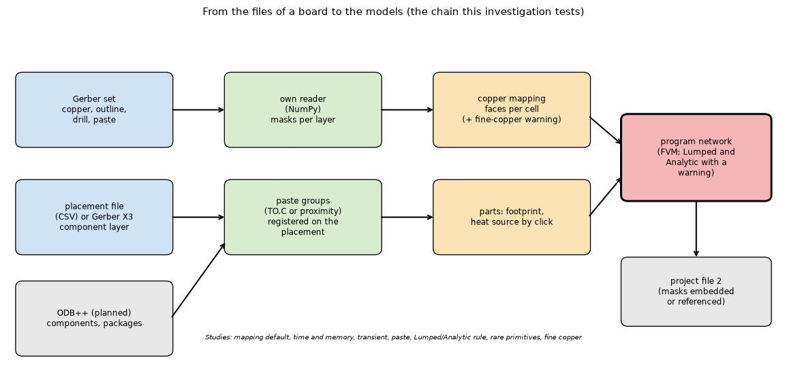
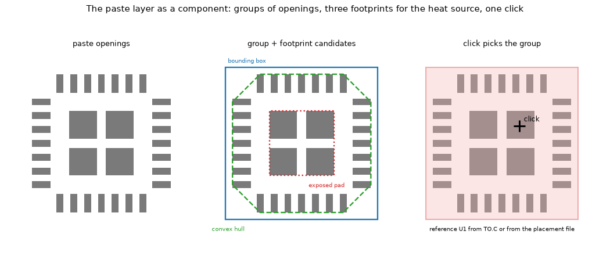
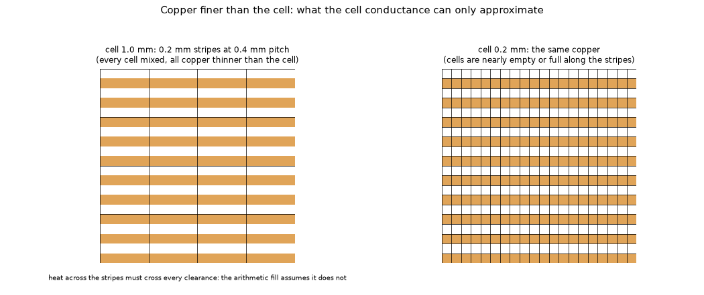
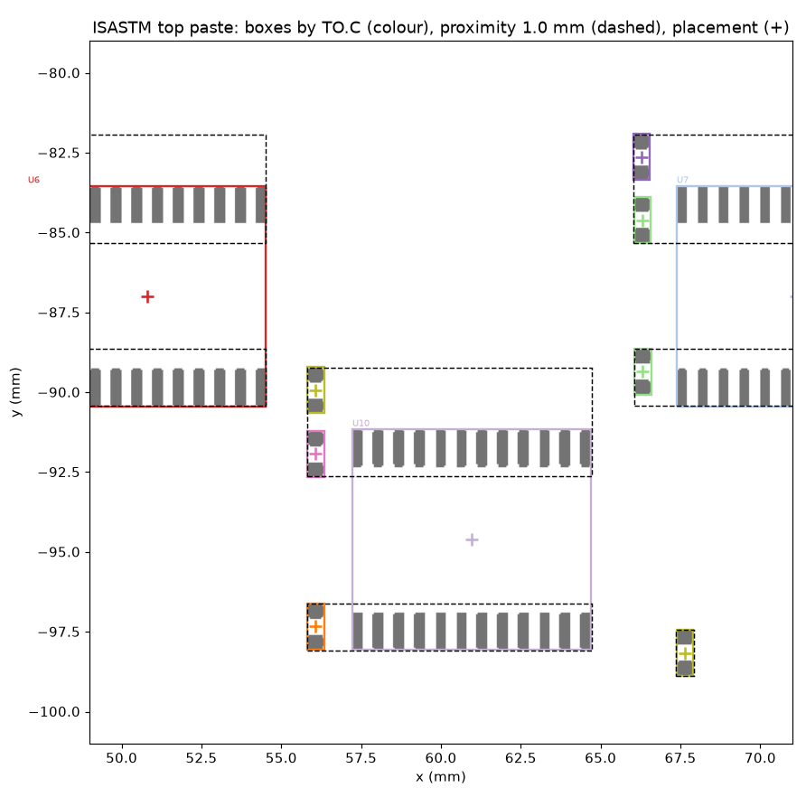
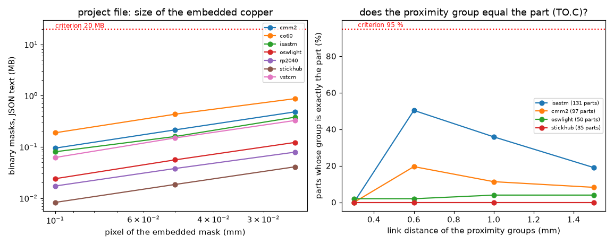
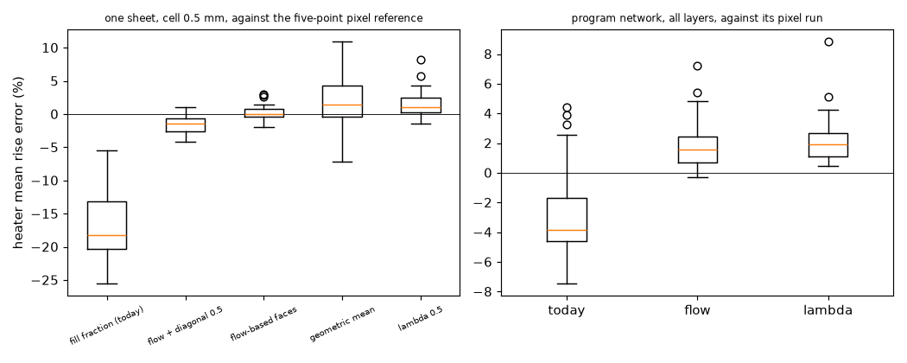
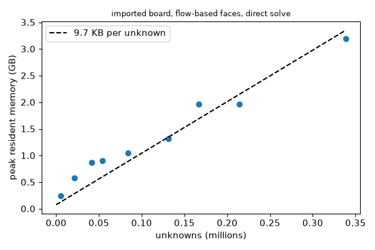
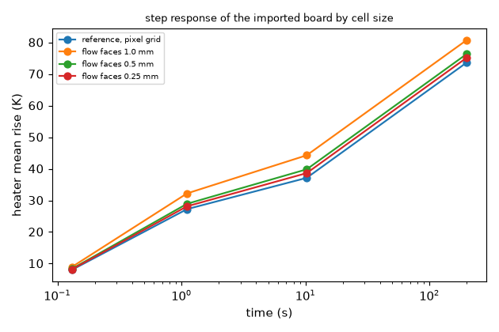
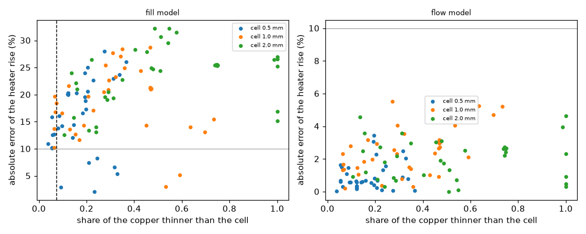

# Real boards: importing a Gerber set without blowing the memory

**Status: both blocks run** (first block: the boards and archives, the folder's tests, the conformance and rare-primitive study 4.6, the ODB++ structure and the paste, placement and X3 parts of 4.4, and the project file 4.8; second block: the fine-copper warning 4.7, the copper mapping 4.1, the Lumped and Analytic rule 4.5, the transient 4.3 and time and memory 4.2). Sections 4.1 to 4.3, 4.5 and 4.7 carry their printed tables; the boards are open boards (section 3), the reference is always another model of the same physics, and no physical measurement exists. Not run: a 0.25 mm cell on a whole board (the estimate was above the 5 GB budget of the machine, section 4.2) and the inputs of figure 9 (the first block's outputs were lost with its worktree; the committed figure stays). Nothing in `pcbthermal/` is changed (the program is only imported). **Reviewed** (section 9): the cheaper studies were re-run and reproduce the quoted numbers; the review corrected several statements (marked "Review:" in the sections) and found one limit that the design must meet before adoption: the flow-based faces and the pixel references run without the laminate rule of 2.4.5, which moves the two-layer windows by up to 7.6 points (section 9.2).

Release theme this serves: **2.5.0, "real boards"**: import a Gerber set (our own reader, no third-party dependency), turn it into the program's model, and do it without exhausting the memory. Decisions of the maintainer that bound the work: our own reader (the independent NumPy reader of `research/gerber-import`, validated pixel by pixel there); no physical board is available yet (so nothing here is a measurement, and the models keep their limits, which the program warns about); tests are local only.

Sections of this README: 1 question and what would answer it; 2 what the earlier research already settled; 3 the boards and the sources; 4 the studies (4.1 to 4.8); 5 how to run; 6 what the preparation found on the way; 7 decisions left to the maintainer; 8 what was read and what was not verified; 9 the review.

## 1. The question, and what would answer it

*Can a real board (several copper layers, hundreds of parts, 0.1 mm tracks) go from its Gerber files to a thermal model in the program, with a stated accuracy and a stated cost, and can the program tell the user when the answer is not to be trusted?*

It breaks into eight questions, each with its own study (section 4):

| Study | Question | What would answer it |
| :-- | :-- | :-- |
| 4.1 copper mapping | Which conductance does an import give each cell by default: the arithmetic fill fraction (what the program does for zones), the flow-based faces, or another? | error of each mapping against a resolved reference on real copper, with the program of 2.4.5 |
| 4.2 time and memory | What does a whole real board cost at 0.5 and 0.25 mm cells, and how many bytes per unknown does the memory guard need now that the laminate nodes exist? | peak resident memory and seconds, phase by phase, in fresh processes, and a fit |
| 4.3 transient | Does the step response of an imported board converge with the cell size, and what is missing for a transient? | step responses at three cell sizes against a pixel-grid reference |
| 4.4 paste, placement, X3, ODB++ | Can the paste layer become component footprints and heat sources by a click, with reference designators and positions from the files? | groups, references, registration, the click, the heat-source shape |
| 4.5 Lumped and Analytic | When should the program warn, and when refuse, to run these two models on imported copper? | their error on real windows against the indicators of fine copper |
| 4.6 conformance and rare primitives | Does our reader agree with the Ucamco test files, and do real files use what it refuses (aperture blocks, LM/LR/LS)? | the files themselves |
| 4.7 fine-copper warning | Which indicator and which threshold say "the copper is finer than the cell"? | a calibration of two indicators on the measured errors |
| 4.8 project file | How big is a project that embeds the imported copper, and does the format migration lose nothing? | sizes on real boards and a round trip |

### 1.1 Diagrams

*Figure 1 (`figures/fig_01_import_chain.png`): the chain this investigation tests, from the Gerber set and the placement data to the program network and the project file. Grey boxes are not built (ODB++ is planned, the project file is a prototype).*

*Figure 2 (`figures/fig_02_paste_to_footprint.png`): a QFN seen from above. Left, the paste openings (perimeter pads and an exposed pad split into four windows, as CAD tools do). Middle, the three footprints a group can give the heat source: bounding box, convex hull, the exposed pad. Right, the click that picks the group, whose reference comes from `TO.C` in the file or from the placement file. Schematic, no data.*

*Figure 3 (`figures/fig_03_fine_copper_cell.png`): the same stripes under a 1 mm and a 0.2 mm cell. At 1 mm every cell is mixed and all the copper is thinner than the cell: the conduction across the stripes is what the cell conductance can only approximate (study 4.7). Schematic, no data.*

The data figures 4 to 7 (mapping errors, memory per unknown, step responses by cell size, the fine-copper threshold) are drawn by `scripts/make_figures.py` from the result files once the studies have run.

*Figure 8 (`figures/fig_08_paste_groups_window.png`): the top paste of ISASTM around three large chips, from the file. Grey, the paste openings; coloured boxes, the parts the file names (`TO.C`), each with its placement origin (+); dashed, the groups found by proximity at 1.0 mm: a chip's two pad rows are two groups, and the capacitor of the next chip joins the pin row beside it (study 4.4, A). **Third-party render**: the openings are drawn from the paste file of Manawyrm/ISASTM (GPL-3.0, https://github.com/Manawyrm/ISASTM); this picture is a render of that design and keeps its licence (GPL-3.0), not the MIT licence of the rest of the folder (noted in `research/README.md`, "Licences"; the maintainer decides whether to keep it or to redraw it from our own synthetic paste file, section 9.6).*

*Figure 9 (`figures/fig_09_project_size_and_links.png`): left, the JSON size of the embedded binary masks against the pixel on the seven boards (study 4.8); right, the share of the named parts that a proximity group reproduces exactly, against the link distance (study 4.4, A). The dotted lines are the success criteria fixed before the run. Review: the figure is the first block's; the review re-ran both studies (the right panel's counts and the left panel's points at 0.1 and 0.05 mm are identical to the digit); the points at 0.025 mm were not re-run (about 6.5 GB on CO60, above the memory allowed), so `make_figures.py` must not be run for this figure without them.*

## 2. What the earlier research already settled (and what this adds)

From `research/gerber-import` and `research/gerber-models` (read for this preparation; their numbers were not re-run here):

* the NumPy-only reader draws the same pixels as gerbonara + shapely, refuses what it cannot do (aperture blocks, transformed apertures, image offset, mirror, scale and rotation, the moire primitive) and reads net names (`TO.N`); the pixel must be at most half the thinnest track; a coverage mask beats a binary one;
* the program's arithmetic fill fraction is biased cool on real copper (clearances cut paths): 16 to 18 % against the program's own pixel run, 24 to 26 % against an independent 3D solution, on seven real windows; the flow-based faces (Sampson's method, not ours) were within 1.1 to 1.5 % (mean) of the pixel run; lambda 0.5 is the cheap alternative; diagonal copper on a coarse grid is the largest residual error, and the diagonal gate did not hold up on held-out windows;
* the program's network takes face conductances without a change of algorithm (`faces.FaceNetwork`, reproducing the program's own formula to 1e-6 K);
* the Lumped and Analytic models were 16 % and 26 % below the FVM on the rectangle board, and no more than a warning is possible for them.

What was **not** done there and is prepared here: a 0.05 mm pixel with the nine-point reference on windows of boards with paste layers; the program of 2.4.5 (laminate rule, point via) in the loop; whole boards at 0.25 mm; the memory per unknown with laminate nodes; the transient of an imported board; the paste layer, the placement files and ODB++; the warn-or-refuse rule for the two simple models; the rare primitives in real files; a detector for fine copper; the project-file format.

## 3. The boards and the sources

Real open boards with **paste layers and a placement file** (found by a search of GitHub through the `gh` tool; licences are the spdx identifiers of the repositories; nothing is stored in this repository, `scripts/fetch_boards.py` downloads into `data/`, which is git-ignored):

| Key | Project | Licence | Layers | What it holds | Status of the facts |
| :-- | :-- | :-- | :-- | :-- | :-- |
| `isastm` | Manawyrm/ISASTM, STM32 ISA-over-USB adapter, KiCad 5.1.6 | GPL-3.0 | 4 | copper (F, In1, In2, B), edge cuts, PTH and NPTH drills, **F_Paste and B_Paste with `TO.C` per part**, `all-pos.csv` (KiCad) and `cpl_jlc.csv` (JLCPCB), a Gerber job file (101.65 x 101.65 mm, 1.6 mm), `.xml` | file list, licence and the heads of the paste, position and job files read (R) |
| `cmm2` | Manawyrm/CMM2-JLC, Colour Maximite 2, revision E | GPL-3.0 | 4 | copper (F, GND, POWER, B), paste, PTH, `all-pos.csv`, `cpl_jlc.csv` | file list and licence (S); size read at fetch |
| `oswlight` | Open-Smartwatch/open-smartwatch-light | GPL-3.0 | 4 | every KiCad layer as `.gbr`, paste, PTH drill, `both_pos.csv`, BOM | file list and licence (S) |
| `rp2040` | tommy-gilligan/RP2040-minimal-design, KiCad 7 | BSD-3-Clause | 2 | copper, paste, PTH, `top-pos.csv`; an exposed-pad QFN | file list and licence (S) |
| `co60` | jmdaly/CO60, 60 % keyboard | CC-BY-SA-4.0 | 2 | large two-layer pours, paste (bottom only), `bottom-pos.csv` | file list and licence (S) |
| `vstcm` | english1234/vstcm, colour vector generator | GPL-2.0 | 2 | copper, empty paste files, `all-pos.csv`, job file | file list and licence (S) |
| `stickhub` | Ucamco's Gerber X3 sample (KiCad 8.99), a USB hub | not stated | 2 | copper, paste with `TO.C`, **an X3 component layer** (reference, footprint, value, rotation, origin, courtyard, pins), job file (16.6 x 40.1 mm), Gerber-format drill | the heads of the component layer, the paste file and the job file read (R) |

Also found, **not** used as boards: brickbots/PiFinder (GPL-3.0) and Duckle29/Vitamins-included (BSD-3-Clause) publish zips only; the other Ucamco archives (`fetch_boards.py --ucamco`): the layer-format test files (21 files, rare primitives), two fabrication examples with **IPC-2581** files (4 and 10 copper layers) and two more X3 samples; ODB++ samples of the library mcix/odbpp (MIT; the archives' own licence is not stated): `sandbox-odb_wifi.tgz` 69 kB, `flat_hierarchy-odb.tgz` 242 kB, `sandbox-odb_pc4.tgz` 630 kB, `video-odb.tgz` 1.2 MB, `designodb_rigidflex.tgz` 11.6 MB (`fetch_boards.py --odb` takes the first three). The licences of GPL boards bind a redistribution of the files, not the statistics a study quotes; no file is committed.

**What the paste layer and the files give** (checked on the real files above, not from the specification): in KiCad output the paste file carries the Gerber X2 component attribute `%TO.C,<ref>*%` before the openings of each part, so the reference designator, the bounding box and the centre of a part are in the file itself; the placement files give reference, value, package, position, rotation and side (KiCad: `Ref,Val,Package,PosX,PosY,Rot,Side`; JLCPCB: `Designator,Val,Package,Mid X,Mid Y,Rotation,Layer`; Altium and EasyEDA use `Mid X`/`Mid Y` with unit suffixes); an X3 component layer adds footprint, value, rotation, the origin of the part, a courtyard outline and the pins. ODB++ holds components, packages and nets in a directory tree (section 4.4, from memory, to be checked on the samples).

## 4. The studies

Every script is run from the repository root with `.venv-research/bin/python research/gerber-real-boards/scripts/<script>` (the Gerber studies use `.venv-research`, see `CLAUDE.md`, "Commands"; the environment is **not** created now). Outputs go to `out/` (git-ignored). Tests: `cd research/gerber-real-boards && ../../.venv-research/bin/python -m pytest -q tests` (the tests on synthetic data need no download; those on the boards are skipped with the message "no board in research/gerber-real-boards/data: run scripts/fetch_boards.py" when `data/` is empty). Run the studies one at a time on a quiet machine: the times and memory would be wrong otherwise.

### 4.1 The default copper mapping of an import (`study_copper_mapping.py`)

* **Question.** For an imported copper layer, which cell conductance is the best default: the arithmetic fill fraction (the program's `Zone.fill` formula applied to each cell), the flow-based faces, lambda 0.5, or the geometric mean? And does half the diagonal coupling help on real windows?
* **Method.** Part A, one conducting sheet (isolates the mapping): 6 windows of 36 mm per board cut from the top copper of every board of section 3 (`onesheet.cut_windows`, the selection rule of `gerber-models`), coverage mask at **0.05 mm** (the earlier studies used 0.1 mm), cells 0.5 and 1.0 mm, 6 mm heater. Part B, the program of 2.4.5 (every copper layer, plated holes as vias, the laminate rule) on 3 windows of 24 mm of each multilayer board, pixel 0.05 mm, cells 0.5 and 1.0 mm: the program as it is (one zone per cell, fill = coverage), the flow-based faces and lambda 0.5 through `faces.FaceNetwork`.
* **Reference.** Part A: the five-point **and the nine-point** pixel solution (`diagonal.pixel_reference9`; the nine-point stencil is closer to the continuum on tilted thin copper). Part B: the program's own network on the pixel grid (`faces.solve_fine`), which is the reference the earlier studies used; an independent 3D solver was the check of that reference in `gerber-models` and is not repeated here.
* **Success criterion** (fixed before the run). The default is the method with the smallest mean absolute error of the heater mean in Part B, provided its worst window is within 10 % and it beats the fill fraction by a factor of 2 in the mean; Part A with the nine-point reference decides ties.
* **Script, tests.** `scripts/study_copper_mapping.py [--quick] [--part A|B]` (about two hours on a quiet 10-core machine with 16 GB; `--quick` is a smoke run); tests: `test_onesheet_and_real_boards.py` (a uniform window gives the same answer for every mapping; stripes across the heat make the fill fraction cooler than the pixel reference and the flow-based faces better).
* **Not verified.** Any measurement on a physical board; copper thickness other than the program's default; a heater other than a 6 mm square on the top layer; the 3D solver as an independent check of Part B (done in `gerber-models`, not repeated); the diagonal gate (its held-out test failed there).
* **Results** (the printed tables of `study_copper_mapping.py`; heater mean rise, error in percent against the reference, mean absolute / maximum absolute / bias).
  **Part A**, one conducting sheet, 36 windows (6 boards, 6 windows each), pixel 0.05 mm, 36 mm window, 6 mm heater, against the five-point reference (the nine-point reference gives the same ranking, differences below 0.4 points):

  | Mapping | cell 0.5 mm | cell 1.0 mm |
  | :-- | :-- | :-- |
  | fill fraction (the program's formula) | 16.83 / 25.58 / -16.83 | 20.07 / 26.99 / -20.07 |
  | flow-based faces | **0.84 / 3.01** / +0.27 | 2.29 / 7.75 / +2.07 |
  | flow-based faces + half the diagonal coupling | 1.60 / 4.10 / -1.52 | **1.08 / 3.88** / -0.20 |
  | lambda 0.5 | 1.79 / 8.26 / +1.50 | 3.04 / 11.88 / +2.87 |
  | geometric mean | 3.28 / 10.95 / +2.24 | 4.45 / 12.63 / +3.60 |

  **Part B**, the program of 2.4.5 on multilayer windows (every copper layer, plated holes as vias, the laminate rule), 6 boards x 3 windows of 24 mm (three four-layer and three two-layer boards), pixel 0.05 mm, against the program's own network on the pixel grid (n = 18 per cell):

  | Mapping | cell 0.5 mm | cell 1.0 mm |
  | :-- | :-- | :-- |
  | today (one zone per cell, fill = coverage) | 3.54 / 6.06 / -2.34 | 4.15 / 7.48 / -3.31 |
  | flow-based faces | **1.14 / 2.97** / +1.09 | **2.53 / 7.22** / +2.53 |
  | lambda 0.5 | 1.50 / 3.23 / +1.50 | 2.92 / 8.85 / +2.92 |

  

  *Figure 4: `figures/fig_04_mapping_errors.png`, boxes of the errors: left, Part A at 0.5 mm; right, Part B with the cells of 0.5 and 1.0 mm pooled (36 values per box; the review corrected this caption, which said 0.5 mm for both).*

* **Against the success criterion.** The flow-based faces have the smallest mean absolute error in Part B at both cell sizes and the worst window is within 10 % (2.97 and 7.22 %). The factor 2 over the fill fraction is met at 0.5 mm (3.54 / 1.14 = 3.1) and **not at 1.0 mm (4.15 / 2.53 = 1.6)**. The honest reading: the faces win everywhere, by a large factor on one sheet (0.84 against 16.8 % at 0.5 mm) and by 1.6 to 3 on the program's multilayer stack, where the other layers, the vias and the laminate hide part of the sheet error. The worst window of the faces in Part B is `vstcm` (42.72, -111.93) at 1.0 mm, +7.2 %.
* **Review: the laminate rule is not the same in the columns of Part B.** The reference (`faces.solve_fine`) and the face networks run with the laminate rule off (`ladder=False`); the column "today" runs the program as it is, rule on. The review ran "today" both ways on the 18 windows (pixel 0.1 mm for memory, scratch script): on the four-layer boards the rule moves it by at most 0.3 point, on the two-layer boards (RP2040, CO60, vstcm) by **up to 7.6 points** (vstcm: rule on +2.0 to +4.8 %, rule off -2.6 to -3.8 %). With the same physics as the reference (rule off), "today" is 3.81 % (0.5 mm) and 4.40 % (1.0 mm) mean absolute, always cool, so the ranking and the factors (about 3.3 and 1.7) hold. What Part B cannot say is how the faces behave **with** the laminate rule, which is the program of 2.4.5 that the import would enter; on two-layer boards the rule's effect is as large as the mapping error (section 9.2).
* **The offset of the held ring (investigated and settled).** The first block found a uniform copper window 16.5 % off at 1 mm for every mapping. A scratch check (a solid 36 mm window, 6 mm heater, held ring 1 mm, pixel 0.1 mm; the script is not kept in the repository) gives the cell model against the pixel reference: **1 mm cell 22.02 K against 21.49 K (+2.5 %), 0.5 mm 21.67 against 21.49 (+0.8 %), 2 mm 19.48 against 19.44 (+0.2 %)**; a pixel reference with the ring narrowed by half a cell gives 21.76 K at 1 mm, so the cause is the one suspected: the held cells carry the ring temperature at their *centre*, half a cell inside the pixel ring. The 16.5 % was a property of the unit test's small board (12 mm, 2 mm heater: the half cell is 8 % of the radius), not of the windows of the studies (36 mm): there the offset is at most 2.5 % and the same for every mapping, so the differences above are the mapping's. It is a property of the scenario (a held ring), not of the program, whose boundary is convective.
* **Not verified.** Any measurement on a physical board; copper thickness other than the default; heaters other than a 6 mm square on the top layer; the reference of Part B is the program's own network on the pixel grid (the 3D solver of `gerber-models` was its check there and is not repeated); the diagonal coupling (it helps on one sheet at 1.0 mm, 1.08 against 2.29, but its held-out gate failed in `gerber-models` and it is worse at 0.5 mm, 1.60 against 0.84: not proposed).

### 4.2 Time and memory of real boards, and the memory per unknown (`study_time_memory.py`)

* **Question.** What does a whole 4-layer board (ISASTM 101.65 x 101.65 mm and the others) cost at 1.0, 0.5 and 0.25 mm cells, by phase (import, faces, assembly, solve), and how many bytes per unknown does the memory guard of 2.5.0 need? The older coefficients predate the laminate nodes: 2.8 KB per unknown for the layered FVM on a plain board (2.7 GB at 992 000 unknowns, `solid3d-verification`), 7 GB per million measured by the maintainer on refined boards, 6.6 to 19.3 KB for the 3D solid.
* **Method.** One fresh child process per case (board, cell) so that the peak resident size is the peak of the case; pixel = cell / 10; coverage masks; the flow-based faces of every layer; the face network; a direct steady solve. Recorded after each phase: seconds and the peak resident size so far; the unknowns of the network and the program's own count with the laminate rule (`fvm.unknowns`, which is ragged: the laminate nodes exist only in cells with absent copper) so that the guard can be fed either; the number of non-zeros.
* **Reference.** The earlier coefficients above; no external reference (it is a measurement).
* **Success criterion.** One coefficient with at most 25 % scatter over the cases, so that the guard can use `baseline + unknowns x coefficient`; otherwise the guard needs the structure (layers, non-zeros). A case whose peak is close to the physical memory is flagged (it may have paged).
* **Script, tests.** `scripts/study_time_memory.py [--cells 1.0 0.5 0.25] [--boards isastm cmm2 oswlight] [--max-gb 12]`; tests: `test_fine_memory_format_odb.py` (the fit recovers a known coefficient and refuses empty input; the peak size is read).
* **Not verified.** Paging effects; other machines; the 3D solid on an imported board; the GUI process on top of the calculation process; the layered models' time at one million or more unknowns on these boards beyond the cases run.
* **Results** (nine cases, one fresh process each, 4-layer boards, pixel = cell / 10; seconds by phase; the peak is the resident size after the solve; another light job ran on the machine):

  | Board | cell (mm) | pixel (mm) | unknowns of the faces | program count (`fvm.unknowns`) | non-zeros | import (s) | faces (s) | solve (s) | peak (GB) | peak after import (GB) |
  | :-- | --: | --: | --: | --: | --: | --: | --: | --: | --: | --: |
  | oswlight 36 x 36 mm | 1.0 | 0.1 | 5 476 | 9 583 | 38 428 | 1 | 0 | 0 | 0.24 | 0.10 |
  | oswlight | 0.5 | 0.05 | 21 316 | 37 303 | 149 352 | 1 | 2 | 0 | 0.58 | 0.15 |
  | oswlight | 0.25 | 0.025 | 84 100 | 147 175 | 590 294 | 2 | 8 | 1 | 1.04 | 0.38 |
  | oswlight | 0.2 | 0.02 | 131 044 | 229 327 | 929 202 | 2 | 12 | 1 | 1.31 | 0.54 |
  | isastm 102 x 102 mm | 1.0 | 0.1 | 41 616 | 72 828 | 283 982 | 7 | 4 | 1 | 0.86 | 0.30 |
  | isastm | 0.5 | 0.05 | 166 464 | 291 312 | 1 117 124 | 8 | 14 | 5 | 1.96 | 1.00 |
  | isastm | 0.35 | 0.035 | 338 724 | 592 767 | 2 299 726 | 9 | 27 | 6 | 3.20 | 1.94 |
  | cmm2 131 x 103 mm | 1.0 | 0.1 | 53 972 | 94 451 | 388 670 | 7 | 5 | 1 | 0.90 | 0.30 |
  | cmm2 | 0.5 | 0.05 | 214 020 | 374 535 | 1 630 974 | 9 | 19 | 3 | 1.96 | 0.89 |

  Fit through the origin on the unknowns of the faces (baseline 78 MB removed): **9.7 KB per unknown** with a largest deviation of 211 % (the small cases: the constant costs of the importer and of Python dominate), **9.4 KB with 20 % deviation on the four cases above 100 000 unknowns**; on the program's own count the fit is 5.5 KB per unknown.

  

  *Figure 5: `figures/fig_05_memory_per_unknown.png`, peak against the unknowns of the faces with the fit through the origin of all nine cases.*

* **Where the peak comes from.** The solve phase adds 0.01 to 0.2 GB over the faces phase; the peak is set by the importer's rasters (the import phase alone is 0.30 / 1.00 / 1.94 GB for ISASTM at 1.0 / 0.5 / 0.35 mm, about 55 bytes per pixel per copper layer; with pixel = cell / 10 that is about 5.5 KB per cell and layer) plus the face construction (a further 1.3 GB on ISASTM at 0.35 mm). The raster is a cost of the import that the memory law of `research/memory-guard` does not contain.
* **Against the law of `research/memory-guard` (README 14.2, FVM, continuous law `1469 t_eff^0.79 N (N / 500 000)^0.24` bytes, t = 4, N the program's count, plus an assumed base of 0.3 GB).** Ratio measured / law: 0.77 (oswlight 1.0 mm), 1.72 (ISASTM 1.0), 1.56 (cmm2 1.0), 1.50 (oswlight 0.5), 1.38 (ISASTM 0.5), 1.33 (oswlight 0.25), 1.16 (oswlight 0.2), 1.07 (cmm2 0.5), **1.06 (ISASTM 0.35, 593 000 unknowns)**. So from about 150 000 unknowns the import's whole peak is within the law's safety factor of 1.40, but below 100 000 unknowns it is up to 1.7 times the law (the raster and fixed costs). The law was measured on the program's own path (`fvm.Network`, no importer); this study measured the research pipeline (importer plus face network in one process), so what is compared is the peak of an import against the solver's law, not the same code: the program's solve of an imported board is not measured here. The assumed base of 0.3 GB moves the ratios of the small boards. **Review:** the base that `research/memory-guard` measured for the calculation process is 0.108 GB, not 0.3; with it the ratios are 1.13 to 2.98 and only three of the nine cases are inside the factor 1.40 (CMM2 0.5 mm 1.19, the Smartwatch at 0.2 mm 1.39, ISASTM 0.35 mm 1.13); ISASTM at 0.5 mm (291 000 unknowns of the program) is 1.59. The phase table also shows that the face construction, not the raster alone, sets the peak (ISASTM 0.35 mm: import 1.94 GB, faces 3.20 GB; CMM2 1.0 mm: 0.30 and 0.84 GB). The conclusion (the guard of an import needs its own terms) is stronger than stated, and the terms must be re-measured on the program's implementation, not on this research pipeline.
* **Against the success criterion.** One coefficient with at most 25 % scatter: **met only above 100 000 unknowns** (9.4 KB, 20 %); below that the guard needs a term in the pixels, `baseline + 55 x layers x pixels + k x unknowns`.
* **Not run.** A whole board at 0.25 mm (ISASTM would be about 6 GB by the 55 B and 9.4 KB figures, cmm2 and CO60 more: above the 5 GB budget set for this session on a 16 GB machine shared with other jobs), CO60, RP2040, vstcm; the 3D solid on an imported board; paging. The importer reaching 6.5 GB on CO60 at 0.025 mm in the first block agrees with the raster figure: 285 x 95 mm at 0.025 mm is 43 million pixels per layer.
* **Not verified.** Other machines; the GUI process on top of the calculation process; the layered models at one million unknowns or more on these boards.

### 4.3 The transient of an imported board with fine cells (`study_transient_fine.py`)

* **Question.** Does the step response of the heater converge with the cell (1.0, 0.5, 0.25 mm), and is the heat capacity of the copper a problem?
* **Method.** A 30 mm window of a multilayer board, a 4 mm heater of 1 W stepping on, the program's transient machinery (implicit Euler, doubling steps) on the pixel grid (reference) and on the flow-based face networks, each with the capacity of the face network as it comes and with the copper capacity set from the coverage (`boardrun.set_capacity`).
* **A finding of the preparation.** The face network of `research/gerber-models` has no zones, so the program computes its capacity as bare laminate (no copper). This does not matter for the steady state and does matter for a transient: copper is up to a sixth of a board's capacity per layer pair. The study measures how much it moves the time constant; if it is over 5 % the import must set the capacity.
* **Reference.** The pixel-grid network (0.1 mm); a closed form for the time constant exists only for a rectangle (`fvm.board_time_constant`), not for imported copper.
* **Success criterion.** Step responses at 0.5 and 0.25 mm within 3 % of the reference at 0.1, 1, 10 s and the end, and within 2 % of each other.
* **Script, tests.** `scripts/study_transient_fine.py [board] [--quick]` (about 20 minutes); no separate test (the pieces are tested in 4.1 and 4.2).
* **Not verified.** A measured step response; power profiles (square waves) and the animation on imported boards; computed heat transfer coefficients (h is typed, 10 W/m2K).
* **Results** (`study_transient_fine.py`, ISASTM, 30 mm window, 4 mm heater of 1 W, reference = the pixel network at 0.1 mm; heater mean rise): reference 7.99 K at 0.1 s, 27.24 K at 1.1 s, 37.14 K at 10.2 s, 73.66 K at 200 s, time constant 57.1 s, steady 102.27 K (review: this steady value and the time constant are of the **hottest cell**, `steady_t_max`; the steady heater mean is 88.84 K). Difference of the face network from the reference (percent of the rise at 0.1, 1.1, 10.2 and 200 s; time constant):

  | Cell | copper capacity set | differences | time constant | steady-state offset of the hottest cell |
  | :-- | :-- | :-- | :-- | :-- |
  | 1.0 mm | yes | +11.6, +18.3, +19.2, +9.7 % | -9.8 % | +3.6 % |
  | 0.5 mm | yes | +4.0, +6.2, +7.3, +3.7 % | -2.7 % | +1.0 % |
  | 0.25 mm | yes | +2.1, +3.3, +4.0, +2.1 % | -4.7 % | +1.8 % |
  | 1.0 mm | no (bare laminate capacity) | +13.7, +19.3, +20.0, +11.5 % | -16.2 % | +3.6 % |
  | 0.5 mm | no | +5.9, +7.1, +8.0, +5.5 % | -9.7 % | +1.0 % |
  | 0.25 mm | no | +3.8, +4.2, +4.8, +3.9 % | -11.7 % | +1.8 % |

  

  *Figure 6: `figures/fig_06_transient_by_cell.png`, the heater's mean rise against time for the pixel reference and the three cells (copper capacity set).*

* **Findings.** (1) The coarse network is too fast in the early response: +18 to +19 % at 1.1 and 10 s with 1.0 mm cells, +6 to +7 % at 0.5 mm, +3 to +4 % at 0.25 mm; the error roughly halves with each halving of the cell. Part of it is the steady offset of the cell model, but at 10 s the excess is larger than the steady offset, so the cell size matters in time more than at rest (review: the "+1 to +3.6 %" and "two to five times" compared a hottest-cell offset with heater-mean differences; with the heater mean the steady offset is +8.0 / +3.1 / +1.7 % and the 10 s excess about 2.4 times it, see below). (2) **Leaving out the copper's heat capacity moves the time constant by 6.4 to 7.0 points** (-9.8 against -16.2, -2.7 against -9.7, -4.7 against -11.7) and the early rise by 1 to 2 points: above the 5 % that the study set, so an import must set the capacity from the coverage. (3) **The criterion (within 3 % at 0.5 and 0.25 mm of the reference, and within 2 % of each other) is not met** at 0.5 mm (up to 7.3 %) and nearly at 0.25 mm (up to 4.0 %): a transient of an imported board wants 0.25 mm cells for a few percent, or the user accepts 7 to 20 % early excess at 0.5 and 1.0 mm.
* **Review: two corrections to the reading.** (a) The "steady-state offset" of the table is of the hottest cell, while the differences in time are of the heater mean. The steady heater-mean offsets, measured by the review on the same window (steady solves of the same networks, scratch script), are **+8.0 % (1.0 mm), +3.1 % (0.5 mm), +1.7 % (0.25 mm)**; the excess at 10 s is about **2.4 times** the steady heater-mean offset at every cell (not two to five times), and at 200 s the differences (+9.7, +3.7, +2.1 %) are close to it. (b) The cells are imported at pixel = cell / 10 (0.1, 0.05 and 0.025 mm) while the reference is drawn at 0.1 mm, more than half the thinnest track of ISASTM (0.09 mm), against the rule of `gerber-import`. The mask pixel alone moves the 1.0 mm network's steady heater mean by +1.2 % (0.1 to 0.05 mm) and +1.7 % (0.1 to 0.025 mm), so the rows of 0.5 and 0.25 mm compare a finer copper image with a coarser reference: part of their offset (and the non-monotone time constant, -2.7 % at 0.5 mm, -4.7 % at 0.25 mm) may be the reference, not the cell. A reference at 0.05 mm (1.44 million unknowns in a transient) was not run: the study peaked at **9.1 GB** with the reference at 0.1 mm (`out/transient_fine.json`, not stated before). The two qualitative findings stand (the copper capacity must be set; a coarse cell is fast early), the percentages at 0.5 and 0.25 mm are uncertain by about 1 to 2 points.
* **Not verified.** One board, one window, one heater position; a measured step response; power profiles (square waves) and the animation on imported boards; computed heat transfer coefficients (h typed, 10 W/m2K); the cause of the early excess (not isolated); a reference whose mask resolves the thinnest track.

### 4.4 Solder paste, reference designators and positions, X3 and ODB++ (`study_paste_footprints.py`, `study_odb_structure.py`)

* **Question.** Can a paste polygon become a component footprint and a heat source by a click (and automatically for every part), and where do the reference designators and positions come from?
* **Method.** (A) Pad groups: `paste.by_proximity` (openings closer than a link distance of 0.3, 0.6, 1.0 or 1.5 mm are one group) and `paste.by_reference` (the `TO.C` attribute, by rewriting `TO.C` to the net attribute the reader already keeps per object); how the two agree. (B) Placement files (`pnp.read_placement`: KiCad CSV and text, JLCPCB, Altium, EasyEDA variants): `pnp.register` finds the translation and the sign of Y from the data (a histogram vote), then counts the parts within 0.5, 1 and 2 mm of a group and compares the references of the placement file with those of `TO.C`. (C) The click: `paste.pick` on every group. (D) The heat-source shape: 1 W on the three biggest groups as the bounding box, the convex hull and the largest opening, at 0.5 mm cells with the flow-based faces, comparing the hottest cell and the mean over the bounding box. (E) The X3 component layer (`x3.components`) against the paste references. (F) ODB++: `study_odb_structure.py` prints what the three small sample archives hold (steps, layers of the matrix, components with package, side and position, the profile, whether `eda/data` and netlists exist) and stops when a components file exists and the reader found nothing.
* **Reference.** The files themselves: references written in two independent places (the paste file and the placement file) must agree; the picture of the click is checked on every group.
* **Success criterion.** With the best link distance at least 95 % of the references of `TO.C` land in exactly one group; at least 90 % of the placement parts are within 2 mm of a group of their side after registration; the click at the centre of the largest opening picks the right group in 100 % of the trials; the footprint choice moves the hottest cell by a figure the README can state (the choice is then the maintainer's). ODB++: components with references, positions and a side in every sample that has them.
* **Script, tests.** `scripts/study_paste_footprints.py [board ...]` (about 15 minutes), `scripts/study_odb_structure.py` (seconds); tests: `test_paste_pnp.py` (synthetic paste file with two parts, link distances, shapes, the click, four placement formats, the registration of a shifted and flipped list, an X3 part) and `test_fine_memory_format_odb.py` (the ODB++ record layout as written from memory), plus the board tests, skipped without data.
* **Not verified.** Parts with no paste opening (through-hole, bottom parts of a board with a top-only paste file, parts glued instead of soldered); rotated large parts whose bounding box is much larger than the hull; the junction temperature (the paste group gives a footprint, not a package); the position frame of an ODB++ job against its Gerber (no Gerber set of the sample jobs is available); **IPC-2581 is not read at all** (two `.ipc` examples exist in the Ucamco fabrication examples). The ODB++ record layout in `lib/odb.py` is from memory and the specification was not obtained (it needs a registration).
* **Results (first block; `out/paste_footprints.json`, `out/odb_structure.json`; the pictures are figures 8 and 9).**

  *A. Groups by proximity do not give the parts; the reference written in the file does.* A part is *intact* when one proximity group holds all of its paste (its box covered to 95 %) and the centre of no other part:

  | Board, side (parts named by `TO.C`) | link 0.3 mm | 0.6 mm | 1.0 mm | 1.5 mm |
  | :-- | --: | --: | --: | --: |
  | ISASTM top (131) | 0 of 766 groups | 66 (50 %) of 160 | 47 (36 %) of 86 | 25 (19 %) of 55 |
  | CMM2 top (97) | 0 of 477 | 19 (20 %) of 188 | 11 (11 %) of 54 | 8 (8 %) of 41 |
  | Smartwatch light top (50) | 1 (2 %) of 175 | 1 (2 %) of 121 | 2 (4 %) of 20 | 2 (4 %) of 13 |
  | StickHub (Ucamco X3) top (35) | 0 of 96 | 0 of 10 | 0 of 6 | 0 of 6 |

  The success criterion (95 % of the named parts in exactly one group) **fails by a wide margin at every link distance on every board**: a small link splits a part into its pads, and even 1.0 mm cuts a large chip's two pad rows into two groups (figure 8), a large one merges a part with its neighbours (a decoupling capacitor with the pin row of the chip next to it; on the two dense boards one group is nearly the whole board, bounding box 666 and 409 mm2). Where the file names its parts, `paste.by_reference` gives the part itself. Where it does not (RP2040 KiCad 7 export, CO60, vstcm: no `TO.C` at all) only proximity remains, and it is approximate; this is a finding about the *files*: three of seven open boards do not write the attribute (the exporter option is off by default in some KiCad versions; not verified which).

  *B. Placement files against the named groups.* By reference designator (no registration at all): ISASTM top 131 of 131 names in both files, the placement origin is 4 micrometres from the centre of the part's paste in the median, 129 of 131 within 0.5 mm (the other two, 2.5 mm, are large parts whose origin is not the paste centre); CMM2 top 96 of 97 (the missing one, J8, is in the paste file and not in the placement file), median 1.2 micrometres, 95 within 0.5 mm; Smartwatch light: all 43 parts of the placement file are named in the paste, 43 within 0.5 mm (review: the paste names 50; J1, SW1, SW2, SW4, SW5, U5 and U7 are in the paste file and not in the placement file). The offset between the frames found from the names is zero (below 3 micrometres) on every board and the signs are `+1, +1`; **the exception is the bottom side of KiCad's combined position file: its X is mirrored** (ISASTM bottom, 3 parts, sx = -1, then 3 of 3 within 7 micrometres); the JLCPCB-style files of CMM2 are not mirrored. (Review: the mirrored X of the bottom side is, from memory and not checked, KiCad's export option "use negative X coordinates for footprints on the bottom layer", on in this file; the program should find the sign from the names, as `by_reference_check` does, not assume it.) The data-driven registration of `pnp.register` on the centres of *unnamed proximity groups* is **not reliable** (review: the numbers below at link 0.6 mm were not printed by the script, which registered only at 1.0 mm; it now prints the registration and the identity count at every link, and the numbers are reproduced: CMM2 top at 0.6 mm (+0.025, +2.286) mm, 25 of 96 within 1 mm against 87 of 96 with the identity frame; at 1.0 mm (0.000, 0.000) and 29 of 96 for both): against the true offset of zero it returned 0.025/2.29 mm on CMM2 (wrong, and worse than doing nothing: 26 % of the parts within 1 mm against 91 % with the identity) and -0.79/0.00 mm on the Smartwatch (wrong), and was right (offset below 0.03 mm, the same as the identity) on ISASTM and RP2040; on CO60 bottom (no names) it gave 0.003 mm at link 1.0 and 0.75 mm at link 0.6, and on the Smartwatch -13.2/-7.7 mm at link 1.0: the answer moves with the link distance, which a registration must not do. A control that shifts the placement by 3 to 15 mm gives 5 to 19 % of the parts "within 1 mm" of some group by chance, against 26 to 81 % at the registered offsets (91 % with the identity on CMM2), so the proximity match is a weak check, the named one a strong one. The test of the folder was changed accordingly (the registration test failed on the first run: 47 of 131 matched).

  *C. The click.* On the named groups of ISASTM top, 655 of 655 clicks at random lit paste pixels give the right part (smallest containing box); on the proximity groups, the centre of the largest opening gives its own group in 519 of 519 trials over all boards and sides, and random points of the bounding box in 2591 of 2595 (the 4 failures are a small group's box inside a larger one: `overlapping_boxes` is 4 on ISASTM, 16 of 20 on the Smartwatch).

  *D. What the footprint choice does to the answer* (1 W on the three largest proximity groups, 30 mm window of the board at 0.5 mm cells, flow-based faces on the program network; the temperatures are the rises printed by the script, in K for 1 W): the hottest cell under a bounding box is 65.8 / 67.8 / 67.8 K (ISASTM) and 63.2 / 67.8 / 71.2 K (CMM2); under the convex hull it is +5.0 / +1.3 / +0.7 % and +2.8 / +0.6 / -0.8 %; under only the largest opening (0.3 to 3 mm2 of an area that really is 15 to 20 mm2 of paste) it is 109 to 277 K, **1.6 to 3.9 times** higher, which is a measure of how wrong a single opening is as a heat source, not of the board. The mean over the bounding box moves only 1 to 7 % between the three shapes. Nothing here says which is right (no measurement); it says the choice between bounding box and hull is a few per cent and the largest opening must not be offered as the part. **Review (all boards of the run, not only ISASTM and CMM2):** the hull against the box is -0.8 to +6.0 % (the Smartwatch +2.6, +5.6, +6.0 %); the largest opening alone is 1.97 to 2.22 times on the Smartwatch, but **1.23 times on the RP2040 QFN** (its exposed pad holds most of the paste) and 1.00 to 1.06 on groups of one opening (StickHub, two RP2040 groups). So the factor 1.6 to 3.9 is the case of parts with many similar pads; for an exposed-pad package the exposed pad is a physical candidate (most of the heat enters the board there), but a single paste window of a split pad is not: an "exposed pad" shape would be the union of the windows inside the central pad, which was not studied.

  *E. The X3 component layer* (StickHub, Ucamco sample): 35 parts, all 35 with origin, courtyard and pins, all 35 present in the paste file and no paste reference missing from the component layer; the courtyard area is 1.50 times the box of the paste in the median. It carries the reference, footprint, value and rotation; and the specification (read, below) adds `.CHgt` (height), `.CMnt` (mount type SMD / TH) and the outline types Body, Lead2Lead, Footprint and Courtyard, which none of the downloaded samples use beyond the courtyard and pins (not counted here).

  *F. ODB++ structure* (three small sample archives of mcix/odbpp; sizes 67 to 236 kB as downloaded; licence of the archives not stated; used for the structure only). The record layout of `lib/odb.py` written from memory **worked unchanged**: no component file was left unread and no correction was needed. Components with reference, part, position, rotation, side and mirror flag, and pins:

  | Archive | Components (top / bottom) | Unit | Components inside the step profile box | Pins | With `.comp_height` | With a body description |
  | :-- | --: | :-- | --: | --: | --: | --: |
  | `flat_hierarchy-odb` (KiCad export) | 64 (64 / 0) | mm | 64 of 64 | 247 | 0 | 0 |
  | `sandbox-odb_pc4` (Altium) | 199 (99 / 100) | inch | 199 of 199 | 1313 | 199 | 198 |
  | `sandbox-odb_wifi` (Altium) | 28 (11 / 17) | inch | 28 of 28 | 198 | 28 | 0 |

  **The component layers, the paste layers and the copper are in one frame and no registration exists to do**: on the bottom side of `pc4` 522 of 522 pins and on `wifi` 98 of 98 pins sit within 1.5 micrometres of a flash of the bottom paste layer; on top 531 of 791 and 48 of 100 pins sit on a paste flash (the rest are through-hole pins, which have no paste), and 661 of 791 and 74 of 100 on a flash of the top copper (the others are through-hole pins drawn as other symbols, not checked). The matrix lists the dielectric layers (`dielectric*`) and the physical order of the copper layers (`Layer_Physical_Order`), so a stack-up order is in the job; whether thicknesses are (not looked at). The compressed members (`.Z`) did not occur in these three archives. What is **not** verified: the frame of an ODB++ job against its own Gerber output (no Gerber set of these jobs), any record kind the three archives do not use, and IPC-2581.

### 4.5 Lumped and Analytic on imported copper: warn or refuse (`study_lumped_analytic_rule.py`)

* **Question.** The two simple models were 16 % and 26 % below the FVM on the rectangle board. On real windows, can an indicator tell when they are unusable, so that the program refuses above a threshold and warns between two?
* **Method.** 24 mm windows of every board, cell 1.0 mm, the imported window turned into one zone per cell with the coverage as fill (the only description these two models take), `lumped.solve_steady` and `analytic.solve_steady` against the face-conductance network and the pixel run; the error is set against `fine_copper.indicators` (partial_share, thin_share), the copper fraction and the heater-block fraction, with `fine_copper.calibrate` at a 15 % error limit.
* **Success criterion.** A rule on one indicator that separates the windows with error above 15 % from the rest with recall at least 0.9 for the warning and no refused window below 25 % error; if no indicator does, the rule is "always warn, never refuse" and this README says so.
* **Script.** `scripts/study_lumped_analytic_rule.py [--quick]` (about 30 minutes).
* **Not verified.** Non-rectangular outlines (the two models use the equivalent rectangle), parts with a top path, large via arrays; the models are run as the program runs them for zones, not on the face conductances.
* **Results** (`study_lumped_analytic_rule.py`, 24 windows of 24 mm, 6 boards x 4, cell 1.0 mm; each imported window turned into one zone per cell with the coverage as fill; error of the heater mean against the pixel network ("fine") and against the face network ("faces")):

  | Model | against the pixel network: mean (range) | against the face network: mean (range) |
  | :-- | :-- | :-- |
  | Lumped | -6.0 % (-1.4 to -12.4) | -7.8 % (-3.6 to -14.2) |
  | Analytic | -6.3 % (-0.9 to -15.7) | -8.1 % (-3.1 to -17.5) |

  Every window is cool (both models are below the references everywhere); only **one** window of 24 passes the 15 % limit for the Analytic (RP2040 at (75.2, -110.7): -15.7 % and -17.5 %; the Lumped there is -12.4 and -14.2 %), none for the Lumped. Correlation of the Lumped error with the indicators: heater block copper fraction 0.76, copper fraction 0.61, partial share of the top layer -0.37, thin share -0.27. The calibration at the 15 % limit has no bad case for the Lumped and one for the Analytic (partial share threshold 0.79, recall 1.0, false alarms 0.26 on one bad window: no statistics).
* **Against the success criterion.** A rule that separates windows above 15 % cannot be built from one bad window. The data say instead that **the error is systematic (always cool, 1 to 16 %), so the rule is "always warn, never refuse"**, with the text "the Lumped and Analytic models read 1 to 16 % cool on imported copper (6 % on average in the windows tried)"; the heater block's copper fraction follows the error best (correlation 0.76: the less copper under and around the heater, the larger the shortfall) if a graded message is wanted, but there is no threshold in the data.
* **Not verified.** Non-rectangular outlines (the two models use the equivalent rectangle), parts with a top path, large via arrays, cells other than 1.0 mm; the models are run as the program runs them for zones, not on the face conductances; 24 windows of 6 boards.

### 4.6 Conformance with the Ucamco test sets and the rare primitives (`study_conformance_rare.py`)

* **Question.** Does our reader agree with Ucamco's own test files and with a second reader (gerbonara + shapely), and do real files use the features it refuses (aperture blocks `AB`, the transformations `LM`, `LR`, `LS`, the moire primitive)?
* **Method.** Every Gerber file of the Ucamco archives and of the open boards: read or refused (with the message), copper area at 0.05 mm against the second reader, and a text count of the rare features (`rare_features.count`) over all real files. Earlier, 161 of 164 comparable gerbonara test files agreed within 3 % and 6 were refused (`gerber-import` 4.17): this extends it to the specification's own tests.
* **Success criterion.** Every Ucamco test file is read with the area within 3 % of the second reader or refused with a specific message (never silently wrong); the real board files use none of `AB`, `LM`, `LR`, `LS`.
* **Script, tests.** `scripts/study_conformance_rare.py` (minutes); `test_fine_memory_format_odb.py::test_rare_feature_counts`, `test_onesheet_and_real_boards.py::test_every_board_has_its_files_and_reads`.
* **Not verified.** The Ucamco pictures (`.png`, the correct renderings) are not compared, only the area; polarity-changing files with transformed apertures beyond what the area shows; Excellon files; the drill in the Gerber format that KiCad's X3 output writes (a plated-hole file with `TF.FileFunction,Plated,...` as `.gbr`): the importer's drill reader is written for Excellon, so `registry.roles` keeps such files apart (`drills_gerber`) and the study reports them.
* **Results (`out/conformance_rare.json`; the data of the table are the printed lines of the run).** 115 Gerber files were read (the 11 `.gbr` of the layer-format test set, the 32 files of the two fabrication examples, the 30 of two X3 samples and the 42 of the seven open boards); **2 were refused with a specific message, 108 were compared with gerbonara + shapely, 105 agree within 3 %**.

  | Class | Files | Refused | Compared | Within 3 % | Largest difference |
  | :-- | --: | --: | --: | --: | --: |
  | Ucamco layer-format tests | 11 | 2 | 8 | 6 | 108.9 % (see below) |
  | Ucamco fabrication examples 1 and 2 (the second reader needed a transcoded copy: Latin-1 bytes in comments) | 32 | 0 | 32 | 32 | 0.57 % |
  | Ucamco X3 samples (two) | 30 | 0 | 29 | 29 | 2.36 % (an outline file) |
  | open boards (seven) | 42 | 0 | 39 | 38 | 4.53 % (an outline file) |

  The files that are not within 3 %: **(1)** the two refused files are the specification's own `Block_with_different_orientations` and `Nested_blocks` (the `AB` aperture block with `LM`, `LR`, `LS`): the refusal message is `AB (aperture blocks and transformed apertures) is not supported`, never a wrong area. **(2)** `sample_macro.gbr` and its X1 twin: our area 8.35 mm2 against 4.00 mm2 of the second reader (+109 %). The reference picture of the test set (`sample_macro.png`, drawn by Ucamco) shows hatched background areas made by step-and-repeat (`SR`) and the thermal macros with round strokes: our rendering reproduces those (the picture was set beside ours and beside gerbonara's), gerbonara's rendering lacks the hatch (it ignores `SR` here) and draws the round-stroke thermals as crosses. So **here our reader agrees with the specification's own picture and the second reader does not**; the comparison with the picture was by eye, not by pixels. **(3)** the outline file of CO60 (-4.53 %) and of two other boards (-2.4 %, -1.0 %): an outline is a stroke, its "area" depends on the stroke handling of the two readers and is not used for the import (the box and the polygon are).

  A silent failure found on the way (not in the table): `Two_square_boxes.gbr` is two squares drawn with a 0.01 mm line; at the study's 0.05 mm pixel with a supersampling of 2 our reader returns an **area of 0.00 mm2** (no stroke touched a sample), at 0.01 and 0.005 mm 0.400 mm2 (the exact value, perimeter 40 mm times 0.01). It is the "pixel at most half the thinnest track" rule of `gerber-import`, but nothing in the reader says so: the importer must take the pixel from the thinnest feature or warn when the layer has a feature thinner than the pixel. **Review:** the loss depends on where the samples fall, not only on their number: at the same 0.05 mm pixel with a supersampling of 4 (the importer's default) the same file gives **0.50 mm2 (+25 %)**, because one row of samples lands on the line and counts a whole sub-pixel of 0.0125 mm; at 0.02 mm with 2 it gives 0.400. A feature thinner than the sample spacing (pixel / supersampling) is lost or inflated at random; `tests/test_fine_memory_format_odb.py::test_line_thinner_than_the_sample_spacing_is_lost_or_inflated` holds both cases. The importer's own warning (`time_memory.json`: "the thinnest aperture is 0.090 mm, under two pixels: coverage masks keep its area") is right only while the aperture is wider than the sample spacing.

  **Rare features in the real files** (text count): `AB`, `LM`, `LR`, `LS` occur **only** in the layer-format test set (1 to 2 files); the moire macro, negative image polarity and the deprecated commands (`OF`, `MI`, `SF`, `IR`, `AS`) occur in **none** of the 115 files; `SR` in the two macro samples only; the polygon aperture `P` in 7 files, region `G36` in 46 and arcs in 37, X2 file attributes in 102 files, the net attribute `TO.N` in 24, the component attribute `TO.C` in 40 and the pin attribute `TO.P` in 20. So the refusals cost nothing on the boards available here, and the reading of the aperture block (spec section 4.11, read below) is an item for later, not for 2.5.0.

### 4.7 The fine-copper warning (`study_fine_copper_warning.py`)

* **Question.** Which indicator, and which threshold, says that the copper of a layer is finer than the cell and the result is approximate?
* **Method.** The one-sheet physics of 4.1 on windows of every board at cells 0.5, 1.0 and 2.0 mm; two indicators on the same coverage mask: `partial_share` (the share of the copper in cells that are neither empty nor full) and `thin_share` (the share of the copper that disappears under an opening with a disc of the cell's half-width); `fine_copper.calibrate` gives, for error limits of 5 and 10 %, the threshold that warns about at least 90 % of the bad cases and the share of good cases warned too; the heater-block copper fraction is the simple rival.
* **Success criterion.** One indicator with recall 0.9 and false alarms under 0.3 for the 10 % limit at all three cell sizes with one threshold; a threshold that moves with the cell is a function of the cell and the warning must say so (graded warning).
* **Script, tests.** `scripts/study_fine_copper_warning.py [--quick]` (about an hour); `test_fine_memory_format_odb.py` (solid copper is not fine, stripes are, the same stripes are not fine for a cell as narrow as they are, the calibration recovers a known threshold).
* **Not verified.** Other heater sizes; other copper thicknesses; the multilayer stack (a layer under another is less sensitive: this is the one-sheet error, an upper bound); tilted copper (the indicator does not look at direction, and the diagonal residual of `gerber-models` 4.42 is a different failure).
* **Results** (`study_fine_copper_warning.py`, 108 cases: 6 boards x 6 windows of 36 mm = 36 windows, each at the cells 0.5, 1.0 and 2.0 mm, pixel 0.05 mm, one-sheet physics, error of the heater mean against the five-point pixel reference; the `--quick` run of 36 cases gave the same picture):

  | Cell | fill model error: mean (range) | flow model error: mean, largest absolute |
  | :-- | :-- | :-- |
  | 0.5 mm | -16.2 % (-28.0 to -2.1) | +0.26 %, 3.45 % |
  | 1.0 mm | -18.7 % (-28.7 to -3.1) | +2.17 %, 5.52 % |
  | 2.0 mm | -23.3 % (-32.3 to -12.6) | -0.34 %, 4.64 % |

  The fill model is above 10 % in 100 of the 108 cases and above 5 % in 105; the flow model is above 10 % in none and above 5 % in 3 (all at 1.0 mm). Calibration (threshold with recall 0.9, false alarms among the good cases, bad cases over good cases), all cells together, for the **fill model** at the 10 % limit: partial share 0.266, false alarms 1.00 (100 / 8); thin share 0.073, 1.00 (100 / 8); heater block copper fraction 0.301, 0.38 (100 / 8). For the **flow model** at the 5 % limit (3 bad cases): partial share 0.591, recall 0.67, false alarms 0.48; thin share 0.344, 0.67 / 0.36; heater fraction 0.267, 0.67 / 0.90. The correlation of the fill model's error with the partial share is 0.06, 0.03 and -0.51 at 0.5, 1.0 and 2.0 mm, with the thin share -0.23, 0.02 and -0.36, with the copper fraction -0.07.

  

  *Figure 7: `figures/fig_07_fine_copper_threshold.png`, absolute error against the thin share for the fill model (left, the dashed line is the calibrated threshold) and the flow model (right).*

* **Against the success criterion** (one indicator, recall 0.9 and false alarms under 0.3 for the 10 % limit at all three cells with one threshold): **not met by any indicator**. The fill mapping is wrong by 10 to 30 % on almost every real window (copper cut by clearances, whatever the share of thin copper), so no indicator separates bad from good because there are almost no good cases; the indicators measure how much copper is fine but the fill error does not follow it (correlation near zero). The flow-based faces are within 5.5 % on all 108 cases and a warning cannot be calibrated on the 3 cases above 5 %.
* **What the warning should be.** (a) With the fill mapping an imported layer always carries the warning (10 to 30 % cool on real copper), which is the reason to change the default (4.1). (b) With the flow-based faces a fine-copper warning is not needed for accuracy at the cells studied (error under 5.5 %); the indicators do not predict the few cases above 5 % (recall 0.67 at false alarms 0.4 to 0.5), so the program should show **one fixed note** (the cell model of imported copper is approximate to a few percent, up to 8 % in the windows tried) and no threshold. ~~If a per-layer warning is wanted anyway, the heater block copper fraction is the best of the rivals for the fill model (threshold 0.30, false alarms 0.38) and also follows the Lumped and Analytic error (4.5).~~ **Review: withdrawn.** `fine_copper.calibrate` assumes that a larger indicator means a larger error, which is not the direction of the heater fraction for the Lumped and Analytic (less copper, more error, 4.5); for the fill model the correlation of the absolute error with the heater fraction is +0.28, +0.18 and -0.15 at 0.5, 1.0 and 2.0 mm, and the "threshold 0.30" only says that 90 % of the bad cases have a heater fraction above 0.30 (the windows were chosen between 0.15 and 0.90), with 8 good cases. No indicator is recommended.
* **Review: the windows were chosen to be mixed.** `onesheet.cut_windows` keeps a window only when its heater block holds 15 to 90 % copper and the window at least 15 %; a heater on a solid pour (where the fill fraction is exact) is excluded by construction. "The fill mapping is wrong by 10 to 30 % on almost every real window" is true of these windows (100 of 108 above 10 %), not of every place of a board; the conclusion for the default (use the faces) does not change, because the faces equal the fill on solid copper.
* **Not verified.** Heaters other than 6 mm; other copper thicknesses; the multilayer stack (this is the one-sheet error, an upper bound: Part B of 4.1 shows 2 to 4 % for the fill on the program's stack); tilted copper (the indicators do not look at direction).

### 4.8 The project file (`study_project_file.py`, `lib/project_format.py`)

* **Question.** How big is a project that embeds the imported copper as masks, against one that keeps references to the Gerber files, and does the migration from format 1 to 2 lose nothing?
* **Method.** Every board at pixels of 0.1, 0.05 and 0.025 mm: the binary mask packed (bits, deflate, base64) and the 8-bit coverage mask, per layer and per board, against the size of the Gerber sources; the round trips (binary exact, coverage within 1/255); the migration 1 to 2 and back.
* **Success criterion.** A 4-layer board of about 100 x 100 mm at 0.05 mm embedded as binary masks under 20 MB of JSON; the round trips exact.
* **Script, tests.** `scripts/study_project_file.py [--pix 0.1 0.05 0.025]` (minutes; the 0.025 mm pixel peaks at about 6.5 GB); `test_fine_memory_format_odb.py` (round trip, migration, the downgrade that refuses a project with imports, a reference-only record).
* **Not verified.** The load time in the program; projects with several imported boards. (The behaviour of a program older than the change was measured, below.)
* **Results (`out/project_file.json`; peak resident size of the run 6.5 GB, see the note below; figure 9, left).** Sizes of the embedded masks as the JSON text of `project_format.pack_mask` (bits for binary, deflate, base64), all copper layers of the board:

  | Board (layers, size) | pixel 0.1 mm: binary / coverage | 0.05 mm: binary / coverage | 0.025 mm: binary / coverage | Gerber sources |
  | :-- | --: | --: | --: | --: |
  | ISASTM (4, 101.7 x 101.7 mm) | 0.08 / 0.13 MB | 0.16 / 0.30 MB | 0.38 / 0.73 MB | 4.11 MB |
  | CMM2 (4, 130.1 x 102.1) | 0.09 / 0.14 | 0.21 / 0.32 | 0.48 / 0.91 | 4.23 |
  | Smartwatch light (4, 36.2 x 36.2) | 0.02 / 0.04 | 0.06 / 0.08 | 0.12 / 0.18 | 0.73 |
  | RP2040 (2, 52.6 x 51.6) | 0.02 / 0.03 | 0.04 / 0.07 | 0.08 / 0.17 | 0.30 |
  | CO60 (2, 285.3 x 95.4) | 0.19 / 0.23 | 0.43 / 0.50 | 0.87 / 1.27 | 2.45 |
  | vstcm (2, 100.1 x 100.1) | 0.06 / 0.09 | 0.15 / 0.22 | 0.33 / 0.51 | 1.03 |
  | StickHub (2, 16.6 x 40.1) | 0.01 / 0.01 | 0.02 / 0.03 | 0.04 / 0.06 | 0.29 |

  The success criterion (a 4-layer 100 x 100 mm board at 0.05 mm under 20 MB) is met by a factor of **about 100** (0.16 MB for ISASTM). The size grows by 2.0 to 2.4 each time the pixel is halved (it is the edge length that is stored, not the area: the large pours compress to almost nothing), the coverage mask costs 1.5 to 2 times the binary one, and the embedded mask is smaller than the Gerber sources at every pixel on every board (even the 8-bit coverage of CO60 at 0.025 mm: 1.27 against 2.45 MB). So **embedding the mask is cheap on boards of this kind** and the cost of "embed or reference" is not size: it is the 8 bits of coverage against 1 bit, and the reproducibility of the pixel. The round trips are exact for the binary mask and within 1/255 for the coverage mask (the script asserts both), and the migration 1 -> 2 -> 1 gives the original project (asserted).

  **The risk of `INTEGRATION.md` section 3 is real and worse than a missing layer.** The released program (2.4.5, `project_from_dict`, run on the `develop` tree of this branch) opens a file that carries `"format": "pcbthermal-project-2"` and an `imports` list **without any message, and drops the imports**; unknown keys inside `board` and inside a zone are accepted too. Saving that project again writes it back as `pcbthermal-project-1` **without the imports**, so the imported copper is destroyed by an ordinary Save in an older program (script: `project_from_dict` on `examples/example_board.pcbt.json` with the two extra keys: `imports kept after reading and saving: False`). Review: that check was not in a kept script; `study_project_file.py` now runs it first (`older_program_check`) and prints the same result, and the review repeated it on the released tag `v2.4.5` extracted apart (load, Save, compare: format written `pcbthermal-project-1`, no `imports`, no message even at the DEBUG log level). It also prints a second layout, the problem nested under a `project` key: 2.4.5 **refuses** it (`KeyError: 'board'`, shown by the application as "Cannot open file"), which protects every installed older version without a patch (INTEGRATION.md section 3). A format 2 file in the old program is therefore a data-loss path; the options for the maintainer are in `INTEGRATION.md` section 3 (a new file extension, or a key the older reader refuses, which needs a 2.4.x fix that raises on an unknown `format` value).

  *Note on the run.* The run took 87 s and its peak resident size was 6.5 GB (probably CO60 at 0.025 mm, a 3820 x 11420 mask per layer; not measured per board; the importer keeps the binary and coverage arrays of every layer together, which is a reading of the code, not a measurement); the limit asked for this block was about 4 GB, so the pixel of 0.025 mm on that board was above it. It is not a result about the format, it is a note for the memory study: **the importer holds all layers and both masks at once, and a board of 285 x 95 mm at 0.025 mm costs about 6 GB before any solve.**

## 5. How to run, in this order

1. `python3 -m venv .venv-research && .venv-research/bin/pip install -r requirements.txt -r research/gerber-import/requirements.txt` (once; not done now).
2. `.venv-research/bin/python research/gerber-real-boards/scripts/fetch_boards.py --odb --ucamco` (network; boards, X3 sample, ODB++ and Ucamco archives into `data/`).
3. The tests: `cd research/gerber-real-boards && ../../.venv-research/bin/python -m pytest -q tests`.
4. In this order, one at a time on a quiet machine: `study_conformance_rare.py`, `study_odb_structure.py`, `study_project_file.py`, `study_paste_footprints.py`, `study_fine_copper_warning.py`, `study_copper_mapping.py`, `study_lumped_analytic_rule.py`, `study_transient_fine.py`, `study_time_memory.py` (last: it needs the machine free).
5. `.venv/bin/python research/gerber-real-boards/scripts/make_figures.py` (the data figures), then paste the printed numbers into the "Results" lines above and update section 8.

## 6. What the first block found on the way

From the preparation (still true):

* The paste file written by KiCad carries the reference designator of each part (`TO.C`), and an X3 component layer carries much more; the reference does not have to come from a placement file (section 4.4). **Three of the seven open boards do not write it** (RP2040, CO60, vstcm).
* The face network of `research/gerber-models` has no copper in its heat capacity (no zones): irrelevant for the steady state, relevant for a transient (section 4.3). The research code that proposes the import must set it.
* The flow-based faces need an even number of pixels per cell; with `pixel = cell / 10` that always holds.
* A drill file in the Gerber format (KiCad X3 output) is not read by the Excellon reader of the importer; the registry keeps it apart.
* `fvm.unknowns` counts the laminate nodes of the 2.4.5 rule only where they exist (ragged), while the face network built with the rule off has `layers x cells`: the memory guard must say which count it uses (section 4.2 records both).
* The Ucamco X3 sample's licence is not stated on the download page; the study uses it from `data/` only and quotes statistics.

From the runs:

* **Defects of the never-run scripts and tests, corrected.** (1) The registration test asked that 80 % of the placement parts be within 2 mm of an unnamed proximity group after `pnp.register`: it got 47 of 131 on ISASTM; the cause is not the file but the method (section 4.4 B), so the test now asks what the data supports (the placement origin lies within 0.5 mm of the centre of its own named paste group for 90 % of the parts, no registration). (2) The uniform-copper test expected an error below 10 % against the pixel reference; it is 16.5 % at 1 mm and 5 % at 0.5 mm, the same for every mapping. The cause is the held ring imposed at the *centre* of its cells, half a cell inside the pixel ring (confirmed in the second block, section 4.1: at 36 mm the offset is 2.5 % at 1 mm and 0.8 % at 0.5 mm; a 12 mm unit-test board is far more sensitive); the consequence is that **the absolute errors of the one-sheet scenario carry an offset of the coarse grid and only the differences between mappings are meaningful**, which the copper-mapping study (4.1) must remember. (3) The conformance script's second reader failed on every fabrication-example file (a Latin-1 byte in a comment makes gerbonara raise a decoding error): it now retries on a transcoded copy; without this fix 32 files looked "not compared". (4) The ODB++ study gained the checks that decide the frame (components inside the profile, pins on the paste flashes) and the paste study gained the by-name check and an "intact part" metric: the first metric of the script (a reference inside exactly one group) said 100 % at 0.3 mm for the smallest board while the part was in pieces, so it was replaced. (5) The bibliography section of this folder is number 23 after merging `develop` (the merge brought sections 20 to 22 of other folders; review: this line said 22).
* The library file used here (`lib/odb.py`, written from memory of the format) needed **no correction** on three archives from two exporters.

## 7. Decisions left to the maintainer

See `INTEGRATION.md`, section 6: the default mapping (after 4.1), embedded masks or file references in the project (after 4.8), what a format 2 file does in an older program, the paste footprint shape (after 4.4), whether Lumped and Analytic refuse or only warn (after 4.5), whether `TO.C`, placement files, X3 and ODB++ all enter 2.5.0 or only the first two, and the specification reading (the attribute sections and the aperture-block sections) that must precede the code.

## 8. What was read and what was not verified

*Read in full (R), from a summary (S), from memory (M), not obtained (N); the entries are in `research/theory/BIBLIOGRAPHY.md`, section 23.*

* **R**: the heads of the paste file, the two placement files and the job file of ISASTM; the head of the component layer, the paste file and the job file of the Ucamco X3 StickHub sample; the GitHub metadata (licence, file lists) of the open boards; the member lists of the Ucamco archives; **the text layer of the Gerber Layer Format Specification, revision 2026.05 (219 pages, downloaded from the Ucamco page and extracted with PyMuPDF in a scratch environment outside the repository; nothing of it is stored here), of which the following passages were read: the component-layer aperture functions (`ComponentMain`, `ComponentOutline` of type Body, Lead2Lead, Footprint and Courtyard, `ComponentPin`), the `.C` object attribute (attachable to objects on any layer; mandatory on the main flash and the outline of a component layer), the component characteristics `.CRot`, `.CMfr`, `.CMPN`, `.CVal`, `.CMnt`, `.CFtp`, `.CPgN`, `.CPgD`, `.CHgt` (height), `.CLbN`, `.CSup`, and the overview of the aperture block `AB` (the block's origin is the file origin, polarity toggles through the nesting levels, introduced in revision 2016.12)**; the contents of the raw ODB++ component, matrix and feature files of the three sample archives (read as text, the layout of `lib/odb.py` checked against them); the whole output of the runs of studies 4.4, 4.6 and 4.8 and the pictures of figures 8 and 9.
* **S**: the Ucamco downloads page (through the fetch tool); the README of mcix/odbpp and ODBPy, a search summary on ODB++ and its free specification; search summaries on the X2/X3 attributes; the file lists (not the contents) of the other open boards; the READMEs, CONCLUSIONS and INTEGRATION files of `gerber-import` and `gerber-models` (the parts quoted: not re-run).
* **M**: the record kinds of ODB++ not used by the three samples (`lib/odb.py`).
* **N**: the rest of the Gerber specification (the attribute dictionary sections other than the component ones, the aperture-block usage and transformation chapters beyond the overview, the file-function list of the paste and legend layers; the 2024.05 revision was not opened, only 2026.05); the ODB++ specification (needs a registration); IPC-2581 (no file opened); the other Ucamco X3 sample (Coldfire) beyond its areas.
* **Run**: first block: the folder's tests (24 pass after the two corrections of section 6), studies 4.6, 4.4 (including the ODB++ structure) and 4.8, figures 8 and 9. Second block: 4.7 (108 cases), 4.1 parts A (36 windows) and B (18 cases), 4.5 (24 windows), 4.3 (ISASTM, three cells) and 4.2 (nine cases), figures 4 to 7. **Not run**: a whole board at 0.25 mm and CO60, RP2040 and vstcm in 4.2; the transient on boards other than ISASTM; the inputs of figure 9 (the first block's outputs were lost with a worktree; the committed figure is the first block's). All the numbers of the second block are against another model of the same physics. Review: the tests (26 after the review's two), studies 4.6, 4.4 with the ODB++ structure, and 4.8 at 0.1 and 0.05 mm were re-run; the second block's tables were recomputed from the result files in `out/` and the review's own checks are in section 9.
* **Not verified**: anything physical (no measurement; the placement-to-paste agreement is between two files of the same CAD export, not a check against a board); that the proximity result holds for other CAD tools than KiCad; why three of the seven KiCad boards have no `TO.C` in the paste layer; the licence of the sample archives (not stated); the position frame of an ODB++ job against its own Gerber output.
* **Reproduction of a published case** (the literature-check rule): the published cases of this topic are the Ucamco test files and the specification's examples (study 4.6: 105 of 108 comparable files within 3 % of a second reader, the specification's own picture of `sample_macro` agrees with ours and not with the second reader, 2 files refused with a message because they use the aperture block); Sampson's method was reproduced in `gerber-models`; the cases of the Electronics Cooling articles were not re-opened here.

## 9. Review

Independent review of both blocks (reviewer agent), on the 16 GB Mac shared with the program's whole battery: every job alone, `nice -n 10`, under 3 GB (one check that grew past 3 GB was stopped and repeated at a coarser pixel), the swap steady at 0.9 to 1.0 GB. The ODB++ and Ucamco archives were missing from `data/` and were fetched again with `fetch_boards.py --odb --ucamco` (the layer-format zip gives 20 files after the names are flattened, not 21).

**Verdict: go for the design of 2.5.0 with the changes of 9.7, not yet for the default mapping as it would enter the program.** The import chain (own reader, `TO.C` and placement by name, embedded binary masks, the paste click with a box or a hull) is supported by numbers that reproduce. The flow-based faces are the better mapping on every comparison made, but they were measured only with the laminate rule off, and on two-layer boards the rule moves the answer as much as the mapping does (9.2): one study is owed before the faces become the program's default.

### 9.1 What was re-run and reproduced

* The folder's tests: 24 pass; 26 with the review's two (below).
* Conformance (4.6): 115 files, 2 refused with the message, 108 compared, 105 within 3 %, the same outliers (`sample_macro` +108.87 %, CO60 outline -4.53 %, the X3 outline -2.36 %), the same rare-feature counts (`AB` 2 files, `LM`/`LR`/`LS` 1, moire, `IPNEG` and the deprecated commands 0, `TO.C` 40, `TO.N` 24, `TO.P` 20). Peak 2.4 GB, 7 minutes.
* ODB++ structure (4.4 F): 64 / 199 / 28 components, all inside the profile box, units, heights (0 / 199 / 28), pins on the paste flashes (522 of 522 and 98 of 98 bottom, 531 of 791 and 48 of 100 top). Also printed and not quoted before: on the KiCad archive 241 of 247 pins sit on a top-copper flash.
* Paste, placement, click, footprint (4.4 A to E): every count of the tables, the by-name match (131 of 131, median 4.3 micrometres; 96 of 97; 43 of 43), the mirrored bottom of ISASTM, the clicks (519 of 519 at the centre of the largest opening, 2591 of 2595 at random points, 655 of 655 on the named groups), the X3 layer (35 of 35, courtyard 1.50 times the paste box) and the hottest-cell values; peak 1.1 GB, 77 s.
* Project file (4.8): the sizes at 0.1 and 0.05 mm on the seven boards to the digit, the round trips and the migration; 0.025 mm not re-run (6.5 GB).
* The loss of the imports in an older program: confirmed on the released tag `v2.4.5`, extracted apart (open a format 2 file with an `imports` list, Save, compare: written as format 1 without the imports, no message at any log level; an unknown key inside `board` is dropped too).
* Second block (4.1, 4.2, 4.5, 4.7): every quoted mean, range, correlation, fit (9.7 and 9.4 KB, deviations 211 % and 20 %) and law ratio recomputed from the result files of `out/` (not re-run: about four hours of machine time).
* The uniform-window offset of 4.1 (21.49 K; +2.47 % at 1 mm, +0.83 % at 0.5 mm, +0.21 % at 2 mm, the same for every mapping): reproduced and now a test (`test_uniform_36mm_window_offset_is_small_and_common`); it had no kept script.
* The silent zero area of `Two_square_boxes.gbr`: reproduced, and it is alignment-dependent (+25 % at the importer's supersampling of 4); now a test on a synthetic line.

### 9.2 Finding R1 (limit of the evidence for the default mapping, high): the laminate rule is off in the references and in the faces

`faces.solve_fine` and `faces.solve_faces` build the program's network with `ladder=False` (the pixel sheets hold the laminate); the column "today" of Part B runs the program as it is, rule on. Measured by the review on the 18 windows of Part B (pixel 0.1 mm, scratch script), the rule moves "today" by at most 0.3 point on the four-layer boards and by up to **7.6 points** on the two-layer boards (RP2040 -2.1 against -5.6 %, CO60 -2.0 against -5.5 %, vstcm +4.4 against -3.3 % at 0.5 mm). With the rule off on both sides "today" is 3.81 / 4.40 % mean absolute (always cool), so the ranking of Part B holds. But the import would enter the program of 2.4.5, whose laminate rule exists because one node per copper layer misses the lateral flow in a thick bare gap (`research/laminate-nodes`): the faces with the rule on, against a reference that has the laminate physics (the 3D solver of `gerber-models` or `tests/helpers/layered3d.py`), were never run. On two-layer boards that effect is as large as the mapping error, so the faces' accuracy there is not known. Owed before adoption: a study of the faces with the rule on, on the two-layer windows, against an independent 3D reference.

### 9.3 Finding R2 (study, medium): the transient compares different copper images

The cells were imported at pixel = cell / 10 and the reference at 0.1 mm, more than half the thinnest track (0.09 mm). The mask pixel alone moves the 1.0 mm network by +1.2 / +1.7 % (0.05 / 0.025 mm), and the "steady-state offset" of the table was of the hottest cell while the differences were heater means (heater-mean offsets +8.0 / +3.1 / +1.7 %). Corrected in 4.3; the 0.5 and 0.25 mm percentages are uncertain by 1 to 2 points; the study peaked at 9.1 GB.

### 9.4 Finding R3 (study, medium): the memory comparison with the guard's law used an assumed base

With the measured base of `research/memory-guard` (0.108 GB) only three of the nine cases are inside the law's factor 1.40 (ISASTM at 0.5 mm 1.59); the face construction, not the raster alone, sets the peak. Corrected in 4.2; the guard of an import needs its own terms, measured on the program's implementation.

### 9.5 Smaller findings, corrected in the folder

* 4.7: the recommendation of the heater block fraction as a warning (threshold 0.30) rested on a calibration that assumes the wrong direction for it and on 8 good cases: withdrawn. The windows are selected to be mixed (heater block 15 to 90 % copper), which is why almost no case is good.
* 4.4 B: the registration numbers at link 0.6 mm were not printed by the script (it registered only at 1.0 mm); `study_paste_footprints.py` now prints the registration and the identity count at every link (`registration_by_link`); the numbers are reproduced.
* 4.4 D: the range of the hull (-0.8 to +6.0 %) and of the largest opening (1.0 to 3.9 times; 1.23 on the RP2040 exposed-pad QFN) over all boards; an exposed-pad shape is a candidate that was not studied.
* 4.8: the older-program check had no kept script; `study_project_file.py` now runs it (two layouts) and takes `--pix`.
* 4.6: the thin-line loss depends on the alignment (0 or +25 %).
* Figure 4: the caption said 0.5 mm for the right panel, which pools both cells.
* Section 6 (5), `docs/literature.md`, the folder's bibliography section: the section is 23, not 22; the bibliography entries [UcamcoLayerFormatTests], [UcamcoFabricationExamples], [OdbppParsers] and the status paragraph of section 23 were stale (files not opened, studies not run) and were updated; [GerberSpecAttributes] keeps two contradictory statuses in one entry (R for the passages read in 2026.05, N in the original text) and records **no page numbers**, which the literature rule asks for: to be read again with the pages written down before the code is adopted.
* `docs/` texts (research, changelog, decisions log, roadmap entry) still described the first block ("not run", "refuse above the threshold", "a fine-copper warning"): updated.

### 9.6 Independence of the references, licences, literature (questions of the maintainer)

* **The reader.** Our reader against gerbonara + shapely is two independent code bases (different parsers, different raster and polygon methods); the comparison here is of the **area** only, which cannot see a shifted, mirrored or misplaced feature of the same area; the pixel-by-pixel comparison of `gerber-import` (122 of 4.76 million pixels) is the check of positions. On `sample_macro` the two disagree and the specification's picture sides with ours, by eye. The Ucamco test files are the published cases of the format; they are not a thermal reference.
* **The one-sheet reference** (Part A, 4.7): a pixel solution of the same sheet physics, five-point and nine-point stencils; independent of the mapping, not of the physics (same sheet model, same held ring). It shows mapping errors, not the error of the sheet model.
* **The multilayer reference** (Part B, 4.3, 4.5): the program's own network on the pixel grid, rule off. It isolates the mapping inside the program's model; it cannot show an error that the program's layered model shares with it (the laminate rule, R1; a node through the thickness); the earlier 3D check of `gerber-models` predates the laminate rule.
* **Placement against paste**: two files of one CAD export; a strong check of the frames and names, not of a physical board.
* **Licences.** `git ls-files` holds no third-party file (no Gerber, drill, archive, placement or job file; the Gerber texts of the tests are our own synthetic files); `data/` and `out/` are ignored. One committed figure renders a third-party board: **figure 8 draws the ISASTM paste file (GPL-3.0)**; it was not noted in `research/README.md` (whose "Licences" line said the Gerber figures render only our boards or the MIT Stormduino board); the note is added there and in the caption. For the maintainer: keep it (as a GPL-3.0 render with attribution) or redraw it from a synthetic paste file of our own. The other figures are statistics or schematics. The rule of the investigation (own reader, no new dependency; gerbonara and shapely only as the second reader in `.venv-research`) is kept: no program file imports them.
* **Literature.** Gerber specification 2026.05: R only for the component-layer, `.C`/`.Cxxx` and `AB` overview passages, with no page numbers recorded (to fix); ODB++ specification N (registration); IPC-2581 N (no file opened). The ODB++ reader of `lib/odb.py` is from memory and worked on three archives of two exporters; that is a check of those archives, not of the format.

### 9.7 The design for 2.5.0 (INTEGRATION.md), judged

Sound: the own reader with refusals; parts from `TO.C` and placement by name, the sign of the bottom side found from the names; proximity only as a marked fallback; the click with a box or a hull, never one opening; embedded binary masks; the copper heat capacity at import; Lumped and Analytic always warn on imports; a guard that refuses before the masks are drawn. To change or add: (1) the default mapping waits for the study of R1; (2) the project format 2 should be **unreadable by the older programs** (the problem nested under a key, verified to be refused by 2.4.5), written only when the project has imports, with a `.bak` of a format 1 file before it is overwritten, and a reader that refuses any format newer than it knows; a 2.4.6 patch is not needed for this (INTEGRATION.md 3); (3) the reader must keep `TO.C`, `TO.N` and `TO.P` apart (the research rewrites `TO.C` into the net attribute, which works on these paste files because none carries `TO.N`, but copper files carry both); (4) the pixel is taken from the thinnest feature and the sample spacing, or the import warns; (5) the memory terms are re-measured on the implementation; (6) the importer keeps the coverage as one byte and draws layer by layer. The branches are listed in INTEGRATION.md 9.

### 9.8 What the review did not verify

The second block's long runs (copper mapping, fine copper, Lumped and Analytic, transient, time and memory) were not repeated: their tables were recomputed from `out/`; the project file at 0.025 mm; a transient reference that resolves the thinnest track; the faces with the laminate rule (R1); the Gerber specification's page numbers; anything physical.
