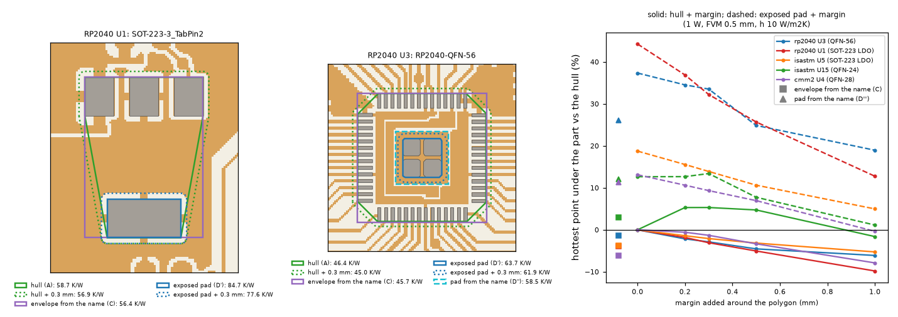

# Heat-source modes for the user: which shapes to offer per part, a margin, the cost in the code, and the text for the project documents

Reviewer opinion and design, after the maintainer read the contact sheets of the heater-shape study ([heater-shape-opinion.md](heater-shape-opinion.md), `scripts/study_heater_shape.py`) and asked: let the user choose the heat-source shape of each imported part (he liked shapes A and C for the SOT-223 parts and A, C, D' and D'' for the QFN), how hard is it in the Gerber import, and what do we think. Read on `develop` after the merge of `feature/exposed-pad-heater` (the exposed pad is the default shape of a part that has one; step 2 of the import window already offers, per part, the exposed pad, the convex hull, the bounding box, the largest opening and, for an X3 part, the outline). One new light study: `scripts/study_heater_margin.py` (56 s, peak 0.71 GB). Nothing in the program or in the project documents is changed here: section 7 is the text to adopt.

**Short answer.** The user can already choose the shape per part in 2.5.0, and what the maintainer liked is already there or within a few per cent: A is the hull, D' is the program's exposed pad (the default), and for the SOT-223 the box reads within 0.7 % of C. A **margin** (grow the chosen polygon by 0 to 1 mm) covers C on the SOT-223 (hull + 0.3 mm is within 0.8 to 1.6 points of it) and D'' on the QFN (the exposed pad + 0.1 to 0.5 mm), with no library. But a margin is **not a safety margin**: a larger heater reads cooler (on the exposed pad up to -8 % at 0.3 mm and -10 to -22 % at 1.0 mm), so its default must be 0. Recommended: in 2.6.0, a "Heat source" combo with the shapes valid for the part, a margin spin box (0 to 1 mm, default 0), the envelope from the name as one more kind, and no library of exposed-pad sizes. Effort small to medium (2 to 3 days with tests and documents), low risk (no model changes; the delicate part is the re-import). Not for 2.5.0: nothing safety-relevant is missing and every addition makes readings cooler or equal.

## 1. The letters of the contact sheets

Read from the panel titles of `heater_shapes_<board>_<ref>.png` (`make_figures.py --sheets`) and from `study_heater_shape.py` (keys in brackets):

| Letter | Panel title | What the polygon is | What it represents physically |
| :-- | :-- | :-- | :-- |
| (a) **A** | convex hull of the openings (`hull`) | the convex hull of all the paste openings of the part | the area of the pads: the heat enters the board through every solder joint, spread over the pads and the laminate between them; the default for parts without an exposed pad |
| (b) | bounding box of the openings (`box`) | the axis rectangle around all the openings | the same as the hull plus the corners; differs from the hull only for a turned or non-rectangular pad pattern |
| (c) **C** | envelope from the package name (`envelope`) | the **pad** envelope of the footprint name (`parts.envelope`, `part_envelope_polygon(place)` with margin 0), turned by the part's angle: SOT-223 8.3 x 6.1 mm, QFN and DFN the body + 0.8 mm per side, SOIC body + 3.6 mm, passives from a table, RP2040 7.8 mm | the footprint as the name says it, not as the paste draws it; **it is not the body with a 0.3 mm margin**: the 0.3 mm (`ENVELOPE_TOLERANCE_MM`) is added only when openings are matched to a part, and was never in the heater. On the RP2040 SOT-223 it coincides with the box (50.63 against 50.65 mm2); on the ISASTM SOT-223, whose pads are smaller, it is 4.7 mm2 larger than the box |
| (d) | largest opening only (`largest`) | the hull of the single largest opening | right only when that opening is the whole thermal pad (the SOT-223 tab: (d) equals (d')); wrong for split exposed pads and equal pads (+22 to +299 %) |
| (d') **D'** | exposed-pad windows (hull) (`ep`) | the hull of the openings of at least half the area of the largest: the paste windows of the exposed pad, or the tab | where the die is soldered: the exposed pad or the tab, to which θJC(bottom) is defined. **It is the program's `exposed` shape**, the default since `feature/exposed-pad-heater` (on these five parts the program's `dominant_group` gives the same polygon: 63.70, 84.65, 52.17, 62.01, 53.35 K/W in both studies). The windows are inset in the copper pad, so D' is a little smaller than the pad |
| (d'') **D''** | exposed pad from the name (`ep_pad`) | a square of the exposed-pad size written in the footprint name (`EP2.6x2.6mm`; 3.2 mm for the RP2040 from memory, not from its datasheet), centred on the windows; only for parts with a dominant group | the copper of the exposed pad as the footprint draws it (the inset of the windows added back); not turned by the part angle in the study (the three pads are square) |
| (e) | each opening, power by area (`openings`) | every opening is its own heater, the power shared by paste area | the heat entering through each joint in proportion to its area; several heaters for one part, which the program's part (one polygon) does not support |

So the maintainer's **A** is the hull, **C** the pad envelope from the name, **D'** the program's exposed pad (already the default), **D''** the copper pad of the size written in the KiCad name.

## 2. The margin study (`scripts/study_heater_margin.py`, `out/heater_margin.json`)

**Method.** The conventions of `study_heater_shape.py`: the program's import path on the RP2040 board (whole) and on 40 mm windows of ISASTM and CMM2, typical stack-up, h = 10 W/m2K on both faces and the edge, FVM at 0.5 mm, 1 W on the top layer, the hottest face point under the heater as the program reports it (the board point of Tj = T_max + θP; at 1 W it is the part-to-board resistance in K/W). The five exposed-pad or tab parts; the hull (A) and the exposed pad (D') each grown by m = 0, 0.2, 0.3, 0.5 and 1.0 mm (Minkowski sum of the convex polygon with a disc, 48 points on the circle), against C and D''. The m = 0 rows reproduce the shape study to the digit.

| Part | A hull (K/W) | A + 0.2 / 0.3 / 0.5 / 1.0 mm (% vs A) | C envelope (% vs A) | D' exposed (% vs A) | D' + 0.2 / 0.3 / 0.5 / 1.0 mm (% vs D') | D'' pad from the name (% vs D') |
| :-- | --: | :-- | --: | --: | :-- | --: |
| RP2040 U1, SOT-223 | 58.7 | -1.8 / -3.1 / -5.0 / -9.8 | -3.9 | +44.3 | -5.1 / -8.3 / -12.9 / -21.8 | - |
| ISASTM U5, SOT-223 | 43.9 | -1.4 / -2.1 / -3.2 / -5.3 | -3.7 | +18.8 | -2.7 / -4.1 / -6.8 / -11.6 | - |
| RP2040 U3, QFN-56 | 46.4 | -2.2 / -2.9 / -4.5 / -6.1 | -1.4 | +37.4 | -2.1 / -2.8 / -9.1 / -13.4 | -8.2 |
| ISASTM U15, QFN-24 | 55.0 | +5.3 / +5.3 / +4.7 / -1.6 | +3.0 | +12.7 | 0.0 / +0.7 / -4.3 / -10.2 | -0.6 |
| CMM2 U4, QFN-28 | 47.2 | -0.6 / -1.3 / -3.3 / -7.9 | -6.1 | +13.1 | -2.2 / -3.3 / -5.5 / -11.9 | -1.6 |

Areas (mm2): A + 0.3 mm 51.7 (U1), 45.0 (U5), 65.9 (U3), 23.9 (U15), 33.7 (U4) against C 50.6, 50.6, 60.8, 31.4, 43.6; D' + 0.5 mm 10.8 (U3) against D'' 10.2; D' + 0.2 mm 7.4 (U15) and 12.4 (U4) against D'' 6.8 and 11.2.

*Figure 24 (`figures/fig_24_heater_margin.png`): left, the RP2040 SOT-223 (U1) and QFN-56 (U3) with the hull (A), the hull + 0.3 mm, the envelope from the name (C), the exposed pad (D'), the exposed pad + 0.3 mm and the pad from the name (D''), over the top copper (tan) and the paste openings (grey) (RP2040 minimal design, BSD-3-Clause, Raspberry Pi Ltd and Tommy Gilligan); right, the hottest point under the part against the margin for the five parts, solid the hull, dashed the exposed pad, squares C and triangles D'' (numbers only for the GPL-3.0 boards).*

**What the numbers say.**

1. **A margin reproduces C on the SOT-223**: the hull + 0.3 mm reads -3.1 and -2.1 % against C's -3.9 and -3.7 % (0.8 and 1.6 points apart). The **box already does it** (U1 -3.9 %, the same as C; U5 -3.1 % against -3.7 %): the C the maintainer liked for the SOT-223 is in 2.5.0 as "Bounding box". On the QFN, C is the body + 0.8 mm per side and no small margin reaches it (U4: C -6.1 %, A + 0.3 mm -1.3 %).
2. **A margin on the exposed pad covers D''**: D'' is the windows plus their inset in the copper pad, about 0.1 mm on U15 and U4 and 0.3 to 0.5 mm on the RP2040; D' reads 0.6, 1.6 and 8.2 % hotter than D'' (the safe side), so D' + a margin of that size gives the same reading without a library.
3. **The margin is not a safety margin.** A larger polygon spreads the same watt over more board and reads cooler: on the exposed pad 0 to -13 % at 0.2 to 0.5 mm and -10 to -22 % at 1 mm; on the hull -1 to -10 %. "Catching a bit more outside the pads" lowers the junction estimate. The one exception is U15, where the hull + 0.2 to 0.5 mm reads 5 % hotter (also in the node value without the face term, 52.0 to 55.4 K/W); not investigated: most likely the grown polygon reaches a hotter cell (a pin trace or a copper island not tied to the planes of the four-layer window) and the read-out is the hottest point under the polygon. Default margin: **0**.
4. **The SOT-223 choice that matters is the tab, not A or C.** A and C read 16 to 34 % cooler than the tab (D') on the two SOT-223 (vs D': A -30.7 / -15.8 %, C -33.4 / -19.0 %). The datasheet resistance of a SOT-223 regulator is junction to tab, so with A or C the junction is read too cool by that much. They may be offered (a user who has measured a board, or who uses ψ to the leads), but the proposal stays the tab.

## 3. Opinion: what to offer, what is the default, margin or modes

**Offer per part only the shapes that make sense for it** (the combo lists those; the others are not shown):

| Class (decided by the openings, as now) | Offered, in this order | Default |
| :-- | :-- | :-- |
| exposed pad or tab (`dominant_group` not empty: QFN, DFN, SOT-223, DPAK, D2PAK, exposed-pad TSSOP) | exposed pad or tab (D'); exposed pad from the footprint name (D'', only when the name carries `EP<a>x<b>mm`); convex hull (A); pad envelope from the footprint name (C, only when `envelope(...)` is `known`); bounding box | exposed pad (as now) |
| other SMD parts (passives, SOIC, SOT-23, crystals, connectors) | convex hull (A); bounding box; pad envelope from the name (C, when known) | hull (as now) |
| X3 part | the outline of the layer (Body, Lead2Lead, ...) plus the paste shapes above | as now (exposed pad, then Body, ...) |
| a single tab where `largest` differs from `exposed` | "largest opening" is dropped: wherever it is right it equals the exposed pad, and wherever it differs it is wrong (+22 to +299 %) | - |

(e), the openings by area, is not offered: it needs several heaters per part, it is within -6 to +9 % of the hull for parts without a pad, and too cool for exposed-pad parts (-2.5 % of the hull on the RP2040 QFN against +37 % for the pad).

**A margin spin box rather than separate modes.** One control, "Margin around the shape", 0 to 1 mm in steps of 0.1 mm, **default 0**, applied to any convex kind (hull, box, exposed, envelope, pad from the name; disabled for an X3 outline, which may be concave). It replaces "hull + margin" and most of D'' as modes, needs no library, and the stored polygon is simply the grown one, so the models change nothing. The maintainer's proposal of 0.3 mm by default for the SOT-223 hull is not recommended: it moves the reading 2 to 3 % cooler for no physical reason, and C is reached by the box anyway. The tooltip says that a margin makes the part read cooler.

**No library of exposed-pad sizes.** D' (the paste windows) is always available, is on the safe side of D'' by 0.6 to 8.2 %, and a margin closes the gap when the user knows the pad. D'' from the KiCad name is a regular expression (no library) and can be offered for those names. A library would need about 25 to 30 entries for the common tab and pad packages that do not write the pad in the name (SOT-223 and its variants, SOT-89, TO-252/DPAK, TO-263/D2PAK 2/3/5/7 leads, TO-277, PowerPAK SO-8, LFPAK56, PowerDI-5 and similar), each with a source (JEDEC outline or the datasheet of a part), and QFN pads differ between makers for one body size (QFN-24 4 x 4 mm with pads of 2.1 to 2.7 mm, from memory), so a table by body is not reliable; it would live in `pcbthermal/data/exposed_pads.json` with a `source` per entry and the status "from datasheets, not verified". The value does not justify it.

## 4. Presentation in step 2 without clutter

Replace the four radio buttons of the shape group by two controls in the same place:

* **Heat source** (combo): only the shapes of section 3 valid for the selected part, the proposal marked "(proposed)": for a QFN "Exposed pad (proposed)", "Exposed pad from the footprint name", "Convex hull of the pads", "Pad envelope from the footprint name", "Bounding box"; for a SOT-223 "Tab (proposed)", "Convex hull of the pads", "Pad envelope from the footprint name", "Bounding box"; for a 0402 "Convex hull (proposed)", "Bounding box", "Pad envelope from the footprint name". The item tooltip carries one sentence each (section 1, right column).
* **Margin** (spin box, mm, 0.0 to 1.0, step 0.1, default 0.0): disabled for an X3 outline; tooltip "Grows the heat source by this distance. A larger heat source reads cooler; 0 keeps the shape of the files."
* **Preview**: no thumbnails; the existing preview already draws the heater filled and, for an exposed-pad part, the hull of the part dashed; it redraws on every change of the combo or the spin box. With a margin above 0 the shape before the margin is drawn as a thin line inside, so the user sees what was added.
* **Source column**: "exposed pad (proposed)", "hull + 0.3 mm (chosen by you)", and so on, as `shape_note` does now.
* Optional, cheap and useful on real boards: **"Apply to every part with this footprint"** next to the combo (a board has many identical regulators or passives).

## 5. Difficulty in the code

**`pcbthermal/gerber/parts.py`**

* `grow_polygon(poly, margin_mm, n=32)`: Minkowski sum of a convex polygon with a disc (the hull of the vertices offset on a circle; the prototype is `grow` in `study_heater_margin.py`); `margin_mm <= 0` returns the polygon unchanged (bit-identical default).
* `shape_polygon(openings, kind, margin=0.0, place=None)`: new kinds `"envelope"` (`part_envelope_polygon(place)` with the part's position, angle and side; the placement data are already in `from_file`: `position_mm`, `rotation_deg`, `package`) and `"pad_name"` (`exposed_pad_from_name(footprint)`: the `EP<a>x<b>mm` field, a rectangle centred on the dominant group and **turned by the part angle**, which the study did not need for its square pads); `margin` applied last; `ValueError` for an unknown kind as now.
* `shape_kinds(openings, footprint, place, x3=False)`: the list of section 3 for one part (drives the combo and the tests).
* `shape_set`: add `envelope` and `pad_name` when valid, so that a re-import can re-derive them; `merge_parts`: keep `(kind, margin)` of a part whose `edits["shape_user"]` is set and re-draw it from the new openings (the place that the review of `feature/exposed-pad-heater` corrected twice: test it first).
* `largest` stays readable in old projects but is no longer offered.

**`pcbthermal/model.py`, `ImportPart`**: no new field and no format change: the kind stays in `shape` (new values `"envelope"`, `"pad_name"`), the margin in `edits["shape_margin_mm"]` (a user edit; absent means 0), and `polygon_mm` is stored already grown, so every model reads it as today. Forward risk: a 2.5.0 program re-importing a 2.6.0 file with `"envelope"` falls back to the hull (`import_session` maps an unknown kind to `"hull"`); acceptable, stated in the changelog.

**`pcbthermal/gui/import_session.py`**: `shapes_of(p)` from `shape_kinds`; `set_shape(designator, kind, margin=0.0)`; `edits["shape_user"]` true when the kind differs from the proposal or the margin is not 0; `shape_note` labels; the re-derivation after a click on an opening keeps the margin.

**`pcbthermal/gui/import_window.py`** (step 2): the combo and the spin box instead of the radios (`_shape_controls`, `_shape`, `_shape_tip`), the thin pre-margin line in the preview, the optional "apply to the footprint" button; tooltips in `gui/tips.py`.

**Tests**: `grow_polygon` (area equals A + P m + π m2 within the circle discretisation; m = 0 bit-identical); the kinds per class on the synthetic parts of `tests/test_exposed_pad.py` and the eleven real parts (when the boards are present); `pad_name` turned at 90 and 45 degrees; a re-import keeps kind and margin and follows moved openings; an old project without `shape_margin_mm` re-imports unchanged; GUI: the combo lists only valid kinds, the spin box is disabled for an outline, a stress scenario for both in `tests/test_gui_stress.py`; `test_tooltips.py`, `test_help.py` (new words). The frozen numbers do not move (imported parts only, default margin 0).

**Documents**: theory 1.8 and models 19.2 and 19.4 (one paragraph each, section 7), the user guide 12b, `CHANGELOG.md`, `docs/versions.md`, `docs/validation.md` 28.4 (the margin table).

**Effort and risk**: margin and combo, small (about 1 to 1.5 days with tests and documents); the envelope kind +0.5 day; the pad from the KiCad name +0.5 day; with the reviewer and the whole battery, **2 to 3 days in all, small to medium**. A library of exposed pads would add 2 to 4 days of reading datasheets and is not recommended. Risk low: no model, solver or file-format change; the risk is in the re-import merge and in the GUI tests.

## 6. 2.5.0 or 2.6.0

**2.6.0.** The request "let the user choose the shape per part" is already met in 2.5.0 (exposed pad, hull, box, largest, X3 outline, per part, remembered across a re-import), and what the maintainer liked is there or close: A is the hull, D' the default, C on the SOT-223 within 0.7 % of the box, D'' within 0.6 to 8.2 % of D' on the hot (safe) side. Everything this design adds makes a reading cooler or leaves it equal, so no user is put on the unsafe side by waiting; the re-import merge, the only delicate place, was corrected twice in the review of the exposed-pad branch and should not be reopened while the release is closing. If the maintainer wants something in 2.5.0, the smallest piece is the margin spin box alone (1 day, default 0, no new kinds), but I would still not take it.

## 7. Text to adopt in the project documents

What is already in `develop`: `feature/exposed-pad-heater` folded the study into `docs/theory.md` 1.8 ("Heat-source shape", the rule, the why with the numbers, the 875-part review, and the figure `docs/images/heater_shapes_rp2040.png`, byte-identical to `figures/fig_22_heater_shapes_rp2040.png`), `docs/models.md` 19.2 (the same paragraph) and `docs/versions.md` (Unreleased). What is missing: the **table** (theory.md carries no result tables; they belong in `docs/validation.md`), the margin study, and the Planned item. Figure to copy: `figures/fig_24_heater_margin.png` to `docs/images/heater_shape_margin.png` (RP2040 drawn, BSD-3-Clause, with the attribution; the ISASTM and CMM2 boards appear only as numbers). The ISASTM and CMM2 contact sheets stay local (GPL-3.0).

### 7.1 `docs/validation.md`: new section 28

> ## 28. The heat-source shape of an imported part
>
> Which polygon carries the power of a part imported from the paste layer (theory 1.8, models 19.2). Program FVM at 0.5 mm on the imported copper (faces mapping), typical stack-up, h = 10 W/m2K on both faces and the edge, 1 W on the top layer; the RP2040 minimal design run whole (52 x 51 mm, two layers), ISASTM and CMM2 (four layers) as 40 mm windows around the part. The read-out is the hottest face point under the heater, as the program reports it (Tj = T_max + θP); at 1 W it is the part-to-board resistance in K/W. Shapes: (a) the convex hull of the openings, (b) their box, (c) the pad envelope from the footprint name (the matching rule's rectangle, margin 0), (d) the largest opening, (d') the hull of the openings of at least half the area of the largest (the exposed pad or tab; the program's `exposed` on the five exposed-pad parts), (d'') the exposed pad as a square of the size in the footprint name, (e) every opening a heater with the power by paste area. Evidence: `research/gerber-real-boards/docs/heater-shape-opinion.md` (`study_heater_shape.py`) and `docs/heater-modes-for-the-user.md` (`study_heater_margin.py`).
>
> [image: Heat-source shapes of five parts of the RP2040 minimal design, file images/heater_shapes_rp2040.png of `docs/`, inserted as a Markdown image]
>
> *Figure (`images/heater_shapes_rp2040.png`): five RP2040 parts with the shapes, filled, over the top copper (tan) and the paste openings (grey); the hottest point in K/W and the change against the hull (RP2040 minimal design, BSD-3-Clause, Raspberry Pi Ltd and Tommy Gilligan).*
>
> ### 28.1 Eleven parts of three boards (change of the hottest point against the hull)
>
> | Part | Package | Hull (K/W) | Box | Envelope | Largest | Exposed pad (d') | Pad from the name (d'') | Openings by area | Program default |
> | :-- | :-- | --: | --: | --: | --: | --: | --: | --: | :-- |
> | RP2040 U3 | QFN-56, pad in 4 windows | 46.4 | -1.4 % | -1.4 % | +65.5 % | +37.4 % | +26.2 % | -2.5 % | exposed |
> | RP2040 U1 | SOT-223 (NCP1117) | 58.7 | -3.9 % | -3.9 % | +44.3 % | +44.3 % | - | +2.4 % | exposed (tab) |
> | ISASTM U5 | SOT-223 (AMS1117) | 43.9 | -3.1 % | -3.7 % | +18.8 % | +18.8 % | - | +4.9 % | exposed (tab) |
> | ISASTM U15 | QFN-24, EP 2.6 mm in 4 windows | 55.0 | +9.0 % | +3.0 % | +48.1 % | +12.7 % | +12.0 % | -1.9 % | exposed |
> | CMM2 U4 | QFN-28, EP 3.35 mm in 9 windows | 47.2 | -2.0 % | -6.1 % | +36.6 % | +13.1 % | +11.3 % | +2.9 % | exposed |
> | RP2040 U2 | SOIC-8 | 109.3 | 0.0 % | -0.5 % | +299.3 % | (no pad) | - | -3.1 % | hull |
> | RP2040 Y1 | HC49 crystal | 56.6 | 0.0 % | 0.0 % | +63.2 % | (no pad) | - | +8.1 % | hull |
> | RP2040 R2 | 0402 | 245.9 | -0.3 % | -0.3 % | +55.9 % | (no pad) | - | -6.0 % | hull |
> | RP2040 C1 | 0805 | 98.7 | -0.3 % | -0.3 % | +22.3 % | (no pad) | - | +9.3 % | hull |
> | RP2040 J3 | USB micro-B | 94.0 | -2.0 % | -2.4 % | +82.7 % | (no pad) | - | -1.1 % | hull |
> | ISASTM U14 | SOT-23-6 | 81.3 | 0.0 % | -5.0 % | +227.6 % | (no pad) | - | +7.1 % | hull |
>
> For parts without an exposed pad the hull, the box, the envelope and the openings by area agree within -6.1 to +9.3 %, about the rest of the model error at 0.5 mm (section 27), so the hull is the default. For the exposed-pad and tab parts the heat on the pad reads +12.7 to +44.3 % hotter than the hull (+6 to +26 K per watt), beyond the model error and on the safe side; the paste windows are inset in the copper pad, so the exposed pad from the paste reads 0.6 to 8.2 % hotter than the pad of the footprint name (conservative). The largest opening alone is wrong whenever the part has several similar pads (+22 to +299 %) and equals the exposed pad for a single tab. The +9.0 % of the box on U15 is the face term of its corners on bare laminate. The percentages include the board mean rise (18 K on the RP2040, 29 K in the windows).
>
> ### 28.2 A published case: the JEDEC 2s2p board
>
> The JESD51-7 2s2p board of `docs/calculators.md` 2.1 (TPS7A47, RθJA 32.5 K/W, θJC(bot) 1.7 K/W, 3 x 3 vias assumed), cell 1 mm, computed h, 1 W: the heater on the 3.15 mm exposed pad gives **31.9 K/W** (-1.8 %), on the 5 mm body 40.0 K/W (+23 %; 37.7 without the face term), on the body with the leads (5.8 mm) 45.1 K/W (+39 %; 42.0). The lead traces of the JEDEC board are not drawn, so the body rows overstate what a real board does under the leads; with the heater on the pad the program reproduces the datasheet.
>
> ### 28.3 The rule on eight boards
>
> The exposed-pad rule (`parts.dominant_group`; constants `EXPOSED_MIN_AREA` 0.5, `EXPOSED_MIN_PASTE` 0.25, `EXPOSED_MAX_HULL` 0.75, `EXPOSED_MIN_FILL` 0.5, `EXPOSED_MAX_GAP` 0.5) was checked on every part with a polygon of eight open boards (RP2040, ISASTM, CMM2, oswlight, co60, StickHub X3, Ucamco X3 coldfire and li-ion; 875 parts): 14 parts are taken, all exposed pads or tabs (QFN, SOT-223, DPAK, D2PAK, exposed-pad TSSOP: group fill 0.70 to 1.00, gap at most 0.25 of the side of the largest opening, group hull at most 0.62 of the part), and no other part is; the nearest miss is a micro-USB with three mounting pads (fill 0.59, gap 0.66). The first rule (hull limit 0.5, no fill or gap test) missed the four DPAK (0.60) and the D2PAK (0.62), on the unsafe side, and took seven JST SH connectors and four tactile switches (fill 0.34 / 0.39, gap 1.9 to 3.0 sides). The thinnest margin is the RP2040 QFN-56, paste share 0.32 against 0.25. Not among the parts: SOT-89, power SO-8, LGA with a thermal pad. Held by `tests/test_exposed_pad.py`.
>
> ### 28.4 A margin around the shape
>
> The hull and the exposed pad of the five exposed-pad parts grown by 0.2, 0.3, 0.5 and 1.0 mm (Minkowski sum with a disc), same runs as 28.1:
>
> | Part | Hull + 0.2 / 0.3 / 0.5 / 1.0 mm (vs hull) | Envelope (vs hull) | Exposed pad + 0.2 / 0.3 / 0.5 / 1.0 mm (vs the exposed pad) | Pad from the name (vs the exposed pad) |
> | :-- | :-- | --: | :-- | --: |
> | RP2040 U1, SOT-223 | -1.8 / -3.1 / -5.0 / -9.8 % | -3.9 % | -5.1 / -8.3 / -12.9 / -21.8 % | - |
> | ISASTM U5, SOT-223 | -1.4 / -2.1 / -3.2 / -5.3 % | -3.7 % | -2.7 / -4.1 / -6.8 / -11.6 % | - |
> | RP2040 U3, QFN-56 | -2.2 / -2.9 / -4.5 / -6.1 % | -1.4 % | -2.1 / -2.8 / -9.1 / -13.4 % | -8.2 % |
> | ISASTM U15, QFN-24 | +5.3 / +5.3 / +4.7 / -1.6 % | +3.0 % | 0.0 / +0.7 / -4.3 / -10.2 % | -0.6 % |
> | CMM2 U4, QFN-28 | -0.6 / -1.3 / -3.3 / -7.9 % | -6.1 % | -2.2 / -3.3 / -5.5 / -11.9 % | -1.6 % |
>
> A margin makes the part read cooler (the exception, U15's hull, reaches a hotter cell and was not investigated further); the hull + 0.3 mm is within 0.8 to 1.6 points of the envelope on the SOT-223, and the exposed pad + 0.1 to 0.5 mm reaches the pad of the footprint name.
>
> [image: A margin around the heat-source polygon, file images/heater_shape_margin.png of `docs/`, inserted as a Markdown image]
>
> *Figure (`images/heater_shape_margin.png`, from `research/gerber-real-boards/figures/fig_24_heater_margin.png`): the RP2040 SOT-223 and QFN-56 with the hull, the hull + 0.3 mm, the envelope, the exposed pad, the exposed pad + 0.3 mm and the pad from the name; right, the hottest point against the margin for the five parts (RP2040 minimal design, BSD-3-Clause, Raspberry Pi Ltd and Tommy Gilligan; the other boards as numbers only).*
>
> ### 28.5 What was not verified
>
> No physical board; the comparison is between shapes in the program's own FVM plus one datasheet case. The heat that leaves through the leads of an exposed-pad package is not modelled (all of it on the pad: the worst case). The exposed-pad size of the RP2040 (3.2 mm) is from memory; eleven parts of three KiCad boards for the shape table, eight boards (KiCad and the Ucamco X3 samples) for the rule.

### 7.2 `docs/theory.md` 1.8

The paragraph "Heat-source shape" stays as it is. Two changes: after "The tests hold the table of the eleven parts and the list of the parts taken on the eight boards (`tests/test_exposed_pad.py`)." add "; the table is `docs/validation.md` 28." When the margin is implemented, add at the end of the paragraph:

> **Margin.** The user may grow the chosen shape by a margin m of 0 to 1 mm (Minkowski sum of the convex polygon with a disc of radius m; default 0, an X3 outline excepted); the polygon stored is the grown one, so the models read it as any part. A larger heat source reads cooler (0 to -22 % of the hottest point at 0.2 to 1 mm on the exposed pads of `docs/validation.md` 28.4); the margin is a choice of the user, not a safety margin.

### 7.3 `docs/models.md` 19.2 and 19.4

19.2, same pointer to `docs/validation.md` 28 after the sentence on `tests/test_exposed_pad.py`. When implemented, in 19.2 replace "From the openings of a part: the convex hull (default), the box around them, the exposed pad (default of a part that has one, see below) or the largest opening (right only for a single tab)." by:

> From the openings of a part: the **exposed pad** (default of a part that has one, see below), the **exposed pad from the footprint name** (KiCad `EP<a>x<b>mm`, turned with the part), the **convex hull** (default of every other part), the **pad envelope from the footprint name** (the matching rule's rectangle, when the name is known) or the **box**, each optionally grown by a margin of 0 to 1 mm (`parts.grow_polygon`, `edits["shape_margin_mm"]`, default 0); only the kinds valid for the part are offered (`parts.shape_kinds`). `largest` is read in older projects and no longer offered (wherever it is right it equals the exposed pad).

and in 19.4 (step 2): "the shape is a combo of the kinds valid for the part with a margin spin box (0 to 1 mm, default 0); the preview draws the heater filled, the shape before the margin as a thin line and the hull of an exposed-pad part dashed".

### 7.4 `docs/versions.md`

Unreleased, in the entry "Exposed-pad heat source", after "evidence `research/gerber-real-boards/docs/heater-shape-opinion.md`": add "and `docs/heater-modes-for-the-user.md`; table `validation.md` 28".

Planned (2.6.0), a new item:

> * **Heat-source modes per part** (`feature/heater-shape-modes`, after `research/gerber-real-boards/docs/heater-modes-for-the-user.md`): in step 2 a "Heat source" combo with only the kinds valid for the part (exposed pad, exposed pad from the KiCad name, hull, pad envelope from the name, box; `largest` no longer offered), a margin spin box 0 to 1 mm (default 0; a margin reads cooler, 0 to -22 % on the exposed pads), "apply to every part with this footprint"; `parts.grow_polygon`, `shape_kinds`, kinds `envelope` and `pad_name`, `edits["shape_margin_mm"]`, no format change; the re-import keeps kind and margin. No library of exposed-pad sizes (the paste windows are on the safe side of the pad by 0.6 to 8.2 %). Effort 2 to 3 days, low risk; frozen numbers unchanged.

## 8. What was read and what was not verified

* Read: `pcbthermal/gerber/parts.py` (envelope, dominant group, shapes, `part_from_openings`, `_x3_part`, `shape_set`), `model.ImportPart`, `gui/import_session.py` (shapes, `set_shape`, the re-derivation), the shape group of `gui/import_window.py` step 2, `docs/theory.md` 1.8, `docs/models.md` 19.2 and `docs/versions.md` on `develop` after the merge of `feature/exposed-pad-heater`; the contact sheets of RP2040 U1 and U3 (the panel titles give the letters).
* Run: `study_heater_margin.py` (the m = 0 rows reproduce `study_heater_shape.py` to the digit); `make_figures.py --only-heater-shapes` (figures 22 and 23 unchanged byte for byte, figure 24 new).
* Not verified: the U15 hull rise with the margin (cause not measured); the KiCad pad sizes of the SOT-223 tab against a datasheet; the QFN pad-size spread between makers (from memory); the effort estimate is an estimate; the D'' square of the study is not turned by the part angle (all three pads are square).
