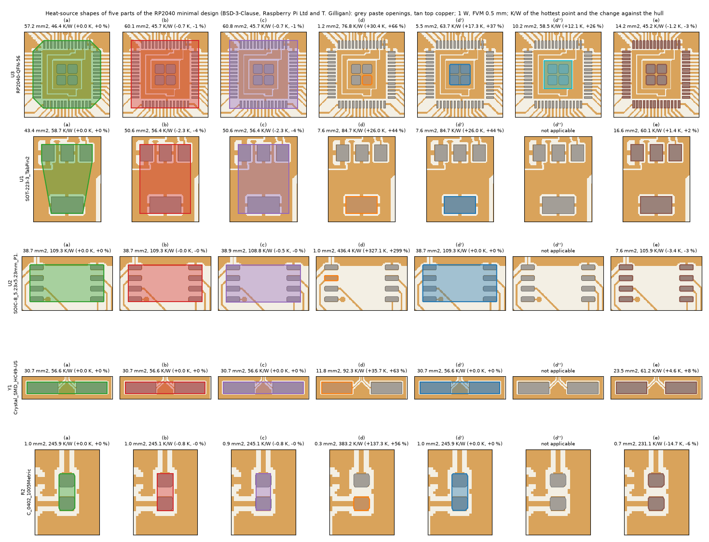
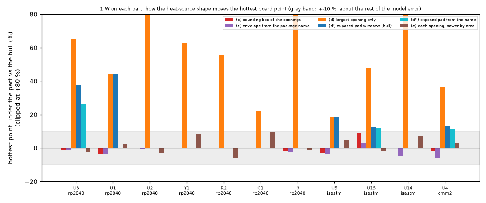

# Reviewer opinion: the heat-source polygon of an imported part

The question of the maintainer, after the import screenshots: the program draws the heater of an imported part as a polygon (the convex hull of the paste openings); is that the right approach, or is a simpler shape (the bounding box, a rectangle from the package name, the exposed pad only) better? Is there a study?

**Short answer.** For parts without a dominant pad (passives, SOIC, SOT-23, crystals, connectors) the choice between hull, box, envelope and the openings themselves moves the hottest board point under the part by -6 to +9 % (1 W, FVM at 0.5 mm, eleven parts of three real boards): about the size of the rest of the model error, so the hull is a fine default and needs no change. For **exposed-pad and tab packages** (QFN with a thermal pad, SOT-223, DPAK-like) the hull spreads the power over a body area that does not carry it: putting the heat on the exposed pad reads **+11 to +44 %** hotter (+8 to +26 K per watt), beyond the model error and on the unsafe side of the hull; it is also what the datasheet's θJC(bottom) assumes and what reproduced a published RθJA (31.9 against 32.5 K/W, while the body as a heater gives 40.0). Recommendation: keep the hull as the default and add one rule, the **exposed pad** (the hull of the dominant paste group) as the default shape of a part whose paste has one (section 6, INTEGRATION form; not implemented, the maintainer decides).

## 1. How the program builds the heat-source polygon today

Read in `pcbthermal/gerber/parts.py` and `components.py`:

1. The paste layers are drawn cluster by cluster at 0.05 mm; every connected blob is an `Opening` (centroid, area, box, convex hull, side, `TO.C` designator when the file writes it).
2. Openings are assigned to parts by trust: X3 component layer, then `TO.C` of the paste file with the placement file, then **by position**: an opening goes to the placement part whose pad **envelope** (a rectangle from the footprint NAME: 0402 to 1206, SOIC pins and pitch, SOT-223, QFN size, crystals; rotated by the part angle, grown by `ENVELOPE_TOLERANCE_MM` = 0.3 mm) holds its centre, the smallest envelope winning.
3. **The envelope is only used to match; it is never the heater.** The heater polygon is `shape_polygon(openings, kind)`: `hull` (convex hull of all the openings' hulls, the default), `box` (their bounding box) or `largest` (the hull of the largest opening).
4. With an X3 layer, `components.heat_polygon` takes Body, then Lead2Lead, then the paste hull, then Footprint, then Courtyard, then the hull of the pins.
5. The import adds one heater per heat source on layer 1 (or the bottom layer), with the polygon as typed; the power is uniform over the polygon, so a hull puts heat on the bare laminate between the pads, and the reported part temperature (`analysis.heater_stats`) is the hottest face point under the polygon, to which Tj adds θ·P.

So the polygon the screenshots show for U3 of the RP2040 (an octagon, the pin rows end before the corners) is the hull of its 60 openings, not the package outline.

## 2. The parts looked at

**U5 is on the ISASTM board, not on the RP2040 board** (the RP2040 placement file has U1 to U3 only); it is an AMS1117-3.3 in `SOT-223-3_TabPin2`, the same KiCad footprint as U1 (NCP1117) of the RP2040 board, so U1 is its drawn twin in figure 22 (ISASTM and CMM2 are GPL-3.0 and are not drawn in the committed figures; their contact sheets were made locally only).

| Board, part | Package (footprint name) | Openings | What the hull gives | Sensible as a heater? |
| :-- | :-- | --: | :-- | :-- |
| ISASTM U5 | SOT-223 LDO (AMS1117) | 4 (tab 4.9 mm2, three pins) | trapezoid joining the tab and the three pins, 37.2 mm2, over a copper pour | geometry yes; thermally no: the tab carries the heat (its θJC is to the tab) |
| RP2040 U1 | SOT-223 LDO (NCP1117) | 4 | trapezoid, 43.4 mm2 | same as U5 |
| RP2040 U3 | RP2040-QFN-56 | 60 (56 pins + exposed pad in 4 windows) | octagon, 57.2 mm2 | geometry yes; thermally the die sits on the exposed pad |
| ISASTM U15 | QFN-24 4 x 4, EP 2.6 mm | 28 (24 + 4 windows) | 18.8 mm2 | as U3 |
| CMM2 U4 | QFN-28 5 x 5, EP 3.35 mm | 37 (28 + 9 windows) | 27.6 mm2 | as U3 |
| RP2040 U2 | SOIC-8 (flash) | 8 | equals the box, 38.7 mm2, mostly over bare laminate | yes (leads only, no dominant pad) |
| ISASTM U14 | SOT-23-6 | 6 | 7.3 mm2 | yes |
| RP2040 Y1 | HC49 crystal, two pads | 2 | 30.7 mm2 bar | yes (it hardly dissipates) |
| RP2040 R2 | 0402 (footprint `C_0402`) | 2 | 1.0 mm2 | yes (the film between the terminations) |
| RP2040 C1 | 0805 capacitor | 2 | 4.2 mm2 | yes |
| RP2040 J3 | USB micro-B | 11 (6 large mounting pads) | 38.6 mm2 | yes (rarely a heat source) |

## 3. The evidence before this note

* `research/gerber-real-boards/README.md` 4.4 D: on proximity groups, the hull against the box is -0.8 to +6.0 % of the hottest cell (the source of the "-0.8 to +6.0 %" of `docs/versions.md`, decision (e)); the largest opening alone 1.6 to 3.9 times hotter, **1.23 times on the RP2040 QFN** "whose exposed pad holds most of the paste"; it already said an exposed-pad shape (the union of the windows of the central pad) "was not studied".
* README 11.5 and INTEGRATION 9 (review): hull as the one default, because the box is never hotter than the hull and the hull follows a turned part; the exposed-pad question "is a separate question for a study with a package model".
* `research/power-calculator`: both datasheet rows that the calculator reproduces put the heater on the **pad** (CSD17308Q3: the 3.3 mm drain pad, -1.7 %; JEDEC 2s2p TPS7A47: the 3.15 mm exposed pad with θJC(bot) 1.7 K/W, +3 % at 0.5 mm).
* `docs/research.md` (Component, sources 12, 13, 18 read): for exposed-pad packages JESD15-3 replaces θJB by θJC(bottom), measured to the exposed pad; θJB includes the spreading in the JEDEC board and would count our board twice.
* `research/component-heatsink`: no study of where in the package the heat leaves (die versus leads versus pad); nothing to quote.

So there was a study of box against hull, but none of the exposed pad, and none that compares the shapes on one model with the pad as a candidate.

## 4. The study (`scripts/study_heater_shape.py`, `out/heater_shape.json`)

**Method.** The program's import path (`ImportSession`, `parts.shape_polygon`, `copper.import_copper` with the faces mapping) on three open boards: RP2040 minimal design run whole (52 x 51 mm, two layers), ISASTM and CMM2 (four layers) as 40 mm windows around the part (the cut edges carry the edge coefficient; the same window for every shape of a part). Typical stack-up, h = 10 W/m2K on both faces and the edge (fixed, so the rise is linear: K at 1 W is K/W), FVM at 0.5 mm, 1 W on the top layer. Seven shapes: (a) hull, (b) box, (c) the envelope from the package name, (d) the largest opening, (d') the hull of the "exposed-pad windows" (openings at least half the area of the largest), (d'') the exposed pad as the square of the size in the footprint name (`EP2.6x2.6mm`; 3.2 mm for the RP2040, from memory of its datasheet, not opened), centred on the windows, and (e) every opening a heater with the power in proportion to its paste area. Read-outs as the program reports them: T_max the hottest face point under the heater(s) (the board point of Tj = T_max + θP; also the part-to-board resistance at 1 W), the power-weighted mean under the heater(s). Run time 70 s, peak 0.66 GB.



*Figure 22 (`figures/fig_22_heater_shapes_rp2040.png`): five parts of the RP2040 minimal design (BSD-3-Clause, Raspberry Pi Ltd and Tommy Gilligan) with the seven shapes, filled, over the top copper (tan) and the paste openings (grey); above each panel the area, the hottest point in K/W and the change against the hull. U1 is the same footprint as U5 of ISASTM.*



*Figure 23 (`figures/fig_23_heater_shape_change.png`): the change of the hottest point under the part against the hull for the eleven parts (numbers only, no geometry of the GPL boards); grey band +-10 %.*

**The table** (`study_heater_shape.py --table`; the T_max rise at 1 W is also the part-to-board resistance in K/W, from the hottest board point under the heater to ambient; the board mean rise is 18 K on the RP2040 board and 29 K in the windows, included in every number):

| Part | Shape | Area (mm2) | Power density at 1 W (W/cm2) | T_max rise (K) | Mean rise under the heater (K) | R part-to-board (K/W) | vs hull (K) | vs hull (%) |
| :-- | :-- | --: | --: | --: | --: | --: | --: | --: |
| rp2040 U3 (QFN-56, exposed pad in 4 windows (RP2040)) | (a) hull | 57.18 | 1.7 | 46.4 | 41.0 | 46.4 | +0.0 | +0.0 |
|  | (b) box | 60.06 | 1.7 | 45.7 | 40.5 | 45.7 | -0.7 | -1.4 |
|  | (c) envelope | 60.84 | 1.6 | 45.7 | 40.5 | 45.7 | -0.7 | -1.4 |
|  | (d) largest opening | 1.17 | 85.8 | 76.8 | 72.8 | 76.8 | +30.4 | +65.5 |
|  | (d') exposed-pad windows | 5.49 | 18.2 | 63.7 | 61.9 | 63.7 | +17.3 | +37.4 |
|  | (d'') exposed pad from the name | 10.24 | 9.8 | 58.5 | 55.3 | 58.5 | +12.1 | +26.2 |
|  | (e) openings by area | 14.24 | 7.0 | 45.2 | 40.6 | 45.2 | -1.2 | -2.5 |
| rp2040 U1 (SOT-223 LDO, tab (NCP1117)) | (a) hull | 43.40 | 2.3 | 58.7 | 52.1 | 58.7 | +0.0 | +0.0 |
|  | (b) box | 50.65 | 2.0 | 56.4 | 50.8 | 56.4 | -2.3 | -3.9 |
|  | (c) envelope | 50.63 | 2.0 | 56.4 | 50.8 | 56.4 | -2.3 | -3.9 |
|  | (d) largest opening | 7.60 | 13.2 | 84.7 | 80.8 | 84.7 | +26.0 | +44.3 |
|  | (d') exposed-pad windows | 7.60 | 13.2 | 84.7 | 80.8 | 84.7 | +26.0 | +44.3 |
|  | (e) openings by area | 16.60 | 6.0 | 60.1 | 55.2 | 60.1 | +1.4 | +2.4 |
| rp2040 U2 (SOIC-8 (flash)) | (a) hull | 38.71 | 2.6 | 109.3 | 78.4 | 109.3 | +0.0 | +0.0 |
|  | (b) box | 38.72 | 2.6 | 109.3 | 78.4 | 109.3 | -0.0 | -0.0 |
|  | (c) envelope | 38.94 | 2.6 | 108.8 | 78.1 | 108.8 | -0.5 | -0.5 |
|  | (d) largest opening | 0.95 | 105.3 | 436.4 | 401.6 | 436.4 | +327.1 | +299.3 |
|  | (d') exposed-pad windows | 38.71 | 2.6 | 109.3 | 78.4 | 109.3 | +0.0 | +0.0 |
|  | (e) openings by area | 7.59 | 13.2 | 105.9 | 84.4 | 105.9 | -3.4 | -3.1 |
| rp2040 Y1 (HC49 crystal, two pads) | (a) hull | 30.66 | 3.3 | 56.6 | 53.2 | 56.6 | +0.0 | +0.0 |
|  | (b) box | 30.66 | 3.3 | 56.6 | 53.2 | 56.6 | +0.0 | +0.0 |
|  | (c) envelope | 30.66 | 3.3 | 56.6 | 53.2 | 56.6 | +0.0 | +0.0 |
|  | (d) largest opening | 11.76 | 8.5 | 92.3 | 87.4 | 92.3 | +35.7 | +63.2 |
|  | (d') exposed-pad windows | 30.66 | 3.3 | 56.6 | 53.2 | 56.6 | +0.0 | +0.0 |
|  | (e) openings by area | 23.52 | 4.3 | 61.2 | 58.5 | 61.2 | +4.6 | +8.1 |
| rp2040 R2 (0402 resistor) | (a) hull | 0.97 | 103.1 | 245.9 | 186.3 | 245.9 | +0.0 | +0.0 |
|  | (b) box | 0.98 | 101.9 | 245.1 | 185.3 | 245.1 | -0.8 | -0.3 |
|  | (c) envelope | 0.90 | 111.1 | 245.1 | 185.3 | 245.1 | -0.8 | -0.3 |
|  | (d) largest opening | 0.35 | 288.8 | 383.2 | 287.5 | 383.2 | +137.3 | +55.9 |
|  | (d') exposed-pad windows | 0.97 | 103.1 | 245.9 | 186.3 | 245.9 | +0.0 | +0.0 |
|  | (e) openings by area | 0.69 | 144.4 | 231.1 | 171.3 | 231.1 | -14.7 | -6.0 |
| rp2040 C1 (0805 capacitor) | (a) hull | 4.17 | 24.0 | 98.7 | 86.1 | 98.7 | +0.0 | +0.0 |
|  | (b) box | 4.20 | 23.8 | 98.4 | 85.9 | 98.4 | -0.3 | -0.3 |
|  | (c) envelope | 4.21 | 23.8 | 98.4 | 85.9 | 98.4 | -0.3 | -0.3 |
|  | (d) largest opening | 1.41 | 70.7 | 120.8 | 101.5 | 120.8 | +22.0 | +22.3 |
|  | (d') exposed-pad windows | 4.17 | 24.0 | 98.7 | 86.1 | 98.7 | +0.0 | +0.0 |
|  | (e) openings by area | 2.83 | 35.4 | 107.9 | 89.2 | 107.9 | +9.2 | +9.3 |
| rp2040 J3 (USB micro-B connector) | (a) hull | 38.56 | 2.6 | 94.0 | 76.3 | 94.0 | +0.0 | +0.0 |
|  | (b) box | 40.95 | 2.4 | 92.2 | 74.1 | 92.2 | -1.9 | -2.0 |
|  | (c) envelope | 41.34 | 2.4 | 91.8 | 74.0 | 91.8 | -2.2 | -2.4 |
|  | (d) largest opening | 5.21 | 19.2 | 171.8 | 156.5 | 171.8 | +77.8 | +82.7 |
|  | (d') exposed-pad windows | 38.56 | 2.6 | 94.0 | 76.3 | 94.0 | +0.0 | +0.0 |
|  | (e) openings by area | 26.75 | 3.7 | 93.0 | 75.5 | 93.0 | -1.0 | -1.1 |
| isastm U5 (SOT-223 LDO, tab (AMS1117)) | (a) hull | 37.24 | 2.7 | 43.9 | 40.4 | 43.9 | +0.0 | +0.0 |
|  | (b) box | 45.92 | 2.2 | 42.6 | 39.7 | 42.6 | -1.3 | -3.1 |
|  | (c) envelope | 50.63 | 2.0 | 42.3 | 39.5 | 42.3 | -1.6 | -3.7 |
|  | (d) largest opening | 4.88 | 20.5 | 52.2 | 49.5 | 52.2 | +8.2 | +18.8 |
|  | (d') exposed-pad windows | 4.88 | 20.5 | 52.2 | 49.5 | 52.2 | +8.2 | +18.8 |
|  | (e) openings by area | 10.64 | 9.4 | 46.1 | 41.6 | 46.1 | +2.1 | +4.9 |
| isastm U15 (QFN-24, exposed pad 2.6 mm in 4 windows) | (a) hull | 18.81 | 5.3 | 55.0 | 48.8 | 55.0 | +0.0 | +0.0 |
|  | (b) box | 20.48 | 4.9 | 60.0 | 47.6 | 60.0 | +5.0 | +9.0 |
|  | (c) envelope | 31.36 | 3.2 | 56.7 | 44.6 | 56.7 | +1.6 | +3.0 |
|  | (d) largest opening | 1.07 | 93.2 | 81.5 | 70.2 | 81.5 | +26.5 | +48.1 |
|  | (d') exposed-pad windows | 5.49 | 18.2 | 62.0 | 59.7 | 62.0 | +7.0 | +12.7 |
|  | (d'') exposed pad from the name | 6.76 | 14.8 | 61.7 | 58.9 | 61.7 | +6.6 | +12.0 |
|  | (e) openings by area | 7.41 | 13.5 | 54.0 | 49.9 | 54.0 | -1.1 | -1.9 |
| isastm U14 (SOT-23-6) | (a) hull | 7.32 | 13.7 | 81.3 | 63.8 | 81.3 | +0.0 | +0.0 |
|  | (b) box | 7.32 | 13.7 | 81.3 | 63.8 | 81.3 | +0.0 | +0.0 |
|  | (c) envelope | 9.90 | 10.1 | 77.2 | 60.4 | 77.2 | -4.1 | -5.0 |
|  | (d) largest opening | 0.43 | 235.3 | 266.3 | 248.7 | 266.3 | +185.0 | +227.6 |
|  | (d') exposed-pad windows | 7.32 | 13.7 | 81.3 | 63.8 | 81.3 | +0.0 | +0.0 |
|  | (e) openings by area | 2.55 | 39.2 | 87.1 | 69.8 | 87.1 | +5.8 | +7.1 |
| cmm2 U4 (QFN-28, exposed pad 3.35 mm in 9 windows) | (a) hull | 27.60 | 3.6 | 47.2 | 43.9 | 47.2 | +0.0 | +0.0 |
|  | (b) box | 30.25 | 3.3 | 46.2 | 42.9 | 46.2 | -1.0 | -2.0 |
|  | (c) envelope | 43.56 | 2.3 | 44.3 | 40.5 | 44.3 | -2.9 | -6.1 |
|  | (d) largest opening | 0.78 | 128.2 | 64.4 | 63.4 | 64.4 | +17.2 | +36.6 |
|  | (d') exposed-pad windows | 9.83 | 10.2 | 53.4 | 50.4 | 53.4 | +6.2 | +13.1 |
|  | (d'') exposed pad from the name | 11.22 | 8.9 | 52.5 | 49.9 | 52.5 | +5.3 | +11.3 |
|  | (e) openings by area | 10.38 | 9.6 | 48.5 | 45.2 | 48.5 | +1.4 | +2.9 |

**JEDEC check (a published number).** The JESD51-7 2s2p board of the power-calculator validation (TPS7A47, RθJA 32.5 K/W, θJC(bot) 1.7 K/W, 3 x 3 vias assumed), cell 1 mm, computed h: the heater on the exposed pad gives **31.9 K/W** (-1.8 %), on the 5 mm body **40.0 K/W** (+23 %; 37.7 without the face term), on the body with the leads (5.8 mm) **45.1 K/W** (+39 %; 42.0). The JEDEC board's lead traces are not drawn, so the body rows overstate what a real board does under the leads; the row that matters is the first one: with the heater on the pad the program reproduces the datasheet.

## 5. What the numbers say

1. **Hull, box, envelope and the openings agree for parts without a dominant pad.** Box and envelope against the hull: -6.1 to +9.0 %; the openings by area: -6.0 to +9.3 % (they are hotter for two-pad parts, whose power is crowded on the two terminations, and cooler for the SOIC). The +9.0 % of the box on U15 is the face term: the box corners lie on bare laminate, and the program adds the drop of half a laminate layer where a heater covers no copper (node value without it +9.9 %, the same order). This is about the rest of the model error at 0.5 mm (faces against the pixel network within 1.7 %, up to 4.3 % at 1 mm and 7 to 10 % at 2 mm, `docs/validation.md` 27; θ datasheet values are typical numbers and a two-resistor model is "30 % or less", JESD15-3; the Power Calculator's design-uncertainty band is wider). **For these parts the hull is a fine default.**
2. **The largest opening alone is wrong** whenever the part has several similar pads (+22 to +299 %): a single pad of a passive, one pin of a SOIC or one window of a split exposed pad is not the part. It is right only when that opening is the whole thermal pad (SOT-223 tab: (d) equals (d')). The program offers it as "largest"; it should not be the shape a user reaches by accident for a split pad.
3. **Exposed-pad and tab packages: the shape matters.** The heat on the exposed pad reads +12.7 to +37.4 % over the hull for the three QFN with the hull of the paste windows (+11.3 to +26.2 % with the pad from the name, which is larger than the hull of its inset windows) and +18.8 % (U5, in a copper pour) to +44.3 % (U1) for the SOT-223 tab: +8 to +26 K per watt. That is beyond the model error, and the hull is on the cool side. Physically the die of these packages sits on the pad (θJC(bot) 1.7 K/W for the TPS7A47 against tens of K/W through the leads), and the datasheet resistance the user types (θJC(bot), or θJ-tab) is defined to that pad, so `Tj = T_max(pad) + θ P` is consistent while `Tj = T_max(hull) + θ P` is not: it spreads the power under a mould body that touches the board only through the pad and the leads. The JEDEC check confirms it on a published number (31.9 against 32.5 K/W with the pad, 40.0 with the body).
4. **The face term** makes any shape that covers bare laminate (the hull of a SOIC, the box corners of a QFN) a little hotter in the program, because a heater over bare laminate is treated as heat entering the laminate face. Real bodies do not do that (the heat leaves through the solder joints), which is one more reason to draw the heat where the copper is; for leaded parts the effect is at most a few per cent here.
5. Real powers scale the kelvins: RP2040 at 0.15 W, the exposed-pad choice is +1.8 to +2.6 K; an LDO at 1 W in a SOT-223 on a two-layer board, +26 K.

## 6. Recommendation and proposal (INTEGRATION form; not implemented)

**Default shape per package class** (a rule on the paste, no package library):

| Class (detected from the openings) | Default shape | Why |
| :-- | :-- | :-- |
| a dominant paste group: the openings at least half the area of the largest are not all the openings, hold at least 25 % of the paste, and their hull is at most half the hull of the part (QFN/DFN with exposed pad, SOT-223, DPAK, SOT-89, power SO-8 with a tab) | **exposed** = hull of that group | the heat leaves through the pad; θJC(bottom) is defined to it; +11 to +44 % against the hull; reproduces the JEDEC datasheet |
| everything else (passives, SOIC, SOT-23, LQFP, TSSOP, crystals, connectors) | **hull** (as today) | the shapes agree within -6 to +9 % |

The rule classifies the eleven parts as intended (exposed: U3, U1, U5, U15, U4; hull: U2, Y1, R2, C1, J3, U14); J3's mounting pads hold 86 % of the paste but their hull is the whole part (ratio 1.0), which is what the hull-ratio condition is for. The paste share of U3 is 0.32, close to the 0.25 threshold: the margin is thin and must be held by a test.

**The user must be able to choose** (today: hull, box, largest; X3 adds outline): add "exposed pad" to the list, keep the hull and the box; rename "Largest opening only" to make clear it is for a single tab, or hide it when the part has more than one opening of the largest size (it is never right then).

**The interface**: the preview and the canvas draw the heater polygon filled (what carries the power) and, for an exposed-pad part, the hull of the part as a thin dashed outline (where the part is; no power), so the user does not read a 3 mm square as a misplaced part. The Source/Shape column says "exposed pad (auto)" when the rule chose it.

**θ and power**: yes, for an exposed-pad part the whole power goes on the exposed pad and θ junction-to-pad is θJC(bottom) to it (worst case, the program's convention: all the power enters the board). The leads carry a few per cent in reality; leaving them out is on the safe side. The paste windows are inset in the copper pad, so the hull of the windows is smaller than the pad (RP2040: 5.5 against 10.2 mm2) and reads +0.6 to +8.9 % hotter than the pad of the name (+8.9 % on the RP2040, +0.6 and +1.6 % on U15 and U4); this is conservative and acceptable; the copper island under the windows would be the exact pad and is a later refinement.

**Text for the user** (tooltip of the shape choice and the guide, 12b):
> The heat source is where the part puts its heat into the board. For most parts that is the area of its pads (the convex hull of the paste openings). Parts with an exposed thermal pad or a tab (QFN, DFN, SOT-223, DPAK) put almost all their heat through that pad, and their datasheet θJC(bottom) is measured to it, so the program proposes the exposed pad as the heat source; the outline of the part is drawn dashed. Choosing the whole part instead spreads the heat and reads the junction 10 to 40 % cooler. "Largest opening only" is for a single tab; on a part with several equal pads it puts all the heat on one pad.

**Exact change** (`pcbthermal/gerber/parts.py`, a `fix/` or `feature/` branch):

```python
EXPOSED_MIN_AREA = 0.5        # opening area / largest opening area that joins the dominant group
EXPOSED_MIN_PASTE = 0.25      # paste share of the group
EXPOSED_MAX_HULL = 0.5        # hull of the group / hull of the part

def dominant_group(openings):
    """The openings of an exposed pad or a tab, or [] when the part has none (rule of research/gerber-real-boards/docs/heater-shape-opinion.md)."""
    amax = max(o.area for o in openings)
    grp = [o for o in openings if o.area >= EXPOSED_MIN_AREA * amax]
    if len(grp) == len(openings):
        return []
    if sum(o.area for o in grp) < EXPOSED_MIN_PASTE * sum(o.area for o in openings):
        return []
    if polygon_area(_hull([p for o in grp for p in o.hull])) > EXPOSED_MAX_HULL * polygon_area(_hull([p for o in openings for p in o.hull])):
        return []
    return grp
```

`shape_polygon` gains `kind="exposed"` (the hull of `dominant_group`, falling back to `hull` when it is empty) and `kind="auto"` (exposed when `dominant_group` is not empty, else hull); `part_from_openings` and `build_parts` take `shape="auto"` by default and store the resolved kind (`ImportPart.shape` = "exposed" or "hull"), with `res.shapes[ref]` adding "exposed" for the re-import; `_x3_part` uses the exposed pad before Body and Lead2Lead when the paste has a dominant group (a Body outline is the mould, which does not carry the heat). The re-import compares shapes by kind, so old projects with "hull" keep their polygon.

**Acceptance tests** (`tests/test_gerber_parts.py`): (1) synthetic QFN (24 pins 0.25 x 0.8 mm, EP 2.6 mm as 2 x 2 windows): `auto` gives the hull of the four windows; a SOIC-8, a 0402 pair, a crystal pair and a USB micro-B pattern give the hull; a SOT-223 gives the tab; (2) the RP2040 board (when `PCBT_REAL_BOARDS` is set): U1 and U3 exposed, the 27 others hull; (3) a part whose paste share is 0.24 stays hull (the threshold is held); (4) a project saved with "hull" re-opens and re-imports unchanged (bit-identical polygons); (5) a run check: on the synthetic QFN at 0.5 mm the exposed shape reads hotter than the hull by more than 10 %.

**Open for the maintainer**: adopt the exposed-pad default (recommended) or only offer it; the thresholds (0.5 / 0.25 / 0.5, measured on eleven parts only); X3 order (exposed pad before Body); whether "largest" stays in the list.

## 7. Limits and what was not verified

* No measurement of a real board; the comparison is between shapes in one model (the program's FVM). Which shape is "right" rests on the physics of the packages and on one datasheet check (TPS7A47 on the JEDEC board, the via array assumed, the lead traces not drawn).
* The share of the heat through the leads of an exposed-pad package was not modelled (no package model); putting it all on the pad is the worst case.
* ISASTM and CMM2 were run as 40 mm windows (cut edges with h = 10 W/m2K), the RP2040 whole; h fixed at 10 W/m2K (computed h only in the JEDEC check). The percentages include the board mean rise (18 K on the RP2040, 29 K in the windows); against the local part rise they are larger.
* The exposed-pad size of the RP2040 (3.2 mm) is from memory, not from its datasheet; the other two come from the footprint names.
* Eleven parts on three boards (all KiCad); the rule was not tried on DPAK, SOT-89, power SO-8 or LGA parts, nor on Altium or other exports (inset windows and paste reductions differ).
* The contact sheets of every part (light theme, one panel per shape with its numbers) were drawn locally by `make_figures.py --only-heater-shapes --sheets <folder>`; only the RP2040 figure is committed, because ISASTM and CMM2 are GPL-3.0.

## 8. Update after the review

The review of the implementation changed the constants of section 6: the hull of the dominant group must be at most 0.75 of the hull of the part (`EXPOSED_MAX_HULL`, was 0.5) and, to keep the looser bound safe, the group must fill at least 0.5 of its own hull (`EXPOSED_MIN_FILL`) with gaps of at most 0.5 of the side of the largest opening (`EXPOSED_MAX_GAP`); the other two stay (0.5 of the largest opening, 0.25 of the paste). The maintainer accepted the set (0.5 / 0.25 / 0.75 / 0.5 / 0.5).

With the first rule (hull at most 0.5) four DPAK and a D2PAK of the open boards were missed, which is the unsafe side. The new rule was run on 875 parts of eight open boards: 14 parts are taken as exposed (3 SOT-223, 4 QFN, 4 DPAK, 1 D2PAK, 2 TSSOP with an exposed pad); no connector, button, crystal, LED or passive is taken. The tightest margin is the micro-USB connector U5 of the oswlight board, whose gap is 0.66 against the limit of 0.5.

Still not verified: SOT-89, power SO-8 and LGA with a thermal pad were not tried, and no physical board was measured. The package outline is not kept for the psi_JB ring and the top-path interface area (a future change, limit stated in `CLAUDE.md`).
