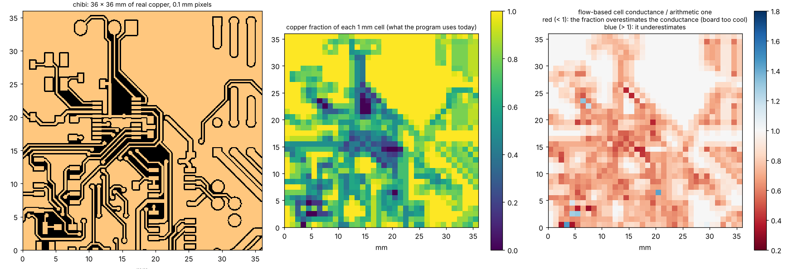
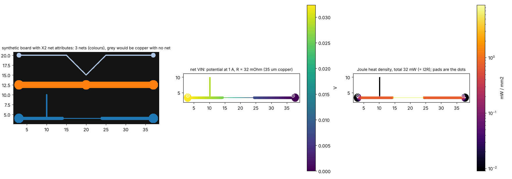
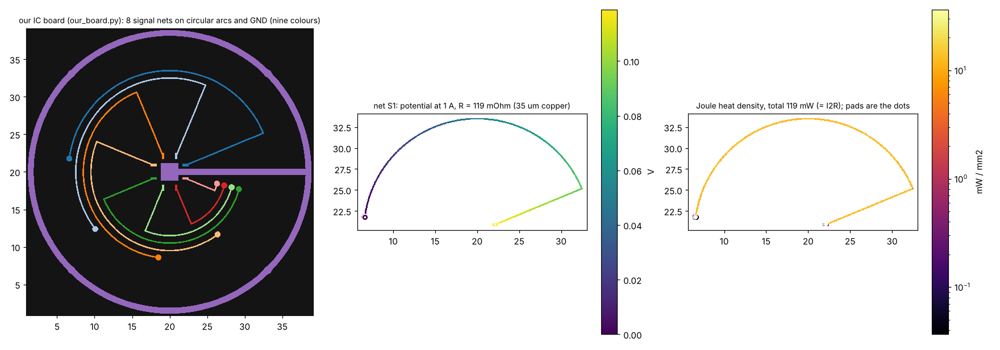
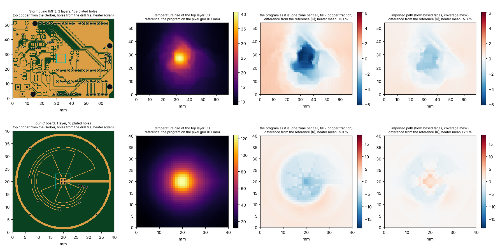

# Gerber import: from copper vectors to the conductances of the grid

Status: **open**, a research branch (`research/gerbers`, started 2026-10-22): **nothing in `pcbthermal/` was changed**. This folder holds the studies, their tests and the conclusions, so that the work can be repeated and the decision taken later. **Start with [`CONCLUSIONS.md`](CONCLUSIONS.md)**; how the result would enter the program, line by line, is in [`INTEGRATION.md`](INTEGRATION.md); what was read and how, in [`LOG.md`](LOG.md); the text that would go into the project documents, in [`docs/`](docs/). The layout is the one of every research folder (`CLAUDE.md`, "Research branches"): documents in the root, executable Python in `scripts/`, shared code in `lib/`, `tests/`, `figures/`, `docs/`.

## 1. The questions

A Gerber file is vector data: strokes with a width, flashes and filled regions. The program's finite-volume model works on a grid of square cells and, today,
knows only one number per cell and layer: the **fraction of copper** (and, for a zone, the fill typed by the user).

1. Can the Gerber be converted to exact polygons, with holes and islands? **Yes** (4.1).
2. Can it be read **without third-party licences**? **Yes**: an independent reader that needs only NumPy (section 5).
3. How should the copper be turned into the conductances of a grid of squares? The fill fraction is badly biased; better mappings exist (4.4 to 4.12).
4. What are the cautions (hatched zones, thick copper, several layers, heater size, time response, the program's own tests)? Investigated, 4.6 to 4.14.
5. Does it work through the program's own solver? **Yes, without changing it** (4.14).

## 2. Findings in short

| Item | Result |
| :-- | :-- |
| Vectors to polygons | Exact with gerbonara + shapely (union keeps holes and islands). One Uno-clone layer: 103 polygons, 80 holes, 43 285 vertices. |
| Reading without libraries | `native_gerber.py` (NumPy only) draws the copper directly from the file: within 0.9 % of the copper area of the gerbonara route (max 2.5 %), same board boxes, same drills; unsupported features are reported, not guessed. |
| Raster | Area within 0.2 % at 0.1 mm pixels; a binary raster **interrupts** traces thinner than about 1.4 pixels: pixel of at most half the thinnest trace (0.05 mm for 0.1 mm traces). |
| **Fill fraction (today)** | **Too cool by 10 to 11 %** on average (single layer, 35 µm, 42 windows of 7 real boards), 14 % with plated holes on two layers, 3 to 7 % on a real four-layer board, up to 18 % with 140 µm copper, and **7 to 43 % for regular 50 % patterns**. Never too hot: the average assumes the copper is connected where clearances cut it. |
| Geometric mean | `S = S_cu^f S_lam^(1 - f)` from the fraction alone: 2 to 3 % on real copper, but **-20 to +22 % on regular patterns** (connected grids too hot, islands too cool): a fallback, not a rule. |
| Directional bounds, lambda = 0.5 | `Sx`, `Sy` per cell from a fine mask: 1.0 to 1.3 % (single layer, 0.6 and 1.0 mm cells), 0.5 to 1.0 % with plated holes, but 1.3 to 7.5 % on the four-layer board and +10 to +12 % for diagonal stripes at 0.6 mm cells. |
| **Flow-based faces** | The most robust: 0.6 to 0.9 % (single layer), 0.4 to 1.3 % (two layers), 0.3 to 2.0 % (four layers), 0.9 to 3.4 % on every regular pattern at 1 mm cells (diagonal stripes included). It costs 5.5 s per 1.6 M pixels (a 100 x 160 mm layer at 0.1 mm), once, at import. |
| In the program | The same numbers through `pcbthermal.fvm.Network` (agreement with the research solver to 3e-12): only the conductances change. **Applying the geometric mean to the program's `Zone.fill` would change a hatched zone by +26 to +45 %** and four exact-value tests by 0.05 to 0.07 K: the zone fill and the imported copper must stay separate things. |
| Time response | Heat capacity stays an arithmetic average; with the new conductances the response follows the steady one (0.7 to 3.2 % at 120 s). |
| Lumped and Analytic | Lumped inherits a better `S` (13 % to 4.8 %); Analytic needs one effective conductance, a heater-influence-weighted geometric-type mean (18.6 % to 5.9 %), section 4.16. |
| Scope | Copper layers 50 of 52 non-empty classified files drawn; drills 38 of 38 read, 35 of 35 identical to gerbonara (after fixing inverted TZ/LZ and other defects); reader refuses what it cannot do, including a drill file with no unit (4.19). |
| Tracks at an angle | Area exact except at 45 degrees on the lattice (±6 %); a track as narrow as the pixel breaks into pieces with 4-connectivity (not with 8); the five-point stencil is up to 2x too resistive on a tilted 1.5 to 2 px track, 6 % at 12 px across (4.23). |
| Nets and heat | The X2 attribute `TO.N` gives the net of pads and tracks; zone fills may carry none; `joule.py` solves the current in a net and returns `I²R` per cell (4.20). |
| Other tools | On 14 files of known area the independent reader equals gerbonara + shapely and pcb-tools (binary) to the digit; the error is the pixel (thin tracks), a grey-level coverage keeps 4.4 % where binary masks lose 22 % at 0.1 mm; pygerber is strict and heavier, pcb-tools failed on real boards (4.22). |
| Reader conformance | 149 of 164 comparable gerbonara test files agree within 3 % of the area; 6 refused as unsupported (4.17). |
| Cell size | 0.6 and 1.0 mm cells map well; at 2 mm every method is limited by the grid itself (the 6 mm heater has 3 x 3 cells). |

## 3. Folder layout

Scripts are run from the repository root (`research/gerbers/.venv/bin/python research/gerbers/scripts/<script>.py`) and import the modules of `lib/` through `scripts/_bootstrap.py`; the tests find `lib/` and `scripts/` through `tests/conftest.py`. `data/` (downloaded boards, conformance and synthetic files), `out/` (caches and results) and `.venv/` are git-ignored.

| Path | What it is |
| :-- | :-- |
| `README.md` | This file: the questions, the findings, the layout, and the results in numbered sections. |
| `CONCLUSIONS.md` | The conclusions, the comparison with the three articles, the validated numbers with the test of each claim, the limits and the decisions left open. |
| `INTEGRATION.md` | How the result would be applied in the program: where, what changes, what does not (section 0: why not polygons and why an interface). |
| `LOG.md` | Dated log: what was read in full, from a summary or from memory; what was reproduced and what not. |
| `requirements.txt` | NumPy and SciPy; gerbonara, shapely and the comparison tools only for the cross-checks. |
| `docs/` | For when the work is adopted: `research.md` summary, `changelog.md`, `decisions-log.md`, `roadmap-entry.md`, `literature.md` (the literature status). The project documents are not edited on this branch. |
| `figures/` | `fig_01` to `fig_08`, committed on purpose, linked from the README files: 01 angles on the pixel grid, 02 nets and Joule heat (our own synthetic board with X2 net attributes), 03 copper mapping to cells (a window of the Stormduino board, MIT), 04 to 06 our IC board (nets and Joule heat, thermal maps, the Gerber render), 07 the import end to end, 08 its set-up (heater, holes, cells). |
| `tests/` | 71 fast tests (about 21 s): the solvers and mappings, the Gerber and Excellon readers on synthetic files, nets and holes, the claims (`test_claims.py`), the program's union rule (`test_program_union.py`, needs the program's dependencies), our board (`test_our_board.py`), the import path (`test_importer.py`, needs the program's dependencies). |
| **`lib/`** | |
| `lib/native_gerber.py` | **Independent reader and rasteriser (NumPy only)**: RS-274X (apertures, macros, arcs, regions, polarity, step and repeat), X2 attributes (file function, aperture functions, net names), the layer classifier, Excellon, coverage masks. |
| `lib/conduction.py` | The conduction solvers (one layer, two, a stack) and **every mapping**: power mean, Bruggeman, Hashin-Shtrikman, bounds, lambda, cell problem, flow-based faces. |
| `lib/scenarios.py` | Boundary-limited scenarios (posts, held border) and the comparison of the mappings against a resolved reference. |
| `lib/joule.py`, `lib/nets.py` | Current and Joule heat of a net; holes, vias, pads and nets matched by position. |
| `lib/readers.py`, `lib/gerber_geometry.py`, `lib/windows.py` | One interface to the readers; the vector route (gerbonara + shapely); the 42 windows of 36 mm of the mapping studies. |
| `lib/boards_synthetic.py`, `lib/our_board.py` | The synthetic board generator of the tests; **a board of our own** (IC, circular tracks, nets, vias, drill file), 4.30. |
| `lib/importer.py` | **The import path end to end**: files to masks, holes and nets, a `Problem` with vias, face conductances and `FaceNetwork` for the program's FVM (4.31). |
| `lib/paths.py` | The folders (`DATA`, `OUT`, `FIGURES`, `REPO`). |
| **`scripts/`** | |
| `scripts/fetch_boards.py` | Downloads the public test boards into `data/` (licences differ, section 9). |
| `scripts/study_raster_error.py`, `study_native_check.py` | Area, thin traces, pixel size (4.2, 4.3); the reader against gerbonara + shapely (section 5). |
| `scripts/study_mapping.py`, `study_fine_scan.py`, `study_scalar_formulas.py`, `study_contrast.py`, `study_heater_size.py`, `study_transient.py` | The mappings on the 42 windows and their parameters (4.4 to 4.10). |
| `scripts/study_patterns.py`, `study_patterns_two_layer.py`, `study_two_layer.py`, `study_multilayer_real.py` | Regular patterns, two layers with plated holes, a real four-layer board (4.11 to 4.13). |
| `scripts/prototype_in_program.py`, `bench_mapping_cost.py` | The mappings through the program's own `fvm.Network` (4.14); time and memory (4.15). |
| `scripts/study_lumped_analytic.py`, `study_models_self.py` | The mappings in the five models of the program (4.16, 4.27; run against a copy of the program with an additive zone union, set `PYTHONPATH`). |
| `scripts/study_reader_conformance.py`, `study_reader_scope.py`, `study_gerber_writer.py` | The reader against gerbonara's test files, copper layers and drills, and Ucamco's `gerber-writer` (4.17, 4.19, 4.24; the last needs `pip install gerber-writer`). |
| `scripts/make_synthetic.py`, `compare_readers.py` | Files of known area made with gerbonara; the comparison with gerbonara, pygerber and pcb-tools (4.22; needs `pip install gerbonara pygerber pcb-tools shapely pillow`). |
| `scripts/study_angles.py`, `study_net_joule.py`, `study_vias_nets.py` | Tracks at any angle (4.23); the heat of a net (4.20); holes, vias and nets (4.29). |
| `scripts/study_sampson_boundary.py`, `study_post_board.py`, `study_coverage.py`, `study_coverage_real.py` | The regime of Sampson's article and its board analogue (4.25, 4.28); coverage masks (4.26). |
| `scripts/study_import_end_to_end.py`, `study_import_readers.py` | The import on the Stormduino and on our board against the program as it is; the same with another reader (4.31). |
| `scripts/make_figures.py` | Draws the eight figures into `figures/`. |

## 4. How to run, and the results

```sh
python3 -m venv research/gerbers/.venv && research/gerbers/.venv/bin/pip install -r research/gerbers/requirements.txt
research/gerbers/.venv/bin/python research/gerbers/scripts/fetch_boards.py          # once
research/gerbers/.venv/bin/python -m pytest -q research/gerbers/tests                # 68 tests, about 17 s
research/gerbers/.venv/bin/python research/gerbers/scripts/study_mapping.py          # 2 min (4 cores); builds the windows on first use
# the others, from the repository root in the same way: study_raster_error (3 min), study_fine_scan (2), study_scalar_formulas (1), study_contrast (7), study_heater_size (2), study_transient (1),
# study_patterns (1), study_patterns_two_layer (3), study_two_layer (2), study_multilayer_real (5), study_native_check (1), prototype_in_program (3, needs the repository's dependencies)
```

The studies use one copper sheet of 35 µm (385 W/mK) on 1.6 mm of FR-4 (0.9 W/mK in plane), 10 W/m²K on each face, and compare the temperature of a heated
block (mean and maximum) with a **reference**: the copper mask solved as it is, pixel by pixel, at 0.1 mm. The coarse grids (0.6, 1.0, 2.0 mm cells) are built
from the same mask, so the error of a mapping is isolated from the fidelity of the pixels. `MAE` is the mean of the absolute errors; `bias` the mean signed error
(negative = too cool = optimistic). All numbers below come from the default (independent) reader.

### 4.1 Vectors to polygons (Stormduino, an Arduino Uno clone)

gerbonara turns every draw, flash and region into primitives; shapely unions them in file order, adding dark and subtracting clear polarity. The top layer has
6 654 primitives (6 117 are 0.254 mm strokes: the copper pour is drawn as hatch lines) and unions into **103 polygons with 80 holes and 43 285 vertices** (12 462
after simplifying by 5 µm, with 0.07 % less area); the bottom layer 69 polygons, 44 holes, 26 288 vertices. As WKB the polygons are 300 to 500 KB; the same layer
as a 0.1 mm PNG mask is 9 to 12 KB.

### 4.2 Raster against the exact area (`study_raster_error.py`)

| Pixel (mm) | Area error, top / bottom | RMS error per 1 mm cell (top) | Max error per 1 mm cell (top) |
| --: | --: | --: | --: |
| 0.2 | +0.18 % / +0.48 % | 0.0375 | 0.180 |
| 0.1 | -0.19 % / -0.02 % | 0.0200 | 0.101 |
| 0.05 | 0.00 % / +0.08 % | 0.0080 | 0.064 |
| 0.025 | +0.02 % / +0.03 % | 0.0036 | 0.023 |

Anti-aliasing (4 x 4 samples) at 0.1 mm gives the same as a binary raster at 0.025 mm: only the number of samples matters.

### 4.3 Thin traces and the pixel (`study_raster_error.py`)

Binary raster, synthetic traces at random sub-pixel offsets and two angles (200 each). The mean area kept is always about 100 %; what counts is the share of
traces that come out **interrupted**:

| Trace (mm) | Pixel 0.2 | Pixel 0.1 | Pixel 0.05 | Pixel 0.025 |
| --: | --: | --: | --: | --: |
| 0.05 | 86 % | 26 % | 0 % | 0 % |
| 0.075 | 27 % | 16 % | 0 % | 0 % |
| 0.10 | 24 % | 0 % | 0 % | 0 % |
| 0.15 | 15 % | 0 % | 0 % | 0 % |
| 0.20 and wider | 0 % | 0 % | 0 % | 0 % |

The reference also depends a little on the pixel (single layer, 5 x 5 mm heater): 0.2 mm +2.1 %, 0.1 mm +0.2 % against 0.05 mm.

### 4.4 The mappings on 42 windows (`study_mapping.py`)



*Figure 3 (`figures/fig_03_copper_mapping_to_cells.png`): a window of the top copper of the Stormduino board (Stormduino Rev 2.2, MIT licence, https://github.com/Chromico/stormduino, downloaded by `fetch_boards.py storm`; window 2 of the fixed-seed set); the fraction of copper per 1 mm cell (what the program uses today) and where the flow-based conductance is lower (red) or higher (blue) than the arithmetic one.*

Methods (all give the face conductances the solver uses; for the first four the face is the harmonic mean of the two cells, as the FVM does):

* **pmean(p)**: cell sheet conductance `(f S_cu^p + (1 - f) S_lam^p)^(1/p)` from the fill fraction alone. `p = 1` is the program's fill fraction, `p = 0` the geometric mean, `p = -1` the harmonic mean.
* **lam(l)**: directional, `low^(1 - l) * up^l` per direction, with `low` = rows in parallel of series chains (no cross flow, a lower bound) and `up` = series of parallel columns (equipotential column faces, an upper bound).
* **cellnum**: numerical upscaling, a local conduction problem on the cell (potential fixed on two faces, the other two insulated).
* **dual(m)**: flow-based face conductance, a local problem on the window that spans the centres of the two cells, with `m` rows of oversampling margin (transmissibility upscaling, as for reservoir grids).

MAE of the mean-temperature error (%), with the bias in brackets:

| Method | 0.6 mm cells | 1.0 mm | 2.0 mm |
| :-- | --: | --: | --: |
| pmean 1 (fill fraction, today) | 9.7 (-9.7) | 11.3 (-11.3) | 11.1 (-11.0) |
| pmean 0 (geometric mean) | 2.2 (-1.0) | 2.4 (-0.8) | 3.0 (+1.7) |
| pmean -1 (harmonic) | 10.2 (+10.2) | 13.7 (+13.7) | 20.9 (+20.9) |
| lam 0 (low) | 2.6 (+2.6) | 4.5 (+4.5) | 9.5 (+9.5) |
| **lam 0.5** | **1.0 (+0.2)** | **1.3 (+0.7)** | 3.2 (+3.2) |
| lam 0.75 | 1.5 (-0.9) | 2.0 (-1.0) | 2.1 (+0.4) |
| lam 1 (up) | 2.3 (-1.9) | 3.1 (-2.6) | 3.6 (-2.2) |
| cellnum | 1.1 (+0.8) | 1.7 (+1.5) | 4.2 (+4.2) |
| dual, m = 0 | 0.6 (-0.1) | 0.9 (+0.4) | 3.6 (+3.6) |
| dual, m/n about 0.2 | 0.7 (-0.4) | 0.8 (+0.2) | 3.1 (+3.1) |

Per board (MAE over the three sizes) the fill fraction is 6.7 to 15.2 % off on every board; lambda = 0.5 is 1.1 to 2.3 % on six boards and 4.4 % on the sparse one
(`fritz`, 18 % copper), where the flow-based faces are best (2.3 to 2.9 %).

### 4.5 Scalar formulas from the fraction alone (`study_scalar_formulas.py`)

| Formula | 0.6 mm | 1.0 mm | 2.0 mm |
| :-- | --: | --: | --: |
| arithmetic (today) | 9.7 (-9.7) | 11.3 (-11.3) | 11.1 (-11.0) |
| geometric | 2.2 (-1.0) | 2.4 (-0.8) | 3.0 (+1.7) |
| Bruggeman 2D | 2.4 (-1.0) | 2.7 (-0.8) | 3.7 (+1.4) |
| Hashin-Shtrikman, geometric mean of the two bounds | 2.1 (-1.0) | 2.2 (-0.7) | 2.8 (+2.0) |
| HS lower / HS upper | 4.3 (+4.1) / 5.6 (-5.6) | 5.8 (+5.7) / 6.3 (-6.3) | 10.3 (+10.2) / 5.5 (-5.1) |

The classical effective-medium formulas of an isotropic 2D two-phase medium give nothing better than the geometric mean (for f = 1/2 Bruggeman is exactly the
geometric mean); they cannot tell a connected copper network from isolated islands, because they only see the fraction.

### 4.6 Fine scan of the parameters (`study_fine_scan.py`)

* Exponent `p`: the minimum is at **-0.05 to 0** for 0.6 and 1.0 mm (MAE 2.1 to 2.4 %); at 2 mm it moves to +0.10. So the geometric mean (`p = 0`) is the natural choice of a scalar.
* Weight `lambda`: the minimum is at **0.5 to 0.6** (average MAE 1.6 to 1.8 %); 0.5 is best at 0.6 and 1.0 mm, 0.7 at 2 mm.

### 4.7 Copper thickness (`study_contrast.py`)

MAE (bias) for 18, 35, 70 and 140 µm of copper (contrast copper / laminate 4.8, 9.4, 18.7, 37.4):

| Copper | Method | 0.6 mm | 1.0 mm | 2.0 mm |
| --: | :-- | --: | --: | --: |
| 18 µm | fill fraction | 5.7 (-5.7) | 6.4 (-6.3) | 5.1 (-4.8) |
| | geometric mean | 1.1 (-0.3) | 1.3 (+0.3) | 3.5 (+3.4) |
| | lam 0.5 / lam 0.7 | 0.6 (+0.3) / 0.7 (-0.2) | 1.1 (+1.0) / 0.9 (+0.2) | 4.1 (+4.1) / 2.7 (+2.7) |
| 35 µm | fill fraction | 9.7 (-9.7) | 11.3 (-11.3) | 11.1 (-11.0) |
| | geometric mean | 2.2 (-1.0) | 2.4 (-0.8) | 3.0 (+1.7) |
| | lam 0.5 / lam 0.7 | 1.0 (+0.2) / 1.4 (-0.6) | 1.3 (+0.7) / 1.8 (-0.6) | 3.2 (+3.2) / 2.0 (+0.9) |
| 70 µm | fill fraction | 13.0 (-13.0) | 15.1 (-15.1) | 15.6 (-15.6) |
| | geometric mean | 3.4 (-1.7) | 3.7 (-1.8) | 3.9 (-0.1) |
| | lam 0.5 / lam 0.7 | 1.5 (+0.3) / 2.0 (-0.9) | 2.0 (+0.6) / 2.8 (-1.3) | 2.9 (+2.4) / 3.0 (-0.7) |
| 140 µm | fill fraction | 14.9 (-14.9) | 17.0 (-17.0) | 17.8 (-17.8) |
| | geometric mean | 4.4 (-2.3) | 4.8 (-2.7) | 4.9 (-1.4) |
| | lam 0.5 / lam 0.7 | 2.1 (+0.4) / 2.6 (-1.0) | 2.6 (+0.5) / 3.7 (-1.8) | 3.2 (+1.8) / 4.1 (-1.8) |

The fill fraction gets worse as the copper gets thicker; lambda 0.5 to 0.7 stays the best at 0.6 and 1.0 mm for every thickness (0.6 to 0.7 for thin copper, 0.5 for heavy).

### 4.8 Heater size (`study_heater_size.py`)

MAE of the block-mean temperature, square heaters on the 42 windows:

| Heater | Cells | fill fraction | geometric | lam 0.5 | cellnum | dual |
| --: | --: | --: | --: | --: | --: | --: |
| 1.2 mm | 0.6 | 10.3 | 4.4 | 5.0 | 5.8 | 3.8 |
| 3 mm | 0.6 | 11.3 | 3.0 | 1.5 | 1.8 | 1.0 |
| 3 mm | 1.0 | 12.3 | 3.6 | 3.1 | 3.9 | 2.5 |
| 6 mm | 0.6 | 9.7 | 2.2 | 1.0 | 1.1 | 0.6 |
| 12 mm | 1.0 | 7.3 | 1.6 | 0.7 | 0.7 | 0.5 |

A heater of a few cells is the hard case (the part sits on a few mapped cells); the flow-based faces are best at every size, and the maximum temperature is less sensitive than the mean (lam 0.5 on the 1.2 mm heater: 2.1 % on the maximum, 5.0 % on the mean).

### 4.9 Time response (`study_transient.py`)

Implicit Euler, 1 W step, 14 windows, error of the block-mean temperature (heat capacity as an arithmetic average in every row):

| Cells | Method | 0.1 s | 1 s | 10 s | 120 s |
| --: | :-- | --: | --: | --: | --: |
| 0.6 mm | fill fraction | +1.2 | -4.3 | -13.8 | -14.0 |
| | geometric | +3.0 | +1.1 | -1.1 | -1.9 |
| | lam 0.5 | +3.1 | +1.9 | +1.2 | +0.5 |
| | dual | +2.7 | +1.6 | +0.6 | -0.1 |
| 1.0 mm | fill fraction | +3.4 | -3.3 | -15.5 | -16.2 |
| | lam 0.5 | +5.5 | +4.6 | +2.6 | +1.1 |
| | dual | +5.1 | +3.9 | +1.9 | +0.6 |

The first fraction of a second is dominated by the heat that has not left the block yet (the coarse grid itself): that error is the same for every mapping; from 10 s on the response follows the steady one.

### 4.10 Scalar versus fill of a zone: what the program does today (`prototype_in_program.py`, and a scratch copy of the program)

The program computes `S = f k_cu t_cu + k_lam (slab - f t_cu)` (`fvm.py:78`, `fdm.py:134`; `solid3d.py:153`, `analytic.py:139,166`) with `f` the union of the zones, each zone a polygon times
its `fill`. With the geometric mean in those lines (a scratch copy, not committed):

| Board, 100 x 80 mm, 2 layers, 4 W at the centre | zone fill 1 | 0.75 | 0.5 | 0.25 |
| :-- | --: | --: | --: | --: |
| rise of the FVM today (K) | 79.4 | 91.4 | 110.0 | 144.3 |
| rise with the geometric mean | 79.4 | 115.5 | 159.3 | 204.2 |
| change | 0 | +26 % | +45 % | +42 % |

(FDM, Lumped and Analytic move by the same amount.) Test battery on the scratch copy: 321 passed, 6 failed, 38 not run (the GUI stress test); two of the failures are only the documents missing from the copy,
the other four are exact-value tests that move by 0.05 to 0.07 K (the 85.34 °C of the example board becomes 85.39; the "outline equals the smaller board" tests for the FVM, FDM and 3D solid differ by 0.07 to 0.08 K).
So **boards without partial copper do not change; a hatched zone changes by tens of percent**: `Zone.fill` is a number typed by a person ("50 % copper") and its meaning depends on the pattern (4.11).
The conclusion: do not change the zone formula; give the imported copper its own element.

### 4.11 Regular patterns: what "fill 0.5" means (`study_patterns.py`, `study_patterns_two_layer.py`)

Synthetic patterns of about 50 % copper (pitch 1 mm), single layer and a two-layer board as the program models it (patterned top over a full plane, or over bare laminate). Error of the block-mean
temperature of the top layer (%), cells of 1 mm; positive = too hot:

| Pattern | fill fraction (today), over plane / bare | geometric | lam 0.5 | dual |
| :-- | --: | --: | --: | --: |
| stripes 0 / 90 degrees | -17.8 / -28.1 | +4.1 / +1.5 | +1.0 / +1.1 | +1.0 / +1.1 |
| stripes 45 degrees | -19.0 / -28.9 | +2.5 / +0.2 | +2.4 / +0.0 | +3.4 / +1.9 |
| cross-hatch (a connected grid) | -9.0 / -12.6 | **+14.8 / +22.5** | -0.4 / -0.9 | +1.3 / +1.6 |
| isolated squares | **-31.2 / -43.4** | -12.5 / -19.5 | +1.1 / +1.1 | +2.0 / +2.5 |
| perforated plane | -11.0 / -15.6 | +13.6 / +20.7 | +1.2 / +1.4 | +0.9 / +0.9 |

* The same 50 % can mean a connected grid (heat flows well), stripes (well one way) or islands (almost not at all): **no scalar function of the fraction is right for all of them**, and the program's arithmetic value is the optimistic limit: 7 to 43 % too cool on every pattern.
* The flow-based faces are within 0.1 to 3.4 % on all of them at 0.6 and 1.0 mm cells; lambda 0.5 within 0.0 to 2.4 % except the diagonal stripes at 0.6 mm cells (+9.8 % over a plane, +12.0 % over bare laminate: a five-point grid has no cross term), where the flow-based faces stay at +1.4 and -0.1 %.
* So a hatched or perforated zone drawn in the program should say which pattern it is (`pattern`: solid, hatch lines, cross-hatch, islands, perforated, with a pitch): the program can then synthesise the mask and use the same mapping as for an imported board.

### 4.12 Two layers with plated holes (`study_two_layer.py`)

Stormduino, both layers resolved, 109 drilled holes as copper barrels (25 µm plating), FR-4 0.3 W/mK through the 1.53 mm gap, 6 x 6 mm heater on the top layer at three random places. MAE (%):

| Method | 0.6 mm | 1.0 mm | 2.0 mm |
| :-- | --: | --: | --: |
| fill fraction | 13.6 | 14.9 | 14.4 |
| geometric mean | 3.9 | 4.1 | 2.8 |
| **lam 0.5** | **1.0** | **1.0** | **0.5** |
| cellnum | 0.2 | 0.5 | 2.2 |
| dual, m = 0 | 1.3 | 0.4 | 1.2 |

### 4.13 A real four-layer board (`study_multilayer_real.py`)

A Cadence Allegro board (inner GND and VCC planes, 283 plated holes), six random 30 x 30 mm windows, the 4-layer stack-up of the program (35 / 15.2 / 15.2 / 35 µm copper, 210 / 1065 / 210 µm FR-4, each layer node its copper plus
half of the adjacent gaps), every hole a barrel across all the gaps, 6 x 6 mm heater on the top layer. MAE (bias) of the block-mean temperature (%):

| Stack-up | Cells | fill fraction | geometric | lam 0.5 | lam 0.9 | cellnum | dual |
| :-- | --: | --: | --: | --: | --: | --: | --: |
| 1 oz outer / 0.5 oz inner | 0.6 | 3.0 (-3.0) | 0.4 (+0.4) | 1.5 (+1.5) | 1.3 (+1.3) | 1.6 (+1.6) | **0.3 (0.0)** |
| | 1.0 | 4.6 (-4.6) | 1.5 (+1.5) | 2.8 (+2.8) | 2.5 (+2.5) | 2.9 (+2.9) | **1.1 (+1.0)** |
| | 2.0 | 5.8 (-5.8) | 4.2 (+4.2) | 7.5 (+7.5) | 6.8 (+6.8) | 7.7 (+7.7) | **2.0 (+1.7)** |
| 2 oz outer / 1 oz inner | 0.6 | 3.1 (-3.1) | 0.3 (+0.1) | 1.3 (+1.3) | 1.2 (+1.2) | 1.4 (+1.4) | **0.3 (0.0)** |
| | 1.0 | 5.0 (-5.0) | 0.9 (+0.9) | 2.4 (+2.4) | 2.1 (+2.1) | 2.5 (+2.5) | **1.0 (+0.8)** |
| | 2.0 | 6.9 (-6.9) | 2.8 (+2.8) | 6.1 (+6.1) | 5.6 (+5.6) | 6.3 (+6.3) | **1.4 (+0.9)** |

With strong vertical coupling (planes and many holes) the mapping matters less (the fill fraction is 3 to 7 % off instead of 10 to 14 %), the bounds-based methods become pessimistic (+1.3 to +7.7 %), and only the flow-based faces
stay within 0.3 to 2.0 % everywhere: the bounds assume the heat has to cross each cell in the plane, while here it also leaves through the holes and the dielectric.

### 4.14 Through the program's own solver (`prototype_in_program.py`)

The program's network (`fvm.Network`: cells, heater, losses, assembly, sparse solve) is built as usual and only the conductances are replaced: for a scalar mapping the `S` array; for the directional and the flow-based ones a 20-line subclass
whose assembly takes the face conductances as given (stage 2 and 3 of `INTEGRATION.md`). One window per board, reference the program's own FVM on the 0.1 mm grid:

* the program's FVM and the research solver agree to **3e-12** (relative) on the same conductances: the studies are the program's numerics;
* MAE over the 7 windows: 0.6 mm cells: fill fraction 9.7 %, geometric 1.8 %, lam 0.5 0.8 %, flow-based 0.4 %; 1.0 mm cells: 11.5 %, 2.2 %, 1.3 %, 0.8 %.

### 4.15 Cost (`bench_mapping_cost.py`)

Per layer, 1 mm cells, 0.1 mm pixels, one core: `lam` 0.00 to 0.02 s; the flow-based faces 0.6 s (200 000 pixels), 1.6 s (480 000), 2.7 s (800 000), 5.5 s (1 600 000 = 100 x 160 mm); the cell problem about the same.
Peak memory about 830 bytes per pixel (1.3 GB for 1.6 M pixels): a larger board is processed in strips (not implemented here). The cost is paid once, at import, and the result is cached with the project.

### 4.16 The Lumped and Analytic models (`study_lumped_analytic.py`)

Both models take the copper only through the `fill` of the zones, so an imported mask can reach them through the public API with no change of the program: one zone per 1 mm cell whose `fill` gives, through the program's formula `S = b + f (a - b)`, the wanted conductance. 42 windows, 1 W on a 6 x 6 mm heater, error of the mean heater rise against the resolved 0.1 mm copper (MAE, bias in brackets):

| conductance of the 1 mm cell | FVM | Lumped | Analytic |
|---|---|---|---|
| arithmetic fraction (today) | 11.9 % (-11.9) | 13.0 % (-13.0) | 18.6 % (-18.6) |
| geometric mean | 2.6 % (-0.9) | 4.8 % (-3.8) | 12.2 % (-12.2) |
| lambda 0.5 mean of the bounds | 2.9 % (-2.0) | 4.9 % (-4.4) | 12.5 % (-12.5) |
| mean of the four flow-based faces | 4.0 % (-3.9) | 4.9 % (-4.2) | 12.4 % (-12.4) |

* **Lumped** reads the sheet conductance of the FVM network and averages it over rings, so it inherits any better `S`: 13 % falls to about 4.8 %, and that residual is its own model error (it is about the same with the FVM-quality mapping), not the mapping's.
* **Analytic** treats the board as one uniform sheet around the heater, so per-cell conductances do not help (12 % left). It needs one effective conductance weighted by the influence of the heater, K0(r / lambda). Arithmetic weighting is 18.6 % too cool; the weighted **geometric-type mean** (power mean with p between -0.2 and -0.1) gives MAE 5.9 %, the flow-based effective conductance of the window 7.1 %, the harmonic mean 24.7 % too warm.
* Internet search (2026-10-22): nothing found that treats the copper fraction of a Lumped (thermal network) or cosine-series model of a PCB; the literature on effective conductivity of PCBs uses area-weighted (arithmetic) copper fractions for the in-plane value, which is what the program does today and what the numbers above show to be too cool on real layouts.

### 4.17 The independent reader against gerbonara on gerbonara's own test files (`study_reader_conformance.py`)

272 Gerber-like files of gerbonara's test resources (many CAD tools; each small file tests one feature), drawn by both readers on the same pixels (pixel = half the thinnest aperture, 0.02 to 0.2 mm). Files with a feature thinner than 1.5 pixels at the finest pixel (82) are left out. Of 164 files both readers draw, **149 agree within 3 % of the area** (median difference 0.04 %, median differing pixels 0.0 %); 6 are refused (5 Upverter files with a non-standard `Rect` aperture shape, 1 file with an image mirror `MIA1B0`), none is read by the independent reader and refused by gerbonara. Time: 51 s against 323 s (gerbonara + shapely sampling).

The first run found four defects, now fixed and covered by tests: comment statements inside a macro (`0 text`), a straight region after a region closed by a G03 arc (the interpolation mode was not reset), a non-standard aperture shape reported as a file error instead of "unsupported". The 15 files that still disagree are almost all not copper layers (silkscreen and outline files with open contours, zero-length lines and strokes with arcs; 4 to 20 %); two small spec-test files differ on purpose: in `example_holes_dont_clear.gbr` and `example_am_exposure_modifier.gbr` the file itself states that an aperture hole or a macro clear primitive must **not** clear what was drawn before, which the independent reader follows (+7 % and +6 %) and gerbonara does not. The stroke differences on open outlines are not yet explained; they do not touch copper layers or the boards of the study.

### 4.18 How the independent reader differs from the others (as read on 2026-10-22; details of the other projects from their documentation, not all verified by running them)

| | independent reader (`native_gerber.py`) | gerbonara | pygerber | pcb-tools |
|---|---|---|---|---|
| licence | part of the project, NumPy only | Apache-2.0 | MIT | Apache-2.0, unmaintained |
| what it produces | a pixel mask of the copper, directly | vector objects, can modify and write files | renders images (and 2D shapes) following the 2024.05 spec | objects, Cairo rendering |
| dependencies | NumPy | several (including shapely in this study for sampling) | pydantic, pillow and others | Cairo, others |
| Excellon | tolerant (Allegro, OrCAD comment tables, repeat command, slots); declared counts match | refuses some Allegro/OrCAD files | spec files | basic |
| features | RS-274X without AB, LM/LR/LS, moire, mirror, scale; no writing | the most complete of these | the most spec-faithful in intent | older subset |
| unsupported content | reported with an error | mostly handled | varies | silently wrong in places |
| checked on | 8 real boards and 164 test files (149 agree) | the reference here, itself not a ground truth | not run in this study | not run in this study |

Honest summary: the independent reader is not a better reader, it is a smaller one that does one job (rasterise copper and holes) with no library whose licence the closed product would have to carry. It supports fewer features, is validated on fewer files, and its remaining disagreements are on silkscreen/outline files and on two spec edge cases where it follows the spec text.

### 4.19 What can be read: copper layers and drill files (`study_reader_scope.py`)

Only copper layers and drills matter for the program (silkscreen, mask, paste and assembly are ignored; the classifier uses the X2 file function or the file name). On gerbonara's test resources and the downloaded boards:

* **Copper**: 54 files are classified as copper layers; 50 are drawn by the independent reader, 2 are refused (Upverter files with a non-standard `Rect` aperture), 2 had no content. Against gerbonara + shapely: 45 of 50 within 3 % of the area, median difference 0.02 %, worst 16.2 %. 8 files carry net names.
* **Drills**: 38 files look like Excellon. All 38 are read by the independent reader; gerbonara reads 35 (it refuses the OrCAD, the PADS file without header and a file with a deliberate syntax error). **On the 35 read by both, the holes are identical (positions to 0.01 mm, diameters to 1 µm) in all 35**, after the fixes below.
* **The first drill comparison found real errors in the reader** (the earlier claim "identical" had compared only the hole *counts*): the Excellon zero options were inverted (`TZ` keeps trailing zeros and omits leading ones, `LZ` the opposite; the Gerber wording is the reverse), the format written as `000.000` or `0000.00` in the header or as `;FILE_FORMAT=3:3` in a comment was ignored, `M71`/`M72` as the unit were ignored, a tool line such as `T1F00S00C0.300` lost its diameter, and a routed path with several `G01` segments gave one hole instead of one per segment. All fixed and covered by tests (`test_excellon_*`). A file with no unit anywhere (a PADS drill without header) is now **refused** ("choose the unit") instead of guessed: a wrong guess would place every hole 25 times wrong.
* **So: can any Gerber be read? No, and the reader says why.** Supported: RS-274X with the features of section 5; Excellon from 15 CAD tools in the test set. Refused with a message: aperture blocks, mirrored/rotated/scaled apertures, moire, image offset/mirror/scale, non-standard aperture shapes, a drill file without a unit. Plated and non-plated holes are told apart only when the file says so (comments, X2 `FileFunction` of the drill file). The layer assignment (which file is which copper layer) comes from the X2 attribute or the name, and the user confirms it.

### 4.20 Nets: how much does the 5 V net heat up? (`joule.py`, `study_net_joule.py`, `tests/test_joule.py`)

**Can polygons be mapped to a net? Yes, if the CAD tool wrote it.** KiCad (and others) write the X2 object attribute `%TO.N,<net>*%` before the objects of a net (`%TD*%` ends it). The reader now keeps the net of every operation (`Layer.nets`, `Layer.net_names()`, `Layer.draw(canvas, nets=[...])`; a step and repeat keeps it). Limits found on the two KiCad 7 files of the test set: the pads and tracks carry a net, **the zone fills did not** (one 428 mm² fill on the top layer touches no labelled object, 64 % of that layer's copper), and the net names of a panel repeat on every board (`Board_0-/X9` 25 times), so one name is several separate pieces. Hence the working rule of the study: the net of a piece of **connected copper** is the net of the labelled objects it contains (149 of 176 pieces on the top layer have exactly one net, none has two). Files from tools that do not write the attribute (EasyEDA, Fritzing, most older ones) need the net from the user (click a piece) or from a netlist.

**The heat of a net.** With the net mask, the sheet resistance `Rs = rho / t` (copper 1.68e-8 ohm m at 20 °C, +0.393 %/K) and two terminals, `joule.solve_net` solves div(grad V / Rs) = 0 on the pixels (4-connected, face conductance 1/Rs, harmonic mean when `Rs` varies) and returns the resistance, the potential and the Joule power of every pixel, whose sum is exactly `I²R`. `joule.to_cells` sums it into the cells of the thermal grid (the total is conserved), which is exactly the heat source the models need. Checks (6 tests): a strip gives `Rs (L-1)/W` to 1e-9, a width step is a series circuit (within 3 %, the constriction adds a spreading term), parallel strips, the cell sum, and unconnected or overlapping terminals are refused.



*Figure 2 (`figures/fig_02_nets_and_joule.png`): a small synthetic Gerber of our own (`make_figures.synthetic_nets_gerber`, 40 x 26 mm, three nets written with the X2 attribute `%TO.N,<net>*%` ended by `%TD*%`). Left, the three nets (VIN, SIG, GND) found by the reader; middle and right, potential and Joule heat density of net VIN at 1 A between its two pads (35 µm copper): R = 32 mΩ and 32 mW (30.7 to 32.4 mΩ for pixels of 0.0125 to 0.05 mm; by hand 70 squares of 0.48 mΩ = 34 mΩ, 32 mΩ when the 2.4 mm of track under the end pads is left out). The heat sits in the 0.25 mm neck and the 0.4 mm dead-end spur carries no current (black). The pixel lattice is anchored so that no track edge falls on a pixel centre; otherwise the neck is drawn 0.30 mm wide and R is 29 mΩ (section 4.23).*

On a real KiCad panel (the `charliewatch-v2` files of gerbonara's test set, used here for statistics only, not drawn; 1 A, 35 µm copper, terminals on the two farthest pads of the largest piece of each net): the signal nets of 22 mm span give 80 mΩ (81 mW at 1 A, hottest 1 mm cell 3.6 mW), a 11.6 mm net 31 mΩ, the GND piece of 388 mm² 4.6 mΩ (hottest cell 0.2 mW). Quick sanity check: 0.2 mm tracks of 22 mm are 110 squares of 0.5 mΩ, about 55 mΩ before the pads and bends.

**Is it possible in the future? Yes**, and the pieces exist; what is missing, in order: (1) the current of the net (a number from the user, a table by net, or later the output of an electrical solve); (2) the terminals (which pads source and sink the current; for a power net with several loads, a list of currents per pad, solved as one Laplace problem with several sinks); (3) the vias and plated holes joining layers (the same Laplace problem on a stack, with the via barrel resistance); (4) the coupling with temperature, `rho(T)`: a fixed-point loop between the electrical and the thermal solve (the program already has such a loop for the power coefficient, `api._solve_with_tc`); (5) the user interface (pick a net, enter the current, see the heat map and the voltage drop). The voltage drop and the hot spots (current crowding at a neck) come out of the same solve.

### 4.21 Literature status (`docs/literature.md`)

The three Electronics Cooling articles could not be opened by the assistant (network policy, HTTP 403); **the maintainer supplied a converted text** (equations of article 1 reconstructed by the converter, tables and figures missing), from which `docs/literature.md` keeps notes in our own words. What it changes:

* **The flow-based faces are Sampson's method (2005, article 2017)**: bitmap of the layer, micro-nodes, temperature 1 and 0 on the centrelines of two neighbouring macro-nodes, solve between them, G = Q / dT. Our `dual_faces` is the same construction, so it is prior art, not a new invention; what this research adds is the test against the pixel-resolved solution on real boards, the patterns, the comparison with simpler mappings and the program-in-the-loop check. His worked example (10 % copper: 40 W/m K along the traces, 0.65 across) is reproduced by `map_bounds` in `test_published_parallel_and_series_example`.
* **Blackmore's tile method (2010) is our `lam 0` bound** for k_x and k_y and the arithmetic fraction for k_z (`test_blackmore_tile_formulas_are_the_lower_bound_and_the_arithmetic_mean`); on our windows it alone is 2.6 / 4.5 / 9.5 % too hot at 0.6 / 1.0 / 2.0 mm cells, against 1.0 / 1.3 / 3.2 % for lambda 0.5. His own validation: 3.3 % average (15.3 % maximum) against detailed simulation, 5.7 % against an automotive board, with tiles of 7 to 14 mm.
* **Guenin (2015)** shows that heat enters the dielectric under the traces and that the copper near the package matters most; two ideas not yet tested here: the vertical link of a smeared layer should carry the local copper overlap, and the length of about ten dielectric thicknesses as the cell size below which a trace can be smeared.

Still open: the formulas of Bruggeman, Hashin-Shtrikman and Dykhne (from memory, checked by limits only), the Ucamco text (host blocked), and the original images of the articles.

### 4.22 Against the other Python tools, on files of known area (`make_synthetic.py`, `compare_readers.py`)

**Tools** (installed from PyPI on 2026-10-23): gerbonara 1.6.3 (Apache-2.0), pygerber 2.4.3 (MIT, raster renderer with anti-aliasing), pcb-tools 0.1.6 (cairo renderer, anti-aliased; it does not run on Python 3.13 as installed, `gerber.read` uses the removed `'rU'` file mode, so the text is passed to `gerber.loads`), and the independent reader. **Files**: made with gerbonara's own writer, so none of the readers wrote them, and the exact copper area comes from an independent shapely construction (buffered lines with round caps, polygons, differences): 7 single tracks of 0.03 to 0.3 mm, the same seven together, at 45 degrees, a plane with 28 clear holes of 0.1 to 1.2 mm, a plane with 1600 holes of 0.3 mm at 0.5 mm pitch (webs of 0.2 mm), a cross hatch (0.2 mm lines, 0.8 mm pitch), a plane with a clear ring, an island and a clear slot, and a random board of 60 tracks (0.1 to 0.4 mm) and 40 pads. Error of the copper area against the exact area (mean absolute over the 14 files, signed mean in brackets), by pixel size:

| tool | 0.1 mm | 0.05 mm | 0.025 mm | 0.0125 mm |
| :-- | --: | --: | --: | --: |
| independent reader (centre sampling) | 22.3 % (+3.3) | 7.8 % (+2.7) | 1.4 % (-1.0) | 3.7 % (-3.7) |
| gerbonara, vector area (no raster) | 0.01 % | 0.01 % | 0.01 % | 0.00 % |
| gerbonara + shapely, centre sampling | 20.8 % (+1.7) | 8.6 % (+1.9) | 1.3 % (-1.2) | 3.7 % (-3.7) |
| pcb-tools, pixels above 50 % | 21.9 % (+3.9) | 7.8 % (+7.2) | 1.3 % (-1.3) | 3.7 % (-3.7) |
| **pcb-tools, grey level (coverage)** | **4.4 % (-1.6)** | **2.6 % (-2.6)** | 1.4 % (-1.4) | 0.02 % |
| pygerber (cleaned file) | 30.3 % (+24.0) | 8.1 % (+1.5) | 1.9 % (-1.9) | 4.1 % (-4.1) |

(the 0.0125 mm column holds only the 9 files with the thinnest tracks, so it is not comparable with the others.)

What this shows:

1. **The independent reader gives the same raster as gerbonara + shapely and as pcb-tools above 50 %** (file by file the numbers coincide to the printed digit). On these files nothing separates the readers; **the error is the pixel**, not the reader. A track narrower than 1.5 pixels is rounded to 0, 1 or 2 pixels: 0.03 mm vanishes at 0.1 mm (-100 %), 0.05 mm doubles (+100 %), 0.075 mm gains a third, 0.15 mm loses a third. Only the vector area is exact.
2. **Binary masks lose or invent area on thin copper; a coverage (grey-level) mask does not**: pcb-tools' anti-aliased coverage keeps 4.4 % at 0.1 mm against 22 % for any binary mask. For the thermal mapping this suggests rendering at a finer pixel and averaging (coverage per coarse pixel), or keeping the pixel at most half the thinnest track (as 4.3 already said). Not yet tested in the conduction solver.
3. **pygerber is the worst at coarse pixels** (a 0.03 mm track draws as 0.1 mm: +233 %) and it **did not parse any of gerbonara's 47 written files as they are** (gerbonara writes `G75` without its `*` and an obsolete `%IPPOS*%`; a cleaned copy parses). Its grammar is strict, which is a feature for conformance and a handicap for tolerance.
4. **The independent reader accepts the same files** (it now tolerates a lone `G75` line, found by this test), runs in 0.04 s per file on average against 0.19 s (gerbonara + shapely), 0.06 s (pcb-tools) and 0.23 s (pygerber).
5. **Planes, holes, islands, clear slots and hatches are exact for every tool** at 0.1 mm (errors 0.0 to 0.4 %), except the perforated plane at 0.1 mm (+6 %: the 0.2 mm webs are 2 pixels wide with 0.5 mm holes, so the rounding of the holes shows) and pcb-tools' hatch (-2 %).

**The eight real boards** (top copper layer, reference gerbonara's vector area): independent reader 0.23 % at 0.1 mm and 0.14 % at 0.05 mm (mean absolute); gerbonara + shapely sampling 0.67 % and 0.14 %; pygerber 1.6 % and 1.3 % low, but it failed to parse 4 of the 16 runs; **pcb-tools 63 % low** on the real boards (clear polarity and region handling; not investigated, so no conclusion is drawn about its quality in general). Times per board: 0.6 s independent, 0.9 s pcb-tools, 3.0 s gerbonara + shapely, 5.7 s pygerber.

Limits of this comparison: area only (the position of the pixels was not compared between tools; for gerbonara and the independent reader it was, section 5); pygerber's and pcb-tools' defaults were used (one render setting each); the bounds of the pcb-tools render had to be given explicitly (its automatic bounds cut the image); versions are those on PyPI on the day; other tools (KiCad's gerbview, tracespace, gerbv) were not run.

### 4.23 Tracks at an angle: area, connectivity and resistance on the grid (`study_angles.py`, `make_figures.py`)

Until now only 45° had been tried (7 widths together, 4.22). A 30 mm track written with gerbonara at 0 to 90° in steps of 7.5° (widths 0.1 to 0.3 mm, pixels 0.1, 0.05 and 0.025 mm) gives the following. Picture (regenerate with `make_figures.py`):


*Figure 1 (`figures/fig_01_angles_pixel_grid.png`): the 0.1 mm track at 30° is 10 pieces at a 0.1 mm pixel and one piece from 0.05 mm; the 0.2 mm track is one piece everywhere but its edge is a staircase.*

* **Area**: within 0.5 % at every angle except exactly 45°, where it is **±6 %** (the edge of the track runs exactly through the pixel centres of the lattice and the tie goes one way or the other, +6 % or -6 % depending on width; 0.1 mm wide at a 0.1 mm pixel: -29 %). A 45° track on a 0.05 or 0.1 mm coordinate grid is common in real layouts, so this is not a rare case. Adding a half-pixel offset or a coverage (grey-level) mask removes the tie.
* **Connectivity**: a track as narrow as the pixel falls to pieces with 4-connected pixels at any angle but 0 and 90° (0.1 mm at a 0.1 mm pixel: 38 pieces at 7.5°, 111 at 30°, 213 at 45°; the conduction solver has no path at all). **With 8-connected labelling it is one piece again** (1/1/1) as long as the track is at least one pixel wide; a track thinner than the pixel (0.05 mm at 0.1 mm, 0.03 mm at 0.05 mm) is broken whatever the connectivity, because centre sampling misses it.
* **Resistance** (ratio of the solved resistance between the two ends to the ideal `Rs L / w`, 1.00 = exact): the 4-point stencil is exact along the axes and **too resistive when the track is tilted, the worse the fewer pixels across**: at 37.5° it is 1.97 (w 0.15 mm, 1.5 px), 1.59 (0.2 mm, 2 px), 1.32 (0.3 mm, 3 px) at 0.1 mm pixels; 1.61 (2 px), 1.33 (3 px), 1.23 (4 px), 1.13 (6 px) at 0.05 mm; 1.23 (4 px), 1.14 (6 px), 1.10 (8 px), 1.06 (12 px) at 0.025 mm. The isotropic nine-point stencil (`stencil="9"`) removes the angle dependence (it is the same within a few percent at every angle) but adds a bias that also shows on the axes (+9 % at 4 px across, +4 % at 8 px, +2 % at 12 px: the pixels at the walls miss their diagonal links). Rule of thumb for a net's resistance: **at least 8 to 10 pixels across the thinnest track that matters** (0.2 mm tracks need a pixel of 0.02 to 0.025 mm; about 6 % error at 12 px for the 4-point stencil at the worst angle, 2 % for the nine-point stencil), or take the resistance of thin tracks from the vector geometry (length and width of the track, which the Gerber has) instead of from the raster.
* **For nets** (section 4.20): the question "which piece belongs to which net" is a question of connectivity, so it should not be answered from a coarse raster. Cheap and sound: label with 8-connectivity at a pixel not larger than the thinnest track, and for anything thinner use the vector geometry (shapely polygons that touch) or the objects' own net attribute. In the worst case, a thin wire that joins two copper areas must be kept as an explicit link, as the maintainer noted.

The same sweep says something about the mapping of copper to cells (4.4 to 4.14): those studies used the same four-neighbour solves, but their features (stripes, hatch, real copper at 0.1 mm) are mostly 3 pixels wide or more and their results were validated against the same four-neighbour solve of the fine mask, so the *relative* comparison between mappings holds; the *absolute* resistance of a very thin tilted track in that reference is too high by the percentages above. Not yet repeated with finer pixels or with the nine-point stencil.

### 4.24 A third writer: Ucamco's `gerber-writer` (`study_gerber_writer.py`)

The Ucamco format page (supplied by the maintainer, `docs/literature.md` section 5) names `gerber-writer`, a Python library for writing Gerber X2 files. Files written with it (thermal and rounded-thermal pads, rectangles, a rounded rectangle, a regular polygon, a circle, four tilted tracks, a path with a quarter-circle arc, a pentagon region) test the reader on a writer it has never seen. Copper area against the exact value (shapely construction for the tracks and the arc; the region is 300 mm²; the pads have no hand formula, so the reference there is gerbonara):

| file | independent reader | gerbonara 1.6.3 (vector) |
| :-- | --: | --: |
| 6 pads, with `Thermal` and `RoundedThermal` aperture macros | +0.08 % (against gerbonara) | (reference) |
| 4 tilted tracks and a path with a quarter-circle arc | **-0.04 %** | **-8.57 %** |
| pentagon region | -0.01 % | 0.00 % |

Findings: (1) **the reader handles the thermal-pad macros and the arc path**; (2) **gerbonara's vector area is 8.6 % low on the arc file** (cause not investigated), so a tool used as a reference is not ground truth, as section 4.22 already said; (3) gerber-writer writes its attributes in the compatibility form `G04 #@! TF.FileFunction,Copper,L1,Top*`, which the reader did not understand (file not classified as copper, net names lost): **fixed**, both forms are read now (`test_attributes_written_as_comments`). gerber-writer has no argument for a net name, so this file set does not test nets. Gerber-writer's `ChamferedRectangle` was not exercised.

### 4.25 The regime of Sampson's article: heat that must reach fixed-temperature posts, no convection (`scenarios.py`, `study_sampson_boundary.py`)

Sampson (2017) found smearing worst when the heat has to cross copper-free regions to posts with little convection. Two families of cases, reference = the mask solved pixel by pixel, error of the mean rise over the heater (1 W, 6 x 6 mm):

* **42 real windows (36 mm) with the whole border held at 0 K**: with no convection (h = 0) MAE of the fill fraction 22.6 % (all cool, worst 37 %), geometric mean 4.8 %, tile method (Blackmore, the lower bound) 11.0 % (all hot), lambda 0.5 2.8 %, flow-based faces **2.3 %** (worst 6.6 %); with h = 10 W/m²K: 20.8, 4.2, 9.7, 2.4, **2.1 %**. The ranking is the one of 4.4 and the errors are about twice those of the insulated-edge case.
* **Copper stripes** (0.5 mm wide, 1 mm pitch, a block of 34 mm in a 36 mm board, posts of 3 x 6 mm at the middle of two opposite edges, no convection), 1 mm cells: heat **across** the stripes: fill fraction **-48.7 %**, geometric mean -13.6 %, tile, lambda and flow-based faces +6.0 %; heat **along** them: fill fraction -19.9 %, geometric mean **+34.9 %**, the three directional mappings +7.5 %. A scalar (the fill fraction or the geometric mean) cannot be right in both directions; the directional mappings can. With 0.3 mm stripes the figures are -44.3 / -1.1 / +6.2 (across) and -17.4 / +46.7 / +7.5 (along).
* **What was not reproduced**: Sampson's board gives 236 °C against 9 °C with smearing (a factor of 26); our stripes give a factor of about 2 in the rise. His traces do not reach the posts over large areas and his board is 100 x 125 mm with 6 layers; ours is a 36 mm single sheet, so the size of his effect is not tested here, only its direction. The cases of 2 mm cells were left out of the tables because the 3 mm posts and the 6 mm heater are not aligned with a 2 mm grid (they are then misrepresented, an artefact of the setup).
* The residual +6 to +7.5 % of the directional mappings on the stripes is the coarse representation of the posts and of the heater edges at 1 mm cells.

### 4.26 Grey-level (coverage) mask against the binary mask (`study_coverage.py`, `study_coverage_real.py`)

Does drawing the copper as a coverage per pixel (4 x 4 sub-samples averaged, `native_gerber.render_coverage`; the sheet conductance of a pixel is the arithmetic mix of copper and laminate) help the mapping on thin copper? Protocol: border held at 0 K, 1 W in a 6 x 6 mm block, h = 10 W/m²K, 1 mm cells, 20 mm windows; **truth = the mask drawn at 0.025 mm and solved pixel by pixel**. Error of the mean rise over the heater, MAE % (bias):

| copper | mask | fill fraction | geometric | tile (low) | lambda 0.5 | flow-based faces |
| :-- | :-- | --: | --: | --: | --: | --: |
| 4 random thin-track boards, 30 % copper (tracks 0.08 to 0.3 mm) | binary 0.1 mm | 19.8 (-19.8) | 18.2 (+18.2) | 37.6 | 16.2 | 15.8 (+15.8) |
| | binary 0.025 mm (the truth mask itself) | 19.8 | 18.5 | 38.5 | 16.2 | 10.0 |
| | **coverage 0.1 mm** | 19.8 | 18.5 | 23.4 | 9.0 | **4.6 (+4.6)** |
| 4 dense boards with a pour, 75 % copper | binary 0.1 mm | 9.8 (-9.8) | 13.4 | 30.6 | 13.5 | 11.3 (+11.3) |
| | binary 0.025 mm | 9.8 | 13.5 | 31.9 | 13.8 | 7.8 |
| | **coverage 0.1 mm** | 9.8 | 13.5 | 15.5 | 6.2 | **2.8 (+2.8)** |
| **21 real windows** (7 boards, 3 each) | binary 0.1 mm | 16.8 (-16.8) | 7.1 (+5.7) | 15.4 | 7.8 | 6.5 (+6.3) |
| | **coverage 0.1 mm** | 17.1 | 6.9 | 9.0 | 5.0 | **4.1 (+1.7)** |

* **Coverage cuts the error of the flow-based faces by about a third on real copper (6.5 to 4.1 %) and by a factor 3 to 4 on thin-track layouts**, at the same 0.1 mm grid; the fill fraction does not change (it depends on the area only, which both masks keep to 0.2 %), and the bound-based and flow-based mappings gain.
* **Part of the gain is not about thin tracks.** The flow-based faces on the fine binary mask itself (0.025 mm) still leave +10 % and +7.8 % on the synthetic boards: the local windows are insulated at the sides and miss the cross flow, so the faces are a little low and the board a little hot; the grey pixels add some conductance and cancel part of that bias. So coverage works partly for the right reason (it keeps the area of tracks narrower than the pixel, section 4.22) and partly by compensation; it is a better default than the binary mask, not a proof that the mapping is exact.
* **Sensitivity of the protocol**: on 14 mm windows with a 4 mm heater (border 5 mm away) every mapping is 10 to 24 % off, on real copper too (tried and not kept: a heater of 4 cells with the held border so close is the hard case of 4.8); the tables above use 20 mm windows and a 6 mm heater. The synthetic boards are random tracks at random angles (harder than real copper, which is mostly orthogonal).

### 4.27 Every model of the program (`study_lumped_analytic.py`, `study_models_self.py`, `tests/test_program_union.py`)

The mapped conductance can be given to the five models through the public API (one zone per 1 mm cell whose fill reproduces the mapped conductance). **First finding: that route is distorted by how the program combines zones.** `fvm.py` (line 72), `fdm.py` (133), `solid3d.py` (91), `analytic.py` (134, 216) and `checks.py` (34) take the **maximum** of the coverage of the zones in a cell, so two zones that each cover half a cell give a cell with half a zone's copper instead of all of it. The same copper cut into 0.5 mm strips (every 1 mm cell shared by two strips) is hotter by +7 % (FVM), +17 % (FDM), +10 % (3D solid), +7 % (Analytic), +8 % (Lumped) (`test_union_by_maximum_loses_copper_when_zones_share_cells`); zones aligned with the cells are exact (`test_aligned_zones_are_exact`). A 1 mm field built from tiled zones gave FDM +53 % on a uniform board until the union was made additive. Everything below was therefore run against **a copy of the program with the one-line change `np.minimum(fill + coverage, 1)`** (in `$scratchpad/prog_add`, not in the repository; the first version of this table used the unmodified program by mistake and is replaced).

Error of the mean heater rise against the resolved sheet model, 42 real windows, 1 mm cells (MAE %, bias in brackets):

| cell conductance | FVM | FDM | Lumped | Analytic | 3D solid |
| :-- | --: | --: | --: | --: | --: |
| arithmetic fill (today) | 11.9 (-11.9) | 15.9 (-15.9) | 13.0 (-13.0) | 18.6 (-18.6) | 49.3 (+43.1) |
| geometric mean | 2.6 (-0.9) | 7.1 (-7.1) | 4.8 (-3.8) | 12.2 (-12.2) | 69.8 (+69.8) |
| lambda 0.5 mean | 2.9 (-2.0) | 7.8 (-7.8) | 4.9 (-4.4) | 12.5 (-12.5) | 66.4 (+66.4) |
| flow-based mean | 4.0 (-3.9) | 7.8 (-7.8) | 4.9 (-4.2) | 12.4 (-12.4) | 49.4 (+49.3) |

Each model against itself (the same model on the fine 0.1 mm mask is its truth), 4 real windows:

| cell conductance | FVM | FDM | Lumped | Analytic | 3D solid |
| :-- | --: | --: | --: | --: | --: |
| arithmetic fill (today) | 11.6 (-11.6) | 8.1 (-8.1) | 2.5 (-0.5) | 0.2 (+0.1) | 48.0 (-48.0) |
| geometric | 1.3 | 3.1 (+3.1) | 11.0 (+11.0) | 8.2 (+8.2) | 39.2 (-39.2) |
| lambda 0.5 mean | 1.8 | 2.4 (+2.4) | 10.4 (+10.4) | 8.0 (+8.0) | 39.9 (-39.9) |
| flow-based mean | 1.9 | 2.5 (+2.4) | 11.1 (+11.1) | 8.3 (+8.3) | 45.0 (-45.0) |

Reading it:
* **FVM**: the reference. The cell field reproduces the research solver to 0.0 % (aligned zones), and the mapping takes it from 11.9 to 2.6 to 4.0 % against the resolved sheet and from 11.6 to 1.3 to 1.9 % against itself.
* **FDM**: the mapping halves the error against the sheet (15.9 to 7.1 to 7.8 %) and brings the coarse run onto its own fine run (8.1 to 2.4 to 3.1 %). A node-centred grid at 1 mm stays a few percent cool against the cell-centred reference.
* **Lumped and Analytic** are reduced models whose fine run averages the conductance around rings or over the board with an arithmetic weight, so against *themselves* the mapping looks worse (2.5 to 11 %, 0.2 to 8 %) while against the *physical* sheet it is better (Lumped 13.0 to 4.8 %, Analytic 18.6 to 12.2 %, and 5.9 % with one effective conductance, 4.16). A reduced model is not its own truth; judge it against the physics.
* **3D solid**: not usable as a check of the mapping here. Against the sheet it is already +43 % hot with the arithmetic fill and gets worse as the conductance drops, and against itself its fine run (0.1 mm cells) gives 121 to 496 K where the FVM gives 62 to 95 K on the same copper, so its result depends on the cell size far more than on the mapping. On uniform boards it is close (+3.3 % full copper, +8.6 % half, against the sheet reference), and with no copper at all it gives 924 K against 157 K for the FVM (it seems to use a lower in-plane conductivity for the bare laminate); not investigated, it is the comparison model of the program and belongs to the maintainer's list.
* **What was not tested**: directional face conductances in the FDM and the 3D solid (only the FVM has the prototype of 4.14); the FDM and the 3D solid need the faces to be taken from the mask as in `INTEGRATION.md`.

### 4.28 An analogue of the post-mounted board of Sampson (`study_post_board.py`)

The article's board (6 layers, 100 x 125 mm, four posts, traces that stop short of the posts, 236 °C against 9 °C smeared) cannot be rebuilt from the text (its trace bitmaps are figures), so this is an **analogue of the mechanism**, not a reproduction: a single equivalent sheet (laminate 0.59 W/m K, 1.6 mm; a copper pixel is six layers of 35 µm superposed), a plane perforated with 0.9 mm clearance holes on a 1.5 mm pitch (73 % copper) that stops a keep-out distance short of four 5 mm posts held at 0 K, 100 x 124 mm, 1 W in a 6 x 6 mm block at the centre, 0.25 mm pixels as the truth. Error of the maximum rise in the heater block:

| convection | keep-out | reference | smeared (one k for the board) | fill 2 mm | flow-based 2 mm | fill 1 mm | flow-based 1 mm |
| :-- | --: | --: | --: | --: | --: | --: | --: |
| none | 4 mm | 75 K | -81 % | +4 % | +26 % | -2 % | +11 % |
| none | 8 mm | 116 K | -87 % | +6 % | +18 % | 0 % | +8 % |
| none | 12 mm | 147 K | -89 % | +7 % | +15 % | +1 % | +6 % |
| none | 16 mm | 173 K | -90 % | +7 % | +13 % | +1 % | +5 % |
| 10 W/m²K | 4 to 16 mm | 17 K | -28 to -35 % | -30 to -31 % | -11 % | -30 to -31 % | -13 % |

* **The mechanism is reproduced**: with the heat forced across copper-free gaps to the posts and no convection, the smeared board predicts 10 to 19 % of the real rise (a factor 5 to 10; the article's factor is 26 on its board). With convection the effect shrinks to -28 to -35 %. The keep-out is what smearing misses, and the copper bitmap carries it.
* **Which mapping wins depends on the regime**: with no convection the fill fraction at 2 mm cells is the best here (+4 to +7 %) because the rise is set by the laminate gap, not by the structure of the plane; the flow-based faces are +13 to +26 % at 2 mm (the 1.5 mm hole pitch does not match the 2 mm cell) and +5 to +11 % at 1 mm. With convection the flow-based faces are better than the fill (-11 against -30 %). No single mapping is best everywhere; the flow-based faces are never worse than 13 % here, the fill fraction is 30 % off whenever the plane structure matters.
* **Limits**: one equivalent sheet instead of six layers, an invented perforation, one board size; the size of the article's effect (a factor 26) is not reproduced and cannot be without its bitmaps.

### 4.29 Vias and nets (`nets.py`, `study_vias_nets.py`, `tests/test_nets.py`)

* **Same vias as the Gerber?** The program's `Via` is a plated through hole (position, finished diameter, fill). In the Gerber set a hole is a position and a diameter in the Excellon file, plated or not (X2 comment `; #@! TF.FileFunction,Plated,1,4,PTH` or `NonPlated,...,NPTH`, now read by `native_gerber.drill_function`; the holes inherit it), and every copper layer has a pad flashed over it whose **aperture function** (`ViaPad`, `ComponentPad`, `SMDPad,CuDef`, now stored per aperture) says what it is. `nets.hole_report` matches the three by position: for each hole the pad, function and net on every layer, and a class (`via`, `component`, `unplated`, `unknown`). A plated `via` maps to a program `Via` directly (hole diameter, position); a `component` hole is a lead hole of a part, copper-plated too (it also conducts between layers); an `unplated` hole is no via.
* **KiCad X2 test set** (2 layers, 80 holes, all variants): 76 plated, 4 non-plated; in the variant with aperture attributes 68 plated holes are classified `component` with a pad on both layers and the same net on both (68 of 68, no conflict), 8 plated holes have no pad found (`unknown`); without aperture attributes 30 are `unknown`, which shows how much the attributes give. The nets of this test file are all `N/C` (a pads-only test board).
* **Vias seen from the pads, a real 4-layer board** (`charliewatch-v2`, KiCad 7, no drill file in the test set): 225 vias found as `ViaPad` flashes at the same position on all four layers, **225 of 225 with the same net on the four layers**, none conflicting, none without a net, every via joining four layers; the nets with most vias are `/X3` (19), `/X1` (18). So the Gerber files do give the polygons-to-nets mapping on every layer and the via connections between layers, when the CAD tool writes the attributes.
* **Polygons to nets**: yes, by the net attribute of the objects (pads, tracks) and by connectivity for the rest (4.20); a net across layers is the union of its pieces joined by its vias. Files from tools that do not write the attribute give no nets.

### 4.30 A board of our own as a bench: an IC with circular tracks (`our_board.py`, `tests/test_our_board.py`, figures 04 and 05)

Because the third-party test boards cannot be pictured (4.9), the repository has a board of its own that can be drawn, tested and published freely: `our_board.py` writes it as RS-274X with X2 attributes (file function, aperture functions `Conductor`, `SMDPad,CuDef`, `ViaPad`, `ComponentPad`, net names) and as an Excellon drill file with the X2 file function. 40 x 40 mm, an IC in the middle (a 2.4 mm exposed pad with four thermal vias and eight 0.8 x 0.35 mm pads), **eight signal nets that leave the IC radially and run round it on circular arcs (up to 150°, tracks of 0.2 mm, circles 1 mm apart) to 0.8 mm test points with plated holes**, and a ground net (exposed pad, a 0.8 mm spoke, a 0.8 mm ring of radius 18.5 mm with four vias). Copper is 10 % of the area.



*Figure 4 (`figures/fig_04_ic_board_nets_and_joule.png`): left, the nine nets found by the reader; middle and right, potential and Joule heat density of net S1 (a radial stub and a 150° arc, 229 squares) at 1 A between its IC pad and its test point: R = 119 mΩ and 119 mW (35 µm copper, 0.025 mm pixels); the hand count of 229 squares gives 110 mΩ, so the five-point grid is 8 % high on a curved 8-pixel track, as 4.23 predicts.*


*Figure 5 (`figures/fig_05_ic_board_thermal.png`): 1 W in a 6 x 6 mm block under the IC, border held at 0 K, h = 10 W/m²K; left, the temperature rise resolved at 0.1 mm (110 K mean over the heater); middle and right, the difference of the 1 mm cell models from it. The fill fraction (today) is 5.6 % cool, concentrated in the copper-poor cells round the IC; the flow-based faces are +4.4 % (geometric mean +13 %, lambda 0.5 +6 %, tile bound +13 %); without convection -8.2 % and +5.1 %.*


*Figure 6 (`figures/fig_06_ic_board_gerber_render.png`): the Gerber of the board as read by the independent reader (copper in gold on the board, plated holes in black, test points named), and a close-up of the IC at 0.0125 mm pixels: the exposed pad with its four thermal vias, the eight pads and the radial tracks.*

The tests use the board as a bench (4 tests, 7 s): nine nets, each one 8-connected piece, no pixel of a net within a pixel of another net (no short, clearance of at least 0.05 mm), the nets do not overlap; the 16 plated holes (8 vias, 8 test points) found with the right net by position (`nets.hole_report`), the drill file's X2 function read; the resistance of the longest arc net within +15 % of its squares and its heat equal to I²R; and the mapping to the thermal grid (fill fraction cool, geometric mean hot, flow-based faces within 8 %). To use it elsewhere: `import our_board`; `our_board.gerber_text()`, `drill_text()`, `holes()`, `net_name(k)`, `squares(k)`, `write(folder)`.

### 4.31 The import path end to end (`importer.py`, `study_import_end_to_end.py`, `study_import_readers.py`, `tests/test_importer.py`, figure 7)

Until now the pieces were studied apart. `lib/importer.py` chains them: Gerber and Excellon files, copper masks (binary and coverage), plated holes matched to pads and nets (`hole_report`), a `pcbthermal` `Problem` with one `Via` per plated hole and no zones, the face conductances of the copper (flow-based, lambda 0.5), and a `fvm.Network` subclass (`FaceNetwork`) that replaces the lateral couplings of each layer by those faces and keeps the program's vertical couplings and convection. Nothing in `pcbthermal/` is changed.

| Stage | State |
| :-- | :-- |
| Read copper and drills | done (NumPy reader); warns when an aperture is thinner than two pixels |
| Holes, pads, nets | done (`hole_report`); each plated hole becomes a `Via` at its position |
| Copper to face conductances | done (flow-based and lambda 0.5, binary or coverage) |
| Solve with the program's FVM | done through `FaceNetwork`; with the program's own formula the faces reproduce its run to 1e-6 K (plumbing check, test) |
| Layer assignment, board outline, several heaters, user confirmation of what was read | **not done** (an interface, `INTEGRATION.md` section 0) |
| Directional faces in the FDM and the 3D solid | **not done** (only the FVM takes them) |
| Leads and pads of components, a physical measurement | **not done / not available** |

Two boards, a 6 mm heater of 1 W on the top layer, mean temperature of the heater against the reference resolved on the 0.1 mm pixel grid (negative = too cool). The 0.1 mm binary reference lacks features thinner than the pixel, so the coverage result is not necessarily wrong where it differs from it by a few percent.

| Board | Program as it is (fill fraction) | Faces, binary mask | Faces, coverage mask | Lambda 0.5, binary | Lambda 0.5, coverage |
| :-- | --: | --: | --: | --: | --: |
| Stormduino (MIT, 69 x 54 mm, 2 layers, 109 vias) | -15.1 % | -2.1 % | -5.3 % | -2.1 % | -5.1 % |
| Our IC board (40 x 40 mm, 1 layer, 16 holes) | -5.0 % | +4.0 % | +2.1 % | +5.8 % | +4.8 % |



*Figure 7 (`figures/fig_07_import_end_to_end.png`): the temperature of the Stormduino and of our IC board for the three runs and the difference of each from the reference; the import reduces the error of the program's own mapping from 15 % to 2 to 5 % on the Stormduino and from 5 % to 2 to 4 % on our board.*

**The choice of reader is not what matters.** The same pipeline with gerbonara + shapely instead of the independent reader (Stormduino): copper area +0.07 % (top) and +0.11 % (bottom), 0.07 to 0.11 % of the pixels differ, and the heater temperature differs by 0.01 to 0.04 % (reference 38.142 K against 38.158 K; coverage faces 36.138 K against 36.142 K).

Limits: two boards, one heater each; no measurement; the 3D solid was not used as a check (unusable at fine cells, cause not investigated); the sign of the error of our board is hot, the Stormduino cool, so the flow-based faces are not a bias-free method, only a much smaller one.

### 4.32 Where the heater is: the set-up of the end-to-end runs (`make_figures.py`, figure 8)


*Figure 8 (`figures/fig_08_import_setup.png`): columns, left to right: the top copper of the whole board with the 109 (above) and 16 (below) plated holes in black, the 20 x 20 mm window (dashed) and the 6 x 6 mm heater of 1 W (cyan); the window with the 1 mm cells of the thermal grid; the copper fraction of each cell (what the program's fill uses today); the reference temperature rise in the window.*

Conditions of every run in 4.31: heater 6 x 6 mm, 1 W, on the top layer, centred at (33, 27) mm on the Stormduino and at (20, 20) mm on our board; 10 W/m²K on both faces, insulated edges, 1.6 mm board, 35 µm copper, 1 mm cells, plated holes as vias. What the figure shows:

* **Stormduino**: the heater sits on a solid copper pour (fraction 1.00 under it), so the heat spreads well (38 K mean); the cells around it are a mixture of pour and traces, and that is where the fill fraction loses connectivity and the program is 15 % cool.
* **Our board**: the heater sits on the exposed pad of the IC (fraction 0.29 under the 6 mm block: the pad, four vias, the pads and thin radial tracks); the heat leaves along 0.2 mm tracks and the 0.8 mm spoke (115 K mean). Here the cells are copper-poor, the fill fraction gives 5 % cool and the flow-based faces 2 to 4 % hot.
* The heater is a footprint on the top layer, not a part from the file: the position was chosen by hand (the layer and part assignment is the missing interface, 4.31).

## 5. Without third-party libraries: the independent reader

The research route (gerbonara + shapely) is only the **reference**. `native_gerber.py` reads the files and draws the pixel centres itself, written from the public Gerber layer format specification and common Excellon practice, with NumPy only:

* RS-274X: coordinate formats (leading or trailing zero omission), MM and IN, standard apertures C, R, O, P with holes, aperture macros (primitives 0, 1, 4, 5, 7, 20, 21, 22, variables and arithmetic), draws with round and rectangular apertures, flashes, arcs (G02/G03, G74/G75), regions (G36/G37), dark and clear polarity, step and repeat, image polarity, X2 file attributes and a classifier of the layer from the attribute or the name.
* Not supported, and reported with an error instead of drawing a wrong picture: aperture blocks (AB), mirrored, rotated or scaled apertures (LM, LR, LS), the moire primitive, an image offset, mirror or scale.
* Excellon: metric and inch, tool definitions and the comment tables of some CAD tools, modal coordinates, the repeat command, routed slots (one hole at the middle).

Cross-check (`study_native_check.py`, 42 windows, 0.1 mm pixels): the copper area differs from the gerbonara + shapely route by -0.66 % to +0.89 % on average per board (largest single window 2.4 %); the pixels that differ are on edges (away from any edge: 0.0005 to 0.01 % of the window); the board boxes
are identical to 0.01 mm; the Stormduino drill gives the same 109 holes; the Allegro and OrCAD drill files, which gerbonara refuses, give exactly the declared 287 and 859 holes. On a four-layer board the native and shapely masks differ by 0.01 % (XOR over union). It is also faster (4.0 s for the 42 windows against 5.0 s plus the sampling). The windows chosen are the same, and **every table above was produced with the native reader**.

Licences of what the program would need for the import: NumPy and SciPy (BSD, already in the program). Nothing else.

## 6. Proposal for the program (not implemented)

Three things came out of the study: **a vector is not needed** (a mask at 0.1 mm is enough and smaller), **the zone fill and the imported copper must stay separate**, and **the mapping that sees the pattern is the one to use**.

1. **Keep `Zone.fill` as it is** (4.10): it is a typed density whose pattern is unknown; changing it would move existing results by tens of percent. If a pattern is declared (`pattern`: solid, hatch lines at 0 or 90 degrees, cross-hatch, islands, perforated, pitch), the program synthesises the mask and uses the mapping below (4.11).
2. **A copper element for the imported layers** (a fine mask per layer, from a Gerber or from a pattern): `Sx`, `Sy` per cell for the grid of the run; the capacity, the blocks and the checks keep using the arithmetic fraction.
3. **The mapping**: the **flow-based faces** as the production choice (robust on real copper, patterns, several layers, small heaters; 5.5 s per 100 x 160 mm layer, once); **lambda 0.5** as the quick preview or fallback (1 % on single layers, pessimistic on stacks with strong vertical coupling, weak on diagonal copper); the **geometric mean** only as a last fallback for random imported copper when no mask is kept.
4. **Cells**: 0.6 to 1.0 mm for the mapping to pay off; coarser cells are limited by the grid.
5. **Import**: Gerber copper and outline, Excellon holes (a Gerber cannot tell a via from a component pad: a filter by diameter and a preview), the layer assignment pre-filled from the X2 attribute or the file name; KiCad (`.kicad_pcb`, text) for parts, stack-up and the via/pad distinction.
6. **Before any change**: `docs/validation.md` section, the equations in `docs/theory.md`, the user guide and tooltips, tests, a layer-by-layer validation on a thick-copper board of a real design, and the effect on the existing examples (`INTEGRATION.md`).

## 7. How other projects do it (read on 2026-10-22; for ideas only, no code copied)

| Project | Geometry | Grid or mesh |
| :-- | :-- | :-- |
| [FYPA](https://github.com/Tomachie/FYPA) (AGPL-3.0) | gerbonara primitives to shapely; polarity-aware union per layer in batches; arcs by chords of 0.025 mm; Clipper2 for a fast union on a 1 µm integer grid (non-zero fill, holes rebuilt from the poly-tree) with a `verify` mode against shapely | triangular mesh (`triangle`) and a sparse FEM solve |
| [padne](https://github.com/atx/padne) (AGPL-3.0) | shapely (multi)polygons with holes; Gerber through `pygerber`; via holes punched out | CGAL constrained Delaunay mesh: minimum angle 20°, maximum size 0.6 mm, finer near points of interest; disconnected copper meshed more coarsely |
| [kicad-electrothermal-sim](https://github.com/krosa-laboratory/kicad-electrothermal-sim) | filled zones, tracks and pads from the KiCad API, shapely | raster grid, 0.1 mm "usually sufficient", islands flagged |
| [KiCad_Thermal_Sim](https://github.com/Dietschi10/KiCad_Thermal_Sim) | KiCad filled zones and tracks | regular grid of 0.5 then 0.3 mm; an adaptive mode keeps the fine cell at copper edges and merges uniform interiors up to 8 times larger |

None of them maps the copper to the cell conductances as above: the mesh projects either follow the polygons exactly (triangles) or rasterise to a binary grid. Electronics Cooling has published the closest prior art (details in `docs/literature.md`): Sampson (2017, method from 2005) computes the conductance between neighbouring nodes by solving the micro-network between their centrelines, which is our flow-based face; Blackmore (2010) maps each tile to k_x, k_y, k_z by pixel counting (our `low` bound and the arithmetic fraction), validated at 3.3 % average against simulation and 5.7 % against an automotive board; Guenin (2015) shows that the copper near the package and the dielectric under the traces set the heat flow into the planes. The journal's pages were read through a converted text supplied by the maintainer, not directly.

**Licences of the mesh libraries** (summaries read, not the licence texts): Shewchuk's *Triangle* restricts commercial use without permission and the CGAL mesh packages are GPL: a problem for a closed product. shapely is BSD but its wheels bundle GEOS (LGPL); Clipper2 was not checked. The route of this folder needs none of them.

## 8. Limits of this study

* Single copper sheet on laminate for the 42-window studies (7 boards, 6 windows each); two layers with holes on **one** board (three places); four layers on **one** board (six windows). All boards are public designs, mostly hobby boards: no power, heavy-copper or metal-core boards.
* The reference is the 0.1 mm mask, 0.2 to 1 % hotter than a 0.05 mm one; a cell never sees detail below that.
* Heater blocks of 1.2 to 12 mm, a uniform face coefficient, insulated edges: no board outline, no copper near the board edge, no parts with a top path.
* Results at 2 mm cells include the error of the coarse grid itself, not only the mapping.
* The geometric mean applied to the program was tried on a scratch copy only; the effect of the other mappings on the program's examples and tests was not measured (they need the copper element).
* Not tested: the Lumped and Analytic models with a mask (the analytic one averages the fraction over large regions; the lumped one reads the FVM `S`), non-rectangular boards, a comparison with a measurement of a physical board (none exists in the project).
* The diagonal copper limit (five-point grid) is a property of the grid, not of the mapping.

## 9. Test boards and licences

The files are **not** in the repository (`data/` is git-ignored). `fetch_boards.py` downloads them for private use; the results quoted here are statistics.

| Key | Board | Licence (as stated by the source) |
| :-- | :-- | :-- |
| `storm` | Stormduino Rev 2.2, an Arduino Uno clone (KiCad), 68.6 x 53.4 mm, 2 layers | MIT |
| `chibi` | chibi_2024 (KiCad), 100 x 78 mm (https://github.com/jaseg/7segstuff) | "CC BY-SA" as copied from the gerbonara test resources; **not confirmed at the source** (no licence file found at the repository root). Used for statistics only; no picture of it is kept |
| `easyeda` | an EasyEDA export | not stated |
| `pcbrnd` | epl_isolatedpwr (pcb-rnd) | GPL-2 |
| `pcad` | zxnet_usb (P-CAD) | GPL-3 |
| `dip` | FD1 mainboard (DipTrace) | BSD |
| `fritz` | analog_gyro_2021 (Fritzing) | MIT |
| `alleg` | a 4-layer Cadence Allegro board (tracespace issue 371), inches | not stated |

All but the Stormduino come from the test resources of gerbonara (https://gitlab.com/gerbolyze/gerbonara), each with the licence of its own folder; the licences of those folders could not be read or confirmed at their sources, so **no picture of any of them is kept in the repository** (the figures use our own synthetic boards and the MIT-licensed Stormduino).

## 10. Sources

* gerbonara, https://pypi.org/project/gerbonara/ (Apache-2.0); shapely and GEOS, https://shapely.readthedocs.io/.
* Ucamco, *The Gerber Layer Format Specification* (free download from https://www.ucamco.com/en/gerber): the reference of `native_gerber.py` (not copied; the document was not read in full in this session, only its availability was confirmed; the reader was written from the format as commonly documented and checked against real files).
* Durlofsky, *Upscaling and gridding of fine scale geological models for flow simulation* (2005), https://pangea.stanford.edu/departments/ere/dropbox/SmartFields/SFC_publications/2005_Durlofsky_upsc_grid_review_ifrs.pdf (local, extended-local and global upscaling; transmissibility).
* Power-law averaging of permeability (exponents between -1 and 1; the geometric mean for isotropic 2D media), https://ccg-server.engineering.ualberta.ca/CCG%20Publications/Other/CVD%20Papers/02-Conference/2002/power-law-averaging02.PDF. The 2D two-phase result of Keller (1964) and Dykhne (1970) (dates from a search summary) and the closed form of the 2D Bruggeman and Hashin-Shtrikman formulas are quoted from memory (checked here only against their limits by the tests).
* Electronics Cooling: R. L. Sampson, *The Problem with Effective Thermal Conductivity* (28 April 2017; method in ASME IPACK2005-73013, 2005); B. Guenin, *Strategies for the Thermal Modeling of Metal Traces on Printed Circuit Boards* (20 March 2015); B. Blackmore, *Creating PCB Thermal Conductivity Maps Using Image Processing* (13 September 2010; validation in SEMI-THERM 2009, pp. 76-86). Read through a converted text supplied by the maintainer. *Modeling heat conduction in printed circuit boards using finite element analysis* (A. Lush, May 2004) is cited by them and not read.
* The four projects of section 7 (repositories linked there).
