# horizontal-plate-h: which natural-convection level for a horizontal face

The question (C8 of `research/ROADMAP.md`, row 13c): the faces of the program's examples are horizontal, and `pcbthermal/convection.py` gives them textbook correlations, `Nu = 0.54 Ra^(1/4)` (then `0.15 Ra^(1/3)` above `Ra = 1e7`) for a hot face looking up and `Nu = 0.27 Ra^(1/4)` for a hot face looking down, with the characteristic length `L = A/P` (area over perimeter of one face). The vertical study (`research/plate-h-level`) did not cover them. What do the sources say about those two correlations, can an independent numerical solution reproduce a published case, and how much does the choice move the rise of a board and of the finned block with the fins hanging down? The program is not touched: everything runs on copies in memory (`lib/correlations.py`).

**Summary** (corrected by the review, section 10). (1) The sources opened give published theories and fits for the horizontal faces: Schulenberg's own report (KIT, read: the strip and the disc below a hot plate; **his formulas are the local Nusselt number at the stagnation point at the centre, not the plate mean**; the strip formula as printed gives `0.4274 Ra^(1/5)` at `Pr` 0.71), Jaffer (2023, read: upper face `[0.642 + 0.370 Ra^(1/6)]^2`, lower face `0.341 + 0.550 (Ra/Xi_all)^(1/5)` with his own length `L_R`), the forms that Lienhard prints (read in the review: Raithby and Hollands for the upper face, Fujii and Imura on the width of a two-dimensional plate and Kadambi and Drake for a disc for the lower face) and the textbook form of Lloyd and Moran (abstract only). The originals of the measurements, Fujii and Imura, Al-Arabi and El-Riedy and the handbook chapter of Raithby and Hollands were not obtained. (2) Over the Rayleigh numbers of the boards (`Ra` of `A/P` 1e3 to 5e5) **the published upper-face levels bracket the program's**: Jaffer's fit is 3 to 8 % above it, Raithby and Hollands' form from 1 % above to 20 % below it; **the program's lower-face correlation has the wrong exponent against all the published forms (`Ra^(1/4)` against `Ra^(1/5)`) and no shape dependence**: against Jaffer's long strip it is 29 % low at `Ra` 1e3, equal at 1e5 and high above; against Jaffer's square (whose length is half the side, `2 A/P`, not `A/P`) it is equal at 1e3 and 16 to 43 % high from 1e4 to 3e5, and Fujii and Imura on the side of a square (where valid) and Kadambi and Drake's disc say the same (section 3.3). Neither face is shown to be conservative. (3) Schulenberg's printed coefficient 1.156 is **not** the misprint that Jaffer says it is: the report's own limits (0.571 and 0.544) give `(0.571/0.544)^3 = 1.156`, and the independent solver's local Nu at the centre of the lower face is closer to the printed form at `Ra` 1e4 and 1e5 (1.4 and 0.3 % against 3.4 and 5.0 % for Jaffer's coefficients; at 1e3 the two are 3.4 and 1.5 % off, and the 1e5 case had not settled), which supports the printed numbers without proving them (sections 3.1 and 10). (4) The independent solver (`lib/plate_h2d.py`: a thin strip and an axisymmetric disc in open air, the full Boussinesq equations) **reproduces Schulenberg's local stagnation-point theory at the centre of the lower face within 4 %** (strip and disc, `Ra` 1e2 to 1e5), puts the mean of the lower face 8 to 11 % (strip) and 16 to 21 % (disc) above Jaffer's fit and **gives the 1/5 power law** (fitted exponents 0.14 to 0.20), but **does not reproduce the measured upper face**: the isolated upper face of the steady symmetric solution is 12 to 36 % below the program at `Ra` 1e2 to 1e4 and 30 to 38 % below Jaffer from 1e3 (16 to 39 % below the program at `Ra` 1e3 and 1e4 when the heat is measured on closed boxes), grid- and domain-converged within 3 %, so the gap is the model (steady, symmetric, two-dimensional), not the numerics; the `Ra` 1e5 cases did not give a usable answer. Its plate mean carries an error of about 5 to 15 % (the singular flux at the edge of a zero-thickness plate is under-resolved, and the strip's convection is not conservative), measured by the review on closed boxes. (5) The solver shows a mechanism that the correlations leave out: with **both faces hot** (a board), the warm air that leaves the lower face at the edge joins the inflow of the upper face and the upper-face `Nu` falls to 0.56 to 0.70 of the isolated-face value (strip and disc, `Ra` 1e2 to 1e4; the board's total heat is 0.78 to 0.83 of the two isolated faces from the wall gradients and 0.75 to 0.78 on closed boxes); the lower face does not change (0.96 to 1.01). The size of this coupling in a real board is not established (the same solver is far from the measured isolated upper face). (6) The rise of a board moves by **-2.7 to +1.3 %** with the published forms instead of the program's (Jaffer's two faces, his lower face alone, or Raithby and Hollands' upper face; -3.8 to +3.3 % without radiation; the finned block with the fins down by -0.5 to +0.6 %), and would move by **+1.8 to +9.9 %** (+5.1 to +20.9 % without radiation; +3.2 to +5.3 % for the finned block) if the upper face lost 40 % of its coefficient (sections 6 and 7). (7) Recommendation in `INTEGRATION.md`: **no change of the coefficients; document the limit** (text for the project documents in `docs/`); Jaffer's forms stay an option for the maintainer. The maintainer's rule is that a limit of the model is lived with.

## 1. The situation

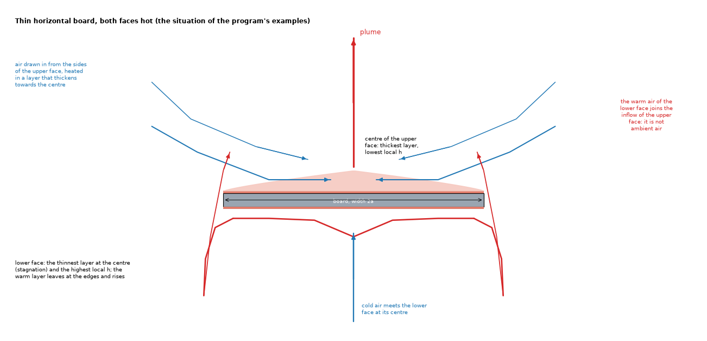

*Figure 1 (`figures/fig_01_flow_paths_of_a_horizontal_board.png`): the section of a thin horizontal board with both faces hot, the situation of the program's examples. Above, the air is drawn in along the face towards the centre, heated in a layer that thickens, and leaves in a plume; below, cold air meets the face at its centre (stagnation), flows out in a thin layer and rises at the edges, where it joins the inflow of the upper face.*

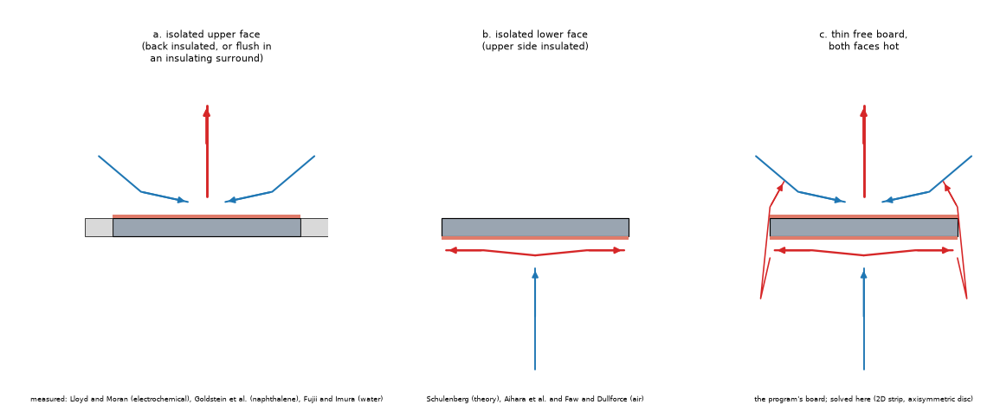

*Figure 2 (`figures/fig_02_three_situations.png`): the three situations of this study. (a) An isolated upper face (back insulated, or flush in an insulating surround): the plates of Lloyd and Moran, Goldstein et al. and Fujii and Imura. (b) An isolated lower face: the theory of Schulenberg and the experiments of Aihara et al. and Faw and Dullforce. (c) A thin free board with both faces hot: the program's board, and the solver of this study.*

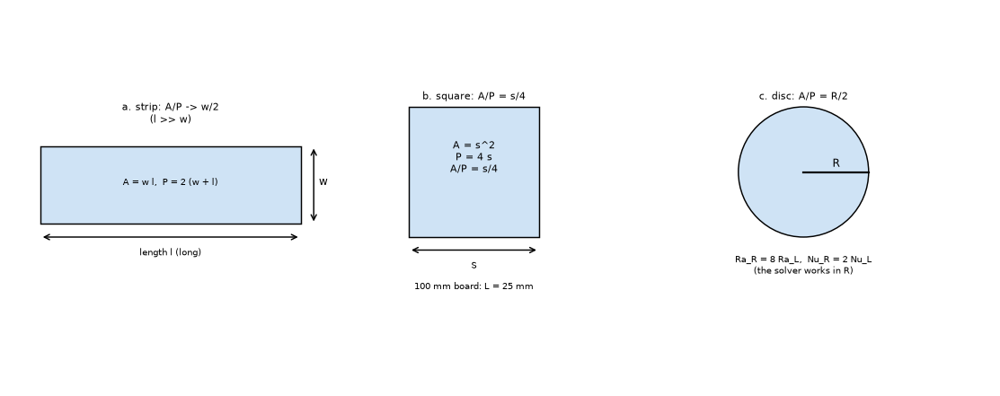

*Figure 4 (`figures/fig_04_characteristic_length.png`): `L = A/P` for a long strip (half the width), a square (a quarter of the side: 25 mm for a 100 mm board) and a disc (half the radius). The solver works with `a` (strip) or `R` (disc) as unit length: `Nu_L = Nu_R / 2` and `Ra_L = Ra_R / 8` for the disc.*

The levels in `lib/correlations.py` (`Nu = h L / k`, `Ra = g beta dT L^3 / (nu alpha)`, `L = A/P` unless said):

| Level (function) | Nu | What it is |
| :-- | :-- | :-- |
| program up (`program_up`) | `0.54 Ra^(1/4)`, `0.15 Ra^(1/3)` above `Ra` 1e7 | the program (`h_natural_horizontal`); textbook form of Lloyd and Moran (1974) |
| program down (`program_down`) | `0.27 Ra^(1/4)` | the program |
| Jaffer up (`jaffer_up`) | `[0.642 + 0.370 Ra^(1/6)]^2` | Jaffer (2023) equation 30; no Prandtl number |
| Jaffer down (`jaffer_down`, `jaffer_down_shape`) | `0.341 + 0.550 (Ra / Xi_all)^(1/5)`, `Xi_all(Pr) = [1 + (0.5/Pr)^(sqrt(1/3))]^(sqrt 3)` (2.813 at `Pr` 0.71) | Jaffer equations 54 and 56, written with `L_R` (half the shorter side of a rectangle, `2R/pi` of a disc, equations 57 and 58); `q = L_R/(A/P)` is 1 for a long strip, 2 for a square, `4/pi` for a disc. *(The first version used `Xi_R` of equation 51, the scaling of Schulenberg's strip, 2.633: 1.1 to 1.3 % high; corrected by the review.)* |
| Schulenberg strip (`schulenberg_strip`) | `0.571 Pr^(1/5) Ra^(1/5) / [1 + 1.156 Pr^(3/5)]^(1/3)` | KfK 3713 equation 92 (length: half the width); theory with the interpolation exponent set by the experiments of Aihara et al.; **the local Nu at the stagnation point at the centre** (pages 31, 32, 36 and figure 11 of the report), not the plate mean |
| Schulenberg disc (`schulenberg_disc`) | `0.705 Pr^(1/5) Ra_R^(1/5) / [1 + 1.48 Pr^(3/5)]^(1/3)`, length `R` | equation 94 (local, at the centre); converted to `A/P = R/2` |
| Raithby and Hollands up (`raithby_hollands_up`, review) | `0.560 Ra^(1/4) / [1 + (0.492/Pr)^(9/16)]^(4/9)`, then `1.4 / ln(1 + 1.4/Nu)` when `Nu <= 10` | Lienhard 8.37a/b (book page 436), `L = A/P`, `1 < Ra < 1e7` |
| Fujii and Imura down (`fujii_imura_down`, review) | `Nu_W = 0.58 Ra_W^(1/5)` on the **width** `W` | Lienhard 8.38 (page 437), a two-dimensional plate with the end effects suppressed, `1e6 <= Ra_W < 1e11` (water); evaluated on `W = 2 A/P` for a long strip and on the side `W = 4 A/P` of a square |
| Kadambi and Drake down (`kadambi_drake_down`, review) | `Nu_D = 0.82 Ra_D^(1/5) Pr^0.034` | Lienhard 8.39 (page 437), a disc of diameter `D = 4 A/P` |

The Rayleigh numbers of the boards (`study_correlations.py`, part 1; air at the film temperature, ambient 20 degC): a square of 40 / 60 / 100 / 150 / 200 mm has `Ra` of `A/P` of 9.7e2 / 3.3e3 / 1.5e4 / 5.1e4 / 1.2e5 at 10 K, 2.5e3 / 8.4e3 / 3.9e4 / 1.3e5 / 3.1e5 at 30 K and 4.0e3 / 1.4e4 / 6.2e4 / 2.1e5 / 5.0e5 at 60 K; a long strip of 40 or 100 mm width (`L = w/2`) 7.7e3 to 3.2e4 and 1.2e5 to 5.0e5. So the range of interest is **`Ra` 1e3 to 5e5 of `A/P`**, far from the `Ra` of 1e7 where the program changes branch.

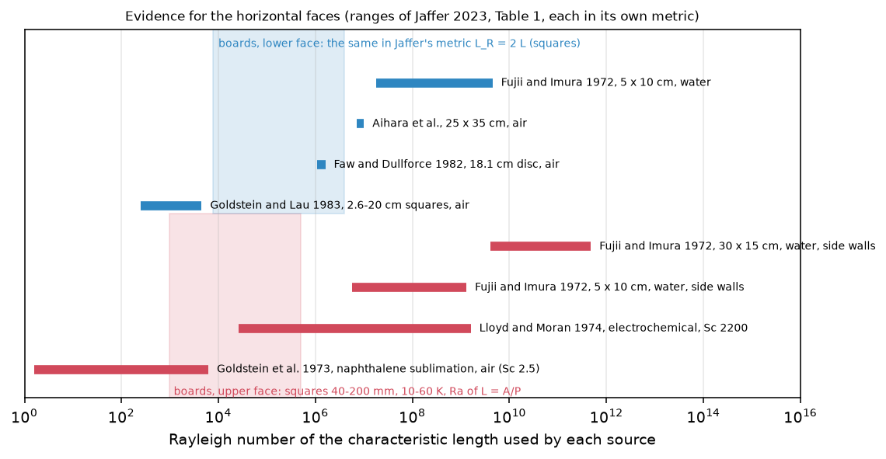

*Figure 5 (`figures/fig_05_evidence_ranges_against_the_boards.png`): the Rayleigh ranges of the data sets that Jaffer lists (his Table 1, read) against the boards of the program. For the upper face only Goldstein et al. (sublimation, `Ra` up to 6.2e3) and the lowest points of Lloyd and Moran (from 2.6e4) reach the boards, and the two lowest points of Lloyd and Moran are 14 and 19 % above Jaffer's fit; for the lower face the squares of Goldstein and Lau (250 to 4500) reach the smallest boards and Faw and Dullforce and Aihara et al. (1e6 to 1e7) lie above them. The measured air data below `Ra` 1e5 are therefore few.*

## 2. Sources and how they were read

| Source | What it gave | Status |
| :-- | :-- | :-- |
| Schulenberg, KfK 3713 (1984), open copy KIT library | the whole text extracted; the pages with equations 42 to 46 (page 16) and 92 to 95 (page 31) read as images; equations 87 to 90 (page 30) from the text layer | **R** (pages named); figures 6 to 9 not read |
| Jaffer, arXiv:2201.02612v6 (2023) | Table 1 (ranges), section 3.4, sections 7 to 11, 15 to 17, Tables 3 and 7, references | **R** as extracted text for the pages named; the figures not viewed; the data are plot values |
| Lloyd and Moran (1974) | the correlations and the `A/P` rule, the transition at about `Ra` 8e6 | **S** (abstract by search results, and Jaffer's text) |
| Lienhard, *A Heat Transfer Textbook* 6.00 (open) | equations 8.35 to 8.39 (book pages 435 to 437): Raithby and Hollands for the upper face, Fujii and Imura (on the width of a two-dimensional plate) and Kadambi and Drake for the lower face, and the remark that the stable cases assume an unobstructed edge | **R** (read in the review; also read in `research/theory-sources`) |
| Goldstein, Sparrow and Jones (1973); Goldstein and Lau (1983) | the abstracts: sublimation from horizontal plates; a finite-difference strip at `Pr` 0.7 with a 1/5 power law, 10 < `Ra` < 1e4 | **S**; no prefactor of the numerical solution was obtained (paywall) |
| Schulenberg (1985, the journal paper); Fujii and Imura (1972); Aihara et al.; Faw and Dullforce (1982) | their data and ranges through Jaffer's Table 1, the citations through Schulenberg's reference list | **S** |
| Al-Arabi and El-Riedy (1976); Raithby and Hollands (Handbook of Heat Transfer) | named by the task; the Raithby and Hollands forms are read as Lienhard prints them | **N** for the originals |
| the Waterloo archive, arXiv, the publishers' open copies | searched: the Waterloo reports found are on vertical plates and channels; no open copy of the horizontal papers of Fujii and Imura, Al-Arabi or Lloyd and Moran was found | **N** |

The entries are in `research/theory/BIBLIOGRAPHY.md` (`[Schulenberg1984KfK]`, `[Schulenberg1985]`, `[GoldsteinSparrowJones1973]`, `[GoldsteinLau1983]`, `[FujiiImura1972]`, `[AiharaFaw]`, `[AlArabiElRiedy1976]`, `[RaithbyHollands]`, and the updated `[LloydMoran1974]` and `[Jaffer2023]`).

## 3. What the sources say, and what the program uses

**3.1 Schulenberg's strip and disc against Jaffer's correction** (`study_correlations.py`, part 3). **What the formulas are** (read by the review on the report's pages 31, 32, 36 and 37): a locally similar solution of the boundary-layer equations restricted to the region round the centre (the stagnation point) of the plate, so equations 92 to 95 give the **local** Nusselt number there; the report says that the heat transfer near the edges is better than this, and its figure 11 shows the plate mean above the local value by `(Nu_mean - Nu)/Nu` of about 0.3 to 0.5 at `Ra` 5e4 to 1e6 and 0.1 to 0.2 at 1e7 (plot values, measurements on squares and strips), the difference falling roughly as `Ra^(-1/5)`. Jaffer treats the formulas as plate means, which they approach only at large `Ra`. In the comparisons below the Schulenberg levels are therefore lower bounds of the plate mean, not levels of it *(the first version compared them with means and read the excess of the solver as a missing conduction term; corrected by the review)*. The report gives the asymptotes: for `Pr -> 0` `Nu = 0.571 (Gr Pr^2)^(1/5)` (strip, equation 43) and `0.705 (Gr Pr^2)^(1/5)` (disc, equation 45); for `Pr -> infinity` `Nu = 0.544 Ra^(1/5)` (strip, equation 87) and `0.619 Ra^(1/5)` (disc, equation 89); and combines them with the exponent `n = 3` of Churchill and Usagi (page 31): `1/Nu^3 = 1/Nu_0^3 + 1/Nu_inf^3`. That gives `Nu/Ra^(1/5) = 0.571 Pr^(1/5) / [1 + (0.571/0.544)^3 Pr^(3/5)]^(1/3)` and `(0.571/0.544)^3 = 1.156`: **the printed 1.156 is what the asymptotes give**, and the disc is consistent in the same way (`(0.705/0.619)^3 = 1.48`). Jaffer (section 3.4) calls the 1.156 a misprint and uses 0.631 and 1.56, which have the same large-`Pr` limit (0.544) but a small-`Pr` coefficient (0.631) that is not the one of the report (0.571). At `Pr` 0.71 the printed form gives `0.4274 Ra^(1/5)` and Jaffer's `0.4483 Ra^(1/5)` (5 % higher). This study uses the printed form as the reading of the source and shows the other as a variant; the data that Jaffer fits cannot decide between them (his Table 7 gives 3.7 to 4.2 % RMSRE with his own, and it does not show the printed form's error).

**3.2 The levels against each other** (`study_correlations.py`, part 2; Nu of `L = A/P`, ratio to the program):

| Ra | program up | Jaffer up | ratio | program down | Jaffer down, strip | ratio | Jaffer down, square | ratio | Jaffer down, disc | ratio | Schulenberg strip (local) | ratio | Schulenberg disc (local) | ratio |
| --: | --: | --: | --: | --: | --: | --: | --: | --: | --: | --: | --: | --: | --: | --: |
| 1e2 | 1.71 | 2.07 | 1.21 | 0.85 | 1.46 | 1.72 | 1.02 | 1.20 | 1.29 | 1.51 | 1.07 | 1.26 | 0.96 | 1.13 |
| 1e3 | 3.04 | 3.28 | 1.08 | 1.52 | 2.12 | 1.40 | 1.52 | 1.00 | 1.88 | 1.24 | 1.70 | 1.12 | 1.53 | 1.01 |
| 1e4 | 5.40 | 5.57 | 1.03 | 2.70 | 3.16 | 1.17 | 2.31 | 0.86 | 2.83 | 1.05 | 2.70 | 1.00 | 2.42 | 0.90 |
| 1e5 | 9.60 | 10.00 | 1.04 | 4.80 | 4.81 | 1.00 | 3.56 | 0.74 | 4.33 | 0.90 | 4.27 | 0.89 | 3.83 | 0.80 |
| 1e6 | 17.08 | 18.85 | 1.10 | 8.54 | 7.43 | 0.87 | 5.54 | 0.65 | 6.70 | 0.79 | 6.77 | 0.79 | 6.08 | 0.71 |
| 1e7 | 30.37 | 36.88 | 1.21 | 15.18 | 11.58 | 0.76 | 8.68 | 0.57 | 10.47 | 0.69 | 10.74 | 0.71 | 9.63 | 0.63 |

*(Re-printed by the review with Jaffer's equation 56 (`Xi_all`); the Jaffer lower-face columns moved by 1 to 2 points.)*

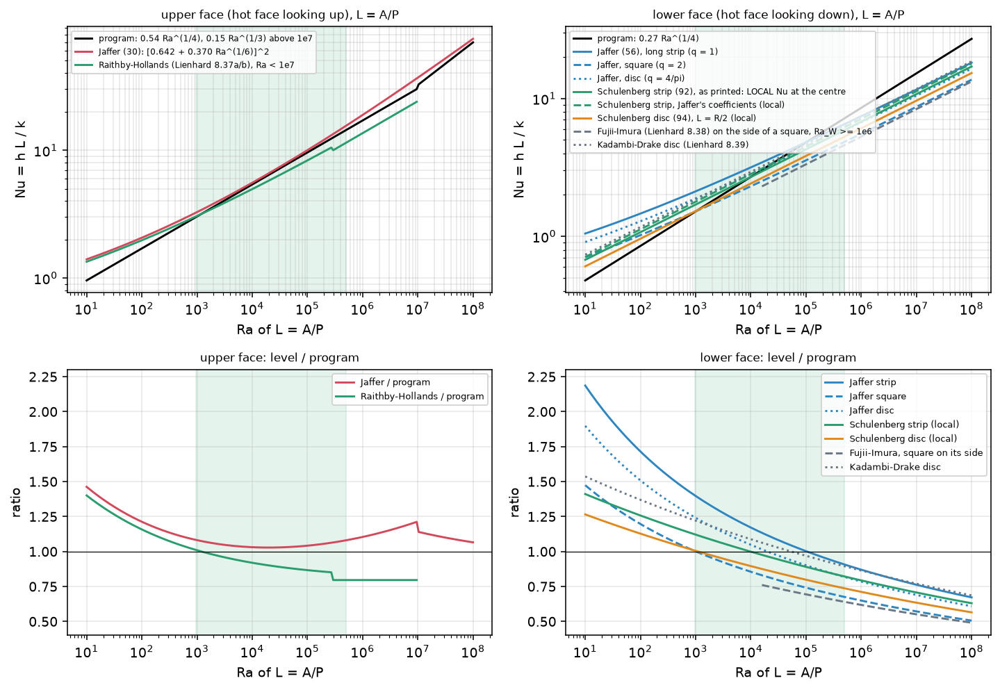

*Figure 6 (`figures/fig_06_levels_in_nu_and_in_ratio.png`): the levels in `Nu` (top) and their ratio to the program (bottom) against `Ra` of `L = A/P`, for the upper and lower face; the green band is the range of the boards. Redrawn by the review: Jaffer's lower face with equation 56, Schulenberg's curves marked as local values at the centre, and Lienhard's forms added (Raithby and Hollands up, whose printed correction stops at `Nu` 10 with a 7 % step near `Ra` 3e5; Fujii and Imura on the side of a square where `Ra_W` is 1e6 or more; Kadambi and Drake's disc).*

* **Upper face.** The program lies 3 to 7 % below Jaffer's fit over `Ra` 1e3 to 5e5 (ratio 1.08 at 1e3, 1.03 at 1e4, 1.04 at 1e5, 1.07 at 3e5), and 9 % below at 1e6; Jaffer's fit has an RMSRE of 4.9 % against the data of Lloyd and Moran (his Table 3), and Jaffer writes it as the level of an unobstructed plate, above which measurements are not expected. The other published form, Raithby and Hollands' as printed by Lienhard (section 3.3), lies **below** the program: from 1 % above it at `Ra` 1e3 to 20 % below at 3e5 to 5e5. So the program sits between the two published levels and is not shown to be conservative or optimistic. The program's branch change at `Ra` 1e7 is a 12 % jump (`0.15 Ra^(1/3)` against `0.54 Ra^(1/4)`) that is outside the boards' range. At `Ra` 1e2 or below, where only the sublimation data of Goldstein et al. exist, the program is 17 to 31 % low, because its `Ra^(1/4)` goes to zero and Jaffer's form goes to the conduction limit `2/pi`.
* **Lower face.** The published forms go as `Ra^(1/5)` and the program's as `Ra^(1/4)`: the program crosses Jaffer's long strip at `Ra` 1e5, Jaffer's disc at 3e4 and Jaffer's square at 1e3, and is above them for larger `Ra` (Schulenberg's columns are local values at the centre, lower bounds of a mean, section 3.1). In the boards' range it is **between 29 % below** Jaffer's long strip (`Ra` 1e3) **and 43 % above** Jaffer's square (3e5). The shape matters in the published forms (the length of the lower face is the distance from the middle line of the plate to its edge, `L_R`: `2 A/P` for a square, `A/P` for a long strip, `4/pi` times `A/P` for a disc, equation 57), and `A/P` does not carry it. For a 100 mm square at 30 K (`Ra` 3.9e4), convection only: program 4.08 W/m2K, Jaffer's square 3.20 (`study_correlations.py`, part 4; 3.24 in the first version, before the correction of equation 56).

**3.3 The other published forms, and the statements of `research/theory-sources`** (added by the review; `study_correlations.py`, parts 2b and 3; Lienhard's book pages 435 to 437 read). Nu on `L = A/P` and the ratio to the program:

| Ra | Raithby-Hollands up | / program up | Fujii-Imura, strip (W = 2 A/P) | / program down | Fujii-Imura, square on its side (W = 4 A/P) | / program down | Kadambi-Drake disc (D = 4 A/P) | / program down | Ra_W of the square |
| --: | --: | --: | --: | --: | --: | --: | --: | --: | --: |
| 1e3 | 3.06 | 1.01 | 1.75 | 1.15 | 1.33 | 0.87 | 1.85 | 1.22 | 6.4e4 |
| 3e3 | 3.84 | 0.96 | 2.18 | 1.09 | 1.65 | 0.83 | 2.31 | 1.16 | 1.9e5 |
| 1e4 | 4.97 | 0.92 | 2.77 | 1.03 | 2.10 | 0.78 | 2.94 | 1.09 | 6.4e5 |
| 3e4 | 6.33 | 0.89 | 3.45 | 0.97 | 2.62 | 0.74 | 3.66 | 1.03 | 1.9e6 |
| 1e5 | 8.32 | 0.87 | 4.40 | 0.92 | 3.33 | 0.69 | 4.66 | 0.97 | 6.4e6 |
| 3e5 | 10.06 | 0.80 | 5.48 | 0.87 | 4.15 | 0.66 | 5.80 | 0.92 | 1.9e7 |

* **The lengths.** Fujii and Imura's 8.38 is written on the **width** `W` of a two-dimensional plate (Lienhard: "plates of width L", "infinite breadth ... approximated by suppression of end effects"), valid for `Ra_W` of 1e6 or more (water). For a long strip `W = 2 A/P`; moved to the half width, its coefficient is `0.4396 Ra^(1/5)`, between Schulenberg's printed strip (0.4274, local) and the `Ra^(1/5)` term of Jaffer's equation 56 (0.4472): **the three strip forms agree within 5 % once each is put on its own length.** For a square, Jaffer's metric (half the shorter side, equation 57) makes the strip-equivalent width the side, `W = 4 A/P`; there, where it is valid (`Ra` of `A/P` from 1.6e4), Fujii and Imura is 26 to 34 % below the program (the program 35 to 52 % above it, `Ra` 3e4 to 3e5), and Jaffer's square says the same with a conduction term (16 to 43 % above it from 1e4 to 3e5). Kadambi and Drake's disc is -2 to +9 % from Jaffer's disc over `Ra` 1e3 to 3e5. **There is no length error in this folder**: Jaffer's lower face is evaluated with `L_R` (`q = 2` for a square, 1.8 for 100 x 80 mm, `4/pi` for a disc), his upper face and the program's with `A/P` (equations 30 and 57, read).
* **The two folders.** The review of `research/theory-sources` (its README section 6, on the branch `research/theory-sources`) found Fujii and Imura evaluated there on `A/P` and corrected it to `2 A/P` and to the shorter side: on 2 A/P the program is 5 to 22 % above it, on the shorter side 28 to 49 %, where it is valid, so the program's lower face is not shown to be conservative. This folder agrees: for squares at `Ra` of 1e4 and more every published lower-face form is below the program's, so the program's lower face gives a square board **more** cooling than the published forms (a cooler board); for a long strip at small `Ra` it gives less. For a square, the shorter side (`4 A/P`) is the width that is consistent with Jaffer's metric; `2 A/P` is the width of a long strip. On the upper face the two folders agree too: Raithby and Hollands (the form `theory-sources` read) is below the program, Jaffer's fit above it. And the mixed-convection exponent `p = 3` that `theory-sources` compared is outside the scope of this folder (natural convection only).
* **Raithby and Hollands' correction** `1.4/ln(1 + 1.4/Nu)` stops at `Nu = 10` with a 7 % step (visible in Figure 6 at `Ra` about 3e5): a property of the printed formula.

## 4. The independent solver

`lib/plate_h2d.py` (imports nothing from the program; written for this folder, the model of the numerics being the vertical solver of `research/plate-h-level/lib/plate2d.py`) solves the steady laminar Boussinesq problem of a **thin isothermal plate across the buoyancy direction** in open air, upper and lower face at once: stream function and vorticity, `u = psi_y`, `v = -psi_x`, `omega = v_x - u_y`, `omega_t + u omega_x + v omega_y = Pr Laplacian(omega) + Ra Pr T_x`, `T_t + u T_x + v T_y = Laplacian(T)`; the plate lies on `y = 0` for `|x| <= 1` (zero thickness, `psi = 0`, `T = 1`, **two wall vorticities**, one per face, by Thom's formula under-relaxed); the flow is taken symmetric about `x = 0`; the boundaries are free (`T = 0`, `omega = 0`, zero normal derivative of `psi`: air enters freely at the side and the bottom; zero normal derivative of `T`, `omega` and `psi` at the top, where the plume leaves); stretched grids cluster at the plate and at its tip; pseudo-time marching with implicit diffusion (factorised matrices) and explicit central convection. With `axisym = True` the same code solves the axisymmetric problem (`x` is the radius; `u = psi_y/r`, `v = -psi_x/r`, the vortex stretching term `u omega/r`, the operators with `1/r` terms, the area weight `2 r` in `Nu` and in the balance). `hot_up = False` or `hot_down = False` makes a face insulated (the plate is a mirror for `T` on that side), which gives the isolated faces of the experiments. The unit length is `a` (strip: `L = A/P = a`) or `R` (disc: `A/P = R/2`, `Nu_L = Nu_R/2`, `Ra_L = Ra_R/8`); the numbers below are all for `L = A/P`, `Pr = 0.71`.

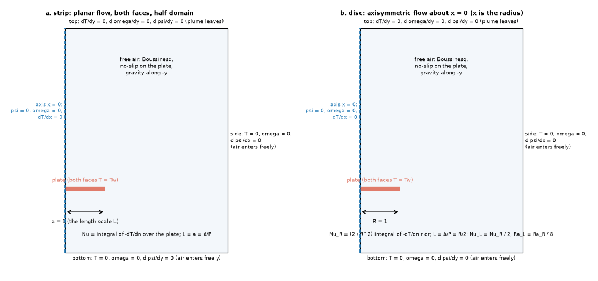

*Figure 3 (`figures/fig_03_numerical_domains.png`): the half domains and the boundary conditions of the strip (planar) and the disc (axisymmetric about `x = 0`).*

**Checks of the solver** (`tests/test_horizontal_plate_h.py`, 10 tests in the first version, 15 after the review; `study_plate_h2d.py`; the review's `study_solver_checks.py`, section 10):

* **Conduction limit** (`Ra` 0.01): the strip and the disc transfer the same heat from the two faces within 15 % (the box is taller above than below, 7 and 3.5 `L`) and the heat leaving the domain is 0.85 to 1.15 of the heat leaving the plate; the conduction `Nu_R` of the disc lies between the open-space value `4/pi` = 1.27 and 1.75 (the value of an outer sphere at five radii, the size of the box). *(Review: at `Ra` 1e-3 on the base grid the heat through three closed boxes is 1.037 to 1.042 (strip) and 1.069 to 1.072 (disc) times the heat of the wall gradient: with no convection the field is conservative and the wall gradient under-reads by 4 and 7 %, the singular flux at the edge of a zero-thickness plate; `study_solver_checks.py`.)*
* **Direction of the flow**: at `Ra` 1e3 the air above the plate moves towards the centre and rises there, the air below moves outwards (Figure 1, Figure 10); the lower face has the larger `Nu`, and the local `Nu` of the lower face is highest at the centre (stagnation) while that of the upper face is lowest there (Figure 9).
* **Grid and domain** (strip, `Ra` 1e4, both faces / lower face alone; the isolated upper face was added by the review, section 10): the finer grid (70 x 48 cells in the half plate and the outside, 90 above, 64 below, first cell 3e-3, tip 6e-3, against 48 x 32, 60, 44, 5e-3 and 1e-2) moves the upper face by +0.6 % (2.088 against 2.075) and the lower by -0.5 % / +0.1 % (3.485 against 3.501 / 3.483); a domain twice as wide and tall (width 10, 14 above, 7 below) moves them by -0.6 %, +0.5 % / +0.4 % (2.063, 3.519 / 3.497).
* **Energy balance** (heat leaving the domain over heat leaving the plate): 0.85 to 1.03 for the strip and 1.03 to 1.18 for the disc at `Ra` up to 1e4; 0.70 for the isolated upper face at `Ra` 1e5. *(Corrected by the review: the first version put this down to the non-conservative central convection alone. Measured on three closed boxes round the plate (section 10), the disc's field is conservative within 1 to 2 % from box to box and the whole excess (4 to 19 %) is the wall gradient, which under-resolves the singular flux at the edge; the strip has both errors: the wall under-reads by 4 % in conduction, and with convection the heat through the boxes falls by 4 to 7 % from the inner to the outer box at `Ra` 1e3 and 1e4, so that at `Ra` 1e4 even the inner box carries 0.92 of the wall's heat.)* The absolute `Nu` of the solver are therefore good to about 5 to 15 %, the ratios between cases on the same grid better (section 10).
* **The `Ra` 1e5 strip** did not give usable numbers: the isolated lower face blew up at every step size tried (the central convection is unstable at that cell Peclet number on the base grid; the `Ra` 1e5 runs use a first cell of 4e-3), the isolated upper face "converged" with a balance of 0.70, and the case with both faces had not settled after 12 time units (the upper-face `Nu` drifting by 3 % over the last window and the field showing a detached vortex above the plate, a sign that the steady symmetric solution does not exist there in the sense of this solver). These cases are in `out/plate_h2d.json` and in the table below but are not used in any statement and are not plotted.
* **Symmetry and unsteadiness.** The flow is imposed symmetric about the centre line. A hot face looking up carries a hot layer under colder air, which becomes unstable above a local Rayleigh number of about 1700 (a rough estimate with a layer of thickness `L/Nu`, `Ra/Nu^3`: 1e4 / 2.1^3 = 1e3 at `Ra` 1e4, 1e5 / 3.6^3 = 2e3 at 1e5, using the solver's own `Nu`), so the symmetric steady solution can be physical only up to `Ra` of about 1e4 (all `Ra` 1e4 cases converged to 2e-5 with no oscillation); the experiments are unsteady and three-dimensional above that. This is the likely reason why the solver's upper face is far below the measurements; that the steady symmetric solution is a lower bound of the real face is plausible but not demonstrated.

## 5. The numerical plates against the published levels

`study_plate_h2d.py` (`Nu` of `L = A/P`; "balance" is the heat leaving the domain over the heat leaving the plate; the ratios use the face that is hot in the case: `up` for the upper face, `down` for the lower; the Jaffer lower-face column uses `q` = 1 for the strip and `4/pi` for the disc, the Schulenberg column the strip or the disc formula):

| geometry | Ra | faces | grid | Nu up | Nu down | balance | converged | up / program | up / Jaffer | down / program | down / Jaffer (strip or disc) | down / Schulenberg (local) |
| :-- | --: | :-- | :-- | --: | --: | --: | :-- | --: | --: | --: | --: | --: |
| disc | 1e+02 | both | base | 1.050 | 1.497 | 1.055 | True | 0.61 | 0.51 | 1.75 | 1.16 | 1.55 |
| disc | 1e+02 | down | base | 0.000 | 1.554 | 1.103 | True |  |  | 1.82 | 1.21 | 1.61 |
| disc | 1e+02 | up | base | 1.503 | 0.000 | 1.181 | True | 0.88 | 0.73 |  |  |  |
| disc | 1e+03 | both | base | 1.462 | 2.218 | 1.052 | True | 0.48 | 0.45 | 1.46 | 1.18 | 1.45 |
| disc | 1e+03 | down | base | 0.000 | 2.227 | 1.071 | True |  |  | 1.47 | 1.18 | 1.46 |
| disc | 1e+03 | up | base | 2.202 | 0.000 | 1.165 | True | 0.73 | 0.67 |  |  |  |
| disc | 1e+04 | both | base | 2.167 | 3.389 | 1.035 | True | 0.40 | 0.39 | 1.26 | 1.20 | 1.40 |
| disc | 1e+04 | down | base | 0.000 | 3.372 | 1.033 | True |  |  | 1.25 | 1.19 | 1.39 |
| disc | 1e+04 | up | base | 3.437 | 0.000 | 1.120 | True | 0.64 | 0.62 |  |  |  |
| strip | 1e+03 | both | base | 1.412 | 2.296 | 0.945 | True | 0.47 | 0.43 | 1.51 | 1.08 | 1.35 |
| strip | 1e+03 | down | base | 0.000 | 2.322 | 0.995 | True |  |  | 1.53 | 1.09 | 1.36 |
| strip | 1e+03 | up | base | 2.309 | 0.000 | 1.006 | True | 0.76 | 0.70 |  |  |  |
| strip | 1e+04 | both | base | 2.075 | 3.501 | 0.861 | True | 0.38 | 0.37 | 1.30 | 1.11 | 1.30 |
| strip | 1e+04 | both | fine | 2.088 | 3.485 | 0.895 | True | 0.39 | 0.38 | 1.29 | 1.10 | 1.29 |
| strip | 1e+04 | both | wide | 2.063 | 3.519 | 0.853 | True | 0.38 | 0.37 | 1.30 | 1.11 | 1.30 |
| strip | 1e+04 | down | base | 0.000 | 3.483 | 0.920 | True |  |  | 1.29 | 1.10 | 1.29 |
| strip | 1e+04 | down | fine | 0.000 | 3.485 | 0.949 | True |  |  | 1.29 | 1.10 | 1.29 |
| strip | 1e+04 | down | wide | 0.000 | 3.497 | 0.909 | True |  |  | 1.30 | 1.11 | 1.30 |
| strip | 1e+04 | up | base | 3.673 | 0.000 | 0.882 | True | 0.68 | 0.66 |  |  |  |
| strip | 1e+05 | both | base | 3.617 | 5.399 | 1.023 | False | 0.38 | 0.36 | 1.12 | 1.12 | 1.26 |
| strip | 1e+05 | down | base | nan | nan | nan | False |  |  | nan | nan | nan |
| strip | 1e+05 | up | base | 5.892 | 0.000 | 0.704 | True | 0.61 | 0.59 |  |  |  |

*(Re-printed by the review: the Jaffer lower-face column uses equation 56; the Schulenberg column divides a plate mean by a local value at the centre, section 3.1.)*

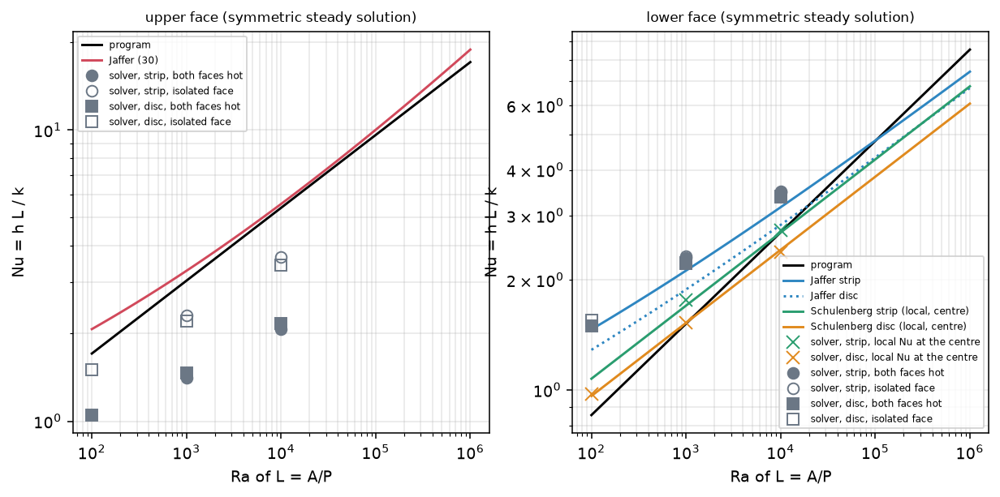

*Figure 7 (`figures/fig_07_numerical_plates_against_the_levels.png`): `Nu` of the numerical plates (grey: filled both faces hot, open the isolated face; circles strip, squares disc) against the program, Jaffer and Schulenberg, for the upper face (left) and the lower (right); the crosses (added by the review) are the solver's local `Nu` at the centre of the isolated lower face, the quantity of Schulenberg's formulas, which they meet. The `Ra` 1e5 strip cases that did not give usable numbers (not converged, blown up or with a balance of 0.70) are not drawn.*

* **Lower face, reproduction** (rewritten by the review). **At the centre, the solver reproduces Schulenberg's theory**: the local `Nu` at the stagnation point of the lower face is 1.4 to 3.9 % above his strip formula as printed (`Ra` 1e3 to 1e4; 0.3 % below at 1e5, a case that had not settled) and -1.4 to +1.8 % from his disc formula (`Ra_R` 8e2 to 8e4), with both faces hot or the lower face alone (`print_tables.py`, table B2). That is the quantity of his formulas (section 3.1), and it is the one published numerical case this folder reproduces to a few percent. **The plate mean** is 27 to 32 % (strip) and 41 to 59 % (disc) above the solver's own centre value, which is the size of the edge effect that Schulenberg's figure 11 shows for measured plates (0.3 to 0.5 at `Ra` 5e4 to 1e6, plot values); *the first version read this excess over Schulenberg as a missing conduction term, which was wrong.* Against Jaffer's fit of the means the solver's mean is 8 to 11 % above for the strip (`Ra` 1e3 and 1e4, grid-converged to 0.5 %) and 16 to 21 % above for the disc (1e2 to 1e4). Part of that is the solver (its plate mean carries 5 to 15 %, section 4; for the disc the heat measured on closed boxes is 4 to 13 % higher still), part is Jaffer's fit (a bound for squares, 10 % scatter in the Goldstein and Lau squares, no air data below `Ra` 1e6 except those squares), part the open box at the lowest `Ra`. Jaffer's own bound (his equation 46 is an upper bound for a square plate) cannot be checked with a strip or a disc. The fitted exponents of `Nu` against `Ra` between consecutive cases are 0.16 to 0.18 for the isolated lower face (strip and disc), 0.17 to 0.18 for the lower face with both faces hot, 0.17 to 0.20 for the isolated upper face and 0.14 to 0.17 for the upper face with both faces hot: close to the 1/5 power law that Goldstein and Lau report for their finite-difference strip at `Pr` 0.7 (`Ra` 10 to 1e4; their prefactor was not obtained, so only the exponent is compared) and not to the 1/4 of the program's correlations.
* **Upper face, no reproduction.** The isolated upper face is 24 % (strip, 1e3), 32 % (1e4), 12 % (disc 1e2), 27 % (1e3) and 36 % (1e4) below the program, and 30 to 38 % below Jaffer's fit from `Ra` 1e3; the gap grows with `Ra`, as it should if the experiments see the three-dimensional unsteady flow that the symmetric steady solution cannot. Nothing about the upper face of a board can be concluded from the absolute values of the solver. The review measured the isolated upper face on a finer grid and a larger domain (strip `Ra` 1e3 and 1e4, disc 1e3: within +1.5 to +2.7 % and -0.6 to +0.1 %) and on closed boxes (16 to 39 % below the program at `Ra` 1e3 and 1e4), so the gap is the model (steady, symmetric, two-dimensional), not the numerics (section 10).
* **Energy balance and uncertainty.** The balance of the cases is 0.86 to 1.18; the isolated-face disc cases are the worst (1.12 to 1.18). The numbers are good to a few percent between grids (above) and to about 5 to 15 % in absolute value (section 4, corrected by the review: the wall gradient at the edge for the disc, the wall and the convection for the strip).

## 6. What the other face does to a face

`study_plate_h2d.py` (Nu of a face with both faces hot over Nu of the same face alone, same grid):

| geometry | Ra | upper face: both / alone | lower face: both / alone |
| :-- | --: | --: | --: |
| strip | 1e+03 | 0.61 | 0.99 |
| strip | 1e+04 | 0.56 | 1.00 |
| disc | 1e+02 | 0.70 | 0.96 |
| disc | 1e+03 | 0.66 | 1.00 |
| disc | 1e+04 | 0.63 | 1.01 |

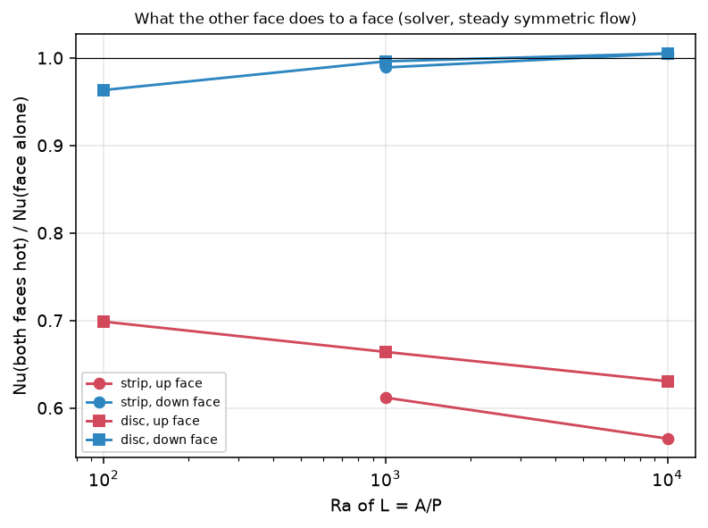

*Figure 8 (`figures/fig_08_the_other_face.png`): the ratio of `Nu` with both faces hot to `Nu` of the face alone, strip and disc, upper and lower face.*

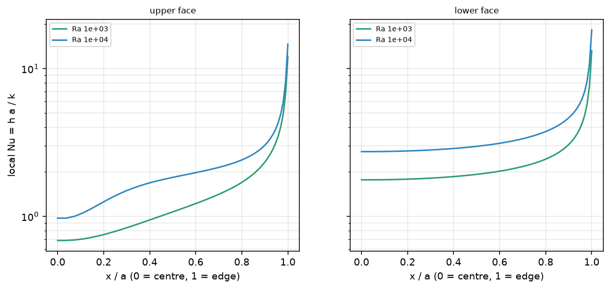

*Figure 9 (`figures/fig_09_local_nusselt_number_of_the_strip.png`): the local `Nu = h a / k` along the half strip with both faces hot, upper and lower face, `Ra` 1e3 and 1e4. The lower face is thinnest (highest `h`) at the centre, the upper thickest (lowest `h`); both rise at the edge, where the grid sees the singularity of the thin plate's tip (grid-dependent, integrable).*

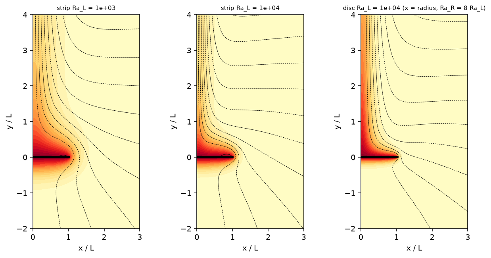

*Figure 10 (`figures/fig_10_computed_fields_of_the_horizontal_plate.png`): temperature (colour, 0 to 1) and streamlines (black) near the plate with both faces hot: strip `Ra` 1e3 and 1e4, disc `Ra_L` 1e4. The plume over the centre, the inflow along the upper face, the thin layer under the lower face, and the warm layer that leaves the lower face at the edge and is drawn up into the inflow of the upper face.*

The lower face does not feel the upper one (0.96 to 1.01), and **the upper face of a board with both faces hot has 0.56 to 0.70 of the `Nu` of the same face alone**: 0.61 / 0.56 (strip, `Ra` 1e3 / 1e4) and 0.70 / 0.66 / 0.63 (disc, 1e2 / 1e3 / 1e4). The mechanism is the one of Figure 1 and is visible in Figure 10: the air that reaches the upper face has been warmed by the lower face at the edge. The effect is smaller for the disc than for the strip (the air reaches the edge of a disc from all sides and the warm layer is a ring). **Limits.** All of this is a steady symmetric solution that does not reproduce the measured isolated upper face (section 5), so the *size* of the coupling in a real board is not known: it can be smaller (turbulent mixing brings fresh air), larger, or not there in three dimensions where the warm air also leaves at the corners. What is robust is the sign and the mechanism, and that it is absent from all the published upper-face correlations, which are for an isolated face (back insulated or flush in a surround, Figure 2). *(Review: the coupling is not an artefact of how the solver measures heat. On totals, the board with both faces hot transfers 0.78 to 0.83 of the sum of its two isolated faces from the wall gradients and 0.75 to 0.78 from the heat through a closed box round the plate (strip `Ra` 1e3 and 1e4, disc 1e2 to 1e4; `study_solver_checks.py`, part 3); the isolated upper face it is compared with is grid- and domain-converged within 3 % (section 10).)*

## 7. How much the choice moves the rise of a board and of the finned block

`study_board_effect.py`: the program's own FVM (cell 2 mm), horizontal board, computed `h` (`Board.h_mode = "computed"`, `orientation = "horizontal"`, emissivity 0.9, radiation to the ambient included as the program does), with `convection.h_natural_horizontal` replaced in memory (`correlations.use_horizontal`) by each level. The two example boards (100 x 80 mm with four layers, vias and a heatsink; 100 x 100 mm with two layers), two-layer square boards with full copper and one 10 x 10 mm part from 40 to 200 mm, and the finned block of `research/fin-channel` (60 x 40 mm board, 3 W, aluminium block 40 x 30 x 3 mm with 15 x 1.5 mm fins on the **bottom** face, so the fins hang down, with the program's uniform fin coefficient and the lower-face level; gaps 3.5, 6.5, 14.5 mm). Levels: `program`; `jaffer` (his upper face and his lower face with `q` of the board: 2 for a square, 1.8 for 100 x 80 mm, 1.67 for the 60 x 40 mm board of the block); `jaffer down` and `R&H up` (one published face at a time, added by the review); and the sensitivities `up x0.6` (the upper face loses 40 %, the size of the coupling of section 6), `down x1.3`, `up x0.6 down x1.3`, `up x1.2`, `down x0.7` (**the factors are bracketing runs, not results**). Rise of the hottest point in K for the program, and the change with each other level:

| case | program (K) | jaffer | jaffer down | R&H up | up x0.6 | down x1.3 | up x0.6 down x1.3 | up x1.2 | down x0.7 |
| :-- | --: | --: | --: | --: | --: | --: | --: | --: | --: |
| example_board (horizontal) | 60.36 | +0.5 % | +0.8 % | +1.3 % | +5.4 % | -1.5 % | +3.5 % | -2.2 % | +1.7 % |
| reference_board (horizontal) | 65.82 | +0.6 % | +0.9 % | +1.3 % | +5.1 % | -1.3 % | +3.5 % | -2.2 % | +1.4 % |
| 40 mm square, 0.2 W | 7.60 | -2.7 % | -0.5 % | -0.9 % | +9.3 % | -2.6 % | +5.9 % | -3.8 % | +2.8 % |
| 40 mm square, 0.8 W | 26.87 | -1.1 % | +0.3 % | +0.3 % | +9.9 % | -2.6 % | +6.4 % | -4.0 % | +2.9 % |
| 60 mm square, 0.4 W | 10.32 | -0.7 % | +0.2 % | +0.2 % | +6.5 % | -1.8 % | +4.2 % | -2.7 % | +1.9 % |
| 60 mm square, 1.5 W | 35.67 | +0.1 % | +0.6 % | +0.9 % | +6.8 % | -1.8 % | +4.4 % | -2.8 % | +2.0 % |
| 100 mm square, 1.0 W | 20.16 | +0.1 % | +0.4 % | +0.6 % | +3.5 % | -0.9 % | +2.3 % | -1.5 % | +1.0 % |
| 100 mm square, 3.0 W | 58.32 | +0.3 % | +0.6 % | +0.8 % | +3.6 % | -0.9 % | +2.5 % | -1.5 % | +1.0 % |
| 150 mm square, 2.0 W | 39.08 | +0.2 % | +0.4 % | +0.5 % | +2.1 % | -0.5 % | +1.5 % | -0.9 % | +0.6 % |
| 150 mm square, 6.0 W | 114.53 | +0.3 % | +0.5 % | +0.7 % | +2.3 % | -0.6 % | +1.7 % | -1.0 % | +0.6 % |
| 200 mm square, 3.0 W | 56.50 | +0.2 % | +0.3 % | +0.5 % | +1.8 % | -0.4 % | +1.3 % | -0.8 % | +0.5 % |
| 200 mm square, 10.0 W | 184.28 | +0.2 % | +0.5 % | +0.7 % | +2.0 % | -0.5 % | +1.4 % | -0.9 % | +0.5 % |
| finned block gap 3.5 mm | 54.46 | -0.5 % | -0.1 % | +0.3 % | +3.2 % | -2.4 % | +0.4 % | -1.5 % | +2.9 % |
| finned block gap 6.5 mm | 58.29 | -0.4 % | -0.0 % | +0.5 % | +4.1 % | -2.6 % | +1.1 % | -1.8 % | +3.0 % |
| finned block gap 14.5 mm | 63.14 | -0.4 % | +0.1 % | +0.6 % | +5.3 % | -2.6 % | +2.2 % | -2.3 % | +3.0 % |

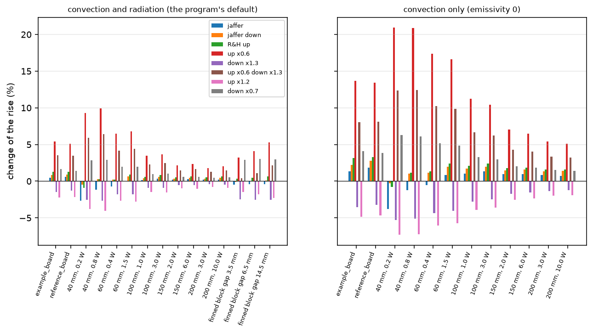

*Figure 11 (`figures/fig_11_effect_on_the_rise_of_the_boards.png`): the change of the rise with each level, with radiation (left) and without (right); the levels `jaffer down` and `R&H up` were added by the review.*

The same with the emissivity at zero (convection only, boards only):

| case | program (K) | jaffer | jaffer down | R&H up | up x0.6 | down x1.3 | up x0.6 down x1.3 | up x1.2 | down x0.7 |
| :-- | --: | --: | --: | --: | --: | --: | --: | --: | --: |
| example_board (horizontal) | 77.61 | +1.3 % | +2.2 % | +3.2 % | +13.6 % | -3.5 % | +8.1 % | -4.8 % | +4.1 % |
| reference_board (horizontal) | 83.86 | +1.8 % | +2.8 % | +3.3 % | +13.5 % | -3.2 % | +8.1 % | -4.7 % | +3.8 % |
| 40 mm square, 0.2 W | 11.62 | -3.8 % | -0.3 % | -0.8 % | +20.9 % | -5.3 % | +12.3 % | -7.3 % | +6.3 % |
| 40 mm square, 0.8 W | 38.08 | -1.2 % | +1.1 % | +1.1 % | +20.9 % | -5.1 % | +12.4 % | -7.2 % | +6.1 % |
| 60 mm square, 0.4 W | 14.76 | -0.5 % | +1.2 % | +1.3 % | +17.4 % | -4.4 % | +10.2 % | -6.0 % | +5.2 % |
| 60 mm square, 1.5 W | 47.48 | +0.8 % | +2.0 % | +2.4 % | +16.6 % | -4.1 % | +9.9 % | -5.7 % | +4.8 % |
| 100 mm square, 1.0 W | 25.52 | +1.1 % | +1.7 % | +2.1 % | +11.3 % | -2.8 % | +6.7 % | -3.9 % | +3.3 % |
| 100 mm square, 3.0 W | 70.58 | +1.3 % | +2.0 % | +2.4 % | +10.4 % | -2.5 % | +6.2 % | -3.6 % | +3.0 % |
| 150 mm square, 2.0 W | 45.86 | +1.0 % | +1.5 % | +1.8 % | +7.1 % | -1.7 % | +4.3 % | -2.5 % | +2.0 % |
| 150 mm square, 6.0 W | 130.70 | +0.9 % | +1.6 % | +1.9 % | +6.5 % | -1.5 % | +4.0 % | -2.3 % | +1.8 % |
| 200 mm square, 3.0 W | 64.92 | +0.8 % | +1.3 % | +1.6 % | +5.4 % | -1.3 % | +3.3 % | -2.0 % | +1.5 % |
| 200 mm square, 10.0 W | 207.05 | +0.7 % | +1.4 % | +1.6 % | +5.1 % | -1.2 % | +3.2 % | -1.9 % | +1.4 % |

*(Both tables re-printed by the review: the `jaffer` column uses equation 56, and the columns `jaffer down` (Jaffer's lower face alone) and `R&H up` (Raithby and Hollands' upper face alone) are new.)*

* **The published forms against the program**: Jaffer's two faces -2.7 to +0.6 % of the rise with radiation (the largest, -2.7 %, is the 40 mm board at 0.2 W), -3.8 to +1.8 % without radiation, -0.5 to -0.4 % for the finned block with the fins down; Jaffer's lower face alone -0.5 to +0.9 % (-0.3 to +2.8 % without radiation; the board is hotter with it on all but the smallest board and the finned block, so the program's lower face is the cooler choice there); Raithby and Hollands' upper face alone -0.9 to +1.3 % (-0.8 to +3.3 %; +0.3 to +0.6 % for the finned block). Over all three, **-2.7 to +1.3 %** with radiation and **-3.8 to +3.3 %** without. The effect is small because the radiation is about half of the total coefficient and does not depend on the level, and because the copper spreads the heat.
* **The size of what could be wrong**: a 40 % loss of the upper face (`up x0.6`) would raise the rise by 5.4 and 5.1 % for the two examples, by 9.3 to 9.9 % for the 40 mm boards, 6.5 to 6.8 % for 60 mm, 3.5 % for 100 mm and 1.8 to 2.3 % for 150 and 200 mm; without radiation by 13.6 and 13.5 % for the examples and up to 20.9 %. For the finned block with the fins down, `up x0.6` gives +3.2, +4.1, +5.3 % (gaps 3.5, 6.5, 14.5 mm) and a lower face 30 % higher or lower changes the block by -2.4 to -2.6 % and +2.9 to +3.0 %. The small boards are the sensitive ones.

**C9, noted and not solved.** The fins of the finned block hang down: the program gives the whole fin array the lower-face coefficient times the fin ratio (`h_exp = h_face r_fin + h_extra`), which is a model of fins in free air, with no channel effect, and the radiation between the fins and to the ground (the computed `h` carries about half of its value as radiation with a simple view factor, which is smaller between close fins) is not corrected. The numerical plate of this study has no fins, so it says nothing about C9. The sensitivity above (the block's rise changes by 2 to 3 % for a 30 % change of the lower-face coefficient) is the only number this study adds; the view factors of a fin array and a numerical solution under a horizontal base with fins remain open (`research/ROADMAP.md` C9).

## 8. Decision

The maintainer's rule: if it is a limit of the model, we live with it. The numbers support that: the published upper-face levels lie on both sides of the program's (Jaffer 3 to 8 % above, Raithby and Hollands up to 20 % below), the lower-face correlation is wrong in the exponent and in the shape dependence (for squares at `Ra` 1e4 and more it gives more cooling than every published form), but with the published forms the rise of a board moves by -2.7 to +1.3 % with radiation (-3.8 to +3.3 % without), and the one effect that could be larger (the coupling of the faces of a free board, a possible +2 to +10 % of the rise with radiation) is a numerical finding of a two-dimensional steady model that this study could not tie to a measurement. **Recommended: no change of the program; document the limit** (`INTEGRATION.md` proposal A, text in `docs/`). Proposals B (Jaffer's forms as an option) and C (a correction for the other face) are written up with their measured impact and not recommended. The review agrees (section 10).

## 9. What was read and what was not verified

* **Read (the pages named)**: T. Schulenberg, KfK 3713 (the text layer of the whole report, the page images of pages 16 and 31; the review read pages 30, 31, 32, 36 and the figure 11 on page 37 as images, which say that equations 92 to 95 are the local value at the stagnation point); A. G. Jaffer, arXiv:2201.02612v6 (Table 1, sections 1, 3.4, 7 to 11, 12, 13, 15, 16, 17 and the tables 3, 5 and 7, as extracted text; the review re-read sections 10 to 13 and 17, equations 30, 46, 51, 54, 56 to 58; the figures were not viewed); Lienhard, *A Heat Transfer Textbook* 6.00, book pages 435 to 437 (read by the review).
* **From a summary only**: Lloyd and Moran (1974); Goldstein, Sparrow and Jones (1973); Goldstein and Lau (1983) (the abstract: 1/5 power law, `Ra` 10 to 1e4, no prefactor); Schulenberg (1985); Fujii and Imura (1972); Aihara et al.; Faw and Dullforce (1982): all through Jaffer's tables and the abstracts.
* **Not obtained**: Al-Arabi and El-Riedy (1976), Raithby and Hollands (the handbook chapter), the originals of the measurements (the data of Jaffer's Table 1 are plot values or his digitisation), any open copy of the horizontal-plate papers in the Waterloo archive or on arXiv. The statement that the textbook `0.54` and `0.27` are McAdams' and Lloyd and Moran's rests on the summaries and on the program's own docstring.
* **Reproduced**: the large- and small-Prandtl limits of Schulenberg's strip and disc and the consistency of his coefficient 1.156 (arithmetic from his own limits, section 3.1); **Schulenberg's local stagnation-point Nu at the centre of the lower face by the independent solver within 4 % (strip and disc, review)**; the mean of the lower face against Jaffer's fit within 8 to 21 % and the 1/5 exponent; **not reproduced**: any measured upper-face value (the solver is 12 to 36 % below the correlations from `Ra` 1e2 to 1e4, more above), the numerical prefactor of Goldstein and Lau (not obtained), the Fujii and Imura and Lloyd and Moran data (not obtained).
* **Mine, not a source**: the solver and its results, the coupling of the two faces and its mechanism, the reading of `A/P` against `L_R` in the board runs (`q` = 2 for a square: Jaffer's lower-face formula is written with `L_R`, the half of the shorter side, confirmed on his section 10 by the review), the width of a square in Fujii and Imura's form (the side, from Jaffer's metric; the review), the recommendation.
* **Not done**: `Pr` other than 0.71; `Ra` above 1e4 (the strip at 1e5 failed or did not settle; the disc at 1e5 and the square plate were not run); three-dimensional flow, unsteadiness and the square; the fins; a measured case with both faces hot.
* **Tests**: `research/horizontal-plate-h/tests/test_horizontal_plate_h.py`, 15 tests (the program's levels against its own function, the branch change, the limits printed in the report, the shape scaling, the restoration of the program, the conduction limits of the strip and the disc and their balance, the direction of the flow, the isolated faces, the grid; added by the review: Jaffer's equation 56 with `Xi_all`, the lengths of the Lienhard forms, the bracket of the upper face, the solver's centre against Schulenberg's local value, the heat through the boxes of the disc).

## 10. Review

The independent review re-ran every study of the folder on `develop` at 2.4.4 (commit `23ec953`): `study_correlations.py` (identical), `study_board_effect.py` (all 15 cases identical to the digit before the corrections), `print_tables.py` from the outputs of `study_plate_h2d.py`, the 10 tests; it re-read Jaffer's sections 10 to 13 and 17 (equations 30, 46, 51, 54, 56 to 58), Schulenberg's report pages 30, 31, 32, 36 and 37 (images of 30, 31 and 37) and Lienhard 6.00 book pages 435 to 437; and it measured the solver on closed boxes, finer grids and larger domains (`scripts/study_solver_checks.py`, new; `HorizontalStrip.heat_through_box`, new). The program was not touched (`git diff develop --stat -- pcbthermal tests examples ico` is empty).

**Confirmed:** the Rayleigh numbers of the boards (9.7e2 to 5.0e5 of `A/P` for squares of 40 to 200 mm at 10 to 60 K); the program's functions equal the folder's levels to 1e-12; Jaffer's upper face and its length `A/P` (equation 30, section 16); Jaffer's lower-face length `L_R` = half the shorter side (section 10: "downward-facing characteristic-length LR is 1/2 of the shorter plate edge"), so `q = L_R/(A/P)` = 2 for a square, 1.8 for 100 x 80 mm and `4/pi` for a disc (equation 58) - **there is no length or inversion error of the kind found in `theory-sources`**; Schulenberg's equations 87, 89, 92 and 94 as printed and `(0.571/0.544)^3 = 1.156`, `(0.705/0.619)^3 = 1.48`, `0.4274` and `0.4483 Ra^(1/5)` at `Pr` 0.71; the solver's equations (stream function and vorticity, Thom's wall vorticity, the axisymmetric terms, the boundary conditions of Figure 3) against the code.

**Corrected (defects in the study, regression tests added):**

| What | Before | After | Test |
| :-- | :-- | :-- | :-- |
| Jaffer's lower face called "equation 46/51/56" with `Xi_R` (equation 51, the scaling of Schulenberg's strip) | `0.341 + 0.4532 Ra^(1/5)` at `Pr` 0.71 | equation 56 uses `Xi_all` (equation 54): `0.341 + 0.4472 Ra^(1/5)`, 1.1 to 1.3 % lower; tables 3.2, 5 and 7 re-printed (the board column `jaffer` -2.8..+0.5 % became -2.7..+0.6 %) | `test_jaffer_down_is_equation_56_with_the_unified_prandtl_function` |
| Schulenberg's formulas compared with plate means; the solver's excess (29 to 61 %) read as a missing conduction term | "Schulenberg's asymptotic theory, which has no conduction term" | the formulas are the **local** Nu at the stagnation point at the centre (KfK 3713 pages 31, 32, 36 and figure 11): the solver's centre value reproduces them within 4 % (strip +1.4 to +3.9 %, disc -1.4 to +1.8 %); its mean is 27 to 59 % above its own centre, the edge effect of Schulenberg's figure 11 (sections 3.1 and 5) | `test_solver_centre_of_the_lower_face_is_schulenbergs_local_value` |
| The energy balance put down to the non-conservative convection alone | "about 10 % of the heat" | the disc's field conserves within 1 to 2 % from box to box and its whole excess (4 to 19 %) is the wall gradient at the edge; the strip has both errors (4 % at the wall in conduction, 4 to 7 % lost from box to box with convection) (section 4) | `test_heat_through_boxes_of_the_disc_agree` |
| Only Jaffer against the program on the upper face | "the program 3 to 7 % below the fit, inside the scatter" | Raithby and Hollands (Lienhard 8.37) lies **below** the program (from +1 to -20 %): the published levels bracket it, it is not shown to be conservative (sections 3.2, 3.3) | `test_published_upper_faces_bracket_the_program` |
| Fujii and Imura and Kadambi and Drake not evaluated; the statements of `theory-sources` about the lower face not reconciled | - | both on their own lengths (the width; the diameter); the three strip forms agree within 5 %; every published square form is below the program from `Ra` 1e4 (section 3.3) | `test_lienhard_forms_and_their_lengths` |

**Corrected (text):** "a lower bound" for the solver's upper face (plausible, not demonstrated); "30 %" (29 %); the upper-face numbers and the balance now carry the review's measurements; the levels `jaffer down` and `R&H up` added to the board study (one published face at a time: -0.5 to +0.9 % and -0.9 to +1.3 % of the rise with radiation).

**Tested directly by the review** (`study_solver_checks.py`, base grid unless said):

| check | strip | disc |
| :-- | :-- | :-- |
| heat through three boxes over the wall's heat, conduction (`Ra` 1e-3) | 1.037 to 1.042 | 1.069 to 1.072 |
| the same with convection (`Ra` 1e3, 1e4; disc also 1e2) | 0.865 to 1.063, falling from the inner to the outer box by 4 to 7 % | 1.037 to 1.191, constant within 1 to 2 % from box to box |
| isolated upper face, base / finer grid / larger domain | `Ra` 1e3: 2.309 / 2.351 / 2.301; 1e4: 3.673 / 3.727 / 3.651 | `Ra` 1e3: 2.202 / 2.261 / 2.205 |
| isolated upper face from the middle box, against the program | -22 % (1e3), -39 % (1e4) | -16 % (1e3), -28 % (1e4) |
| board total over the two isolated faces, wall / middle box | 0.80 / 0.76 (1e3), 0.78 / 0.75 (1e4) | 0.83 / 0.77 (1e2), 0.83 / 0.78 (1e3), 0.82 / 0.78 (1e4) |

**Is the solver trustworthy?** For the lower face, yes, to the stated accuracy: it reproduces a published theory (Schulenberg's local value at the centre) within 4 %, its means are grid-converged to 0.5 % and good to about 5 to 15 % in absolute value. For the upper face it is a correct solution of a model (steady, symmetric, two-dimensional laminar flow) that is not the experiment: the gap to the measured correlations does not move with the grid, the domain or the way the heat is measured. The coupling of the faces is a property of that model, robust to the measurement of the heat; its size in a real board stays unknown. A more robust scheme (conservative convection, a resolved plate edge) would tighten the absolute numbers by the 5 to 15 % above but cannot answer the three-dimensional question, so it was not built.

**What the review thinks of the proposals** (the decision is the maintainer's): **A, document the limit.** The program's horizontal coefficients are a model limit of the size the maintainer's rule accepts: the published forms move the rise by -2.7 to +1.3 % with radiation (-3.8 to +3.3 % without), less than the 20 to 30 % that `docs/models.md` already states for components on a board. B adds a geometry routine and a key for a change below 3 %, from a single author's fit (and his lower face is a bound for squares): not worth it now. C has no measured basis. The text for A is `docs/theory-text.md`; it must not call either face conservative (the upper face lies between two published levels, the lower face gives square boards more cooling than every published form above `Ra` 1e4).

**Not verified by the review:** the originals of Lloyd and Moran, Fujii and Imura, Goldstein and Lau, Al-Arabi and El-Riedy, Kadambi and Drake and the handbook chapter of Raithby and Hollands (not obtained); Jaffer's and Schulenberg's figures other than Schulenberg's figure 11 (plot values only); the `Ra` 1e5 cases of the solver (not re-run: they did not settle in the first version); `study_plate_h2d.py` was not re-run in full (its outputs were read and its 15 base cases were re-run by `study_solver_checks.py`, which reproduced them, the disc at `Ra` 1e4 within 0.4 %); a three-dimensional or unsteady solution.
