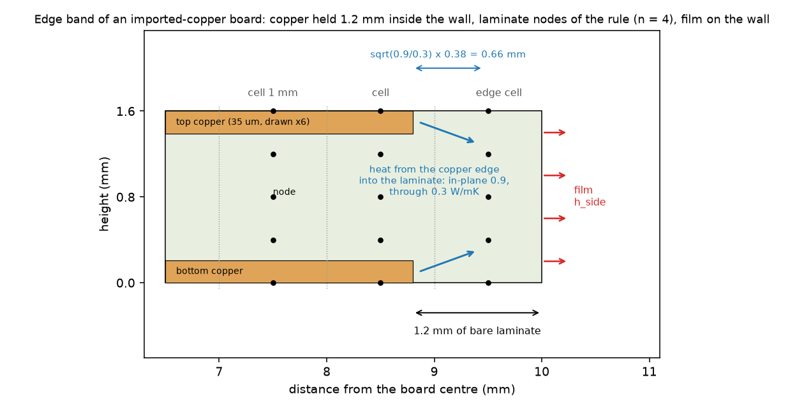
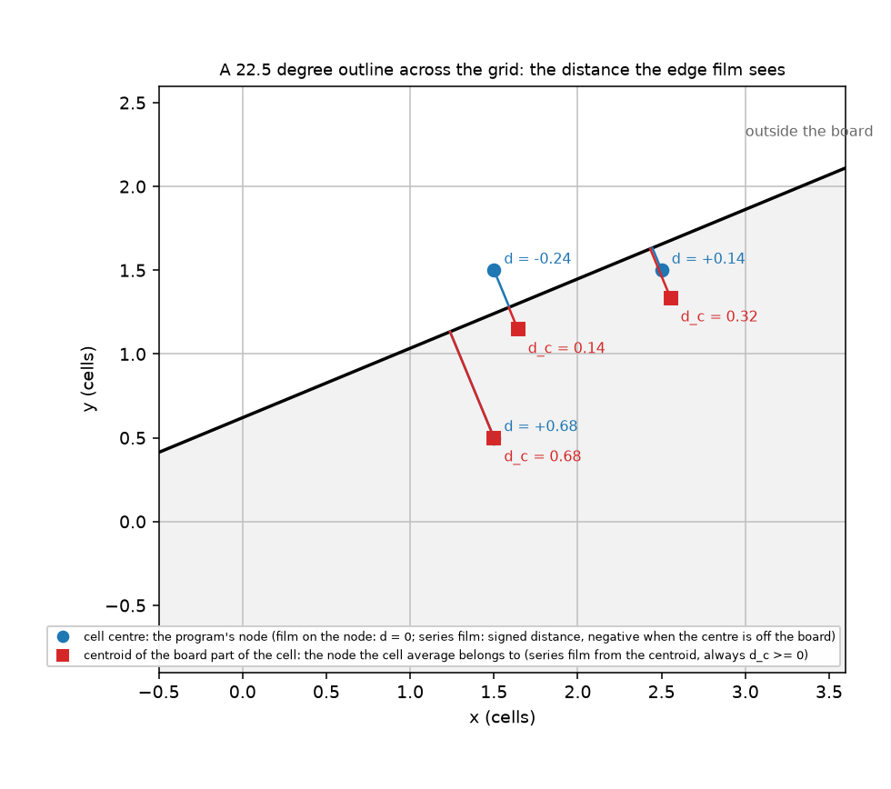

# The edge film of imported copper on a board with an outline: where the cool bias comes from

*Status: investigation written up, **reviewer pending**. Two runs were paused by the machine (memory pressure) and are listed in section 6 as not run.*

**Question.** After the pixel-level outline mask (`fix/imported-copper-outline-mask`, `docs/validation.md` 38), the heater rise of an imported-copper board with an outline reads cool: at `h_side` 200 W/m2K, five turned squares, mean -2.20 % (spread 1.86 %) at 1 mm, -1.24 % at 0.5 mm, -2.51 % at 2 mm; the aligned square -2.43 % at 1 mm. The series film fixes the aligned board (+0.32 %) and not the turned ones (-1.56 %). What is the cause, and what is the correction? The program is untouched here; the candidates are copies (`lib/variants.py`).

**Answer in short** (every number below is printed by the script named in its section).

* **There are two separate cool errors, not one**, and the earlier numbers saw only the second: (a) the *idealisation* error, the program converged in the cell (0.05 to 0.125 mm) is still **-2.0 to -2.3 %** below a 3D reference that resolves the laminate (n = 4 sub-gaps of the laminate rule; with n = 16 it is -0.9 to -1.0 %, so it falls roughly as 1/n); it is the same for drawn copper and for a rectangle without an outline, so it is **not an imported-copper or outline effect**; (b) the *cell* error at the usual cells (1 mm: -1.6 % mean on the ten boards against the program's own frame reference, 2 mm worse), which falls with the cell. At 1 mm the two add: **-3.0 % mean, worst -3.85 %** against the 3D truth (section 3.1).
* **The cell error comes from the edge film acting on the cell centre.** The unknown of a cut cell is the average over its board part, which sits at the centroid of that part, not at the cell centre. For the aligned board every cell centre is half a cell from the wall, so the film overstates the loss by `1 + h_side d / k` (11 % on the laminate nodes, which carry about 70 % of the wall area, at 1 mm); for a turned outline the signed centre distances average to zero, so putting the film in series from the centre (the program's drawn-layer scheme, the reviewer's "series film") changes the aligned board by +1.6 and the turned ones by only +0.1 to +0.3 points. That is why it "fixed" one and not the other (section 2).
* **Best candidate: the series film with the distance taken from the centroid of the board part of the cell** (`film = centroid`): no new unknowns, no new arrays in the matrix, the same symmetric M-matrix, heat balance 1e-13, time unchanged. Mean error against the 3D truth at `h_side` 200: 1 mm **-3.00 % to -0.94 %**, worst 3.85 to 1.87 %; 0.5 mm -2.48 % to -1.45 %; at `h_side` 1000, 1 mm -6.36 % to -1.26 %, worst 8.78 to 3.02 % (section 3.2). No change at `h_side` 10 (all candidates within 0.05 points).
* **What it does not fix**: the spread over the angles at 1 mm (1.8 % against 1.9 %) and the idealisation error (n = 4); the remaining one needs `laminate_n_max` 16 (2.3 times the unknowns): centroid film and n = 16 together give mean +0.22 % and worst 1.25 % at 1 mm.
* **Recommendation** in `INTEGRATION.md`: adopt the centroid film in `fvm.Network._cut_edge_film` for the imported layers on an outline (and, subject to the check of section 4, for the drawn ones), leave n_max at 4; or accept as a limit. Not verified: the four-layer truth and the striped boards (section 6).

## 1. Method

### 1.1 The board and the references

*Figure 1 (`figures/fig_01_edge_band_section.png`): the 1.6 mm board at the wall, to scale: copper held 1.2 mm inside, 1.2 mm of bare laminate, the 1 mm cells, the four sub-gaps of the laminate rule with their nodes, the heat path from the copper edge into the laminate and the film. The width of the thermal boundary layer in the laminate, `sqrt(k_xy / k_z) x 0.38 mm = 0.66 mm`, is about the size of the cell: a cell of 1 mm cannot resolve the heat that leaves the wall.*

*Figure 2 (`figures/fig_02_turned_edge_distances.png`): a 22.5 degree outline over the grid; the cell centre (blue) with its signed distance d, the centroid of the board part (red) with d_c. d is negative when the centre lies off the board; d_c never is.*

The board is the reviewer's (`lib/study_outline_mask.py`, `lib/indep_two_sheets.py`, copied): 20 mm square in a 30 mm box (or a rectangle without an outline), two layers (4 in 4.x only by the program), 1.6 mm, copper 35 um held 1.2 mm inside the wall (inset), imported at a 0.05 mm pixel, a 4 mm heater of 1 W, `h_top = h_bottom = 10`; boards turned by 0, 11.25, 22.5, 33.75, 45 degrees and shifted by 0 and 0.3 cell. Full copper inside the inset (so that a quarter has symmetry) unless a section says stripes. Three references that do not move with the change:

1. **3D truth** (`lib/truth3d.py`, imports nothing from the program): quarter board, real copper thickness, laminate cut into slabs, anisotropic (0.9 in the plane, 0.3 through), the film on the whole wall in series with the half-cell conduction, heat balance 1e-9 at every run. Extrapolated by `scripts/study_truth.py` from (0.2 mm, 12 slabs), (0.1, 12), (0.1, 24): 124.571 / 90.444 / 57.247 / 44.354 / 39.026 K at `h_side` 10 / 50 / 200 / 500 / 1000 (corrections of the extrapolation 0.05 to 0.16 K, about 0.1 to 0.3 %; that is the uncertainty of the truth). The slab count converges like 1/n at first and faster later (57.887, 57.656, 57.457, 57.380 K at 4, 6, 12, 24 slabs, cell 0.1 mm, `h_side` 200).
2. **The program's frame reference**: the same board as an aligned rectangle with no outline, solved at 0.1 mm by the program (no outline path, no cut cell). It isolates the cell error from the idealisation.
3. **The independent two-sheet solver** (`lib/indep_two_sheets.py`, laminate rule off): the aligned square equals it (54.10 K at 0.1 mm against the program with `n_max = 1`, 53.74 K at 0.125 mm and still converging at first order); the program with the rule on is a different model (the rule recovers 3.4 of the 5.8 points between the two sheets and the 3D truth).

### 1.2 The candidates (`lib/variants.py`)

Copies on top of the program (the program is not edited): `fvm.Network` and `laminate.build` are replaced inside a context. Switches: `film` = `node` (the program for imported copper), `series` (the drawn-layer scheme from the centre, signed), `centroid` (series, d from the centroid of the board part, `d >= 0`; the centroid comes from the exact cover at 8 x 8 sub-cells), `alpha` scales d, `grade` = `cos` or `ends` for graded sub-gaps, `n_max` 4, 8, 16. The floor 0.25 is kept.

## 2. Decomposition (`scripts/study_reference_gap.py`, `study_decomposition.py`, `study_cell_effect.py`; `h_side` 200, 2 layers, inset 1.2 mm, truth 57.25 K)

**2.1 The converged program is below the truth** (error against the truth, imported, n = 4, cells 1 / 0.5 / 0.25 / 0.125 mm, `study_decomposition.py 200 57.25 1,0.5,0.25,0.125 4,16`):

| board | n = 4 | n = 16 |
| :-- | --: | --: |
| rectangle, no outline | -1.66 % at 0.125 (-0.06 at 1 mm) | -0.59 % |
| square aligned | -3.76 / -3.36 / -2.19 / -2.12 | -2.41 / -2.47 / -0.86 / -1.04 |
| square 22.5 | -3.75 / -2.49 / -2.06 / -1.95 | -2.94 / -1.52 / -1.01 / -0.89 |
| square 45 | -2.79 / -2.56 / -2.19 / -2.00 | -0.93 / -1.57 / -1.13 / -0.93 |
| drawn square 45 (zones) | -6.36 / -3.50 / -2.79 / -2.31 | -5.35 / -2.20 / -1.63 / -1.21 |

At the fine cell all angles agree (spread 0.2 %): the limit is a property of the idealisation, -2.0 % at n = 4 and about -0.9 % at n = 16 (a + b/n with a = -0.5 %, b = 5.9 %). The rule recovers 1.1 points in going from 4 to 16 sub-gaps; the graded sub-gaps (`cos`) recover 0.4 (section 3.1).

**2.2 The cell error at fixed idealisation** (against the same variant at 0.05 mm, n = 4, inset 1.2):

| film | board | 2 mm | 1 mm | 0.5 mm | 0.25 mm |
| :-- | :-- | --: | --: | --: | --: |
| node (program) | aligned | +0.74 | -2.19 | -1.79 | -0.59 |
| node | 22.5 | -3.94 | -2.08 | -0.80 | -0.36 |
| node | 45 | -1.43 | -1.15 | -0.93 | -0.54 |
| series from the centre | aligned | +0.55 | +1.38 | -0.10 | +0.15 |
| series from the centre | 22.5 | -3.71 | -1.84 | -0.75 | -0.34 |
| series from the centre | 45 | -0.81 | -1.08 | -0.89 | -0.53 |

The aligned board changes by +3.6 points (1 mm) when the film goes in series, the turned ones by 0.1 to 0.35. Scaling the distance (`alpha`, aligned / 22.5 / 45 degrees, 1 mm, against the truth): 0 -3.76 / -3.75 / -2.79 %, 0.5 -1.89 / -3.60 / -2.73, 1 -0.06 / -3.52 / -2.71 (series from the centre); there is no `alpha` that suits both the aligned board and the turned ones, and the aligned best value changes with the cell (the aligned board is the one case where all centres have the same d).

**2.3 Where it lives.** With the copper held 1.2 mm inside the wall the heat leaves through the laminate, whose in-plane sheet is small (Biot `h_side d / k = 0.11` at 1 mm, 0.055 at 0.5 mm); with the copper reaching the wall (inset 0) the turned boards' cell error is -0.69 / -0.47 % at 1 mm (22.5 / 45 degrees) and -0.23 / -0.12 % at 0.5 mm, a third of the bare-band value, and the film variant matters little (`study_cell_effect.py 200 2,1,0.5,0.25,0.1 4 0.0`). The nodes that lose heat at a wall are the laminate nodes (about 70 % of the wall area at 1.6 mm, only 35 um of it copper); each carries the film of its own slab. Decomposition of the 1 mm turned board: idealisation (n = 4) about -2.0, cell error about -1.0 to -1.7, total -3.0 (the mean of ten boards, section 3.1). The 0.25 floor does not bind below `h_side` 1000 on these boards (not measured separately; see 6); the "copper held inside versus reaching the edge" item is the first sentence of this paragraph.

## 3. Candidates against the 3D truth (`scripts/study_candidates.py`)

Ten boards (five angles, two shifts of 0.3 cell), error = program / truth - 1. Cells mean / spread (max - min) / worst |error|, in percent.

### 3.1 `h_side` 200, 2 layers

| candidate | unknowns (1 mm / 0.5 mm) | 1 mm | 0.5 mm |
| :-- | :-- | :-- | :-- |
| c0 program (node film, n 4) | 2700 / 10272 | -3.00 / 1.91 / 3.85 | -2.48 / 1.96 / 3.36 |
| c1 series from the centre | same | -2.51 / 3.57 / 3.62 | -2.26 / 1.24 / 2.63 |
| c2 node, n 8 | 3900 / 14368 | -2.26 / 2.24 / 3.31 | -1.79 / 2.29 / 2.72 |
| c3 node, n 16 | 6300 / 22560 | -1.84 / 2.48 / 3.06 | -1.44 / 2.64 / 2.46 |
| c4 node, cosine sub-gaps, n 4 | 2700 | -2.58 / 2.16 / 3.59 | -2.11 / 2.23 / 3.04 |
| c5 series, n 16 | 6300 | -1.34 / 4.08 / 2.82 | -1.22 / 1.82 / 1.63 |
| c6 node, cosine, n 8 | 3900 | -1.74 / 2.60 / 3.05 | -1.43 / 2.88 / 2.51 |
| c7 series, d half | 2700 | -2.73 / 1.82 / 3.70 | -2.36 / 1.25 / 2.64 |
| c8 series, cosine, n 8 | 3900 | -1.24 / 4.15 / 2.82 | -1.21 / 2.00 / 1.64 |
| **c9 centroid film, n 4** | **2700 / 10272** | **-0.94 / 1.81 / 1.87** | **-1.45 / 1.21 / 1.72** |
| c10 centroid, d half | 2700 | -1.96 / 1.82 / 2.84 | -1.96 / 1.49 / 2.43 |
| c11 centroid film, n 16 | 6300 / 22560 | +0.22 / 2.33 / 1.25 | -0.43 / 1.76 / 1.05 |

Heat balance 1e-13 for all; the aligned run takes 0.4 s (1 mm) and 0.2 to 0.35 s (0.5 mm) for every candidate (the centroid costs one exact cover at 8 x 8 sub-cells). More z-resolution (n 8, 16, cosine grading) moves the mean by 0.4 to 1.2 points and leaves the spread; only the film from the centroid reduces the worst case without more unknowns.

### 3.2 Edge coefficient 10 to 1000 and cells 2 / 1 / 0.5 mm (mean / spread / worst, %)

| h_side, cell | c0 program | c1 series | c3 node n16 | **c9 centroid** | c11 centroid n16 |
| :-- | :-- | :-- | :-- | :-- | :-- |
| 10, 1 | -0.43 / 0.76 / 0.59 | -0.42 / 0.82 / 0.59 | -0.29 / 0.83 / 0.50 | -0.39 / 0.79 / 0.56 | -0.25 / 0.86 / 0.47 |
| 50, 2 | -1.38 / 2.33 / 2.46 | -1.41 / 2.25 / 2.52 | -0.86 / 2.95 / 2.04 | -0.67 / 2.27 / 1.77 | -0.08 / 2.87 / 1.61 |
| 50, 1 | -1.08 / 0.76 / 1.44 | -0.99 / 1.56 / 1.40 | -0.66 / 0.96 / 1.16 | -0.63 / 1.16 / 1.00 | -0.21 / 1.35 / 0.73 |
| 50, 0.5 | -0.96 / 0.45 / 1.06 | -0.92 / 0.46 / 1.06 | -0.59 / 0.67 / 0.70 | -0.73 / 0.44 / 0.85 | -0.36 / 0.67 / 0.49 |
| 500, 2 | -6.61 / 9.10 / 9.96 | -5.99 / 8.10 / 9.27 | -4.34 / 12.31 / 8.65 | -0.92 / 9.03 / 4.95 | +2.31 / 10.40 / 8.92 |
| 500, 1 | -4.90 / 3.78 / 6.75 | -3.83 / 5.34 / 5.56 | -3.11 / 4.03 / 4.98 | -1.13 / 2.84 / 2.55 | +0.63 / 3.64 / 2.32 |
| 500, 0.5 | -3.84 / 3.43 / 5.49 | -3.38 / 1.93 / 3.96 | -2.25 / 4.44 / 4.11 | -2.00 / 1.91 / 2.41 | -0.42 / 2.79 / 1.88 |
| 1000, 2 | -9.47 / 12.75 / 14.17 | -7.82 / 10.27 / 11.79 | -6.71 / 16.85 / 12.60 | -2.01 / 12.58 / 6.40 | +2.42 / 13.29 / 10.90 |
| 1000, 1 | -6.36 / 5.10 / 8.78 | -4.68 / 6.48 / 6.80 | -4.20 / 5.26 / 6.58 | -1.26 / 3.60 / 3.02 | +0.87 / 4.49 / 3.00 |
| 1000, 0.5 | -4.78 / 4.39 / 6.88 | -4.08 / 2.37 / 4.78 | -2.85 / 5.61 / 5.19 | -2.33 / 2.37 / 2.84 | -0.42 / 3.48 / 2.41 |

At `h_side` 10 every candidate is within 0.2 points of the program (the reviewer's "all agree within 0.4 %" holds). Above 50 the centroid film is the only change that helps at every cell with no cost; the cool bias that grows with `h_side` in the program (-9.5 % at 1000, 2 mm) falls to -2.0 %. The spread over the angles at 2 mm (9 to 13 %) is the cut-cell scatter of a cell as big as the heater; no candidate reduces it.

### 3.3 Robustness (frame reference, cell error; `scripts/study_robustness.py 200 1,0.5`, mean / spread / worst %, node film then centroid)

| board | node, 1 mm | centroid, 1 mm | node, 0.5 mm | centroid, 0.5 mm |
| :-- | :-- | :-- | :-- | :-- |
| imported full copper, inset 1.2 | -1.60 / 1.94 / 2.46 | +0.49 / 1.84 / 1.39 | -1.07 / 1.99 / 1.97 | -0.03 / 1.23 / 0.93 |
| drawn zones, inset 1.2 (program: series from the centre) | -3.39 / 5.05 / 5.00 | -1.76 / 3.82 / 3.23 | -2.18 / 0.97 / 2.55 | -1.36 / 0.64 / 1.61 |
| imported stripes + pad, inset 1.2 (node only) | -3.14 / 3.02 / 4.17 | not run | -2.22 / 3.10 / 3.24 | not run |

The centroid film also improves the drawn layers (their current scheme is the series film from the centre), which suggests the rule belongs to the cut-cell treatment as a whole, not to imported copper.

## 4. Why the centroid, and the limits of the argument

In a cut-cell finite-volume scheme with the cell average as unknown (cover-weighted capacity and sheet, as here) the unknown sits at the centroid of the board part, which is the place where Taylor's first-order expansion to the wall must start. Bochkov and Gibou (2019, eqs. 1.11 to 1.14) and Barrett and others (2022, eqs. 12 to 14) place the unknown at the cell centre because their nodes are point samples of a level-set grid; the program's nodes are not. The centroid distance is zero when the board part is a thin sliver (the film is then on the node, as before), `cover / 2` of a cell for a sliver of full width, and half a cell for a whole cell at the wall; it is never negative, so the floor 0.25 is reached less often. This is an argument, checked by the numbers of section 3, not a derivation: the aligned board with the centroid film is still +0.5 % hot at 1 mm (c9 mean) in the frame reference, and the exact cell error depends on the position of the copper edge in the cell (±2 %, section 2.2).

## 5. Impact on the program (measured on copies)

* `copper.py`/`fvm.py`: the change is in `fvm.Network._cut_edge_film` (a distance array) and the line that turns the film off for imported layers; no matrix size, symmetry or sign change (the film still goes into `g_amb`, so a constant field stays exact; test `tests/test_edge_film.py`).
* Frozen numbers: the harness has no imported-copper board with an outline (`docs/validation.md` 38.3); drawn boards would move if the rule is adopted for them too (not measured: section 6).
* Cost: one exact cover on an 8 x 8 sub-grid per cut cell row (restrict to cells with edge length); not measured on a 200 mm board.

## 6. What was not run, limits

* **Paused by the machine, not run**: the 4-layer truth (`scripts/study_truth.py 4 1.2 200,1000,50`) and the remaining rows of `study_robustness.py` (centroid on stripes and a pad, copper to the edge, inset 3 mm, the disc). The numbers of 3.3 for those rows are missing, so the recommendation is for 2 layers with the copper inside the wall and for full-copper layers.
* No board with a re-entrant corner (T, L), no pattern with a truth (the stripes break the quarter symmetry), no real imported board, no time simulation, no FDM, Lumped or Analytic (unchanged by the proposal).
* The 0.25 floor and the "copper at the edge" item were not isolated one by one: the first by reasoning (Biot below 0.3), the second by the inset-0 run of 2.3.
* The truth is a quarter of a 20 mm board extrapolated from three solves (0.1 to 0.3 % uncertainty); the n = 16 results and the centroid film cancel part of the same error, so a mean of +0.22 % does not prove the film exact.
* The program run of the bench is the tree at `develop` aa3b3c9f (outline mask merged, not the review branch's memory bands, which do not matter at these sizes).

## 7. What was read and what was not verified

* Bochkov and Gibou (2019, as chapter 1 of the dissertation, `research/bochkov-robin-check`, status R for the pages compared with their image), Barrett, Fogelson and Griffith (2022, R for sections 1 to 3.1 and 3.3), Schwartz and others (2006, R pages 1 to 16): quoted from `research/theory/BIBLIOGRAPHY.md`; not re-read here beyond the equation numbers cited above (S for this study). Nothing of them was stored.
* The reviewer's `releases/2.6.1/final-opinion/outline-mask.md` and its two scripts were read in full (copied into `lib/`, with one path line changed); `docs/validation.md` 38.1 to 38.3 read.
* Reproduced: the aligned program against the two-sheet solver (rule off, 53.74 against 54.10 K, converging); the reviewer's -2.2 % turned mean is the cell error of section 2.2 (we get -1.6 % with another shift set on a full-copper board). The reviewer's stripes-and-pad numbers were not reproduced (the truth does not hold for them).
* Scripts and tests: `tests/test_edge_film.py` (6 tests: truth balance and convergence, the variant network equals the program with no switch, `alpha = 0` is the node film, the heat balance of the centroid film, the graded sub-gaps).
