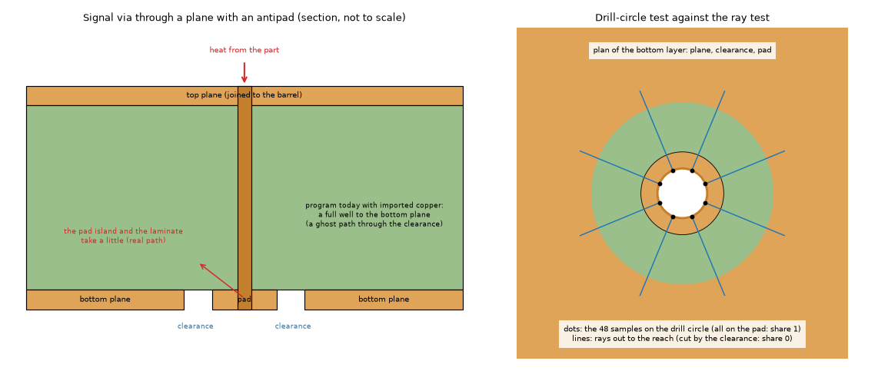
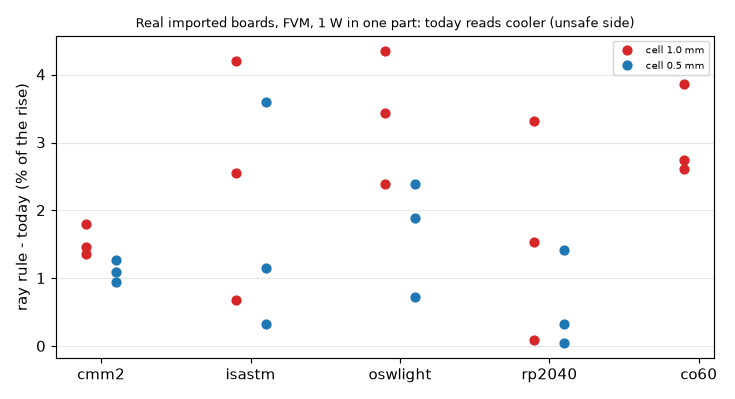
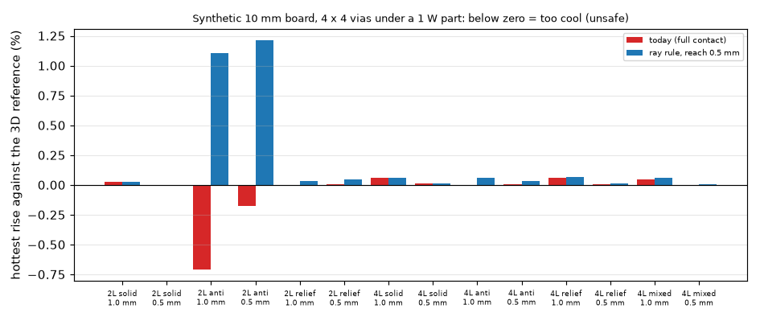

# Imported copper: the rim test of the vias

Question: with imported copper `viawell.rim_copper_shares` returns 1.0 on every layer (the rim test is skipped), so every via is coupled to every layer
by a full well, also through a plane where it has an antipad. How big is the effect, can the rim test be read from the masks, and what is the smallest fix?
The program is not touched: the prototype is `lib/rimmask.py` (monkeypatch of `viawell.rim_copper_shares`), the independent reference is `lib/truth_via.py`.

*Figure 1 (`fig_01_antipad_and_ray_test.png`): left, the section of a two-layer board at a signal via whose bottom plane has a clearance (the pad is an island); right, the plan of that layer with the 48 drill-circle samples (all on the pad) and the rays of the ray test (cut by the clearance).*

## 1. The drill-circle rim test cannot be read from the masks of a real board

The 48 samples on the circle of the drill look at the pixel at the barrel. In KiCad Gerber sets every through via has its pad (annular ring) on every copper layer, so the
drill circle is on copper on all layers whether the via is connected to the plane or sits in an antipad (a pad island inside a bare clearance ring).
Measured on the local library (`scripts/study_real_boards.py`, `lib/rimmask.py` with reach 0): the share of `(via, layer)` pairs with a rim share below 1 is **0 on every layer** of
cmm2 (1000 vias), isastm (1008), oswlight (126), rp2040 (43), co60 (359) and vstcm (21). Only gi-alleg (Allegro, 241 vias, pads removed) differs (share 0 for 17 % of the vias on L2, 37 % on L3).
So the rule "as for drawn boards, applied to the mask" would change nothing on the boards that matter.
Coverage on rings around the via (cmm2, mean over vias): 1.00 at 0 and 0.15 mm, 0.23 to 0.73 at 0.3 mm (the clearance), 0.82 to 0.91 at 0.5 mm.

## 2. A ray rule works at the import pixel

`rim_shares_masks(reach_mm)`: a sample of the 48 on the drill circle counts as contact only if the copper is continuous along the ray from the circle out to `reach` beyond it
(pixel by pixel, nearest pixel, coverage >= 0.5). The pixel is 0.09 to 0.1 mm on the library boards, so a 0.2 to 0.3 mm drill is 1 to 1.5 pixels in radius and the antipad (0.3 to 0.6 mm
clearance) 3 to 6 pixels: resolvable. A pad island is 'not connected'; a solid plane or a track-and-plane connection is. Mean share per layer at reach 0.5 mm
(top, inner, ..., bottom): cmm2 0.53 0.46 0.21 0.54; isastm 0.37 0.37 0.13 0.33; oswlight 0.39 0.46 0.46 0.46; rp2040 0.35 0.73; co60 0.59 0.48. Reaches 0.3 to 1.2 mm move the means
by 0.05 to 0.2 (cmm2 top 0.61 to 0.43), so the reach is a parameter to settle (0.5 mm used, not fitted). Thermal reliefs read as a partial share.
Limit: a via on an outer layer reached by one track reads a small share (the share is the angle of the track).

## 3. Size of the effect on real boards (FVM, 1 W in one part at a time, today against the ray rule at reach 0.5 mm)

*Figure 3 (`fig_03_real_board_shift.png`): ray rule minus today, per cent of the rise, three parts per board, FVM, cells 1 and 0.5 mm (third-party boards of the local library: numbers only, no render).*

Hottest rise of the board; the 3 parts with the most vias within 3 mm of their box. Positive = the part is hotter with the rule, i.e. today is on the unsafe side.

| board | layers, vias | cell 1.0 mm | cell 0.5 mm |
| :-- | :-- | :-- | :-- |
| cmm2 | 4, 1000 | +1.5, +1.8, +1.4 % | +1.0, +1.1, +1.3 % |
| isastm | 4, 1008 | +0.7, +2.5, +4.2 % | +0.3, +1.2, +3.6 % |
| oswlight | 4, 126 | +2.4, +4.4, +3.4 % | +0.7, +1.9, +2.4 % |
| rp2040 | 2, 43 | +3.3, +0.1, +1.5 % | +1.4, +0.0, +0.3 % |
| co60 | 2, 359 | +2.7, +3.9, +2.6 % | not run |

The effect is 0 to 4.4 % of the rise, always on the unsafe side, larger at 1 mm than at 0.5 mm, largest on parts over via fields (U5 of isastm, SW2 of oswlight). The reviewer's estimate
(phantom path comparable to the core's dielectric coupling) is not reached: percent, not tens of percent. Not run: 0.25 mm, the FDM, vstcm, gi-alleg temperatures; no measured board.

## 4. Synthetic board against an independent 3D reference

10 mm square board, a 3 x 3 mm heater with 1 W over 4 x 4 vias (0.3 mm drill, 0.7 mm pitch), h = 10 W/m2K on both faces, insulated edges, FR-4 0.9 / 0.3 W/mK, 35 um copper, given to the program
as imported masks (0.05 mm pixel). Reference `lib/truth_via.py` (0.1 mm cells, copper as real slabs, laminate in 6 or 12 sub-slabs per gap, barrel as 3 x 3 cell blocks; heat balance below 1e-10;
cell and slab convergence not studied). Patterns: solid, antipad (pad 0.25 mm radius, bare to 0.55), relief (four 0.25 mm spokes). Hottest rise in K (percent against the reference):

| case | reference | today 1.0 mm | today 0.5 mm | ray 1.0 mm | ray 0.5 mm | no vias 0.5 mm |
| :-- | :-- | :-- | :-- | :-- | :-- | :-- |
| 2L, bottom solid | 508.21 | 508.36 (0.0) | 508.19 (0.0) | 508.36 | 508.19 | 523.14 (+2.9) |
| 2L, bottom antipad | 517.12 | 513.47 (-0.7) | 516.21 (-0.2) | 522.86 (+1.1) | 523.39 (+1.2) | 523.39 |
| 2L, bottom relief | 509.14 | 509.10 (0.0) | 509.19 (0.0) | 509.31 (0.0) | 509.37 (0.0) | 523.38 |
| 4L solid | 506.68 | 507.00 (+0.1) | 506.74 (0.0) | 507.00 | 506.74 | 522.34 |
| 4L L2, L3 antipad | 507.84 | 507.83 (0.0) | 507.87 (0.0) | 508.15 (+0.1) | 508.01 (0.0) | 522.60 |
| 4L L2, L3 relief | 506.91 | 507.22 (+0.1) | 506.93 (0.0) | 507.26 (+0.1) | 506.96 (0.0) | 522.43 |
| 4L L2 antipad, L3 solid | 507.16 | 507.41 (0.0) | 507.17 (0.0) | 507.48 (+0.1) | 507.19 (0.0) | 522.56 |

*Figure 2 (`fig_02_synthetic_against_reference.png`): error of the hottest rise against `lib/truth_via.py`, today and with the ray rule, every synthetic case, cells 1 and 0.5 mm.*

Reading: (a) the ghost path exists (2L antipad: via effect 9.39 K today at 1 mm and 7.19 K at 0.5 mm, each against the program's own board without vias at the same cell, against 6.32 K in the reference: +49 % and +14 %; the review corrected a first 9.9 K that took the board without vias at 0.5 mm) but on these boards it is below 1 % of the rise, since the layers the
via does join carry the effect; on 4L below 0.3 %. (b) The ray rule removes the antipad coupling entirely, but in the reference the pad island still gives 6 K (heat from the barrel into the island and the
faces) which the rule drops: it goes to the safe side (+1.1 to +1.2 % on 2L antipad, 0.0 to +0.1 % on 4L). (c) The relief is kept (partial share) within 0.1 %.
The real-board effect of section 3 (up to 4 %) is larger than the synthetic one (many close vias under small parts); it was not reproduced against a reference on a real board.

## 5. Fix and cost

Smallest fix: in `viawell.rim_copper_shares`, for imported layers with a mask replace `return [1.0] * n_layers` by the ray test of `lib/rimmask.rim_shares_masks` (48 rays, one-pixel steps out to 0.5 mm,
heaters of the layer still count as contact; a layer without a mask keeps the zone rule), using `copper.CopperSource.of(problem)` (masks already unpacked for the cell fill). Cost: a gather of
48 x (reach / pixel) pixels per via and layer; the run of isastm (1008 vias, 4 layers) took the same time with and without it (11 to 13 s at 1 mm, solve-dominated; both runs are in `out/`, not committed).
FVM and FDM wells only (the Lumped and Analytic constrictions never read the masks and already warn for imported copper). Frozen numbers: imported boards are not in the harness (17 drawn
boards), so no frozen record moves; the drawn-board rim test is unchanged.
Open: the reach (a rule from the drill and pad radius would be better than 0.5 mm); one-track connection on outer layers; 0.25 mm and the FDM not measured; the pad island's own contribution (the rule drops it, safe side).

## 6. Warning if it stays a limit

"Imported copper: every via is treated as joined to every copper layer it crosses, also where the Gerber copper has a clearance around it (a signal via through a plane). On six boards tried the hottest part
reads 0 to 4 % cooler than with the clearance read from the copper (FVM, 1 mm cell; under 1.5 % on a synthetic board against a 3D reference)." One aggregated line, quoted as a sample, not a bound.
The cell-fill check `check_via_partial_copper` is silent at the 1 mm Auto cell; a check by the ray rule would count the vias with share below 0.5 per layer (cmm2 at reach 0.3: 32 to 78 % of the vias on L2, L3).

## 7. Review

Independent review (re-run on the research branch with `develop` merged in; the program is not edited: `git diff develop...HEAD -- pcbthermal tests examples ico` is empty).

* **Code read.** `viawell.rim_copper_shares` returns 1.0 on every layer when the problem has imported copper; `lib/rimmask.py` replaces it by monkeypatch only inside `install()` /
  `uninstall()`; the ray test marches one pixel at a time and keeps a sample only when every pixel on the ray is copper. The reference `lib/truth_via.py` shares nothing with the program
  and models the same via (0.3 mm drill, 25 um plating, open barrel, 385 W/mK copper, FR-4 0.9 / 0.3 W/mK); its barrel is a 0.3 mm square block carrying the copper area of the round barrel.
* **Re-run.** `study_synthetic.py 2 1.0,0.5 0.5`: every number of the 2L rows reproduced to the digit (peak memory 3.5 GB, the sparse LU of the reference; above the 3 GB budget of a
  shared machine). `study_real_boards.py rp2040 1.0,0.5 3`: the six shifts reproduced (+3.3, +0.1, +1.5 / +1.4, +0.0, +0.3 %), `oswlight 1.0`: +2.4, +4.4, +3.4 %. The other boards and
  the 4L synthetic rows were not re-run. Tests of the folder: 2 passed.
* **Convergence of the reference (not studied before).** 2L antipad, with an AMG-preconditioned CG in a scratch copy: rise 517.123 / 517.000 / 517.056 K at 0.1 mm and 12 sub-slabs,
  0.05 mm and 12, 0.1 mm and 24; via effect 6.32 / 6.44 / 6.39 K. The reference moves 0.02 % of the rise and 2 % of the via effect: every reading stands. With the converged effect the
  overstatement is +46 % (1 mm) and +12 % (0.5 mm).
* **Corrected.** The via effect 'today' of the 2L antipad (9.9 K, a difference across two cells; 9.39 K at 1 mm, +49 % rather than +57 %); the docstring of `lib/truth_via.py` named a test
  file and a series-circuit test that do not exist; the docstring of `study_real_boards.py` said 1.5 mm for the part window (the code uses 3 mm).
* **What the real-board numbers are.** Section 3 measures the ray rule against today, not against a reference: on the synthetic boards the ray rule itself is up to 1.2 % hot (it drops the pad
  island), so 'today is 0 to 4.4 % too cool' is an upper bound of the unsafe error on those boards, and part of each shift may be the island the rule leaves out. Stated, not resolved.
* **Not verified.** A reference on a real board; the FDM; 0.25 mm; the reach (only the shares were swept, not the temperatures); vstcm and gi-alleg temperatures; one-track outer connections.

**Verdict: GO** for closing the investigation and for the proposal of `INTEGRATION.md` (the ray test for imported layers, reach 0.5 mm, a decision of the maintainer). The implementation on
`fix/imported-via-rim-mask` is reviewed separately.

## What was read and what was not verified

Read: the program files named in the task (viawell, copper, import session) and finding 1 of the independent review (its arithmetic was an estimate, not measured; measured here: smaller). Own code and reference, no
literature used. Not verified: a physical board; the 3D reference convergence in the cell and slabs (0.1 mm only); 0.25 mm; the FDM; a reference on a real board; temperature sensitivity to the reach (only the shares);
vstcm and gi-alleg temperatures. Third-party boards of the local library: numbers only.
Run: `scripts/study_synthetic.py <layers> <cells> <reach>`, `scripts/run_real_all.sh` (the board list), tests `tests/test_rimmask.py`. Note: the docstring of `study_real_boards.py` says parts are chosen within 1.5 mm; the code uses 3 mm.
