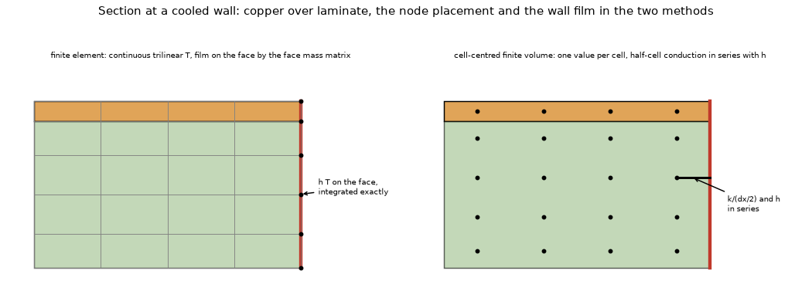
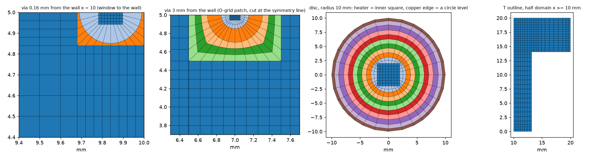
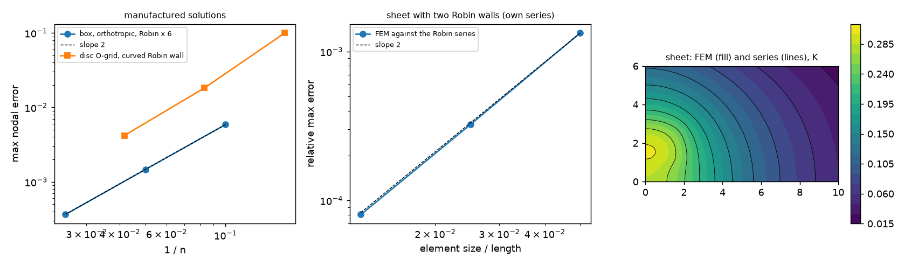
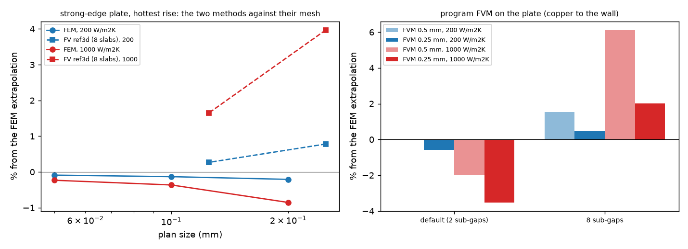
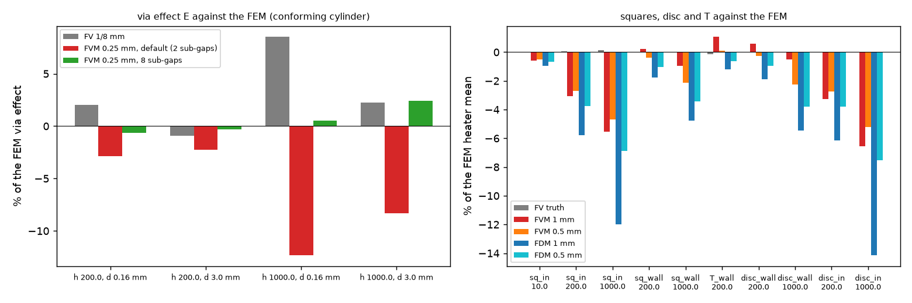

# Independent finite-element comparison program for the layered PCB

Question: the references behind the edge film, the cut cells, the via well and the laminate at the edge (`tests/helpers/layered3d.py`, `research/laminate-edge-band`,
`research/strong-edge-laminate`, `research/imported-copper-edge-film`) are cell-centred finite-volume solvers with harmonic means, the same family as the program: independent
implementations, not independent methods. Do the recorded numbers (the plate 9 % cool at 1000 W/m2K, the simple stack-up slab defect, the via effect, the gain of the centroid film,
the +1.19 % excess of the T, the thin-laminate warning of `checks.check_edge_laminate`) hold against a **structurally different method**? This folder is that method, kept as our own
comparison tool from now on: a steady-state conduction solver with isoparametric trilinear (Q1) hexahedral finite elements on mapped meshes (continuous nodal field, Galerkin weak form,
Robin film as a natural boundary integral on the real wall, conforming cylinders and polygons, no cover fraction of a cut cell, no half-cell link, no harmonic mean). It imports
`pcbthermal` only in the scripts that run the program for a comparison, and changes nothing in the repository (`git diff develop...<branch> --stat -- pcbthermal tests examples ico` is empty).


*Figure 5 (fig_05_cases.png): the four canonical boards, plan views; red, the wall with the film; dashed, a symmetry plane; orange, the source; black discs, the via at 0.16 and 3 mm.*



*Figure 6 (fig_06_methods_at_the_wall.png): section at a cooled wall; left the finite element (continuous trilinear temperature, the film integrated on the face with the consistent face mass, no half-cell link), right the cell-centred finite volume (one value per cell, half-cell conduction in series with h).*



*Figure 1 (fig_01_meshes.png): the plan meshes of the study (graded tensor grid, O-grid patch of a via, disc, turned square).*



*Figure 2 (fig_02_validation_convergence.png): convergence against the manufactured solutions and the own-series sheet with two Robin walls (section 2).*



*Figure 3 (fig_03_plate_methods_and_program.png): the strong-edge plate, hottest rise: the finite elements and the cell-centred reference against their mesh, and the program's FVM (section 3a).*



*Figure 4 (fig_04_boards_against_fem.png): via effect and the squares, disc and T of the program (`develop` e39de188, the FDM with the cell-fill faces of validation 47) against the finite elements (sections 3b to 3d).*

## Layout and how to run (from the repository root)

| path | what |
| :-- | :-- |
| `lib/fem.py` | the solver: `Model(nodes, elems)` with `k` (kx, ky, kz per element), `q` (W/m3 per element), `add_faces` (Robin `h`, ambient per face or per face node, prescribed flux), `solve` (SuperLU symmetric mode up to `direct_max` unknowns, then CG with a pyamg preconditioner), `face_integral`, `volume_integral` |
| `lib/mesh2d.py` | plan meshes: `grid1d`, `tensor`, `Quad2D.remove/rotate/boundary_edges`, `ogrid` (butterfly O-grid), `embed_ogrid` (an O-grid patch in a tensor grid, for a via), `disc`, `point_in_polygon`, `merge` |
| `lib/board.py` | `stack`, `extrude` (plan mesh to hexahedra), `Board` (copper per layer from polygons or a callable, vias as conforming cylinders, heaters as volumetric sources or a surface flux, films on the faces and on every wall slab, symmetry lines), `cell_max` (hottest cell mean of the top face, the program's read-out) |
| `lib/exact.py` | closed forms used by the tests: 1D series stack, 1D fin with a Robin end, 2D sheet with two Robin walls (own eigenfunction series) |
| `lib/refine.py` | Richardson extrapolation, observed order, grid-convergence index |
| `lib/cases.py` | the boards: Seri Lee's plate, the Culham-Yovanovich coupon, the strong-edge plate (with via, with inset), the 20 mm square, the disc, the T outline, the thin-laminate boards (`thin_board`) |
| `scripts/` | `study_published.py`, `study_fem_cases.py`, `study_program.py`, `study_fv_refs.py`, `study_report.py`, `study_thin_laminate.py` (`fem` / `prog` / `report`), `make_figures.py`, `make_diagrams.py` |
| `tests/` | closed forms, manufactured solutions, mesh conformity, rotation invariance, review checks; the scikit-fem cross-check skips when scikit-fem is not installed |
| `docs/validation-text.md` | the sentences for `docs/validation.md` and the places that say the reference is outside the repository (for the maintainer) |
| `out/` | caches and logs (git-ignored; regenerated by the scripts) |

```sh
.venv/bin/python -m pytest -q research/independent-fem-edge/tests                                     # clean .venv: the cross-check skips, the rest runs on numpy and scipy
python3.13 -m venv research/independent-fem-edge/.venv-research                                           # once: git-ignored scratch environment (named `.venv-research`, not `.venv-fem`: `tests/test_license_header.py` skips only `.venv` and `.venv-research`)
research/independent-fem-edge/.venv-research/bin/pip install -r research/independent-fem-edge/requirements.txt
research/independent-fem-edge/.venv-research/bin/python -m pytest -q research/independent-fem-edge/tests # the same plus the scikit-fem cross-check
.venv/bin/python research/independent-fem-edge/scripts/study_published.py                            # Lee plate, Culham coupon (1 min)
research/independent-fem-edge/.venv-research/bin/python research/independent-fem-edge/scripts/study_fem_cases.py   # every FEM sequence (cached; 10 min; pyamg above 60 000 unknowns)
.venv/bin/python research/independent-fem-edge/scripts/study_program.py                              # the program (FVM, FDM) on the same boards (5 min)
.venv/bin/python research/independent-fem-edge/scripts/study_fv_refs.py                              # ref3d at 1/4 and 1/8 mm, the stored truths (3 min, 1.5 GB)
.venv/bin/python research/independent-fem-edge/scripts/study_report.py                               # the tables (prints Markdown; writes out/report.json)
research/independent-fem-edge/.venv-research/bin/python research/independent-fem-edge/scripts/study_thin_laminate.py fem   # section 6 (about 40 min, under 3 GB); then `prog`, `report`
.venv/bin/python research/independent-fem-edge/scripts/make_figures.py; .venv/bin/python research/independent-fem-edge/scripts/make_diagrams.py
```

**Libraries.** The solver needs only numpy and scipy. `requirements.txt` of this folder (never the project's) adds **scikit-fem 12.0.2** (BSD-3-Clause, read from the `LICENSE`
file and the PyPI classifier of the installed package; used by one cross-check test only) and **pyamg 5.4.1** (MIT; the iterative solver above 60 000 unknowns). They live in the
git-ignored `.venv-research`; nothing is added to the project `requirements.txt` or to the README table of libraries, and nothing is vendored.

**Units and conventions.** SI inside (m, W, K, W/mK, W/m2K); the case builders take mm. z = 0 is the top face and grows downwards; an element's local nodes are the four nodes of its
bottom quad counter-clockwise then the same four at the top. Temperatures are rises over the ambient unless a per-node ambient is given to a face. "Hottest rise" is the hottest
top-face node; "heater mean" is the surface integral of the trilinear field over the heater footprint divided by its area (the finite-volume references read the mean of the top-copper
cells the heater covers, and their hottest cell).

**How the geometry is represented.** Axis-aligned outlines, copper edges and heaters whose edges are mesh lines are exact. A disc and a via drill are inscribed polygons of 4 n sides
with the nodes on the circle (conforming; chord error O(h^2)). A turned square is the aligned mesh rotated: exact, physically the same board, so the FEM has one value per board
whatever the angle; the program's spread over angles is its own cut-cell error. A copper polygon whose edge is not a mesh line is classified by the quad centroid (not used in the
comparison boards). A via is a solid copper cylinder through every layer (`r_in` and `k_fill` exist for a hollow barrel but were never run). The copper layers are one element thick
(35 um); a gap has 6 graded elements by default, and the tables apply a through-thickness Richardson correction measured with 3 / 6 / 12 (/ 24) elements per gap.

## 0. Comparing a board of the program with the finite elements (the API)

1. Describe the board for the FEM in `lib/board.py` terms (`Board(plan, layers, ..., h_top, h_bottom, h_side, copper, vias, heaters)`) on a plan mesh of `lib/mesh2d.py`, or take one of
   the builders of `lib/cases.py`; use `symmetry=[("x", ...), ("y", ...)]` for a quarter or half domain. 2. Solve it on three plan sizes (`hf` 0.4 / 0.2 / 0.1 mm, `hmax` growing with `hf`
   so that the whole plan refines) and extrapolate with `refine.richardson` (observed order and GCI). 3. Build the same board as a `pcbthermal.Problem` and read the program's
   number the way `scripts/study_program.rise` does (`simulate(p, SolverOptions(models=("fvm",), cell_mm=...))`, `analysis.heater_stats`). 4. Compare like for like: the FEM
   `heater_mean` against the program's heater mean, and the hottest cell mean (`board.cell_max(res, cell)`) against the program's hottest cell, not the FEM point maximum.

```python
import sys; sys.path.insert(0, "research/independent-fem-edge/lib")
import cases
r = cases.square(h_side=200.0, inset=1.2, hf=0.4).solve()   # 20 mm square, copper 1.2 mm inside the wall, quarter domain
print(r["heater_mean"], r["tmax"], r["balance"])             # 56.772 K, 59.701 K, balance 1 (6 elements per gap; table 3c has 12 and the extrapolation)
```

The FEM never needs the program; `study_program.py`, `study_fv_refs.py` and `study_thin_laminate.py prog` are the only scripts that import it.


## 1. Design

* **Element**: isoparametric trilinear (Q1) hexahedra on *mapped* structured meshes: a plan quad mesh (graded tensor grid; O-grid "butterfly" patches
  whose nodes lie on a circle, for a disc board and for the drill circle of a via; rigid rotation for a turned board) extruded through the stack
  (one element per copper layer, a graded set per laminate gap). Why: the thin copper (35 um) and the gaps are naturally layered, so an extruded
  quad mesh puts every material interface on element faces exactly (a tetrahedral mesh would need many elements to resolve 35 um sheets), the
  orthotropic laminate is a diagonal tensor per element, the Robin film is the natural boundary integral on the real wall face (consistent face
  mass, no half-cell link), the via barrel and a disc outline are conforming cylinders/polygons (nodes on the circle, 4 n sides), and a turned
  square is the same mesh rotated (exact: the physics has no grid direction, `tests/test_mesh_and_crosscheck.py`).
* **What is structurally different from the repository's references** (all cell-centred finite volumes with harmonic means and half-cell films):
  continuous nodal field, Galerkin weak form, 2x2x2 Gauss quadrature, face-mass Robin term, no cover fraction of a cut cell (the boundary is conforming).
* **Linear solver**: SuperLU in symmetric mode (same library as the program, but the matrix and the discretisation are not); above `direct_max`
  unknowns, conjugate gradients with a pyamg smoothed-aggregation preconditioner (not needed so far).
* **Energy balance**: `balance = (integral of h (T - T_amb) over the films) / (power in)`. For a direct solve of a consistent assembly this is
  an identity (the stiffness rows sum to zero), so it checks the assembly and the solve, not the physics; it is printed for every solve.
* A defect found and fixed on the way: in the first O-grid the ring between the inner square and the first circle was never refined radially, and
  Q1 elements on those degenerating trapezoids stopped converging (manufactured solution on the disc stalled at 5e-3). Blended levels between the
  inner square and the first circle (`n_inner`) restore second order (section 2).
## 2. Validation (`.venv/bin/python -m pytest -q research/independent-fem-edge/tests`: the tests that need scikit-fem skip; all pass with `research/independent-fem-edge/.venv-research/bin/python -m pytest -q research/independent-fem-edge/tests/test_mesh_and_crosscheck.py`)

| check | reference | result |
| :-- | :-- | :-- |
| (1) 1D series stack (2 copper layers, 1.53 mm gap in 5 graded elements, source in the top copper, films 10 / 200 W/m2K) | own closed form `exact.series_stack` | every interface temperature within 1e-9 relative; heat split up/down within 1e-9 |
| (1) 1D fin with a Robin end (copper strip 10 x 1 mm, 35 um, source on 2 mm, h 50 both faces, h_end 1000 W/m2K) | own closed form `exact.fin_robin` | max error 1e-5 of the peak (the fin approximation itself, Biot 1e-6) |
| (2) 2D sheet 10 x 6 mm with two Robin walls (h_side 1e5 W/m2K, rectangular source) | own series in the Robin eigenfunctions (`exact.robin_eigen` by bisection, `exact.sheet_robin_2d`; the program's analytic code is NOT used) | relative max error 1.33e-3 / 3.24e-4 / 8.05e-5 at 20x12 / 40x24 / 80x48 elements: order 2.04, 2.01 |
| (4) manufactured solution on a box, orthotropic k = (3, 2, 1), Robin on all six faces with a per-node ambient | exact field | max nodal error 5.87e-3 / 1.47e-3 / 3.63e-4 at 10 / 20 / 40 elements along x: order 2.00, 2.01 |
| (4) manufactured solution on the O-grid disc (mapped bricks, curved Robin wall) | exact field | 9.95e-2 / 1.83e-2 / 4.19e-3 at n_side 6 / 12 / 24: order 2.45, 2.12 |
| (5) energy balance | identity | 1 within 1e-9 on every solve of the tests (3e-12 typical) |
| cross-check of the assembly | scikit-fem 12.0.2 (ElementHex1, same tensor mesh, orthotropic stiffness, Robin facets, source) | nodal temperatures equal to 1e-10 |
| rotation invariance | the same quarter board turned 30 degrees | tmax and heater mean equal to 1e-9 |

**(3) Published spreading cases** (`scripts/study_published.py`, `out/published.txt`; the published numbers and the repository's finite-volume values
are taken from `research/effective-conductivity/README.md` 4.2 and 4.4: the papers were not reopened here, status S):

| case | FEM (extrapolated, GCI) | paper | repository FV (`layered3d`) |
| :-- | :-- | :-- | :-- |
| Seri Lee plate, centre | **0.6676 K/W** (review: uniform 2 / 1 / 0.5 mm 0.66837 / 0.66782 / 0.66768; own cosine series 0.66772). The first value, 0.6671 (GCI 0.01 %), refined only the zones near the source edges with the 4 mm far field fixed and was 0.09 % low | 0.66 (+1.2 %) | 0.6679 (-0.04 %) |
| edge midpoint | **1.2840** (review: uniform 1.28461 / 1.28416 / 1.28406; series 1.28411; first value 1.2839) | 1.29 (-0.5 %) | 1.2842 (-0.01 %) |
| corner | **2.2744** (review: uniform 2.27518 / 2.27457 / 2.27444; series 2.27446; first value 2.2756, +0.05 %) | 2.38 (-4.4 %) | 2.2745 (-0.00 %) |
| Culham-Yovanovich coupon k_eff, layer order 1 | 14.647 W/mK (0.5 mm; 14.641 at 1 mm) | 15.02 (-2.5 %) | 14.67 (-0.2 %) |
| order 2 | 11.284 | about 11.6 (-2.7 %) | 11.30 (-0.1 %) |
| order 3 | 7.821 | 8.28 (-5.5 %) | 7.81 (+0.1 %) |
| order 4 | 7.005 | about 7.4 (-5.3 %) | 6.99 (+0.2 %) |
| order 5 | 4.742 | 5.00 (-5.2 %) | 4.74 (+0.0 %) |

Reading: the conforming finite elements reproduce the repository's finite-volume values of the published cases to 0.2 % (Lee) and 0.2 % (coupon), and
keep the same distances from the papers (the -4.4 % at Lee's corner, the 2.5 to 5.5 % shortfall of the coupon orders): those distances are not an
artefact of the cell-centred scheme; they belong to the case definitions or the papers (as `research/effective-conductivity` 4.9 already argued).

**Memory finding**: SuperLU in symmetric mode on the 27-point Q1 stencil reached 5.2 GB at 138 000 unknowns (the 0.05 mm plate; the earlier study's
3.6 to 4.1 GB at 191 000 was on the same ordering), above the 3 GB the brief allows; the run was stopped. Above 60 000 unknowns the solver now uses
conjugate gradients with a pyamg smoothed-aggregation preconditioner (`.venv-research` only): on the 46 138-unknown plate at 1000 W/m2K, 135 iterations,
1.0 s, maximum difference from the direct solve 5.8e-12 K, a few hundred MB.
## 3. Comparison studies

All numbers below are printed by `scripts/study_report.py` (`out/report.md`, `out/report.json`) from the caches of `study_fem_cases.py` (FEM),
`study_program.py` (the program: FVM, and the FDM at its default) and `study_fv_refs.py` (`ref3d.py` at
1/4 and 1/8 mm with 8 slabs per gap; the stored truths of the drawn boards). **Program version of the columns** (review, section 7): every program number of sections 3, 4 and 6
is the program of `develop` at e39de188 (2.7.0 candidate, version string 2.6.0), re-run by the review. The FVM columns are bit-identical (to 1e-9, all 160 records of
`study_program.py` and the 208 FVM records of section 6) to the first run; the FDM columns moved where a drawn copper edge or an outline cuts the nodes, because
the FDM faces of drawn copper layers are built from the copper fill of the cells since `fix/fdm-copper-edge-faces` (`docs/validation.md` 47); the first run's FDM
value (the harmonic faces of validation 41) is kept in brackets where it moved. The first run was labelled `develop` at 48ad0380: that label was wrong (at 48ad0380 the
simple stack-up still gave every node T / L, while the first run's simple and physical records are identical), so the first run was made on a later tree with the
physical slabs and without the FDM cell-fill faces. **On this tree the simple and the advanced stack-up are bit-identical**
(`fix/simple-stackup-physical-layers`, validation 43; asserted in `study_report.py` on every strong-edge record), so the program columns are
"default (2 sub-gaps) / 8 sub-gaps" only. "FEM ext" is the Richardson limit of three plan meshes (6 graded elements per gap) plus a through-thickness
correction from a 3 / 6 / 12 / 24 elements-per-gap sequence on the middle plan mesh (+0.013 K at 200 W/m2K, +0.045 K at 1000: the sequence
36.883 / 36.932 / 36.942 / 36.944 and 24.064 / 24.243 / 24.281 / 24.287 K, observed order 2.5 to 2.7). Every solve closed the balance to 1e-11.

### 3(a) Strong-edge plate (10 x 10 mm, 4 layers, gaps 0.487 mm, 0.5 W, h_top 10, h_bottom 200), hottest rise, K

| h_side | copper | FEM 0.2 / 0.1 / 0.05 mm | p | FEM ext (GCI) | ref3d 1/4 mm | ref3d 1/8 mm | FVM 0.25 mm: default / 8 sub-gaps | FVM 0.5 mm | FDM 0.25 / 0.5 mm (default) |
| :-- | :-- | :-- | :-- | :-- | :-- | :-- | :-- | :-- | :-- |
| 10 | to the wall | 51.6904 / 51.6801 / 51.6866 | - | 51.687 (0.01 %) | +0.02 % | +0.01 % | -0.02 / -0.01 | -0.03 / -0.01 | -0.05 / -0.10 |
| 200 | to the wall | 36.9037 / 36.9317 / 36.9475 | 0.83 | 36.981 (0.07 %) | +0.78 % | +0.27 % | -0.57 / +0.46 | -0.03 / +1.53 | -1.10 / -1.44 |
| 1000 | to the wall | 24.1242 / 24.2432 / 24.2751 | 1.90 | 24.332 (0.06 %) | +3.97 % | +1.65 % | **-3.52 / +2.01** | -1.97 / +6.12 | **-5.13 / -6.35** |
| 10 | inset 0.5 mm | 53.2646 / 53.3670 / 53.3955 | 1.85 | 53.406 (0.03 %) | +0.58 % | +0.28 % | -0.11 / +0.30 | +0.35 / +0.89 | -0.56 / -0.95 [-0.97 / -1.26] |
| 200 | inset 0.5 mm | 41.5794 / 41.7514 / 41.7971 | 1.91 | 41.826 (0.05 %) | +1.69 % | +0.82 % | -0.45 / +0.99 | +0.53 / +2.63 | -1.48 / -2.28 [-3.47 / -5.10] |
| 1000 | inset 0.5 mm | 33.5260 / 33.7723 / 33.8373 | 1.92 | 33.906 (0.09 %) | +3.30 % | +1.57 % | -1.09 / +1.91 | +0.69 / +5.13 | **-2.96 / -4.44** [-7.64 / -12.21] |

Readings. (1) The first hexahedral study (a first hand-written hexahedral solver of this folder, 8 uniform bricks per gap, kept in git history at commit 5e28646f) extrapolated
51.684 / 36.969 / 24.351 K: this solver gives 51.687 / 36.981 / 24.332, within 0.08 %. (2) The cell-centred reference `ref3d` converges from above at first
order where the film is strong: +1.65 % at 1/8 mm and 1000 W/m2K (copper to the wall), +1.57 % with the inset, +0.27 / +0.82 % at 200; the stored
"3D reference" of validation 43 and 28 is therefore 1.6 % hot at 1000 W/m2K. (3) Against the FEM the FVM at 0.25 mm with the default two sub-gaps reads
-3.5 % at 1000 W/m2K (validation 43.2 says -5.09 % against ref3d at 1/8 mm: the 1.6 points are the reference), -0.6 % at 200 (43.2: -0.83 %); with eight
sub-gaps +2.0 % (43.2: +0.35 %): with the hot reference the eight-sub-gap program looked right and is in fact 2 % hot at 0.25 mm (the half-cell film of a
cell wider than the sub-gap, which also gives +6.1 % at 0.5 mm). (4) The FDM at its default is cooler than the FVM everywhere: -5.1 % at 0.25 mm
and 1000 W/m2K with copper to the wall (unchanged by the cell-fill faces: uniform copper), and with the copper 0.5 mm inside the wall -0.6 / -1.5 / -3.0 % at
0.25 mm (10 / 200 / 1000 W/m2K; -1.0 / -2.3 / -4.4 % at 0.5 mm) on `develop` e39de188, where the first run with the harmonic faces read -1.0 / -3.5 / **-7.6 %**
(-1.3 / -5.1 / -12.2 % at 0.5 mm). The cell-fill faces of validation 47 removed about 60 % of that deficit; the rest (2 to 3 points at 1000 W/m2K) is still
a copper-edge error of the FDM (the FVM reads -0.1 / -0.5 / -1.1 %).

### 3(b) Via effect E = hottest rise without the via minus with it (K); via a solid copper cylinder of radius 0.15 mm at 0.16 and 3 mm from the wall

The FEM via is a conforming cylinder (O-grid, nodes on the drill circle); E is the difference of two solves on the SAME mesh (copper in the cylinder on and
off), so the mesh effect cancels; the references and the earlier hexahedral study mix the copper by the area share of the disc in each cell.

| h_side | d (mm) | FEM E 0.2 / 0.1 / 0.05 mm | FEM E (band) | earlier hex study (disc share) | ref3d 1/4 mm | ref3d 1/8 mm | FVM 0.25: default / 8 sub-gaps | FVM 0.5 | FDM 0.25 / 0.5 |
| :-- | :-- | :-- | :-- | :-- | :-- | :-- | :-- | :-- | :-- |
| 200 | 0.16 | 1.5777 / 1.5816 / 1.5788 | 1.579 (0.2 %) | 1.604 (+1.6 %) | 1.678 (+6.3 %) | 1.611 (+2.0 %) | -2.9 / -0.7 | -1.4 / +1.9 | -5.4 / -11.1 |
| 200 | 3.0 | 2.5238 / 2.5285 / 2.5311 | 2.534 (0.2 %) | 2.562 (+1.1 %) | 2.747 (+8.4 %) | 2.511 (-0.9 %) | -2.3 / -0.3 | -0.8 / +2.1 | -3.6 / -4.0 |
| 1000 | 0.16 | 0.6720 / 0.6836 / 0.6833 | 0.683 (0.04 %) | 0.699 (+2.3 %) | 0.803 (+17.5 %) | 0.742 (+8.5 %) | **-12.3 / +0.5** | -8.6 / +10.2 | -15.6 / -23.8 |
| 1000 | 3.0 | 1.2057 / 1.2323 / 1.2260 | 1.226 (0.5 %) | 1.245 (+1.5 %) | 1.413 (+15.2 %) | 1.254 (+2.2 %) | -8.3 / +2.4 | -4.8 / +10.7 | -9.9 / -13.3 |

Readings. (1) The disc-share via (reference and earlier study) overstates E by 1 to 2 % against the conforming cylinder; the 1/8 mm reference by 2 to 8.5 %,
the 1/4 mm one by 6 to 17 %. (2) The program's via with eight sub-gaps is within 2.4 % of the conforming FEM at 0.25 mm (validation 28 and 43.2 quote -7.3 %
at 1000 W/m2K and 0.16 mm against ref3d 1/8 mm: that was the reference's +8.5 %; against the FEM it is **+0.5 %**); with the default two sub-gaps the via
effect is 8 to 12 % low at 1000 W/m2K (43.2: -19.2 %, again half of it the reference), 2 to 3 % low at 200. (3) The FDM reads the via effect 4 to 16 % low
at 0.25 mm with the defaults (no repository number to compare; unchanged on `develop` e39de188). (4) Review: the 1/4 and 1/8 mm references converge towards
the FEM: their error ratio is 2.1 to 2.9 on the plate and 2.05 to 3.1 on the via 0.16 mm from the wall, and a first-order extrapolation of the two (2 v(1/8) - v(1/4))
lands -0.05 to -0.67 % (plate) and -0.4 / -2.2 % (via, 1000 / 200) from the FEM: the two methods share their limit. The via 3 mm from the wall is not in the
asymptotic range of the reference (+8.4 % at 1/4 mm, -0.9 % at 1/8 mm, ratio of the errors negative), so its "-0.9 %" agreement at 1/8 mm is partly a crossing.
### 3(c) The 20 mm squares and the disc, heater mean rise, K (FEM: 12 graded elements per gap, three plan meshes, plus a 6 / 12 / 24 thickness correction, observed order 2.6 to 2.95)

The program columns are the mean error of the ten turned (0 .. 45 degrees) and shifted (0, 0.3 cell) boards of validation 40, with the worst in brackets
and, where a stored finite-volume truth exists, the mean error against that truth in square brackets; in braces, the FDM of the first run (harmonic faces, before the cell-fill faces of validation 47). The disc is the program's 180-gon outline at shifts
0 and 0.3 cell (two boards, the FEM disc is one conforming O-grid with the heater as its inner square).

| board | h_side | FEM 0.4 / 0.2 / 0.1 mm (disc: n 8 / 16 / 32) | FEM ext (GCI) | stored FV truth | FVM 1 mm | FVM 0.5 mm | FDM 1 mm | FDM 0.5 mm |
| :-- | :-- | :-- | :-- | :-- | :-- | :-- | :-- | :-- |
| square, copper 1.2 mm in | 10 | 124.375 / 124.473 / 124.516 | 124.551 (0.03 %) | 124.571 (+0.02 %) | -0.57 (0.78) [-0.58] | -0.51 (0.55) [-0.52] | -0.95 (1.25) {-0.99} | -0.69 (0.82) {-0.78} |
| same | 200 | 56.852 / 57.045 / 57.126 | 57.201 (0.13 %) | 57.247 (+0.08 %) | -3.07 (4.54) [-3.15] | -2.68 (2.94) [-2.76] | -5.77 (8.10) {-6.97} | -3.77 (4.88) {-4.89} |
| same | 1000 | 38.572 / 38.792 / 38.884 | 38.972 (0.21 %) | 39.026 (+0.14 %) | -5.53 (8.26) [-5.66] | -4.68 (5.37) [-4.82] | **-11.99 (16.75)** {-14.23} | -6.86 (9.19) {-9.12} |
| square, copper to the wall | 200 | 50.459 / 50.567 / 50.604 | 50.635 (0.05 %) | 50.619 (-0.03 %) | +0.22 (0.87) [+0.25] | -0.37 (0.55) [-0.34] | -1.78 (2.33) {-1.62} | -1.02 (1.35) {-0.97} |
| same | 1000 | 29.880 / 30.024 / 30.072 | 30.114 (0.10 %) | 30.105 (-0.03 %) | -0.96 (1.89) [-0.93] | -2.15 (2.61) [-2.12] | -4.76 (5.70) {-4.36} | -3.44 (4.03) {-3.31} |
| disc, copper to the rim | 200 | 58.999 / 59.053 / 59.075 | 59.104 (0.03 %) | - | +0.60 (1.22) | -0.25 (0.33) | -1.87 (1.92) {-1.72} | -0.97 (1.00) {-0.93} |
| same | 1000 | 32.484 / 32.670 / 32.725 | 32.773 (0.09 %) | - | -0.52 (1.60) | -2.24 (2.32) | -5.45 (5.58) {-5.02} | -3.78 (3.85) {-3.64} |
| disc, copper 1.2 mm in | 200 | 66.110 / 66.468 / 66.589 | 66.670 (0.12 %) | - | -3.25 (3.31) | -2.74 (2.88) | -6.15 (6.35) {-7.42} | -3.80 (3.90) {-5.03} |
| same | 1000 | 42.637 / 43.179 / 43.354 | 43.462 (0.24 %) | - | -6.56 (6.96) | -5.23 (5.42) | **-14.14 (14.49)** {-16.38} | -7.52 (7.76) {-10.13} |

Hottest rise of the disc (program `t_max` against the FEM node maximum; shifts 0 / 0.3): copper to the rim 200: FVM 1 mm -0.05 / +0.14 %, 0.5 mm -0.53 / -0.33,
FDM 1 mm -1.33 / -2.41, 0.5 mm -0.85 / -1.15; 1000: FVM -1.62 / -1.22 and -2.64 / -2.19, FDM -4.22 / -6.16 and -3.36 / -3.91; copper 1.2 mm in, 200: FVM -4.27 / -2.93
and -2.82 / -2.79, FDM -5.75 / -6.25 and -3.53 / -3.93; 1000: FVM -8.18 / -5.58 and -5.23 / -5.13, FDM -13.09 / -13.79 and -6.79 / -7.58 (`develop` e39de188; the first
run's harmonic FDM read -1.18 / -2.27, -0.81 / -1.11, -3.82 / -5.78, -3.23 / -3.79, -6.87 / -7.56, -4.74 / -5.07, -15.01 / -16.06, -9.31 / -9.96 in the same order).

Readings. (1) The stored finite-volume truths of the squares agree with the conforming finite elements within 0.14 % (the +0.39 % the first hexahedral study
found at 1000 W/m2K came from its 8 uniform bricks per gap: with the thickness resolved the two families agree), so every "before -> after" number of
validation 40.2 for the squares holds to 0.2 point against the FEM: copper 1.2 mm inside -3.1 / -5.5 % (1 mm, 200 / 1000), copper to the wall +0.2 / -1.0 %.
(2) The disc, a case not in the repository, behaves like the square: copper to the rim within 0.6 % at 1 mm and 200 W/m2K (the cut cells of a 180-gon are
no worse than those of a turned square), copper 1.2 mm inside -3.3 / -6.6 % at 1 mm (200 / 1000), -2.7 / -5.2 % at 0.5 mm: the drawn copper edge inside
the board still reads cool, as validation 40 says of the square. (3) **The FDM is about twice as far from the FEM as the FVM on every drawn board with the copper inside the outline**: with the cell-fill faces of `develop`
e39de188 -5.8 / -12.0 % at 1 mm (square, 200 / 1000; worst 16.8 %), -6.2 / -14.1 % on the disc (the first run, harmonic faces: -7.0 / -14.2 %, worst 17.6 %, and
-7.4 / -16.4 %, 2 to 3 times the FVM); with the copper to the wall it is 0.6 to 5 points below the FVM, and the cell-fill faces move it 0.05 to 0.5 point further
away there (validation 47 says the same). Validation 47 quotes these FDM numbers.

### 3(d) The T outline with copper to the wall, 200 W/m2K, heater mean rise

FEM 67.113 / 67.249 / 67.291 K at 0.4 / 0.2 / 0.1 mm (12 per gap), p 1.70, extrapolated 67.325 K (GCI 0.03 %); the whole T solved without the symmetry plane
gives 67.1124 against 67.1132 K of the half domain at 0.4 mm (the symmetry cut is right). Stored finite-volume truth 67.2415 K (-0.12 % from the FEM; the
earlier hex study said -0.05 %). Program, ten turned boards: FVM 1 mm **+1.06 % (worst 1.35)** against the FEM, +1.19 (1.48) against the truth; 0.5 mm +0.12 (0.49)
and +0.24 (0.42); FDM 1 mm -1.20 (3.29), 0.5 mm -0.61 (1.52) on `develop` e39de188 (first run, harmonic faces: -0.73 (3.10), -0.44 (1.47)). The +1.19 % hot excess of validation 40.2 is real (+1.06 % against the FEM) and falls with the cell.

## 4. Disagreements and proposed corrections to `docs/validation.md` (text for the project documents in `docs/validation-text.md`; the documents are not edited on this branch)

1. **Validation 43.2 and 28 (strong-edge plate, via).** The 3D reference of those tables (`ref3d.py` at 1/8 mm, 8 slabs) is **+1.65 % hot at 1000 W/m2K and
   +0.27 % at 200** against the conforming finite elements (cell-centred half-cell film, first-order from above; the first hexahedral study found the same
   +1.57 / +0.30 %), and its via effect at 0.16 mm is **+8.5 % (1000) / +2.0 % (200)** high. Proposed: add a column or a sentence "against the finite
   elements (`research/independent-fem-edge`, conforming cylinder): plate at 0.25 mm -0.57 / -3.52 % (default) and +0.46 / +2.01 % (eight sub-gaps) at 200 / 1000 W/m2K; via 0.16 mm
   from the wall -2.9 / -12.3 % (default), -0.7 / +0.5 % (eight)". The reading "with eight sub-gaps within 0.5 %" becomes "eight sub-gaps are 2 % hot at 0.25 mm
   and 6 % hot at 0.5 mm (the half-cell film of a cell wider than the sub-gap)", and "-7.3 % for the via inside the first cell with eight sub-gaps" becomes
   "+0.5 %": there is no via deficit at the wall at all.
2. **Validation 28, the sentence "the reference's own E is 5 % high at 1/8 mm"**: it is 8.5 % high against the conforming cylinder at 1000 W/m2K (2 % at 200); the
   earlier hex study's 6.1 % was against a disc-share via, which is itself 1 to 2 % high.
3. **Validation 40.2 (squares, T, L)**: confirmed; the truths are within 0.14 % of the FEM, the T's +1.19 % excess is +1.06 % against the FEM. No number to
   change; a sentence may say that a conforming finite-element solver agrees with the truths within 0.15 % on five of the boards.
4. **Validation 44, "not reconciled" (-1.3 / -3.9 / -7.2 / -11.7 against -0.8 / -2.5 / -5.1 / -8.9 %)**: not resolved here (that study's boards were not run); but
   the reference of section 36 / 43 being 1.6 % hot at 1000 W/m2K narrows the gap of the 1000 column from 2.1 to about 0.5 point if section 44's reference is
   closer to converged; worth a check with this solver (its boards are 10 x 10 mm with thin gaps, two minutes each).
5. **FDM findings** (the first run, harmonic faces): (a) the FDM read a drawn copper edge inside the outline 2 to 3 times cooler than the FVM
   (square and disc with copper 1.2 mm in: -7 / -14 % at 1 mm and 200 / 1000 W/m2K; -5 / -9 % at 0.5 mm) and the strong-edge plate with a 0.5 mm inset
   -1.0 % already at 10 W/m2K (-7.6 % at 1000, 0.25 mm), where the FVM reads -0.1 / -1.1 %; (b) the FDM via effect is 4 to 16 % low at 0.25 mm. Item (a) was
   taken up by `research/fdm-inset-edge` and `fix/fdm-copper-edge-faces` (`docs/validation.md` 47, now in `develop`): on `develop` e39de188 the same boards read
   -5.8 / -12.0 % (square, 1 mm), -3.8 / -6.9 % (0.5 mm), and the inset plate -0.6 / -1.5 / -3.0 % at 0.25 mm (10 / 200 / 1000 W/m2K): about twice the FVM's
   error, no longer two to three times; the residual and the box-against-outline difference are A40 of `research/ROADMAP.md`. Item (b) is unchanged and is
   not in any project document (a candidate for an FDM limit sentence).
6. **The first hexahedral study (this folder before the present solver, commit 5e28646f)**: its plate extrapolations agree with this solver within 0.08 %, its square truths
   differ by up to 0.3 % through its 8 uniform bricks per gap (the thickness was not extrapolated there), and its via effect carries the disc-share bias
   (+1.5 to +2.3 %). Its numbers are superseded by the conforming values above.

## 5. Limits, what was and was not verified

(See also section 7: the review corrected the Lee extrapolation above, added a patch test and two own-series checks in `tests/test_review.py`, and measured
the read-out convention of the hottest rise: the FEM gives the point maximum, the program and `ref3d` the hottest cell mean, which is 0.20 % (1000 W/m2K) /
0.13 % (200) below the point at 0.25 mm and 0.75 / 0.52 % at 0.5 mm on the strong-edge plate.)

* **Verified**: the solver against closed forms, a manufactured solution (box and curved disc, order 2), scikit-fem on the same mesh (1e-10), rotation
  invariance, the published cases through the repository's values (the papers were not reopened: the published numbers are quoted from
  `research/effective-conductivity`, status S), the half-domain cuts (T whole = half), the energy balance on every solve.
* **Not verified**: the representation of the via by a solid cylinder is the references' and the program's `fill_k = 385` convention, not a real plated
  barrel (`r_in`, `k_fill` exist in `board.py` but no hollow via was run); the via sits on the symmetry line (half domain), as in `ref3d`; the FDM finding
  4.5(a) was traced elsewhere (`research/fdm-inset-edge`: the half-copper node at a copper edge, fixed in part by `fix/fdm-copper-edge-faces`), the residual and
  4.5(b) were not traced here; the section 44 boards are section 6; the
  L outline and the four-layer / pad / stripe boards of validation 40 were not run; no time domain, no metal blocks, no imported masks.
* **Mesh limits reached**: plan 0.05 mm on the strong-edge board (138 000 to 158 000 unknowns, CG + AMG, 1.6 GB), 0.1 mm on the squares and T, n_side 32 on
  the disc, 24 elements per gap in the thickness sequences; the whole study peaked at 2.73 GB of resident memory (one direct solve of 59 000 unknowns);
  the 3 GB limit was kept after the direct solver was capped at 60 000 unknowns (one run of 138 000 unknowns had reached 5.2 GB with SuperLU and was
  stopped: section 2).
* **Observed orders below 2** on some plan sequences (0.83 at 200 W/m2K on the plate, 1.2 to 1.6 on the squares): the hottest point under a source and the
  re-entrant corners are singular, and the plan sequence has a graded mesh whose coarse part does not refine by exactly 2; the GCI (0.01 to 0.24 %) is
  the band of the graded sequences (with `hmax` held fixed the far field is not refined: a uniform sequence moves the plate at 200 W/m2K by 0.04 %, inside its GCI, but the Lee plate by 0.09 %, outside it; section 7.2; no conclusion moves), and the through-thickness sequences (order 2.6 to 2.95) are clean.
* **Machine**: shared, one run at a time; the solves took 0 to 22 s each; the program runs under 1 GB.

## 6. Thin-laminate boards of validation 44

Boards of `research/strong-edge-laminate/scripts/study_thin_laminate.py` (10 x 10 mm, 2 to 8 copper layers of 35 um in 1.0 to 2.4 mm, equal gaps = the
advanced stack-up with physical slabs, FR-4 0.3 / 0.3, h_top 10, h_bottom 200, 0.5 W on 3 x 2 mm, full copper or a pad (0.5..5.5, 3..7) mm on the outer
layers, h_side 200 / 500 / 1000 / 2000), built for the FEM by `cases.thin_board` (half domain, graded plan with `hmax = 5 hf`, so the whole plan refines by 2
with hf = 0.2 / 0.1 / 0.05 mm: the reviewer's point about the fixed far field is taken), 6 graded elements per gap (12 checked at 1000 W/m2K on the 0.1 mm mesh).
Read-outs: the point maximum and, like for like with the program and the reference, the hottest cell mean on the 0.5, 0.25 and 0.125 mm grids
(`board.cell_max`, bilinear sampling of the top face, 8 x 8 samples per cell). Script `scripts/study_thin_laminate.py` (fem | prog | report); caches
`out/thin_fem.json` and `out/thin_cache.jsonl` (the cache of `research/strong-edge-laminate`'s own script, redirected by THIN_OUT so that nothing is written in that folder).
Runs: 139 FEM solves (`out/thin_fem.txt`; the largest, 8 layers full at 0.05 mm, 327 000 unknowns, CG + AMG, peak 2.78 GB; the 8-layer pad board at
0.05 mm, 460 000 unknowns, was skipped by the memory guard, so that board is extrapolated from two meshes with second order assumed); the program FVM at
0.5 / 0.25 mm (default and 8 sub-gaps) and 0.125 mm (8 sub-gaps, not for 8 layers), the FDM at 0.5 / 0.25 mm (default) and 0.25 mm (8), and the study's own
reference `ref` at 0.25 and 0.125 mm with 8 slabs (0.125 mm not for 8 layers) through its cache (`out/thin_prog.txt`). **Memory limit broken once, by the
program, not by the FEM**: the 6-layer boards at 0.125 mm with 8 sub-gaps (294 000 program unknowns, direct solver) took the process to 3.15 GB (full) and
4.4 GB (pad); in hindsight those two settings should have been skipped like the 8-layer ones. Every FEM solve closed the balance to 1e-11.

### 6.1 Table (errors in % against the FEM; the FEM column "hottest 0.25 mm cell" is the like-for-like read-out of the program and of the reference at 0.25 mm; the 0.5 and 0.125 mm columns are measured against the FEM hottest cell of their own size; the FEM point extrapolation carries the 6 / 12 elements-per-gap correction measured at 1000 W/m2K and applied at 1000 and 2000, 4 (v12 - v6) / 3, at most +0.12 K; the closing review corrected it from (v12 - v6) / 3, which left the 1000 and 2000 W/m2K limits low by up to 0.09 K, 0.33 %, and moved the program errors there by -0.0 to -0.35 point; the FDM in brackets is the first run's, as it printed before that correction)

| board | h_side | FEM point ext (GCI) | FEM hottest 0.25 mm cell | ref 0.25/8 | ref 0.125/8 | FVM 0.25: default / 8 | FVM 0.5: default / 8 | FVM 0.125/8 | FDM 0.25 default / 8 (pads: [first run, harmonic faces]) |
| :-- | :-- | :-- | :-- | :-- | :-- | :-- | :-- | :-- | :-- |
| full 2L 1.0 mm | 200 | 36.918 (-0.08 %) | 36.868 | +0.7 | +0.4 | -0.3 / +0.3 | +0.5 / +1.3 | +0.1 | -0.6 / -0.1 |
| full 2L 1.0 mm | 500 | 31.188 (0.02 %) | 31.143 | +1.8 | +0.9 | -1.5 / +0.6 | -0.2 / +2.5 | -0.0 | -2.3 / -0.8 |
| full 2L 1.0 mm | 1000 | 27.122 (0.02 %) | 27.077 | +3.0 | +1.5 | -4.1 / +0.3 | -2.4 / +3.2 | -0.7 | -5.1 / -2.0 |
| full 2L 1.0 mm | 2000 | 23.588 (0.05 %) | 23.533 | +5.4 | +3.1 | -7.9 / -0.1 | -6.1 / +3.4 | -1.4 | -8.9 / -3.2 |
| full 4L 1.0 mm | 200 | 34.563 (0.02 %) | 34.522 | +0.9 | +0.3 | -0.8 / +0.7 | -0.4 / +2.0 | +0.2 | -0.8 / -0.3 |
| full 4L 1.0 mm | 500 | 28.047 (0.05 %) | 28.007 | +2.7 | +1.1 | -2.9 / +2.0 | -2.4 / +5.3 | +0.6 | -3.0 / -1.1 |
| full 4L 1.0 mm | 1000 | 23.299 (0.12 %) | 23.254 | +5.0 | +2.0 | -6.0 / +3.5 | -5.4 / +8.8 | +1.0 | -6.0 / -2.2 |
| full 4L 1.0 mm | 2000 | 19.514 (0.23 %) | 19.463 | +7.9 | +3.3 | -9.7 / +4.9 | -9.0 / +11.7 | +1.5 | -9.7 / -3.5 |
| full 4L 1.6 mm | 200 | 36.975 (0.09 %) | 36.929 | +0.9 | +0.3 | -0.4 / +0.6 | +0.5 / +2.1 | +0.1 | -1.0 / -0.5 |
| full 4L 1.6 mm | 500 | 29.117 (0.05 %) | 29.075 | +2.5 | +1.0 | -1.4 / +1.6 | +0.3 / +4.8 | +0.4 | -2.6 / -1.1 |
| full 4L 1.6 mm | 1000 | 24.338 (0.06 %) | 24.295 | +4.1 | +1.7 | -3.4 / +2.2 | -1.3 / +6.9 | +0.3 | -5.0 / -2.2 |
| full 4L 1.6 mm | 2000 | 20.800 (0.12 %) | 20.749 | +6.2 | +2.8 | -6.2 / +2.6 | -4.2 / +8.1 | +0.3 | -7.8 / -3.1 |
| full 6L 1.6 mm | 200 | 35.496 (0.02 %) | 35.455 | +1.2 | +0.5 | -1.1 / +0.9 | -0.7 / +2.6 | +0.3 | -1.1 / -0.4 |
| full 6L 1.6 mm | 500 | 27.454 (0.06 %) | 27.414 | +3.2 | +1.2 | -3.2 / +2.4 | -2.7 / +6.1 | +0.8 | -3.2 / -1.2 |
| full 6L 1.6 mm | 1000 | 22.507 (0.13 %) | 22.462 | +5.3 | +2.1 | -5.9 / +3.7 | -5.3 / +9.4 | +1.1 | -5.9 / -2.3 |
| full 6L 1.6 mm | 2000 | 18.915 (0.22 %) | 18.864 | +7.7 | +3.2 | -9.0 / +4.9 | -8.3 / +11.6 | +1.5 | -9.1 / -3.3 |
| full 6L 1.0 mm | 200 | 32.990 (0.01 %) | 32.948 | +1.1 | +0.4 | -0.3 / +0.9 | +0.1 / +2.2 | +0.3 | -0.4 / -0.2 |
| full 6L 1.0 mm | 500 | 26.389 (0.11 %) | 26.344 | +3.2 | +1.3 | -1.5 / +2.6 | -1.0 / +6.0 | +1.0 | -1.5 / -0.9 |
| full 6L 1.0 mm | 1000 | 21.495 (0.27 %) | 21.446 | +6.1 | +2.5 | -3.2 / +4.8 | -2.6 / +10.3 | +1.8 | -3.3 / -1.9 |
| full 6L 1.0 mm | 2000 | 17.618 (0.53 %) | 17.564 | +9.4 | +4.0 | -5.6 / +7.0 | -4.9 / +14.1 | +2.7 | -5.6 / -3.3 |
| full 6L 2.4 mm | 200 | 37.551 (0.06 %) | 37.506 | +1.2 | +0.4 | -0.4 / +0.8 | +0.7 / +2.6 | +0.2 | -1.1 / -0.5 |
| full 6L 2.4 mm | 500 | 28.614 (0.05 %) | 28.572 | +2.8 | +1.1 | -1.2 / +1.8 | +0.7 / +5.4 | +0.5 | -2.6 / -1.2 |
| full 6L 2.4 mm | 1000 | 23.748 (0.07 %) | 23.705 | +4.3 | +1.7 | -2.8 / +2.5 | -0.6 / +7.4 | +0.5 | -4.6 / -2.2 |
| full 6L 2.4 mm | 2000 | 20.300 (0.13 %) | 20.250 | +6.3 | +2.8 | -5.2 / +3.0 | -3.0 / +8.7 | +0.5 | -7.0 / -3.1 |
| full 8L 1.0 mm | 200 | 31.652 (0.02 %) | 31.606 | +1.1 | - | -0.1 / +0.9 | +0.3 / +2.2 | - | -0.2 / -0.1 |
| full 8L 1.0 mm | 500 | 25.116 (0.22 %) | 25.068 | +3.3 | - | -0.9 / +2.7 | -0.4 / +6.0 | - | -0.9 / -0.7 |
| full 8L 1.0 mm | 1000 | 20.239 (0.63 %) | 20.187 | +6.2 | - | -2.2 / +5.0 | -1.6 / +10.3 | - | -2.2 / -1.7 |
| full 8L 1.0 mm | 2000 | 16.379 (1.26 %) | 16.324 | +9.4 | - | -4.0 / +7.3 | -3.3 / +13.9 | - | -4.0 / -3.0 |
| full 8L 1.6 mm | 200 | 34.330 (0.02 %) | 34.290 | +1.3 | - | -0.6 / +1.1 | -0.2 / +2.8 | - | -0.7 / -0.3 |
| full 8L 1.6 mm | 500 | 26.282 (0.10 %) | 26.239 | +3.5 | - | -2.0 / +2.8 | -1.5 / +6.7 | - | -2.1 / -1.1 |
| full 8L 1.6 mm | 1000 | 21.287 (0.21 %) | 21.240 | +6.0 | - | -3.9 / +4.6 | -3.3 / +10.4 | - | -4.0 / -2.1 |
| full 8L 1.6 mm | 2000 | 17.679 (0.37 %) | 17.627 | +8.7 | - | -6.2 / +6.2 | -5.5 / +13.1 | - | -6.3 / -3.2 |
| pad 4L 1.6 mm | 200 | 61.073 (0.11 %) | 61.029 | +2.9 | +1.4 | -0.6 / +1.9 | +1.9 / +4.8 | +0.6 | -3.1 / -2.0 [-5.4 / -3.4] |
| pad 4L 1.6 mm | 500 | 54.337 (0.14 %) | 54.295 | +3.8 | +1.8 | -1.0 / +2.5 | +2.0 / +6.3 | +0.8 | -4.1 / -2.5 [-6.9 / -4.1] |
| pad 4L 1.6 mm | 1000 | 50.357 (0.17 %) | 50.316 | +4.5 | +2.0 | -1.9 / +2.8 | +1.5 / +7.3 | +0.7 | -5.3 / -3.1 [-8.3 / -4.8] |
| pad 4L 1.6 mm | 2000 | 47.441 (0.20 %) | 47.401 | +5.3 | +2.5 | -2.8 / +3.0 | +0.6 / +8.0 | +0.8 | -6.5 / -3.6 [-9.7 / -5.4] |
| pad 6L 1.6 mm | 200 | 50.150 (0.11 %) | 50.106 | +2.5 | +1.1 | -1.3 / +1.9 | +0.5 / +4.4 | +0.7 | -3.2 / -1.8 [-4.9 / -2.6] |
| pad 6L 1.6 mm | 500 | 42.671 (0.16 %) | 42.628 | +3.8 | +1.7 | -2.4 / +3.0 | -0.2 / +6.9 | +1.1 | -4.8 / -2.5 [-6.8 / -3.4] |
| pad 6L 1.6 mm | 1000 | 38.181 (0.21 %) | 38.138 | +5.0 | +2.1 | -3.8 / +3.8 | -1.4 / +8.7 | +1.3 | -6.5 / -3.2 [-8.8 / -4.2] |
| pad 6L 1.6 mm | 2000 | 35.006 (0.26 %) | 34.965 | +6.2 | +2.7 | -5.2 / +4.4 | -2.6 / +9.9 | +1.5 | -8.1 / -3.8 [-10.6 / -5.0] |
| pad 8L 1.0 mm | 200 | 37.130 (0.15 %) | 37.094 | +1.8 | - | +0.3 / +1.3 | +1.2 / +2.9 | - | -1.4 / -1.2 [-1.8 / -1.4] |
| pad 8L 1.0 mm | 500 | 30.676 (0.26 %) | 30.642 | +3.8 | - | +0.3 / +3.2 | +1.6 / +6.5 | - | -2.0 / -1.7 [-2.5 / -2.0] |
| pad 8L 1.0 mm | 1000 | 25.894 (0.39 %) | 25.862 | +6.5 | - | -0.0 / +5.5 | +1.7 / +10.6 | - | -3.0 / -2.5 [-3.5 / -2.7] |
| pad 8L 1.0 mm | 2000 | 22.136 (0.54 %) | 22.104 | +9.3 | - | -0.7 / +7.7 | +1.2 / +14.0 | - | -4.2 / -3.3 [-4.8 / -3.6] |

The FEM plan sequences of the 8-layer boards at 1000 and 2000 W/m2K are the least converged (observed order 0.6 to 0.9, GCI 0.4 to 1.3 %): the gaps are 0.10 to
0.19 mm and the 0.05 mm plan size is not yet asymptotic for the field at the wall; the 0.25 mm cell mean, which is what every comparison uses, is less
sensitive than the point maximum. Elsewhere the GCI is 0.01 to 0.27 %.

### 6.2 Readings

1. **The 'not reconciled' gap between sections 36 and 44 is reconciled: it is only the cell of the reference.** The two reference codes (`ref3d.py` of
   section 36 and `ref` of `study_thin_laminate.py`) are the same scheme and give identical numbers on the 4-layer 1.6 mm board (37.0797 / 24.7338 K at
   0.125 mm, 37.2694 / 25.2978 K at 0.25 mm, 200 / 1000 W/m2K). Section 44 measured the program against the reference **at 0.25 mm** (-1.3 / -3.9 / -7.2 /
   -11.7 %), section 36 / 43 against the reference **at 0.125 mm** (-0.8 / -2.5 / -5.1 / -8.9 %); against the FEM (hottest 0.25 mm cell) the same program
   value (FVM 0.25 mm, default rule) is **-0.4 / -1.4 / -3.4 / -6.2 %** at 200 / 500 / 1000 / 2000 W/m2K (-3.2 / -6.0 before the closing review corrected the
   thickness term of the FEM limit). The reference is +0.9 / +2.5 / +4.1 / +6.2 % hot at
   0.25 mm and +0.3 / +1.0 / +1.7 / +2.8 % at 0.125 mm (first order from above: the half-cell film at the cell centre).
2. **The real error behind the thin-laminate warning** (thin-gap full-copper boards 4L 1.0, 6L 1.0 / 1.6, 8L 1.0 / 1.6 mm; FVM 0.25 mm, shipped rule, against
   the FEM): **-0.1 .. -1.1 % at 200, -0.9 .. -3.2 % at 500, -2.2 .. -6.0 % at 1000, -4.1 .. -9.7 % at 2000 W/m2K** (-5.9 and -4.0 .. -9.6 before the correction of the thickness term) (the warning says -1 .. -4 / -5 .. -6 / -6 .. -11 /
   -9 .. -16 %, measured against the reference at 0.25 mm, which carries +1 / +3 / +5 .. +6 / +8 .. +9.5 % of it). Pads on the outer layers: +0.3 .. -1.3 / +0.3 .. -2.4 /
   -0.0 .. -3.8 / -0.7 .. -5.2 %. The boards whose gap is cut (2L 1.0, 4L 1.6, 6L 2.4 mm): -0.3 .. -0.4 / -1.2 .. -1.5 / -2.8 .. -4.1 / -5.2 .. -7.9 %. So a thin
   laminate is as under-resolved as a thick one (the warning's point stands), but the sizes are about **half** of the quoted ones.
3. **Eight sub-gaps at 0.25 mm are not "within 0.5 to 2.6 %": they are HOT**, +0.7 .. +1.1 / +2.0 .. +2.8 / +3.5 .. +5.0 / +4.9 .. +7.3 % on the thin-gap boards
   (+1.3 .. +7.7 % on the pads), and at 0.5 mm +2 .. +3 / +5 .. +7 / +9 .. +10.5 / +12 .. +14 % (the half-cell film of a cell wider than the sub-gap, as
   `check_edge_laminate` already says of the 0.5 mm cell). Against the hot reference at 0.25 mm they looked right (-0.2 .. -2.6 %). The program at 0.125 mm
   with eight sub-gaps is +0.2 .. +2.7 % (thin), +0.5 .. +1.5 % (pads), -1.4 .. +0.5 % (cut gaps): the layered idealisation converges to the FEM from above
   with the cell and from below with the sub-gap count; the default at 0.25 mm and eight sub-gaps at 0.125 mm bracket the truth.
4. **FDM** (default, 0.25 mm): on the full-copper boards the same as the FVM to 0.1 point (-0.2 .. -1.1 / -0.9 .. -3.3 / -2.2 .. -6.0 / -4.1 .. -9.7 %;
   unchanged by the cell-fill faces); on the **pad boards 1.7 to 3.7 points cooler than the FVM** on `develop` e39de188 (-1.4 .. -3.2 % at 200 W/m2K, -3.0 .. -6.5
   at 1000, -4.2 .. -8.1 at 2000), where the first run with the harmonic faces read 2 to 5 points (-1.8 .. -5.4 / -3.5 .. -8.8 / -4.8 .. -10.6 %): the copper edge
   inside the outline again (section 4, item 5a), on a four- to eight-layer board with inner planes; the faces of validation 47 cut the FDM error of the pads by a fifth to two fifths.

#### 6.3 Proposed corrections (not edited)

* `docs/validation.md` 44, paragraph "Not reconciled": replace by "Reconciled by the finite-element check (`research/independent-fem-edge`, section 6): the two reference codes
  give identical values; section 44 compared with the reference at 0.25 mm and section 36 with it at 0.125 mm, and the reference is +0.9 / +2.5 / +4.1 /
  +6.2 % (0.25 mm) and +0.3 / +1.0 / +1.7 / +2.8 % (0.125 mm) above a conforming finite-element solution at 200 / 500 / 1000 / 2000 W/m2K; against the
  finite elements the program (0.25 mm, default rule) reads -0.4 / -1.4 / -3.4 / -6.2 % on that board." (Numbers of the closing review; the text applied in
  `develop` quotes the first run's +4.3 / +6.4, +1.8 / +3.0 and -3.2 / -6.0: see `docs/validation-text.md`.)
* `docs/validation.md` 44, the table and the sentence "the program's own finest value lies 0.1 to 2.4 % below the reference at 0.125 mm": add the FEM
  column of 6.2 item 2 and say that the finest program value (0.125 mm, eight sub-gaps) is +0.2 .. +2.7 % above the finite elements (hot, not cool).
* `checks.check_edge_laminate` warning text (and validation 44 / 36 where quoted): the thin-gap error of the shipped rule is about -0.1 .. -1.1 / -1 .. -3 /
  -2 .. -6 / -4 .. -10 % at 200 / 500 / 1000 / 2000 W/m2K against a conforming finite-element reference (0.25 mm cell; pads on the outer layers up to
  -1.3 / -2.4 / -3.8 / -5.2 %), half of the quoted -1 .. -4 / -5 .. -6 / -6 .. -11 / -9 .. -16 %, which were against a cell-centred reference 1 to 9.5 %
  hot; and "eight sub-gaps within 0.5 to 2.6 %" should become "eight sub-gaps read 1 to 7 % HOT at 0.25 mm and 2 to 14 % hot at 0.5 mm; at 0.125 mm
  within +0.2 .. +2.7 %". The sentence "the reference is not fully converged" can be replaced by the measured figures above. The maintainer decides
  whether the warning keeps quoting the reference numbers (safe side, exaggerated) or the finite-element ones.
* `docs/validation.md` 43.2 (same board): the 'now: eight sub-gaps' column (+0.19 / +0.41 / +0.35 / -0.35 %) is against the 0.125 mm reference; against the
  FEM it is +0.6 / +1.6 / +2.2 / +2.6 %, and the default column (-0.83 / -2.55 / -5.09 / -8.90 %) is -0.4 / -1.4 / -3.4 / -6.2 % (closing review; the first run
  printed +2.3 / +2.8 and -3.2 / -6.0 at 1000 / 2000 W/m2K).

## 7. Review

Two reviews by the project reviewer: the review of the folder as it is in the repository (7.0 to 7.0.4, the closing review, run on `develop` e39de188) and the
first review of the tool before it entered the repository (7.1 to 7.8, its checks re-confirmed by the closing review where said).

### 7.0 Verdict of the closing review

**GO** for the merge of the folder and as the independent reference for the **steady** validation numbers of layered boards (copper sheets, orthotropic
laminate, films on the faces and on every wall slice, axis-aligned, turned and disc outlines, a solid copper via cylinder), with the conditions of the first
review kept: (a) the corrected Lee values, (b) a `docs/validation.md` sentence that compares a program **hottest rise** with the FEM states whether the FEM value
is the point maximum or the hottest cell mean (section 7.0.3 finds that validation 46 does not). It is **not** a reference for transients, metal blocks,
imported masks or a hollow plated barrel (none was run). The project documents need the corrections of `docs/validation-text.md` (stale FDM numbers, the
read-out sentence of validation 46, the places that call the reference "outside the repository"); they are not edited on this branch.

#### 7.0.1 What was re-run (`develop` e39de188 merged into the branch; `.venv` for the program, `.venv-research` with scikit-fem 12.0.2 and pyamg 5.4.1)

* Tests: `.venv` 11 passed, 1 skipped (the scikit-fem cross-check); `.venv-research` 12 passed.
* `study_program.py` (all 160 records, 19 s, 0.26 GB) and `study_thin_laminate.py prog` (every FVM record at 0.5 and 0.25 mm, the 0.125 mm records of the
  2- and 4-layer boards, every FDM record; 92 s, 2.6 GB peak); `study_report.py` and `study_thin_laminate.py report` print the tables of sections 3 and 6.
  **FVM: all 160 + 208 records bit-identical (1e-9) to the first run. FDM: 32 of 160 and 36 of 132 records moved** (every board with a drawn copper edge or an
  outline cutting the nodes; full-copper plates and the vias did not move), by the cell-fill faces of `fix/fdm-copper-edge-faces`. The tables now carry the
  numbers of `develop` e39de188 with the first run's FDM in brackets; the new FDM numbers reproduce `docs/validation.md` 47 to the digit (inset plate
  -0.56 / -1.48 / -2.96 % at 0.25 mm against 47.1's -0.56 / -1.48 / -2.97, a rounding of the last digit; square, disc, T as in 47.1's review table).
* FEM: nine cached solves re-solved from scratch (plate 1000 W/m2K at 0.1 and at 0.05 mm, the latter 138 000 unknowns by CG + AMG, 0.93 GB; plate inset 200 at 0.2;
  via 0.16 mm at 0.1; square inset 1000, disc inset 1000, T at the middle meshes; two thin boards at 0.1 mm, one of 100 640 unknowns): equal to the cache to
  1.6e-12 K, balance 1 to 2e-12. The thin 4-layer 1.6 mm board at 1000 W/m2K equals the strong-edge plate to the last digit (same board, two builders).
* The program-version label of the first run (`develop` 48ad0380) was **wrong**: at 48ad0380 the simple stack-up still gave every node T / L, while the first
  run's simple and physical records are identical and `study_report.py` asserts it; the first run was on a later tree (physical slabs, no FDM cell-fill faces).
  Corrected in section 3, section 8 and `INTEGRATION.md`.

#### 7.0.2 Independent checks of the conclusions

* **The explanation "the cell-centred reference is hot because its half-cell film is first order" was tested directly**: the errors of `ref3d` at 1/4 and
  1/8 mm against the FEM fall by a ratio 2.1 to 2.9 (plate, four cases) and 2.05 / 3.1 (via 0.16 mm), and the first-order extrapolation 2 v(1/8) - v(1/4) of the
  reference lands -0.05 to -0.67 % (plate) and -0.4 % (via, 1000 W/m2K) from the FEM: a cell-centred finite-volume solver and the conforming finite elements
  converge to the same limit, so the agreement of the FEM with the stored truths is not two errors cancelling. The via 3 mm from the wall is not in the
  asymptotic range of the reference (errors +8.4 % then -0.9 %), so its "-0.9 % at 1/8 mm" is a crossing, not a convergence (said in 3(b)).
* Closed forms (`tests/test_closed_forms.py`, `test_review.py`, run): 1D series stack 1e-9, Robin fin 1e-5, two-wall Robin sheet order 2, manufactured box and
  disc order 2, the Lee plate against an own cosine series (1e-4) and a two-layer board against an own layered series (1e-5), a patch test 7e-15.
* The element code was read again against the Q1 formulation (`lib/fem.py`: `B = dN J^-1`, `sum B diag(k) B^T |det J|`, 2 x 2 x 2 Gauss, face mass on the real
  face); no defect.
* Numbers of the readings checked against the printed tables: 3(a) to 3(d), 6.1 and the items of 6.2 (thin-gap ranges -0.1 .. -1.1 / ... / -4.0 .. -9.6 %,
  eight sub-gaps +0.7 .. +1.1 / ... / +5.0 .. +7.3 %, the 4-layer 1.6 mm board -0.4 / -1.4 / -3.2 / -6.0 %): all reproduce. Corrected: the FDM readings (3(a)
  item 4, 3(c) item 3, 3(d), 4 item 5, 6.2 item 4: the FDM is now about twice the FVM's error at a copper edge inside the outline, no longer two to three
  times), the "not verified" list of section 5 (section 44 boards are run in section 6; the FDM finding 4.5(a) was traced by `research/fdm-inset-edge`).

* **Defect in a study, fixed**: `scripts/study_thin_laminate.py` (report) added (v12 - v6) / 3 as the through-thickness correction at 1000 and 2000 W/m2K, the
  distance from the 12-element value to the limit, to the extrapolation of the 6-element plan sequence; the right term is 4 (v12 - v6) / 3. Found because the
  same board (four layers, 1.6 mm, full copper, 1000 W/m2K) had two limits, 24.300 K (section 6) against 24.332 K (section 3(a), its own 3 / 6 / 12 / 24
  sequence); corrected it is 24.338 K. The limits at 1000 and 2000 W/m2K rise by 0.005 to 0.09 K (at most 0.33 %, the two-layer 1.0 mm board) and the
  program errors there by 0 to -0.35 point; table 6.1, the readings 6.2 and 6.3 carry the corrected numbers (four-layer 1.6 mm board -3.4 / -6.2 % instead
  of -3.2 / -6.0 %; thin-gap boards -2.2 .. -6.0 / -4.1 .. -9.7 % instead of -5.9 / -4.0 .. -9.6 %).

#### 7.0.3 Findings in the project documents (for the maintainer; text in `docs/validation-text.md`)

1. **Wrong document, validation 46**: the paragraph says the FEM hottest value "is read as the hottest cell mean like the program's", but the plate rows of
   its table (-0.57 / -3.52 %, +0.46 / +2.01 %, FDM -1.10 / -5.13 %, 0.5 mm -0.03 / -1.97, +1.53 / +6.12) are against the **point** extrapolation (section 3(a)).
   Against the hottest 0.25 mm cell (point -0.13 % / -0.20 %, section 7.3) they are -0.44 / -3.32 %, +0.59 / +2.21 %, FDM -0.97 / -4.94 %. The thin-laminate
   numbers (44, 46, the warnings) ARE cell means and stand. Either the rows or the sentence must change; no conclusion moves (0.1 to 0.2 point).
2. **Stale document, validation 46**: "The FDM at its harmonic default reads a drawn copper edge inside the outline 2 to 3 times cooler than the FVM (-7.0 /
   -14.2 %)" and "on thin-gap boards with pads, 2 to 5 points colder": since validation 47 the default FDM reads -5.8 / -12.0 % and 1.7 to 3.7 points.
3. **Numbers moved by the study defect above** (at most 0.35 point): validation 43.2, 44, 46, the user-guide limits table, the edge-laminate warning texts of
   `checks.py` and the CLAUDE.md Decisions Log quote -3.2 / -6.0 %, +2.3 / +2.8 %, -2.2 to -5.9 / -4.0 to -9.6 %, the reference +4.3 / +6.4 %; the corrected values
   are in `docs/validation-text.md` 3. Rewording the warnings is the maintainer's decision (a text-only `fix/`).
4. **Stale location**: validation 46, `CLAUDE.md` (open decision 1, gate item 1, the Decisions Log entry on the edge warnings) and the 2.7.0 final opinion
   (`README.md` 2, 5, 6; `fdm-copper-edge-faces.md`) say the reference is outside the repository or cite its git-ignored location; once this folder is
   merged it is `research/independent-fem-edge`. The list is in `docs/validation-text.md`.

#### 7.0.4 Not verified by the closing review

The FEM sequences were not re-run in full (nine solves were, all equal to the cache; the rest is read from `out/fem_cache.json` and `out/thin_fem.json`,
which the scripts regenerate); the `ref3d` references (`study_fv_refs.py`) and the reference of section 6 were not re-run (the program does not enter them);
the FVM 0.125 mm records of the 6- and 8-layer boards were not re-run (above the memory budget; the FVM did not move anywhere else); the published cases
(`study_published.py`) were not re-run; the papers were not reopened (status S).

### 7.1. Element formulation (read against Zienkiewicz-Taylor / Hughes, Q1 isoparametric heat conduction)

* Mapping `J_ij = dx_i/dxi_j`, physical gradients `B = dN J^-1`, stiffness `sum_g B diag(k) B^T |det J|` with 2 x 2 x 2 Gauss (full integration of Q1).
  Correct. The conductivity is diagonal in the global axes. Every case has a transversely isotropic laminate (kx = ky), so turning a board in the plan is
  physically consistent.
* Robin face: the consistent face mass `h N_i N_j dA` (2 x 2 Gauss on the bilinear face, |t1 x t2|), with the load `h T_amb` from a per-node ambient.
  Flux load as well. Correct. The film goes on every wall slice of every slab (copper and laminate). A symmetry line gets no face, which is the natural
  zero-flux condition. The film covers the whole top face, including under a volume heater, as in the program.
* Sources: `q |det J| N` per element. The heater is a uniform volumetric source in the top copper elements under the polygon. This is the same physics as
  the program, which puts the power in the top copper node.
* Via: the elements whose centroid lies in the drill circle are copper (k_cu, isotropic) through every slab. With the O-grid these elements are exactly
  the conforming cylinder. `r_in` and `k_fill` exist but were never exercised.
* **Patch test added** (`tests/test_review.py::test_patch_linear_field_on_distorted_mesh`): a linear field with k = (3, 2, 0.5) and Robin films on all
  six faces. The film ambient is chosen so that the film flux equals the conduction flux. The mesh is a 5^3 box with every node moved by +-30 % of the
  element size, the boundary nodes moved within their face. Error 7e-15 (interior nodes only moved) and 5e-15 (all moved). Passed.

### 7.2. Validation claims

| claim | re-run | status |
| :-- | :-- | :-- |
| 1D series 1e-9, fin 1e-5, Robin strip order 2.0, manufactured box 2.00 and disc 2.1-2.5, balance 1 +- 1e-9, rotation 1e-9 | `.venv` 8 passed 1 skipped; `.venv-research` 9 passed (the scikit-fem check included) | confirmed (tests assert these limits) |
| scikit-fem on the same mesh to 1e-10 | `.venv-research` | confirmed |
| **Seri Lee 0.6671 / 1.2839 / 2.2756 K/W** | **own cosine series** (top insulated except the flux, film 100 on the bottom, adiabatic sides): **0.66772 / 1.28411 / 2.27446** (converged in the mode count). FEM with **uniform** plan refinement 2 / 1 / 0.5 mm: 0.66837 / 0.66782 / 0.66768, 1.28461 / 1.28416 / 1.28406, 2.27518 / 2.27457 / 2.27444, which agrees with the series to 1e-4. | **wrong in the 4th digit.** The sequence refined only `hf` near the source edges and kept the 4 mm far field (`hmax`) fixed, so the "GCI 0.01 %" measured nothing of the far field. The extrapolations were 0.09 % low (centre) and 0.05 % high (corner). Corrected in section 2 to 0.6676 / 1.2840 / 2.2744. The repository FV values (0.6679 / 1.2842 / 2.2745) are therefore within 0.04 % of the exact value, not 0.12 %. The distances to the paper (+1.2 / -0.5 / -4.4 %) stand. |
| Culham coupon 14.65 / 11.28 / 7.82 / 7.01 / 4.74 | not re-derived (a mixed top condition: film outside the source); cached output re-read | accepted, with the same fixed-`hmax` caveat (two meshes only, no extrapolation) |
| (review's second independent check) two-layer 20 mm board, orthotropic FR-4 0.9 / 0.3, volume source in the 35 um top copper, films 10 / 10, insulated walls | own layered series (each Fourier mode carried through the stack in closed form with the particular solution of the source): heater mean 139.95223, centre 142.64421 K. FEM 0.4 / 0.2 / 0.1 mm: mean 139.830 / 139.919 / 139.943 (extrapolation 139.951), centre 142.720 / 142.662 / 142.647 | confirmed to 1e-5 (`test_layered_board_against_own_series`) |

Methodological finding (defect in the study, small): every plan sequence of the comparison keeps `hmax` and the growth fixed, so the "GCI" bands
understate the error. Measured on the strong-edge plate (`.venv-research`):

| case | graded, `hf` 0.1, `hmax` 0.5 | uniform 0.1 |
| :-- | :-- | :-- |
| 1000 W/m2K | 24.2432 | 24.2437 |
| 200 W/m2K | 36.9317 | 36.9405 (+0.024 %) |

The uniform pair 0.2 / 0.1 extrapolates 36.954 at 200 W/m2K, plus the thickness correction of +0.013 gives about 36.967 K, against the reported
36.981 K. The real band is about 0.05 %. This changes no conclusion (the differences under discussion are at least 0.5 %).

### 7.3. Comparison numbers re-run

* Program (this tree, `research/strong-edge-laminate/lib/prog.py`): plate 0.25 mm 36.7716 / 23.4760 K at 200 / 1000 W/m2K. Against the FEM's 36.981 / 24.332
  this is -0.57 / -3.52 %. Via 0.16 mm from the wall: E 1.5332 / 0.5992 K, which is -2.9 / -12.3 % against FEM 1.579 / 0.683. FDM plate 1000 at 0.25 mm 23.0847
  (-5.13 %), FDM E 0.5770 (-15.5 %). **All reproduce sections 3(a) and 3(b).**
* FEM coarse level (hf 0.2): plate 1000 24.1242 and 200 36.9037 (cached values reproduced). Via 1000 / 0.16 mm: E 0.6720 on the same mesh, as in the
  cache. Via 200 / 3 mm: E 2.5238. Same-mesh differencing matters: the no-via plate on the plain mesh reads 24.1242, on the via mesh 24.1520. A
  cross-mesh E would be off by 4 %. The same-mesh E is right.
* **Same physical problem?** Strong-edge board: 4 x 35 um copper (k 385), physical gaps 0.487 mm, FR-4 0.3 / 0.3, h_top 10 over the whole top face
  (heater included), h_bottom 200, film on every wall slab, 0.5 W on 3 x 2 mm in the top copper. This is identical to `prog.board` (Materials
  k_fr4_inplane 0.3, through 0.3 default, k_copper 385). On this tree the program's simple stack-up takes the physical slabs. The via is a solid copper
  cylinder of radius 0.15 mm, 0.01 mm from the wall at d = 0.16. The program uses `fill_k = 385`, the same solid copper, but represents it by a footprint
  well (and the references by a disc share of cells). A disagreement on E is therefore the program's well and its laminate sub-gaps at the wall, not a
  different via. Squares, disc and T: two layers, 1.6 mm, FR-4 0.9 / 0.3, h 10 / 10, 1 W heater, the same as `study_drawn_film.py`.
* **Read-out convention (to state in any validation sentence).** The FEM "hottest rise" is the point maximum of the top face. The program and `ref3d` report the hottest **cell
  mean**. On the FEM field (uniform 0.1 mm) the hottest 0.25 mm cell aligned like the program's grid reads -0.20 % (1000 W/m2K) / -0.13 % (200) below
  the point maximum, and the hottest 0.5 mm cell -0.75 % / -0.52 %. The maximum lies on the line y = 5 mm, which is a cell edge of the program's grid. Like
  for like, the plate errors at 0.25 mm are therefore -3.3 % (default) and +2.2 % (eight sub-gaps) at 1000 W/m2K. At 0.5 mm, -1.2 % (default) and
  +6.9 % (eight). The heater-mean comparisons (squares, disc, T) are like for like.

### 7.4. The FDM at a copper edge inside the outline

Confirmed: the FVM is the closer model. 20 mm square, copper 1.2 mm inside, angle 0, shift 0, heater mean (K):

| h_side | FEM 0.4 / 0.2 mm (ext) | FVM 1 / 0.5 mm | FDM harmonic 1 / 0.5 | FDM arithmetic 1 / 0.5 |
| :-- | :-- | :-- | :-- | :-- |
| 0 | 140.539 / 140.625 (about 140.65) | 140.975 / 140.405 (+0.2 / -0.2 %) | 139.723 / 140.001 (-0.7 / -0.5 %) | 139.564 / 139.875 |
| 1000 | 38.571 / 38.792 (38.972 in the report) | 37.890 / 36.879 (-2.8 / -5.4 %) | 35.408 / 36.078 (-9.1 / -7.4 %) | 30.337 / 34.358 |

With insulated walls the FDM is within 0.7 % of the FEM, so the defect is not the copper edge alone. It appears only with the edge film and grows with
it (strong-edge plate with the 0.5 mm inset: already -1.0 % at 10 W/m2K). The arithmetic mean is far worse (-22 %). This is consistent with copper
conduction reaching too close to the wall through the node cover of the nodes next to the copper edge, so the film draws too much heat. The cause in
`fdm.py` was **not traced**: the film bookkeeping of `laminate.build` (moves `hs * move * edge` out of the copper node into the sub-gap nodes) was read
and does not double count. Classification: an unexplained result / likely defect of the comparison model FDM. It is for a `fix/` investigation, not
for this tool.

### 7.5. The proposed `docs/validation.md` corrections (section 4)

1. 43.2 and 28, the reference is about 1.6 % hot at 1000 W/m2K: **right**. The numbers are consistent: (1 - 0.0509) x 1.0165 = 0.9648 and (1.0035) x
   1.0165 = 1.0201. Add the read-out convention: like for like, the default is -3.3 % and eight sub-gaps +2.2 % at 0.25 mm. "There is no via deficit at
   the wall with eight sub-gaps (+0.5 %)": **right**. The default keeps -12.3 % at 1000 W/m2K and -2.9 % at 200, and the sentence must keep that.
2. 28, "the reference's own E is 5 % high at 1/8 mm": **right in substance, needs rewording**. The 5 % in the document is 0.742 against the reference's own
   1/16 mm value 0.706. Against the conforming FEM (0.683) the 1/16 mm value is +3.4 % and the 1/8 mm value +8.6 %. Quote both.
3. 40.2 confirmed (the truths are within 0.14 % of the FEM, the T is +1.06 %): **right**. Only an added sentence is needed.
4. 44, "not reconciled": **not a correction**, a suggestion. It should be run (below), not written.
5. New FDM rows: **right as a finding**. Section 4 above adds that the FDM is fine with insulated walls. Whether it gets a validation row or a warning is
   the maintainer's call.
6. The unmerged `research/independent-fem-edge`: **right**. Only relevant if that folder is ever merged.

### 7.6. Gaps, by importance

1. **Section 44 boards (thin gaps, 4- to 8-layer, pads on the outer layers)**. These are the most valuable: the warning of `checks.check_edge_laminate`
   quotes numbers whose reference is 0.2 to 4.1 % unconverged, and 36 against 44 is "not reconciled". The boards are 10 x 10 mm and cheap, and the
   builder already supports per-layer copper.
2. **A hollow plated barrel** (`r_in`, `k_fill` of resin), against the program's barrel `d + 0.5 t_cu` and rim rule. Every via number so far is the solid
   `fill_k = 385` convention.
3. **Stripes and imported masks** (validation 40 and 45 truths). Centroid classification works for mesh-aligned stripes. Masks need sampling.
4. The L outline: low priority, because the T already covers the reflex corners.
5. Metal blocks: low priority, because there is a separate 3D-solid validation.
6. Transient: lowest priority. It needs a time integrator. The program's transients are checked by other means.

### 7.7. What the review changed

* Section 2 (Lee rows) and the validation list of the program description give the corrected values.
* `tests/test_review.py` (new): the patch test, Lee against the series (centre computed, corner from the measured uniform values), and the layered series
  check. `.venv/bin/python -m pytest -q research/independent-fem-edge/tests`: 11 passed, 1 skipped (4 s).

### 7.8. Not verified

* The Culham coupon was not re-derived independently.
* The finest FEM runs (CG + AMG, 0.05 mm) were not repeated (the closing review re-solved one, plate 1000 W/m2K at 0.05 mm: equal to 1.6e-12 K). The disc and T sequences were not re-run, only read from the cache (the closing review re-solved their middle meshes: equal).
* The cause of the FDM defect was not found here (later: `research/fdm-inset-edge`, `docs/validation.md` 47).
* The papers were not reopened (status S).


## 8. What was read and what was not verified

* **Read in full**: the sources of the repository's own studies were not reopened here; the published numbers of the Lee plate (0.66 / 1.29 / 2.38 K/W) and of the Culham-Yovanovich
  coupon (15.02 / about 11.6 / 8.28 / about 7.4 / 5.00 W/mK) are quoted from `research/effective-conductivity/README.md` (status S, a summary); "about" marks values read from a plot there.
* **Reproduced**: the solver against closed forms, a manufactured solution (box and curved disc, order 2), scikit-fem on the same mesh (1e-10), rotation invariance, the half-domain cuts,
  the energy balance on every solve, Lee's plate against an own cosine series (1e-4), a layered board against an own layered series (1e-5), and a patch test on a distorted mesh. The
  published cases are reproduced only through the repository's finite-volume values and the same distances from the papers (the papers are not reopened).
* **Not verified**: a hollow plated barrel (every via number is the solid `fill_k = 385` convention); stripes and imported masks; the L outline and the four-layer, pad and stripe
  boards of validation 40; transients and metal blocks; the Culham coupon was not re-derived independently; of the finest runs one was repeated (section 7.0.1); the FDM finding 4.5(a) was traced by `research/fdm-inset-edge`, its residual and 4.5(b) were not
  traced; the 8-layer pad board at 0.05 mm (460 000 unknowns) was not solved.
* The program numbers in the tables were printed by the program of `develop` at e39de188 (the closing review's re-run, section 7.0.1); the FDM numbers of the first run, on an earlier
  tree without the FDM cell-fill faces (wrongly labelled 48ad0380 before), are kept in brackets where they moved. A later model change moves the program columns, not the
  finite-element ones: `study_program.py`, `study_thin_laminate.py prog` and the two report scripts regenerate them (under 2 minutes and 2.6 GB).
* The first, hand-written hexahedral solver that this folder held before (a different implementation of the same idea; its extrapolations agree with the present one within 0.08 %
  on the plate) is not kept in the tree; it is in git history at commit 5e28646f.
