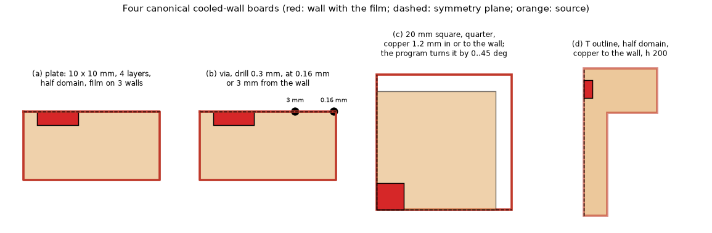
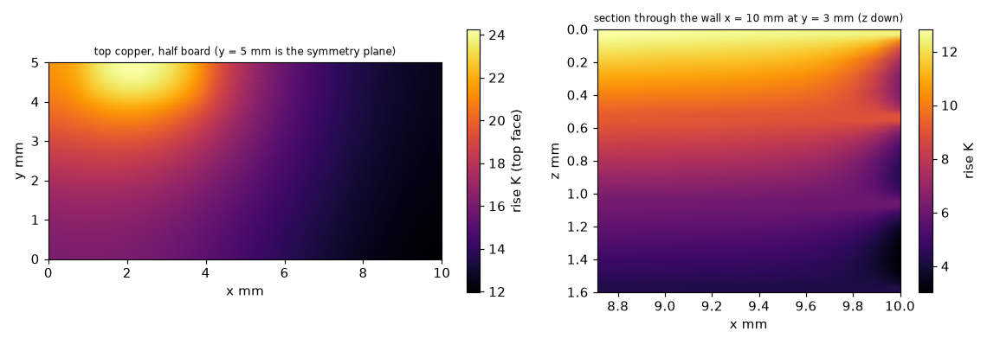
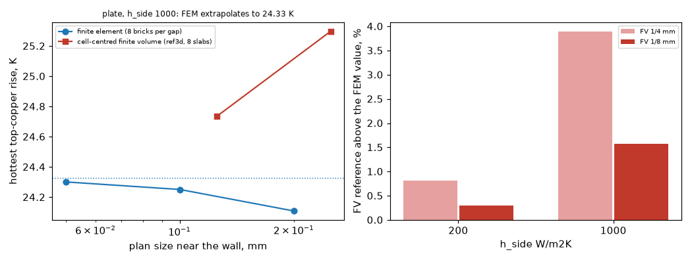
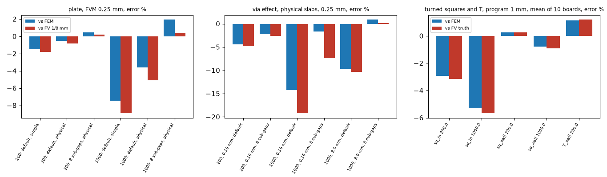

# A different method for the cooled-wall references: conforming finite elements

Question (priority for 2.7.0 confidence): every 3D "independent" reference behind the edge film, the cut cells and the laminate at the edge (`tests/helpers/layered3d.py`,
`research/laminate-edge-band/lib/graded3d.py`, `research/strong-edge-laminate/lib/ref3d.py`, `research/imported-copper-edge-film/lib/truth3d.py` and `truth_mask.py`) is a Cartesian
cell-centred finite-volume solver with harmonic means, the same family as `pcbthermal/solid3d.py`: independent implementations, not independent methods. Do the recorded conclusions
(the plate 9 % cool at 1000 W/m2K, the simple stack-up slab defect, the via effect 17 to 26 % low, the gain of the film from the centroid, the +1.19 % excess of the T with copper to
the wall) hold against a structurally different method? The program is not touched (`git diff origin/develop -- pcbthermal tests examples ico` is empty).

*Figure 1 (fig_01_cases.png): the four canonical boards, plan views; red, the wall with the film; dashed, a symmetry plane; orange, the source; black discs, the via at 0.16 and 3 mm.*

*Figure 2 (fig_02_methods_at_the_wall.png): section at a cooled wall; left the finite element (continuous trilinear temperature, the film integrated on the face with the consistent face mass
matrix, no half-cell link), right the cell-centred finite volume (one value per cell, half-cell conduction in series with h).*

## 1. The solver, and what it was checked against

`lib/hexfem.py` (imports nothing of the program, SciPy only; written by hand, scikit-fem was not needed and was not installed, so no licence question arises): trilinear (Q1) hexahedra on a graded
tensor grid, exact Galerkin stiffness of every brick with piecewise-constant conductivity (kx = ky in the plane, kz through the thickness), the film `h T` on every wall slab (copper and
laminate) integrated with the consistent face mass matrix, exact brick source, an outline by switching bricks off (the wall is then every face between a live and a dead brick), symmetric sparse
LU (`SuperLU`, symmetric mode). Boards in `lib/boards.py`: copper 385 W/mK, 35 um; FR-4 0.3 both ways (strong-edge board) or 0.9 in the plane and 0.3 through (edge-film boards); `h_top`, `h_bottom`
as in the finite-volume studies; a via is a copper cylinder whose brick conductivity is mixed by the area share of the drill disc (the same representation as the `cyl` of `ref3d`, so the
via comparison tests the method, not the via model).

Checks (`tests/test_hexfem.py`, 5 passed): the stack of two copper layers and a gap with two films equals the series-resistance solution (2e-4); a thin copper bar with a source in its first
part and films on four faces equals the closed-form 1D fin with a source (2e-3 of the maximum); the heat balance closes on every canonical board; the graded grid contains every break; **a defect
of my own first T board** (the wall y = 0 of the stem left insulated, +2.3 % hot against the stored truth) was found by comparing the half domain with a whole-T solve, fixed, and a regression test
holds half = whole to 0.3 %. Every one of the 53 cached solves closes the balance to 2.7e-11. No published numerical case was reproduced by this solver itself; its agreement with the two
earlier finite-volume families on the boards below (sections 2, 4) is the evidence, together with the closed forms.

## 2. Mesh convergence and the grid-convergence index

Plan size near the walls, the source and the via refined by 2 (0.2, 0.1, 0.05 mm; via sequences 0.28, 0.14, 0.07 mm); brick count in the gaps 8 (4 and 16 at 0.1 mm for the thickness).
Observed order `p` from three meshes, Richardson value, GCI = 1.25 |f3 - f2| / (f3 (2^p - 1)):

| board | values (K) plan sequence | p | GCI | extrapolated | thickness effect (4, 8, 16 bricks) |
| :-- | :-- | :-- | :-- | :-- | :-- |
| plate, 10 W/m2K | 51.640, 51.672, 51.681 | 1.77 | 0.01 % | 51.684 | 51.671 / 51.672 / 51.672 |
| plate, 200 | 36.865, 36.929, 36.951 | 1.53 | 0.04 % | 36.969 +- 0.013 | 36.902 / 36.929 / 36.934 |
| plate, 1000 | 24.109, 24.251, 24.301 | 1.51 | 0.14 % | 24.351 +- 0.031 | 24.152 / 24.251 / 24.270 |
| square 20 mm, copper 1.2 mm in, 200 (heater mean) | 56.889, 57.045, 57.097 | 1.57 | 0.06 % | 57.124 | |
| same, 1000 | 38.601, 38.781, 38.842 | 1.56 | 0.10 % | 38.873 | |
| square, copper to the wall, 200 | 50.506, 50.588, 50.607 | 2.10 | 0.01 % | 50.612 | |
| same, 1000 | 29.912, 30.024, 30.051 | 2.07 | 0.03 % | 30.060 | |
| T, copper to the wall, 200 | 67.085, 67.219, 67.258 | 1.76 | 0.03 % | 67.275 | |

The observed order is 1.5 to 2.1 (the hottest point under a source and the re-entrant corner of the T are singular, so the full second order is not expected). The plate's extrapolated value
combines the plan extrapolation at 8 bricks with the thickness correction (+0.024 K at 1000). The via effect E = no via minus via is **not monotone** with the mesh (the disc is a staircase
of mixed bricks): E at 1000 W/m2K, via 0.16 mm: 0.634, 0.710, 0.699 K; the GCI of the last pair is 1.6 to 2.1 % and the Richardson value is not used (the finest value is, with that band).
Solves: 53, the largest 191 400 unknowns.

*Figure 3 (fig_03_fem_field_at_the_wall.png): the finite-element temperature rise of the plate at 1000 W/m2K (0.1 mm mesh); left the top copper, right the section through the wall at y = 3 mm: the
wall is at about the board temperature in the copper and falls through the laminate half-gap, the thing the layered models represent by sub-gaps and a film.*

## 3. The finite-volume references against the finite elements

`ref3d.py` (cell-centred, 8 slabs per gap) rerun at 1/4 and 1/8 mm; the stored truths of the edge-film study are those of the repository. Error of the finite-volume value against the finite-element extrapolation:

| board | FV 1/4 mm | FV 1/8 mm | stored truth (extrapolated FV) |
| :-- | :-- | :-- | :-- |
| plate, 10 W/m2K | +0.02 % | +0.01 % | |
| plate, 200 | +0.81 % | +0.30 % | |
| plate, 1000 | +3.89 % | +1.57 % | |
| via effect E, 200, via 0.16 mm | | +0.4 % | |
| via effect E, 200, via 3 mm | | -2.0 % | |
| via effect E, 1000, via 0.16 mm | | +6.1 % | |
| via effect E, 1000, via 3 mm | | +0.7 % | |
| square, copper in, 10 / 200 / 1000 | | | +0.03 / +0.22 / +0.39 % |
| square, copper to the wall, 200 / 1000 | | | +0.01 / +0.15 % |
| T, copper to the wall, 200 | | | -0.05 % |

Reading: the cell-centred reference converges **from above and at first order** where the film is strong (the half-cell film acts on a cell centre, a cell wide of the wall): +3.9 % at 1/4 mm,
+1.6 % at 1/8 mm at 1000 W/m2K, halving with the cell, which is the 0.8 % "hot against 1/16 mm" that the strong-edge review quoted (24.538 K at 1/16 mm against the FEM 24.35 K, +0.8 %). The
extrapolated truths (0.4 / 0.2 mm series) agree with the finite elements to 0.4 % at most, the largest at 1000 W/m2K, so the 0.2 % uncertainty stated for them is a little low there. At the usual
edge coefficients (10 to 200 W/m2K) the families agree within 0.3 %.

*Figure 4 (fig_04_convergence_two_methods.png): plate at 1000 W/m2K, hottest rise against the plan size: the finite element rises to its limit 24.35 K, the cell-centred reference falls to it from above;
right, the finite-volume reference above the finite-element value at 200 and 1000 W/m2K.*

## 4. The program against the finite elements: do the recorded conclusions hold?

The program is this tree (`develop`), run through its public API as in `study_references.py prog`; the physical stack-up is the advanced stack-up of three equal gaps (the board of the reference).

**(a) The plate, hottest rise, error against the FEM, FVM at 0.25 mm** (columns: default sub-gaps with the simple stack-up / default with the physical slabs / 8 sub-gaps simple / 8 physical; the
same against the 1/8 mm finite volume in brackets, the numbers of `strong-edge-laminate` 8.2):

| h_side | cell 0.5 mm | cell 0.25 mm |
| :-- | :-- | :-- |
| 10 | -0.1 / 0.0 / -0.1 / 0.0 | -0.1 / 0.0 / -0.1 / 0.0 (same) |
| 200 | -0.9 / 0.0 / +0.3 / +1.6 | -1.5 / -0.5 / -0.7 / +0.5 (-1.8 / -0.8 / -1.0 / +0.2) |
| 1000 | -5.9 / -2.0 / +0.1 / +6.0 | **-7.5 / -3.6 / -3.4 / +1.9** (-8.9 / -5.1 / -4.9 / +0.4) |

The program FDM at 0.25 mm, default sub-gaps: -9.0 % (simple) and -5.2 % (physical) at 1000 W/m2K, -2.0 / -1.1 at 200. **Holds**: the plate is cool by the default's two sub-gaps and by the simple
stack-up's equal slabs; the slab defect is **3.9 points** at 0.25 mm and 1000 W/m2K (-7.5 to -3.6), the review's 3.8 (-8.9 to -5.1); the headline "-8.9 %" becomes **-7.5 %** because the 1/8 mm
reference was 1.6 % hot; with the physical slabs and 8 sub-gaps the program is +1.9 % at 0.25 mm and +6.0 % at 0.5 mm (the half-cell film of a cell wider than the gap, `check_edge_laminate`),
against +0.4 % and +4.4 %. **Not confirmed as a converged-deficit claim**: there is none (as the review said); the FEM also rules out a hidden cool residual of the idealisation (with 8 physical sub-gaps and a fine cell the
error is positive).

**(b) The via effect E** (hottest rise without minus with a via at 0.16 and 3 mm from the wall), FVM at 0.25 mm, same four columns, against the FEM:

| h_side, distance | FEM E (K) | cell 0.5 mm | cell 0.25 mm (against the 1/8 mm FV in the review) |
| :-- | :-- | :-- | :-- |
| 200, 0.16 mm | 1.604 | -6.5 / -3.0 / -3.8 / +0.3 | -7.9 / -4.4 / -6.1 / -2.2 (-8.3 / -4.8 / -6.5 / -2.7) |
| 200, 3 mm | 2.562 | -5.1 / -1.8 / -2.7 / +1.0 | -6.6 / -3.3 / -4.9 / -1.4 |
| 1000, 0.16 mm | 0.699 | -26.8 / -10.6 / -13.9 / +7.7 | **-30.0 / -14.3 / -21.0 / -1.7** (-34.0 / -19.2 / -25.5 / -7.3) |
| 1000, 3 mm | 1.245 | -20.2 / -6.2 / -9.2 / +9.1 | -23.1 / -9.7 / -15.4 / +0.9 (-23.7 / -10.3 / -16.0 / +0.2) |

**Holds in direction**: with the default
two sub-gaps the via effect stays 10 to 19 % low at 1000 W/m2K even with the physical slabs (here -14.3 / -9.7), and 15 to 21 % low with 8 simple sub-gaps (the review's "17 to 26 %" is 15 to 21 % against
the FEM; the large entries of the old statement came from the 1/8 mm reference being 6 % hot in E at 0.16 mm). **Changes**: the **via within one cell of the wall** reads -7.3 % at 1000 against the 1/8 mm FV and
**-1.7 %** against the FEM (the review's "about -2.5 % against the finer reference" is confirmed by a different method): there is **no** residual via-model defect at the wall to chase; the 1/8 mm
reference's own E was 6.1 % high there. The via representation is the same disc-share mixing in both methods, so a via-model error common to both is not tested.

**(c) The turned squares, the centroid film** (mean heater rise of the ten boards, 1 mm cell, against the FEM and against the stored truth):

| board, h_side | against FEM, mean / worst % | against the stored truth |
| :-- | :-- | :-- |
| copper 1.2 mm in, 10 | -0.55 / 0.76 | -0.58 / 0.79 |
| in, 200 | -2.94 / 4.41 | -3.15 / 4.62 |
| in, 1000 | -5.29 / 8.02 | -5.66 / 8.39 |
| copper to the wall, 200 | +0.27 / 0.91 | +0.25 / 0.90 |
| to the wall, 1000 | -0.78 / 1.72 | -0.93 / 1.86 |
| at 0.5 mm, in 200 / 1000; wall 200 / 1000 | -2.55 / 2.80 ; -4.44 / 5.13 ; -0.32 / 0.50 ; -1.98 / 2.44 | -2.76 / 3.01 ; -4.82 / 5.50 ; -0.34 / 0.52 ; -2.12 / 2.58 |

**Holds**: every error against the truth of validation 40.2 moves by at most 0.4 point against the FEM, in the cool direction of the table (the truth is up to 0.4 % hot), so the quoted gains of the film from
the centroid (for example -9.18 -> -5.66 % at 1000 W/m2K) are confirmed in size (-5.29 % against the FEM) and the conclusion that the drawn copper 1.2 mm inside still reads cool (-3 to -5 %) is not an artefact of the reference.

**(d) The T with copper to the wall, 200 W/m2K**: the program is +1.14 % (mean of 10 boards, worst 1.43) at 1 mm and +0.19 % (worst 0.42) at 0.5 mm against the FEM, **+1.19 / +0.24 % in validation 40.2**.
**The +1.19 % hot excess of the T is real** (the FEM puts the truth within 0.05 % of the finite-volume truth), and so is its fall with the cell.

*Figure 5 (fig_05_program_against_fem.png): the program's error against the FEM (blue) and against the finite-volume reference (red): the plate at 0.25 mm, the via effect, and the turned squares and T at 1 mm.*

## 5. Where the finite-volume references and the finite elements disagree, and what it means

1. **The cell-centred reference with a strong film is hot and converges at first order.** At 1000 W/m2K the 1/8 mm plate is +1.6 %, the 1/8 mm via effect at 0.16 mm +6.1 %; at 200 W/m2K +0.3 % and +0.4 %. Every number of
   validation 36 and of `strong-edge-laminate` 4 to 8 that is an error against ref3d at 1/8 mm and at 500 W/m2K or above shifts by 1 to 5 points (cool error smaller in size, e.g. the plate -8.9 -> -7.5 %, the via effect -34.0 -> -30.0 %).
   The conclusions (the sub-gap and slab causes, the sign, the size ordering) do not change.
2. **Where the two methods agree, the families agree**: 10 and 200 W/m2K, the squares and the T (<= 0.4 %). The shared-scheme doubt is retired for these boards.
3. **A residual of the finite elements**: the via effect is mesh-noisy (+- 2 %) because of the disc-share mixing; the Richardson value is not trusted there, and the 1 mm via 3 mm at 200 W/m2K differs from the FV by -2.0 %, the only
   case where the two disagree by more than their own bands.
4. **Not tested by this study**: the half-cell film of the program with copper reaching a strongly cooled wall on cut cells of an outline at a *non-aligned* angle (the FEM board is aligned, the program's turned boards are compared with it by the invariance of the physics, as the finite-volume truth did); a
   conforming via; vias on partial copper; the FDM at the new harmonic default was not run separately (the program's FDM numbers above are the tree's current ones).

## 6. Limits

Memory: the finest plate solves (191 400 unknowns) reached **3.6 to 4.1 GB** of the process (the 3 GB goal was exceeded, the 4 GB ceiling was touched once at 4.12 GB, with the machine under load and the process swapped for part of the run); everything else is under 2.5 GB (the via
sequences were limited to 0.07 mm on purpose, 130 500 unknowns, 2.5 GB). The cost of the finest runs is 1.3 minutes on a quiet machine and 17 minutes when it was paused and swapped. One strong-edge board, one 20 mm square, one T; solid copper vias only; the film `h_side` above 200 W/m2K is not air (as in the earlier studies); no time domain.

## 7. What was read and what was not verified

Read in full: the four reference solvers' headers and `ref3d.py`'s source, `study_drawn_film.py`, `strong-edge-laminate/README.md` (sections 1 to 8), `docs/validation.md` 40, the independent review `tmp/fable_research_review_270.md` section 6. Not read: no
finite-element text was opened for the Q1 formulation (it is the standard Galerkin trilinear brick; from memory, M), and no published numerical case was reproduced by the new solver (the closed forms are the series stack and the 1D fin of `tests/test_hexfem.py`).
Reproduced: the program numbers of validation 40.2 (T and squares), the `ref3d` values at 1/4 and 1/8 mm (the earlier 24.7338 / 23.9923 K at 1000 W/m2K 1/8 mm). Not done: scikit-fem cross-check of `hexfem` itself, the disc and L outlines, a conforming via, the FDM harmonic default on its own.
Scripts: `scripts/study_fem_cases.py fem`, `study_references.py fv|prog`, `study_report.py` (prints the tables of sections 2 to 4), `make_figures.py`, `make_diagrams.py`; tests `tests/test_hexfem.py`.
