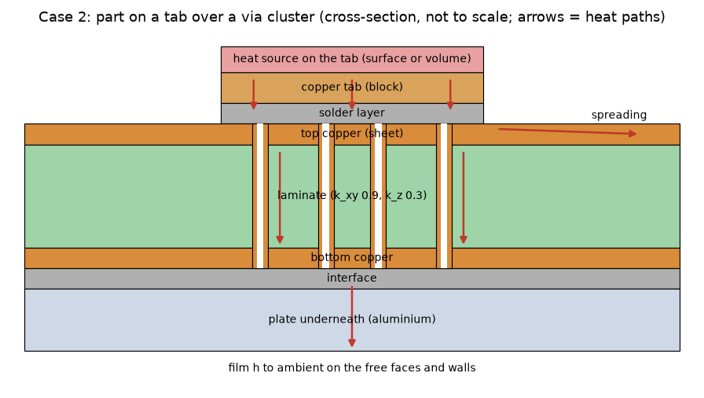
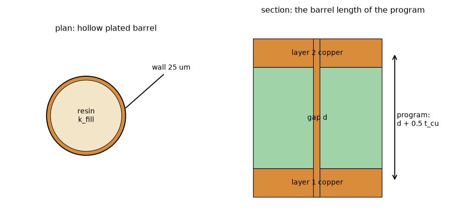
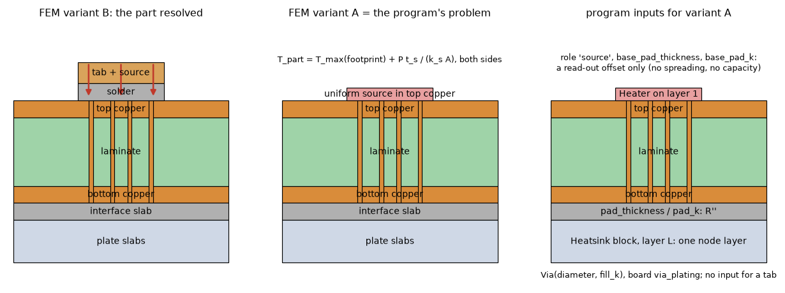
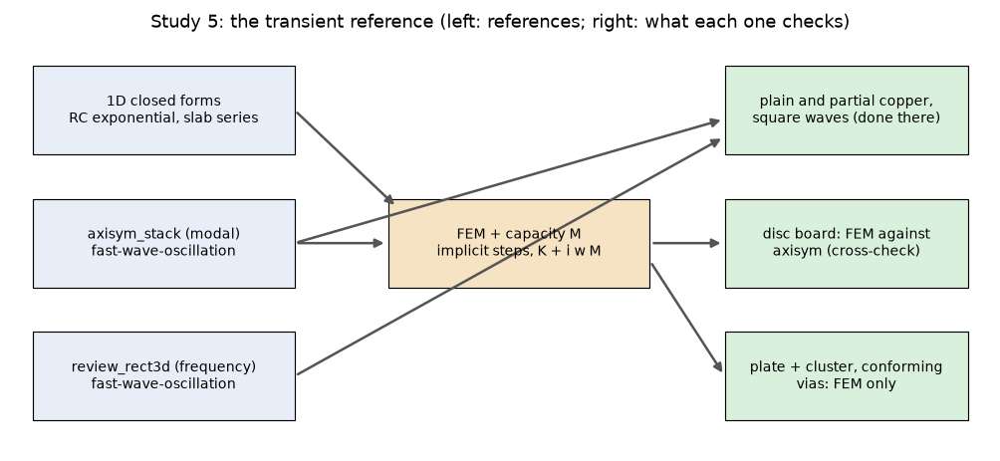
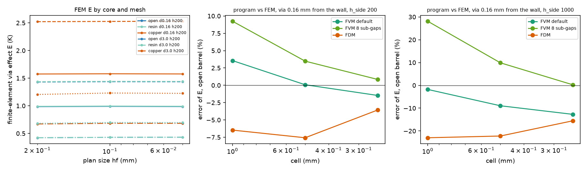
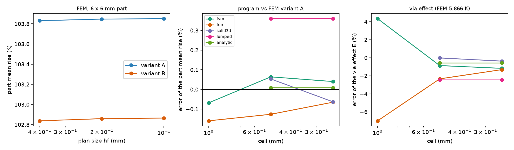
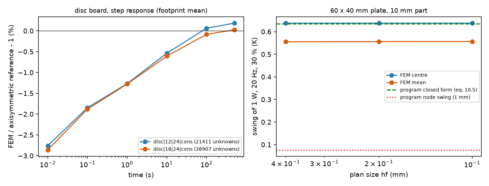
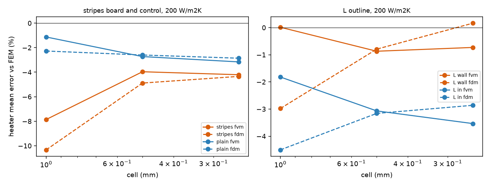

# Extensions of the independent finite-element comparison tool (plan)

**Status: planned and reviewed (section 7: GO for the plan as corrected here); the cleared studies were run (section 8); the results were reviewed (section 9: GO for the merge, with the corrections of 9.2 written into section 8; the finer levels of README 4 still wait for a quiet machine).** This folder reopens `research/independent-fem-edge`
(its `lib/` is imported, never copied or edited here) for `research/ROADMAP.md` A43 and the item 'FEM extensions (A43)' of `docs/versions.md`
'Planned: 2.8.0'. Every cost in sections 1 to 7 is an ESTIMATE printed by `scripts/study_plan_costs.py` (unknowns counted on plan meshes built by the tool's own
mesh functions; memory from the peaks the tool measured, section 3); the first run of each study replaces it by a measured number. No number of the
program is quoted that a script of this folder has not printed.

## 1. What the tool is today, and what is missing

Read from `independent-fem-edge/lib` (`fem.py`, `mesh2d.py`, `board.py` in full; `cases.py` for the builders; the review read the bodies, the first
pass of the plan only the signatures). There is no `asm.py`: the assembly is `fem.Model._assemble_elements` and `_assemble_faces`.

* `fem.Model`: a steady, isoparametric trilinear (Q1) hexahedral solver; per element a diagonal conductivity `(kx, ky, kz)` and a volumetric source
  `q`; Robin faces `h (T - T_amb)` with a consistent face mass and a per-node ambient; a prescribed face flux; 2 x 2 x 2 Gauss. Solve: SuperLU in
  symmetric mode up to `direct_max` (default **60 000** unknowns), above it CG with a pyamg smoothed-aggregation preconditioner (pyamg only in
  `independent-fem-edge/.venv-research`). Unused nodes are dropped, so elements can be removed freely (a hole, a slab that covers only part of the plan).
* `mesh2d`: graded tensor axes (`grid1d`), O-grid patches whose circles are mesh levels (`ogrid`, `embed_ogrid`), the disc, `Quad2D.remove`.
* `board.Board`: a plan mesh extruded through ALL slabs of the stack (copper layers, graded gaps); copper per layer by polygon (even-odd per polygon,
  union of polygons; a plane with antipads needs a callable) on quad centroids; vias as cylinders by plan centroid **through every slab of the
  extrusion**; heaters only in the top copper layer (volume source, or a prescribed flux with no film under it); films on the top, bottom and every wall slab.

**Corrections of the first plan.** (1) The brief says a Crank-Nicolson integrator exists in the tool: it does NOT. `fem.py` has no capacity matrix,
no density or specific heat, no time loop (confirmed by reading the whole file); the Crank-Nicolson of the repository is the program's theta method
(`fvm.transient_*`), which is what is checked, so it cannot be the reference. (2) `Board` cannot express a slab that covers only part of the plan
(tab, solder, a plate smaller than the board): every slab spans the whole plan, so those slabs are a new builder that extrudes and then removes the
elements outside their polygon, and adds the films on the new free faces (top and sides of the tab, bottom and sides of the plate) by hand. (3) The
via loop of `Board.build` would also turn the new tab, solder, interface and plate slabs into copper: the builder must restrict the barrel to the board
slabs. (4) An open barrel cannot be `k_fill = 0` (the core nodes would have no stiffness and the matrix would be singular): the core quads are removed
from the plan (a hole through the board, adiabatic inner wall, as the program's open barrel). (5) Under a 2 GB budget the default `direct_max` of
60 000 is too high (2.73 GB was measured at 59 000 unknowns): pass `direct_max=30000`.

| Capability | In the tool | Missing for the studies |
| :-- | :-- | :-- |
| solid barrel | yes (`k_fill` 385, 3(b)) | - |
| hollow plated barrel | fields `r_in`, `k_fill` exist, never run | O-grid levels at `r_in` and 3 to 4 rings across the 25 um wall; open barrel as a hole (correction 4) |
| tab and solder over a polygon, source in the tab | no | partial slabs (correction 2), source in the tab elements, films on the tab |
| plate under the board through an interface | no (films only) | partial slabs under the board (correction 2); via barrel kept out of them (correction 3) |
| stripes | aligned with mesh lines: yes | a builder |
| imported masks | no | a mask callable on centroids of a mesh that RESOLVES the features (section 2, study 3) |
| L outline | polygon plan yes (the T exists) | a builder |
| capacity `C = rho c` | no | element mass (lumped and consistent) |
| time integrator | no | implicit steps and a frequency-domain solve (study 5) |

*Figure 1 (fig_01_cluster_cross_section.png): the section of study 2 with the heat paths, not to scale.*

*Figure 2 (fig_02_hollow_barrel.png): plan and section of the hollow barrel and the program's barrel length `d + 0.5 t_cu`.*

## 2. Studies (corrected by the review; order and green light in section 4)

'Runs now' means: the estimated peak of one solve is under 2 GB (`study_plan_costs.py`), the script builds the mesh, prints the unknowns and the
estimate, and refuses above the budget; one heavy run at a time on the shared machine.

### Study 1. Hollow plated barrel against the program's barrel
Question: is `d + 0.5 t_cu` with the Peaceman well right for a plated wall of 25 um, or only for the solid cylinder of `independent-fem-edge` 3(b)?
And the FDM via effect 4 to 16 % low at 0.25 mm (A43): every program row carries the FDM column.
Board: exactly the 3(b) board (`cases.strong_edge`: 10 x 10 mm, 4 layers 35 um, gaps 0.487 mm, FR-4 0.3 / 0.3, 0.5 W on 3 x 2 mm, h_top 10,
h_bottom 200, h_side 200 and 1000, half domain), the via of 0.3 mm drill at 0.16 and 3 mm from the wall, so that the solid cylinder of 3(b) is the
control already computed. Barrel `r_in = r_drill - 25 um` with three cores: open (the hole), resin `k_fill` 0.3, copper `k_fill` 385. Program: FVM
and FDM at 1, 0.5 and 0.25 mm with `Via(diameter 0.3 mm, fill_k 0 / 0.3 / 385)`, `board.via_plating` 25 um (the same annulus: the program's drill
includes the plating). 1b: a 3 x 3 array at 1 mm pitch, the middle row on the symmetry line. Output: E (as 3(b)) for the three cores, both programs.
Checks: (i) `k_fill = k_cu` with `r_in` set equals the solid cylinder on the same mesh (round-off: the matrix is the same); (ii) the closed form of
the barrel conductance `k_cu pi (r_o^2 - r_i^2) / L` against a FEM column with the laminate set to a negligible conductivity, within 1 %; (iii) the
wall with 2, 3 and 4 elements: E moves less than 0.5 %; (iv) the plan meshes 0.2 / 0.1 / 0.05 mm with the observed order (`refine.py`), and the
balance (a real check with CG, an identity with the direct solve).

### Study 2. Part on a tab over a via cluster, plate underneath
Question: how far are the program's cluster (FVM and FDM footprint of cells with Peaceman wells, the 3D solid, the Lumped dense group, the
Analytic tiles) from the finite elements on the board that matters most, and how much does the program's idealisation of the part itself add?
Board (figures 1 and 3): 20 x 20 mm, 4 layers 35 um, 1.6 mm, FR-4 0.3 / 0.9, full copper on every layer; **a 4 x 4 cluster at 0.8 mm pitch** (the
first plan had 5 x 5: a 5 x 5 array puts nine vias on the two symmetry planes of the quarter, and some via centres of a 4 x 4 or 6 x 6 array at other
pitches fall on the program's cell lines, the stated limit of the 3D solid; 4 x 4 at 0.8 mm centred at (10, 10) mm sits off every line of the 1, 0.5,
0.25 and 0.125 mm grids and off both symmetry planes), drill 0.3 mm, hollow with resin `fill_k` 0.3; 1 W; the part 6 x 6 mm (7..13 mm, on cell lines)
and a 4 x 4 mm variant (8..12 mm; the first plan's 3 x 3 mm edge at 8.5 mm is not on the 1 mm grid); a 1.0 mm aluminium plate (k 204 W/mK, rho c
2.44 MJ/m3K, the program's defaults, so that both sides take the same values) under the whole board through a 0.1 mm interface of 3 W/mK; h_top =
h_bottom = 10, h_side 10.
* **Variant A, the program's problem** (solved by both sides): the heat is a uniform volume source in the top copper over the footprint (the
  program's heater), the top face convects also under it (as in the program); the plate and the interface as above. The part temperature is
  `T_max(footprint) + P t_s / (k_s A)` on both sides (solder 0.1 mm, 50 W/mK: 0.056 K at 6 x 6 mm), so the comparison is of the board.
* **Variant B, the part resolved** (finite elements only): a 0.2 mm copper tab with the source in its volume and 0.1 mm of solder (50 W/mK) under
  it; no film on the board under the tab, films on the tab top and sides. B minus A is the error of the program's part idealisation (uniform flux plus
  a series offset instead of a nearly isothermal tab spreading through the solder); A against the program is the error of its discretisation.
* Variant with a partial rim: the copper of layer 2 ends on a line through one column of the cluster (expressible by a zone in the program and by a
  polygon in the tool), so that the rim rule acts.
Program inputs (section 5.1): `Heater` on layer 1, role 'source', `base_pad_thickness` 0.1 mm, `base_pad_k` 50; 16 `Via`; one `Heatsink` block on the
last layer (thickness 1 mm, k 204, rho_cp 2.44e6, `pad_thickness` 0.1 mm, `pad_k` 3, `h_extra` 0). Models: FVM and FDM at 0.5 and 0.25 mm, the 3D
solid, the Lumped and the Analytic (steady).
Checks: (i) a 1D column of the new stack (one plan element, insulated walls, uniform source) against the series closed form `exact.series_stack`
extended to the tab, solder, interface and plate slabs, to 1e-9 (the first plan named `tests/helpers/layered3d.py`, which cannot take a plate, and a
1D closed form under the tab, which a spreading problem does not obey); (ii) the solder at `k_cu` equals the tab directly on the copper; (iii) the
balance; (iv) the plan meshes 0.2 / 0.1 mm now and 0.05 mm on a quiet machine: the 0.1 mm value with two levels is flagged unconverged until then.

### Study 3. Stripes and imported masks (validation 40 and 45)
The boards of validations 40 and 45 as FEM boards. Stripes aligned with mesh lines are exact (the centroid decides). **Correction**: the first plan
mixed the copper by its fraction in each element (volume mixing, parallel in the plane, series through); that is the program's own cell fill and would
share the assumption under test. The truth must RESOLVE the copper: elements of at most a quarter of the narrowest feature, centroid classification,
and a mesh sequence. Checks: stripes against the 1D parallel and series closed forms on a strip board; a 2D checkerboard sheet (copper and laminate
sheets alone, no laminate below) against Dykhne's `sqrt(S1 S2)` (from memory, status M: the source must be opened before it is relied on); refinement.
The masks at 45 degrees need a fine plan everywhere and wait.

### Study 4. The L outline
Two layers, 20 mm arms, copper to the wall and inset 1.2 mm, 200 W/m2K, the heater of the T (`cases.t_outline`) moved into one arm. Low priority
(README 7.6 item 4 of `independent-fem-edge`: the T covers the reflex corners). Checks: mirror symmetry of the L about its diagonal, balance, refinement.

### Study 5. The transient reference (design decided in section 7.3)
Question: the program's time to 63 %, step responses and square-wave swing against a reference of a different construction, on the cases the
existing references cannot take.
* **Existing references, no new code** (`research/fast-wave-oscillation/lib`): `axisym_stack.Reference` (axisymmetric finite volumes diagonalised
  once: the step response and the periodic state of a square wave in closed form per mode) and `review_rect3d` (Cartesian 3D finite volumes of the
  rectangle in the frequency domain, partial copper, vias as copper columns). They already cover the plain and partial-copper boards and the square
  waves of `docs/validation.md` 37. The first plan's board ('30 x 20 mm two-layer with a 6 mm part, the board of fast-wave-oscillation') was wrong: that
  folder's board is 60 x 40 mm, 1.6 mm, parts of 2, 5 and 10 mm.
* **Tool addition, small** (`lib/transient.py` here, importing `fem.Model`): element capacity `rho c` (copper 8960 x 385, FR-4 1850 x 900 = the
  program's `Materials`, solder, aluminium 2.44e6), lumped mass (row sums, positive for Q1 bricks) and consistent mass as a check; (a) implicit steps,
  `(M/dt + theta K) T = ...`, Crank-Nicolson with two implicit-Euler steps after every power switch (Rannacher's start: Crank-Nicolson is not
  L-stable, and the thin copper elements are stiff modes that ring after each edge of a square wave), implicit Euler as the check, `dt` growing
  geometrically for a step response (one factor per `dt` level up to 30 000 unknowns, CG with a fixed AMG hierarchy above); (b) the periodic state of a
  square wave from the harmonic sum of complex solves `(K + i k w M) T_k = F_k` (no time step, no start-up; complex SuperLU only up to 30 000 unknowns).
* **Time step and mesh at 20 Hz** (corrected): the first plan's 5 ms steps cannot resolve a 10 % duty at 20 Hz (5 ms on: one step). Steps of at most
  1/20 of the shortest stretch (0.25 ms) or the frequency form (b). The penetration depth in FR-4 at 20 Hz is 0.06 mm (`fast-wave-oscillation`
  README 3): the gap needs about 20 graded elements with a first element of a few um, not the 6 elements of ratio 1.4 (first 0.17 mm) of the steady boards.
* Program side: the Lumped and Analytic transients refuse a metal block (`blocks.require_no_blocks`), so on the study 2 board only the FVM and FDM
  have a step response.
Checks: (i) a column with a film and lumped mass against the exact exponential; (ii) a 1D slab against its eigenseries (Carslaw and Jaeger, to be
cited with the page when the study runs); (iii) the plateau equals the steady solve; (iv) the energy in time (stored plus lost equals the input);
(v) halving `dt` (ratio 4 for Crank-Nicolson); (vi) **the disc board against `axisym_stack`** (same physics, a method of a different family: the
check of the new integrator before any program comparison); (vii) the periodic state by (a) and by (b) on the same mesh.

*Figure 3 (fig_03_program_mapping.png): the part resolved (variant B), the same board as the program takes it (variant A), and the program inputs.*

*Figure 4 (fig_04_transient_design.png): which transient reference covers which case and where they are checked against each other.*

## 3. Cost summary

Printed by `.venv/bin/python research/independent-fem-extensions/scripts/study_plan_costs.py` (a few seconds, no solve). Memory: 8.5 kB per unknown
for CG + AMG (the upper value measured by the tool: 2.78 GB at 327 000 unknowns; a fresh process 0.93 GB at 138 000), 46 kB per unknown for the
direct solve (2.73 GB at 59 000), the direct solve only up to 30 000 unknowns. The first plan assumed 3000 bytes per unknown (2.8 times too low) and
counted about three times too many unknowns (2a: 360 000 assumed, 160 000 counted at 0.1 mm).

| Case | unknowns (est.) | GB (est.) | solver | under 2 GB |
| :-- | :-- | :-- | :-- | :-- |
| 1a hollow barrel, d 0.16 / 3.0 mm, hf 0.2 | 27 462 / 28 566 | 1.26 / 1.31 | direct | yes |
| 1a same, hf 0.1 | 58 190 / 62 215 | 0.49 / 0.53 | cg+amg | yes |
| 1a same, hf 0.05 | 146 832 / 160 540 | 1.25 / 1.36 | cg+amg | yes |
| 1b 3 x 3 array, hf 0.2 / 0.1 / 0.05 | 88 596 / 142 600 / 273 240 | 0.75 / 1.21 / 2.32 | cg+amg | yes / yes / WAIT |
| 2 tab over cluster, plate, quarter, hf 0.2 / 0.1 | 91 272 / 160 357 | 0.78 / 1.36 | cg+amg | yes |
| 2 same, hf 0.05 / 0.025 | 343 048 / 1 210 009 | 2.92 / 10.29 | cg+amg | WAIT |
| 3 stripes aligned, 20 mm square, quarter | 23 085 | 1.06 | direct | yes |
| 4 L outline, hf 0.2 / 0.1 | 40 500 / 110 250 | 0.34 / 0.94 | cg+amg | yes |
| 5 fast-wave board, quarter, hf 0.4 / 0.2 / 0.1 | 27 600 / 59 248 / 142 968 | 1.27 / 0.50 / 1.22 | direct / cg+amg / cg+amg | yes |

## 4. Order and green light (decided by the review, section 7.4)

1. **Study 1** (a builder only, no tool change): 1a at 0.2, 0.1, 0.05 mm and 1b at 0.2 and 0.1 mm **run now**; 1b at 0.05 mm waits.
2. **Study 2, variant A, then B**: the partial-slab builder and its 1D check first; 0.2 and 0.1 mm **run now** (flagged unconverged); 0.05 mm waits
   for a quiet machine (about 3 GB), 0.025 mm (about 10 GB) is not planned.
3. **Study 5**: the tool addition and checks (i) to (vii) on small meshes **run now**; the fast-wave board at hf 0.4 / 0.2 / 0.1 **runs now** (frequency
   form only at 0.4); the step response of the study 2 board at 0.2 mm runs now, at 0.1 mm after study 2 has passed its checks.
4. **Study 3**, aligned stripes **run now**; masks wait.
5. **Study 4**, both levels **run now**, last.
The code of later studies may be written while an earlier one runs (writing is not a heavy job).

## 5. Limits and what was not verified

* The costs are estimates from built plan axes and the tool's earlier peaks; nothing was solved in this pass.
* The solder (50 W/mK), the interface (3 W/mK, 0.1 mm) and the plate are our choices for a synthetic board, not a datasheet; the comparison takes
  the SAME inputs on both sides, so the choice does not enter the program error, only the absolute number.
* The transient reference has the physics of the layered program (constant properties, no radiation).
* `axisym_stack` and `review_rect3d` are reused as they were reviewed in `research/fast-wave-oscillation`; they are not re-reviewed here.

### 5.1 What the program can express (read from `pcbthermal/model.py` and `blocks.py`)

* **A heat source**: `Heater` on any copper layer, a polygon, a power spread uniformly in the copper node(s) of its footprint; the face under it
  still convects. **No input for a copper tab or any body above the top copper.**
* **Solder or paste under a source**: `Heater.role = 'source'` with `base_pad_thickness` and `base_pad_k` (or `base_interface` in K cm2/W). It is a
  **read-out offset only**: `junction_theta() = (t / k) / A` is added to the hottest board temperature under the footprint (`analysis.part_split`); it
  does not spread, has no capacity and does not change the board field.
* **A plate under (or on) the board**: `Heatsink` with `thickness > 0` on the first or last layer: one node layer (isothermal through its thickness),
  lateral conduction `k t`, capacity `rho_cp t`, contact `c A [f / R'' + (1 - f) / (R'' + d / k)]` with `R'' = pad_thickness / pad_k` (or `contact_r`)
  and `f` the copper fill of the board layer; exposed face `h_face x fin ratio + h_extra`, sides `h_face + h_extra`; the board face under it loses
  nothing; cut at the outline. The Lumped and Analytic take it in the steady state only.
* **Vias**: `Via(x, y, diameter, fill_k)`, through every layer (no blind via), plating `board.via_plating` inside the drill; barrel length
  `d + 0.5 t_cu`; rim shares from the zones.
* So the FEM problem that is THE SAME as the program's is variant A of study 2; variant B is a different, more real problem whose difference from A
  is the program's part idealisation, reported as such and never as a discretisation error.

## 6. What was read and what was not verified

Read in full: `independent-fem-edge/lib/fem.py`, `mesh2d.py`, `board.py`, the builders of `cases.py` used here, its README sections 1, 2, 3(b), 5,
6, 7.6; `pcbthermal/model.py` (Heater, Via, Heatsink, Materials) and `pcbthermal/blocks.py` (header and the functions named); the headers of
`research/fast-wave-oscillation/lib/axisym_stack.py` and `review_rect3d.py` and that folder's README sections 1 to 3. Not opened: Dykhne's
checkerboard result and the slab eigenseries of Carslaw and Jaeger (from memory, status M, to be cited with pages when the studies run); Rannacher's
start-up is a known remedy (M). Nothing was solved; `study_plan_costs.py` builds plan axes only.

## 7. Review

Independent review of the plan (the planning pass read only signatures; the review read the code bodies and the program inputs). **Verdict: GO for
the plan as corrected in sections 1 to 5; no run has been made, so there is nothing to confirm numerically yet.**

### 7.1 Findings, by severity

1. **Defect of the plan, study 5**: the tool has no capacity and no integrator (confirmed); the plan's 20 Hz run (5 ms steps) could not resolve a
   5 ms on-time; the gap mesh of the steady boards (first element 0.17 mm) cannot resolve a 0.06 mm penetration depth; the plan's board was not the
   fast-wave board (60 x 40 mm, not 30 x 20). Corrected in section 2.
2. **Defect of the plan, study 3**: volume mixing of the copper in an element is the program's own cell fill; as a truth it would share the
   assumption under test. Corrected: resolved copper.
3. **Defect of the plan, study 2 (mapping)**: the program cannot express a tab, and its solder input is a read-out offset; a FEM with the tab
   compared directly with the program would mix the idealisation of the part with the discretisation. Corrected: variants A and B (section 2, figure 3).
4. **Defect of the plan, study 2 (geometry)**: a 5 x 5 cluster puts vias on the symmetry planes; the 3 x 3 mm tab is off the 1 mm grid. Corrected:
   4 x 4 at 0.8 mm, tabs 6 x 6 and 4 x 4 mm.
5. **Defect of the plan, costs**: 3000 bytes per unknown against 6.7 to 8.5 kB measured with CG + AMG and 46 kB with the direct solve; the unknown
   counts about three times high. Section 3 now holds counts from built axes. Consequence: the direct limit of the tool (60 000) exceeds a 2 GB budget.
6. **Tool limits not in the plan**: partial slabs, the via loop through every slab, the singular open barrel (section 1, corrections 2 to 5).
7. **Check that did not apply**: `tests/helpers/layered3d.py` cannot take a plate, and a 1D closed form does not hold under a tab on a 20 mm board;
   replaced by the 1D column of the new stack against `exact.series_stack`.

### 7.2 The memory constant against the tool's measurements

`independent-fem-edge` README: CG + AMG 0.93 GB at 138 000 unknowns (fresh process, 6.7 kB per unknown) and 2.78 GB at 327 000 (whole-study process
peak, 8.5 kB); direct 2.73 GB at 59 000 (46 kB) and 5.2 GB at 138 000 (stopped). The plan's 3000 B is 2.2 to 2.8 times low for CG + AMG and 13 to 15
times low for the direct solve. The assembly keeps triplets of 64 entries per element (about 1.5 kB per element) besides the matrix and the AMG
hierarchy, which is where the per-unknown cost comes from. 8.5 kB is used as the upper value.

### 7.3 Transient: a new integrator in the tool, or a closed form plus the FEM for steady states?

Neither alone. (b) alone, a closed form or a 1D modal reference with the FEM only for steady states, cannot give the time to 63 % or the swing of a
board with spreading, a plate or vias: a 1D column has no lateral spreading, and the board's slow time constant is set by its lateral spreading and
its films. (a) alone would build a second copy of what `research/fast-wave-oscillation` already has (an axisymmetric modal reference and a Cartesian
frequency-domain reference, both reviewed) for the plain and partial-copper boards. **The cheapest defensible design**: reuse those two references
for what they cover; add to the FEM only the capacity matrix with an implicit step (Rannacher-started Crank-Nicolson, implicit Euler as the check) and
the frequency-domain periodic solve, about 150 lines on top of `fem.Model`; check it against closed forms and against `axisym_stack` on the disc
board (the FEM has the disc mesh), and only then use it for the cases no other reference takes (the plate and the cluster of study 2, conforming
hollow vias). The time integrator is of the same family as the program's, which is acceptable because the reference is converged in `dt` (halving)
and in the mesh: the independence is in the spatial method.

### 7.4 Decisions (delegated by the maintainer)

* **Order**: 1, 2 (A then B), 5, 3, 4 (section 4). Study 1 needs no tool change and answers the first item of A43; study 2 is the board that
  matters most; the transient reference is the other wave-2 priority, and its code may be written while 1 and 2 run.
* **Synthetic values accepted**: solder 50 W/mK (bulk tin-lead is about 50, SAC305 about 58 to 60, from memory, M), interface 0.1 mm at 3 W/mK
  (0.33 K cm2/W, inside the range of pastes and thin pads, M); the solder offset is 0.056 K at 6 x 6 mm, so its value barely enters; the plate takes
  the program's aluminium defaults (k 204, rho c 2.44 MJ/m3K). Both sides take the same inputs.
* **Cleared to run now (under 2 GB, one at a time, the mesh guard printing the estimate)**: study 1a at 0.2 / 0.1 / 0.05 mm; 1b at 0.2 / 0.1 mm;
  study 2 (A and B, and the rim variant) at 0.2 / 0.1 mm; study 5 tool checks (i) to (vii), the fast-wave board at hf 0.4 / 0.2 / 0.1 mm and the step
  response of the study 2 board at 0.2 mm; study 3 aligned stripes; study 4 at 0.2 / 0.1 mm.
* **Wait for a quiet machine**: 1b at 0.05 mm (2.3 GB), study 2 at 0.05 mm (2.9 GB); masks at 45 degrees. Not planned: study 2 at 0.025 mm (10 GB).
* **For the maintainer, not decided here**: whether variant B (the part resolved) should lead to a program feature (a tab or a spreading term
  under a part); that is a proposal only after the numbers exist.

### 7.5 Not verified by the review

Nothing was run: no mesh was assembled or solved; the cost table counts plan axes (the O-grid patch and the tab region are added by rule, not
built). `axisym_stack` and `review_rect3d` were read by their headers, not re-run. The pyamg environment (`independent-fem-edge/.venv-research`) was
not checked on this machine.

## 8. Worklog: the cleared studies, run (numbers printed by the scripts of `scripts/`, caches in the git-ignored `out/`)

Order of the review (7.4), one job at a time, each under 2 GB (the largest resident peak of any run: 1.03 GB), the guard of the scripts printing the unknowns and the
estimate first. Program: `development` a917a51f (this worktree), `.venv/bin/python` of the main checkout. Every value below is printed by the script named; a number that
a script did not print is not here. Tool additions (all in `lib/`, importing `independent-fem-edge/lib` without editing it): `hollow.py` (hollow barrels), `stack_ext.py`
(partial slabs, free faces), `cluster.py` (study 2 board), `sheets.py` (stripes), `transient.py` (capacity, Crank-Nicolson, harmonic solve). Tests
(`tests/`, 7 passed with the scratch environment): the 1D column of the new stack against `exact.series_stack` to 1e-9 (source in the tab and in the top copper), the energy
balance of a tab on a plate, the solder at copper conductivity equal to a thicker tab, parallel and series stripes against their closed forms (1e-5), one lumped node
against the exact exponential, a 1D slab against its eigenseries (5e-3) with plateau and energy, the second order of Crank-Nicolson (error ratio above 3.4 per halving).

### 8.1 Study 1: the hollow plated barrel (`study_hollow_barrel.py`; figure 5)

*Figure 5 (fig_05_hollow_barrel_results.png): left, the finite-element via effect E by core and mesh (solid lines d 0.16 mm, dashed d 3 mm; the lower group is 1000 W/m2K); middle and right, the error of the program's E for the open barrel against the finest finite-element value.*

Checks (`study_hollow_barrel.py checks`): (i) a copper core with the wall rings against the solid cylinder of 3(b) on the same board: the hottest rise differs by
+0.0008 K (d 0.16) and +0.0023 K (d 3.0): NOT round-off as the plan said, because the two meshes differ by the ring levels (not the same matrix); (ii) the wall
is an inscribed 4 n-gon: its area is 0.99284 of the annulus at n_side 8 and 0.99680 at 12 (inscribed-polygon ratio 0.99359 and 0.99715), and a column solve gives
G(FEM)/G(closed form `k pi (ro^2 - ri^2) / L`) = 0.99284: the conforming wall carries 0.7 % less copper than the true annulus (a real limit of the O-grid, and it moves E by
under 1 %); (iii) E of the open barrel with 2 / 3 / 4 elements across the wall: 0.98395 / 0.98382 / 0.98377 K (0.02 %).

Finite-element via effect E (K; plan sizes 0.2 / 0.1 / 0.05 mm; 1b has 0.2 / 0.1 only; 'band' is the non-monotone spread, not an error bar):

| h_side | via | open core | resin core (0.3) | copper core |
| :-- | :-- | :-- | :-- | :-- |
| 200 | 0.16 mm from the wall | 0.9838 / 0.9894 / 0.9852 | 0.9893 / 0.9948 / 0.9906 | 1.5749 / 1.5788 / 1.5759 |
| 200 | 3.0 mm | 1.4295 / 1.4354 / 1.4340 | 1.4354 / 1.4413 / 1.4399 | 2.5215 / 2.5263 / 2.5288 |
| 1000 | 0.16 mm | 0.4215 / 0.4291 / 0.4309 (order 2.11) | 0.4226 / 0.4302 / 0.4320 | 0.6708 / 0.6824 / 0.6821 |
| 1000 | 3.0 mm | 0.6804 / 0.6957 / 0.6942 | 0.6819 / 0.6972 / 0.6957 | 1.2046 / 1.2311 / 1.2249 |
| 200 | 3 x 3 array | 5.0900 / 5.0909 | 5.1359 / 5.1370 | 6.2842 / 6.2833 |
| 1000 | 3 x 3 array | 2.5944 / 2.6317 | 2.6043 / 2.6418 | 3.2543 / 3.2928 |

The solid copper column of 3(b) is reproduced (1.5749 / 1.5788 / 1.5759 against its 1.5777 / 1.5816 / 1.5788: 0.2 %, the difference of the base mesh). A resin core adds 0.005 K
(0.5 %) to the open barrel, a copper core 60 % (1.58 against 0.99 K at 200 W/m2K, 0.16 mm): the plating alone is a poor conductor and the fill is what matters, as the program's
`thermal_area` says.

Error of the program's E (open barrel) against the finest finite-element value, % (FVM at 1 / 0.5 / 0.25 mm; 'FVM 8' and 'FDM 8' are the models with 8 laminate sub-gaps, 'FDM 8' added by the review; FDM at the defaults):

| case | FVM | FVM 8 | FDM | FDM 8 | Lumped 0.5 | Analytic 0.5 | 3D solid 0.5 / 0.25 |
| :-- | :-- | :-- | :-- | :-- | :-- | :-- | :-- |
| 200, 0.16 mm | +3.6 / +0.1 / -1.5 | +9.2 / +3.5 / +0.8 | -6.5 / -7.6 / -3.6 | -5.8 / -6.6 / -2.3 | +31.1 | +3.9 | +9.7 / +3.2 |
| 200, 3.0 mm | +2.9 / -0.5 / -2.1 | +7.8 / +2.4 / -0.1 | -4.1 / -3.8 / -3.4 | -3.4 / -3.0 / -2.3 | +11.1 | -4.5 | +1.9 / +1.2 |
| 1000, 0.16 mm | -1.8 / -9.0 / -12.7 | +28.1 / +9.9 / +0.2 | -23.0 / -22.2 / -15.5 | -19.7 / -17.5 / -8.6 | +7.5 | -20.1 | +25.8 / +9.6 |
| 1000, 3.0 mm | +1.5 / -5.2 / -8.7 | +26.0 / +10.4 / +2.0 | -15.2 / -13.7 / -10.1 | -12.4 / -9.5 / -4.3 | -3.6 | -20.2 | +13.8 / +6.7 |
| 200, 3 x 3 array | +2.7 / +0.5 / -0.7 | +7.0 / +3.2 / +1.1 | -2.6 / -2.3 / -1.8 | -2.0 / -1.6 / -0.8 | +31.1 | -2.8 | +0.6 / +1.3 |
| 1000, 3 x 3 array | +3.3 / -3.3 / -6.6 | +25.4 / +10.8 / +3.1 | -13.0 / -11.5 / -9.0 | -10.5 / -7.8 / -4.0 | +23.7 | -17.0 | +11.1 / +6.1 |

Readings (corrected by the review, section 9.2). (1) The barrel rule `d + 0.5 t_cu` with the Peaceman well holds for a HOLLOW barrel: in the FVM and the FDM the open, resin and copper
cores differ by at most 1.6 points in the program's error (the Lumped by up to 15 points: +31.1 % open, +45.8 % copper core at 0.16 mm, 200 W/m2K), and at 200 W/m2K the FVM is within 2.1 %
(0.25 mm) and the 3 x 3 array within 0.7 %. (2) The error at 1000 W/m2K is the laminate at the edge, not the barrel: the same FVM with 8 sub-gaps is +0.2 % (single via) and +3.1 % (array)
at 0.25 mm. The FVM at 1 mm and 1000 W/m2K reads within 3.3 % (-1.8 / +1.5 / +3.3 %) only because two errors cancel: the coarse cell overstates the via effect (+25 to +28 % with 8
sub-gaps) and the two default sub-gaps understate it. (3) The FDM via effect reads 2 to 8 % low at 200 and 9 to 23 % low at 1000 W/m2K with the default laminate, with every core; **most
of the deficit at 1000 W/m2K is the laminate at the edge that the FVM shares**: with 8 sub-gaps (section 9.2, the reviewer's run) the FDM's own deficit at 0.25 mm is -2.3 / -2.3 / -0.8 %
at 200 and -8.6 / -4.3 / -4.0 % at 1000 W/m2K (via 0.16 mm, via 3 mm, array), against +0.8 / -0.1 / +1.1 % and +0.2 / +2.0 / +3.1 % for the FVM; at 1 mm it is -2.0 to -19.7 %. So
A43 is confirmed as an FDM defect of 1 to 9 % (2 to 9 points below the FVM with the same laminate) at 0.25 mm, larger at coarse cells and near a strong edge, not of 9 to 23 %. (4) The Lumped via effect is 31 % high at 200 W/m2K for the
via 0.16 mm from the wall and for the array (the 3 mm via +11 %): inside the range its live warning quotes ('22 % too small to 65 % too large' for a lone via, '19 to 56 % too large' for
scattered vias); the Analytic is 17 to 20 % low at 1000 W/m2K, **beyond** the 'up to 16 % too small' of its via warning (the edge warning also fires there; 9.2). (5) The 3D solid is
+1.9 to +25.8 % high at 0.5 mm and +0.6 to +9.6 % at 0.25 mm (the earlier '+1 to +10 % at 0.5 mm' was wrong); the largest errors are at 1000 W/m2K and next to the wall, where the 3D solid
has no image of the edge (`docs/versions.md`, 'Board-edge image of the via in the FDM and the 3D solid'); the cause was not separated (slab rule, footprint or edge) and is not claimed.
(6) Limits of the reference: the finest value is itself within a 0.5 % band at 200 W/m2K (non-monotone), so errors under 1 % are not resolved; 1b at 0.05 mm was not run (waits for a
quiet machine).

### 8.2 Study 2: part on a tab over a 4 x 4 via cluster with a plate (`study_cluster.py`; figure 6)

*Figure 6 (fig_06_cluster_results.png): left, the finite-element part mean rise by plan size (variants A and B); middle, the program's error against variant A; right, the error of the via effect E.*

Variant A is the problem the program receives; B resolves the tab and solder; the partial edge ends the copper of layer 2 on the line through one column of vias; the 4 mm part is
the second row. **Correction found on the way**: the first run put the heat of variant A into the resin plugs of the top copper (k 0.3), which made a hot spot of 10 K above the mean
(115 K at the part maximum); the source now excludes the plugs (the program spreads the power over the copper of the footprint); the first run is kept as
`out/s2_A_with_source_in_plug.json` and was not used. All solves converge in plan size with observed order 1.5 to 2.4 over 0.4 / 0.2 / 0.1 mm, so none is flagged unconverged.

Rise of the part mean (K) at plan sizes 0.4 / 0.2 / 0.1 mm and the part hottest node:

| part, copper | A mean | B mean | B - A mean | B - A hottest | A hottest | plate mean A |
| :-- | :-- | :-- | :-- | :-- | :-- | :-- |
| 6 x 6, full | 103.8310 / 103.8470 / 103.8512 (order 1.92) | 102.8379 / 102.8595 / 102.8654 | -0.986 K (-0.95 %) | -1.372 K (-1.32 %) | 104.3007 | 98.2807 |
| 6 x 6, partial edge | 103.9164 / 103.9324 / 103.9366 | 102.9237 / 102.9462 / 102.9523 | -0.984 K (-0.95 %) | -1.370 K (-1.31 %) | 104.3912 | 98.3033 |
| 4 x 4, full | 104.5937 / 104.6089 / 104.6133 | 104.1085 / 104.1283 / 104.1352 | -0.478 K (-0.46 %) | -0.931 K (-0.89 %) | 105.1493 | 98.6489 |

**The program against variant A** (error of the part mean / hottest cell / plate mean, %; the program's `heater_stats` t_mean and t_max, `block_T`), 6 x 6 mm, full copper:

| model | cell 1 mm | 0.5 mm | 0.25 mm |
| :-- | :-- | :-- | :-- |
| FVM | -0.07 / -0.26 / +0.09 | +0.06 / +0.02 / -0.02 | +0.04 / +0.01 / -0.03 |
| FDM | -0.16 / -0.00 / -0.55 | -0.13 / -0.13 / -0.25 | -0.06 / -0.10 / -0.13 |
| 3D solid | | +0.05 / +0.02 / -0.00 | -0.06 / -0.09 / -0.12 |
| Lumped | | +0.36 / +0.12 | +0.36 / +0.12 |
| Analytic | | +0.01 / -0.09 | +0.01 / -0.09 |

The 4 x 4 mm part and the partial edge read within 0.6 % in every model (FVM 4 x 4: +0.31 / +0.18 / +0.11 % of the mean at 1 / 0.5 / 0.25 mm; rim: FVM +0.02 % at 0.25 mm, FDM -0.09 %,
Lumped +0.33 %, Analytic -0.04 %). **The board is dominated by convection (h 10 on the plate and the top: a rise of 104 K per watt), so the totals agree to 0.5 % whatever the
cluster does**; the discriminating number is the via effect E (no via minus via on the same mesh; the vias remove 5.87 K of 109.7 K, 5.4 %):

| part | FEM E (0.2 / 0.1 mm) | FVM 1 / 0.5 / 0.25 | FDM | 3D solid 0.5 / 0.25 | Lumped | Analytic |
| :-- | :-- | :-- | :-- | :-- | :-- | :-- |
| 6 x 6 | 5.8676 / 5.8658 K | +4.3 / -0.9 / -1.2 % | -7.0 / -2.3 / -1.3 % | -0.0 / -0.4 % | -2.4 % | -0.6 % |
| 4 x 4 | 8.9589 / 8.9590 K | +2.0 / -1.1 / -1.5 % | -5.8 / -2.9 / -1.9 % | -0.1 / -0.5 % | +1.0 % | -2.3 % |

**B minus A is the program's idealisation of the part**: the resolved tab (0.2 mm of copper over 0.1 mm of solder, no film under it) is 0.99 K (0.95 %) cooler at the part mean and 1.37 K
at the hottest point for the 6 mm part (0.48 K and 0.93 K for 4 mm), because the tab is nearly isothermal and spreads the heat through the solder; the program's uniform flux plus a series
offset overstates the part temperature by that much, on the safe side, and it does not depend on the cluster. This is a proposal input only (feature for a tab or spreading term under a
part: the maintainer decides, README 7.4). Limits: the resolved tab uses the synthetic solder and interface of 7.4 and a film of 10 W/m2K on the tab; a 20 x 20 mm board with a 1 mm
plate hides the cluster behind the convective resistance (a board with a cooler plate would show the cluster more: not run); the Lumped reads identical numbers at 0.5 and 0.25 mm because
the program clamps its cell. **The Lumped part rows changed after this run** (review, 9.2): `fix/lumped-part-readout`, merged into `development` after the branch was made, reads the part's
own peak; on the `development` tip 5c29e9ee the Lumped hottest point of the part is +0.30 % (6 mm) and +0.49 % (4 mm) of variant A instead of +0.12 % and -0.03 % on the branch tree; the
part mean, the via effect and every other model are unchanged (`study_review_checks.py cluster_prog`).

### 8.3 Study 5: the transient reference (`study_transient.py`, `transient.py`; figure 7)

*Figure 7 (fig_07_transient_results.png): left, the new integrator against the axisymmetric modal reference on the disc board (step response of the footprint mean); right, the 20 Hz wave on the 60 x 40 mm plate by plan size, against the program's closed form and node swing.*

Design as 7.3: capacity and an implicit step added on top of `fem.Model`; consistent mass (the lumped mass is 2 to 3 points lower in the step response at 0.01 s, see below); Crank-Nicolson
with two implicit-Euler half steps after every change of power; the frequency-domain solve for the periodic state on small meshes (complex SuperLU only up to 25 000 unknowns).

Checks on the disc board (radius 10 mm, insulated rim, a source on the disc of the area of a 4 mm square, two layers, h 10; `study_transient.py disc`):
(iv) energy: stored + lost - input over the step response 2.6e-12 of the input (and 1e-9 at most in the plate runs); (iii) plateau: the end of the run equals the steady solve (174.35599 against 174.35726 K/W);
(v) the second order in the step: the tests; (vii) periodic state at 20 Hz, 30 %, 10 cycles from the steady state of the mean: swing 2.79841 K/W by time stepping and 2.79627 by the frequency domain
(+0.076 %, same mesh), periodicity 1.8e-4; (vi) against `axisym_stack.Reference` (mesh of 21 411 unknowns, 12 elements per gap, then 38 907):

| t (s) | 0.01 | 0.1 | 1 | 10 | 100 | 500 |
| :-- | :-- | :-- | :-- | :-- | :-- | :-- |
| FEM / axisym - 1, 21 411 unknowns (%) | -2.76 | -1.85 | -1.27 | -0.54 | +0.06 | +0.19 |
| same, 38 907 unknowns (plan 12 -> 18) | -2.86 | -1.88 | -1.28 | -0.61 | -0.08 | +0.02 |

The 20 Hz swing is 2.79841 K/W (21 411 unknowns) and 2.79553 (38 907) against 2.86858 of the axisymmetric reference: **-2.45 % and -2.55 %**. The residual is NOT removed by the plan (12 -> 18),
by the gap elements (`zconv`: 12 / 24 / 36 / 48 elements per gap give -5.03 / -3.46 / -3.37 / -3.35 % on a coarse plan, converged at -3.35 %), nor by the time step ((a) and (b) agree to 0.08 %); the
lumped mass is worse (-4.7 % at the same mesh). The axisymmetric reference itself moves by 0.3 % under refinement (its swing 2.8686 -> 2.8580 with the cells doubled). **The cause of the
remaining -2.5 %** (found by the review, 9.3; the first text said 'not found', with the disc polygon as a candidate): it is the PLAN mesh at the edge of the source, which the 12 -> 18
refinement did not touch (it refines the inner square and the angle; the rings outside the source stay 8 rings of 0.97 mm). With the gap at 24 elements, consistent mass and the same
steps, seven plans that differ only around the edge of the source give -3.46 / -0.80 / -0.52 / -1.51 / -1.12 / -2.24 / -1.37 % (`study_review_checks.py disc_edge`), and the frequency
domain agrees with the time stepping on two of them (-0.64 / -2.36 %): the residual is spatial, of either size between -0.5 and -3.5 %, and does not converge monotonically with these
O-grid plans; the polygon of the source (0.3 % less area) is too small to explain it. So on the fast swing of a footprint mean of a small source the reference reads **0.5 to 3.5 % low** (an uncertainty to state, not a correction); on a
point away from the source edge (the plate centre, +0.10 %), on plateaus and on the time to 63 % it is within 0.5 %.

The 20 Hz, 30 %, 1 W wave on the 60 x 40 mm two-layer plate, 10 mm part (quarter domain, 20 elements per gap at 0.8 mm, 24 at 0.4 to 0.1 mm; 7 periods from the steady state of the mean, 0.25 ms steps,
the footprint mean and the centre node of the top face), swing in K per watt of the on-power:

| plan size | unknowns | FEM centre | FEM footprint mean | time |
| :-- | :-- | :-- | :-- | :-- |
| 0.8 mm, 20 / 30 elements per gap | 16 192 / 23 232 | 0.63609 / 0.63818 | 0.55136 / 0.55288 | 7 / 12 s |
| 0.4 mm | 32 400 | 0.63780 | 0.55545 | 198 s |
| 0.2 mm | 69 552 | 0.63787 | 0.55625 | 429 s |
| 0.1 mm | 167 832 | 0.63788 | 0.55644 | 1040 s |

The centre converges to 0.63788 (0.01 % between 0.2 and 0.1 mm; the last two periods differ by 0.15 %: the state is periodic to that, so +-0.15 %; the gap elements 20 -> 30 move it 0.33 %).
Independent references: `axisym_stack` 0.63722 (centre) and 0.56930 (mean over a disc of the same area; the FEM mean is over the square part): the FEM centre is **+0.10 %** from it.
**The program** (`profiles.decide`, 10 mm part, one watt): the node swing is 0.0769 / 0.0770 K per watt at the 2 / 1 mm cell (**8.3 times too small** against the FEM centre 0.63788), and the decision
with the closed-form floor of 2.6.0 (`stackimpedance`, eq. 10.5) is 0.63545 K per watt: **-0.38 % against the FEM**. The program's earlier headline 6.355 K for the 10 W wave stands.

Step response of the study-2 plate (variant A, 6 mm part, cluster, plate; 68 672 unknowns; consistent mass; steps doubling every six; energy residual 8.5e-12): steady 103.847 K/W, time to 63 % **201.39 s**.
The program, steady resistance K/W / time to 63 % s:

| model | 2 mm (the API default) | 1 mm | 0.5 mm |
| :-- | :-- | :-- | :-- |
| FVM | 103.649 / 200.89 | 104.028 / 200.70 | 104.323 / 199.92 |
| FDM | 102.750 / 200.58 | 104.296 / 198.17 | 104.169 / 199.34 |

**Corrected by the review** (9.2): the program's step responses read the HOTTEST cell of the part (`fvm.step_responses`), while the reference above is the footprint mean; read at the hottest
top node of the footprint (`study_review_checks.py plate_hot`) the reference is 104.30126 K/W and **200.287 s**. Against that like readout the program's steady resistance is -0.63 / -0.26 /
+0.02 % (FVM at 2 / 1 / 0.5 mm) and -1.49 / -0.00 / -0.13 % (FDM), the time to 63 % +0.30 / +0.21 / -0.18 % (FVM) and +0.15 / -1.06 / -0.47 % (FDM): within -1.1 to +0.3 %. (The first text
compared the hottest cell with the mean: 'times 0.2 to 0.7 % (FVM) and 0.4 to 1.6 % (FDM) below the reference, steady -1.1 to +0.4 %'.) The Lumped and Analytic refuse a block in the transient (as the plan said). Not run: the
step of this plate at 0.1 mm (waits for variant A to pass its checks; it did, but the cost was not cleared), the waves of the cluster, the periodic frequency-domain solve above 25 000 unknowns.

### 8.4 Study 3: stripes (`study_stripes.py`; figure 8)

*Figure 8 (fig_08_stripes_and_l_results.png): the program's heater-mean error against the finest finite-element value on the stripes board and the control (left) and on the two L boards (right), FVM solid and FDM dashed.*

The `sq_stripes` board of validation 40 (20 mm, stripes of 1.2 mm every 2.4 mm plus a 7.2 mm pad on the top layer, copper 1.2 mm inside, 200 W/m2K, heater 4 mm, 1 W), aligned with the grid, the copper
RESOLVED (every edge a mesh line, plan 0.4 and 0.2 mm everywhere; not volume-mixed), 12 elements per gap; control: the same board with plain copper. Closed forms of the stripes (tests): parallel and
series stripes to 1e-5. Heater mean rise, K:

| board | FEM 0.4 / 0.2 mm | FVM 1 / 0.5 / 0.25 mm | FDM 1 / 0.5 / 0.25 mm |
| :-- | :-- | :-- | :-- |
| plain copper (control) | 56.9358 / 57.1020 | 56.457 (-1.13 %) / 55.545 (-2.73) / 55.297 (-3.16) | 55.804 (-2.27) / 55.618 (-2.60) / 55.469 (-2.86) |
| stripes and pad | 73.3435 / 73.7400 | 67.946 (-7.86 %) / 70.817 (-3.96) / 70.638 (-4.21) | 66.122 (-10.33) / 70.137 (-4.89) / 70.537 (-4.34) |

Errors against the 0.2 mm value; with two meshes only the reference is not extrapolated: it moves +0.29 % (plain) and +0.54 % (stripes) from 0.4 to 0.2 mm, so the converged value is probably 0.3 to 0.6 % higher
and the errors that much larger. The program reads 4 to 8 % cool on the stripes board and 3 % cool on the plain board, which is the drawn-copper idealisation of validation 40.4 (stated limit, planned 5a)
confirmed against a resolved reference; the stripes cost about 1 point more than the plain board at 0.25 mm. **The checkerboard against sqrt(S1 S2) did NOT work**: the ratio S_eff / sqrt(S1 S2) is
4.52 / 4.78 / 4.91 for N = 4 / 8 / 16 squares, not 1, with 4 elements per square (the run was not a refinement). The cause is the conforming mesh: two copper squares that touch at a corner share a NODE, a coupling of finite conductance, while the
continuum point contact has none; the review refined the 8 x 8 board (`study_review_checks.py checker`): 4.78 / 3.99 / 3.45 / 3.04 / 2.73 with 4 / 8 / 16 / 32 / 64 elements per square, a
slow (logarithmic-like) fall towards the continuum, which supports the explanation; the converged value is not reached, so the test checks nothing yet. It is a limit of the test, not a finding about Dykhne's result (which was not opened). The masks at 45 degrees were not run.

### 8.5 Study 4: the L outline (`study_lshape.py`; figure 8, right)

The L outline of validation 40 (20 mm arms 8 mm wide, two layers, 200 W/m2K, heater 2.4 mm in the lower arm, 1 W), aligned, finite elements at 0.4 / 0.2 / 0.1 mm (fine zones at the walls, the corner and the heater);
mirror check: the board mirrored about its diagonal gives the same heater mean to 1.0e-10 K. Heater mean rise, K:

| copper | FEM 0.4 / 0.2 / 0.1 mm | order, extrapolated | FVM 1 / 0.5 / 0.25 mm | FDM 1 / 0.5 / 0.25 mm |
| :-- | :-- | :-- | :-- | :-- |
| to the wall | 65.2843 / 65.4321 / 65.4831 | 1.53, 65.510 | +0.01 / -0.87 / -0.73 % | -2.98 / -0.79 / +0.17 % |
| 1.2 mm inside | 79.4140 / 79.7127 / 79.8177 | 1.51, 79.875 | -1.82 / -3.07 / -3.54 % | -4.50 / -3.16 / -2.86 % |

(errors against the 0.1 mm value; the extrapolated one would add 0.05 and 0.07 point). The FVM with the copper to the wall is within 1 % at every cell (the centroid film), the FDM within 3 % at 1 mm and 0.2 % at
0.25 mm; with the copper 1.2 mm inside both read 3 to 3.5 % cool at 0.25 mm, close to the mean over ten turned and shifted boards that validation 40.2 quotes for the FVM (-3.12 / -2.86 % at 1 / 0.5 mm; this study runs the aligned board only, -1.82 / -3.07 %) and that does not fall with the cell (the laminate idealisation, 8 sub-gaps would
change it: not run here).

### 8.6 What was run, what was not, and the decisions that remain

Run: study 1a (0.2, 0.1, 0.05 mm) and 1b (0.2, 0.1 mm); study 2 (A, B, partial edge, and the 4 mm part; 0.4, 0.2, 0.1 mm); study 5 (the checks, the plate at 0.4 / 0.2 / 0.1 mm, the step of the study-2 plate at 0.2 mm, the
program's decision and step responses); study 3 (aligned stripes, 0.4 and 0.2 mm); study 4 (0.4, 0.2, 0.1 mm). Not run, by instruction: 1b at 0.05 mm, study 2 at 0.05 mm, the masks at 45 degrees. Not run by choice
or time: the periodic frequency-domain solve of the plate, the study-2 step at 0.1 mm, stripes at 0.1 mm (a 600 000-unknown mesh), the 8 sub-gap FVM on the L boards.
Contradictions with the plan: the tool had no transient (known, corrected in section 1); the Dykhne check fails for a reason of the mesh (8.4); the 'round-off' equality of the copper core and the solid cylinder is 0.001 to 0.002 K
(8.1); the O-grid wall carries 0.7 % less copper than the annulus; the integrator against the axisymmetric reference leaves a -2.5 % residual on the 4 mm disc, explained by the review as the plan mesh at the source edge (8.3, 9.3). For the maintainer: whether the
resolved part (B minus A, about 1 % of the part rise here) justifies a feature; nothing of the program was edited (`git diff development --stat -- pcbthermal tests examples ico` is empty).

## 9. Review of the results

Independent review of section 8 on the branch tip 9f6eb79c (program of the branch: `development` a917a51f; one check also on the `development` tip 5c29e9ee). **Verdict: GO
to merge the folder into `development`, with the corrections below written into section 8.** Every number of section 8 that was re-run came back to the last printed digit; the
corrections are of readings and of one comparison, not of the finite-element numbers.

### 9.1 What was re-run (one job at a time, every peak under 2 GB resident; the largest 1.9 GB, `disc_edge`)

| Result | Re-run | Agreement |
| :-- | :-- | :-- |
| Study 1a at 0.2 mm, 16 solves (two distances, two films, base and three cores) | `study_hollow_barrel.py fem 1a 0.2` | every E to the digit (0.98382 ... 1.20460 K) |
| Study 1 checks (i) to (iii) | `study_hollow_barrel.py checks` | +0.000799 / +0.002256 K, 0.99284 / 0.99680, 0.98395 / 0.98382 / 0.98377 K |
| Study 1 program side, 1a and 1b (258 numbers) | `study_hollow_barrel.py prog 1a`, `prog 1b` | identical to the cache |
| Study 2, variants A and B at 0.2 mm and the no-via baseline | `study_cluster.py fem A 6 0.2` (and `novia`, `B`) | 103.84695 / 109.71457 / 102.85952 K, E = 5.8676 K |
| Study 2, the program side (FVM, FDM, Lumped, Analytic) | `study_review_checks.py cluster_prog` | every printed error to the digit on the branch tree |
| Study 3, stripes and control at 0.4 mm, the checkerboard | `study_stripes.py fem stripes 0.4`, `plain 0.4`, `checker`, `prog` | 73.34354 / 56.93581 K, 4.5208 / 4.7752 / 4.9067; program 39 numbers identical |
| Study 4, both coppers at 0.4 and 0.2 mm, the mirror | `study_lshape.py fem ...`, `prog` | 65.2843 / 79.4140 / 65.4321 / 79.7127 K, mirror equal to the digit; program 42 numbers identical |
| Study 5, the disc checks (iii), (iv), (vi), (vii) | `study_transient.py disc 12 24` (1.1 GB, 176 s) | every row of the table, 2.79841 / 2.79627, -2.45 % |
| Study 5, the plate wave at 0.8 mm, the program's decision and steps | `study_transient.py fast 0.8 20`, `prog` | 0.63609 / 0.55136; 0.07690 / 0.63545; every step row |
| Tests of the folder | `pytest research/independent-fem-extensions/tests` (scratch environment) | 7 passed |

Not re-run (cost or machine): the levels 0.1 and 0.05 mm of studies 1 and 2, the plate waves at 0.4 to 0.1 mm, `zconv`, the disc at 38 907 unknowns; their values were read from the cache
of the run, which agrees with every key that was re-run.

### 9.2 Findings, by severity

1. **Defect of a reading, study 1 (the FDM, A43)**: '9 to 23 % low at 1000 W/m2K' mixed the laminate at the edge, which the FVM shares, with the FDM's own via defect. The review added
   the FDM with 8 sub-gaps to `study_hollow_barrel.py` (column 'FDM 8' of 8.1): the FDM's own deficit at 0.25 mm is 1 to 9 % (2 to 9 points below the FVM with the same laminate), larger
   at 1 mm (2 to 20 %) and next to a strong edge. A43 is confirmed in that smaller form; it holds also 3 mm from the wall and for the array, so it is not only the missing edge image.
2. **Defect of a comparison, study 5 (the plate step)**: the program's step responses read the hottest cell of the part, the reference was the footprint mean. Against the hottest node
   (104.30126 K/W, 200.287 s, `study_review_checks.py plate_hot`) the times are within -1.1 to +0.3 % and the steady resistance -1.5 to +0.02 % (8.3, corrected).
3. **Wrong number in a reading, study 1 (the 3D solid)**: '+1 to +10 % at 0.5 mm' is the 0.25 mm range; at 0.5 mm the table reads +0.6 to +25.8 %. The cause ('its slab rule') was
   not tested and is withdrawn.
4. **Unexplained result explained, study 5 (the -2.5 % of the disc swing)**: it is the plan mesh at the edge of the source (9.3), not the gap mesh, the time step, the mass or the
   source polygon. Decision below.
5. **Stale against `development`, study 2 (the Lumped part rows)**: `fix/lumped-part-readout` (merged after the branch was made) moves the Lumped hottest point of the part from
   +0.12 / -0.03 % to +0.30 / +0.49 % of variant A (6 / 4 mm); nothing else moves. Recorded in 8.2; after the merge `study_cluster.py prog` gives the new rows.
6. **Imprecise readings, study 1**: 'the cores differ by under 1.5 points' holds for the FVM (1.2) and nearly for the FDM (1.6), not for the Lumped (15 points); 'the FVM within 1.5 %
   at 0.25 mm' is 2.1 %; the FVM at 1 mm and 1000 W/m2K within 3.3 % is two errors cancelling (the coarse-cell over-effect, +25 to +28 % with 8 sub-gaps, against the two default
   sub-gaps). Corrected in 8.1. The Analytic's -17 to -20 % at 1000 W/m2K is beyond its via warning ('up to 16 %'); the Lumped's +31 % is inside its warning (both checked on the live
   warnings of the program on these boards).
7. **Test that checks nothing yet, study 3 (the checkerboard)**: it ran at a fixed 4 elements per square, so it was not a refinement; refined to 64 per square the ratio falls 4.78 to 2.73
   without converging (8.4). The explanation (the shared corner node) stands; the check does not.
8. **Comparison context, studies 3 and 4**: the program's boards are outlines inside a 32 mm box (`study_drawn_film.build`), the FEM boards whole boards; the FVM is the same in both, the
   FDM's wall term is not (A40: -7.33 % against -5.03 % on the plain square at 200 W/m2K), so the FDM columns of 8.4 and 8.5 carry A40. The L comparison is the aligned board, while
   validation 40.2 quotes the mean of ten turned boards (8.5).

**Inputs checked against the finite-element problem** (the risk of an invented error): study 1 (10 x 10 mm, 4 layers 35 um, gaps 0.487 mm, FR-4 0.3 / 0.3, films 10 / 200 and
`h_side`, 0.5 W on 3 x 2 mm at (1..4, 4..6), drill 0.3 mm with the 25 um plating inside it, the open core as a hole, positions 9.84 and 7.0 mm and the array at 6 / 7 / 8 x 4 / 5 / 6 mm):
the same on both sides, the half domain on the FEM side. Study 2 (20 x 20 mm, 4 layers, FR-4 0.9 / 0.3, films 10 on top, plate and every wall, plate 1 mm k 204 through 0.1 mm at 3 W/mK
over the whole board, 16 vias at 8.8 / 9.6 / 10.4 / 11.2 mm with resin 0.3, the rim strip |x - 10| < 1.2 mm on layer 2): the same; the solder offset is added on neither side (the
program's `t_mean` and `t_max` are board values, the junction is a separate column), so the comparison is of the board as the text says. Study 3 and 4 (FR-4 0.9 / 0.3, films 10 / 10,
200 W/m2K, 1.6 mm, 35 um, the heaters and the copper polygons): the same, up to the box of point 8. Study 5 (copper 8960 x 385, FR-4 1850 x 900, aluminium 2.44e6 J/m3K, as `Materials`
and `axisym_stack.Stack`): the same. No input mismatch was found.

### 9.3 The transient tool: can it be called a reference of the program's transient?

`lib/transient.py` was read in full: the lumped mass is the row sums of the consistent mass (stored energy `1' M T` is then exact for both), the theta step and the Rannacher start (two
implicit-Euler half steps after every change of power, also in the step response), the energy bookkeeping with the trapezoid on the film loss, the harmonic solve `(A + i w M)` and the
periodic sum of the square wave with the log-spline of `H`. No defect was found. The -2.5 % of the 20 Hz swing on the disc (4 mm source) is spatial: seven plans that differ only around
the edge of the source move it between -0.5 and -3.5 % (8.3), while the frequency domain and the time stepping agree on the same mesh (0.12 % at most on the two meshes checked) and the
gap elements are converged; the early step response moves the same way (-0.75 to -3.72 % at 0.01 s). At 20 Hz the heat spreads about 1 mm through the copper in a period, so the mean
over a 2.26 mm disc depends on how the plan resolves the ring around the edge; the convergence of these O-grid plans is not monotone (the plan of 18 rings with a first ring of 25 um is
worse than that of 12 rings with 50 um), which the review could not explain further.

**Decision**: yes, the tool may be called a reference of the program's transient, **with stated uncertainties**: within 0.5 % for plateaus, the late step response (from about 10 s on the
disc) and the time to 63 % (disc +0.06 % at 100 s and +0.2 % on the plateau, while the step at 1 to 10 s is -0.5 to -2.6 % on these plans, the same edge effect); within 0.2 % for a fast swing read at a point away from a source edge (the plate centre, +0.10 % from the
axisymmetric reference); a fast swing of the MEAN over a small source is read **0.5 to 3.5 % low**. The program errors it is meant to judge are much larger (the node swing 8.3 times
too small; the profile decision's closed-form floor -0.38 %, which is inside the uncertainty of a footprint mean but checked at the centre). A plan converged at the source edge (a
tensor plan of a square source, refined there) would remove the caveat; not done.

### 9.4 What the results mean for the program

Listed with their evidence, size, frozen-number risk and place in 'Planned' in `INTEGRATION.md` ('Candidate program items'): the FDM via effect (1 to 9 % at 0.25 mm with the laminate
resolved, partly planned), the laminate at a strong edge in the via effect (planned, A18), the Analytic via warning text (17 to 20 % at 1000 W/m2K against 'up to 16 %', not planned),
the Lumped near a wall (inside its warning), the 3D solid next to a wall (planned), the part idealisation (about 1 %, planned as a study), the stripes (planned, 5a) and the transient of
the FVM and FDM with a plate (confirmed, within 1.1 %).

### 9.5 Open items, honestly

* The checkerboard against `sqrt(S1 S2)` checks nothing yet (9.2, 7); Dykhne's result was not opened (M).
* The 3D solid's +1 to +26 % on the via effect: the cause (no edge image, slab rule, footprint) was not separated.
* The finer levels of README 4 (1b and study 2 at 0.05 mm, masks at 45 degrees) and the plate wave in the frequency domain still wait.
* The branch's project documents differ from the `development` tip only because `development` moved (the branch touches nothing outside `research/`); merge `development` into the
  branch before the merge back.

### 9.6 What was read and what was not verified

Read in full: `lib/transient.py`, `lib/hollow.py`, `lib/cluster.py`, `scripts/study_hollow_barrel.py`, `study_cluster.py`, `study_transient.py`, `study_stripes.py`, the board builder
of `study_lshape.py`, `fast-wave-oscillation/lib/axisym_stack.py` (assembly and readouts), `strong-edge-laminate/lib/prog.py` (the program's board of study 1), the case table and
`build` of `imported-copper-edge-film/scripts/study_drawn_film.py`. Not read in full: `lib/stack_ext.py` and `lib/sheets.py` (their tests pass), `make_figures.py` and the figures (the
figures were not regenerated: they quote the run's numbers, and the corrections of 9.2 are of readings and of the plate step, which no figure shows except the FDM curves of figure 5,
which stay right). Not verified: the levels of 9.1 'Not re-run'.
