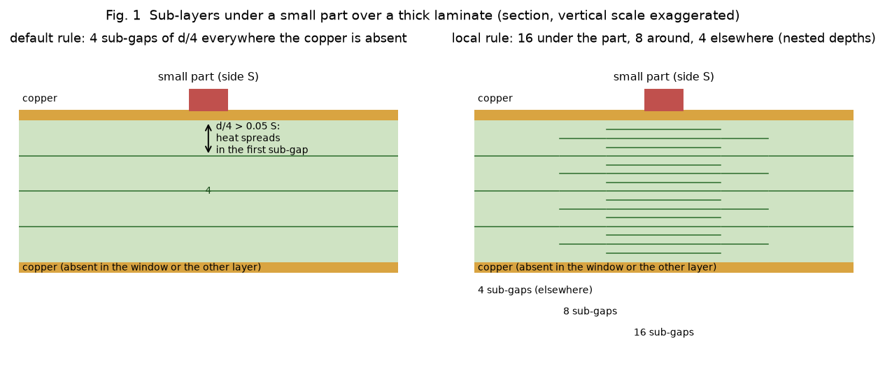
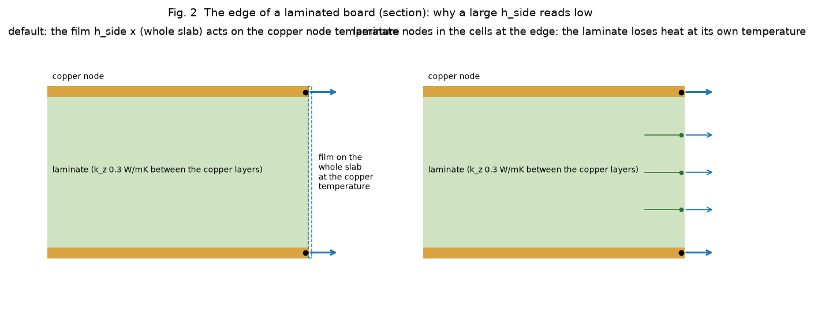
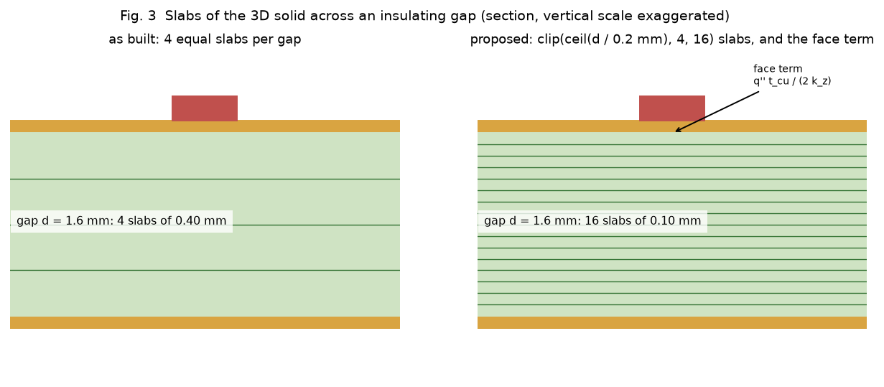
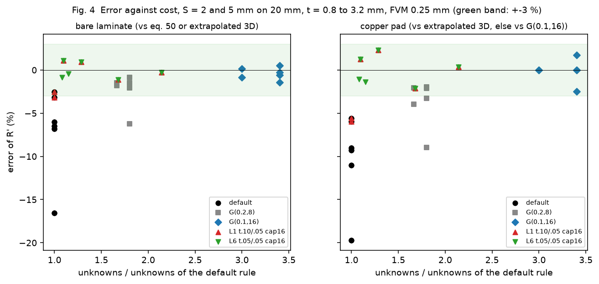
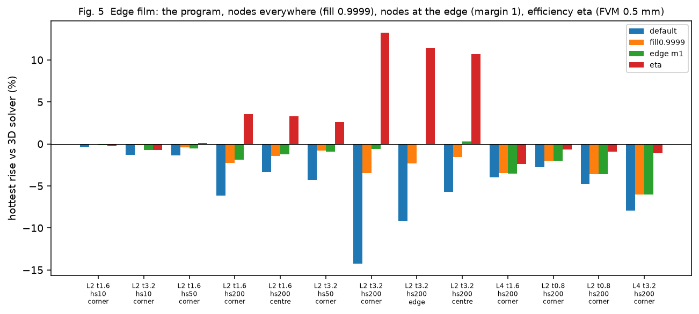
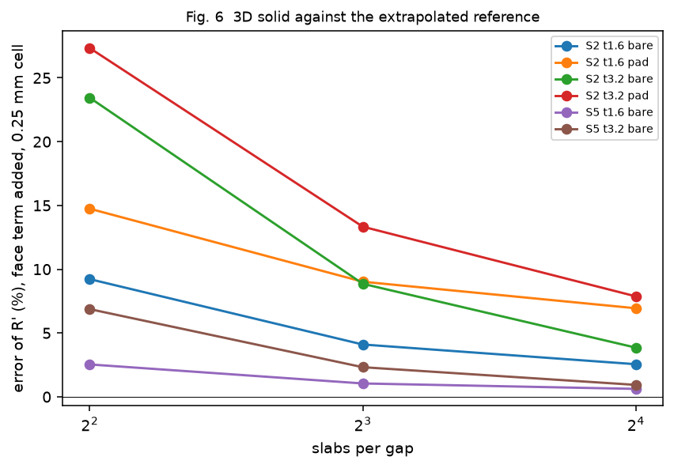

# Laminate 2.6: a local rule for small parts, the edge film, and the slabs of the 3D solid

Status: studies run, prototypes written, waiting for the reviewer. The program is not touched; every change below is a proposal measured on a copy (`lib/local_laminate.py` replaces three functions of `pcbthermal.laminate` for the duration of a run and edits nothing).

## 1. The questions

Three linked limits of the layered models, found in 2.5.0 (`docs/versions.md` 'Planned', `docs/theory.md` 1.4 and 4, `research/paper-case-studies` 11 to 16, `research/analytic-edge-spatial` 8.4):

* **A. Small part over a thick laminate.** The laminate rule (sub-gaps of at most 0.4 mm, at most 4) is the same everywhere, so a part whose side is small against the sub-gap reads too cool (-4 to -9 % bare, -6 to -14 % over a pad at sub-gap / side 0.15 to 0.2; -12 to -24 % at 0.3 to 0.4). A global fine rule costs 3 times the unknowns. Question: a rule that is fine only under and around small parts.
* **B. Edge film.** The FVM and FDM put the edge film of a whole slab on the copper node, so with a large `h_side` on a thick board they read 13 to 17 % low against the independent 3D solver. Question: nodes for the laminate at the edge, or an edge conductance with an efficiency.
* **C. 3D solid.** It cuts each insulating gap into 4 slabs (reads +20 % bare / +27 % pad hot at 3.2 mm under a 2 mm part) and adds no face term. Question: slabs by thickness and the face term.

### 1.1 Diagrams

*Figure 01 (`fig_01_small_part_sublayers.png`). Left: the default rule, 4 sub-gaps everywhere the copper is absent. Right: the local rule, 16 under the part, 8 around it, 4 elsewhere; the depths of the coarse cells are a subset of the fine ones.*

*Figure 02 (`fig_02_edge_film.png`). Left: the film on the whole slab acts at the copper node temperature. Right: laminate nodes in the cells at the edge, so the laminate loses heat at its own, lower, temperature.*

*Figure 03 (`fig_03_solid_slabs.png`). The slabs of the 3D solid across a gap, as built and as proposed, with the face term.*

## 2. References and method

* Bare laminate: equation 50 of Muzychka, Yovanovich and Culham (2004) through `paper-case-studies/lib/flux_channel.py`; for S = 2 mm, h = 1e3 also the extrapolated 3D numbers recorded there (README 16.4: bare 389.12 / 419.08, pad 316.37 / 347.39 K/W at 1.6 / 3.2 mm). The 389.12 was re-run here (389.117, 19 s, 3.2 GB: too heavy for the present machine, so the other extrapolations were **not** re-run).
* **Under a pad only S = 2 mm has an independent reference.** For S = 5 and 10 mm pad boards the tables compare with the global (0.1, 16) run of the program itself, which is a self-consistency check, not a reference (it overshoots the extrapolated reference by +1.7 % at S = 2, t = 1.6 mm).
* Edge: the independent 3D solver with the side film on every slab (`analytic-edge-spatial/lib/layered3d_side.py`, 1 mm cells, 4 and 8 sub-slabs: they differ by 0.02 to 0.9 %; the errors below are against 8).
* Machine: light runs only (peak under 2 GB, cells 0.25 mm only on 20 mm boards at S = 2 and 5 mm, a battery was running on the main checkout, load 5 to 8).

## 3. Item A: the local laminate rule

### 3.1 Design (prototype in `lib/local_laminate.py`)

* A **fine chain** of n_f sub-gaps per gap, nested: a cell at level n_c uses every (n_f / n_c)-th node, so the same layer index means the same depth in every cell and the lateral links between neighbouring cells join equal depths. The node of a cell holds the laminate half way to its two neighbours **in its own chain** (conserves the laminate cell by cell).
* **Where**: default level n0 in the cells the default rule flags; around a part whose *spread side* S_eff (the checks' `_spread_side`: the part, or the part grown by the copper around it on its layer) satisfies d / n0 > `TRIGGER` x S_eff the level rises to n_p = n0 x 2^m >= d / (`TARGET` x S_eff), at most 16, in the footprint grown by a margin of `ceil(d/dx) + 1` cells (the default margin), halving every further margin. Only cells the default rule already flags are refined.
* Uniform spacing; grading (ratio 1.3, fine at the face of the part) was tried and is **worse** (3.1).
* The drop mask of the ladder already leaves unused interior nodes out of the direct solve, so the cost is only the nodes that exist.

### 3.2 Tests (`tests/test_local_laminate.py`, 4 passed)

* A trigger that never fires gives the program's number bit for bit, bare and pad.
* A fine region that covers every flagged cell with a chain of 16 gives the global option (0.1 mm, 16) of the program to 1e-9: this checks the generalised `build` against `laminate.build`.
* The unknowns order default < local < global; the edge nodes raise a thick board with a large `h_side`.

### 3.3 Result (`scripts/study_local_rule.py`, FVM 0.25 mm, h = 1e3; error of R' in %, unknowns as a multiple of the default)

Candidate **L6**: trigger 0.05, target 0.05, cap 16, uniform, margin 1 (round 2: the first-round L1, trigger 0.10, differs only on S = 5 mm).

| S, t (mm) | board | default | G(0.2,8) | G(0.1,16) | L6 | L6 unknowns x | G(0.1,16) unknowns x |
| :-- | :-- | --: | --: | --: | --: | --: | --: |
| 2, 0.8 | bare | -6.8 | -1.8 | +0.2 | +1.1 | 1.10 | 3.00 |
| 2, 1.6 | bare | -6.5 | -1.5 | +0.5 | +1.0 | 1.28 | 3.40 |
| 2, 3.2 | bare | -16.6 | -6.3 | -1.5 | -1.1 | 1.68 | 3.40 |
| 5, 0.8 | bare | -3.2 | -1.5 | -0.8 | -0.9 | 1.08 | 3.00 |
| 5, 1.6 | bare | -2.5 | -0.9 | -0.3 | -0.5 | 1.15 | 3.40 |
| 5, 3.2 | bare | -6.0 | -2.1 | -0.6 | -0.3 | 2.14 | 3.40 |
| 2, 1.6 | pad | -9.0 | -2.1 | +1.7 | +2.3 | 1.28 | 3.40 |
| 2, 3.2 | pad | -19.7 | -9.0 | -2.5 | -2.1 | 1.68 | 3.40 |
| 5, 0.8 | pad (vs G16) | -6.0 | -2.1 | 0 | -1.1 | 1.08 | 3.00 |
| 5, 3.2 | pad (vs G16) | -9.3 | -3.3 | 0 | +0.4 | 2.14 | 3.40 |

Bare references: equation 50 (S = 5 and S = 2 at 0.8 mm) and the extrapolated 3D (S = 2 at 1.6, 3.2). Pad S = 2: extrapolated 3D; pad S = 5: vs G(0.1,16). The full tables are `out/local_rule.txt` (first round, 8 rules, 8 cases) and `out/local_rule2.txt` (second round).

*Figure 04 (`fig_04_local_rule_cost_error.png`). Error of R' against the unknowns relative to the default, S = 2 and 5 mm on 20 mm, all thicknesses; green band +-3 %.*

* **L6 reaches +-3 % on every row with a reference (-2.1 to +2.3 %) at 1.08 to 2.14 times the unknowns; the global (0.1, 16) needs 3.0 to 3.4 times for -2.5 to +1.7 %.** The default is -16.6 / -19.7 % on the worst row.
* **Cost measured in fresh processes** (`scripts/study_cost_one.py`, 0.25 mm, S = 2 mm pad, t = 3.2 mm): default 0.26 s, 0.18 GB; global (0.1, 16) 5.5 s, 1.51 GB; **L6 1.07 s, 0.45 GB** (same error, -2.5 against -2.1 %). S = 5 mm bare, t = 3.2 mm: default 0.21 s / 0.17 GB, L6 1.86 s / 0.72 GB (R' 138.47 against 146.95; eq. 50 gives 147.37). The wall times of the sweeps vary with the load of the machine (a battery was running); the unknowns and the single-process figures are the trustworthy ones.
* **Margin**: x 0.5 is cheaper (1.05 to 1.53) but overshoots (+3.1 to +3.9 % at S = 2 mm, 0.8 and 1.6 mm); x 2 changes the error by 0.2 to 1 point and costs 1.2 to 1.8 times more. The default margin (one gap thickness plus a cell) stays.
* **Cap and target**: cap 32 or target 0.03 add 1.5 to 3 times the unknowns and *overshoot* the reference (+1.6 to +5 %), because at the 0.25 mm cell the layered model has its own positive pixel bias once the sub-gaps are fine; finer is not better. **Grading** (1.3) adds +0.5 to +3 points of overshoot for no saving.
* **Where it does nothing**: S = 10 mm parts on 40 mm boards (trigger not met: -1.5 % bare 1.6 mm, -2.7 % bare 3.2 mm stay; the pad rows at 5 to 10 mm are within the trigger band) and every part over a plane (the spread side is infinite).

### 3.4 Impact on the frozen boards (`scripts/study_harness_impact.py`, FVM at 2 and 1 mm)

The trigger fires on **none of the 14 supported harness boards** (the parts are 8 mm and larger; the two one-layer boards and the finned block are not supported by the prototype, and a one-layer board has no gap with two copper layers). **No frozen record moves for A.** It moves only boards with a small part over a thick laminate, which the harness has none of (add one: see INTEGRATION 1.4).

### 3.5 Limits

* The sub-gap at the cap is d / 16: 0.2 mm for a 3.2 mm board, so a part under about 4 mm on 3.2 mm boards is not fully resolved (S = 2 mm: -1.1 / -2.1 %, inside the pad band; smaller parts not tested).
* S_eff for a part on a pad of another shape and several parts close together (the regions merge; the level is the largest) were not tested.
* The test boards have the part on layer 1 over a bare second layer; parts on inner or bottom layers (the gap above the part, the grading direction) are covered by the code but not run.
* FDM: the same seam (`laminate.plan_gaps/build` is shared) but not run with the local rule.
* One-layer boards and boards with a metal block are outside the prototype.
* The residual overshoot at S = 2 mm (+1.0 to +2.3 %) is the 0.25 mm pixel (S/8): the independent 3D solver at the same pixel is +3.9 % high (paper-case-studies 16.4).

## 4. Item B: the edge film

### 4.1 Reproduction of the review's probe (`scripts/study_edge_film.py`)

Uniform full-copper boards, a 10 mm, 2 W part, faces 10 W/m2K, FVM 0.5 mm, error of the hottest rise against the 3D solver with the side film (8 sub-slabs, 1 mm cells), %:

| board | h_side | default | fill 0.9999 (nodes everywhere) | **edge nodes, margin 1** | edge nodes, margin 2 | efficiency eta |
| :-- | --: | --: | --: | --: | --: | --: |
| 2 L 1.6 mm, corner | 10 | -0.3 | -0.0 | -0.2 | -0.1 | -0.2 |
| 2 L 3.2 mm, corner | 10 | -1.3 | -0.1 | -0.7 | -0.7 | -0.7 |
| 2 L 1.6 mm, corner | 200 | -6.1 | -2.3 | -1.9 | -2.3 | +3.5 |
| 2 L 3.2 mm, corner | 50 | -4.3 | -0.8 | -0.9 | -1.2 | +2.6 |
| 2 L 3.2 mm, corner | 200 | **-14.3** | -3.5 | **-0.6** | -2.6 | +13.2 |
| 2 L 3.2 mm, edge | 200 | -9.1 | -2.3 | -0.1 | -1.6 | +11.4 |
| 2 L 3.2 mm, centre | 200 | -5.7 | -1.5 | +0.3 | -1.1 | +10.7 |
| 4 L 1.6 mm, corner | 200 | -4.0 | -3.5 | -3.5 | -3.5 | -2.4 |
| 4 L 3.2 mm, corner | 200 | -8.0 | -6.0 | -6.0 | -6.1 | -1.1 |
| 2 L 0.8 mm, corner | 200 | -2.7 | -2.0 | -2.0 | -2.0 | -0.7 |

(`out/edge_film.txt`, 13 boards. The review's -15.1 to -4.4 % on the 3.2 mm, 200 W/m2K board is reproduced at 0.5 mm in this form: -14.3 to -3.5 %.)

*Figure 05 (`fig_05_edge_variants.png`). Error of the hottest rise against the 3D solver for the program, nodes everywhere, nodes at the edge (margin 1) and the efficiency model.*

### 4.2 Findings

* **Nodes in the cells at the board edge (and 1 cell beyond) bring the worst board from -14.3 to -0.6 %**, the edge and centre cases from -9.1 and -5.7 to -0.1 and +0.3 %, and cost **0 to +52 % of the unknowns** on the harness boards at 2 mm (+5 to +37 % on the rectangular ones, +17 to +52 % on the outline boards; +29 % on the 60 x 40 mm test board at 0.5 mm; the share falls as the cell shrinks: 1 mm +0 to +28 %), against 4.5 times for nodes everywhere. The nodes on the ring alone (margin 0) give exactly the nodes-everywhere number; margin 1 is better than both (-0.6 against -3.5 %) and margin 2 worse again (-2.6): the discretisation of the transition between a cell with interior nodes and one without gives a scatter of about +-2 points around the converged value, so **the claim is "within 3.5 %", not "to 0.6 %"**. A finer laminate (0.2 mm, 8, `out/edge_film_fine.txt`) gives the same picture (margin 1: +0.6 to +0.9 % on the 3.2 mm, 200 W/m2K boards).
* **The efficiency model is rejected.** `eta = tanh(mL)/(mL)` with L = d/2 and a penetration width delta = dx/2 depends on the cell and reads +10 to +13 % hot (the unsafe-low side is traded for a hot one) on the boards that matter; a width independent of the grid would need a 2-D corner solution. Nodes are the converging construction.
* **Not explained by the edge**: the 4-layer boards stay at -3.5 / -6.0 % with every variant, and the 0.8 mm and 30 x 20 mm boards at -2 to -3.6 %. Those are not the laminate film at the edge (nodes everywhere do not change them); the candidates are the simple stack-up slab allocation for three or more layers (a recorded separate item of `laminate.py`) and the sub-gap count; **not investigated here**.
* **Outlines**: the cells to flag are those the outline crosses (`geometry.edge_length_on_board > 0`), not the raster border. With them: round outline +0.016 / +0.023 K, T outline +0.109 / +0.055 K, part across the outline +0.59 / +0.42 K at 2 / 1 mm (h_side 10).

### 4.3 Impact on the frozen boards

At `h_side` 10 the shifts are small (example board < 0.001 K, `reference_board` +0.001, `plate_vias` +0.006 K, `t_outline` +0.109 K, `part_across_outline` +0.59 K at 2 mm), but the frozen tolerance is 1e-8 K: **every FVM and FDM record of a board with an edge coefficient and a gap above 0.4 mm moves** (pending file). Boards with `h_side` None (`plate_uniform`, `plate_pad`) do not.

## 5. Item C: the slabs of the 3D solid

### 5.1 Result (`scripts/study_solid_slices.py`, 0.25 mm, 20 mm board, h = 1e3)

* **The solid equals the independent solver at the same pixel and slabs to 0.00 %** on all 24 rows (`R` against `ref3d` at pixel S/8: -0.00 to +0.00 %), once the half layer of laminate between the node and the face is added on bare laminate (`(t_cu/2) / (k_z S^2)` = 14.58 K/W at S = 2 mm). So the slab count and the missing face term are the whole story, as the review found.
* Error against the reference (equation 50, or the extrapolated 3D), with the face term, %:

| case | 4 slabs | 8 | 16 |
| :-- | --: | --: | --: |
| S 2, 1.6 mm, bare | +9.2 | +4.1 | +2.6 |
| S 2, 3.2 mm, bare | +23.4 | +8.9 | +3.9 |
| S 2, 1.6 mm, pad | +14.7 | +9.0 | +6.9 |
| S 2, 3.2 mm, pad | +27.3 | +13.3 | +7.9 |
| S 5, 1.6 mm, bare | +2.5 | +1.1 | +0.6 |
| S 5, 3.2 mm, bare | +6.9 | +2.3 | +0.9 |

(`out/solid_slices.txt`; S = 5 mm pad rows have no reference.) Without the face term the S = 2 mm bare rows read +5.5 / +20.0 % at 4 slabs (the earlier review): the face term moves them by +3.7 / +3.4 points, so **adding it without more slabs makes the solid worse**; it is only right together with the slab rule. The +0.4 % of the earlier 16-slab bare number was two errors cancelling (3.5 % each).

*Figure 06 (`fig_06_solid_slabs_error.png`). Error of the 3D solid against the reference against the slabs per gap.*

* **What remains at 16 slabs is the 0.25 mm pixel** (S/8): the independent solver at that pixel with 16 sub-slabs is +3.9 % above the extrapolated reference on the bare 3.2 mm board (paper-case-studies 16.4), and the pad rows add the residual of the slab error (about 1.7 % at 16 by Richardson from 8 and 16). So the **acceptance cannot be "within 3 % of the extrapolated reference at 0.25 mm for S = 2 mm"**; it is: (i) equal to the independent solver at the same pixel and slabs to 0.01 %; (ii) S >= 5 mm within 1 % of equation 50 at 16 slabs; (iii) S = 2 mm bare within +4 % and pad within +8 % (hot side) at 0.25 mm.

### 5.2 Cost of the rule n = clip(ceil(d / 0.2 mm), 4, 16) (`out/solid_slices_part2.txt`, `out/solid_harness.txt`)

* The shipped templates have gaps of 76 to 520 um except the core: **only the 2-layer board (1.53 mm gap: 8 slabs, 6 -> 10 node slabs, x1.67) and the 4-layer core (1.065 mm: 6 slabs, 16 -> 18, x1.12) change**; 6 to 10 layers keep 4 everywhere (x1.00). The memory guard law of the solid gives 0.19 -> 0.61 GB (2 layers, 100 x 80 mm, 1 mm cell) and 1.78 -> 2.33 GB (4 layers), 1 oz and 0.5 oz alike.
* On the 17 harness boards at 2 mm the rule moves the solid's hottest temperature by -0.001 to -0.26 K (the pad boards -0.26 and -0.22 K; the 3 four-layer examples 0.000), at 1.4 to 1.8 times the unknowns; the face term is not included in these numbers (it lowers nothing: it adds, only on bare laminate under a part). **Every solid record of a board with a gap above 0.8 mm moves** (pending file).
* A thick uniform 3.2 mm board with 16 slabs: 5 to 8 s and 1.6 GB at 0.25 mm on the 20 mm test board (115 200 unknowns).

## 6. Summary and recommendation

| item | finding | cost | frozen records | effort | recommendation |
| :-- | :-- | :-- | :-- | :-- | :-- |
| A local laminate rule | -16.6 / -19.7 % -> -1.1 / -2.1 % (S = 2, 3.2 mm); within +-3 % on all rows with a reference | 1.08 to 2.14 x unknowns, one fifth the time and 0.3 x the memory of the global (0.1, 16) on the worst row | none moves (no small part in the harness) | `laminate.py` about 150 lines (the prototype is that code), `fvm._add_ladder`, `fdm`, `fvm.unknowns`, `checks`; 1 to 2 days with the tests | **feature branch for 2.6.0**, after the reviewer; add a small-part board to the harness |
| B edge nodes | -14.3 -> -0.6 % (3.2 mm, 200 W/m2K); scatter +-2 points | 0 to +52 % unknowns (falls with the cell) | every FVM/FDM record of a board with `h_side` and a gap > 0.4 mm (pending file) | `flag_cells` + edge mask in `plan_gaps`, 30 lines; 0.5 day | **include in the same branch**; do not model an efficiency |
| C solid slabs and face term | solid = independent solver at the same pixel; error 23 -> 4 % (bare 3.2 mm, S = 2) | x1.67 slabs on 2-layer boards, x1.12 on 4-layer, x1.00 above | every solid record of a 2- or 4-layer board (pending file) | `solid3d.py` per-gap slab counts, `unknowns`, `memory` law input, face term in `solve_steady`; 1 day | **separate small branch or the same; the face term only with the slab rule** |

## 7. What was read and what was not verified

* **Read for this study**: the program's `laminate.py`, `fvm.py` (laminate seam), `solid3d.py` (slab loop), `checks.py` (small-part ratios), the READMEs of `paper-case-studies` (11, 16), `analytic-edge-spatial` (8) and their scripts. No new external source was opened: the equation 50 of Muzychka, Yovanovich and Culham (2004) and the extrapolated 3D numbers are taken from `paper-case-studies`, where the equation was read from the page image and reproduced (their review); the bibliography statuses of `research/theory/BIBLIOGRAPHY.md` are unchanged and nothing was added.
* **Reproduced here**: the extrapolated 3D reference for S = 2, t = 1.6 bare (389.117 against 389.12); the program's default and global (0.1, 16) R' on S = 2, t = 3.2 (349.606 / 278.863 / 413.013 / 338.691, as in paper-case-studies 11.3 and 16.3); the solid's R' at 4 / 8 / 16 slabs (517.33, 456.21, 435.23 bare; 442.36, 393.72, 374.74 pad); the review's edge probe (fill 0.9999).
* **Not verified / limits**: extrapolated references for S = 5 and 10 mm and for pad boards other than S = 2 (not run: 3.2 GB each; the pad S = 5 rows are against the program's own G(0.1,16)); the FDM with the local rule and the edge nodes; the 3D solver reference of the edge has its own sub-slab and pixel error (0.02 to 0.9 % between 4 and 8 sub-slabs, not extrapolated); the 4-layer residual of -3.5 / -6.0 % at the edge is unexplained; boards with a part on an inner or bottom layer, several close small parts, one-layer boards and metal blocks were not run with the local rule; the memory estimate of the guard for the proposals was not run beyond the solid's law (the layered laws already read the unknowns); times are under a load of 5 to 8 and the sweep ratios are indicative.
* **My doubts**: (i) at the 0.25 mm cell the +1 to +2.3 % overshoot of the local and global fine rules is a pixel bias, so the proposal's accuracy at coarser cells (1 mm and above, where the sub-gap is not the limit) is the default's; (ii) the margin and the nested-depth transition were validated only by the equality to the global rule and by the two margin scales; (iii) the edge result's scatter (margin 0, 1, 2) shows the transition at a flagged border has a +-2 point effect that a reviewer may want to understand better (a graded margin of the edge nodes would be the next test).
