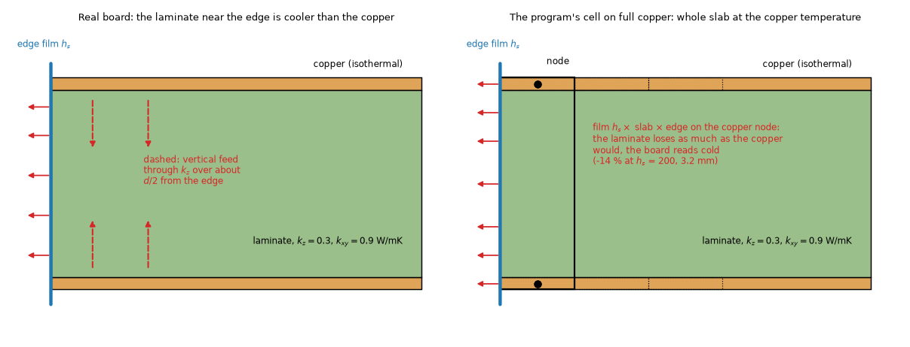
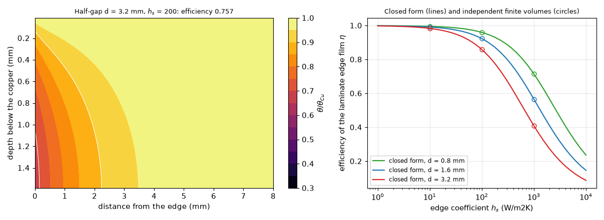
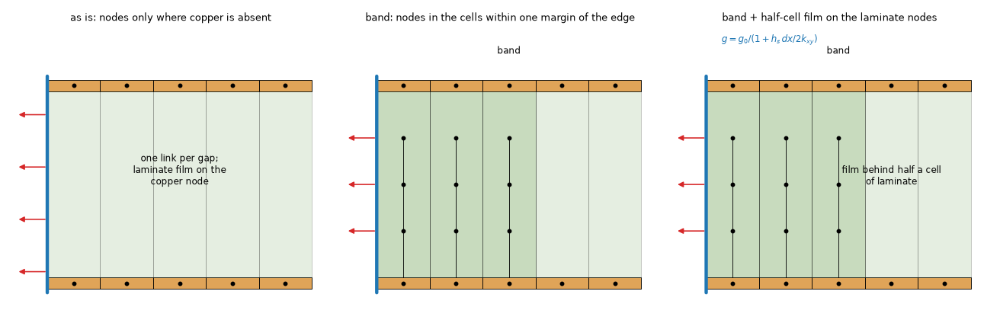
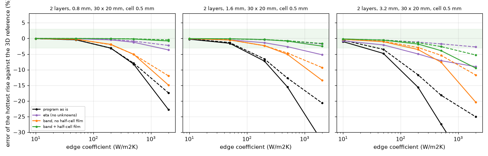
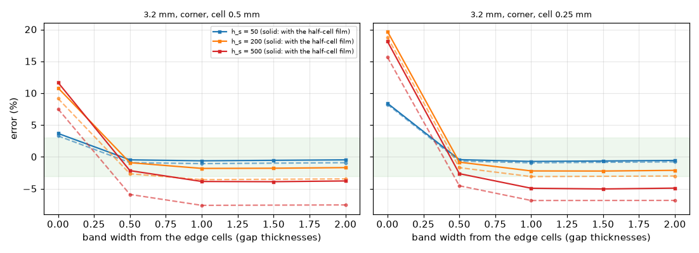
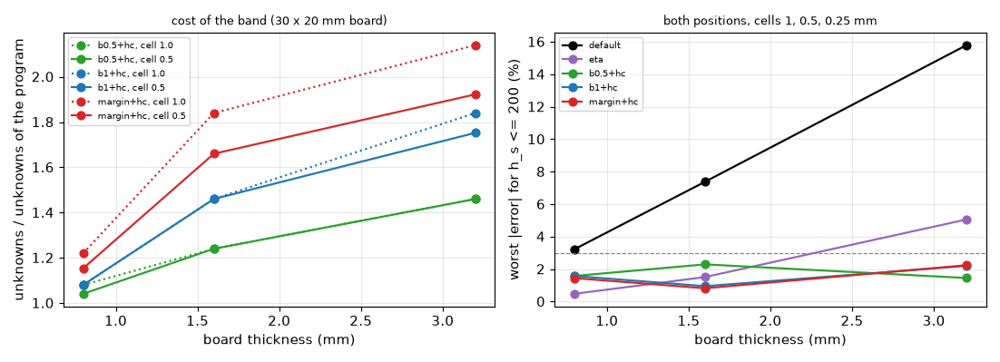

# Laminate at the board edge: nodes in a band and the film behind half a cell (item A16)

Status: studied, **not yet reviewed**. The program is not touched; every rule below is a prototype in `lib/edge_rules.py` that replaces two functions of `pcbthermal.laminate` for the duration of a run (it edits nothing). Measured on `develop` (2.5.2); a short check on the 2.6.0 integration tree is in 6.7.

## 1. The question

On a cell with copper in every layer the FVM and FDM make no laminate nodes (`laminate.py`, the rule of `research/laminate-nodes`), so the whole slab of the copper node, copper plus half of each adjacent gap, puts its edge film `h_side x slab x edge` at the **copper** temperature. The laminate is cooler than the copper near the edge, so the film is overstated and the board reads cold: -13 to -17 % at `h_side` 200 W/m2K on thick boards (`ROADMAP.md` A16, `analytic-edge-spatial` 8.4, `laminate-2-6` 4). `laminate-2-6` found that nodes in a band one gap thick plus a cell take the 3.2 mm, 200 W/m2K corner board from -14.3 to about -4 %, and left a shared -2 to -3 % unexplained.

Asked here: can edge nodes in a band about one gap thick wide (or another rule) bring the layered FVM and FDM within about 3 % of an independent 3D reference on boards 0.8 to 3.2 mm thick, `h_side` 10 to 2000 W/m2K and cells 1 to 0.25 mm? What does it cost in unknowns and what does it move in the 17 frozen boards?

**Answer in one paragraph.** A band alone does not do it: it saturates at -3 to -4 % at 200 W/m2K and at -20 % at 2000 on the 3.2 mm board, because the second cause is not a missing node but the film of a cell-centred laminate node, which stands at the centre of the cell with no conduction between the node and the edge face (section 4). With that fixed (the film in series with half a cell of laminate, `g' = g / (1 + h_s dx / (2 k_xy))` on the laminate nodes) **a band of the program's own margin gives a worst error of 2.2 % for `h_side` up to 200 W/m2K on every board (0.8 to 3.2 mm), cell (1, 0.5, 0.25 mm) and position tried, 0.8 to 1.9 % at 500 W/m2K up to 1.6 mm (4.9 % at 3.2 mm with the program's four sub-gaps), at a cost of +15 to +92 % unknowns on a 30 x 20 mm board (+4 to +66 % on 60 x 40 mm; 1.0 to 1.7 times on the frozen boards)**. 2000 W/m2K needs 16 sub-gaps in the band (error 0.5 to 1.3 %).

### 1.1 Diagrams

*Figure 01 (`fig_01_edge_section_heat_paths.png`). Section of a board edge. Left: the real board, the laminate loses heat through its edge film and is fed by the copper through `k_z`, so it is cooler than the copper. Right: the program's cell on full copper, one node per layer, the whole slab's film at the copper temperature.*

*Figure 02 (`fig_02_halfgap_field_and_efficiency.png`). Left: temperature of the laminate half-gap (copper on top at 1, middle of the gap at the bottom), 3.2 mm, `h_s` 200 W/m2K, from the independent solver `lib/halfgap_fd.py`. Right: efficiency of the laminate edge film against `h_s`: closed form (lines) and the solver (circles).*

*Figure 03 (`fig_03_cells_band_and_halfcell.png`). The cells at the edge. Left: as is, nodes only where copper is absent. Middle: the band of cells with interior nodes. Right: the film of the interior nodes behind half a cell of laminate.*

## 2. References and method

* **Reference**: the independent 3D finite-volume solver with the side film on every slab, `research/analytic-edge-spatial/lib/layered3d_side.py` (imports nothing from `pcbthermal`; a copy that also returns the side loss by slab is `lib/layered3d_split.py`). Same board as `analytic-edge-spatial`: full 35 um copper on every layer, FR-4 0.9 / 0.3 W/mK, faces 10 W/m2K, a 10 mm, 2 W part in the corner or at the centre (`cases.py`).
* **Boards**: 30 x 20 mm (the cell goes to 0.25 mm) and 60 x 40 mm (the board of `laminate-2-6`); 2 layers 0.8, 1.6, 3.2 mm; `h_side` 10, 50, 200, 500, 2000; also 4 layers (6 cases).
* **Converged reference** (`scripts/study_reference.py`, `out/refs30.json`, `out/refs.json`): 30 x 20 mm: `R(0.25 mm, 4 sub-slabs) x R(0.5 mm, 16) / R(0.5 mm, 4)`; 60 x 40 mm: `R(1 mm, 16) x R(0.5 mm, 8) / R(1 mm, 8)`. The sub-slab term moves the 3D number by 0.0 to 0.6 % at `h_s` <= 50, 0.5 to 1.5 % at 200 and up to 6.5 % at 2000 on 3.2 mm (4 to 16 sub-slabs); the cell term 0.1 to 0.5 %. The 1/n pattern of the sub-slabs says the reference is still high by about a third of the 4 -> 16 change: **about 0.5 % at `h_s` <= 200, up to about 2 % at 3.2 mm and 2000**. Below that level an error of the program is not resolved.
* **Program**: FVM and FDM `simulate`, hottest rise of the part (the FVM and FDM read it at the copper node; the face term of `laminate.face_terms` is the same in every rule). Errors are `100 (rise / reference - 1)`; negative is the cold, unsafe side.

## 3. The program as is (A16 reproduced and mapped)

Worst |error| over both positions and the cells 1, 0.5, 0.25 mm, 30 x 20 mm board, 2 layers, in % (`scripts/study_sweep.py`, `out/sweep30b.json`; `scripts/summarize.py`). Rules are defined in section 5.

| t (mm) | `h_s` | program as is | eta | band 0.5 d + hc | band 1 d + hc | band (margin) + hc |
| --: | --: | --: | --: | --: | --: | --: |
| 0.8 | 10, 50 | 0.5 | 0.1 | 0.2 | 0.2 | 0.2 |
| 0.8 | 200 | 3.2 | 0.5 | 1.6 | 1.6 | 1.4 |
| 0.8 | 500 | 8.3 | 1.3 | 4.0 (a) | 4.0 (a) | 3.7 (a) |
| 0.8 | 2000 | 23.3 | 4.0 | 9.3 | 9.3 | 8.7 |
| 1.6 | 10, 50 | 1.6 | 0.5 | 0.4 | 0.2 | 0.2 |
| 1.6 | 200 | 7.4 | 1.5 | 2.3 | 1.0 | 0.8 |
| 1.6 | 500 | 15.8 | 2.8 | 4.4 | 2.0 | 1.9 |
| 1.6 | 2000 | 33.6 | 5.7 | 8.0 | 5.5 | 5.9 |
| 3.2 | 10, 50 | 4.8 | 2.1 | 0.5 | 0.7 | 0.7 |
| 3.2 | 200 | 15.8 | 5.1 | 1.5 | 2.2 | 2.2 |
| 3.2 | 500 | 27.9 | 7.4 | 2.6 | 4.9 | 5.0 |
| 3.2 | 2000 | 45.7 | 9.7 | 11.2 | 13.4 | 13.6 |

(a) the 1 mm cell on the 0.8 mm board, where the cell is larger than the gap: the film behind half a cell then overcorrects (+3.6 to +4.0 %); at 0.5 and 0.25 mm the same rows read -0.2 to -1.9 %.

The 60 x 40 mm board (`out/sweep60_fvm.json`) agrees: program as is -2.1 / -5.6 / -13.8 % at `h_s` 200 for 0.8 / 1.6 / 3.2 mm, -23 / -33 / -45 % at 2000 (cell 1 mm; the same at 0.5). The default is flat in the cell (it does not converge: -13.7 at 0.5 mm, -13.8 at 1 mm).

## 4. What is wrong: two causes, not one

1. **The laminate is cooler than the copper at the edge.** The copper node carries the film of the whole slab at its own temperature. The laminate half-gap held at the copper temperature on one face and cooled by a film on its edge has a closed form by separation of variables (`mu_n = lambda_n sqrt(k_z / k_xy)`, `lambda_n = (2n - 1) pi / d`): the share of the film that the laminate really carries is `eta = sum_n 8 / ((2n-1)^2 pi^2) * a_n / (h_s + a_n)`, `a_n = (2n-1) pi sqrt(k_z k_xy) / d` (`edge_rules.eta_laminate`; 0.76 at 3.2 mm and 200 W/m2K, 0.28 at 2000; `fig_02`). It agrees with the independent finite-volume solution to 1.5 % (test) and the symmetric mode is exact for a hot top and cold bottom copper (the antisymmetric part integrates to zero over the gap).
2. **A cell-centred laminate node has its film at the centre of the cell.** The FVM puts `h_s x thickness x edge` on the node with no conduction between the node and the edge face; the 3D reference puts the film behind half a cell (`layered3d_side.py`, as any finite-volume boundary condition). For copper (385 W/mK) it does not matter; for the laminate (`k_xy` 0.9) `h_s dx / (2 k_xy)` is 0.056 at `h_s` 200 and 0.5 mm, 0.2 at 500 and 0.55 at 2000. The effect is of order `h_s dx / k`, **first order in the cell, so the nodes of the band alone do not converge** (nodes everywhere, 3.2 mm, 200 W/m2K, corner: -3.4 % at 0.5 mm with 4 sub-gaps, -1.8 % with 16, -1.2 % at 0.25 mm; at 2000 W/m2K -20.4, -10.2, -8.2 %, `out/finer_laminate.txt` part 2).

This is why the earlier finding of `laminate-2-6` (nodes everywhere stop at -3.5 %, "unexplained -2 to -3 %") and the 4-layer residual are not the edge nodes: at `h_s` 200 the missing 1 to 3 points are cause 2 and the number of sub-gaps (1/n). The corner is worse than the centre for every rule (3.2 mm, 200 W/m2K, eta: -5.0 against -1.2 %): at a corner two edges cool the same laminate (the 2D efficiency counts the overlap twice) and the part sits there. The heat lost through the edge is equal in the 3D and the FVM (1.589 W against 1.594 W with eta, 1.599 with the band, 1.671 as is; `out/edge_loss_split.txt`), the temperature field is what differs.

## 5. The rules (`lib/edge_rules.py`, tests `tests/test_edge_rules.py`, 6 passed)

| name | what | unknowns |
| :-- | :-- | :-- |
| ring | interior nodes in the cells the edge crosses (the border cells, or the cells an outline crosses) | + ring |
| band `w` d | interior nodes also in the cells within `w` gap thicknesses of the ring (distance between cell centres) | + band |
| margin | the band of `laminate.margin_cells(d, dx)` = `ceil(d / dx) + 1` cells, the margin the program already uses around absent copper | + band |
| eta | no nodes: the laminate share of the edge conductance of a cell without interior nodes is multiplied by `eta(h_s, d, k_xy, k_z)` (cause 1) | 0 |
| hc | the film of the laminate nodes (interior nodes, and the laminate held by the copper nodes of the flagged cells) in series with half a cell: `g' = g / (1 + h_s dx / (2 k_xy))` (cause 2) | 0 |

A rule changes nothing when `h_side` is None (bit identical, test) and nothing in a one-layer board or a board with a metal block (`laminate.uses_rule`). Conservation (test): the edge conductance of a cell of the band drops by exactly `(1 - f) h_s edge d`, nothing else moves.

## 6. Results

### 6.1 Band alone against band with the film (fig_04, fig_05)

*Figure 04 (`fig_04_error_against_edge_coefficient.png`). Error against `h_s` for the program, eta, the band without and with the half-cell film (cell 0.5 mm, corner solid, centre dashed). The shaded strip is +-3 %.*

*Figure 05 (`fig_05_band_width.png`). Error against the width of the band, 3.2 mm, corner. Dashed: without the film (it is a cancellation: the ring alone reads +9 to +19 % at 200 and a wide band tends to -3.5 %); solid: with it, flat from 1 gap thickness on and within 0.3 points of the margin band.*

With the half-cell film the result is **independent of the width from 1 gap thickness on** (3.2 mm, 200 W/m2K, corner, 0.5 mm: -1.8 / -1.8 / -1.7 / -1.8 % at 1, 1.5, 2 gap thicknesses and the margin), which the earlier band without it was not: the ring alone, +9 %, and 0.5 d, -2.6 %, were cancellations of a hot ring by a cold transition (the review of `laminate-2-6`, finding 6). The band of 0.5 d with the film is within 2.6 % too at `h_s` <= 500 on 3.2 mm and is cheaper (+24 to +46 %), but it leans on a cancellation (+0.5 to +1.5 % at 1.6 mm, 500 W/m2K); not recommended as the default.

### 6.2 Cells and positions

`h_s` <= 200 W/m2K, both positions, cells 1, 0.5, 0.25 mm, 30 x 20 mm: worst |error| as is 3.2 / 7.4 / 15.8 % (0.8 / 1.6 / 3.2 mm), eta 0.5 / 1.5 / 5.1 %, band (margin) + hc **1.4 / 0.8 / 2.2 %** (`fig_06`, right). On 60 x 40 mm at cells 1 and 0.5: 0.4 / 0.8 / 1.4 % at 200 and 1.5 / 1.2 / 4.0 % at 500 (`out/sweep60_fvm.json`).

*Figure 06 (`fig_06_cost_and_worst_error.png`). Left: unknowns of the rules over the program's, 30 x 20 mm board. Right: worst error for `h_s` <= 200 over cells and positions.*

### 6.3 Sub-gaps in the band (`scripts/study_finer_laminate.py`, `out/finer_laminate.txt`)

Band (one gap thick) with the film, cell 0.5 mm, 30 x 20 mm, error % (unknowns), corner / centre, 3.2 mm:

| `h_s` | 4 sub-gaps | 8 sub-gaps | 16 sub-gaps |
| --: | :-- | :-- | :-- |
| 200 | -1.8 / -1.1 (8412) | -0.7 / -0.3 (13228) | -0.3 / -0.0 (22860) |
| 500 | -3.9 / -2.3 | -1.3 / -0.6 | -0.5 / -0.0 |
| 2000 | -9.3 / -5.0 | -3.4 / -1.7 | -1.3 / -0.5 |

The remaining error is the 1/n of the sub-gaps (`laminate-nodes`), so `h_s` of 500 to 2000 needs a finer chain **in the band only**. The program's option is global (`laminate_n_max`) and costs the same chain in every patterned region; a separate count for the band is the proposal.

### 6.4 Four layers (6 cases, `out/sweep30_4L.json`, corner, 0.5 mm, simple stack-up)

As is -4.3 / -8.5 % (1.6 / 3.2 mm, 200 W/m2K); eta -2.3 / -4.9; band (margin) + hc **-1.5 / -4.4 %**; at 500 W/m2K -9.2 / -16.1 % as is, -3.2 / -8.4 % with the band. The 4-layer residual is the **simple stack-up allocation** of `laminate.py` (outer slabs, `laminate-2-6` 7.2, about 1.3 points) and is not an edge defect; the 3 % target is met at 1.6 mm up to 200 W/m2K and not at 3.2 mm. Not separated further here.

### 6.5 FDM (`out/sweep30_fdm.json`)

The same rules, cells 1 and 0.5 mm: as is 3.1 / 7.1 / 15.5 % at 200 (0.8 / 1.6 / 3.2 mm), band (margin) + hc 0.5 / 0.8 / 1.1 % (worst), 1.1 / 1.4 / 2.4 % at 500. The FDM node lies on the face, so the film behind half a cell is not obvious there; it was applied as in the FVM and gives the same improvement (the cell `dx` is the node spacing). The justification for the FDM is empirical here.

### 6.6 The 3D solid (a second reference, `scripts/study_solid3d.py`)

The program's solid at its default slabs reads **hot** against the converged reference (+0.4 to +2.1 % at 200 W/m2K, +1.5 to +4.2 % at 500, +2.8 to +9.2 % at 2000; falling with the cell: 7.4 against 9.2 at 0.5 against 1 mm on the 3.2 mm corner case) and equals the independent solver at the same cell and slabs (49.29 against 49.29 K at 2000, 0.5 mm, 4 sub-slabs): the same film behind half a cell, so the solid is right for its cell and converges from above. No change is proposed for the solid.

### 6.7 The 2.6.0 integration tree

The tree `feature/integration-260` already puts the edge film in series with the sheet conductance of the node (cut-cell branch). Running the same sweep there (`LAMEDGE_TREE=<worktree>`, cell 0.5 mm, 3.2 mm): program as is -15.4 / -11.5 % at 200 (corner / centre; -15.6 / -11.7 on `develop`), band without the film -2.5 / -1.8, band + hc **-0.8 / -0.0 %**, margin + hc -0.8 / -0.3; at 500 -2.3 / -0.8 and at 2000 -7.3 / -3.7 %. The branch's factor acts on the copper-dominated sheet and is about 1.005 on a copper node, so it does not provide cause 2 for the laminate nodes; **the proposal still stands there, and must be implemented once** (the interaction with the interior nodes of `Network.__init__` must be read in the code by the reviewer).

## 7. Cost

Unknowns over the program (30 x 20 mm, 200 W/m2K), cell 0.5 mm: margin band 1.15 / 1.66 / 1.92 times (0.8 / 1.6 / 3.2 mm), band 1 d 1.08 / 1.46 / 1.75, band 0.5 d 1.04 / 1.24 / 1.46; cell 1 mm: margin 1.22 / 1.84 / 2.14. The share falls with the board: 60 x 40 mm, 0.5 mm: margin 1.08 / 1.35 / 1.51 (the perimeter over the area). Gaps of 0.4 mm and less (`n` = 1) cost nothing. With 8 or 16 sub-gaps in the band: 3.2 mm, 30 x 20 mm, 1.65 or 2.7 times the margin-band count.

## 8. Frozen boards (`scripts/study_harness_impact.py`, `out/harness_impact.json`)

All 17 boards have `h_side` 10 or none. Untouched by construction: `plate_uniform`, `plate_pad` (`h_side` None), the one-layer boards, `finned_block`. The other 12 boards move in the FVM and in the FDM at 2 and 1 mm: hottest temperature +0.002 to +0.84 K, at most **0.41 % of the rise** (`part_across_outline`, margin band, FDM 2 mm), typical +0.003 to +0.05 K (0.00 to 0.03 %); unknowns 1.00 to 1.74 times (margin band; `part_across_outline` 1.74, `t_outline` 1.47, `plate_vias` 1.54 at 2 mm; the example board 1.11). Every FVM and FDM record of a board with an edge coefficient and a gap above 0.4 mm moves above the frozen tolerance, so a pending file `laminate-edge.json` is needed. Eta alone moves +0.001 to +0.058 K.

## 9. Limits and doubts

* **The reference**: the 3D reference carries its own sub-slab and cell error (section 2); at 3.2 mm and 2000 W/m2K it is uncertain by about 2 %, so the differences at 2000 are indicative.
* **What was run**: uniform full-copper boards with one part, 2 layers (and 6 four-layer cases). Not run: patterned copper at the edge (the rules apply to every flagged cell; the harness boards `two_layer_partial` and `hatched_copper` move by 0.01 %), outlines beyond the harness (flagging by `edge_length_on_board` is the research prototype's, as in `laminate-2-6`), a part at the middle of an edge (position `edge` of `laminate-2-6` not repeated), the transient (the capacities are not changed, the edge conductance is: the time constants move by the same share as the steady edge loss, not measured), the Lumped and the Analytic (they have no cells).
* **The coarse cell**: when the cell is larger than the gap the half-cell film overcorrects (+3.6 to +4.0 % at 500 W/m2K, 0.8 mm board, 1 mm cell).
* **The lateral conductance at the edge of the band** (0.40 of the slab's, `laminate-2-6` 7.2 finding 2) is still there; the width-independence with the film says it is not visible in the hottest rise, it may be in the field near the band.
* **The FDM**: the half-cell film is applied empirically (node on the face).
* **The eta rule** is not a substitute: free, exact for the 2D edge, within 2.7 % at the centre to 2000 W/m2K and at a corner within 5 % to 200 but 7 to 9 % at 500 and 2000; the corner overlap is not in it.
* **My doubt**: the half-cell factor was found by looking at why the nodes alone do not converge, and tested against the independent 3D solver on the same family of boards (full copper, 10 mm part); the second family (30 x 20 and 60 x 40 mm, the integration tree) is not independent of the first in the physics. A board with the part away from the edge, a very small part, or a partly covered edge are the cases to try before adoption.

## 10. Recommendation

See `INTEGRATION.md`.

## 11. What was read and what was not verified

* **Read in full**: the program's `laminate.py`, `fvm.py` and `fdm.py` at the seams (`plan_gaps`, `build`), `research/laminate-2-6` README 4 and 7 and INTEGRATION, `research/analytic-edge-spatial/lib/cases.py` and `layered3d_side.py`, and the heading of the `cut-cell-links` INTEGRATION (the edge film in series, items 3 and 4; the rest of that branch was not read).
* **From memory**: the separation of variables of the half-gap (the Fourier series in `sin(lambda z)`; Carslaw and Jaeger, `[CarslawJaeger]`, status M for this use, no page) and the film behind half a cell as the standard finite-volume boundary condition (`[Patankar1980]`, status M for this use). No new source was opened; `research/theory/BIBLIOGRAPHY.md` is not changed. The closed form is checked by an independent finite-volume solution (`lib/halfgap_fd.py`), not by a publication.
* **Not a published case**: the literature check asks for a published case; none of the cases here is one (the 3D solver reproduces published ones in `effective-conductivity` and `paper-case-studies`, not this edge problem). A measurement or a published edge-cooled laminate case was not found.
* **Reproduced**: the program's default error of A16 (-14 %, 3.2 mm, 200 W/m2K) and the band of `laminate-2-6` (-3.5 %).
* **Not run**: the 60 x 40 mm sweep at 0.25 mm (memory), four layers beyond 6 cases, 2000 W/m2K with the 4-layer boards, the FDM at 0.25 mm, any measurement.
