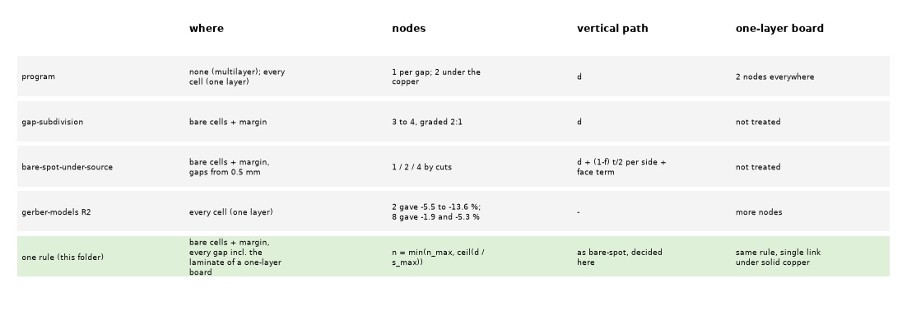
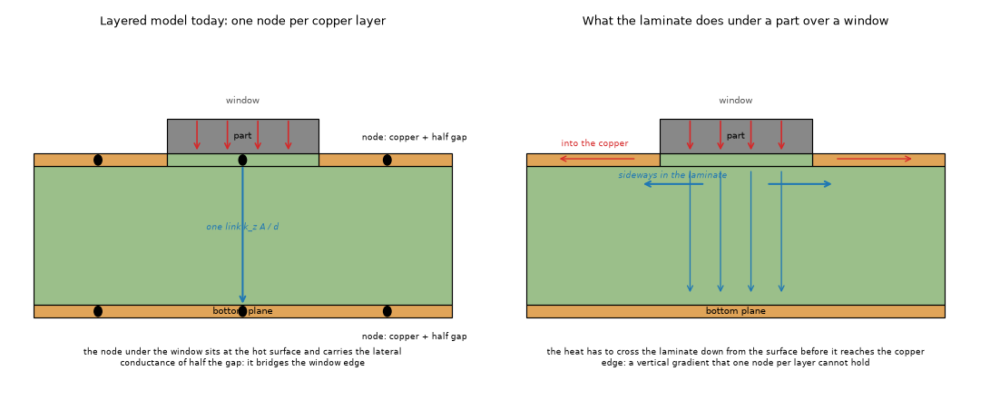
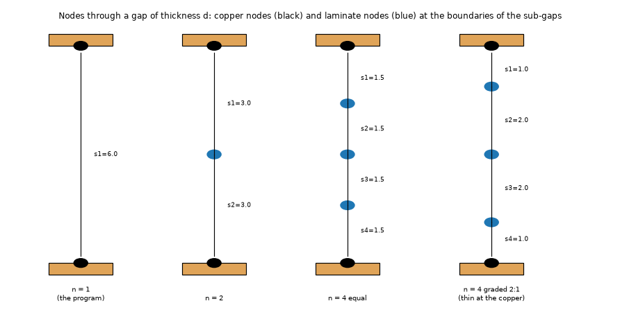
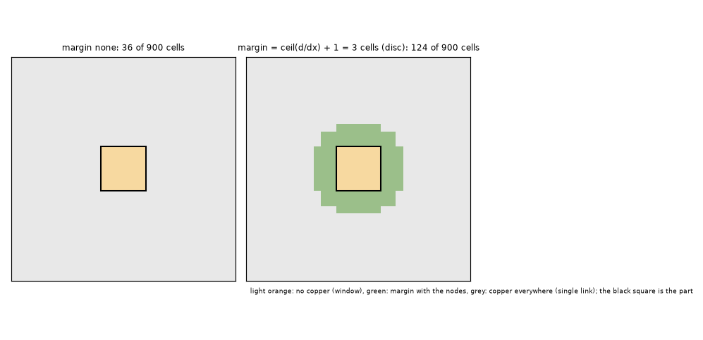
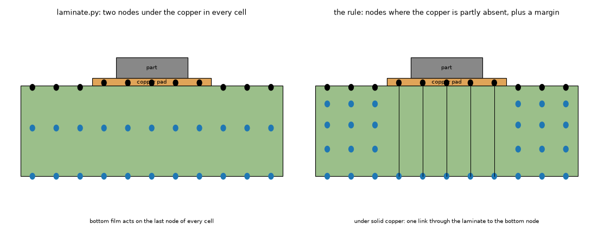

# One construction for the laminate nodes of the layered models (investigation S5; roadmap A1, A11, A12)

**Status: in preparation. Nothing in this folder has been run yet.** The code, the plan and the documents were written without executing any study, test or solver (the machine was busy with the whole battery), so every "result" below is a **question or an expectation, marked as such**; the sections with tables are filled from the printed output of the scripts at the first run (section 2 lists the order). Numbers quoted from earlier folders are marked "(earlier folder)" and were not remeasured here.

The program has four unreconciled treatments of the laminate between copper layers. This folder asks whether one construction can replace them, measures it against an independent resolved 3D reference with the 1/n law and Richardson, and writes down what must change in the program (INTEGRATION.md), for the fix of 2.4.5.

## 1. Situation, question and method

### 1.1 The question

A layered model keeps one node per copper layer; the laminate between two copper layers is a vertical link `k_z A / d` and half of its in-plane conductance sits in each neighbouring node. Where the copper is partly absent (a window, a pad edge, hatching, a track layout) the laminate carries heat sideways **across the thickness of the gap**, which one node cannot hold: the layered models read cool (FVM -18.4 % over a 6 mm window on a 1.6 mm two-layer board, -3.8 % on the typical 4-layer; two laminate nodes of a one-layer board are 5.5 to 13.6 % cool on real windows; earlier folders). The cure measured in three separate folders is the same thing: more nodes through the gap, in the cells that show laminate. The four versions are not the same rule:

| | where | how many | vertical path | one-layer board |
| :-- | :-- | :-- | :-- | :-- |
| program (`laminate.py`, `fvm.py`) | one-layer: every cell; multilayer: none | 2 nodes under the copper; 1 link per gap | `d` | 2 nodes everywhere |
| `gap-subdivision` | cells with fill below 1 in a layer next to the gap + margin `ceil(d/dx) + 1` | 3 or 4, graded 2:1 | `d` | not treated |
| `bare-spot-under-source` | the same cells, gaps of 0.5 mm and more | 1 / 2 / 4 by cuts at 0.3 and 0.8 mm, equal | `d + (1-f_a) t_a/2 + (1-f_b) t_b/2`, face term `Q (1-f) t/(2 k_z A)` | not treated |
| `gerber-models` R2 / A11 | every cell (one layer) | 8 give 1.9 and 5.3 % on two windows | - | more nodes |
| the Analytic (`analytic-partial-copper`, other branch) | tiles | needs the same n as the FVM | - | n laminate nodes instead of the series film |

*Figure 5 (`figures/fig_05_five_constructions.png`): the four treatments and the rule of this folder, side by side.*

What this folder decides, in the order of the questions: **(Q1)** one rule for n and its mask (which cells, which gaps, which margin, grading), valid on one-, two-, four- and six-layer boards, solid copper, pads, windows, hatching, real Gerber windows and the example boards; **(Q2)** the vertical correction and the face term (two undecided points: the face term on a partly covered cell, 1.2 K on the hatched row, and the 3D solid's maximum read at the centre of its top slab); **(Q3)** the FDM with the construction (never studied); **(Q4)** the transient (heat capacity of the extra nodes); **(Q5)** windows narrower than the gap (-9 % left by the earlier folder); **(Q6)** the cost: unknowns, memory estimate, the SOR with irregular extra nodes; **(Q7)** how the Analytic and the Lumped models take it; **(Q8)** what changes in the program, which numbers of `docs/validation.md` move, the new warnings, and the limits that remain.

### 1.2 The construction (one picture, one rule)

*Figure 1 (`figures/fig_01_section_over_a_window.png`): a part over a window in the top copper, as the layered model sees it (one link, node at the hot surface with the lateral conductance of half the gap) and what the laminate does (the heat goes down, crosses sideways under the copper edge and up into the copper).*

A **gap** is the laminate between two copper nodes; for a one-layer board it is the laminate between the copper node and the bottom face (so a one-layer board is a two-layer board whose bottom layer has no copper and holds the bottom film). It is cut into `n` sub-gaps `s_1 ... s_n` (sum `d`, symmetric, thinner towards the copper by the ratio of the grading), with a node at every boundary. In a **flagged cell** the copper nodes keep the copper and half of their first (last) sub-gap, the `n - 1` new nodes hold `(s_j + s_{j+1})/2` of laminate each and conduct sideways with `k_inplane` times that, and consecutive nodes are joined by the program's link times `d / s`. In **every other cell** the gap is the program's single link. Flagged cells: the cells where either layer next to the gap has copper fill below 1, plus a margin (a gap thickness plus a cell). `n = min(n_max, ceil(d / s_max))`. The formulas are in `docs/theory-text.md`.

*Figure 2 (`figures/fig_02_node_ladder_and_grading.png`): the nodes through a gap for n = 1, 2, 4 equal and 4 graded 2:1.*

*Figure 3 (`figures/fig_03_mask_of_the_cells.png`): the cells that get the nodes around a 6 mm window, without and with the margin.*

*Figure 4 (`figures/fig_04_one_layer_laminate_path.png`): the laminate path of a one-layer board: two nodes in every cell today, the rule's nodes only next to the absent copper.*

### 1.3 The code (written, not yet run)

`lib/` (all of it new; `bare-spot-under-source/lib` and `gap-subdivision/lib` are reused as they are):

| file | what |
| :-- | :-- |
| `rule.py` | the rule as data (`Rule`, presets of the four old treatments), `n_for_gap`, `sub_gaps`, the mask `flag_cells` with `dilate`, the unknown counts |
| `gapnet.py` | the construction on the **program's own `fvm.Network`** (arrays changed, extra node layers appended, `extra_links`): the direct solver, CG, the transient machinery and the Lumped's ring sums run on it unchanged; `solve_ragged` (matrix without the unused nodes); `solve_sor_general` (red-black SOR on any bipartite network); `peak_under_parts` (face term) |
| `fdmnet.py` | the same on the node-centred FDM (S and the vertical conductances recomputed, matrix reassembled, zero link at the border of the refined zone) |
| `ref3d.py` | the independent resolved 3D reference: graded sub-slabs, one-layer laminate, vias as copper area, quadrant symmetry, steady and step response, `richardson` |
| `boards.py` | one description (`Spec`) that gives the Problem and the masks of the reference; `simple_set()` |
| `runner.py`, `report.py` | measurement with a cache of the reference, tables, the 1/n fit |

`tests/` (to be run first): `test_rule.py`, `test_gapnet.py` (empty mask = the program to the last bit; the one-layer ladder equals `laminate.py` for n = 1 and 2; a one-dimensional column does not depend on n; energy balance; ragged and SOR agree with the direct solve; the odd-cycle failure of the old barrel treatment; the FDM matrix and balance), `test_ref3d.py` (equals `bare-spot-under-source/lib/resolved3d.py`; quadrant equals full board; series circuit; Richardson on a known sequence; the transient tends to the steady value).

### 1.4 The references

* **Resolved 3D reference** (`lib/ref3d.py`, independent of the program): 0.25 mm cell and 8 sub-slabs per gap in the sweeps; convergence sequence (0.5, 4), (0.25, 8), (0.125, 16) with the Richardson limit, observed order and GCI (`scripts/study_reference.py`). Earlier folders measured the 0.25 mm / 8 reference 0.3 to 2.2 % above its limit on a window board: **every error of the layered models is that much too negative; the study reports the distance of the reference from its limit with each table and does not hide it in the error**.
* **Closed forms** for the solver itself: the series column, the energy balance, the rectangular source on a plate of Muzychka, Culham and Yovanovich (2003) (`bare-spot-under-source/lib/closed_forms.py`, reproduced there to +0.0007 %), the two-layer compound channel of Yovanovich, Muzychka and Culham (1999) (`gap-subdivision/lib/yovanovich1999.py`, reproduced there to 2.4e-6). Both are re-run here through `tests/test_ref3d.py` only to the extent of the series circuit; the published-case reproduction of this folder is the **independent solver agreeing with the earlier folders' solvers** (a second implementation, section 3.1).
* **Real copper:** the 42 windows of 36 mm of the Gerber research (`research/gerber-import/out/windows_native.npz`, git-ignored) and the seven first windows, the same board as `gerber-models` R2.

### 1.5 Simple boards first (maintainer's rule)

`boards.simple_set()`: one layer full / pads 6, 10, 20 mm / windows 4, 8, 12 mm; two layers on laminates of 0.2, 0.4, 0.8, 1.6, 3.2 mm with a 10 mm pad on a bare bottom and with a 6 mm window, windows of 2, 4, 8, 12 mm on 1.6 mm, the uniform board; the typical 4- and 6-layer stack-ups of the program with a window, a pad and uniform. Then: a 40 mm pad on a 60 mm board, a track, an island under a part, a copper pad whose edge is half a cell off the grid, a fine hatch, a via under the part, the simple 4- and 6-layer stack-up, an edge coefficient and a round outline, a part on an inner layer, windows narrower than the gap, then the real windows, then the validation scenarios and the example boards. Boards and articles: the two published solutions above stand for the articles (an exact series and the compound-channel closed form); a published numerical case of a part over a copper-free window or a patterned PCB layer was not found by earlier folders and is searched again in the next phase (section 8).

## 2. The plan of the runs (step by step)

Memory and time are those of the earlier studies of the same kind (sizes of the reference: a 30 mm board on a quadrant at 0.25 mm is 3 600 cells per slab, about 40 000 unknowns; the 36 mm real windows at 0.2 mm are 291 000 unknowns, about 8 GB).

| step | script | answers | cost | output |
| :-- | :-- | :-- | :-- | :-- |
| 0 | `pytest research/laminate-nodes/tests` | the code does what it says (first thing to run) | under a minute | - |
| 1 | `study_reference.py` | is the reference converged enough; face against slab centre | minutes | `out/reference.json` |
| 2 | `study_s0_four_treatments.py` | the four old treatments and the rule on the simple boards (Q1) | minutes (reference cached) | `out/s0_four_treatments.json` |
| 3 | `study_n_law.py` | the 1/n law, grading, the laws `(s_max, n_max)` as cost against error (Q1) | minutes | `n_law_A.json`, `n_law_B.json` |
| 4 | `study_mask.py` | mask type, threshold, margin, shape (Q1) | minutes | `mask.json` |
| 5 | `study_one_layer.py` | the laminate of a one-layer board, A11 (Q1) | minutes | `one_layer.json` |
| 6 | `study_vertical_face.py` | vertical correction, face-term exponent, partial cells, hatching, the 3D solid's reading (Q2) | tens of minutes (0.125 mm references) | `vertical_face.json` |
| 7 | `study_narrow_window.py` | windows narrower than the gap (Q5) | tens of minutes | `narrow_window.json` |
| 8 | `study_windows_real.py [--all]` | real Gerber windows, flagged fraction, cost cap (Q1) | 7 windows: about 30 min, 8 GB; `--all`: hours | `windows_real_0.8.json`, `.npz` |
| 9 | `study_fdm.py` | the FDM (Q3) | minutes | `fdm.json` |
| 10 | `study_transient.py` | the capacity of the extra nodes (Q4) | tens of minutes | `transient.json` |
| 11 | `study_cost_sor.py` | unknowns, memory, dense against ragged, SOR sweeps (Q6) | tens of minutes | `cost_sor.json` |
| 12 | `study_analytic.py` | the Analytic and the Lumped (Q7) | minutes | `analytic.json` |
| 13 | `study_combinations.py` | vias, simple stack-up, edge, outline, block, inner part (Q6, Q8) | minutes | `combinations.json` |
| 14 | `study_validation_rows.py` | what moves in `docs/validation.md` and the examples (Q8) | tens of minutes | `validation_rows.json` |
| 15 | `make_diagrams.py`, `make_figures.py` | figures 1-5 (no data) and 6-16 | seconds | `figures/` |

Decision points after the runs (written in advance so that the numbers decide and not the taste): (a) `s_max`, `n_max` and the grading are the point of the error-cost curve of step 3 where the next halving of the error costs more than a factor 1.3 in unknowns; (b) the mask is "bare + margin" unless "edge" is within 0.5 points of it on every simple board and the real windows with fewer unknowns (step 4, 8); (c) the face exponent is the one with the smallest largest error over the windows, the edge offsets and the hatching (step 6), and the rule says if it differs between them; (d) dense layers with pinned cells are proposed if the direct solve costs less than 15 % over the ragged matrix (step 11), otherwise the ragged assembly; (e) the Analytic keeps the passive cell everywhere unless step 12 shows the series film differing from the rule's one-link FVM by more than 1.5 points on a uniform board.

## 3. Results

*(To be filled from the printed output of each script, section by section, in the order of section 2. Each subsection will carry the table printed by the script, the figure, the limits and the reading; no number is written here before it is printed.)*

### 3.1 The reference and the solvers (steps 0, 1)
### 3.2 The four treatments and the rule on the simple boards (step 2)
### 3.3 The 1/n law, grading and the law of n (step 3)
### 3.4 The mask (step 4)
### 3.5 One-layer boards (step 5)
### 3.6 The vertical correction and the face term (step 6)
### 3.7 Windows narrower than the gap (step 7)
### 3.8 Real windows (step 8)
### 3.9 The FDM (step 9)
### 3.10 The transient (step 10)
### 3.11 Cost, memory and the SOR (step 11)
### 3.12 The Analytic and the Lumped (step 12)
### 3.13 Vias, simple stack-up, edge, outline, block, inner part (step 13)
### 3.14 The validation rows and the examples (step 14)

## 4. Limits (known before the runs)

* Blocks, metal heatsinks with a thickness: refused by `gapnet.build` (the program's `blocks.py` layers come after the laminate nodes; the combination was not designed). Outline and edge coefficient: built (cover and edge length are carried through) and checked by the energy balance only.
* The FDM measurement covers rectangular boards with insulated sides.
* The reference's own grid error (sections 1.4 and 3.1) and the singular edge of a window (observed order below 2) limit every number to a few tenths of a percent at best.
* Real copper finer than the cell (hatching, tracks): the scalar fill of the cell is the larger error (earlier folder) and the nodes do not touch it.

## 5. How to run

From the repository root, with the program's environment (`.venv`), in the order of section 2; the real windows need `research/gerber-import/out/windows_native.npz` (built by the Gerber research; in a worktree set `LAMNODES_GERBER_OUT` to the folder of the main checkout). All outputs go to `out/` (git-ignored); `make_figures.py` and `make_diagrams.py` write the committed figures.

## 6. What the program would change (preview; the design is in INTEGRATION.md)

`laminate.py` becomes the module of the construction (`nodes()` generalised to a gap and a mask); `fvm.Network.__init__` builds the extra layers for every gap (not only for a one-layer board); `fdm.Network` the same with the border rule; `api.SolverOptions` and Preferences get the parameters; `fvm.unknowns`, `fdm.unknowns` and the memory guard count the extra nodes; `solve_sor` gets the depth colouring; `results.py` keeps the extra nodes out of the layer arrays; the reported peak adds the face term; `solid3d` reports the face; `checks.py` gets the warnings of INTEGRATION.md 5. No numbers yet.

## 7. Doubts of the author, before the first run

1. The one-layer board: the construction replaces `laminate.py`'s two nodes in every cell by one node (bottom) in the cells under solid copper. `laminate.py` documents -0.0 to -0.3 % with full copper at n = 2 and a worse sweep at n = 1 for a bare pad; the full-copper case with the single link is the first thing to check (`study_one_layer.py`, "ladder n=1 all" is exactly `laminate.py` with one node, "proposed" has the single link under copper).
2. The simple stack-up with three or more layers allocates the laminate unequally (0.75 d to an outer node of 4 layers). The construction assumes `d/2` per side; `rebuild_slabs` rebuilds the nodes from the advanced equal-gap convention and is measured in `study_combinations.py` B. If it moves the examples it is a separate decision.
3. The barrel of a via inside every sub-link (series) is a modelling choice that makes the graph bipartite (so the SOR colouring exists); against the old parallel treatment it is untested on a real via. The point-via limit of the program below 0.5 mm (`research/via-fill`) applies to both.
4. The Lumped's use of the extra layers goes through ring sums of per-cell arrays; it is expected to be erratic on windows, as it already is.
5. The `edge` mask and the thresholds below 1 are included to find out whether the margin is what matters; nothing is assumed.
6. Code written without a run: the first run will find defects; each is fixed with a regression test and the earlier comparison re-run.

## What was read and what was not verified

**Read (this preparation):** `research/ROADMAP.md` A1, A11, A12; `gap-subdivision/INTEGRATION.md` (in full) and README sections 5, 6, 10 (status R) and the rest by headings (S); `bare-spot-under-source/INTEGRATION.md` (in full) and `lib/layered.py`, `lib/treatments.py`, `lib/resolved3d.py`, `lib/cases.py` (R), its README by headings and the sections quoted above (S); `analytic-partial-copper/INTEGRATION.md` and the head of `lib/defect.py` (R, read from the branch with `git show`; the folder is **not in `develop`** and is read-only here); `gerber-models` README, Review R2 (R) and `scripts/study_laminate_reference.py` (head, R); `docs/theory.md` 1.2 (R); `pcbthermal/laminate.py` (R), `fvm.py` (Network, assembly, SOR, transient: R), `fdm.py` (Network: R), `lumped.py` and `analytic.py` (interfaces only, S), `solid3d.py` (slab construction by grep, S), `tests/helpers/layered3d.py` (not opened: the independent reference of this folder is `lib/ref3d.py`).

**Sources:** no new published source was opened in this phase. The two published solutions used by the earlier folders (Muzychka, Culham, Yovanovich 2003; Yovanovich, Muzychka, Culham 1999) are entries R of `research/theory/BIBLIOGRAPHY.md`; Richardson extrapolation and the GCI (Roache) are used from memory (status M) and checked on a known sequence by `tests/test_ref3d.py`. To search in the next phase (status N until opened): a published numerical case of a source over a copper-free window or a patterned board layer, compact-model literature on the number of nodes through a PCB dielectric (earlier folders found none).

**Not verified:** everything in section 3 (not run); all code is unrun, only compiled; the numbers quoted from earlier folders are theirs.
