# One construction for the laminate nodes of the layered models (investigation S5; roadmap A1, A11, A12)

**Status: reviewed (section 8); the corrections of the review are in the sections they touch.** Steps 0 to 14 were run (the 42-window run excepted); section 3 holds the printed numbers. Numbers quoted from earlier folders are marked "(earlier folder)" and were not remeasured here. Headline: one rule (n = min(4, ceil(d / 0.4 mm)) sub-gaps in the cells with absent copper plus a margin, one link elsewhere, vertical correction, face value) reproduces the program bit for bit on boards with copper everywhere, is within 0.03 point of `bare-spot-under-source` on two or more layers, and halves the shortfall of `laminate.py` on one-layer boards with drawn copper; on real one-layer layouts at the cells a user picks (0.8 mm) it gains only 0.2 to 2.8 points, because there the scalar fill of the cell is the error (3.8, corrected by the review). The Analytic does not take it and the Lumped is erratic on it. The point red-black SOR cannot run on the construction (any refined column next to a single link with an even n closes an odd cycle); a column red-black SOR does, in the program's number of sweeps (3.11).

The program has four unreconciled treatments of the laminate between copper layers. This folder asks whether one construction can replace them, measures it against an independent resolved 3D reference with the 1/n law and Richardson, and writes down what must change in the program (INTEGRATION.md), for the fix of 2.4.5.

## 1. Situation, question and method

### 1.1 The question

A layered model keeps one node per copper layer; the laminate between two copper layers is a vertical link `k_z A / d` and half of its in-plane conductance sits in each neighbouring node. Where the copper is partly absent (a window, a pad edge, hatching, a track layout) the laminate carries heat sideways **across the thickness of the gap**, which one node cannot hold: the layered models read cool (FVM -18.4 % over a 6 mm window on a 1.6 mm two-layer board, -3.8 % on the typical 4-layer; two laminate nodes of a one-layer board are 5.5 to 13.6 % cool on real windows; earlier folders). The cure measured in three separate folders is the same thing: more nodes through the gap, in the cells that show laminate. The four versions are not the same rule:

| | where | how many | vertical path | one-layer board |
| :-- | :-- | :-- | :-- | :-- |
| program (`laminate.py`, `fvm.py`) | one-layer: every cell; multilayer: none | 2 nodes under the copper; 1 link per gap | `d` | 2 nodes everywhere |
| `gap-subdivision` | cells with fill below 1 in a layer next to the gap + margin `ceil(d/dx) + 1` | 3 or 4, graded 2:1 | `d` | not treated |
| `bare-spot-under-source` | the same cells, gaps of 0.5 mm and more | 1 / 2 / 4 by cuts at 0.3 and 0.8 mm, equal | `d + (1-f_a) t_a/2 + (1-f_b) t_b/2`, face term `Q (1-f) t/(2 k_z A)` | not treated |
| `gerber-models` R2 / A11 | every cell (one layer) | 8 give 1.9 and 5.3 % on two windows | - | more nodes |
| the Analytic (`analytic-partial-copper`, other branch) | tiles | needs the same n as the FVM | - | n laminate nodes instead of the series film |

*Figure 5 (`figures/fig_05_five_constructions.png`): the four treatments and the rule of this folder, side by side.*

What this folder decides, in the order of the questions: **(Q1)** one rule for n and its mask (which cells, which gaps, which margin, grading), valid on one-, two-, four- and six-layer boards, solid copper, pads, windows, hatching, real Gerber windows and the example boards; **(Q2)** the vertical correction and the face term (two undecided points: the face term on a partly covered cell, 1.2 K on the hatched row, and the 3D solid's maximum read at the centre of its top slab); **(Q3)** the FDM with the construction (never studied); **(Q4)** the transient (heat capacity of the extra nodes); **(Q5)** windows narrower than the gap (-9 % left by the earlier folder); **(Q6)** the cost: unknowns, memory estimate, the SOR with irregular extra nodes; **(Q7)** how the Analytic and the Lumped models take it; **(Q8)** what changes in the program, which numbers of `docs/validation.md` move, the new warnings, and the limits that remain.

### 1.2 The construction (one picture, one rule)

*Figure 1 (`figures/fig_01_section_over_a_window.png`): a part over a window in the top copper, as the layered model sees it (one link, node at the hot surface with the lateral conductance of half the gap) and what the laminate does (the heat goes down, crosses sideways under the copper edge and up into the copper).*

A **gap** is the laminate between two copper nodes; for a one-layer board it is the laminate between the copper node and the bottom face (so a one-layer board is a two-layer board whose bottom layer has no copper and holds the bottom film). It is cut into `n` sub-gaps `s_1 ... s_n` (sum `d`, symmetric, thinner towards the copper by the ratio of the grading), with a node at every boundary. In a **flagged cell** the copper nodes keep the copper and half of their first (last) sub-gap, the `n - 1` new nodes hold `(s_j + s_{j+1})/2` of laminate each and conduct sideways with `k_inplane` times that, and consecutive nodes are joined by the program's link times `d / s`. In **every other cell** the gap is the program's single link. Flagged cells: the cells where either layer next to the gap has copper fill below 1, plus a margin (a gap thickness plus a cell). `n = min(n_max, ceil(d / s_max))`. The formulas are in `docs/theory-text.md`.

*Figure 2 (`figures/fig_02_node_ladder_and_grading.png`): the nodes through a gap for n = 1, 2, 4 equal and 4 graded 2:1.*

*Figure 3 (`figures/fig_03_mask_of_the_cells.png`): the cells that get the nodes around a 6 mm window, without and with the margin.*

*Figure 4 (`figures/fig_04_one_layer_laminate_path.png`): the laminate path of a one-layer board: two nodes in every cell today, the rule's nodes only next to the absent copper.*

### 1.3 The code (tests: 20 passed)

`lib/` (all of it new; `bare-spot-under-source/lib` and `gap-subdivision/lib` are reused as they are):

| file | what |
| :-- | :-- |
| `rule.py` | the rule as data (`Rule`, presets of the four old treatments), `n_for_gap`, `sub_gaps`, the mask `flag_cells` with `dilate`, the unknown counts |
| `gapnet.py` | the construction on the **program's own `fvm.Network`** (arrays changed, extra node layers appended, `extra_links`): the direct solver, CG, the transient machinery and the Lumped's ring sums run on it unchanged; `solve_ragged` (matrix without the unused nodes); `solve_sor_general` (red-black SOR on any bipartite network); `solve_sor_columns` (column red-black SOR, valid on every construction; added by the review); `peak_under_parts` (face term) |
| `fdmnet.py` | the same on the node-centred FDM (S and the vertical conductances recomputed, matrix reassembled, zero link at the border of the refined zone) |
| `ref3d.py` | the independent resolved 3D reference: graded sub-slabs, one-layer laminate, vias as copper area, quadrant symmetry, steady and step response, `richardson` |
| `boards.py` | one description (`Spec`) that gives the Problem and the masks of the reference; `simple_set()` |
| `runner.py`, `report.py` | measurement with a cache of the reference, tables, the 1/n fit |

`tests/`: `test_rule.py`, `test_gapnet.py` (empty mask = the program to the last bit; the preset "program" takes a given fill; the point colouring fails for an even n where refined and single-link columns meet and the column SOR solves those boards; the one-layer ladder equals `laminate.py` for n = 1 and 2; a one-dimensional column does not depend on n; energy balance; ragged and SOR agree with the direct solve; the odd-cycle failure of the old barrel treatment; the FDM matrix and balance), `test_ref3d.py` (equals `bare-spot-under-source/lib/resolved3d.py`; quadrant equals full board; series circuit; Richardson on a known sequence; the transient tends to the steady value).

### 1.4 The references

* **Resolved 3D reference** (`lib/ref3d.py`, independent of the program): 0.25 mm cell and 8 sub-slabs per gap in the sweeps; convergence sequence (0.5, 4), (0.25, 8), (0.125, 16) with the Richardson limit, observed order and GCI (`scripts/study_reference.py`). Earlier folders measured the 0.25 mm / 8 reference 0.3 to 2.2 % above its limit on a window board: **every error of the layered models is that much too negative; the study reports the distance of the reference from its limit with each table and does not hide it in the error**.
* **Closed forms** for the solver itself: the series column, the energy balance, the rectangular source on a plate of Muzychka, Culham and Yovanovich (2003) (`bare-spot-under-source/lib/closed_forms.py`, reproduced there to +0.0007 %), the two-layer compound channel of Yovanovich, Muzychka and Culham (1999) (`gap-subdivision/lib/yovanovich1999.py`, reproduced there to 2.4e-6). Both are re-run here through `tests/test_ref3d.py` only to the extent of the series circuit; the published-case reproduction of this folder is the **independent solver agreeing with the earlier folders' solvers** (a second implementation, section 3.1).
* **Real copper:** the 42 windows of 36 mm of the Gerber research (`research/gerber-import/out/windows_native.npz`, git-ignored) and the seven first windows, the same board as `gerber-models` R2.

### 1.5 Simple boards first (maintainer's rule)

`boards.simple_set()`: one layer full / pads 6, 10, 20 mm / windows 4, 8, 12 mm; two layers on laminates of 0.2, 0.4, 0.8, 1.6, 3.2 mm with a 10 mm pad on a bare bottom and with a 6 mm window, windows of 2, 4, 8, 12 mm on 1.6 mm, the uniform board; the typical 4- and 6-layer stack-ups of the program with a window, a pad and uniform. Then: a 40 mm pad on a 60 mm board, a track, an island under a part, a copper pad whose edge is half a cell off the grid, a fine hatch, a via under the part, the simple 4- and 6-layer stack-up, an edge coefficient and a round outline, a part on an inner layer, windows narrower than the gap, then the real windows, then the validation scenarios and the example boards. Boards and articles: the two published solutions above stand for the articles (an exact series and the compound-channel closed form); a published numerical case of a part over a copper-free window or a patterned PCB layer was not found by earlier folders and was not searched again in this phase (last section).

## 2. The plan of the runs (step by step; all run, see section 3)

Memory and time are those of the earlier studies of the same kind (sizes of the reference: a 30 mm board on a quadrant at 0.25 mm is 3 600 cells per slab, about 40 000 unknowns; the 36 mm real windows at 0.2 mm are 291 000 unknowns, about 8 GB).

| step | script | answers | cost | output |
| :-- | :-- | :-- | :-- | :-- |
| 0 | `pytest research/laminate-nodes/tests` | the code does what it says (first thing to run) | under a minute | - |
| 1 | `study_reference.py` | is the reference converged enough; face against slab centre | minutes | `out/reference.json` |
| 2 | `study_s0_four_treatments.py` | the four old treatments and the rule on the simple boards (Q1) | minutes (reference cached) | `out/s0_four_treatments.json` |
| 3 | `study_n_law.py` | the 1/n law, grading, the laws `(s_max, n_max)` as cost against error (Q1) | minutes | `n_law_A.json`, `n_law_B.json` |
| 4 | `study_mask.py` | mask type, threshold, margin, shape (Q1) | minutes | `mask.json` |
| 5 | `study_one_layer.py` | the laminate of a one-layer board, A11 (Q1) | minutes | `one_layer.json` |
| 6 | `study_vertical_face.py` | vertical correction, face-term exponent, partial cells, hatching, the 3D solid's reading (Q2) | tens of minutes (0.125 mm references) | `vertical_face.json` |
| 7 | `study_narrow_window.py` | windows narrower than the gap (Q5) | tens of minutes | `narrow_window.json` |
| 8 | `study_windows_real.py [--all]` | real Gerber windows, flagged fraction, cost cap (Q1) | 7 windows: about 30 min, 8 GB; `--all`: hours | `windows_real_0.8.json`, `.npz` |
| 9 | `study_fdm.py` | the FDM (Q3) | minutes | `fdm.json` |
| 10 | `study_transient.py` | the capacity of the extra nodes (Q4) | tens of minutes | `transient.json` |
| 11 | `study_cost_sor.py` | unknowns, memory, dense against ragged, SOR sweeps (Q6) | tens of minutes | `cost_sor.json` |
| 12 | `study_analytic.py` | the Analytic and the Lumped (Q7) | minutes | `analytic.json` |
| 13 | `study_combinations.py` | vias, simple stack-up, edge, outline, block, inner part (Q6, Q8) | minutes | `combinations.json` |
| 14 | `study_validation_rows.py` | what moves in `docs/validation.md` and the examples (Q8) | tens of minutes | `validation_rows.json` |
| 15 | `make_diagrams.py`, `make_figures.py` | figures 1-5 (no data) and 6-16 | seconds | `figures/` |

Decision points after the runs (written in advance so that the numbers decide and not the taste): (a) `s_max`, `n_max` and the grading are the point of the error-cost curve of step 3 where the next halving of the error costs more than a factor 1.3 in unknowns; (b) the mask is "bare + margin" unless "edge" is within 0.5 points of it on every simple board and the real windows with fewer unknowns (step 4, 8); (c) the face exponent is the one with the smallest largest error over the windows, the edge offsets and the hatching (step 6), and the rule says if it differs between them; (d) dense layers with pinned cells are proposed if the direct solve costs less than 15 % over the ragged matrix (step 11), otherwise the ragged assembly; (e) the Analytic keeps the passive cell everywhere unless step 12 shows the series film differing from the rule's one-link FVM by more than 1.5 points on a uniform board.

## 3. Results

Every table below is the printed output of the named script (the `out/*.txt` and `out/*.json` files, git-ignored; the scripts are re-run from the repository root). Errors are signed, in percent of the resolved 3D reference (`lib/ref3d.py`, 0.25 mm cell and 8 equal sub-slabs per gap unless said), a negative number meaning the layered model reads cool. "program" is the program as it is (`laminate.py` for a one-layer board, one link per gap otherwise); "proposed" is the default `rule.Rule()`: `s_max` 0.4 mm, `n_max` 4, equal sub-gaps, mask "bare" with the margin `ceil(d/dx) + 1` cells (disc), vertical correction on, face exponent p = 1, barrels in the sub-links, one-layer board under the same rule. The number of nodes is `min(4, ceil(d / 0.4 mm))`: 1 for a gap up to 0.4 mm, 2 for 0.8 mm, 4 for 1.6 mm and 3.2 mm.

### 3.1 The reference and the solvers (steps 0, 1)

*Tests:* `pytest research/laminate-nodes/tests`: 20 passed (18 before the review) (the rule, the construction on the program's `fvm.Network` with the empty mask equal to the program to the last bit, the one-layer ladder equal to `laminate.py`, the series column independent of n, energy balance, ragged and SOR equal to the direct solve, the independent reference equal to `bare-spot-under-source/lib/resolved3d.py`, quadrant equal to the full board, Richardson on a known sequence).

*Convergence of the reference* (`study_reference.py`, `out/reference.json`, `out/reference_table_shallow.txt`): peak of the face in K, the distance of the production reference (0.25 mm, 8 sub-slabs) from its Richardson limit:

| board | production K | cell: limit / production % | cell order | slabs: limit / production % | total % |
| :-- | --: | --: | --: | --: | --: |
| 1L pad 10 | 122.67 | -0.59 | 1.24 | -0.41 | -0.99 |
| 1L window 6 | 173.18 | -0.83 | 1.10 | -0.70 | -1.53 |
| 2L 0.8 window 6 | 126.50 | -0.31 | 0.73 | -0.05 | -0.36 |
| 2L 1.6 window 6 | 151.59 | -0.50 | 0.95 | -0.41 | -0.91 |
| 2L 1.6 pad 10 bare bottom | 122.65 | -0.59 | 1.24 | -0.39 | -0.98 |
| 4L typical window 6 (`--deep`) | 96.60 | -0.36 | 0.82 | -0.01 | -0.37 |
| 6L typical window 6 (`--deep`) | 86.94 | -0.43 | 0.54 | -0.00 | -0.43 |

The production reference is 0.4 to 1.5 % **above** its limit, so every error of a layered model below is that much too negative (a layered model that reads 1 % cool is at the limit on the 1L boards). The shallow sequence for the 4- and 6-layer boards was not in the asymptotic range (order 0.09 and -0.10, "limit" -4.5 % and +2.9 %); the deep sequence (0.5, 0.25, 0.125 mm) replaces it and is the one in the table. The observed order is 0.5 to 1.2 for the cell (the edge of the window is a singularity; the 2nd order of the smooth problem does not show) and 1.4 to 1.9 for the slabs. Heat balance of every reference solution 1.000000. Graded 2:1 against equal sub-slabs at the same count moves the reference by 0.0 to 0.14 %.

*Face against slab centre* (same table, last column of the script): the reference's value at the centre of the top slab is 0.0 % (pad) to 1.0 % (windows on 2 layers) and 1.6 to 1.8 % (4 and 6 layers) below the face value that adds `Q t / (2 k_z A)` for the half slab above the node. The metric of the whole folder is the face value.

*The five 1- and 2-layer rows are already the finest sequence of the script* (review): for them the cell sequence is 0.5, 0.25, 0.125 mm at 8 sub-slabs and the slab sequence 4, 8, 16; `--deep` only replaces the 4- and 6-layer rows (whose first run was not in the asymptotic range). An earlier version of this README listed "the deep sequence of the five 1- and 2-layer boards" as not done; there was nothing more to run at these grids. A further level (0.0625 mm, about 580 000 unknowns on a quadrant) was not run (memory). *Independent check of the reference* (review, `research/solid3d-verification/lib/layered3d.py`, which shares no code with `ref3d.py`; isotropic laminate 0.3 W/mK because that solver is isotropic, 0.25 mm, 8 sub-slabs, film under the source): 2L 1.6 mm window 6: ref3d 183.149 K, layered3d 183.043 K (+0.06 %); 2L 1.6 mm pad 10 on a bare bottom: 178.745 K both (+0.00 %). On the same isotropic boards the program reads -9.50 and -6.56 % and the rule -1.18 and -1.52 % against layered3d.

### 3.2 The four treatments and the rule on the simple boards (step 2)

`study_s0_four_treatments.py`, cell 0.5 mm, error of the peak under the part, percent; the unknowns are the ragged count over the program's:

| board | ref K | program | gap-subdivision | bare-spot | one-layer-2 | proposed | unk x |
| :-- | --: | --: | --: | --: | --: | --: | --: |
| 1L pad 6 | 181.93 | -6.98 | -6.98 | -6.98 | -6.98 | -3.53 | 1.67 |
| 1L pad 10 | 122.67 | -4.08 | -4.08 | -4.08 | -4.08 | -1.80 | 1.64 |
| 1L window 4 | 137.59 | -13.95 | -13.95 | -12.77 | -13.95 | -5.48 | 0.75 |
| 1L window 12 | 213.90 | -4.30 | -4.30 | -3.55 | -4.30 | -1.06 | 0.98 |
| 2L 0.2 mm window 6 | 82.24 | -3.80 | -3.62 | -0.03 | -3.69 | -0.03 | 1.00 |
| 2L 0.8 mm window 6 | 126.50 | -6.62 | -2.84 | -1.64 | -3.89 | -1.64 | 1.04 |
| 2L 1.6 mm pad 10 bare bottom | 122.65 | -7.16 | -1.53 | -2.03 | -4.01 | -2.03 | 2.50 |
| 2L 1.6 mm window 6 | 151.59 | -18.44 | -4.46 | -3.07 | -8.80 | -3.07 | 1.19 |
| 2L 3.2 mm window 6 | 163.71 | -34.19 | -8.89 | -9.10 | -20.52 | -9.13 | 1.29 |
| 2L 1.6 mm window 2 | 102.00 | -22.86 | -8.89 | -8.99 | -16.89 | -9.00 | 1.06 |
| 2L 1.6 mm window 12 | 163.72 | -10.36 | -2.72 | -0.82 | -4.18 | -0.82 | 1.47 |
| 4L typical window 6 | 96.60 | -3.77 | -3.27 | -0.61 | -3.26 | -0.61 | 1.00 |
| 6L typical window 6 | 86.94 | -3.68 | -3.48 | -0.13 | -3.48 | -0.13 | 1.00 |
| uniform boards (1L, 2L, 4L, 6L full) | | -0.03 to -0.26 | same | same | same | -0.03 to -0.26 | 0.67 to 1.00 |

All 27 boards are in `out/s0_table.txt`. Reading: (1) on two and more layers the rule **is** `bare-spot-under-source` within 0.03 point (the law gives the same n and the same vertical correction; the margin shape, disc against diamond, and the barrels in the sub-links against across the gap are the only differences: 2L 3.2 mm window -9.13 against -9.10, 2L 1.6 mm window 2 -9.00 against -8.99, the other rows equal to the printed digit); (2) the rule's gain over the program is largest on thick laminates (2L 3.2 mm window: -34.2 to -9.1 %; 2L 1.6 mm window: -18.4 to -3.1 %); (3) on **one-layer** boards it halves the error of `laminate.py` (pad 10: -4.08 to -1.80 %; window 4: -13.95 to -5.48 %) with fewer unknowns under the copper (0.67 to 1.0 x for windows) and 1.4 to 1.7 x for pads; (4) uniform boards are unchanged within 0.1 point (the one-layer full board -0.05 to -0.15 %: the single link under solid copper replaces the two-node chain; the full-copper case of doubt 1 is acceptable); (5) the windows of 2 to 4 mm on 1.6 mm, and the 3.2 mm laminate, keep -5 to -9 %: the law stops at n = 4 (section 3.3, 3.7).

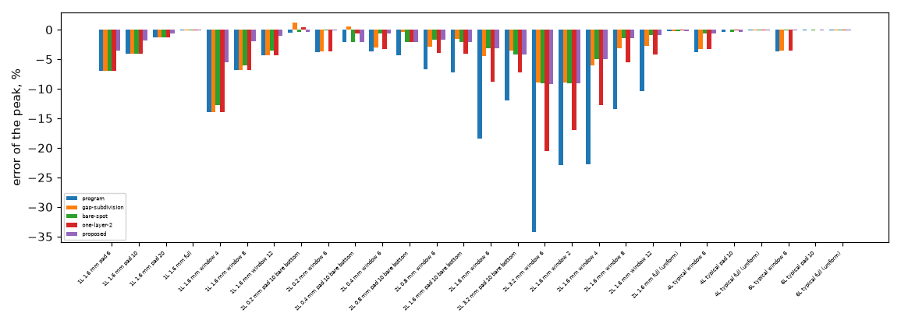

*Figure 16 (`figures/fig_16_four_treatments_and_the_rule.png`): the error of the peak under the part on the 27 simple boards, the program, the three old treatments and the rule; the blue bars (program) are the tall ones on the thick two-layer boards.*

### 3.3 The 1/n law, grading and the law of n (step 3)

`study_n_law.py` (`out/n_law_table.txt`): error of the peak for n = 1, 2, 3, 4, 6, 8 equal sub-gaps and for the 2:1 graded ones; the 1/n fit `e(n) = e_inf + a/n` is printed beside each row. Selected rows (equal sub-gaps):

| board | n = 1 | 2 | 3 | 4 | 6 | 8 | e_inf (graded fit) |
| :-- | --: | --: | --: | --: | --: | --: | --: |
| 1L 1.6 pad 10 | -7.27 | -3.89 | -2.54 | -1.80 | -0.98 | -0.52 | +0.51 |
| 2L 1.6 window 6 | -17.20 | -7.26 | -4.34 | -3.07 | -1.92 | -1.37 | +0.73 |
| 2L 1.6 pad 10 bare bottom | -7.09 | -3.95 | -2.71 | -2.03 | -1.29 | -0.88 | +0.07 |
| 2L 3.2 window 6 | -33.17 | -19.33 | -12.59 | -9.13 | -5.95 | -4.53 | +0.62 |
| 2L 3.2 pad 10 bare bottom | -11.94 | -7.12 | -5.20 | -4.16 | -3.02 | -2.41 | -0.94 |
| 2L 0.2 mm pad 10 bare bottom | -0.39 | +0.53 | +0.88 | +1.07 | +1.26 | +1.37 | +1.63 |
| 4L typical window 6 | -0.61 | -0.29 | -0.18 | -0.12 | -0.07 | -0.04 | +0.05 |
| 6L typical window 6 | -0.13 | +0.01 | +0.06 | +0.08 | +0.10 | +0.12 | +0.15 |

The error does fall as `1/n` (the e_inf of the 1/n fit is within 1 % of the reference on 13 of the 15 boards printed (+1.24 and +1.63 % on the pads over the 0.4 and 0.2 mm laminates, whose reference itself is 0.3 to 1 % high)), which means that nodes are a **cost-accuracy choice, not a convergence**: the table of laws (error and unknowns over the boards of part A):

| s_max mm | n_max | mean abs e % | max abs e % | mean unknowns x | max unknowns x |
| --: | --: | --: | --: | --: | --: |
| 0.2 | 8 | 0.85 | 4.53 | 1.83 | 4.50 |
| 0.2 | 6 | 1.08 | 5.95 | 1.63 | 3.50 |
| 0.3 | 8 | 1.04 | 4.53 | 1.66 | 4.50 |
| 0.4 | 4 | 1.87 | 9.13 | 1.31 | 2.50 |
| 0.4 | 6 | 1.58 | 5.95 | 1.39 | 3.50 |
| 0.6 | 4 | 2.05 | 9.13 | 1.25 | 2.50 |
| 0.8 | 4 | 2.76 | 9.13 | 1.16 | 2.50 |

(rows of the 20 laws are in `out/n_law_table.txt`). The default (0.4 mm, 4) is the point where the next step (n_max 6) costs 1.06 in mean unknowns for 0.3 points of mean error; going to (0.2, 8) halves the mean error again (1.87 to 0.85) for 1.4 x more unknowns. The decision rule written in section 2 (a) (stop when halving costs more than 1.3 x in unknowns) would stop at (0.4, 4) on the mean (the step to n_max 6 costs 1.06 x); the law is **left to the maintainer** (section 7 of INTEGRATION.md).

*Grading 2:1* (thinner sub-gaps at the copper): on thick gaps it helps at the same n (2L 1.6 window 6, n = 3: -4.34 to -4.17 %; n = 8: -1.37 to -0.73 %; 2L 3.2 window 6, n = 4: -9.13 to -7.44 %) and it overshoots the reference by up to +0.5 point on thin gaps (0.2 mm laminate: +1.07 to +1.26 %); the reference itself moves by under 0.14 % with grading. The proposed rule keeps **equal** sub-gaps: the gain of grading is smaller than the reference's own distance from its limit on the boards where it matters, and equal sub-gaps keep the link `d / s` uniform. Not adopted, not rejected.

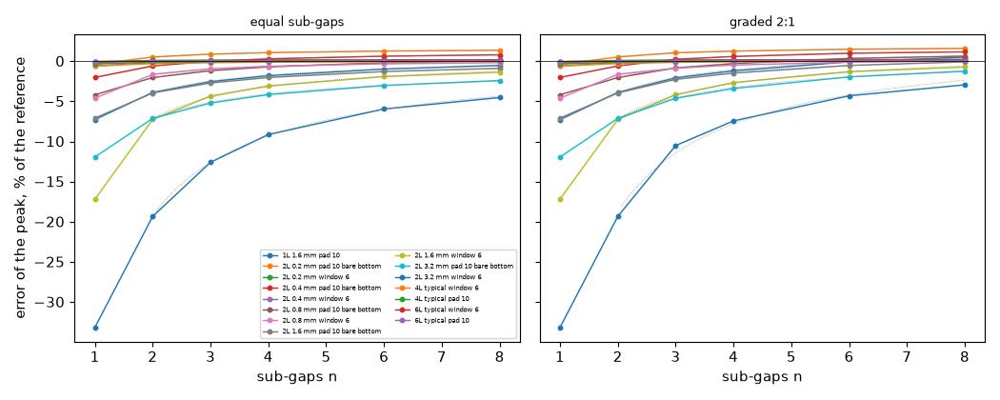

*Figure 6 (`figures/fig_06_error_against_n.png`): the error of the peak against the number of sub-gaps on the boards of part A, equal sub-gaps (left) and graded 2:1 (right); the dotted lines are the 1/n fits.*

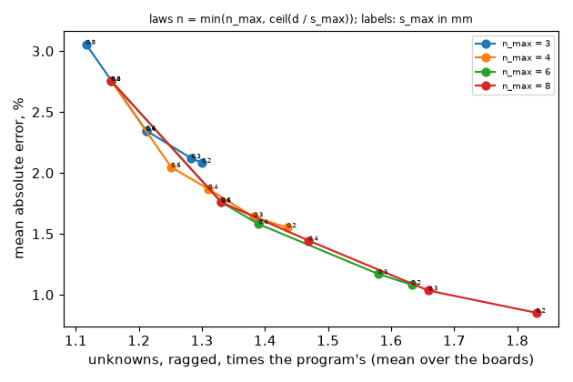

*Figure 9 (`figures/fig_09_error_against_unknowns.png`): the mean and maximum error against the mean unknowns for the laws of the table above.*

### 3.4 The mask (step 4)

`study_mask.py` (`out/mask_table.txt`), cell 0.5 mm, n by the default law, the 28 simple boards:

| variant | mean abs e % | max abs e % | largest distance from "every cell" (points) | unknowns x (ragged) | unknowns x (dense) |
| :-- | --: | --: | --: | --: | --: |
| proposed (bare, threshold 1.0, margin gap, disc) | 2.27 | 9.13 | 0.45 | 1.27 | 1.58 |
| mask "edge" | 2.01 | 9.18 | 4.76 | 1.09 | 1.58 |
| mask "all" | 2.30 | 9.28 | 0.00 | 1.68 | 1.68 |
| threshold 0.98 / 0.9 | 2.27 | 9.13 | 0.45 | 1.27 | 1.58 |
| margin none | 1.70 | 6.12 | 10.71 | 1.23 | 1.58 |
| margin 1 cell | 1.62 | 5.54 | 3.80 | 1.24 | 1.58 |
| margin 2 gaps | 2.31 | 9.26 | 0.24 | 1.31 | 1.58 |
| shape diamond / square | 2.26 / 2.27 | 9.10 / 9.16 | 0.51 / 0.37 | 1.26 / 1.27 | 1.58 |

The proposed mask is within 0.45 point of refining **every** cell (column "vs every cell") at 1.27 instead of 1.68 x the unknowns; "edge" and a margin of one cell or none are better on the mean error here (1.6 to 2.0 against 2.27) but leave up to 3.8 to 10.7 points from the refine-everywhere answer on some board. **Why their mean error is lower** (review, `study_mask_bracket.py`, `out/log_mask_bracket.txt`): a partial mask refines fewer cells at the same n, so a sound answer lies between the program (n = 1) and "every cell"; these variants read **hotter than every cell** (1L pad 10: margin none +6.12, edge +2.67 against -2.09 for every cell; 2L 1.6 mm pad on a bare bottom: edge +2.45 against -2.03; 2L 1.6 mm window 6: margin none +2.05 against -3.13). Where the mask ends, the interior nodes have no lateral link to the next cell, whose laminate is lumped into its copper nodes: a mask that stops where the laminate still carries heat sideways is an insulating wall, which heats the part and cancels part of the cool error. Margin none leaves the bracket on 6 of 17 boards, margin 1 on 5, edge on 4, the proposed mask on 1 (1L window 4: -5.48 against -5.93, 0.45 point). The lower mean errors are this artefact, not better physics. The rule of section 2 (b) ("bare + margin unless edge is within 0.5 points on every board") keeps the proposed mask. The threshold (1.0, 0.98, 0.9) and the shape of the margin do not matter on these boards (no cell has a fill between 0.9 and 1 except the off-grid pad edges of section 3.6).

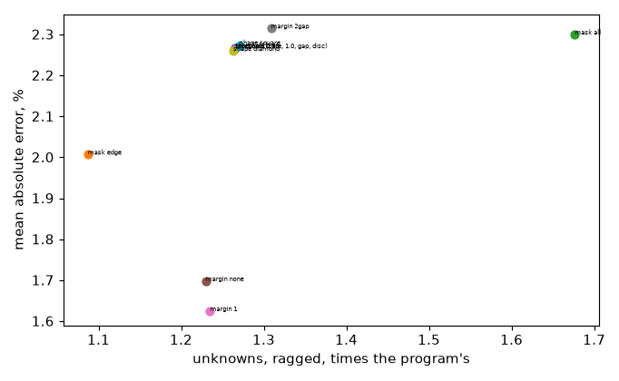

*Figure 15 (`figures/fig_15_mask_variants.png`): the variants of the mask, mean error and unknown ratio.*

### 3.5 One-layer boards (step 5; A11)

`study_one_layer.py`, cell 0.5 mm: the laminate under the copper of a one-layer board with the program's two nodes everywhere ("program"), the same ladder with n = 1, 2, 4 in every cell, and the rule:

| board | ref K | program (2 nodes) | ladder n=1 all | n=2 all | n=4 all | proposed (mask) | proposed n=8 | unk x |
| :-- | --: | --: | --: | --: | --: | --: | --: | --: |
| 1L full | 71.70 | -0.05 | -0.15 | -0.05 | -0.03 | -0.15 | -0.15 | 0.67 |
| 1L pad 6 | 181.93 | -6.98 | -12.30 | -6.98 | -3.64 | -3.53 | -1.50 | 1.67 |
| 1L pad 10 | 122.67 | -4.08 | -7.29 | -4.08 | -2.12 | -1.80 | -0.52 | 1.64 |
| 1L pad 20 | 78.70 | -1.27 | -2.31 | -1.27 | -0.66 | -0.58 | -0.16 | 1.42 |
| 1L pad 40 (board 60) | 38.90 | -0.71 | -1.38 | -0.71 | -0.37 | -0.49 | -0.27 | 1.33 |
| 1L window 2 | 105.03 | -17.49 | -23.45 | -17.49 | -11.34 | -9.23 | -4.72 | 0.71 |
| 1L window 6 | 173.18 | -10.75 | -21.04 | -10.75 | -5.88 | -4.00 | -1.44 | 0.79 |
| 1L window 12 | 213.90 | -4.30 | -10.38 | -4.30 | -2.45 | -1.06 | -0.33 | 0.98 |
| 1L track 2 mm | 163.21 | -8.97 | -14.43 | -8.97 | -5.25 | -3.95 | -1.83 | 1.67 |
| 1L island 4 under 3 | 257.84 | -9.87 | -17.12 | -9.87 | -5.20 | -5.11 | -2.24 | 1.67 |
| 1L 0.8 mm pad 10 | 146.61 | -2.21 | -4.45 | -2.21 | -0.81 | -2.08 | +0.29 | 0.98 |

(1) "ladder n=2 all" **equals the program** to the printed digit (the construction reproduces `laminate.py`, the regression the tests check). (2) The program's two nodes are the n = 2 point of the same 1/n curve, so the A11 finding (8 nodes give 1.9 % and 5.3 %) is the n = 8 column: -0.3 to -4.7 % with the mask. (3) The rule at the default n (4 for a 1.6 mm laminate) halves the shortfall on pads, tracks and islands (-3.5 to -5.1 % on the smallest copper) and on windows; at n = 8 on the bare cells it reaches -0.2 to -2.2 % on every board except the 2 mm window (-4.7 %: narrower than the gap, section 3.7). (4) The mask makes the one-layer board **cheaper than the program on windows** (0.71 to 0.98 x) and 1.3 to 1.7 x on pads (the program carries two nodes under every cell, the rule one node under solid copper). (5) 1L pad 40 and the thin 0.8 mm board: the rule is no better than -0.5 to -2.1 %, the same as the program on a thin laminate.

*Figure 4 (repeated from 1.2): the laminate path of a one-layer board.*

### 3.6 The vertical correction and the face term (step 6)

`study_vertical_face.py` (`out/vf_table.txt`), n = 1 (so that the effect of the correction is isolated), peak under the part; columns: off, vertical correction only, vertical + face with p = 0 (the full term on every cell with f < 1), 1, 2, and p = 1 only:

| board | ref K | off | vert only | vert + p=0 | vert + p=1 | vert + p=2 | p=1 only |
| :-- | --: | --: | --: | --: | --: | --: | --: |
| 2L 6 mm window | 151.59 | -18.44 | -18.26 | -17.20 | -17.20 | -17.20 | -17.37 |
| 4L 6 mm window | 96.60 | -3.77 | -2.29 | -0.61 | -0.61 | -0.61 | -2.09 |
| 6L 6 mm window | 86.94 | -3.68 | -2.00 | -0.13 | -0.13 | -0.13 | -1.82 |
| 4L 12 mm window | 100.50 | -3.43 | -1.97 | -0.36 | -0.36 | -0.36 | -1.82 |
| pad edge off the grid +0.125 mm | 91.98 | -7.04 | -7.00 | -7.00 | -7.00 | -7.00 | -7.04 |
| window edge in the footprint +0.25 mm (peak) | 134.82 | -25.52 | -25.44 | -24.24 | -24.24 | -24.24 | -24.32 |
| window edge in the footprint +0.25 mm (mean) | 90.14 | -17.22 | -17.18 | -15.94 | -16.17 | -16.28 | -16.21 |
| hatch 1.0 mm duty 0.5 (peak) | 152.60 | -7.65 | -7.65 | -6.59 | -7.38 | -7.58 | -7.39 |
| hatch 0.5 mm duty 0.3 (peak) | 163.88 | -11.17 | -11.15 | -10.16 | -10.67 | -10.91 | -10.68 |

(1) The vertical correction **and** the face term are worth 3.1 to 3.8 points on the 4- and 6-layer boards under a window (-3.77 to -0.61 %; -3.68 to -0.13 %), 1.1 points on the thick 2-layer window, and nothing on a pad edge off the grid. (2) On windows the face exponent does not matter (a cell with fill 0 has the full term for every p); on hatching and on cut cells the full term (p = 0) is closest on **every** row printed (the errors are all negative, so p = 0 never overshoots on these boards): the rule of section 2 (c) (the smallest largest error) picks **p = 0**; the code's default is p = 1, left unchanged here so that the earlier tables stand: this is an open decision (differences 0.3 to 1.1 points, on boards where the model is already 7 to 25 % cool for another cause, section 3.7). *Overshoot near f = 1* (review, `study_face_slot.py`, `out/log_face_slot.txt`): a two-dimensional model of a bare slot of width w in 35 um copper (face to the node level, copper walls and node level at the node temperature) gives the peak of the face over the 1D term `q t / (2 k_z)`: 0.05 at w = 5 um, 0.24 at 20 um, 0.42 at 35 um (w = t), 0.58 at 50 um, 0.87 at 100 um, 0.96 at 150 um, 0.98 at 200 um. So the full term (p = 0) is the right peak for a bare feature wider than about four copper thicknesses (0.15 mm, which every fabricated clearance is), and overstates it only on a sliver: a cell cut by an edge that leaves f = 0.9 to 0.99 in a 0.5 mm cell (a strip of 5 to 50 um) gets 1.7 to 19 times the true drop. The overshoot is bounded by the term itself (1.6 K for 1 W on a 6 mm part over 35 um copper, about 1 % of the rise on these boards). A guard that scales the term by the slot curve with the bare width `(1 - f) dx` removes it (INTEGRATION.md 7). (3) The error of a window edge inside the footprint grows with the offset (-22.5, -24.2, -25.5, -26.3 % for 0.0 to 0.375 mm): the scalar fill of a cut cell is the larger error here (section 4).

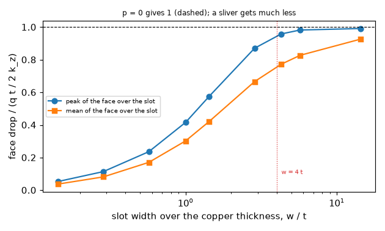

*Figure 17 (`figures/fig_17_face_term_over_a_slot.png`): the drop from the face of a bare slot to the copper node level over the 1D term, against the slot width over the copper thickness (review, `study_face_slot.py`); the full term (p = 0) is the dashed line.*

*Part D, the program's 3D solid against the face value and the slab-centre value* (`out/vf_table.txt`, last table): +1.46 to -0.78 % against the face value on the 2-layer windows (+3.0 to +0.15 % against the centre), -1.3 to -2.0 % against the face value on the 4- and 6-layer windows (+0.3 to -0.1 % against the centre). The solid reads the slab centre; the difference to the face value is within 2 % on the 12 boards, so the proposal of reporting the face in `solid3d` is a 2 % refinement at most, not a defect.

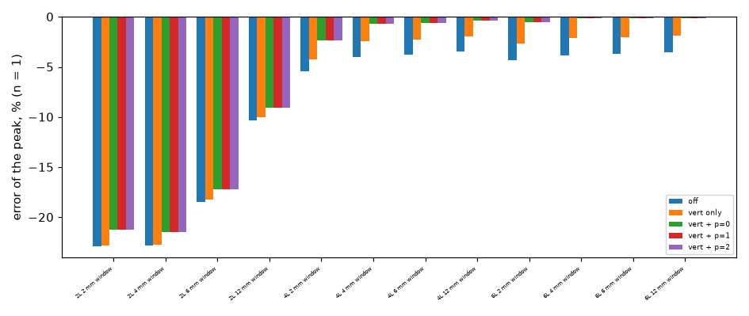

*Figure 14 (`figures/fig_14_vertical_and_face.png`): the error with the vertical correction and the face exponents on the windows, the off-grid edges and the hatchings.*

### 3.7 Windows narrower than the gap (step 7; Q5)

`study_narrow_window.py` (`out/log_narrow.txt`), peak error against a 0.125 mm reference (8 sub-slabs): laminates of 0.2, 0.4, 0.8, 1.6 and 3.2 mm, windows of 0.5 to 6 mm, cells of 0.5 and 0.25 mm. For the 1.6 mm laminate (the typical 2-layer gap), peak error in percent:

| w mm | w/d | cell | n=1 | n=2 | n=4 | n=8 | n=8 vs same-cell 3D |
| --: | --: | --: | --: | --: | --: | --: | --: |
| 0.5 | 0.31 | 0.50 | -10.63 | -10.53 | -10.50 | -10.49 | -24.48 |
| 0.5 | 0.31 | 0.25 | -8.52 | -7.90 | -6.93 | -5.64 | -4.03 |
| 1 | 0.62 | 0.50 | -15.47 | -13.49 | -10.70 | -7.70 | -5.85 |
| 2 | 1.25 | 0.50 | -21.39 | -15.41 | -9.11 | -4.77 | -4.76 |
| 4 | 2.50 | 0.50 | -22.03 | -11.46 | -5.01 | -2.14 | -2.69 |
| 6 | 3.75 | 0.50 | -17.98 | -7.58 | -3.07 | -1.25 | -1.73 |

(1) When the window is narrower than 2 cells (w = 0.5 mm at a 0.5 mm cell) **no number of nodes helps** (-10.6 to -10.5 %; the 3D solver on the same cell is itself 24 % away from the fine reference: "cell effect" column +18.5 %), so the error is the cell's, not the laminate's. (2) From w/d >= 1.25 on resolved cells the error falls with n as on wide windows, and **n = 8 at w/d >= 2.5 is within 2.1 % of the fine reference**; the default law (n = 4 on 1.6 mm) leaves -5.0 % at w/d = 2.5 and -9.1 % at w/d = 1.25. (3) On a thin laminate (0.2 mm) windows of 1 mm and more are within 0.6 to 4.7 % at n = 1 and within 1 % from n = 2 (w >= 2 mm). The earlier folder's -9 % for a window narrower than the gap is of the same size as the n = 4 column at w/d 0.3 to 1.25 (-6.9 to -10.7 %); the 3.2 mm rows (n = 4: -5 to -13 %) are in the log. A warning (INTEGRATION.md 5) is the answer for w/d under 1.5, not more nodes.

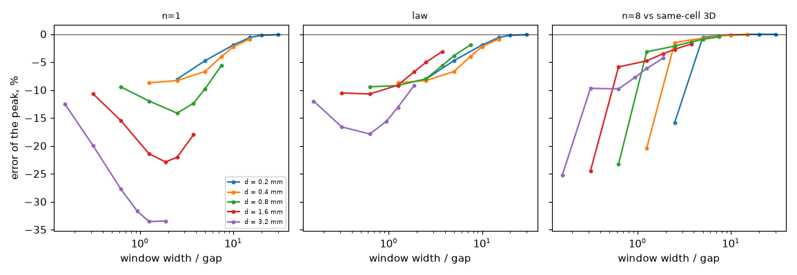

*Figure 7 (`figures/fig_07_narrow_windows.png`): error against the window width over the gap, per n, at two cell sizes.*

### 3.8 Real windows (step 8)

`study_windows_real.py`, `study_windows_cell.py` and `study_windows_reconcile.py` (`out/log_windows_real.txt`, `out/log_windows_cell.txt`, `out/log_windows_reconcile.txt`): the first window of each of the seven real one-layer boards of the Gerber research (36 mm, copper pixels of 0.2 mm, a 6 x 6 mm heater of 1 W at 12 to 18 mm, 1.6 mm laminate, 35 um copper, h = 10 W/m2K on both faces), the mean heater rise against the 0.2 mm resolved reference (8 sub-slabs, 291 000 unknowns), the program's scalar fill being the mean of the pixels of each cell. The resolved references are kept in `out/windows_ref_cache.json` (one 8 GB solve per window and orientation).

**Corrected by the review.** The first version of this section had the program at -27 to -62 % at every cell size: the preset "program" did not take the fill of the mask (`gapnet.apply_ladder` returned before applying it on a one-layer board), so the program column solved the full-copper placeholder board of `problem()`; fixed, with a regression test (`test_program_preset_takes_a_given_fill`). The rule and "n = 8 everywhere" columns were right and are unchanged. Error of the mean rise, percent (this folder's orientation, see below):

| window | copper % | program @0.8 mm | rule @0.8 | n=8 everywhere @0.8 | program @0.4 | rule @0.4 | program @0.2 | n=8 @0.2 | rule @0.2 |
| :-- | --: | --: | --: | --: | --: | --: | --: | --: | --: |
| storm | 77 | -18.32 | -16.93 | -17.14 | -14.48 | -12.63 | -7.45 | -3.28 | -4.18 |
| chibi | 80 | -25.70 | -25.04 | -25.35 | -20.88 | -19.52 | -9.35 | -3.89 | -5.51 |
| easyeda | 86 | -22.53 | -21.83 | -22.39 | -19.28 | -18.02 | -10.75 | -5.11 | -6.70 |
| pcbrnd | 68 | -22.00 | -21.52 | -21.60 | -12.85 | -10.27 | -8.00 | -3.00 | -4.54 |
| pcad | 55 | -45.66 | -43.35 | -43.26 | -40.02 | -36.45 | -17.09 | -6.75 | -9.55 |
| dip | 74 | -38.89 | -38.38 | -38.70 | -29.79 | -26.70 | -15.07 | -5.44 | -8.34 |
| fritz | 27 | -23.96 | -21.13 | -20.83 | -13.28 | -8.39 | -9.37 | -3.71 | -4.70 |

The mask flags 87 to 100 % of the cells on these layouts, at 1.5 to 1.7 x the unknowns (the cost cap `budget = 2` never acted); the "edge" mask flags 93 to 99 %. **Finding:** at the 0.8 mm cell the rule gains only 0.2 to 2.8 points over the program (-18 to -46 % to -17 to -43 %), and eight nodes everywhere are no better: at that cell the error is the **scalar fill of a cell with copper finer than the cell** (tracks and clearances of 0.2 to 0.5 mm inside a 0.8 mm cell; the fill fraction treats the copper of a cell as joined, gerber-models 4.4 and R2), which the nodes do not touch. At the pixel-sized cell (0.2 mm) the laminate is the error and the nodes repair most of it: program -7.5 to -17.1 %, rule -4.2 to -9.6 %, n = 8 everywhere -3.0 to -6.8 %. The answer to the fill error is a better mapping of the copper (the flow-based faces of gerber-models, -9.4 % against -23.9 % for the fill at 0.8 mm in R2), not more laminate nodes.

*Reconciliation with gerber-models R2* (review). The two folders read the same masks of `windows_native.npz` but R2 flips their rows (row 0 at y = 0 of the board) and this folder took them as stored, so its windows are the **mirror images** of R2's: the heater, off the centre of the window, sits over different copper (the references differ: storm 84.15 K here, 72.91 K in R2). Run on R2's orientation and against **R2's own independent 3D solver** (its printed heater means; `study_windows_reconcile.py`, node value without a face term, R2's metric):

| case | mean % | range % |
| :-- | --: | --: |
| program @0.2 mm (R2 printed: mean -9.8, range -13.6 to -5.5) | -9.81 | -13.64 to -5.53 |
| rule @0.2 mm | -5.82 | -8.55 to -3.07 |
| n = 8 everywhere @0.2 mm | -3.64 | -5.30 to -1.91 |
| program @0.8 mm (R2 printed for the fill: -23.9) | -25.46 | -36.45 to -17.33 |
| rule @0.8 mm | -24.54 | -35.65 to -16.98 |

The program at the pixel reproduces R2 to the printed digit, so the earlier discrepancy is fully explained (the fill defect and the mirror); at 0.8 mm the program is 1.6 points cooler than R2's fill row, which R2 built through the faces of `lib/faces.py` (not investigated further). The rule's gain is confirmed against a second, independent reference: -9.8 to -5.8 % at the pixel, -25.5 to -24.5 % at 0.8 mm. Only the seven first windows were run (`--all`, 42 windows, not run).

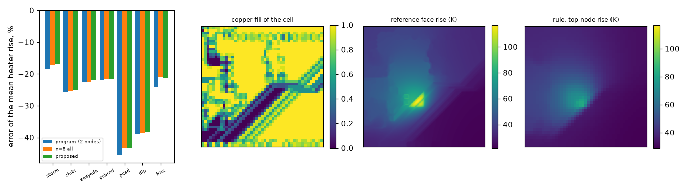

*Figure 8 (`figures/fig_08_real_windows.png`): the mean error on the seven windows at a 0.8 mm cell (program column corrected by the review) and, for the first one, the maps of the fill, the reference face and the rule's top node.*

### 3.9 The FDM (step 9)

`study_fdm.py` (`out/log_fdm.txt`), cells of 1 and 0.5 mm, error of the peak against the face value; FDM balance 1.000000000 on every row:

| board | cell | FDM program | FDM rule | FVM program | FVM rule |
| :-- | --: | --: | --: | --: | --: |
| 1L pad 10 | 0.5 | -9.36 | -8.04 | -4.08 | -1.80 |
| 2L 0.8 window 6 | 0.5 | -11.02 | -5.86 | -6.62 | -1.64 |
| 2L 1.6 pad 10 bare bottom | 0.5 | -11.46 | -8.14 | -7.16 | -2.03 |
| 2L 1.6 window 6 | 0.5 | -24.71 | -10.49 | -18.44 | -3.07 |
| 4L typical window 6 | 0.5 | -7.12 | -3.95 | -3.77 | -0.61 |
| 6L typical window 6 | 0.5 | -6.82 | -3.24 | -3.68 | -0.13 |
| 4L typical pad 10 / 6L typical pad 10 | 0.5 | -2.49 / -1.65 | -2.38 / -1.53 | -0.36 / -0.08 | -0.33 / -0.06 |
| 2L 1.6 window 6 | 1.0 | -31.28 | -18.98 | -19.26 | -3.28 |

The construction on the FDM (the zero link at the border of the refined zone, the arithmetic mean elsewhere) conserves the heat (balance 1.000000000) and moves the FDM toward the reference by 0.1 to 14 points, but the FDM **stays 3 to 8 points below the FVM with the rule** on every board with a bare spot (e.g. 2L 1.6 window 6: -10.5 against -3.1 %; pad on a bare bottom: -8.1 against -2.0 %). The FDM's own extra shortfall at the edge of a pad or window (half control volumes on the border of the copper, node sampling; the earlier folders measured 3 to 9 points) is not touched by the nodes and is not part of this question; with the construction the FDM is better than before and still the least accurate model over a bare spot. A grid of 1 mm gives -19 % against -3.3 % for the FVM on the 1.6 mm window.

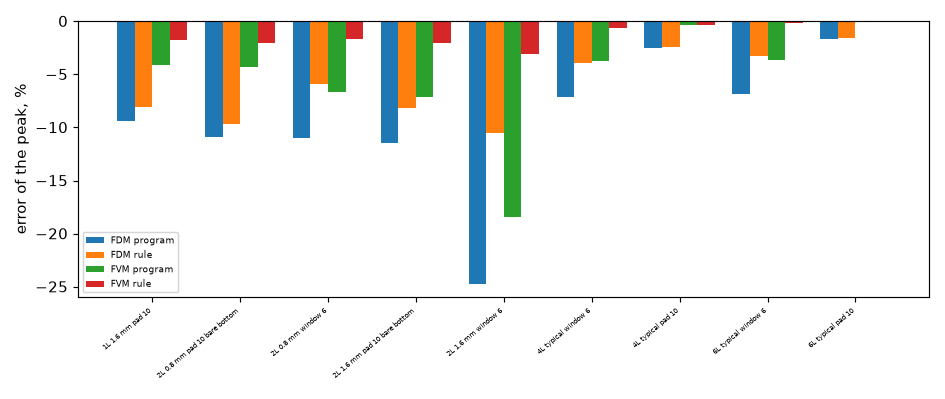

*Figure 11 (`figures/fig_11_fdm.png`): the FDM and the FVM, program and rule, on the boards of the table.*

### 3.10 The transient (step 10)

`study_transient.py` (`out/log_transient.txt`): the step response of the hottest node, from the board at rest, against the resolved 3D step response (Crank-Nicolson); the total heat capacity of the rule's network equals the program's (ratio 1.000000 on the three boards):

| board | program: max abs e % / t63 e % | FVM rule: max abs e % / t63 e % | FDM rule: max abs e % / t63 e % | steady ratio rule / 3D, late |
| :-- | --: | --: | --: | --: |
| 2L 1.6 pad 10 bare bottom | +59.95 / +14.90 | +9.38 / +3.87 | +13.69 / +15.15 | 0.9806 |
| 1L pad 10 | +36.36 / +7.83 | +58.21 / +2.93 | +57.17 / +14.48 | 0.9824 |
| 4L typical window 6 | +15.36 / +5.99 | +11.52 / +2.27 | +12.72 / +10.33 | 0.9939 |

The time to 63 % of the steady peak is 2.3 to 3.9 % off with the rule (7.8 to 14.9 % off in the program) on the FVM and 10 to 15 % on the FDM. The "max abs e" column is the worst point of the whole curve and is dominated by the earliest times, where the 3D reference's top slab centre and the layered model's node (no face term) differ in the heat they hold: on the one-layer board it is +58 % with the rule against +36 % in the program, i.e. **the rule is worse than the program on the earliest points of that board** and better on the time constant. The extra nodes do not change the capacity (the total is conserved by construction) but they delay the heat's path in the first moments; the profile runner uses the same matrices (`fvm.transient_from_network`), so its response has the same time constant and the same first-moments behaviour. Not measured: a power profile with a pulse shorter than the time constant of the laminate (the first-moments error matters there).

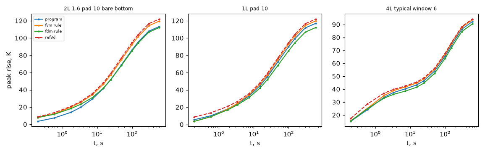

*Figure 12 (`figures/fig_12_step_response.png`): the step response of the program, the rule (FVM, FDM) and the resolved reference.*

### 3.11 Cost, memory and the SOR (step 11)

`study_cost_sor.py` (`out/log_cost_sor.txt`, re-run by the review): the unknowns (program, ragged, dense) and the direct-solve time:

| board | cell | program unknowns | ragged x | dense x | dense solve s | ragged solve s | program solve s |
| :-- | --: | --: | --: | --: | --: | --: | --: |
| 2L 100 x 80, pour 60 x 40, window 6 | 1.0 | 20 000 | 2.22 | 2.50 | 0.3 | 0.2 | 0.0 |
| same | 0.5 | 80 000 | 2.21 | 2.50 | 1.4 | 1.4 | 0.2 |
| 4L typical 100, window 6 | 0.5 | 160 000 | 1.00 | 1.00 | 1.1 | 1.1 | 1.1 |
| 1L 100, pad 40 | 0.5 | 120 000 | 1.54 | 1.67 | 1.4 | 1.3 | 0.5 |

The direct solve costs 2 to 7 x the time of the program on the boards with a refined gap (the 2-layer pour has 2.2 x the unknowns and denser columns). The first run had the dense layers 25 % slower than the ragged matrix on the 2-layer board (0.5 against 0.4 s, 2.1 against 1.7 s); the review's run gives 0.3 against 0.2 s and 1.4 against 1.4 s: on a loaded machine the solve times do not separate the two. Decision (d) of section 2 still goes to the **ragged assembly**, on the unknown count (2.21 against 2.50 x, 1.54 against 1.67 x: 6 to 12 % fewer unknowns and no rows of pinned nodes), not on the time. The memory guard counts the ragged unknowns. The peak resident memory read in the script is the process's maximum (not a per-board figure).

*SOR* (30 mm boards, 1 mm cells, residual 1e-8; sweeps):

| board | program point SOR | general red-black, program K | point red-black, ladder n = 4 | ladder, barrels parallel, n = 2 | **column red-black, ladder n = 4** | column red-black, barrels parallel, n = 2 |
| :-- | --: | --: | --: | --: | --: | --: |
| 2L 1.6 pad 10, bare bottom | 719 | 720 | 990 | no colouring | **730** | 720 |
| 2L 1.6 window 6 | 5221 | 5230 | no colouring | no colouring | **5200** | 5200 |
| 1L pad 10 | 775 | 780 | no colouring | no colouring | **730** | 720 |

The column SOR agrees with the direct solve within 2e-7 to 4e-7 K at this tolerance. **Corrected by the review:** the first version said that "the one-layer ladder is not bipartite, a defect of the construction not understood", and that 2-layer ladders colour. The cause is general: in a refined gap a flagged column joins its two end nodes by n links and an unflagged column by one, and the lateral links close the cycle a(i) - b(i) - b(j) - [n links] - a(j) - a(i) of length n + 3, odd for every **even** n. The 2-layer board of the first run coloured only because its bottom is bare everywhere, so every cell was flagged; the 2L window (refined and single-link columns side by side) fails at n = 2 and 4 and colours at n = 3 and 5, and the one-layer pad likewise (measured with `gapnet.two_colour`; `test_mixed_columns_with_even_n_are_not_bipartite_and_column_sor_solves_them`). No point two-colouring exists for the default law (n = 2 or 4). Every link of the construction joins nodes of one plan cell (vertical, sub-links, barrels in either mode) or the same node of two plan neighbours, so a **block (column) red-black SOR**, coloured on the plan grid, is always valid (`gapnet.solve_sor_columns`): it relaxes all the nodes of a cell together by an exact solve of the column, and it needs the program's number of sweeps. The program's planned SOR for 2.4.5 (`research/sor-with-via-couplings`, option (c')) is a point red-black sweep plus relaxed, coloured **via blocks** (all the nodes of a via, skipped by the point sweep); the refined columns fit the same mechanism as blocks (every flagged cell's column, colour groups by the plan grid), which keeps the point sweep and a board without refined cells bit-identical to today. That hybrid was **not measured here**; the column red-black above is the measured prototype and the fallback.

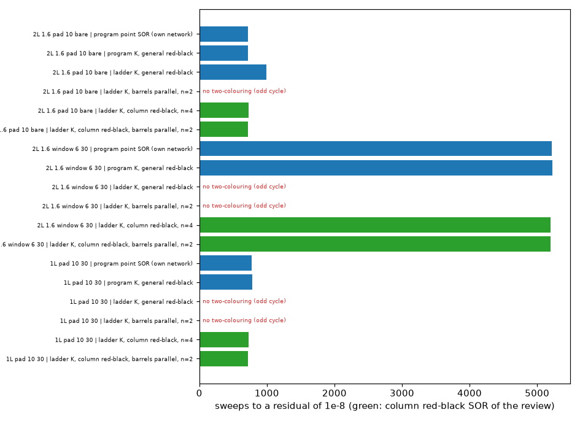

*Figure 13 (`figures/fig_13_sor_sweeps.png`): the sweeps of the point SOR on the program's network, the general red-black SOR on the program's K and on the ladder's K (red: no two-colouring exists) and the column red-black SOR of the review (green), on three boards.*

### 3.12 The Analytic and the Lumped (step 12)

`study_analytic.py` (`out/log_analytic.txt`), error of the peak against the face value:

| board | Analytic | FVM program | FVM rule | Lumped program | Lumped on the rule's network |
| :-- | --: | --: | --: | --: | --: |
| 1L full | -0.77 | -0.05 | -0.15 | | |
| 2L 1.6 full | -0.55 | -0.26 | -0.26 | | |
| 4L typical full | -0.31 | -0.06 | -0.06 | | |
| 1L pad 10 | -19.68 | -4.08 | -1.80 | -6.57 | -4.34 |
| 2L 0.2 pad 10 bare bottom | -67.89 | -0.49 | -0.39 | -7.23 | -7.15 |
| 2L 1.6 pad 10 bare bottom | -34.43 | -7.16 | -2.03 | -9.15 | -4.45 |
| 2L 1.6 window 6 | -52.69 | -18.44 | -3.07 | -15.93 | +5.36 |
| 2L 3.2 window 6 | -55.45 | -34.19 | -9.13 | -34.55 | -3.25 |
| 4L typical window 6 | -26.60 | -3.77 | -0.61 | +6.92 | +8.86 |
| 6L typical window 6 | -19.22 | -3.68 | -0.13 | +1.85 | +4.10 |

(1) On **uniform** boards the Analytic is within 0.3 to 0.8 % of the reference and 0.3 to 0.6 points below the FVM, inside the 0.3 to 1.3 % that `laminate.py` documents: the passive cell (one link, the series film on a one-layer board) is coherent with the rule's empty mask, decision (e) keeps the Analytic without nodes. (2) On any **partial** copper the Analytic is 10 to 68 % cool, far outside what the rule can change (it has no cells): the shortfall is the Analytic's (`analytic-partial-copper`), and the nodes would not repair it. Its warning, not this construction, is the answer. (3) The **Lumped on the rule's network** is erratic: it moves the 2L 1.6 and 3.2 mm windows from -15.9 and -34.6 % to +5.4 and -3.3 % (better in magnitude), but the 4- and 6-layer windows from +6.9 and +1.9 % to +8.9 and +4.1 %, and the 0.4 mm window from +10.4 to +12.1 % (worse): its ring sums of per-cell arrays do not follow the refined cells (as written in doubt 4). The Lumped is **not** a model to which the construction is offered without a decision of its own; the program's Lumped stays as it is (INTEGRATION.md 2). The partial-copper candidate of `analytic-partial-copper` was not at hand (`ANALYTIC_DEFECT` not set) and was not run.

### 3.13 Vias, simple stack-up, edge, outline, block, inner part (step 13)

`study_combinations.py` (`out/log_combinations.txt`):

* **A, a via under the part** (2L 1.6 pad 10 on a bare bottom, barrel as copper area): program -6.93 % (cell 1 mm) and -6.70 % (0.5 mm); barrel in the sub-links (series) n = 1, 2, 4, 8: -6.87, -3.59, -1.43, -0.08 % at 1 mm and -6.64, -3.67, -1.86, -0.78 % at 0.5 mm; barrel across the gap (parallel): -6.87, -3.52, -1.32, +0.05 and -6.64, -3.55, -1.67, -0.56 %. The two modes differ by under 0.2 point (series is the one that keeps the graph bipartite, so it is the proposed one). The point via below 0.5 mm of `via-fill` is a known limit.
* **B, the simple stack-up** (equal slabs, the laminate allocated 0.75 d to an outer node): 4L window 6: program -6.15 %, rule -2.59 %, rule with `rebuild_slabs` -0.51 %; 6L: -4.24, -0.97, -0.29 %. The rebuild of the nodes from the equal-gap convention is worth 1.9 and 0.7 points; it is a separate decision (doubt 2).
* **C, D, edge and outline** (2L pad 10 on a bare bottom): the energy balance is 1.000000000 with and without the rule for `h_side` = 10 W/m2K and for a round outline of 28 mm; the peak moves by +5.67 % and +4.71 % against the program (the rule's nodes are what the bare bottom needs; no independent reference was run for these two).
* **E, a metal block:** refused by `gapnet.build`, **not designed** (documented limit; the program's block layers come after the laminate nodes).
* **F, a part on an inner layer** of a 4-layer board: peak change +0.02 % (no face term; the rule leaves an inner-layer part where it is).

### 3.14 The validation rows and the examples (step 14)

`study_validation_rows.py` (`out/log_validation_rows.txt`), 1 mm cell, FVM peak in degrees C, the 22 scenarios and examples of `docs/validation.md`:

| board | FVM program | FVM rule | change K | change % | 3D solid |
| :-- | --: | --: | --: | --: | --: |
| reference board and its variants (corner, 5 mm heater, 8 layers), heater on the bottom, long thin heater, heater 10 mm from two edges, two heaters | 65.70 to 109.40 | identical | 0.00 | 0.00 | 67.9 to 109.5 |
| example board (also without heatsink, without vias, only U1) | 85.81 (88.91, 94.67, 79.97) | 85.82 (88.92, 94.68, 79.97) | +0.01 | +0.01 to +0.02 | 85.98 |
| example, top copper over the full board / uniform | 85.29 / 96.68 | identical | 0.00 | 0.00 | 85.42 / 96.88 |
| heater 5 mm inside the top-copper edge | 94.45 | 94.48 | +0.03 | +0.05 | 94.78 |
| heater straddling the top-copper edge | 143.89 | 148.98 | +5.08 | +4.28 | 149.27 |
| no copper on the heater layer | 150.16 | 154.70 | +4.54 | +3.63 | 153.19 |
| 30 x 30 mm copper island around the heater | 92.38 | 92.44 | +0.05 | +0.07 | 92.78 |
| hatched copper (fill 0.5) on the top layer | 105.78 | 107.34 | +1.56 | +1.93 | 106.23 |

Boards with copper in every cell of every gap are **bit for bit the program** (the refined set is empty: the same float on 12 of the 23 rows of `out/log_validation_rows.txt`, among them the uniform variants of the example; the first version said "14 of the 22 rows", corrected by the review; the six example rows with the zone edge move by 0.01 K). The example board moves by +0.01 K (the zone edge around the heater flags 4964 cells in the first gap at 1.16 x the unknowns). The two largest movements are toward the 3D solid: the straddled edge 143.89 to 148.98 against 149.27, the board without copper under the heater 150.16 to 154.70 against 153.19 (the rule is 1.5 K, 1 %, above the 3D solid there), the hatching 105.78 to 107.34 against 106.23 (1.1 K, 1 % above). That is not an established overshoot: the 3D solid reports the centre of its top slab, which is 1.3 to 2.0 % below the face value on windows (3.6 D), and the hatching is a uniform fill of 0.5 in the layered models and in the solid alike (3.6, 3.8). The FDM column is "n/a" (the table did not run the FDM on these boards); the Lumped moves by under 0.6 K. The 8-layer reference board reads "ValueError" in the 3D solid column (its size limit). The rows that move are the ones with a bare spot.

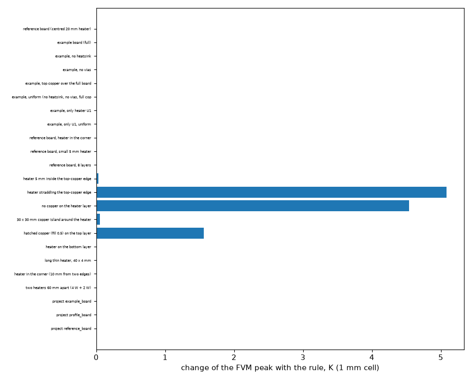

*Figure 10 (`figures/fig_10_validation_rows.png`): the change of the peak on the validation rows and examples, with the 3D solid for scale.*

## 4. Limits

* Blocks, metal heatsinks with a thickness: refused by `gapnet.build` (3.13 E). Outline and edge coefficient: built, checked by the energy balance only.
* The FDM covers rectangular boards with insulated sides and stays 3 to 8 points below the FVM over a bare spot (3.9).
* The reference's own grid error (3.1, 0.4 to 1.5 %) and the singular edge of a window (observed order 0.5 to 1.2) limit every number to a few tenths of a percent at best.
* Copper finer than the cell (hatching, tracks, real layouts): the scalar fill of the cell is the larger error and the nodes do not touch it (3.8: the program -13 to -46 % and the rule -8 to -43 % at 0.4 to 0.8 mm cells on real windows; at the pixel the program -7 to -17 %, the rule -4 to -10 %). A window narrower than about two cells or about 1.5 times the gap is not repaired by any n (3.7).
* No point red-black colouring exists for an even n where refined and single-link columns meet (any board, 3.11); the column (block) red-black SOR is valid and was measured; the hybrid with the via blocks of `sor-with-via-couplings` was not.
* The mask ends with an insulating wall for the interior nodes (3.4): 0.45 point on the 1L window 4, more for narrower margins.
* The face term with p = 0 overstates the peak on cells cut by an edge into a sliver (f above about 0.9 at 0.5 mm), by at most the term itself (3.6).
* The transient: the time constant improves, the earliest points of a one-layer board worsen (3.10).
* The Analytic is not changed by the construction and is far off on any partial copper (3.12); the Lumped on the refined network is erratic (3.12).
* The reference converges at 0.125 mm and 16 sub-slabs on every board of 3.1 and agrees with an independent solver within 0.06 % on two boards (isotropic laminate); a 0.0625 mm level was not run. `--all` real windows (42) and the 3.2 mm narrow-window rows were not examined row by row.

## 5. How to run

From the repository root, with the program's environment (`.venv`), in the order of section 2; the real windows need `research/gerber-import/out/windows_native.npz` (built by the Gerber research; in a worktree set `LAMNODES_GERBER_OUT` to the folder of the main checkout). All outputs go to `out/` (git-ignored); `make_figures.py` and `make_diagrams.py` write the committed figures. `study_windows_real.py`, `study_windows_cell.py` share the reference cache `out/windows_ref_cache.json` (the first one that meets a window solves it, 8 GB); `study_windows_reconcile.py` needs no 3D solve (R2's printed values). `study_mask_bracket.py` uses the reference cache of `runner.py` (run `study_s0_four_treatments.py` first); `study_face_slot.py` takes seconds.

## 6. What the program would change

`laminate.py` becomes the module of the construction; `fvm.Network.__init__` builds the extra layers for every gap; `fdm.Network` the same with the border rule; `api.SolverOptions` and Preferences get the parameters; `fvm.unknowns`, `fdm.unknowns` and the memory guard count the extra nodes (ragged); `solve_sor` relaxes the refined columns as blocks (3.11; a point colouring does not exist for an even n); `results.py` keeps the extra nodes out of the layer arrays; the reported peak adds the face term; `checks.py` gets the warnings of INTEGRATION.md 5. The numbers of the impact are in 3.2 and 3.14 and INTEGRATION.md 3.

## 7. Doubts of the author

1. The full-copper one-layer case (doubt 1 of the preparation) is within 0.1 point of the program (-0.15 against -0.05 %): resolved.
2. The simple stack-up with three or more layers: `rebuild_slabs` is worth 1.9 and 0.7 points (3.13 B) and is not in the default rule: a decision.
3. The barrel in the sub-links against across the gap: they differ by under 0.2 point on one board with a via under the part (3.13 A); no real via layout was run.
4. The discrepancy with the earlier folder on the real windows (3.8): **resolved by the review** (a defect of the study, the program column ignored the fill, and mirror-image windows; R2 reproduced to the printed digit).
5. The colouring defect (3.11): **diagnosed by the review** (an odd cycle n + 3 for even n where refined and single-link columns meet, on any board), and a column SOR measured.
6. The transient's worst point on the one-layer board is worse with the rule (3.10): open.
7. The face exponent: the data prefer p = 0 on every board printed, the default is p = 1; the overshoot near f = 1 is **measured by the review** (3.6: up to the term itself on slivers; a guard by the bare width removes it).
8. The deep reference of the 1- and 2-layer boards: **nothing to re-run** (3.1, review); checked against an independent solver.

## 8. Review

* **Status**: reviewed on the branch at `9968d64` (program at `develop` `b0ff0a7`, untouched: `git diff develop --stat -- pcbthermal tests examples ico README.md CHANGELOG.md CLAUDE.md docs requirements.txt` empty). Re-run by the review: the tests (20 passed), steps 2 (`study_s0_four_treatments.py`, the table identical to `out/s0_table.txt` to the last digit, references from the cache), 8 (`study_windows_real.py`, `study_windows_cell.py`, with the corrected program column; references from the cache seeded from the first run, same code), 11 (`study_cost_sor.py`), the figures 8 and 13; added `study_windows_reconcile.py`, `study_mask_bracket.py`, `study_face_slot.py`, `gapnet.solve_sor_columns` and two tests. Not re-run: steps 3 to 7, 9, 10, 12 to 14 (their tables were checked against their logs in `out/`, and 3.14 was corrected from its log).
* **Independent checks**: the resolved reference against `research/solid3d-verification/lib/layered3d.py` (0.06 % and 0.00 % on two boards, 3.1); the program on the real windows against the independent 3D solver of gerber-models R2 (its printed values; R2 reproduced to the digit, 3.8); a 2D slot model for the face term (3.6); the bracket [program, every cell] for the masks (3.4).
* **Defects found in this folder and fixed**: (1) the preset "program" ignored a given fill on one-layer boards, so the program column of the real windows solved a full-copper board (3.8; `gapnet.apply_ladder`, regression test); the headline "the rule moves the 0.8 mm cell from -27 to -62 % to -17 to -43 %" was wrong: the gain at 0.8 mm is 0.2 to 2.8 points. (2) The SOR diagnosis "the one-layer ladder is not bipartite, 2-layer ladders colour" was wrong: any board with refined and single-link columns side by side and an even n has odd cycles (3.11; column SOR added, test). (3) The windows are mirror images of R2's (documented in `study_windows_real.load_windows`, `flip=True` gives R2's). (4) Wrong statements corrected: the deep reference "not done" (3.1), "the same numbers to the printed digit" as bare-spot (3.2), "14 of 22 rows" (3.14), the dense layers "+25 %" (3.11, not reproduced), the overshoot against the 3D solid (3.14).
* **Explanations tested**: the lower mean error of the masks "edge", "margin none" and "margin 1" is an insulating wall at the end of the mask (3.4); the remaining error on real windows at 0.8 mm is the fill (n = 8 everywhere is no better than the rule, 3.8).
* **Open**: the literature check of the construction (no published case of a patterned layer reproduced; the construction is a discretisation of the same conduction equation, checked against two independent resolved solvers); the transient's earliest points on a one-layer board (3.10); the hybrid SOR (point sweep plus column blocks plus via blocks); the 42 windows; a 0.0625 mm reference level.

## What was read and what was not verified

**Read (preparation):** `research/ROADMAP.md` A1, A11, A12; `gap-subdivision/INTEGRATION.md` (in full) and README sections 5, 6, 10 (R), the rest by headings (S); `bare-spot-under-source/INTEGRATION.md` (in full) and `lib/layered.py`, `treatments.py`, `resolved3d.py`, `cases.py` (R), its README by headings (S); `analytic-partial-copper/INTEGRATION.md` and the head of `lib/defect.py` (R, from the branch with `git show`; not in `develop`); `gerber-models` README, Review R2 (R) and the head of `scripts/study_laminate_reference.py` (R); `docs/theory.md` 1.2 (R); `pcbthermal/laminate.py`, `fvm.py` (Network, assembly, SOR, transient), `fdm.py` (Network) (R); `lumped.py`, `analytic.py` (interfaces, S); `solid3d.py` (by grep, S).

**Sources:** no new published source was opened. The two published solutions used by the earlier folders (Muzychka, Culham, Yovanovich 2003; Yovanovich, Muzychka, Culham 1999) are entries R of `research/theory/BIBLIOGRAPHY.md`; Richardson extrapolation and the GCI (Roache) are from memory (M) and checked on a known sequence by `tests/test_ref3d.py`. A published numerical case of a source over a copper-free window or a patterned PCB layer, and compact-model literature on the number of nodes through a PCB dielectric, were **not searched in this phase and remain N**: the independent solver of this folder agrees with the earlier folders' two solvers (equality test) and with the series closed form, but **no published numerical case for the patterned-copper situation was reproduced here**, so the literature-check rule is met for the solver (earlier folders) and not for the construction.

**Run:** steps 0 to 14 above except the 42-window `--all` run; `study_windows_cell.py` (added after the first real-window run to test the cell-size explanation); the figures 1 to 16 were regenerated from these outputs. The review's runs are listed in section 8.

**Not verified:** any model against a physical measurement; a published numerical case of a patterned copper layer (the literature check of the construction, open); the Lumped's behaviour on the refined network beyond the 15 boards of 3.12; the transient with a short power pulse; the numbers quoted from earlier folders (theirs). Every error is against a resolved 3D reference that is itself 0.4 to 1.5 % above its Richardson limit.
