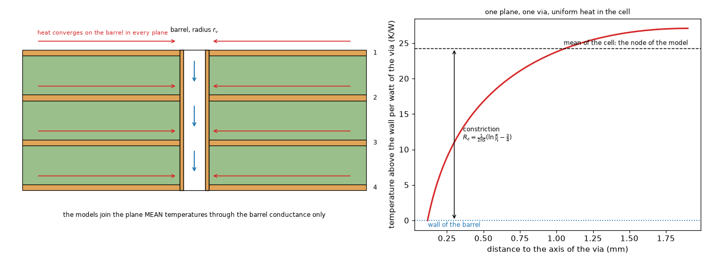
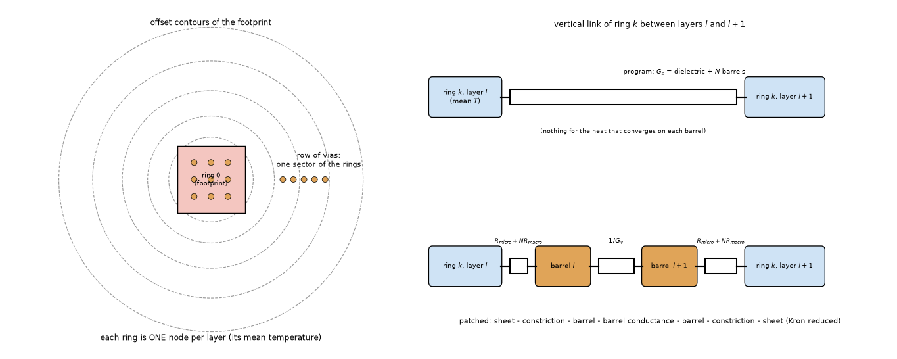
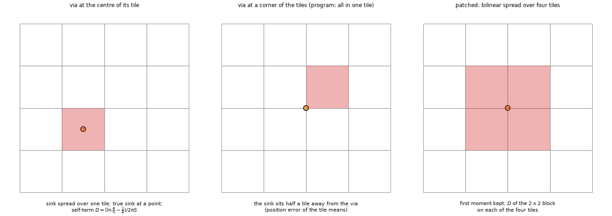
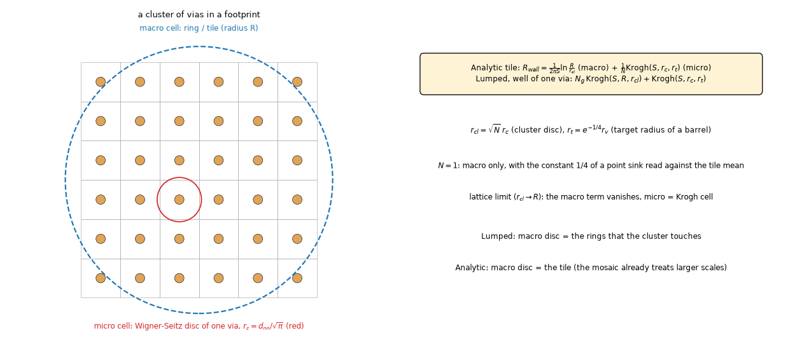
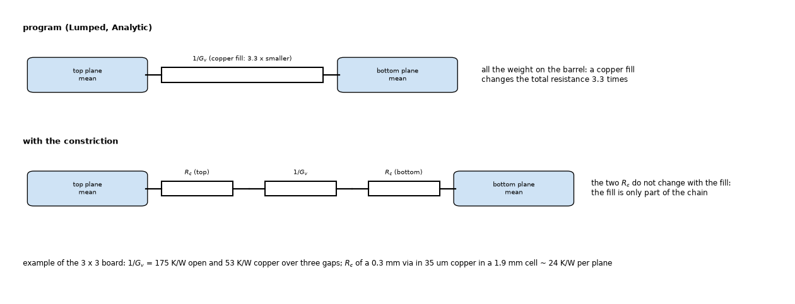
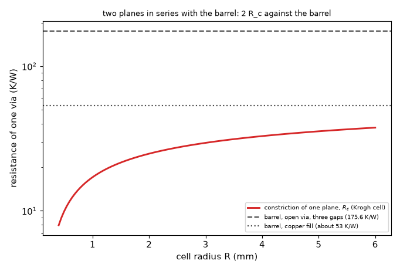
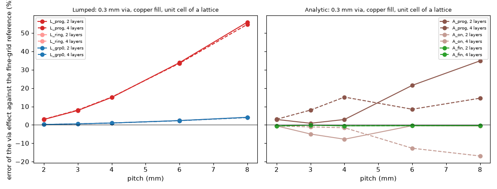
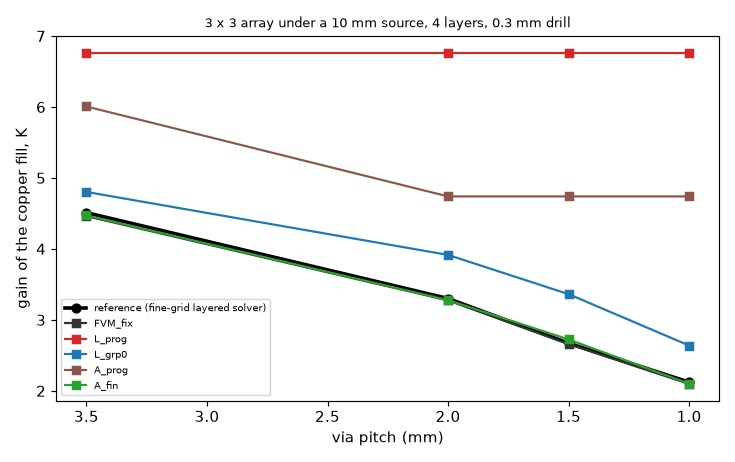
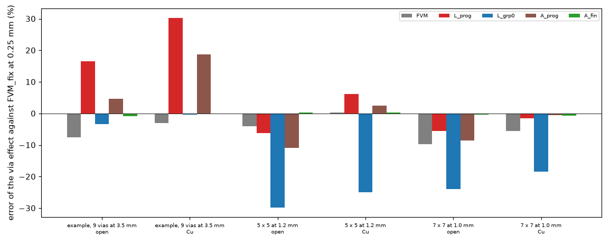

# Why the Lumped and Analytic models overstate vias, and how to fix it (investigation A6)

**Question.** The Lumped (ring network) and Analytic (cosine series with Green-function corrections) models give the copper fill of the vias of the example board a gain of -6.3 to -7.0 K where the FVM, FDM and 3D solid give -3.9 to -4.5 K (`research/via-fill` 4.5, 4.6): 35 to 52 % too much. Which part of their construction carries the error, how can it be removed or approximated, and what must stay as a known limit? (Roadmap item A6.)

**Answer in short.**

* **The cause is one missing resistance, and it is exact to name.** The heat that reaches a via converges on its barrel in every plane, and falling to the wall costs `(ln(R/r_t) - 3/4) / (2 pi S)` per plane (`R` the radius of the cell of the via, `r_t = e^(-1/4) r_v` its target radius, `S` the sheet conductance; the "Krogh cell"). Both models carry **area-mean** temperatures (a ring of the network, a tile of the mosaic) and join the planes through the barrel conductance `k_Cu A / d` alone: the constriction is not there. On the periodic unit cell of a via lattice the program's Lumped model is **identical to the closed form without the constriction** (error 1.8 to 60.6 %, the same digits, section 3.2) and the closed form **with** it lands within 0.1 to 4.5 % of an independent fine-grid reference. A copper fill lowers the barrel resistance (175.6 to about 53 K/W for three gaps) but not the constriction (about 24 K/W per plane for a 0.3 mm via in a 1.9 mm cell), which is why the gain of the fill is the symptom (figure 07).
* **The program's Analytic model is not free of the cause by luck of its tiles.** Its tile mosaic puts the sink uniformly over a tile of 2.5 to 5 mm and reads the tile mean: that carries an implicit, tile-dependent constriction (error from -14 to +173 % with the tile, `study_discretisation.py` 2). Two more causes are specific to it: the **position of the via in the tile** (up to +/-10 % of the effect for a lone via) and the **tile size against the via spacing** (a dense array of 1 mm pitch in 4 mm tiles: +36 %).
* **Fixes measured as in-memory copies** (`lib/lumped_patch.py`, `lib/analytic_patch.py`; nothing in `pcbthermal/` is edited):
  * **Lumped**: a well of the Krogh cell in every plane in series with the barrel (Kron reduced, no new unknown), with the cell of a via the Wigner-Seitz disc of its nearest neighbour and **the cluster of vias as one disc inside the ring** (the macro term). The copper-fill gain of the example board becomes 4.47 K (program 6.79, corrected FVM 4.20), the unit cell stays within 4.5 %, the 3 x 3 array board within 3 % (3.5 mm pitch). **Limits that stay**: a lone via or a row beside a source (the rings are isotherms around the footprint; errors 9 to 31 %, erratic with the ring count, section 5.1), and dense arrays of open barrels (-8 to -24 % of the effect, on the safe side).
  * **Analytic**: a self-term of the tile Green function (the sink read at the wall of the via, not at the tile mean), the barrel spread over the four nearest tiles with bilinear weights, and **tiles of 1 mm around vias** (hence about 0.1 to 0.3 s more). The copper-fill gain of the example board becomes 4.27 K, and the mean error of the via effect over the simple boards of each kind (arrays, pads, rows, lone vias, 2/4/6 layers) falls from 4.5 to 84 % to **0.3 to 2.3 %** (section 6.2); on the example board and its 5 x 5 and 7 x 7 arrays it is within **0.8 %**.
* **The old model should stay selectable for one release as a legacy option** with a warning (text in `INTEGRATION.md` 4) and the new one should be the default: the gain of a copper fill in the old models is overstated by 35 to 60 % and every temperature of a board with vias in the Lumped and Analytic models moves by 0.5 to 2 K (the example board: Lumped 83.5 to 85.5 degC, Analytic 84.7 to 85.2, FVM with the corrected via 85.2).
* **Not solved**: the peak term of the Lumped model (a sink in the middle of the footprint raises its rim, section 5.4: the patch tried is worse), the lone via and the row in the Lumped model, the Gerber boards (not run, section 8).

Everything is measured on copies in memory. What changes if it is adopted and the risks are in `INTEGRATION.md`; the text for the project documents is in `docs/`.

## 1. Situation and method

*Figure 1 (`figures/fig_01_via_section_and_constriction.png`): left, a four-plane board with a via: the heat converges on the barrel in every plane; right, the temperature of one plane around the via (closed form, 0.3 mm via in a 1.9 mm cell): the mean of the cell is the node of the model, the wall is where the barrel is, and the difference is the constriction.*

*Figure 2 (`figures/fig_02_lumped_rings_and_vias.png`): left, the rings (offset contours of the footprint) with a 3 x 3 array in the footprint and a row of vias in one sector; right, the vertical link of a ring in the program (dielectric plus N barrels) and in the patch (constriction, barrel, constriction, Kron reduced).*

*Figure 3 (`figures/fig_03_analytic_tiles_and_vias.png`): the mosaic of tiles: a via at a tile centre, at a corner (the program puts all of it in one tile) and spread over four tiles.*

*Figure 4 (`figures/fig_04_cells_clusters_macro_micro.png`): the micro cell of one via (Wigner-Seitz disc), the cluster as one larger disc and the macro cell of the ring or tile; the formula of the two resistances.*

*Figure 5 (`figures/fig_05_resistance_chains.png`): the chain of two planes and a via, program and patch.*

* **References, independent of the program** (`research/point-via-convergence/lib`, imported read-only; nothing of it imports `pcbthermal`): `sheets2d` (the layered model of the program on a 1/16 mm grid with every barrel drawn by area over its disc: this is the layered idealisation with the target radius `0.78 r_v` by construction) and `layered3d` (3D finite volumes with the barrel drawn: the floor of the idealisation, section 3.3). The numbers of the layered model (sheet conductances, dielectric conductance, films, barrels) come from the program's own network of a copy without vias.
* **Metric**: the via effect `E = T_max(no via) - T_max(via)` (K) and the copper-fill gain `G = E(Cu fill) - E(open)`. A negative error means a model that is hotter than the reference (the safe side).
* **Simple boards first** (maintainer's rule), each isolating one effect: the unit cell of a via lattice (only the constriction), the cluster in a cell (neighbours), a lone via and a row beside a source (lateral gradient, position against rings and tiles), 3 x 3 arrays under a source at 3.5 to 1 mm pitch on 2, 4 and 6 layers and 5 x 5 thermal pads (the dense limit); then the example board of the program and denser arrays on it.
* **Variants** (`lib/harness.py`, `VARIANTS`): `L_prog`, `A_prog` (the program); `L_ring` (Krogh well, cell = the ring's area per via), `L_grp0` (cell = nearest neighbour, plus the cluster macro term; **the Lumped proposal**), `L_grp` (the same with the macro radius capped at 0.75 fin lengths: a calibrated variant); `A_on` (self-term), `A_bil` (plus the bilinear spread), `A_fin` (plus 1 mm tiles around vias; **the Analytic proposal**); `FVM` (program, 0.5 mm) and `FVM_fix` (the corrected via treatment of `point-via-convergence`, 0.25 mm) for scale.
* Tests: `tests/test_via_constriction.py` (12 tests: the Krogh formula against numerical integration and its asymptote, the lossy cell against the infinite sheet, the Kron reduction against a series circuit, the peak excess formula, the patches in mode "off" bit by bit, restore of the program, unit-cell error, the row, the example-board gain, the dense array). With the proposed patches installed for a whole session, 173 tests of the program that run the five models (`test_via_fill`, `test_api`, `test_models_agree`, `test_profiles`, `test_stackup`, `test_layered_vs_3d`, `test_laminate`, `test_outline`, `test_model_io`, `test_component`, `test_heatsink_part`, `test_top_path`, `test_zone_union`, `test_templates`, `test_calculator_validation`, `test_inverse`) still pass.

## 2. What the literature says (and does not)

No source found gives a formula that fits these two models; the closed forms below are derived here and checked numerically (status L in `research/theory/BIBLIOGRAPHY.md` 17). The context:

* **The constriction of a circular source on a flux tube or half space** is a classical function of the relative source size, isoflux or isothermal (Yovanovich, Culham and Teertstra 1998, flux tubes; status S: the text was read, the equations did not survive the text extraction). **Fish (2017)**, chapter 7, sets up the axisymmetric boundary-value problem of a via cell (a via inside a substrate of the "equivalent pitch", uniform flux on the top, eqs. 58 to 68) and calls the effect **microspreading resistance**; his correlations (chapters 5 and 6) were not read. His result is the same statement as ours for a 3D cell: a model with an equivalent vertical conductivity of the via array is optimistic by the spreading in the planes.
* **Via-array compact models** found in searches (Politecnico di Milano 2009: a 1D lumped via model from axisymmetric finite differences with a dimensionless correlation for the constriction; Mondragon: analytical via models; Aalborg: barrel, copper layer and array terms; vendor notes that divide one via by the number of vias) were not obtained or contain no constriction formula (status N or S). The vendor rule "N vias in parallel: R/N" is exactly the model of the program, and the sources themselves warn that it excludes the spreading resistance of the copper.
* **The treatment of a point sink on a grid** (Peaceman's well, the singularity removal of Gjerde and others) is the idea behind the FVM fix of `point-via-convergence`; here it is the same step in the compact models: subtract the known logarithm and let the network carry the rest.
* **The target radius** `r_t = e^(-1/4) r_v` and its limits (-2 to +4 % against a 3D barrel) are from `point-via-convergence` section 3.3 and are used unchanged.

## 3. The mechanism

### 3.1 The constriction of a via in a plane

A sink disc of radius `a` at the centre of a circular cell of radius `R` with a uniform source of the same total heat and an insulated rim (the Wigner-Seitz cell of a lattice): the temperature above the wall is `T(r) = I (R^2 ln(r/a) - (r^2 - a^2)/2) / (2 pi S (R^2 - a^2))`; the mean over the cell minus the wall is

`R_c = (1 / (2 pi S)) [ b^4 ln b / (b^2 - 1)^2 - b^2 / (2 (b^2 - 1)) - 1/4 ]`, `b = R / a`, which tends to `(ln b - 3/4) / (2 pi S)` (`lib/constriction.krogh`, tested against numerical integration of the profile and the asymptote). For a 0.3 mm via (`a = 0.117 mm`) in 35 um copper (`1 / (2 pi S) = 11.8 K/W`) in a cell of 1.9 mm: 24 K/W per plane. With the loss of the plane to the ambient, `cell_with_loss` solves the same problem with `I0, I1, K0, K1` (checked: it tends to Krogh without loss and to the infinite sheet of `point-via-convergence/lib/sheets2d.lone_via_exact` for a big cell).

A point sink read against the response of a tile to its own uniform injection (the quantity the mosaic gets wrong) is `(ln(R/a) - 1/4) / (2 pi S)` (`constriction.tile_self`): the means of `ln r` over a disc (`ln R - 1/2`) and between two points of a disc (`ln R - 1/4`) give the constant. Checked against the program in section 6.3: with the via at the centre of its tile, the constant `1/4` reproduces the reference within 0.5 % at tile sizes of 0.5, 1.5 and 2.5 mm.

*Figure 7 (`figures/fig_07_constriction_against_barrel.png`): the constriction of one plane against the cell radius, next to the barrel resistance of three gaps (open, copper fill). The two constrictions of a two-plane via are comparable to the copper-filled barrel: that is why the model without them overstates the fill.*

### 3.2 The program equals the closed form without the constriction

`scripts/study_causes.py`, part 1: the unit cell of a lattice written as a one-cell network (one node per plane, the dielectric, the barrels; no program imported), without the constriction, against the Lumped model of the program, the reference and the same network with the Krogh wells (error of the via effect, percent):

| layers | drill mm | pitch mm | fill | E_ref K | closed form without constriction | Lumped program | closed form with Krogh |
| --: | --: | --: | :-- | --: | --: | --: | --: |
| 2 | 0.3 | 4 | open | 181.25 | +11.5 | +11.5 | +1.1 |
| 2 | 0.3 | 4 | Cu | 235.67 | +15.0 | +15.0 | +1.0 |
| 2 | 0.3 | 8 | Cu | 29.97 | +55.9 | +55.9 | +4.1 |
| 2 | 0.6 | 8 | Cu | 42.18 | +60.6 | +60.6 | +3.5 |
| 4 | 0.3 | 8 | Cu | 28.82 | +54.7 | +54.7 | +4.0 |
| 4 | 0.6 | 4 | Cu | 260.17 | +12.0 | +12.0 | +0.8 |

All 24 rows of the script agree between the first two columns to the digit: the Lumped model of the program has **no** cause of error on this board other than the missing constriction (one ring: no ring discretisation, no neighbours beyond the lattice). The error grows with the cell (3 % at 2 mm to 56 to 61 % at 8 mm) because `ln(R/r_t)` does.

### 3.3 The radius of the barrel and the floor of the layered idealisation

`study_causes.py`, part 2 (unit cell, closed form with the Krogh constriction; 3D solver with the barrel drawn at 1/16 mm):

| | range over 16 cases |
| :-- | --: |
| 3D against the layered reference (E) | -1.0 to +1.6 % |
| error of the closed form with `r_t = r_v` | +2.1 to +7.7 % |
| with `r_t = 0.78 r_v` | +0.8 to +4.5 % |
| with `r_t = 0.6 r_v` | -0.7 to +2.6 % |

The target radius of `point-via-convergence` is a good single constant here too (+0.8 to +4.5 %), and the layered reference is itself within 1.6 % of a 3D barrel on these boards: the errors below 2 % of this study are inside the floor of the idealisation.

## 4. The simple boards

### 4.1 The unit cell (only the constriction)

`scripts/study_unit_cell.py`: 2, 4 and 6 layers, drills 0.2 to 1 mm, pitches 2 to 8 mm, open and copper (about 100 cases). Mean and maximum absolute error of the via effect, percent:

| variant | mean | max |
| :-- | --: | --: |
| FVM, program, 0.5 mm | 4.9 | 22.8 |
| FVM_fix, 0.25 mm | 0.3 | 1.1 |
| **Lumped, program** | 17.0 | 60.6 |
| Lumped, Krogh well (`L_ring`) | 1.4 | 4.5 |
| Lumped, with cluster (`L_grp0`, `L_grp`) | 1.4 | 4.5 |
| **Analytic, program** | 6.9 | 34.9 |
| Analytic, self-term (`A_on`) | 5.0 | 22.0 |
| Analytic, plus spread (`A_bil`) | 1.2 | 5.5 |
| Analytic, plus 1 mm tiles (`A_fin`) | 0.4 | 1.3 |

*Figure 6 (`figures/fig_06_unit_cell_error_against_pitch.png`): the error of the via effect of the unit cell (0.3 mm, copper fill) against the pitch: the Lumped program grows to +56 % at 8 mm, the patch stays within 4.1 %; the Analytic program wanders (+3 to +35 %: the tile and the position), the patch with tiles of 1 mm stays on the axis.*

### 4.2 Neighbours: a cluster in a cell

`study_causes.py`, part 3: an n x n cluster of 0.3 mm copper-filled vias at 1 mm pitch in the middle of an 8 mm cell heated everywhere (2 layers, errors in percent; the other rows are in the script output):

| vias | E_ref K | L_prog | L_ring (cell of the ring) | L_nn (micro cell only) | **L_grp0** (micro + cluster) | A_prog | **A_fin** |
| --: | --: | --: | --: | --: | --: | --: | --: |
| 1 | 29.97 | +55.9 | +4.1 | +4.1 | +4.1 | +34.9 | -0.4 |
| 4 | 49.86 | +35.9 | +19.4 | +28.3 | +8.2 | +12.7 | -0.1 |
| 9 | 60.25 | +22.6 | +16.2 | +19.3 | +5.5 | +0.5 | +2.3 |
| 16 | 66.92 | +14.0 | +11.0 | +12.2 | +3.2 | +12.6 | -0.1 |

The micro cell alone (the Wigner-Seitz disc from the nearest neighbour) makes it worse (+28 %): a cluster of vias inside a larger cell is one **bigger sink** whose own constriction `ln(R/r_cl)/(2 pi S)` is the second, macro term; with it the Lumped model is within 8.2 %. The Analytic model with 1 mm tiles resolves the cluster by itself.

### 4.3 A lone via and a row beside a source

`study_arrays.py`, 30 mm board, 3 mm source, 0.3 and 0.6 mm vias at 2, 4 and 8 mm from the source centre, 2 and 4 layers; and a row of five at 1 mm pitch on a 16 mm board (summary over both drills, both fills, both layer counts; percent of E):

| board | variant | E mean | E max | gain mean | gain max |
| :-- | :-- | --: | --: | --: | --: |
| lone via | L_prog | 73.4 | 287.8 | 230.5 | 540.8 |
| lone via | L_grp0 | 15.1 | 31.4 | 11.3 | 19.0 |
| lone via | A_prog | 83.6 | 236.2 | 169.1 | 342.6 |
| lone via | A_fin | 2.3 | 4.0 | 1.9 | 3.1 |
| row of 5 | L_prog | 72.1 | 100.6 | 199.2 | 217.6 |
| row of 5 | L_ring | 34.6 | 50.2 | 86.1 | 98.9 |
| row of 5 | L_grp0 | 8.0 | 10.9 | 12.8 | 19.3 |
| row of 5 | A_prog | 36.3 | 56.8 | 105.4 | 139.1 |
| row of 5 | A_fin | 0.7 | 1.4 | 0.9 | 1.7 |

The row needs the **group** (the cluster across rings): the ring-by-ring cell leaves it 34.6 % off; the group of five as one disc makes it 8.0 %. The lone via stays 15 % off in the Lumped model (section 5.1).

### 4.4 Arrays under a source, thermal pads, stack-ups

`study_arrays.py`: 3 x 3 vias at 3.5, 2, 1.5, 1 mm pitch under a 10 mm source on a 21 mm board (2, 4, 6 layers; 0.3 and 0.6 mm); 3 x 3 and 5 x 5 at 1.2 and 0.8 mm under a 6 mm source on 20 mm (4 layers). Mean and maximum absolute error of E (open and copper fill) and of the copper-fill gain, percent:

| board | variant | E mean | E max | gain mean | gain max |
| :-- | :-- | --: | --: | --: | --: |
| array (48 cases) | FVM, program | 5.3 | 10.2 | 10.2 | 23.1 |
| array | L_prog | 26.8 | 69.7 | 134.1 | 257.5 |
| array | L_ring | 10.2 | 41.2 | 70.9 | 164.2 |
| array | L_grp0 | 11.0 | 24.1 | 18.3 | 30.4 |
| array | L_grp (cap 0.75) | 9.7 | 33.9 | 53.3 | 132.5 |
| array | A_prog | 11.0 | 42.3 | 44.8 | 135.6 |
| array | A_on | 7.9 | 18.9 | 18.3 | 64.9 |
| array | **A_fin** | 0.3 | 1.1 | 1.8 | 5.1 |
| pad (6 cases) | L_prog | 8.1 | 17.4 | 51.5 | 82.8 |
| pad | L_grp0 | 6.1 | 14.2 | 17.0 | 24.8 |
| pad | A_prog | 4.5 | 9.8 | 25.8 | 46.5 |
| pad | **A_fin** | 1.4 | 2.0 | 3.3 | 5.7 |

The stack-up (2, 4, 6 layers) changes the numbers by a few percent and not the picture (3 x 3, 3.5 mm, copper: L_prog +24.4 / +27.1 / +28.0 %, L_grp0 +1.7 / +2.6 / +2.9 %, A_fin -0.2 / -0.2 / -0.2 %; at 1 mm: L_prog +45.8 / +54.1 / +55.4 %, L_grp0 -16.6 / -13.0 / -10.9 %, A_fin -0.4 %).

The Lumped model with the cluster term **underestimates** the effect of dense arrays (the 3 x 3 at 1 mm: -13 % with copper, -21 % with open barrels), that is, it is on the safe side; the residual is the footprint-ring physics and is discussed in 5.4.

*Figure 8 (`figures/fig_08_copper_fill_gain_against_pitch.png`): the copper-fill gain of the 3 x 3 board (4 layers, 0.3 mm) against the pitch. The program (L_prog) gives 6.8 K at every pitch, the reference falls from 4.5 to 2.1 K; the patched Analytic model lies on the reference, the Lumped one above it.*

## 5. The other causes, separated

### 5.1 The ring structure of the Lumped model (cause d, e)

`study_discretisation.py` part 1 (error of the via effect, percent, 4 to 20 rings, raster cell 0.5 and 1 mm):

| board | model | range over the 8 settings |
| :-- | :-- | :-- |
| 3 x 3, 3.5 mm | program | +23.4 to +28.1 |
| 3 x 3, 3.5 mm | cluster | -1.1 to +3.6 |
| 3 x 3, 1 mm | program | +49.6 to +55.3 |
| 3 x 3, 1 mm | cluster | +5.1 to +9.8 |
| lone via, 4 mm | program | +20.0 to +113.0 |
| lone via, 4 mm | cluster | -41.3 to +15.5 |
| unit cell 8 mm | program | +55.9 (no dependence) |
| unit cell 8 mm | cluster | +4.1 (no dependence) |

The number of rings does not matter for vias under the footprint (ring 0); the raster cell moves the result by about 5 points. **A lone via is erratic**: where it falls in the rings changes the ring area per via, and the result swings from -41 to +16 % (the program swings from +20 to +113 %). A lone via is a non-axisymmetric sink in a model of isotherms around the footprint; the heat must travel tangentially in the ring to reach it and the ring-mean node has no resistance for that. Caps of the cell radius at the fin length (tried: `lone_cap` 0.5 to 1.5) do not remove it (-10 to -26 % at 2 to 4 mm). **This stays a documented limit** of the Lumped model; the useful statement is that its effect is small (E = 0.1 to 2 K on these boards).

### 5.2 The tiles of the Analytic model (cause d, e)

`study_discretisation.py` part 2 (error of the via effect, percent; tile 1.5, 2.5, 4 mm, 100 and 300 modes):

| board | model | tile 1.5 | tile 2.5 | tile 4.0 |
| :-- | :-- | --: | --: | --: |
| 3 x 3, 3.5 mm | program | +6.3 | +13.0 | +14.7 |
| 3 x 3, 3.5 mm | self-term + spread | -2.5 | -1.0 | -6.8 |
| 3 x 3, 1 mm | program | +0.7 | -4.0 | +36.3 |
| 3 x 3, 1 mm | self-term + spread | -4.9 | -6.6 | +11.6 |
| lone via, 4 mm | program | -4.7 | -13.5 | +173.1 |
| lone via, 4 mm | self-term + spread | -1.1 | +2.9 | +4.7 |

The program is right at some tile sizes only by cancellation (a lone via goes from -4.7 to +173 % with the tile). With the self-term the error falls with the tile and is below 3 % at tiles of 1 mm (`A_fin`). The number of modes (100 or 300) makes no difference: the truncation of the series (cause e) is not the problem; the Green function of the system is built from 64 modes in the program and the tile average removes the rest.

### 5.3 The position of the via in the tile (cause d)

`study_discretisation.py` part 3: a copper-filled 0.3 mm via at several places of an 8 mm cell (tiles of 2.67 mm, 2 layers); reference: the fine-grid solver with the via at that place (percent):

| position in the tile | program | self-term | self-term + spread |
| :-- | --: | --: | --: |
| (0.50, 0.50) centre | +34.9 | -0.6 | -0.6 |
| (0.12, 0.50) | +41.1 | +4.0 | -0.3 |
| (0.12, 0.12) corner | +46.2 | +7.8 | -1.3 |
| (0.75, 0.75) | +15.6 | -10.1 | -1.6 |
| (0.38, 0.38) | +37.1 | +6.6 | +6.6 |
| (0.25, 0.25) | +42.3 | +5.0 | -1.1 |

With the via at the centre of its tile the constant 1/4 is exact; the position moves the self-term result by +/-10 points because the mosaic puts the sink at the centre of the tile (the program too: its +15 to +46 % contains the same shift). The bilinear spread over the four nearest tiles keeps the position of the sink and brings it to within 1.6 % (the case at 0.38 of the tile, 1 mm from the board corner, 6.6 %, is near an edge where the mirror images matter).

### 5.4 The peak term of the Lumped model (cause f)

The Lumped model adds to the footprint mean a peak term from the heat that leaves the footprint laterally. A sink inside the footprint draws heat **inwards** and makes the rim hotter than the mean by `(1 - rho^2) I / (8 pi S)` (a disc of relative radius `rho` of the cluster; tested against the exact profile in `test_peak_excess_formula`). The study measured the error of the drop of the footprint **mean** and of the **peak** (3 x 3, copper fill; `study_discretisation.py` part 4):

| pitch mm | macro factor | error of the mean drop | error of the peak drop | peak with the inward-flow term |
| --: | --: | --: | --: | --: |
| 2.0 | 1.0 | -6.0 | -11.4 | -22.5 |
| 1.0 | 0.5 | +14.1 | +6.6 | -12.3 |
| 1.0 | 1.0 | -6.9 | -13.0 | -28.3 |

The footprint mean agrees within 7 % with the full macro term and the peak is lower than the mean error by a few points, so the peak is not the cause of the remaining dense-array error; **adding the inward-flow term makes the peak worse** (it removes more of the drop than the reference does, -22 to -28 %). The formula is right for the model (disc sink, uniform source) and the reference's peak is not at the rim of a disc: it is where the copper of the footprint is farthest from the vias and from the source layer's lateral flow. This candidate fix is **not proposed**; the observation stays that the error of the Lumped model on dense arrays is of the order of 10 to 25 % of E, under, and that the macro term at full strength is the principled one (the calibrated cap at 0.75 fin lengths halves the error of E, from 11.5 to 6.3 % over 22 boards, and worsens the gain of the fill, 18 to 53 %, so it is not proposed either).

## 6. The fixes, in the order tried

### 6.1 Lumped

| step | what | result |
| :-- | :-- | :-- |
| 1 | a Krogh well per plane, cell = area of the ring per via (`L_ring`) | unit cell 1.4 % mean; 3 x 3 array at 3.5 mm +0.9 to +2.6 %; dense arrays +24 % (gain +126 %); row +21 to +50 % |
| 2 | cell = Wigner-Seitz disc of the nearest neighbour (`L_nn`) | worse for clusters (+28 % for 4 vias) |
| 3 | + cluster as one disc inside the rings it touches (`L_grp0`) | dense 3 x 3: -13 %; row: -7 %; the gain of the fill +18 % mean |
| 4 | the macro radius capped at 0.75 fin lengths (`L_grp`) | E 6.3 % mean (11.5 % without), gain worse; not proposed |
| 5 | the inward-flow term in the peak | worse; not proposed |
| 6 | a cap on the cell of a lone via | no effect on the lone via |

Proposal: step 3. The wells of every plane and the Kron reduction of the barrel keep the matrix of the same size (no unknown added), and `GZ` becomes a dictionary of couplings between sheets (not only adjacent ones).

### 6.2 Analytic

| step | what | result (mean error of E over the cases of each kind) |
| :-- | :-- | :-- |
| 1 | self-term of the tile Green function (`A_on`) | unit cell 5.0 %; arrays 7.9 %; position and tile still matter |
| 2 | + bilinear spread of isolated vias (`A_bil`) | unit cell 1.2 %; arrays 5.1 % |
| 3 | + tiles of 1 mm around vias (`A_fin`) | unit cell 0.4 %, arrays 0.3 %, rows 0.7 %, lone vias 2.3 %, pads 1.4 % |

The refinement rests on a rule found by trying: a tile at most the spacing of the vias (0.75 of it was best, 1 mm is simpler and as good) because the self-term formula for a tile with n vias (`ln(R_tile/r_cl)` plus the Krogh cell of one via over n) is right only when the tile resolves the cluster. The guard: a via outside the footprint and closer than half a tile to it is not spread (the spread tiles would reach under the source: -35 % at 0.5 mm from the source edge in the first version, -5 % with the guard). The cost: the dense system has (active tiles x layers)^2 entries; 400 vias at 1 mm pitch: 0.31 s against 0.06 s, 252 MB peak; the patch coarsens the tiles above 1200 active tiles.

### 6.3 Checks of the self-term constants

With the via at the centre of the tile (an odd number of tiles across the 7.5 mm cell) the constant `c` of `D = (ln(R/a) - c)/(2 pi S)` was swept from -0.5 to 1.25 on tiles of 2.5, 1.5, 0.5 mm, 2 and 4 layers: the error of E is zero at `c = 0.25` for every tile and layer count (-0.5, -0.2, -0.0 % at c = 0.25), +2.8 % per 0.25 of `c`. The theory (1/4) and the numerics agree; `c = 3/4` (the Krogh constant) is right for the lattice (many vias in a tile) and wrong for one via by about 5 %.

## 7. The example board and denser arrays

`study_real_boards.py`: the 100 x 80 mm example board of the program (two parts, a heatsink, 9 vias of 0.3 mm at 3.5 mm under U1), and the same board with a 5 x 5 array at 1.2 mm and a 7 x 7 at 1.0 mm replacing them. Reference: `FVM_fix` at 0.25 mm (not independent of the layered idealisation: the best the program has; it is within 0.4 to 1 % of the fine-grid reference on the simple boards). Error of the via effect, percent:

| board | fill | E_ref K | FVM | L_prog | L_ring | **L_grp0** | A_prog | A_on | **A_fin** |
| :-- | :-- | --: | --: | --: | --: | --: | --: | --: | --: |
| 9 vias, 3.5 mm | open | 9.573 | -7.5 | +16.5 | -3.4 | -3.4 | +4.7 | -12.7 | -0.8 |
| 9 vias, 3.5 mm | Cu | 13.770 | -3.1 | +30.3 | -0.4 | -0.4 | +18.7 | -11.2 | 0.0 |
| 5 x 5, 1.2 mm | open | 18.241 | -3.9 | -6.2 | -13.4 | -29.8 | -11.0 | -26.6 | +0.4 |
| 5 x 5, 1.2 mm | Cu | 20.509 | +0.3 | +6.1 | -3.7 | -24.9 | +2.5 | -19.8 | +0.3 |
| 7 x 7, 1.0 mm | open | 21.323 | -9.8 | -5.6 | -9.1 | -23.9 | -8.5 | -21.4 | -0.4 |
| 7 x 7, 1.0 mm | Cu | 22.294 | -5.6 | -1.4 | -1.5 | -18.4 | -0.5 | -14.8 | -0.7 |

Gain of the copper fill (reference 4.198 / 2.268 / 0.971 K): L_prog +61.8 / +104.7 / +88.6 %, L_grp0 +6.5 / +14.0 / +102.3 %, A_prog +50.5 / +110.9 / +175.0 %, **A_fin +1.8 / -0.7 / -6.4 %**.

The program's Lumped and Analytic models on the example board give the gain of the copper fill 6.79 and 6.32 K and the corrected FVM 4.20 K; the patched ones 4.47 and 4.27 K (`study_via_fill_rows.py`; table in `INTEGRATION.md` 3). The Lumped model on the dense real arrays is 18 to 30 % under (safe side), which is the limit of section 5.4 (on these boards the heat comes from a footprint much larger than the cluster).

*Figure 9 (`figures/fig_09_real_board_errors.png`): the error of the via effect on the example board and its denser arrays for the FVM, the Lumped and Analytic models of the program and of the patches.*

## 8. Limits and what was not done

* **The Lumped model with vias outside the footprint**: a lone via 9 to 31 % off in a small effect, erratic with the ring count (5.1); rows well treated by the group term (8 to 11 %, up to 26 % with the calibrated cap). A warning in the results summary is proposed (`INTEGRATION.md` 4).
* **Dense arrays of open barrels in the Lumped model**: -8 to -24 % of the effect (the model is hotter), the safe side.
* **The Analytic model**: error 2 to 5 % for a lone via within a tile of the source where the program swings; no case above 6 % in the simple boards with the proposal. Many vias spread over a large board would use the coarsening (1200 tiles): not tested beyond 400 vias.
* **Transients**: the Lumped transient builds the same networks (the patch was run with the program's transient tests); the Analytic transient smears the vias and scales them to the steady maximum (it inherits the corrected steady value). No transient study was made.
* **Partial copper, drilled planes, blind and buried vias, via-in-pad with a heatsink**: not studied; the layered idealisation's own limits (`point-via-convergence` 3.3) apply.
* **Gerber boards of `research/gerber-models`**: **not run**: the boards are downloaded by `fetch_boards.py` (third-party files, not in the repository) and the environment of the research folders (gerbonara and others) was not installed here; the example board of the program is the real board of this study. A board with 100 to 400 vias from a Gerber file is the test to repeat (cost and the coarsening of tiles).
* The reference of the real-board table is the FVM with the corrected treatment, not an independent solver of the real board.
* The 3D floor was measured on the unit cell only; arrays were not repeated in 3D (the layered reference was checked against 3D for the array board in `point-via-convergence`).

## 9. Reproducing

From the repository root (`.venv/bin/python`): `research/lumped-analytic-vias/scripts/study_unit_cell.py` (20 s), `study_arrays.py` (about 8 minutes), `study_causes.py` (about 15 minutes, the 3D part), `study_discretisation.py` (5 minutes), `study_real_boards.py` (2 minutes), `study_via_fill_rows.py` (1 minute), then `make_diagrams.py` and `make_figures.py`. Tests: `.venv/bin/python -m pytest research/lumped-analytic-vias/tests`.

## What was read and what was not verified

* **Read in part**: Fish (2017), dissertation (abstract, contents, thermal constriction section, chapter 7 opening, eqs. 58 to 68; chapters 5 and 6 not read). Yovanovich, Culham and Teertstra (1998): the first pages as text; the equations were lost in the extraction and **were not read** (status S). The Aalborg thesis on PCB vias: downloaded and searched; no constriction formula (S).
* **Not obtained** (N): the Politecnico di Milano paper on the via constriction correlation, the Mondragon analytical via models, Lasance and Ellison's compact models (abstracts and search summaries only).
* **From the repository**: the target radius, the lattice constant, the references `sheets2d` and `layered3d` and the boards of `research/point-via-convergence` (reviewed there); the FVM fix used as reference of the real boards.
* **Derived here and checked numerically** (status L): the Krogh resistance (against numerical integration of the profile), the lossy cell (against Krogh without loss and the infinite sheet), the point sink against the tile mean (constant 1/4: swept in 6.3), the peak excess of a disc with a central sink (against the exact profile), the Kron reduction (against a series circuit).
* **Reproduced** with the independent solver: every table of sections 3 to 7 comes from a script of this folder and is printed by it; the whole set was run once on the final code (the first runs, with earlier versions of the variants, changed the Analytic proposal from the self-term alone to the 1 mm tiles and are not quoted except where said). The previous variants measured on the way (a cap at 0.75 fin lengths, the inward-flow peak term, a cap on the lone via, `tile_k`) are in the text with their numbers; their scratch scans are not versioned (the numbers in 5.4 and 6.1 are from those scans and from `study_discretisation.py` part 4).
* **Not verified**: the published numerical case of a via-array constriction was not reproduced (no source with an openly readable correlation was found); the agreement is against our own fine-grid solver and, for the layered idealisation, against the 3D solver (<= 1.6 %). The calibrated values (0.75 fin lengths, 1 mm tiles, `iso` 0.7, `guard` 0.5, coarsening at 1200 tiles) are assumed from the boards of this study, not derived.
* **Doubts of the author**: (1) the "macro" term of the Lumped model is a disc-in-a-disc approximation and a factor 0.3 to 0.8 of it fits better on some boards (oracle scan); I kept the theoretical value. (2) The 1 mm tile of the Analytic model works because 1 mm is smaller than every via spacing tested (0.8 to 3.5 mm); with vias at 0.5 mm pitch the cluster formula applies at tiles larger than the pitch: not tested. (3) The 3D floor is 1.6 % on the unit cell, but the real boards have drilled planes and thick copper pads where the idealisation is up to 4 to 27 % off (`point-via-convergence` 3.3).
