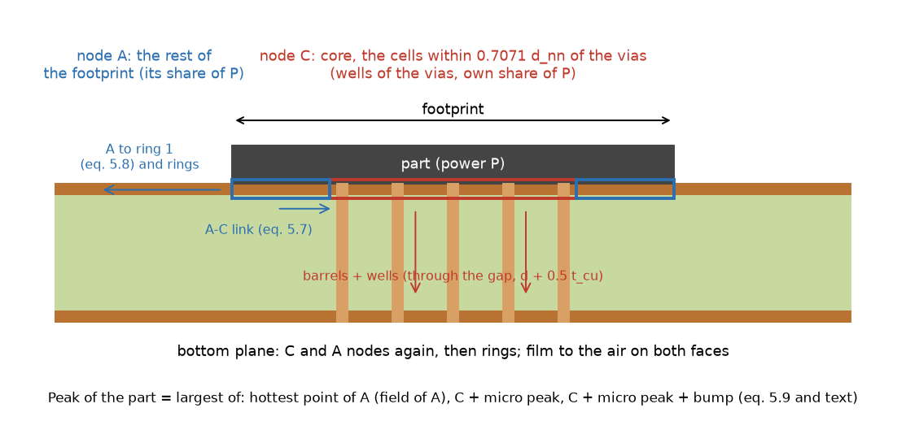
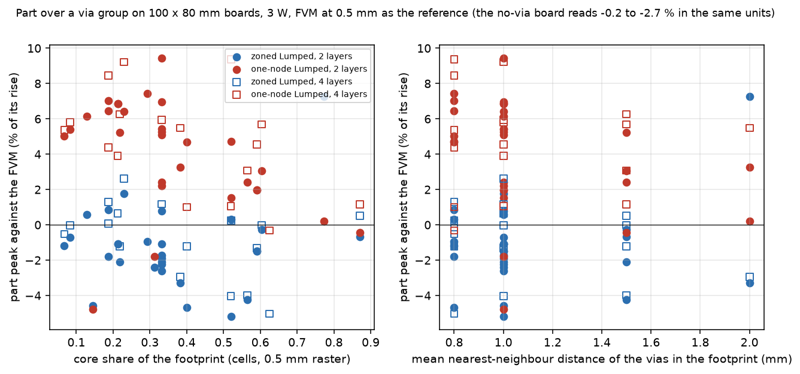
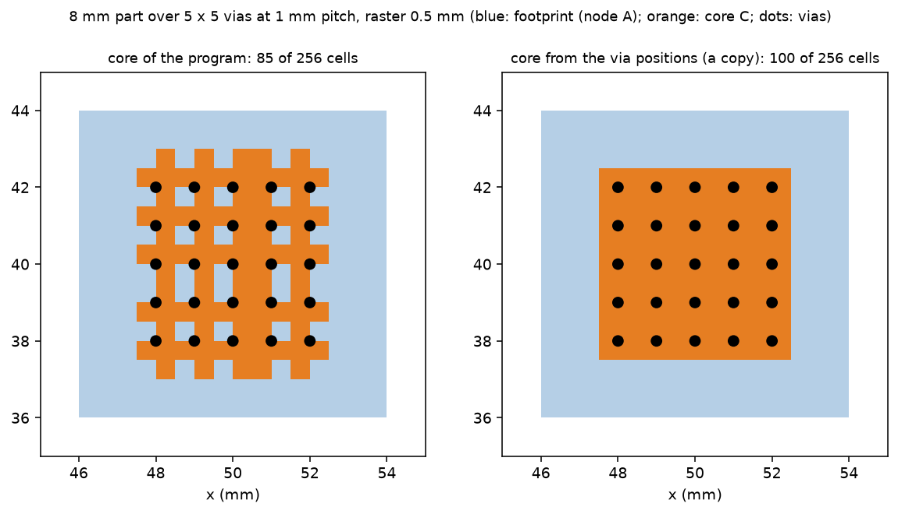

# The Lumped model over a dense group of thermal vias: definitions first, then the errors and their cause

Branch `research/lumped-dense-via-group`. Everything here is a synthetic board of ours; no measured board is used. The program (`pcbthermal/`, `tests/`, `examples/`, the documents) is untouched; the variants of section 6 are monkeypatches of module names inside a context manager (`lib/variants.py`), measured on a copy.

## 0. Summary

* **Definitions (section 2).** The Lumped part row is `max(painted field, heater_peak)`. For a zoned footprint `heater_peak = A + peak_extra`, and the painted field under the footprint is A over the rest and C over the core, so the painted maximum is the larger of the two NODES, never a peak. `peak_extra` is the largest of three candidates; on every board of the sweep except the thin-A case the candidate that wins is the hottest point of A (field of A), the micro peak of the rim of a via cell is 0.08 to 0.12 K and never decides. The FVM part row is the hottest CELL under the footprint (peak) and the coverage-weighted mean of the cells (mean). Peak against peak and mean against mean are compared everywhere below; a one-node Lumped reads +5.1 % on the peak and +0.7 % on the mean of the same board, so mixing the two changes a conclusion by 4 points.
* **Errors (sections 3 to 5).** Against the FVM at 0.5 mm on 100 x 80 mm boards (66 cases, 46 of them zoned by the program), the zoned Lumped reads the part peak -1.1 % on average (mean of the absolute value 1.9 %, largest 7.3 %) and the one-node Lumped +4.3 % (mean abs 4.6 %, largest 9.4 %) on the same 46 cases. About -1.0 point of the zoned error is NOT the via group: the Lumped reads the same part without vias -0.2 to -2.7 % low against the FVM (a spreading difference of the rings on a 100 x 80 mm board; on a 40 x 40 mm board the zoned model reads +0.0 to +2.7 % against the independent 3D solver). What is specific to the via group, the zoned peak minus the no-via baseline, has a mean absolute value of 1.5 points and a largest of 8.4 points.
* **Against the independent 3D reference (section 5)**, barrels drawn, 40 x 40 mm boards, ten cases: zoned Lumped peak -1.4 to +2.7 % of the rise (mean -0.6 to +2.5 %), the FVM at 0.25 mm -0.6 to +0.1 %, the program's 3D solid at 0.5 mm -0.5 to +0.4 %, the one-node Lumped +0.5 to +4.5 %. The FVM and the 3D solid read the independent reference a little cool (a constant -0.3 to -0.6 %, the same on boards without vias), so the 3D solver and the FVM are not far apart; the Lumped zoned difference from the FVM on these small boards is mostly the difference of the two references.
* **Cause of what is left (sections 4 and 6).** Two regimes, both about the SHAPE of the heat flow in the footprint and not about the vias themselves: (a) a footprint much larger than the array (core share 0.5 or less, pitch 1.5 mm or more, array inside the part) is read 3 to 5 % cool by the zones (the one-node model reads these +0.6 to +3.4 %); (b) an array that fills about three quarters of the footprint with its outer vias on the edge of the footprint (pitch 2.0 mm under a 7.5 to 8.1 mm part, core share 0.77) is read +5 to +8 % hot by the zones and ~0 by one node. Neither is a single-constant error: the factor on the A-C link that would remove the via-related error of each zoned case runs from 0.2 to 4.2 (section 6.2), `CORE_R` 0.5 to 1.0 trades one regime for the other, and a finer raster (0.25 mm) moves the whole level down by 2 points. One cause found and not decisive: the core mask of the program depends on which side of a cell edge each via falls (section 4.1, figure 2).
* **Proposal (INTEGRATION.md).** No change recommended to the zoned model for dense groups (pitch up to 1.0 mm: zoned peak error -1.1 % mean, largest 5.2 %, against +4.6 % and 9.4 % for one node). One small, measured option for regime (b), `MAX_CORE` 0.92 to 0.75, removes the +7.3 % worst case (largest absolute error of the 46 zoned cases 7.3 to 5.2 %, three cases change from zones to one node, `plate_vias` of the frozen numbers keeps its zones at share 0.625); it is a candidate for the 2.8.0 list, not a finding of a defect, and `0.6` would move that frozen record.
* **Not verified:** boards with a metal block, outlines, imported copper, several groups, groups that are not square arrays, the transient; the 3D reference is at 0.125 mm for two layers and 0.25 mm for four (about 0.3 % of the rise of discretisation); the FVM at 0.5 mm is itself 0.4 to 0.6 % below the independent 3D on the small boards.

*Figure 1 (`figures/fig_01_part_over_via_group_section.png`): section through a part over a via group: the nodes A and C of the zoned footprint, the A-C link, the barrels and wells, A to ring 1, and what the peak is made of.*

## 1. Question

For a part over a dense group of thermal vias the footprint is two nodes (the rest A and the core C, `docs/theory.md` 5.2) in the zonal Lumped model. How far is the Lumped part reading from the FVM (0.5 and 0.25 mm) and from an independent 3D reference, and where does a gap come from? The first step is the definition of the quantities compared (`docs/validation.md` 48: until `fix/lumped-part-readout` the part rows read the node, 10 % of the rise below the peak).

## 2. Definitions (study 1: `scripts/study_definitions.py`)

Board of the first study: 100 x 80 mm, a full 35 um plane on every layer, h 10 W/m2K on both faces (the board default of edge heat applies), 3 W on a square part of the top layer over a centred 5 x 5 array, 1.0 mm pitch, 0.3 mm drill (hollow, 25 um plating); ambient 25 degC. Temperatures in degC.

| Quantity | What it is | 2 layers, 8 mm part | 4 layers, 8 mm part |
| :-- | :-- | --: | --: |
| Lumped zoned, node A | mean temperature of the rest of the footprint (raster 0.5 mm: zones force it) | 77.505 | 65.245 |
| Lumped zoned, node C | mean temperature of the core | 77.641 | 63.797 |
| `peak_extra`: field of A | hottest point of A above node A (uniform generation of A, sink at C) | 2.671 | 1.130 |
| `peak_extra`: C + micro + bump - A | the core candidate | 0.329 (micro 0.079, bump 0.115) | -1.327 (micro 0.122) |
| `heater_peak` = A + largest candidate | the Lumped part peak | **80.176** | **66.375** |
| painted field, maximum under the footprint | the larger NODE (A or C), not a peak | 77.641 | 65.245 |
| painted field, footprint mean | coverage-weighted mean | **77.550** | **64.764** |
| `heater_stats` part row (t_max, t_mean) | max(painted, heater_peak) and the painted mean | 80.176 / 77.550 | 66.375 / 64.764 |
| Lumped one node: node = painted max = mean | the footprint node | 79.640 | 65.384 |
| Lumped one node: peak = node + `peak_extra` | the one-node peak | 84.681 (+5.041) | 68.659 (+3.275) |
| FVM 1.0 / 0.5 / 0.25 mm: hottest cell under the footprint (peak) | `heater_stats` t_max | 81.349 / 81.153 / 81.125 | 65.935 / 65.894 / 65.840 |
| FVM 1.0 / 0.5 / 0.25 mm: footprint mean | `heater_stats` t_mean | 78.696 / 78.365 / 78.274 | 65.262 / 64.943 / 64.851 |

* The Lumped board maximum (`SteadyResult.t_max`) equals the hottest part peak in every case (difference 0; `docs/validation.md` 48.3); the FVM board maximum equals its hottest part cell. The board maximum is therefore not a separate column below.
* The micro peak (rim of a via cell above the mean of the core) is 0.08 to 0.12 K here and the FVM, whose via is a mean-potential footprint of cells, cannot resolve it either; so the comparison of the peak is the comparison of the large-scale shape of the footprint field.
* The FVM peak is cell-dependent by 0.2 to 0.3 K between 1.0 and 0.25 mm (0.4 % of the rise), the mean by 0.4 K: the reference itself is converged to that level at 0.5 mm (error against 0.25 mm: +0.03 K and +0.09 K for two layers).
* A trap found on the way: for the one-node footprint the painted maximum under the part IS the node (79.640) and the mean (79.640); the peak is 5.0 K higher. The zoned footprint paints A and C, so its painted maximum is the larger of two means. Reading the Lumped part "from the map" gives the node (a mean) and was the 10 % of validation 48.
* The independent reference (`lib/ref3d.py`, `tests/helpers/layered3d.py`, barrels drawn, 40 x 40 mm board, h_side = 0, quadrant) reads its peak as the hottest cell of the surface under the part (`max_source`) and its mean as the mean of the heated cells (`mean_source`), the same definitions. On the board of the first study cut to 40 x 40 mm: 3D at 0.25 mm 145.507 / 142.706 degC (peak / mean), at 0.125 mm 145.124 / 142.416 (0.26 % of the 120.1 K rise per halving); FVM 0.25 mm 144.571 / 141.842; Lumped zoned 145.162 / 142.529; one node 149.02 / 144.062.

## 3. The sweep against the FVM at 0.5 mm (study 2: `scripts/study_sweep.py --grid`)

Errors in percent of the FVM rise of the part, peak with peak and mean with mean; E is the via effect (the same board without vias minus the board with vias, on the peak); the baseline column is the Lumped (one node, no vias) against the FVM on the board without vias. Base board: 2 layers, 100 x 80 mm, 8 mm part, 3 W, 5 x 5 at 1.0 mm, 0.3 mm drill, h 10, centred; one factor at a time, then the grid of layers 2 and 4, part 6 and 10 mm, 3, 5 and 8 vias a side, pitch 0.8, 1.0, 1.5, 2.0 mm (66 cases, 46 zoned by the program, 20 one node by the program's own rule).

| case | FVM rise K (part 1) | Lumped zoned peak % | zoned mean % | one-node peak % | one-node mean % | E fvm K | E zoned err % | E one-node err % | zoned? | no-via baseline % | zoned peak minus baseline % |
| :-- | --: | --: | --: | --: | --: | --: | --: | --: | :-- | --: | --: |
| base | 56.2 | -1.7 | -1.5 | +5.1 | +0.7 | 13.77 | 1.4 | -26.5 | [True] | -1.1 | -0.6 |
| n=3 | 59.5 | +0.6 | +0.3 | +6.2 | +0.5 | 10.43 | -10.9 | -42.7 | [True] | -1.1 | +1.7 |
| n=8 | 55.3 | -1.3 | -1.5 | -1.3 | -1.5 | 14.60 | -0.5 | -0.5 | [False] | -1.1 | -0.2 |
| pitch=0.8 | 55.6 | -0.9 | -1.1 | +7.4 | +1.1 | 14.28 | -1.8 | -34.5 | [True] | -1.1 | +0.2 |
| pitch=1.5 | 57.6 | +0.1 | -0.9 | +0.1 | -0.9 | 12.29 | -6.9 | -6.9 | [False] | -1.1 | +1.2 |
| pitch=2.0 | 59.3 | +7.3 | +6.0 | +0.2 | -0.6 | 10.60 | -48.0 | -8.5 | [True] | -1.1 | +8.4 |
| drill=0.6 | 54.4 | -1.9 | -1.5 | +5.4 | +0.9 | 15.50 | 1.5 | -24.1 | [True] | -1.1 | -0.8 |
| layers=4 | 40.9 | +1.2 | -0.4 | +5.9 | -0.1 | 16.82 | -4.6 | -16.2 | [True] | -0.5 | +1.7 |
| part=6.0 | 62.2 | -1.5 | -2.1 | +2.0 | +0.4 | 16.66 | 2.9 | -10.0 | [True] | -0.6 | -0.9 |
| part=10.0 | 51.7 | -1.1 | -1.4 | +6.9 | +0.2 | 11.51 | -3.9 | -39.6 | [True] | -1.6 | +0.5 |
| h=30.0 | 40.9 | -2.2 | -1.9 | +6.9 | +1.1 | 13.46 | 1.4 | -26.5 | [True] | -1.3 | -0.9 |
| h=100.0 | 30.3 | -2.6 | -1.8 | +9.4 | +2.0 | 12.48 | 2.0 | -27.3 | [True] | -1.3 | -1.4 |
| filled=True | 54.2 | -2.1 | -1.7 | +5.3 | +0.8 | 15.77 | 2.2 | -23.0 | [True] | -1.1 | -1.0 |
| offset 2,0 | 60.3 | -2.4 | -1.2 | -1.8 | -1.2 | 9.68 | 9.5 | 5.8 | [True] | -0.8 | -1.6 |
| offset 3,3 | 65.0 | -4.6 | -2.2 | -4.8 | -3.7 | 5.06 | 22.3 | 24.5 | [True] | -2.7 | -1.9 |
| second part 14 mm away | 75.8 | -1.1 / -3.2 | -0.3 / -2.5 | +2.4 / -3.2 | +1.3 / -2.5 | 13.34 | -3.4 | -23.1 | [True, False] | -1.4 / -3.4 | +0.3 / +0.2 |
| second part 9 mm away (touching) | 84.6 | +0.8 / -3.3 | -0.1 / -3.0 | +2.2 / -3.2 | +1.4 / -3.0 | 11.63 | -15.9 | -26.3 | [True, False] | -1.2 / -2.8 | +2.0 / -0.4 |
| 4L filled 8x8 @0.8 | 37.4 | -5.0 | -2.6 | -0.3 | -2.2 | 20.35 | 7.8 | -0.9 | [True] | -0.5 | -4.5 |

(The two-part rows give the first part's column first; the second part, 6 mm, 2 W, has no vias under it and reads -3.2 / -3.3 % peak with the same model as the no-via baseline, -3.4 / -2.8 %.)

### 3.1 Summary of the 66 cases (from `out/sweep.json`)

| Subset | cases | zoned peak: mean / mean abs / largest abs % | one-node peak: mean / mean abs / largest abs % | zoned mean: mean / largest abs % | one-node mean: mean / largest abs % | zoned minus no-via baseline: mean abs / largest | E error zoned / one node: mean abs / largest % |
| :-- | --: | --: | --: | --: | --: | --: | --: |
| zoned by the program | 46 | -1.11 / 1.89 / 7.3 | +4.28 / 4.60 / 9.4 | -0.86 / 6.0 | +0.10 / 3.8 | 1.50 / 8.4 | 7 / 48 and 24 / 50 |
| dense, d_nn at most 1.0 mm | 35 | -1.14 / 1.73 / 5.2 | +4.61 / 5.01 / 9.4 | -0.94 / 4.4 | +0.19 / 3.8 | 1.34 / 4.5 | 6 / 22 and 25 / 50 |
| sparser, d_nn 1.5 to 2.0 mm | 11 | -0.99 / 2.41 / 7.3 | +3.22 / 3.30 / 6.3 | -0.62 / 6.0 | -0.20 / 1.8 | 1.98 / 8.4 | 10 / 48 and 22 / 47 |
| core share 0.6 or less | 40 | -1.32 / 1.83 / 5.2 | +4.69 / 5.02 / 9.4 | -1.03 / 4.4 | +0.15 / 3.8 | 1.33 / 3.6 | 6 / 22 and 26 / 50 |
| core share above 0.6 | 6 | +0.30 / 2.29 / 7.3 | +1.56 / 1.81 / 5.7 | +0.25 / 6.0 | -0.27 / 2.2 | 2.59 / 8.4 | 12 / 48 and 10 / 20 |
| two layers | 27 | -1.37 / 2.16 / 7.3 | +4.14 / 4.66 / 9.4 | -1.15 / 6.0 | +0.15 / 3.7 | 1.49 / 8.4 | 8 / 48 and 28 / 50 |
| four layers | 17 | -0.81 / 1.58 / 5.0 | +4.73 / 4.77 / 9.4 | -0.50 / 2.9 | -0.14 / 3.8 | 1.55 / 4.5 | 4 / 9 and 18 / 34 |
| one node by the program's rule | 20 | -0.18 / 0.94 / 2.4 | the same model | -0.65 / 2.6 | the same | 0.84 / 2.6 | 3 / 11 |

* For the dense groups the zones are a clear gain: the one-node footprint reads the part peak 4.6 % hot on average (up to 9.4 %) and the via effect 25 % low on average (up to 50 %); the zones read -1.1 % and 6 %. This agrees in sign and size with `research/lumped-zones-adoption`.
* The one-node MEAN is good (+0.1 % on average) and its PEAK is the hot one: the 4.6 % of the one-node model is the `peak_extra` of the whole footprint (2.7 to 5.0 K on the first board), which assumes a uniform source with no sink in the middle; the zoned peak term is the field of A only, so it is smaller.
* The zoned peak is cooler than the FVM by 1.1 % on average, of which -1.0 point is the no-via baseline of the Lumped model against the FVM on a 100 x 80 mm board; the via-group-specific mean absolute error is 1.3 points for the dense groups.
* The mean of the zoned footprint is 0.9 % cool on average and up to 6.0 % hot (one case, section 3.2).

### 3.2 The largest via-specific errors of the zoned model (grid cases, sorted)

| case | core share | zoned peak % | no-via baseline % | zoned minus baseline % | one-node peak % |
| :-- | --: | --: | --: | --: | --: |
| grid L2 part10 n8 pitch1.0 | 0.52 | -5.2 | -1.6 | -3.6 | +1.5 |
| grid L4 part10 n8 pitch1.0 | 0.52 | -4.0 | -0.7 | -3.3 | +1.1 |
| grid L4 part10 n5 pitch1.5 | 0.56 | -4.0 | -0.7 | -3.3 | +3.1 |
| grid L2 part10 n8 pitch0.8 | 0.40 | -4.7 | -1.6 | -3.1 | +4.7 |
| grid L4 part6 n3 pitch1.0 | 0.23 | +2.6 | -0.2 | +2.8 | +9.2 |
| grid L2 part10 n5 pitch1.5 | 0.56 | -4.2 | -1.6 | -2.6 | +2.4 |
| grid L2 part6 n3 pitch1.0 | 0.23 | +1.8 | -0.6 | +2.3 | +6.4 |
| grid L4 part10 n3 pitch2.0 | 0.38 | -3.0 | -0.7 | -2.2 | +5.5 |

Plus the one-factor cases `pitch=2.0` (+7.3 % zoned peak, +8.4 over its baseline, one node +0.2 %) and `4L filled 8x8 @0.8` (-5.0 %, -4.5 over the baseline, one node -0.3 %).

*Figure 3 (`figures/fig_03_error_against_core_share_and_pitch.png`): the part-peak error of the zoned and the one-node Lumped against the core share and the via pitch, the 46 zoned cases of section 3; open squares are four-layer boards.*

### 3.3 The array reaching the edge of the footprint (study 6: `scripts/study_array_edge.py`)

A 5 x 5 array at pitch 2.0 mm (8 mm) and at 1.5 mm (6 mm) under a part of 5 to 11 mm, 2 layers, 3 W, FVM at 0.5 mm; the number of vias with their centre inside the footprint, the core share on the 0.5 mm raster, and the errors in percent of the FVM rise.

| pitch | part | vias in footprint | core share | zoned? | zoned peak % | zoned mean % | one-node peak % | one-node mean % | no-via baseline % | zoned peak minus baseline % |
| --: | --: | --: | --: | :-- | --: | --: | --: | --: | --: | --: |
| 2.0 | 5.0 | 9 | 0.97 | False | -0.1 | -0.9 | -0.1 | -0.9 | -0.5 | +0.4 |
| 2.0 | 6.0 | 9 | 0.94 | False | +0.4 | -0.6 | +0.4 | -0.6 | -0.6 | +1.0 |
| 2.0 | 7.0 | 9 | 0.78 | True | +1.7 | +1.0 | +2.1 | +0.7 | -0.9 | +2.6 |
| 2.0 | 7.5 | 9 | 0.77 | True | +5.0 | +4.0 | -0.6 | -1.2 | -1.7 | +6.7 |
| 2.0 | 7.9 | 9 | 0.77 | True | +6.6 | +5.7 | -0.4 | -0.9 | -1.7 | +8.4 |
| 2.0 | 8.0 | 16 | 0.77 | True | +7.3 | +6.0 | +0.2 | -0.6 | -1.1 | +8.4 |
| 2.0 | 8.1 | 25 | 0.77 | True | +8.0 | +6.4 | +0.9 | -0.2 | -0.4 | +8.4 |
| 2.0 | 8.5 | 25 | 0.95 | False | -3.0 | -2.9 | -3.0 | -2.9 | -2.1 | -0.9 |
| 2.0 | 9.0 | 25 | 0.95 | False | -2.2 | -2.4 | -2.2 | -2.4 | -1.5 | -0.7 |
| 2.0 | 10.0 | 25 | 0.94 | False | -1.3 | -2.0 | -1.3 | -2.0 | -1.6 | +0.3 |
| 2.0 | 11.0 | 25 | 0.84 | True | -2.2 | -2.8 | -0.1 | -1.4 | -1.6 | -0.6 |
| 1.5 | 5.0 | 9 | 0.81 | False | +2.6 | +1.6 | +2.6 | +1.6 | -0.5 | +3.1 |
| 1.5 | 6.0 | 16 | 0.78 | False | +1.9 | +1.2 | +1.9 | +1.2 | -0.6 | +2.4 |
| 1.5 | 7.0 | 25 | 0.91 | False | -1.2 | -1.4 | -1.2 | -1.4 | -0.9 | -0.4 |
| 1.5 | 7.5 | 25 | 0.84 | False | -0.7 | -1.2 | -0.7 | -1.2 | -1.7 | +1.0 |
| 1.5 | 7.9 | 25 | 0.84 | False | -0.4 | -1.1 | -0.4 | -1.1 | -1.7 | +1.3 |
| 1.5 | 8.0 | 25 | 0.84 | False | +0.1 | -0.9 | +0.1 | -0.9 | -1.1 | +1.2 |
| 1.5 | 8.1 | 25 | 0.84 | False | +0.8 | -0.5 | +0.8 | -0.5 | -0.4 | +1.2 |
| 1.5 | 8.5 | 25 | 0.70 | True | -5.0 | -4.9 | +0.6 | -0.8 | -2.1 | -2.9 |
| 1.5 | 9.0 | 25 | 0.70 | True | -3.8 | -3.3 | +1.3 | -0.6 | -1.5 | -2.3 |
| 1.5 | 10.0 | 25 | 0.56 | True | -4.2 | -3.2 | +2.4 | -0.4 | -1.6 | -2.6 |
| 1.5 | 11.0 | 25 | 0.47 | True | -4.5 | -3.1 | +3.4 | -0.2 | -1.6 | -2.9 |

* Pitch 2.0 mm, part 7.0 to 8.1 mm (the array is as large as the part, core share 0.77 to 0.78): the zones read +1.7 to +8.0 % and one node -0.6 to +2.1 %, and the error is smooth in the part size (not a cell effect). Above core share 0.92 on the fine grid the program already falls back to one node (parts 5 to 6 mm and 8.5 to 10 mm at pitch 2.0: no zones).
* Pitch 1.5 mm, part 8.5 to 11 mm (a footprint much larger than the array, core share 0.47 to 0.70): the zones read -3.8 to -5.0 % and one node +0.6 to +3.4 %.
* So the zoned and the one-node models each win in one regime and both stay within 5 % of the rise except the +5 to +8 % band of the array-fills-the-footprint case.

## 4. Where the gap comes from, node by node (studies 3 and 4: `scripts/study_nodes.py`, `scripts/study_layers.py`)

The FVM field at 0.5 mm (the Lumped raster of a zoned board) is averaged over the same core mask C and the same rest A that the Lumped uses; rises over the ambient in K.

| Case | A: Lumped / FVM | C: Lumped / FVM | A-C: Lumped / FVM | peak: Lumped / FVM (where) |
| :-- | --: | --: | --: | --: |
| 8 mm, 5x5 @1.0, 2L | 52.51 / 52.51 | 52.64 / 55.08 (-4.4 %) | -0.14 / -2.58 | 55.18 / 56.15 (a cell near the centre) |
| part 10, 8x8 @1.0, 2L | 44.88 / 46.09 (-2.6 %) | 45.41 / 48.30 (-6.0 %) | -0.53 / -2.21 | 48.28 / 50.92 |
| part 10, 8x8 @0.8, 2L | 46.20 / 46.74 | 46.59 / 49.16 (-5.2 %) | -0.40 / -2.42 | 48.03 / 50.39 |
| part 10, 5x5 @1.5, 4L | 36.10 / 36.42 | 36.68 / 37.86 (-3.1 %) | -0.59 / -1.44 | 37.41 / 38.96 |
| 8 mm, 5x5 @2.0, 2L | 50.06 / 51.35 | 59.46 / 54.88 (+8.3 %) | -9.40 / -3.53 | 63.63 (extra 13.56) / 59.32 |
| 4L filled 8x8 @0.8, 8 mm | 35.06 / 35.46 | 34.83 / 36.07 (-3.4 %) | +0.23 / -0.62 | 35.48 / 37.36 |
| part 6, 3x3 @1.0, 2L | 62.72 / 61.72 (+1.6 %) | 62.60 / 64.60 (-3.1 %) | +0.12 / -2.89 | 66.04 / 64.90 |
| 8 mm, offset 3,3, 2L | 56.24 / 58.33 (-3.6 %) | 56.89 / 53.31 (+6.7 %) | -0.65 / +5.02 | 62.00 / 64.98 |

* In the FVM the core is HOTTER than the rest of the footprint (C - A +0.6 to +2.9 K on the dense boards): the field in the footprint is a bell, hottest at the centre, and the vias do not flatten it. The Lumped puts C at or below A (C - A -0.2 to +0.6 K): the two zones are nearly one temperature. The A node is within -2.6 to +1.6 % and the C node is 3 to 6 % cool on the dense boards (+8.3 % and +6.7 % in the two regimes below).
* The part peak of the Lumped is the hottest point of A (`peak_extra`), the FVM's is at the centre (in the core): the 1 K of the first row is the centre of the bell, which the Lumped does not have.
* The step across the vias in C, top plane minus the lowest plane, is right: Lumped 7.52, 3.68, 7.41, 1.51, 8.81 K against FVM 7.81, 3.83, 7.51, 1.67, 8.97 K (study 4: 1 to 10 % low, the 1.5 K step the largest fraction); the heat out of the top and the bottom face equals the FVM's (1.47 and 1.44 W of 3 W). The error of C is the SAME on every layer under the core (four layers, part 10 mm at 1.5: C -1.18, -1.08, -1.08, -1.08 K; A -0.33, -0.60, -0.60, -0.59 K), so it is not made by the vias, the barrels or the wells: it is a column offset, the lateral spreading from the footprint into the board.
* Of that offset, about -0.8 K is the no-via baseline of the Lumped on this board (-1.1 % of the 70 K rise of the no-via part, study 2); the rest, -1 to -2 K on C, is the bell inside the footprint that two nodes cannot hold.
* The 2.0 mm pitch under an 8 mm part is the opposite sign: the core is 77 % of the footprint and the A node is a thin rim; C reads +8.3 % and A-C -9.4 K against -3.5 K in the FVM, and the field-of-A candidate adds 13.56 K above A. The A-C link of eq. 5.7 (log potentials of the real shapes) separates the two nodes by far more than the FVM does when A is a rim far from the vias.

### 4.1 The core mask depends on the cell that holds each via (figure 2)

*Figure 2 (`figures/fig_02_core_mask_on_the_raster.png`): the core of an 8 mm part over a 5 x 5 array at 1 mm pitch on the 0.5 mm raster; left the program's mask (cells within `CORE_R d_nn` of the CELL that holds each via, the via moved to the centre of its cell), right the mask from the via positions (copy, `lib/variants.py`).*

On a 0.5 mm raster with vias at 1 mm pitch on cell corners, `lumped._core_mask` moves every via to the centre of the cell that contains it (the upper right one of the four around a corner) and takes the cells within `0.7071 d_nn` of those cell centres: a lattice with holes and a lean to one side, 85 cells against 100 from the positions, and not symmetric about the board centre. It matters through the cell count (area of C) and the position of the boundary, and it moves with the raster; replacing it by the position-based mask (study 5) moves the sweep by -0.2 point on the mean and makes the worst case worse (10.6 %), so it is not what decides the error, but the mask is a quantisation noise of the same order as the other effects. Test: `test_true_core_is_symmetric`.

## 5. Against the independent 3D solver (study 8: `scripts/study_independent.py`)

40 x 40 mm boards, h_side = 0, part and array centred, quadrant solve by `tests/helpers/layered3d.py` with the barrels drawn (annulus of the plating or the whole disc, area shares sampled 16 x 16 per cell), the FR-4 isotropic at the program's through-plane conductivity, four slabs per gap. 3D cell 0.125 mm for two layers, 0.25 mm for four (a 0.125 mm four-layer solve of 410 000 unknowns was stopped after more than ten minutes; going from 0.25 to 0.125 mm moved the two-layer base case by 0.26 % of the rise). Peak with peak, mean with mean, percent of the 3D rise of the part; E is the via effect on the peak, error against the 3D E in percent.

| case | 3D rise K (peak / mean) | FVM 0.5 peak / mean % | FVM 0.25 peak / mean % | 3D solid 0.5 peak / mean % | Lumped zoned peak / mean % | one-node peak / mean % | zoned? | E (3D) K | E: FVM 0.25 / zoned / one-node % |
| :-- | --: | --: | --: | --: | --: | --: | :-- | --: | --: |
| 2L 8 mm, 5x5 @1.0 | 120.1 / 117.4 | -0.4 / -0.4 | -0.5 / -0.5 | -0.3 / -0.4 | +0.0 / +0.1 | +3.2 / +1.2 | True | 14.51 | -4 / +1 / -26 |
| 2L 6 mm, 3x3 @1.0 | 129.1 / 126.5 | -0.6 / -0.5 | -0.6 / -0.6 | +0.2 / -0.4 | +2.2 / +1.3 | +4.5 / +2.1 | True | 14.74 | -5 / -9 / -29 |
| 2L 10 mm, 8x8 @1.0 | 114.9 / 111.3 | -0.4 / -0.3 | -0.4 / -0.4 | -0.5 / -0.3 | -1.4 / -0.6 | +1.5 / +0.7 | True | 12.91 | -4 / +12 / -15 |
| 2L 10 mm, 5x5 @1.5 | 116.9 / 113.2 | -0.4 / -0.3 | -0.4 / -0.4 | -0.5 / -0.3 | -1.0 / -0.4 | +1.9 / +0.7 | True | 10.91 | -4 / +10 / -22 |
| 2L 8 mm, 5x5 @2.0 (array = part) | 123.4 / 118.1 | -0.5 / -0.4 | -0.5 / -0.4 | -0.3 / -0.3 | +2.7 / +2.5 | +0.5 / +0.3 | True | 11.26 | -5 / -28 / -5 |
| 2L 8 mm, 5x5 @1.0, drill 0.6 | 118.3 / 116.0 | -0.4 / -0.4 | -0.4 / -0.5 | -0.3 / -0.4 | -0.2 / +0.1 | +3.4 / +1.2 | True | 16.34 | -5 / +2 / -24 |
| 2L 8 mm, 5x5 @1.0, filled | 118.2 / 115.8 | -0.5 / -0.4 | -0.5 / -0.5 | -0.3 / -0.4 | -0.4 / -0.1 | +3.2 / +1.1 | True | 16.48 | -4 / +3 / -22 |
| 4L 8 mm, 8x8 @0.8 filled | 106.4 / 104.9 | +0.1 / +0.1 | +0.1 / +0.0 | +0.2 / +0.1 | -0.9 / -0.0 | +0.9 / +0.1 | True | 20.35 | -2 / +10 / +1 |

* The zoned Lumped reads the part peak within -1.4 to +2.7 % of the independent reference (the largest +2.7 % is the array that fills the footprint, pitch 2.0 mm, the same regime as section 3.3) and the mean within -0.6 to +2.5 %; the one-node Lumped +0.5 to +4.5 % on the peak, +0.1 to +2.1 % on the mean.
* The FVM (0.25 mm) is 0.3 to 0.6 % below the independent reference on every board, with and without vias; the program's 3D solid at 0.5 mm -0.5 to +0.4 %. So the FVM and the 3D solid agree with the independent solver to better than 1 % of the rise, and the Lumped zoned difference from the FVM on the large boards is of the same size as its baseline.
* The via effect E: the FVM reads it 0 to 5 % low; the zoned Lumped -28 to +16 % (the -28 % is the array-fills-footprint case at pitch 2.0), the one-node Lumped -29 to +1 %.

## 6. What moves the error, measured on a copy

### 6.1 Variants of the rules (study 5: `scripts/study_variants.py`, over the 66 cases of section 3, FVM references stored by study 2)

Zoned cases, part peak error against the FVM in percent of the rise; the last two columns over all 66 cases. (The program row is section 3.1.)

| variant | zoned cases: mean peak % | mean abs | max abs (case) | mean of part mean % | max abs mean % | all cases: mean abs peak | max abs peak | cases zoned / changed |
| :-- | --: | --: | --: | --: | --: | --: | --: | --: |
| program | -1.11 | 1.89 | 7.3 (pitch=2.0) | -0.86 | 6.0 | 1.61 | 7.3 | 46 / 0 |
| true core mask | -1.29 | 2.05 | 10.6 (pitch=2.0) | -0.32 | 9.2 | 1.72 | 10.6 | 46 / 0 |
| CORE_R 0.5 | -0.29 | 2.65 | 8.3 (grid L4 part6 n8 pitch1.0) | +0.25 | 6.6 | 2.58 | 8.3 | 64 / 18 |
| CORE_R 0.6 | -0.48 | 2.07 | 7.3 (pitch=2.0) | -0.21 | 6.0 | 1.75 | 7.3 | 49 / 3 |
| CORE_R 0.85 | -0.06 | 2.39 | 20.2 (pitch=2.0) | +0.13 | 19.7 | 1.90 | 20.2 | 44 / 2 |
| CORE_R 1.0 | -0.73 | 1.97 | 7.7 (grid L4 part6 n3 pitch1.5) | -0.45 | 4.3 | 1.64 | 7.7 | 40 / 6 |
| true mask, CORE_R 0.6 | -0.61 | 2.85 | 22.3 (grid L2 part10 n8 pitch2.0) | +0.40 | 22.9 | 2.33 | 22.3 | 49 / 3 |
| true mask, CORE_R 0.85 | -0.64 | 1.89 | 12.3 (pitch=2.0) | -0.33 | 11.4 | 1.61 | 12.3 | 41 / 5 |
| MAX_CORE 0.75 | -1.35 | 1.83 | 5.2 (grid L2 part10 n8 pitch1.0) | -1.03 | 4.4 | 1.51 | 5.2 | 43 / 3 |
| MAX_CORE 0.6 | -0.94 | 1.57 | 4.7 (grid L2 part10 n8 pitch0.8) | -0.69 | 2.8 | 1.48 | 5.7 | 33 / 13 |
| raster 0.25 mm | -2.98 | 3.33 | 7.9 (pitch=2.0) | -2.62 | 6.3 | 2.61 | 7.9 | 46 / 0 |
| raster 0.25 + true mask | -2.85 | 3.23 | 8.7 (pitch=2.0) | -2.30 | 7.1 | 2.54 | 8.7 | 46 / 0 |
| A-C link x0.5 | -2.48 | 2.59 | 6.7 (grid L2 part10 n8 pitch0.8) | -2.12 | 5.2 | 2.09 | 6.7 | 46 / 0 |
| A-C link x1.5 | +0.19 | 1.89 | 13.8 (pitch=2.0) | +0.25 | 11.6 | 1.60 | 13.8 | 46 / 0 |
| A-C link x2 | +1.38 | 2.29 | 20.2 (pitch=2.0) | +1.27 | 17.0 | 1.88 | 20.2 | 46 / 0 |

* A finer raster (0.25 mm, `ZONE_CELL_MM`) moves the level of the zoned Lumped DOWN by 1.9 points (mean -1.11 to -2.98 %) and makes it worse; the raster of 0.5 mm was chosen for the core to be a handful of cells (theory 5.2) and the result depends on it by that much.
* The core radius: 0.5 and 1.0 change which cases are zoned (18 and 6 change) and the worst case moves between 8.3 and 7.7 %; 0.85 makes the pitch-2.0 case +20.2 %. No value removes both regimes.
* `MAX_CORE` 0.75 is the only variant that lowers the worst case (7.3 to 5.2 %) without moving many cases (3 change to one node) and without moving the frozen `plate_vias` (core share 0.625, still zoned); 0.6 lowers the worst case to 4.7 %, changes 13 cases and takes `plate_vias` out of the zones (measured on the frozen board: hottest 136.523 to 140.417 degC, +3.9 K; with 0.75 the board is bit-identical, and the three example boards, one node by the 0.92 rule, do not change either). The gain in the mean absolute error is 0.06 point (0.75) and 0.32 point (0.6).
* The A-C link factor does not help: x0.5 reads 2.5 points cool, x1.5 and x2 are hot and the pitch-2.0 case goes to +13.8 and +20.2 %.

### 6.2 The factor on the A-C link that removes each case's via-related error (study 7: `scripts/study_link_scale.py`)

If the A-C link of eq. 5.7 were the cause there would be one factor. The factor that makes the zoned peak equal the no-via baseline of the same board runs from 0.20 to 4.19 over the 46 zoned cases (base 1.29, `pitch=2.0` 0.37, 8 x 8 vias under 10 mm at 1.0 mm 4.19, 4L filled 8x8 3.17; one case has none between 0.1 and 10); it is below 1 when the array is small against the footprint and above 1 when it fills the footprint (core share 0.5 or more), the sign flips with the shape. The link is not a single-constant defect; it carries the error of a two-node footprint that has no spatial profile.

## 7. Limits of this investigation

* Synthetic square arrays under square parts on uniform two- and four-layer boards, h 10 to 100 W/m2K, hollow and filled vias; not irregular groups, several groups in a footprint, metal blocks, outlines, imported copper, the time simulation, a part on the bottom layer.
* The reference of the sweep is the FVM (the same layered idealisation as the Lumped; the Lumped constants were fitted against it); the independent 3D reference is used on 40 x 40 mm boards only (10 cases) because the 3D solve of the 100 x 80 mm boards at 0.125 mm is too large for the direct solver; the 3D FR-4 is isotropic (the program's FVM has 0.9 W/mK in the plane, negligible next to the copper planes).
* The percentages are of the rise of the part over the ambient (about 30 to 130 K here); a different convection moves the baseline by about 0.2 to 0.5 point.
* The ring baseline of the Lumped on large boards (-0.2 to -2.7 % against the FVM without vias) is not examined here.

## 8. Files and reproduction

`lib/viastudy.py` (boards, runs, definitions), `lib/ref3d.py` (independent 3D with barrels), `lib/variants.py` (variants on a copy), `scripts/study_definitions.py`, `study_sweep.py [--grid]`, `study_nodes.py`, `study_layers.py`, `study_array_edge.py`, `study_variants.py`, `study_link_scale.py`, `study_independent.py [--only 4L --dx 0.25]`, `make_diagrams.py`, `make_figures.py`; `tests/test_lumped_dense_via_group.py` (5 tests). Run from the repository root with the program's `.venv`, ONE process at a time (the FVM at 0.5 mm of the four-layer boards takes a few GB); `out/` is git-ignored. Order: `study_sweep.py --grid` first (it writes `out/sweep.json` read by studies 5, 7 and the figure 3).

## What was read and what was not verified

* Read in full: `docs/theory.md` 5.2, `docs/validation.md` 48, the Lumped code paths named in section 2 (`_zone_network`, `_ZonePeak`, `_core_mask`, `solve_steady`, `analysis.heater_stats`). The README of `research/lumped-zones-adoption` was read in its headings and the 3D barrel study (its numbers were not reproduced here: other boards); `research/via-contact-geometry` was not re-read in full (the barrel length 0.5 t_cu is the program's and is the same in the independent reference's drawn barrels).
* Not obtained / not used: no published numerical case is reproduced here (the question is a comparison of the program's models with an independent solver; the literature check of the via constriction is that of `research/lumped-zones-adoption`).
* Reproduced: the independent 3D reference is tested against the FVM without vias (within 1.5 %) and by the barrel area (annulus and disc to 1 %); its own energy-balance test is that of `tests/helpers/layered3d.py` (`research/effective-conductivity`).
* Not verified: the zone-width explanation of the +8 % case beyond the node table (no experiment varied the A-C geometry independently); the cause of the -1 % baseline of the Lumped on a 100 x 80 mm board; the four-layer references at 0.125 mm; the review (this folder has not been reviewed).
