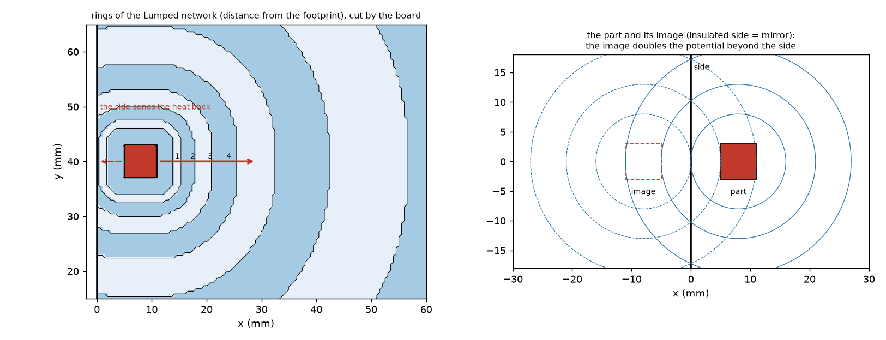
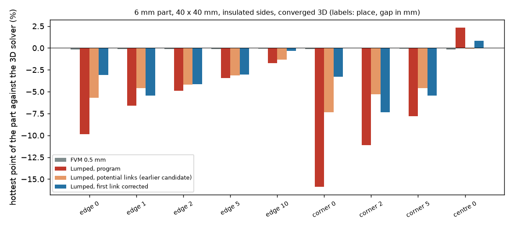

# The Lumped model near a board edge: the first link (A27), re-measured and a correction on a copy

Branch `research/lumped-edge-link`. Nothing in `pcbthermal/`, `tests/`, `examples/` or the project documents was edited: every variant is a copy of `pcbthermal/lumped.py` made in memory
(`lib/variants.py`) and installed where `pcbthermal.api` calls the Lumped model. Synthetic boards of ours only.

## 0. Summary

* **The deficit stands after the part read-out fix** (`docs/validation.md` 48). For one part the Lumped part row equals the board maximum (difference 0 on every case run), which already contained the peak term, so
  "peak with peak" is the same number the earlier studies called the hottest node; the footprint mean never used the peak term. Re-measured on 432 new cases (3.1): the hottest point of a part reads **-9.4 % of the rise on average
  (worst -22.4 %)**, -11.0 % within max(1 side, 5 mm) of a side and -3.9 % farther away; the footprint mean -7.9 %.
* **Against an independent converged 3D solver** (`tests/helpers/layered3d.py`, 40 x 40 mm, insulated sides): FVM -0.1 to -0.2 % (so the FVM is a good reference), Lumped -9.9 % (part touching a side), -15.9 % (corner),
  -3.5 % (5 mm gap), -1.7 % (10 mm gap) (3.2).
* **Mechanism** (3.3, code read in full): the rings are cut by the board correctly (cell counts, contour lengths and the edge film are those of the cells that exist). What goes wrong is **the link from the footprint to ring 1**: it is
  `ln(r_boundary / r_mean) / (2 pi S)` of the part alone, times the interior factor, plus half of ring 1 as a plain strip `t / (S L)`. It carries two assumptions that a side breaks: the heat leaves through the whole circle
  (a part on a side sends it through half of it) and ring 1 is a clean annulus around the part (it is a clipped one with the image of the side in it). Dividing the potential by the open fraction of ring 1 (variant `expo`) fixes only a part
  touching a side (-11.3 to -7.2 %), nothing at a gap, where ring 1 is not clipped yet the deficit is -7.5 %: the deficit at a gap comes from the **ring-1 mean of the total potential with the image of the side**, not from the geometry of the footprint.
* **Correction on a copy (`first`, `first:zone`)**: replace in `_one_node_network` the half-ring term of the first link by `(U1 - phi_boundary) / (2 pi S)`, with `U1` the mean over the cells of ring 1 of the log potential of the
  footprint and its eight mirror images in the sides of the board (the one tiling), and the same in the zone model's A to ring 1 link. Hottest point over the 432 cases: **-9.4 to -2.5 % on average, worst cool -22.4 to -8.6 %**, far from every side
  -3.1 to 0.0 %; cost 0.0 to 0.6 s per part (ring 1 only, at most 900 source cells); a part over a dense via group (zone model) 3 mm from a side -11.0 to -8.8 %, 12 mm -8.0 to -5.0 %, centred -1.7 to -0.3 % (3.5).
* **What the correction does not do**: a residual of 3 to 7 % cool remains at gaps of 1 to 5 mm and at a corner 2 to 5 mm (the ring-to-ring links, 3.3); a **cooled side (200 W/m2K) reads up to +9.4 % hot** on 5 of 432 cases (10 mm part
  in a corner 0.5 to 1 mm from both sides): the image is that of an insulated side (3.4); the mean over the footprint stays 4 to 8 % cool at a corner gap of 1 to 5 mm.
* **Frozen numbers move**: 51 of 51 Lumped records (17 boards, three cells) by -0.47 to +3.13 % of the rise (mean +0.67 %, mostly hot), the largest `part_across_outline` (equivalent-rectangle path) +3.1 %, and 14 times to 63 % by
  -19.9 to +1.1 % (3.6). All 51 records are already in `tests/regression/data/pending/lumped-part-readout.json`: the combined pending file is described in `INTEGRATION.md`.
* **Review (section 4, GO for the adoption)**: every number re-run reproduced to the printed digit; three statements of this summary were incomplete and are corrected there: (a) most of the gain at a gap and in the interior is the
  change of the chain of the first link (strip replaced by the potential difference from the boundary cells to the ring-1 mean), not the images, which matter only for a part touching a side or a corner (a part 29 mm from every side:
  -4.8 to +1.4 % with the images, +1.2 % without); (b) on the 17 frozen boards the correction does NOT make the Lumped closer to the FVM on average (mean absolute error of the part peaks 5.04 to 5.17 % at 1 mm), because an interior
  part of the example board read right only by a cancellation; (c) the times to 63 % against a converged FVM step response are fixed near an edge (+20 to -5 %, corner +43 to +2 %) and become 5 to 9 % short in the interior.

### 1.1 Drawings

*Figure 1 (`figures/fig_01_rings_near_a_side.png`, `scripts/make_diagrams.py`): left, the ring index of the program's own construction (100 x 80 mm, 0.5 mm raster, 6 mm part, 5 mm from the left side): the rings are cut by the board and the heat
goes away from the side; right, the same part on an unbounded sheet with its mirror image (the insulated side): the potential beyond the side is that of two sources.*

## 1. Question

Item A27 of `docs/versions.md` 'Planned: 2.8.0': the Lumped model reads a part near a side or a corner too cool (4 to 15 %, -7.4 % on the sweep, `docs/validation.md` 35). The part read-out fix of 48 made the part rows read the part's own peak,
so the earlier numbers had to be taken again. Questions: (1) how large is the deficit now, against the FVM and against a converged independent 3D; (2) where in `lumped.py` is it made; (3) is there a correction of the first link
that removes it without moving the centred boards, what does it do to the zoned footprint, and what do the 17 frozen boards do; (4) adopt or only re-measure the warning.

## 2. Method

Boards: full copper 35 um, 1.6 mm FR-4 (0.3 / 0.9 W/mK), faces 10 and 15 W/m2K, 1 W in a square source on layer 1 (`lib/boards.py`). FVM at 0.5 mm as the reference (cell-centred, cached in the git-ignored `out/`), the Lumped at 0.5 mm with the
variants of `lib/variants.py`. The part rows are read through `analysis.heater_stats` as the Results table does. Error = Lumped / FVM - 1 in % of the rise, on the hottest point of the part and on the footprint mean.

| study | script | cases |
| :-- | :-- | :-- |
| re-measure and variants | `scripts/study_remeasure.py`, `scripts/summarise.py` | 432: boards 60 x 40 and 100 x 80 mm, parts 3, 6, 10 mm, gap 0, 0.5, 1, 2, 5, 10, 25 mm from a side (centred along it) or a corner, edge film 0, 10, 50, 200 W/m2K, 2 layers (and 4 layers for the 6 mm part) |
| independent 3D | `scripts/study_reference3d.py`, `lib/ref3d.py` | 40 x 40 mm, 6 mm part, insulated sides, isotropic FR-4 0.3 W/mK in the program too: side (half board by symmetry) gap 0, 1, 2, 5, 10; corner gap 0, 2, 5; centred |
| zoned footprint | `scripts/study_zoned_edge.py` | 100 x 80 mm, 8 mm part, 5 x 5 vias at 1 mm pitch (board of `research/lumped-dense-via-group`), gap 3, 6, 12, 25 mm and centred |
| frozen numbers | `scripts/study_frozen_effect.py` | 17 boards x 2, 1, 0.5 mm, steady records and times to 63 % of the Lumped, a variant against the program in one process |

## 3. Results

### 3.1 The deficit, re-measured (`out/summary.txt`, `out/summary_first.txt`)

Hottest point of the part, mean over the cases [worst cool, worst hot], % of the rise (program = the tree as it is):

| group | n | program | `first` (= `first:zone` on one-node footprints) |
| :-- | --: | --: | --: |
| all | 432 | -9.4 [-22.4, +1.6] | -2.5 [-8.6, +9.4] |
| side, gap 0 / 1 / 5 / 10 / 25 mm | 32 each | -11.3 / -8.4 / -6.3 / -4.5 / -1.6 | -1.5 / -2.8 / -2.8 / -1.7 / +0.7 |
| corner, gap 0 / 1 / 5 / 10 / 25 mm | 32 (25 mm: 16) | -18.8 / -13.8 / -9.5 / -6.7 / -3.9 | -1.3 / -3.5 / -5.1 / -3.1 / +0.2 |
| edge film 0 / 10 / 50 / 200 | 108 each | -9.9 / -9.8 / -9.3 / -8.8 | -3.4 / -3.2 / -2.3 / -0.9 |
| part 3 / 6 / 10 mm | 108 / 216 / 108 | -9.0 / -9.2 / -10.3 | -3.0 / -2.0 / -3.0 |
| 60 x 40, 2 / 4 layers; 100 x 80, 2 / 4 layers | 156 / 52 / 168 / 56 | -9.5 / -8.0 / -10.1 / -8.9 | -3.8 / -1.9 / -2.2 / -0.2 |
| far from every side (gap 10 mm or more on 100 mm, 25 mm) | 64 | -3.1 [-6.7, +1.6] | 0.0 [-4.0, +1.9] |

Footprint mean (mean with mean): all cases -7.9 [-13.8, +1.7] against -3.5 [-10.6, +3.8]; corner gap 1 to 5 mm stays -6 to -8 % with the correction (the mean is the node of the footprint).

Counts: beyond -8 % 262 of 432 (program) against 6 (`first`); beyond -5 % 353 against 69; hot beyond +3 % 0 against 5. The grid is weighted to the edge (336 of the 432 cases are within max(1 side, 5 mm) of a side; the
flagged cases read -11.0 % on average with the program, -3.0 % with the correction; the others -3.9 % and -0.7 %). Single-part boards on 100 x 80 mm, 6 mm, edge film 10 to 200 (42 cases): -9.9 against -1.6 %.
The part row equals the board maximum of the Lumped run for one part (difference 0 on the cases of 3.3), so the numbers of `docs/validation.md` 35 keep their meaning; the level differs from section 35 (-6.6 %) because the grid is not the same (3 mm parts, 60 x 40 mm, `h_side` 0, 25 mm gaps, many more gaps near the side).

### 3.2 Against the independent converged 3D (`out/reference3d.json`)

`tests/helpers/layered3d.py` (imports nothing of the program), 6 mm part, 40 x 40 mm, 2 layers, 4 sub-slabs in the gap, the film also under the part, insulated sides; the program run with isotropic FR-4 0.3 W/mK and `h_side` 0.
A part centred along a side uses the symmetry plane (half board). Peaks at 0.5 / 0.25 mm (and 0.125 mm for the side cases gap 0, 1, 2 mm): gap 0 55.1444 / 55.1532 / 55.1554 K, gap 1 51.2188 / 51.2222 / 51.2219 K, gap 2 49.0499 / 49.0543 / 49.0541 K:
the peak is converged to 0.01 % at 0.25 mm. The Richardson value of the two cells is used (the 0.125 mm run of the edge cases peaked at 4.9 GB resident, above the 3 GB kept for the others, and was stopped after gap 2 and the 0.5 / 0.25 mm of gap 5).
Hottest point of the part, % of the converged 3D peak (`fig_03`):

| case | 3D peak K | FVM 0.5 mm | Lumped, program | img (earlier) | pot (earlier) | `first` |
| :-- | --: | --: | --: | --: | --: | --: |
| side, gap 0 | 55.16 | -0.2 | -9.9 | -4.8 | -5.7 | -3.1 |
| side, gap 1 | 51.23 | -0.1 | -6.6 | -5.2 | -4.6 | -5.4 |
| side, gap 2 | 49.06 | -0.1 | -4.9 | -4.1 | -4.2 | -4.2 |
| side, gap 5 | 45.58 | -0.1 | -3.5 | -3.2 | -3.1 | -3.0 |
| side, gap 10 | 43.05 | -0.1 | -1.7 | -1.6 | -1.3 | -0.3 |
| corner, gap 0 | 77.24 | -0.2 | -15.9 | -3.1 | -7.4 | -3.3 |
| corner, gap 2 | 59.85 | 0.0 | -11.1 | -8.3 | -5.3 | -7.4 |
| corner, gap 5 | 50.34 | -0.1 | -7.8 | -6.9 | -4.6 | -5.4 |
| centred | 42.03 | -0.2 | +2.3 | +2.3 | -0.1 | +0.8 |

*Figure 3 (`figures/fig_03_against_3d.png`, `scripts/make_figures.py`): hottest point of the part against the converged 3D solver, 40 x 40 mm board.*

The FVM reference is right to 0.2 % wherever the independent solver was run, so the deficit is the Lumped's. On this small board the centred part already reads +2.3 % hot with the program and the earlier `pot` candidate is the closest
overall: the residual of `first` at a gap of 1 to 5 mm and in a corner (3 to 7 %) is the ring-to-ring links, which `first` leaves as they are.

### 3.3 The mechanism (`lib/variants.py`, `pcbthermal/lumped.py` `_one_node_network`, `ring_edges`, `_footprint_potentials`)

* The rings are offset contours of the footprint on the raster of the board: `dist = edt(~foot)`, `idx = searchsorted(edges, dist)`. A cell that does not exist is not in any ring, so the ring areas `cnt`, the contour length
  `length = cnt * cell / thickness` and the edge film `g_side` summed per ring are those of the board. The links from ring k to k+1 for k >= 1 are `0.5 t_k / (S_k L_k) + 0.5 t_{k+1} / (S_{k+1} L_{k+1})` with the clipped length. The
  edge film acts on the rings that contain the border cells.
* The link from the footprint to ring 1 is `f_r (phi_boundary - phi_mean) / (2 pi S_0) + 0.5 t_1 / (S_1 L_1)`: the logarithmic potential of the footprint ALONE (`_footprint_potentials`, no image) over a full circle, plus half of ring 1 as a strip.
* **The part touching a side (ω)**: ring 1 is cut, the heat leaves through half the circle; dividing the potential term by the open fraction ω of ring 1 (area of ring 1 on the board over the area of the same ring on an unbounded plane) is exact
  for the half plane (ω = 1/2). Variant `expo` (with the peak term divided too): side gap 0 -11.3 to -7.2 %, corner gap 0 -18.8 to -11.7 %, **nothing at a gap > 0** (ω = 1 as soon as ring 1, at most one equivalent radius wide, clears the side: gap 5 mm -6.3 % with both, 10 mm and farther no change).
  A part is not made right by the geometry of its footprint alone.
* **The gap**: 100 x 80 mm, 6 mm part, edge film 10, hottest point, % against the FVM: program -7.5 (gap 5) / -6.5 (gap 10); the link of the first ring alone with the ring-1 mean potential of part and images (`pot_first`) -3.3 / -2.4; the same
  without the images (`pot_first:0`, ρ = 0) -4.0 / -2.6; the ring-to-ring links alone (`pot_rings`) -6.2 / -6.2, without images -18.9 / -13.4; centred part: program -0.6, `pot_first` +1.5, `pot_rings` -1.9. So at a gap most of the gain of the first link is
  the replacement of the strip `t / (S L)` of ring 1 by the potential difference to the ring-1 mean (a mean over the annulus, not a mean distance), and the image adds the rest; the image alone (`img`, only the footprint potentials) lifts the part on a side (-11.3 to -4.0 %) and does almost nothing from a gap of 2 mm (-7.7 to -6.2 %).
* **The raised centred reading**: `pot_first` reads a centred 6 mm part +1.5 % hot against the FVM (program -0.6 %): the program's interior factor and first-ring cap were fitted with its own links, so a different first link shifts the centre by about 2 points. On the 17 frozen boards it moves the records by +0.4 to +1.7 %.
* The earlier alternative `delta` (the image term only ADDED to the program's link, so that the centre would not move) overshoots at a side (+2.0 to +7.4 % at gap 0) and does nothing at a gap: the program's strip and the potential difference are not the same quantity.

### 3.4 Candidates compared (432 cases, hottest point, mean [worst cool, worst hot] %)

| variant | what it changes | mean | worst cool | worst hot |
| :-- | :-- | --: | --: | --: |
| program | - | -9.4 | -22.4 | +1.6 |
| `expo_peak` | first link and peak term divided by ω (part touching a side only) | -7.5 | -13.8 | +1.6 |
| `img` | footprint potentials with the images (first link and peak inside) | -5.5 | -10.8 | +1.7 |
| `pot` (earlier candidate) | images and potential links for every ring | -2.7 | -9.3 | +8.3 |
| `pot_rings` | ring-to-ring potential links only | -5.7 | -11.9 | +1.1 |
| `delta` | the image term added to the program's first link | -2.6 | -10.4 | +12.7 |
| `pot:0.8` | `pot` with a reflection factor 0.8 of the side | -7.7 | -18.9 | 0.0 |
| `pot_first` / `first` | first link by the ring-1 mean potential with the images (ring 1 only for `first`) | -2.5 | -8.6 | +9.4 |
| `pot_first:0.8` | the same with reflection 0.8 | -4.5 | -11.2 | +1.8 |

A reflection factor below 1 (a cooled side) makes the average worse; the Robin factor of the first attempt, `(1 - β) / (1 + β)` with β from the edge film and the fin length, was far too small (it turned -3 into -16 % at 200 W/m2K): a reflection factor
for the cooled side is NOT derived. The hot cases of `first` are the 5 cases of 10 and 6 mm parts in a corner 0.5 to 1 mm from both sides at 200 W/m2K (+3.6 to +9.4 %), the safe side. `first` and `pot_first` agree to 0.05 point
(0.02 to 0.6 s per part against 0.2 to 5 s for `pot_first`: a 20 mm part 2.1 s to 0.2 s, a 30 mm part 4.9 s to 0.6 s, the same peak to 0.05 %).

### 3.5 The zoned footprint (`out/zoned_edge.json`)

Part over a dense group (8 mm, 5 x 5 vias at 1 mm), hottest point and footprint mean against the FVM at 0.5 mm, % (FVM peak 77.90 / 71.22 / 64.59 / 58.62 / 56.15 K, mean 73.06 / 67.78 / 61.68 / 55.80 / 53.36 K):

| gap | program zoned | program one node | `first` (one node patched only) | `first:zone` |
| --: | --: | --: | --: | --: |
| 3 mm | -11.0 / -9.2 | -6.3 / -7.2 | -11.0 / -9.2 | -8.8 / -6.6 |
| 6 mm | -9.6 / -8.9 | -4.2 / -7.2 | -9.6 / -8.9 | -7.0 / -6.0 |
| 12 mm | -8.0 / -8.6 | -2.2 / -6.3 | -8.0 / -8.6 | -5.0 / -5.2 |
| 25 mm | -5.1 / -5.5 | +1.4 / -3.0 | -5.1 / -5.5 | -2.0 / -2.0 |
| centred | -1.7 / -1.5 | +5.1 / +0.7 | -1.7 / -1.5 | -0.3 / +0.1 |

(peak / mean). The zoned footprint has its own A to ring 1 link (`viaconstriction.annulus_out_resistance` plus half of ring 1): `first` does not reach it, so a patch of the one-node link alone leaves the part over vias at -9 to -11 % next to a side. The same
replacement of the half ring by `(U1 - phi_boundary) / (2 pi S)` in the zone model (`first:zone`) takes 3 mm from -11.0 to -8.8 %, 12 mm from -8.0 to -5.0 %, 25 mm to -2.0 % and the centred group to -0.3 %. The remaining -5 to -8 % at 3 to 12 mm is the
offset that `research/lumped-zone-placement` found (zoned minus one node: here -4.7 / -5.4 / -5.8 / -6.6 points at the peak at gap 3 / 6 / 12 / 25 mm and -6.8 centred; that study -6 to -10 on its boards): the zone model, not the first link (the reading of that study that A27 and the zone noise are additive and separable holds: the gain of `first:zone` is 2 to 3 points at every gap, the placement noise of 1 to 3 points is not changed by it).

### 3.6 Frozen numbers (`scripts/study_frozen_effect.py`, `out/frozen_effect*.json`)

`first:zone` against the program on the 17 boards of `tests/regression` (Lumped at 2, 1 and 0.5 mm; 2 mm equals 1 mm because the Lumped raster is clamped to 0.5 to 1 mm), hottest point of the board:

| | records | moved | range of the shift, % of the rise | mean |
| :-- | --: | --: | --: | --: |
| 2 mm | 17 | 17 | -0.39 to +3.13 | +0.74 |
| 1 mm | 17 | 17 | -0.39 to +3.13 | +0.74 |
| 0.5 mm | 17 | 17 | -0.47 to +2.46 | +0.51 |

The largest: `part_across_outline` +5.55 K (3.1 %) at 2 and 1 mm and +4.22 K (2.5 %) at 0.5 mm (the part across the outline on the equivalent rectangle, 0.5 mm of the side), `reference_board` +1.10 K (1.7 %), `example_cut_to_T` +1.02 K (1.5 %),
`round_outline` +1.19 K (0.8 %), `plate_vias` -0.38 K (-0.3 %, the zone raster does not depend on the cell). The footprint mean moves by at most 0.08 K. `example_board` U1 +0.04 K, U2 +1.98 K. Times to 63 % of the unit step: 14 of 14 move,
-19.9 % (`example_board` U2, the small part near the side), -3.3 % (`plate_uniform`), -3.1 % (`plate_lone_via`), -2.1 % (`one_layer_full`), -1.7 % (`reference_board`, `part_top_path`), +1.1 % (`plate_vias`), -0.3 % to +0.9 % the others. `first`
without the zone patch moves 48 of 51 records and the same 13 times (the three it leaves are the zoned board).
`expo_peak` alone would move 3 records (`part_across_outline`), no time. `pot` (the earlier candidate) moves 48 of 51 by up to -3.9 K and 13 times: not recommended.

### 3.7 What `first` costs

0.02 to 0.6 s per part more (the ring-1 potential: ring-1 cells times at most 900 source cells times the 9 images, nothing the size of the board); no memory beyond the arrays (a 30 mm part at 0.5 mm: 0.6 s, a few MB); the
step responses and profiles use the same network and move with it. The earlier candidates computed the potential on every cell of the board (up to 5 s for a 30 mm part).

### 3.8 Limits of the study

* A footprint of more than 3600 cells (a part of 32 mm or more at 0.5 mm) is outside the cell-resolved image potentials (the same limit as the earlier candidate; the program's block potentials have no image): the correction is then NOT applied and the part keeps the old link (a 34 and a 40 mm part 3 to 5 mm from a side read -10.9 % with both, a 30 mm part -12.4 to -6.6 %); this limit also holds for the zone model.
* One part per board, a full copper plane on every layer, one stack-up (1.6 mm, 35 um); partial copper, outlines, a metal block and several parts near the same side were not run (the 17 frozen boards give the only outline and block records).
* The reference of the 432 cases is the FVM at 0.5 mm; it agrees with the independent 3D to 0.2 % on the 9 cases of 3.2 (insulated sides). With an edge film the 3D solver has no edge film: the cooled side was checked against the FVM only.
* The image is that of an insulated side; the cooled side is not derived (3.4). The eight images are one tiling (the four sides and four corners, one reflection each).
* The 3D at 0.125 mm of the edge cases beyond gap 2 mm was not run (memory); 0.25 mm moves the peak by 0.01 % at the cases that were.
* The residual 3 to 7 % at a gap of 1 to 5 mm and at a corner 2 to 5 mm: the ring-to-ring links with the image would need a ring potential on every cell (the earlier `pot`: 0.2 to 5 s per part, moves the 17 boards by up to -3.9 K and some by +8 % hot).
* Profiles and step responses use the same rings: the time response of the corrected network was measured only at the 14 times of 3.6, not against a transient reference.

## 4. Review

Independent review of the folder (code of `lib/variants.py` and `pcbthermal/lumped.py` `_one_node_network`, `_zone_network`, `ring_edges`, `_footprint_potentials` read against `docs/theory.md` 5; studies re-run on this branch, one process at a time;
the review scripts were kept outside the repository). Verdict: **GO for merging the investigation; GO for adopting `first:zone` as a `fix/` of 2.8.0**, with the corrections and conditions below.

### 4.1 Reproduced

* 13 of the 432 cases (60 x 40 and 100 x 80 mm, 3 / 6 / 10 mm, 2 and 4 layers, side and corner, gap 0 to 25 mm, `h_side` 0 to 200), variants `program`, `first`, `first:zone`: hottest point and mean equal to `out/remeasure_first.json` to the fourth decimal; 4 FVM 0.5 mm part read-outs
  recomputed without the cache equal to the stored ones to 1e-6 K; the part row equals the board maximum of the Lumped run on all 13 (difference 0).
* The independent 3D (`tests/helpers/layered3d.py`): side gap 0 at 0.5 / 0.25 mm 55.1444 / 55.1532 K, side gap 2 at 0.25 mm 49.0543 K, centred at 0.5 / 0.25 mm 42.0058 / 42.0164 K, all equal to `out/reference3d.json`; FVM -0.16 / -0.14 / -0.19 %; Lumped program / `first`
  -9.85 / -3.09 %, -4.88 / -4.16 %, +2.34 / +0.83 % of the converged peak (table 3.2). Peak resident 2.8 GB (the centred case at 0.25 mm, whole board).
* `tests/test_edge_link.py`: 9 passed (the INTEGRATION file said 8).

### 4.2 Independent checks that the study had not made

**At the 1 mm cell** (the Lumped raster is clamped to 0.5 to 1 mm; the study ran only 0.5 mm), the 432 cases against the same FVM at 0.5 mm, hottest point, % of the rise, mean [worst cool, worst hot]:

| group | n | program 0.5 mm | `first:zone` 0.5 mm | program 1 mm | `first:zone` 1 mm |
| :-- | --: | --: | --: | --: | --: |
| all | 432 | -9.4 [-22.4, +1.6] | -2.5 [-8.6, +9.4] | -7.3 [-20.9, +10.6] | -1.5 [-8.5, +7.0] |
| flagged by `check_lumped_near_edge` (gap at most max(side, 5 mm)) | 336 | -11.0 [-22.4, -3.3] | -3.0 [-8.6, +9.4] | -9.2 [-20.9, +5.2] | -2.2 [-8.5, +6.6] |
| not flagged | 96 | -3.9 [-9.7, +1.6] | -0.7 [-5.7, +1.9] | -0.6 [-8.8, +10.6] | +1.0 [-3.6, +7.0] |

Beyond -8 %: 209 of 432 at 1 mm with the program, 2 with the correction; hot beyond +3 %: 31 and 24 (at 1 mm the hot ones are mostly the 3 mm part on the 1 mm raster, which the program already reads up to +10.6 % hot). The gain holds at both cells.

**On the 17 frozen boards against the FVM at the same cell** (part peaks of `tests/regression/data/v2.7.0.json` and of the pending `lumped-part-readout.json`, plus the shifts of `out/frozen_effect.json`; 18 parts per cell, `profile_board` left out as a copy of `example_board`):

| cell | mean absolute error, program -> `first:zone` | mean signed error | parts closer to the FVM |
| --: | --: | --: | --: |
| 0.5 mm | 5.14 -> 5.02 % | -4.54 -> -3.83 % | 12 of 18 |
| 1 mm | 5.04 -> 5.17 % | -3.43 -> -2.48 % | 8 of 18 |
| 2 mm | 5.38 -> 5.60 % | -3.70 -> -2.74 % | 7 of 18 |

So on these boards the correction gives no net gain in accuracy. The largest errors are other limits that it does not touch (`t_outline` -32 %, `plate_pad` -14 to -16 %, `one_layer_pad` -10 to -12 %); the parts near a side improve (`part_across_outline` -13.3 to -10.6 % at 1 mm,
`example_cut_to_T` U1 -2.0 to -0.5 %), the interior parts move hot by 0.1 to 1 point, and `example_board` U2 moves from +0.07 to +4.23 % at 1 mm. **U2 is an interior part** (6 mm, 29 mm from the nearest side, 14 mm inside the top copper): run alone it reads
-4.82 % with the program and +1.41 % with the correction (without the heatsink -4.48 / +1.70 %, without the vias the same); the program's near-zero reading on the full board was its own deficit cancelled by the superposed tail of U1's network (about +5 points
at U2). The correction removes the first of the two errors and shows the second. The same run without the images (`first:0zone`, reflection 0): U2 alone +1.19 %, so the interior gain is the chain of the first link, not the images.

**Time to 63 % against a converged FVM step response** (`profiles.step_response_fvm` at 0.5 mm; the frozen FVM times are at 2 mm, where a centred 6 mm part reads 5.61 s against 4.99 s, so the comparison with them would not be a reference), Lumped at 1 mm,
error of t63 and of the step resistance R:

| case | FVM 0.5 mm t63 s / R K/W | program t63 / R | `first:zone` t63 / R |
| :-- | --: | --: | --: |
| 100 x 80, 6 mm, side gap 0 | 6.415 / 40.08 | +19.9 / -10.6 % | -5.2 / +0.7 % |
| 100 x 80, 6 mm, corner gap 0 | 7.321 / 65.43 | +43.4 / -19.0 % | +1.7 / -0.8 % |
| 100 x 80, 6 mm, centred | 4.989 / 25.06 | +3.0 / -0.1 % | -6.4 / +4.0 % |
| `plate_uniform` | 19.039 / 26.93 | -1.5 / +0.6 % | -4.5 / +1.5 % |
| `example_board` U1 | 10.409 / 13.64 | -14.9 / +0.9 % | -15.2 / +0.9 % |
| `example_board` U2 | 2.174 / 21.25 | +12.7 / -5.0 % | -9.2 / +1.3 % |

Near a side the step response is now right; in the interior the time gets 5 to 9 % shorter, because the first link carries more resistance next to the small capacity of the footprint. A shorter time is a faster rise and a larger swing of a
square wave: the safe side of the average-or-resolve decision. At 0.5 mm the same pattern (side gap 0 -5.8 %, centred -6.7 %).

### 4.3 The physics of the copy, read against the program

* **What is replaced.** `image_source("first")` replaces `_footprint_potentials` by the version with the eight images in all its uses: the interior term `f_r (phi_bnd - phi_mean)` of the first link and the micro peak `f_p (phi_mean - phi_min)` change value as well.
  `INTEGRATION.md` said "the peak term is unchanged": its formula is, its value is not (corrected there).
* **The chain.** `phi_bnd` is the potential at the centres of the boundary cells of the footprint, half a cell inside its edge; the program then added half of ring 1 as a strip that starts at the footprint edge, so the half cell between the boundary
  centres and the edge was not counted and the strip is an approximation of the log potential of a thick ring (ring 1 is at least the equivalent radius wide since the first-ring cap). The new term `(U1 - phi_bnd) / (2 pi S_1)` goes from the boundary centres to
  the ring-1 area mean, which is what the ring-1 node stands for; the next link still adds the outer half of ring 1 as a strip with the clipped length. No stretch is counted twice. On an unbounded sheet with a thin ring 1 the two forms are equal.
* **The images.** For a part on an insulated side the image doubles both potential terms, which is the open-fraction argument of `expo` (ω = 1/2), and the clipped ring lengths of the later links are the board's: consistent. The images sit at x = 0, W and y = 0, H of the Lumped raster,
  which is the board box (`dx = W / nx`). One reflection per side is the first term of the image series; at a gap the images change the first link by little (0.2 point for U2 above).
* **Outline boards.** The Lumped runs them on the equivalent rectangle, so the images are those of its sides, not of the real outline: consistent with how the Lumped places everything on that rectangle, not a model of the real edge. Measured: `part_across_outline`
  -13.3 to -10.6 % (1 mm), `round_outline` +2.8 to +3.6 %, `t_outline` -32.3 to -31.6 %. The existing equivalent-rectangle and near-edge warnings already apply; no extra rule is needed.
* **A cooled side.** The hot cases (up to +9.4 % at 0.5 mm, +6.6 % at 1 mm, a 6 or 10 mm part 0.5 to 1 mm from both sides of a corner at 200 W/m2K) are on the safe side. A reflection factor below 1 only pulls them back towards cool and makes the average worse
  (0.8: -4.5 % mean against -2.5 %, 3.4); a derived Robin reflection is not needed to adopt the correction and is left as a limit.
* **The calibration.** The interior factor and the first-ring cap were fitted with the old link, yet the parts away from every side read better with the new one (-3.9 to -0.7 % at 0.5 mm; against the 3D the centred part +2.3 to +0.8 %); at 1 mm they move
  from -0.6 to +1.0 % on average with a spread to +7 % that is the 1 mm raster of a 3 mm part (the program reads it +10.6 %). A refit would chase the raster; not recommended.
* **Shared paths.** The step response and the power profiles use the same network (4.2); a metal block's layers use the same link (the `finned_block` record moves +0.6 to +0.9 K, its part error -0.9 to 0.0 % at 0.5 mm, +2.1 to +2.7 % at 1 mm); the via wells are not touched.
  The far-part shift is not "less than 3 %" as test (c) of `INTEGRATION.md` 3 proposed: on the 80 cases far from every side it is +0.1 to +5.3 points at 0.5 mm (mean +3.4) and -5.7 to +6.3 at 1 mm (corrected there).

### 4.4 Not verified by the review

The zoned footprint (3.5) was not re-run (its FVM references were not recomputed); the cost figures of 3.7 were not timed again (the 13 cases took 0.0 to 0.1 s per Lumped run); several parts near the same side, partial copper near a side and a metal block near a side were not run;
no published case of a part near an insulated or cooled side was found or reproduced; the 0.125 mm 3D runs were not repeated.

### 4.5 Decisions (delegated by the maintainer; the reviewer's recommendation)

* **Adopt now**, in 2.8.0, as `fix/lumped-edge-first-link`, in the one-node network and in the zone model, with the insulated images and **no Robin restriction** (the cooled-corner excess is hot, the safe side). Reason: it turns an unsafe error of up to -22 % of the rise
  (209 of 432 cases beyond -8 % at 1 mm) into at most -8.5 % cool and +7 to +9 % hot, removes a cancellation instead of creating one, and fixes the near-edge step response. Not 'only a warning': the warning would keep -22 %; not `expo_peak` alone: it does nothing at a gap.
* **Conditions on the fix branch**: the tests of `INTEGRATION.md` 3 at 0.5 and 1 mm; the warning numbers re-measured with the program on the branch at both cells; the changelog says that interior parts move by up to a few points hot, that on a board with several
  parts a near-zero reading of an interior part can become +4 % (the superposition of the other part's network), and that the times to 63 % of interior parts get 5 to 9 % shorter; the pending files as in `INTEGRATION.md` 5 (b).

### 4.6 Adopted

The first-link correction (`first:zone`) is in the program as `fix/lumped-edge-first-link` (2.8.0, unreleased; `docs/validation.md` section 53). Measured with the shipped Lumped: 180 cases -7.45 to -1.64 % of the rise, the cases beyond -8 % 70 to 0; against the independent 3D table, a part at a side -9.9 to -3.1 %, in a corner -15.9 to -3.3 %, centred +2.3 to +0.8 %.
The jump at the footprint limit (a part of more than 3600 cells keeps the old link, so a 30 mm part and a 40 mm part at 0.5 mm are not read on the same footing) is a stated limit, kept in the program.
**Tests after the adoption**: `lib/variants.py` no longer patches `pcbthermal/lumped.py` (its anchors were the text the fix rewrote); it patches a frozen copy of the pre-fix module, `lib/lumped_before_fix.py` (development `dbe5068e`), and `tests/test_edge_link.py` checks that the prototype `first:zone` built on the copy equals the shipped Lumped to rounding (mean and peak of the part, four boards: at a side, interior, corner, insulated edge). The studies of `scripts/` that name `program` now read the pre-fix copy; the adopted program is the variant `shipped`.

## 5. What was read and what was not verified

* **Read in full**: `pcbthermal/lumped.py` (`ring_edges`, `_one_node_network`, `_zone_network`, `_footprint_potentials`, `_heater_network`), `docs/validation.md` 35 and 48, `research/lumped-near-edge` README sections 3, 5, 6, 10 and `INTEGRATION.md`,
  `lib/variants.py` and `lib/boards.py` of that folder, `tests/helpers/layered3d.py`, the harness files of `tests/regression` that this study calls (`regress_harness.run_one`, `t63`, `regress_boards`).
* **From a summary / not read in full**: `docs/theory.md` 5 and the capped first ring (31) were taken from the folders that cite them; the section on A27 in `research/lumped-zone-placement` README was read (sections 7, 8, 10), the rest not.
* **Reproduced**: the program's near-edge deficit (3.1), the FVM against the independent 3D (3.2); the earlier `img` and `pot` variants of `research/lumped-near-edge` were ported to the current `lumped.py` (not copied from its numbers) and their ordering reproduced
  (`pot` -2.7 %, `img` -5.5 %).
* **Not reproduced / no source**: no published case was added here: the near-edge problem has no published numerical case beyond the Seri Lee plate already reproduced in `research/lumped-near-edge` (`study_seri_lee.py`), not re-run on this tree.
* **Not done**: a reflection factor of a cooled side; a correction of the ring-to-ring links that does not move the centred boards; partial copper, outlines, a metal block, several parts; a transient reference for the changed network.
* **Doubts of the author**: the centred reading rises by about 2 points with `first` (the program's calibration was made with its own links); whether the 8 mirror images of one tiling are enough on a board of 40 mm; the +9 % hot corner cases at a cooled side.
