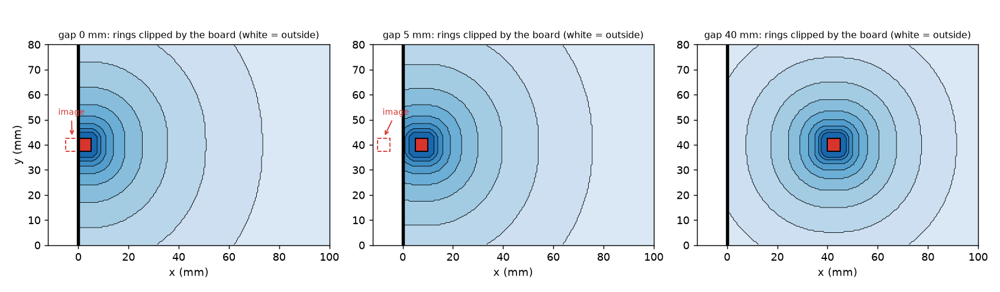
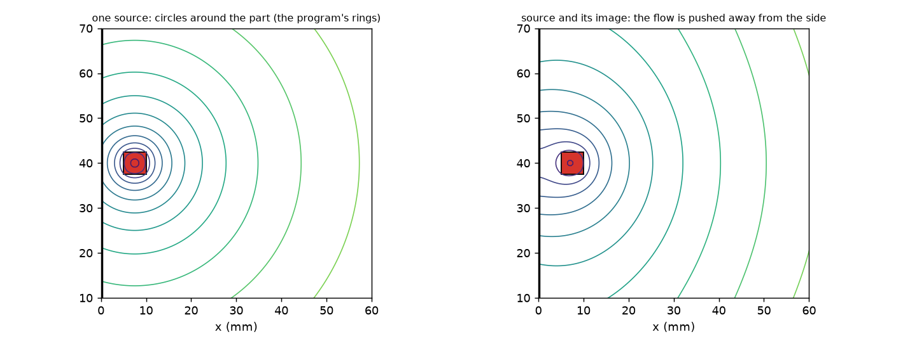
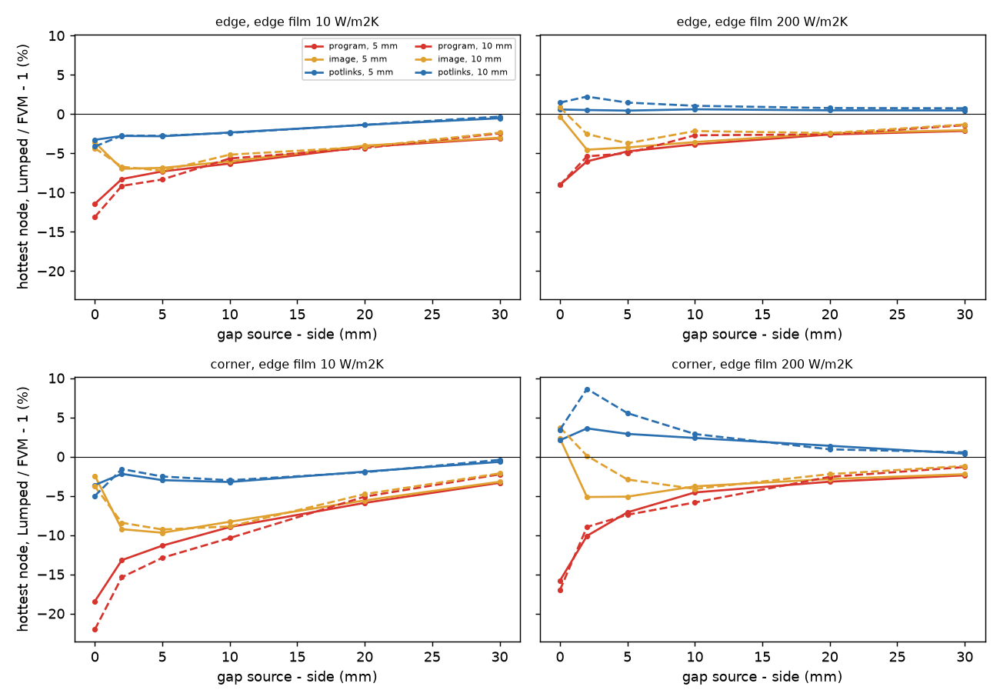
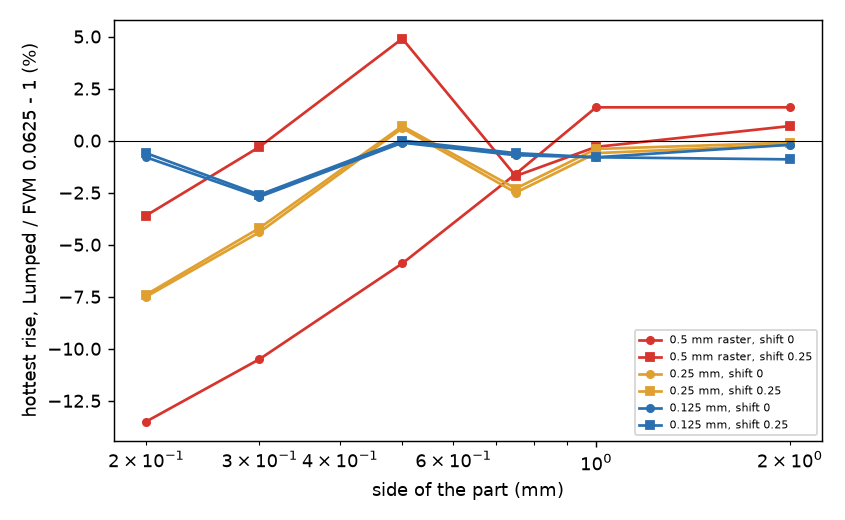
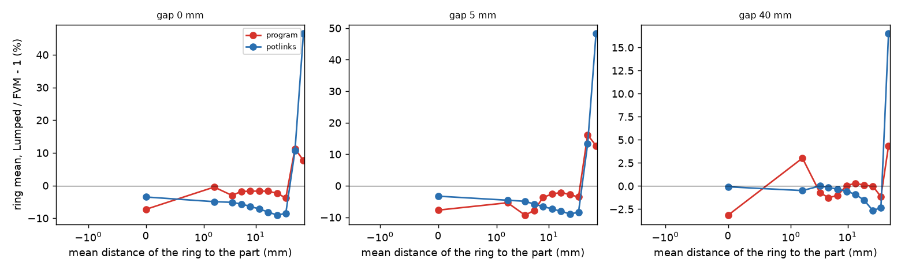

# The Lumped model near a board edge or corner, and for a part smaller than its cell

Status: reviewed (section 10; go for the merge, the candidate correction is not adopted). Branch `research/lumped-near-edge`, folder `research/lumped-near-edge/`. The program was not edited: every study imports the program through `lib/tree.py` and builds
the candidates by editing a copy of `pcbthermal/lumped.py` in memory (`lib/variants.py`). **Tree under test**: a checkout of `feature/integration-260` (the Lumped with the capped first ring of
`fix/lumped-first-ring` and the cut-cell FVM), set with `PCBT_TREE=<checkout>`; the numbers of `develop` (no capped first ring) are those of `published-cases-followup` 7.1 and are not repeated.
This branch was opened from `develop`, which holds neither the register items A21 and A23 nor the first-ring work; they were read from `feature/integration-260`.

## 1. Question

Why it matters: item A23 of `research/ROADMAP.md` (the observation on Seri Lee's plate and the 100 mm board that opened it is A21, which belongs to `published-cases-followup`). A part near a side or a corner of the board is the normal case of a real board (connectors, regulators at the edge), and the Lumped model reads it cool
(published-cases-followup 7: -9 to -14 % of the footprint mean on a PCB-like board, -18 to -22 % on Seri Lee's plate). This folder asks: (a) how large is the deficit as a function of the gap to the
side, the part size, the edge film and the board size, against the FVM at 0.5 and 0.25 mm; (b) is the cause the ring geometry clipped by the board edge (ring areas, contour lengths, no edge loss path);
(c) is there a correction that is robust; (d) if not, a warning rule with its hit and false-alarm rates; (e) the "sub-cell footprint spread": a part smaller than the 0.5 mm raster cell.

What would answer it: a sweep with an independent reference (the FVM, with its own cell check; the exact thin-plate series for the published plate), a diagnosis ring by ring, a prototype on a copy,
and rates on the 17 frozen boards plus random boards.

### 1.1 Drawings

*Figure 1 (`figures/fig_01_rings_clipped_by_the_edge.png`): the rings of the program's network (the same cell, edges and membership as `lumped._one_node_network`) for a 5 mm part at a gap of 0, 5 and
40 mm from the left side of a 100 x 80 mm board. Rings stop at the board (white = outside); the dashed square is the mirror image of the part in the side. The rings are circles around the part, cut by the side.*

*Figure 2 (`figures/fig_02_equipotentials_with_image.png`): left, the log potential of the part alone (its contours are the circles the rings follow); right, the log potential of the part plus its mirror
image in the insulated side (method of images): the equipotentials, which are the surfaces the ring-to-ring conduction really crosses, are pushed away from the side and are not circles.*

## 2. Method

* Boards: two layers of 35 um full copper, 1.6 mm, h 10 W/m2K (top) and 15 (bottom), edge film `h_side` 10, 50 or 200 W/m2K, no vias; 40 x 40 and 100 x 80 mm. A 2, 5 or 10 mm square of 1 W on layer 1 at a gap
  d = 0, 2, 5, 10, 20, 30 mm (source edge to board side; edge: centred along the side; corner: the same gap to both sides), 180 cases (`scripts/study_edge_sweep.py`).
* Reference: the FVM at 0.5 mm, hottest node and mean over the cells whose centre is in the footprint. The FVM at 0.25 mm changes the hottest node by at most 0.2 % (16 cases, `scripts/study_reference_cell.py`,
  section 3.4), so 0.5 mm is converged for this purpose. Error = Lumped / FVM - 1; **negative is too cool**.
* The Lumped is run at 0.5 mm (the API keeps the raster of the two reduced models between 0.5 and 1 mm). Variants (`lib/variants.py`): `program` (the tree as it is), `image` (the footprint potentials include
  the 8 mirror images of the part in the sides, the ring geometry unchanged), `potlinks` (`image` plus the ring-to-ring links computed from the log potentials, section 5).

## 3. Results: the deficit and its cause

### 3.1 How large (`out/edge_sweep.json`, 180 cases)

Lumped `program`, error of the hottest node / of the footprint mean, % (mean over the cases, range in brackets):

| case | n | hottest node | footprint mean |
| :-- | --: | --: | --: |
| all | 180 | -6.6 [-22.0, +1.4] | -5.5 [-13.5, +1.6] |
| edge, gap 0 | 18 | -9.0 [-13.1, -6.7] | -5.6 [-8.9, -3.7] |
| edge, gap 5 mm | 18 | -4.3 [-8.3, 0.0] | -4.5 [-9.0, +0.1] |
| edge, gap 30 mm | 9 | -2.4 [-3.1, -1.4] | -2.7 [-3.5, -1.9] |
| corner, gap 0 | 18 | -15.2 [-22.0, -12.2] | -8.1 [-13.5, -5.4] |
| corner, gap 2 mm | 18 | -10.6 [-15.4, -7.1] | -9.2 [-12.7, -6.0] |
| corner, gap 5 mm | 18 | -7.4 [-12.9, -1.6] | -7.3 [-12.8, -1.4] |
| corner, gap 30 mm | 9 | -2.6 [-3.4, -1.3] | -3.0 [-3.7, -1.8] |
| edge film 10 / 50 / 200 | 60 each | -7.6 / -6.9 / -5.2 | -6.5 / -5.8 / -4.3 |
| board 40 / 100 x 80 | 72 / 108 | -5.8 / -7.1 | -4.4 / -6.3 |

The worst case is a 10 mm part in the corner of the 100 x 80 board (-22.0 % of the rise, 47.2 K reference). The deficit falls with the gap but does not vanish (-2.4 to -3 % at 30 mm, which is the
centre value of the uniform-sheet deficit of `lumped-ring-uniform-deficit`, partly removed by the capped first ring that this tree has). It grows with the board (100 x 80 against 40 x 40) and falls with the
edge film (a cooled side is a weaker wall). Size of the part: no clear trend (2 mm -6.2, 5 mm -6.6, 10 mm -6.9 % on the hottest node).

*Figure 3 (`figures/fig_03_error_against_gap.png`): hottest-node error against the gap for the program, `image` and `potlinks`, 100 x 80 board, parts of 5 and 10 mm, edge film 10 and 200 W/m2K, edge (top) and corner (bottom).*

### 3.2 The cause is not the clipping of the rings

The hypothesis of the task (ring areas or contour lengths not reduced by the board, no edge loss path) is **not what the code does**: the network is built on the cells of the board, so a ring holds only the
cells that exist (`cnt`), its contour length is `cnt * cell / thickness` (the clipped length), and the edge film enters through `net.g_side` summed per ring. The ring table of `scripts/study_ring_diagnostic.py`
(`out/ring_diag.txt`) shows it numerically: the ring cell counts add up to the board (gap 0: 100 footprint cells and 31 900 ring cells = 200 x 160), and the FVM ring means, read with the same ring membership,
agree with the Lumped away from the part:

| gap 0 mm, 5 mm part | ring 0 (footprint) | ring 1 | ring 2 | ring 3 | ring 5 |
| :-- | --: | --: | --: | --: | --: |
| FVM mean rise of the ring cells (K) | 38.95 | 29.19 | 23.68 | 20.26 | 13.36 |
| Lumped program (K) | 36.12 (-7.3 %) | 29.05 (-0.5 %) | 22.97 (-3.0 %) | 19.90 (-1.8 %) | 13.14 (-1.6 %) |
| Lumped with potential links (K) | 37.59 (-3.5 %) | 27.75 (-4.9 %) | 22.47 (-5.1 %) | 19.12 (-5.6 %) | 12.41 (-7.1 %) |

| gap 5 mm, 5 mm part | ring 0 | ring 1 | ring 2 | ring 3 | ring 4 |
| :-- | --: | --: | --: | --: | --: |
| FVM (K) | 30.55 | 24.03 | 20.52 | 18.08 | 14.86 |
| Lumped program (K) | 28.19 (-7.7 %) | 22.74 (-5.4 %) | 18.60 (-9.4 %) | 16.67 (-7.8 %) | 14.32 (-3.6 %) |
| Lumped with potential links (K) | 29.54 (-3.3 %) | 22.93 (-4.6 %) | 19.51 (-4.9 %) | 17.04 (-5.8 %) | 13.89 (-6.5 %) |

(With the potential links the outer rings sit 4 to 7 % low: the candidate fixes the footprint and the first rings, not the far field; section 5.2. Percentages are written from the K columns.)

Reading: the heat conduction **beyond** the first rings is right, the deficit is made in the links from the footprint outwards. Two facts follow from the geometry (figure 2): (i) the interior link of
ring 0 uses the log potential of the part alone (`phi_bnd - phi_mean`), while at a side the temperature difference across the footprint is that of the part plus its image; at gap 0 this alone is the ring-0
deficit (-7.3 %); (ii) the rings are circles around the part but the flux is not radial (it is pushed away from the side), so for a part at a gap of the order of its size the link resistance of
`thickness / (S * length)` of circle-shaped rings is too small (the deficit builds in the links 0-1, 1-2, 2-3 at gap 5 mm). The review measured which link carries it (section 10.3): the candidate's
footprint-to-ring-1 link alone (images plus the potential of ring 1) takes a 10 mm corner part from -22.0 to -1.9 % and a 5 mm part at a 5 mm gap from -7.3 to -3.5 %, the ring-to-ring potential links
alone only to -6.9 and -6.2 %; so the deficit is made mostly in the link from the footprint to ring 1. "Not the clipping" means the bookkeeping of the cut rings (cells, contour length, edge loss) is right;
it does not contradict the earlier reading of A23 that rings 2 to 4 sit 1.4 to 1.8 K cool (they do here too at gap 5 mm: 1.9 and 1.4 K), which is the consequence of the too small links. The image alone (variant `image`) removes (i) and is exact at gap 0 but does not
act at a gap (3.1, `image` column): a cell is always nearer to the real part than to its image, so the distance contours are the same, and only the potentials inside the footprint see the image.

### 3.3 Sub-cell footprint spread (`scripts/study_subcell.py`, `study_subcell_raster.py`)

24 x 24 mm board, same layers, a square of 0.1 to 2 mm of 1 W, centre shifted by 0, 0.125 or 0.25 mm inside the 0.5 mm cell; reference: the FVM at 0.0625 mm (hottest node, 120.1 K at 0.1 mm to 89.5 K at 2 mm).
The power is spread over every cell the part touches (a part below 0.125 mm has zero 4 x 4 coverage and is put in the cell of its centroid, `_footprint_coverage`), so the footprint is a whole number of cells.

| side mm | position | FVM 0.5 mm % | Lumped raster 0.5 mm % | 0.25 mm % | 0.125 mm % | 0.0625 mm % |
| --: | :-- | --: | --: | --: | --: | --: |
| 0.2 | on a cell corner | -15.2 | -13.5 | -7.5 | -0.8 | -0.4 |
| 0.2 | in a cell | -2.6 | -3.6 | -7.4 | -0.6 | -0.3 |
| 0.3 | on a corner | -12.3 | -10.5 | -4.4 | -2.7 | -1.2 |
| 0.3 | in a cell | +0.7 | -0.3 | -4.2 | -2.6 | -1.2 |
| 0.5 | on a corner | -7.8 | -5.9 | +0.6 | -0.1 | -0.9 |
| 0.5 | in a cell | +6.0 | +4.9 | +0.7 | 0.0 | -0.8 |
| 1.0 | on a corner / in a cell | -0.4 | +1.6 / -0.3 | -0.6 / -0.4 | -0.8 | -1.2 |
| 2.0 | on a corner / in a cell | -0.1 | +1.6 / +0.7 | -0.2 / -0.1 | -0.2 / -0.9 | -0.8 / -0.9 |

*Figure 5 (`figures/fig_05_subcell_raster.png`): hottest-node error of the Lumped against the raster for parts of 0.2 to 2 mm (shift 0 and 0.25 mm), from `out/subcell_raster.txt`.*

Findings. (1) For parts of 0.2 mm and up the Lumped follows the FVM at the **same** cell within about 2 points (the FVM reads -15 to +6 %, the Lumped -14 to +5 %): the sub-cell error is the footprint
rounding to whole cells, a grid error that the FVM has too, not a defect of the ring construction. (At 0.1 mm, below the 4 x 4 coverage sampling, the Lumped puts the part in one cell and reads -8.4 % where the FVM
reads -19.4 % on a cell corner and -7.4 % in a cell.) It has either sign and depends on where the part sits in the cell (a part straddling cell corners reads 8 to 19 % cool, one centred in a cell and equal to it
+5 %). (2) A finer raster removes it: at 0.125 mm the error is -0.1 to -2.7 % for parts of 0.2 to 2 mm; at 0.25 mm it is within 2.5 % for parts of 0.5 mm and up and -4 to -7.5 % below. The cost is small:
a 0.5 mm part on a 100 x 80 mm board takes 0.2 s and 0.84 GB peak at 0.125 mm (0.01 s and 0.12 GB at 0.5 mm; peak resident size of the process). (3) The tried correction ("subcell": add the spreading
inside the cell, `lat ln(sqrt(A_cells / A_part)) / (2 pi S)`, `lib/variants.py`) fixes the corner case (0.2 mm on a corner: -13.5 to +0.1 %) but over-corrects the in-cell case (-3.6 to +3.3 %) and the larger parts
(+3 to +7 %) because the cell weights already carry part of it; it is **not robust and is not proposed**. Candidate rule (section 6.2): refine the raster to side / 2 (not below 0.125 mm) when a part is smaller than
two cells. (The rule as written, with its rasters of 0.15 and 0.375 mm that the table above does not hold, was run by the review: -0.8 to +1.6 % on 15 cases; its cost grows with the board area, section 10.4.)

### 3.4 The reference cell

`scripts/study_reference_cell.py`: on 16 cases (parts 5 and 10 mm, edge and corner, gaps 0 and 5 mm, film 10 and 200) the FVM hottest node changes by 0.0 to 0.2 % from 0.5 to 0.25 mm (for example 33.16 to 33.14 K,
72.10 to 72.11 K), so every error of this README is the same to 0.2 points against 0.25 mm.

## 4. The published plate (Seri Lee), reproduced with the independent series

`scripts/study_seri_lee.py` uses the exact thin-plate series of `published-cases-followup` (`lib/plate_series.py`, read from the tree) for the aluminium plate of Seri Lee, Electronics Cooling (January 1998) (100 x 100 x 1.3 mm,
25 mm source, 1.0 K/W film; printed Rc 0.66, 1.29, 2.38 K/W; the article was not re-opened here, the printed numbers are as quoted there). The program's numbers are those of `published-cases-followup` 7 to the digit
(centre -25.3 / -5.3, edge -34.7 / -17.9, corner -39.0 / -21.6 % on the hottest / the mean):

| position | exact series Rc max / mean | program max % / mean % | `image` % | `potlinks` max % / mean % |
| :-- | --: | --: | --: | --: |
| centre | 0.664 / 0.523 | -25.3 / -5.3 | -25.3 / -5.3 | -22.0 / -1.1 |
| edge midpoint | 1.280 / 1.018 | -34.7 / -17.9 | -29.5 / -11.4 | -32.7 / -15.4 |
| edge, gap 6 mm | 0.995 / 0.824 | -34.0 / -20.3 | -33.9 / -20.2 | -29.1 / -14.4 |
| edge, gap 12 mm | 0.853 / 0.701 | -28.6 / -13.1 | -28.5 / -13.0 | -27.7 / -12.1 |
| corner | 2.270 / 1.767 | -39.0 / -21.6 | -28.6 / -8.3 | -34.3 / -15.6 |
| corner, gap 6 mm | 1.482 / 1.236 | -36.3 / -23.7 | -36.3 / -23.6 | -30.5 / -16.6 |

The Lumped has no peak across the source (its hottest node is the footprint mean plus a micro peak), so the maximum column is mostly the definition; the footprint-mean column is the comparison. On this plate (a
source of a quarter of the board side on a conductive base) the candidate removes only part of the deficit (mean -14 to -17 % remain near an edge or a corner). It is therefore **not a robust correction for
large sources**; it was designed and tested for the part sizes of a board (2 to 12 mm). (Columns `potlinks` after the review's correction of the candidate, section 10.2; this plate runs at 1 mm, 625 footprint
cells, below the threshold of the defect, so it moved by at most 0.3 points. On this plate the image alone is better than the potential links at the edge midpoint and the corner, -11.4 and -8.3 % against -15.4 and -15.6 %: the plate loses heat strongly (fin length about 51 mm), where the lossless potentials of the links are poorest.)

## 5. The candidate correction (prototype on a copy, `lib/variants.py`)

* `image`: the log potentials of the footprint (`_footprint_potentials`: link of ring 0, micro peak) are those of the part plus the 8 mirror images in the sides of the board (one tiling; insulated side, method of
  images, `T = -(P / 2 pi S) (phi_part + phi_images)`). Ring geometry unchanged.
* `potlinks`: `image` plus the ring-to-ring link `R(k, k+1) = (U_{k+1} - U_k) (1/S_k + 1/S_{k+1}) / (4 pi)` and `R(0, 1) = f_r (phi_bnd - phi_mean) / (2 pi S_0) + (U_1 - phi_bnd) / (2 pi S_1)`, with `U` the
  ring mean (cell mean) of the total log potential (part plus images, at most 64 source cells, floor of a cell at 0.447 cell). In the lossless limit the difference of the ring means of the temperature **is** this
  difference of the potentials, so the link is exact for any ring shape; losses enter through the node conductances as in the program.

### 5.1 Sweep, `potlinks` against the program (`out/edge_sweep.json`, 180 cases)

| case | program max / mean % | `image` | `potlinks` max / mean % |
| :-- | --: | --: | --: |
| all (n = 180) | -6.6 / -5.5 | -3.6 / -4.5 | **-1.7 / -2.4** [max -8.3 .. +8.6] |
| edge, gap 0 | -9.0 / -5.6 | -2.5 / -2.9 | -3.1 / -3.4 |
| edge, gap 5 | -4.3 / -4.5 | -3.8 / -4.5 | -1.8 / -2.2 |
| corner, gap 0 | -15.2 / -8.1 | -0.7 / -1.2 | -3.2 / -3.9 |
| corner, gap 2 | -10.6 / -9.2 | -6.7 / -9.2 | -1.3 / -3.2 |
| corner, gap 5 | -7.4 / -7.3 | -5.7 / -7.3 | -1.6 / -2.9 |
| edge film 10 / 50 / 200 | -7.6 / -6.9 / -5.2 (max) | | -3.1 / -2.2 / +0.1 (max) |

The remaining spread is a **hot** side at a cooled side: edge film 200 W/m2K, corner at gap 2 to 5 mm, 10 mm part: up to +8.6 % of the rise (28.9 K). The image is that of an insulated side; a cooled side reflects
less. There the candidate reads hotter than the FVM (the conservative side for a temperature limit, but not a correct value); a reflection factor from the film (a Robin image) was not derived. Cases beyond -8 %: 1 of 120 random boards (below) against 31 % for the program.

### 5.2 Where it does not help or does harm

* Centred sources (`scripts/study_centre_sizes.py`, 40 cases: 100 x 80 and 60 x 60, 2 and 4 layers, fill 1 and 0.5, sources 2 to 30 mm): hottest-node mean -1.1 % (program) to +0.0 % (`potlinks`), range -5.3 .. +1.4
  to -3.6 .. +1.5 %, mean absolute 1.6 to 1.0 %; a 20 mm part on 100 x 80, 2 layers: -0.7 to +0.7 % (footprint mean -1.5 to +0.3 %). **Corrected by the review**: the first version read a 20 mm part 2 to 3 points
  worse (-3.2 %) and was explained here as the 64-cell sample of the potential links; the review measured that the sample is not the cause (64, 256 and every cell give the same -3.2 %) and that the cause was a
  defect of the candidate, the fallback to the program's block potentials without images above 900 footprint cells (section 10.2). The candidate's good centred numbers are partly a compensation of its two
  links (section 10.3).
* The outer rings read 4 to 7 % low in the tables of 3.2 (the footprint is fixed by the interior potentials, the outer rings are not); the board maximum is unaffected where a part is the hottest point.
* Boards with outlines (`example_cut_to_T`, `t_outline`, `part_across_outline`): the Lumped runs on the equivalent rectangle and the candidate acts on the rectangle's sides, not the real outline: no change
  there (section 6.1).

## 6. Rule and recommendation data

### 6.1 The 17 frozen boards and 120 random boards (`scripts/study_rule.py`, `out/rule.txt`)

Hottest rise against the FVM at 0.5 mm, board maximum, Lumped `program` and `potlinks`:

| board | parts | g1 mm | program % | `potlinks` % | rule (gap <= max(1 side, 5 mm)) |
| :-- | --: | --: | --: | --: | :-- |
| example_board, profile_board | 2 | 29.0 | +0.4 | +1.4 | no |
| reference_board | 1 | 40.0 | -1.2 | +1.0 | no |
| example_cut_to_T | 2 | 2.0 | -2.1 | -1.6 | yes |
| plate_uniform, plate_vias, plate_lone_via | 1 | 26.0 | +0.5, +0.2, +3.3 | +0.3, +0.2, +3.0 | no |
| round_outline | 1 | 22.3 | -0.8 | -0.2 | no |
| t_outline | 1 | 4.0 | -32.4 | -31.8 | **yes** |
| two_layer_partial, hatched_copper | 1 | 24.0 | -2.9, -0.2 | -2.5, +0.2 | no |
| one_layer_full, finned_block, part_top_path | 1 | 14 to 26 | +0.2, -0.9, +0.4 | +0.1, +0.5, +0.4 | no |
| part_across_outline | 1 | 1.7 | -16.0 | -14.2 | **yes** |
| plate_pad, one_layer_pad (bare laminate around a pad) | 1 | 26.0 | -14.2, -10.5 | -14.3, -10.5 | no (another cause) |

`g1` is the smallest distance of the source polygon to a side (to the outline segments for the three outline boards). The rule flags 3 boards: two real near-edge failures (`t_outline` -32 %,
`part_across_outline` -16 %, both outline boards where the equivalent rectangle is the dominant error, not the ring construction), one that is fine (`example_cut_to_T` -2.1 %: false alarm), and misses two
bad boards (the two bare-pad boards, error of another kind: the Lumped reads a laminate pad without the face term).

Random single-part boards (seed 20260101; 2 or 4 layers; fill 1, 0.7, 0.4; 30 to 100 mm; part 2 to 12 mm anywhere; edge film 5 to 200): the program reads -5.9 % on average [-14.1, +1.2], 37 of 120 beyond -8 %
(31 %); `potlinks` -2.4 % [-8.1, +3.1], 1 beyond -8 % and none beyond +8 %. The rule, with "bad" = more than 8 % too cool on the hottest node (`out/rule.txt` for the full grid):

| rule: gap at most | sweep (180, 58 bad): hits / false alarms | random (120, 37 bad): hits / false alarms |
| :-- | --: | --: |
| 0.5 sides, floor 5 mm | 55 / 53 | 31 / 18 |
| **1 side, floor 5 mm** | **57 / 63** | **35 / 24** |
| 1 side, floor 10 mm | 58 / 86 | 36 / 33 |
| 2 sides, floor 5 mm | 58 / 80 | 36 / 51 |

On the random boards the rule flags 59 of 120: those read -8.3 % on average (range -14.1 .. -0.8) against -3.6 % for the 61 not flagged (range -11.2 .. +1.2); the two bad boards it misses have gaps of
20.3 and 5.3 mm against sides of 3.8 and 4.8 mm (a part with a 4.8 mm side at 5.3 mm is just outside; the rule is "at most max(1 side, 5 mm)"). The false alarms are mostly cases with the deficit between 4 and
8 % (the program's baseline is -2 to -4 % even at 30 mm), so "false alarm" means "less than 8 % too cool", not "no deficit". A sample, not a bound.

*Figure 4 (`figures/fig_04_ring_means.png`): ring mean error (Lumped / FVM - 1) against the mean distance of the ring for the gaps of 3.2, program and `potlinks`.*

### 6.2 Rules proposed

1. **Warning (text, a sample not a bound)** for a heat source whose gap to the nearest side of the board is at most max(its equivalent side, 5 mm), in the Lumped. The gap is measured as the rates were: from
   the polygon to the sides of the box, or to the real outline on a board with an outline (not to the equivalent rectangle, as the first text said: `lib/gaps.py` measures the real outline). Hits 57 of 58 (sweep),
   35 of 37 (random boards), 2 of 2 near-edge boards of the 17 (and one false alarm). The exact text the review proposes is in `INTEGRATION.md` 2 (the first text named the research folder, which the
   project's rule on warning texts forbids).
2. **Sub-cell** (a candidate rule, not a correction): when the footprint is smaller than two cells (side < 1 mm at the 0.5 mm raster), refine the Lumped raster to side / 2 with a floor of 0.125 mm; error -0.8 to
   +1.6 % on 15 cases with the rule as written (section 10.4; the first text quoted the fixed 0.125 mm raster, -2.7 % or better), cost 0.47 s and 0.97 GB on 100 x 80 mm at 0.125 mm (0.2 s and 0.84 GB in the first
   run), about 1.7 KB per raster cell, so a guard is needed. Warn in the meantime that a part below two cells reads -19 to +6 % depending on its position in the cell.

## 7. Limits of the study

* One layout family (uniform copper, one part, no vias, part centred along the side for the edge cases, full copper or fill 0.4 to 1 for the random boards); no board with a part beside a thick plane or a block;
  vias and zoned footprints were only sampled through the 17 frozen boards (the candidate patches the one-node network; the zone network shares `_footprint_potentials` and gets the images but not the potential links).
* FVM at 0.5 mm is the reference (0.25 mm checked on 16 cases); the review ran the independent 3D solver on five near-edge and centre cases (insulated sides, section 10.1: the FVM within 0.2 %).
  published-cases-followup 7 has the FVM, FDM, 3D solid and Analytic within 0.5 % of the exact plate.
* The outer rings of the candidate read 4 to 7 % low (3.2): the temperature of a neighbouring part caused by this one (superposition at the other part's centroid) was not measured with the candidate.
* The candidate is derived for an insulated side; a cooled side makes it too hot (+8.6 % at most in the sweep).
* The potential links assume a lossless uniform sheet inside each link; with strong partial copper or a block the rings carry mean `S` and the result was checked only on the 17 boards (changes of -0.3 to +2.2 points
  of the board maximum against the program after the review's correction; the first run quoted -2.1 to +1.0, with `reference_board` -1.2 to -3.3 % from the defect of section 10.2). The candidate's image potentials
  are cell-resolved up to 3600 footprint cells (a 30 mm part at 0.5 mm) and fall back to the program's block potentials without images above.
* "Bad" is 8 % of the rise on the hottest node; the rates move with that threshold.

## 8. What was read and what was not verified

* Read in full (R): `lib/lumped.py` of the tree under test (`_one_node_network`, `ring_edges`, `_footprint_potentials`, `solve_steady`); `research/published-cases-followup` README 7 and 7.1 and `scripts/study_near_edge.py`;
  `research/lumped-ring-uniform-deficit/scripts/study_edge_distance.py`, `lib/runner.py`, `lib/patch_program.py` and the README headings; `research/ROADMAP.md` A21, A23 and E13 (of `feature/integration-260`). `research/lumped-zones-adoption` and `docs/theory.md` 5
  were consulted for the ring construction only, not re-read in full.
* From memory (M): the method of images for an insulated side (Carslaw and Jaeger, Conduction of Heat in Solids): used as a textbook identity and checked only through the numbers above; the log potential of a
  uniform square and the 0.447 constant are the program's own (`docs/theory.md` 5).
* Summary (S): Seri Lee, Electronics Cooling (January 1998): the printed Rc values are as quoted in published-cases-followup 7; the article was not opened in this folder. No new source was opened: this is a
  program-against-program study with the exact series and the FVM as references, not a new literature check.
* Reproduced: the program's Lumped numbers of published-cases-followup 7 (to the digit, section 4) with the exact thin-plate series; the program's 5 mm / 100 x 80 mm deficits of section 7.1 of that folder (centre
  -2.3 / -11.6 on the mean / max; edge -6.9 / -16.8 with the first ring) are consistent with the sweep (the sweep has the same board with 0.5 mm cells and the corner at 0, 2, 5 mm).
* Not verified: any physical board (nothing here is measured); the develop tree (no capped first ring) was not re-run; the FDM and 3D solid were not run on the sweep; no Robin image for a cooled side; no run of the
  candidate on boards with vias, blocks, imported copper or the zoned footprint (the review ran the sub-cell raster with a via array, section 10.4); the review is section 10.

## 9. Reproduction

All from the repository root with `PCBT_TREE=<checkout of feature/integration-260> QT_QPA_PLATFORM=offscreen` and the main venv: `scripts/study_edge_sweep.py` (about 1.5 min), `study_ring_diagnostic.py`,
`study_subcell.py` (about 1 min), `study_subcell_raster.py`, `study_reference_cell.py` (about 1 min), `study_centre_sizes.py`, `study_rule.py` (about 3 min), `study_seri_lee.py`, then `make_diagrams.py` and
`make_figures.py`; tests: `PCBT_TREE=... .venv/bin/python -m pytest -q research/lumped-near-edge/tests` (7 pass). Outputs are in `out/` (git-ignored). Peak resident memory measured by the review: 2.9 GB
for `study_rule.py`, 2.2 GB for `study_centre_sizes.py`, under 1 GB for the others (the first text said under 1 GB for all).

## 10. Review

The reviewer re-ran every study on `feature/integration-260` (FVM cache deleted first, so the reference was recomputed) and checked the claims against references that do not share the Lumped's assumptions.
The scratch scripts of the review are not kept; what they measured is below.

### 10.1 Reproduced, and an independent reference

* The sweep reproduces to the digit (180 cases; program -6.6 % [-22.0, +1.4] on the hottest node, 58 cases beyond -8 %), as do `study_subcell.py`, `study_subcell_raster.py`, the rule tables (57 / 63, 35 / 24,
  the 17 boards) and Seri Lee's program column (-25.3 / -34.7 / -39.0 % on the hottest point).
* Independent 3D solver (`tests/helpers/layered3d.py` of the tree, which imports nothing of the program: real copper and laminate slabs, 4 sub-slabs, 0.5 mm cells, insulated sides, film also under the source; the program
  run on the same board with isotropic FR-4 0.3 W/mK and `h_side` 0), hottest / footprint-mean error in %:

  | case (100 x 80 mm) | 3D hottest K | FVM 0.5 mm | Lumped program | candidate (`potlinks`) |
  | :-- | --: | --: | --: | --: |
  | 10 mm, corner, gap 0 | 49.29 | -0.07 / -0.06 | -22.6 / -13.9 | -5.7 / -5.5 |
  | 5 mm, corner, gap 2 mm | 54.59 | -0.12 / -0.11 | -13.6 / -12.2 | -2.7 / -4.5 |
  | 5 mm, edge, gap 0 | 45.13 | -0.20 / -0.18 | -11.9 / -7.6 | -3.7 / -3.9 |
  | 5 mm, edge, gap 5 mm | 34.24 | -0.20 / -0.17 | -7.7 / -8.1 | -3.2 / -3.7 |
  | 10 mm, centred | 20.39 | -0.15 / -0.13 | -1.9 / -2.4 | +0.3 / +0.2 |

  The FVM reference holds to 0.2 % against a solver with its own discretisation, so claim (1) is not an artefact of the FVM.

### 10.2 A defect in the candidate (corrected)

`lib/variants.py` fell back to the program's block potentials, **without images**, for a footprint of more than 900 cells (`_MAX_POTENTIAL_CELLS`: a part above 15 mm at 0.5 mm), while the potential links read
cell-resolved ring means. Measured on 100 x 80 mm, 2 layers (hottest / mean, %):

| case | program | first candidate | first candidate, every source cell | corrected candidate (cell-resolved images) |
| :-- | --: | --: | --: | --: |
| 20 mm centred, fill 1 | -0.7 / -1.5 | -3.2 / -4.8 | -3.2 / -4.7 | +0.7 / +0.3 |
| 20 mm centred, fill 0.5 | -1.0 / -2.0 | -3.8 / -5.9 | -3.7 / -5.8 | +0.6 / +0.1 |
| 30 mm centred | -0.5 / -1.5 | -1.3 / -2.7 | -1.2 / -2.6 | +0.8 / +0.1 |
| 20 mm, corner, gap 0 | -23.7 / -14.7 | **-31.3 / -24.4** | | -8.0 / -7.4 |
| 20 mm, edge, gap 5 mm | -8.6 / -9.2 | -9.5 / -10.5 | | -2.9 / -4.8 |

So the 20 mm worsening of the first text was **not the 64-cell sampling** (256 cells and every cell give the same number) but this fallback, and it also made a 20 mm part in a corner much cooler than the
program. The candidate now computes cell-resolved image potentials up to 3600 footprint cells (`IMAGE_MAX_CELLS`) and every source cell in the ring means; a test holds it
(`tests/test_near_edge.py`, fails on the first version). The sweep (parts of at most 10 mm, 400 cells) moved by at most 0.02 points; the centred sizes, Seri Lee and the 17 boards were re-run and their tables above
carry the new numbers.

### 10.3 The candidate's links, measured one at a time

Hottest node, % against the FVM at 0.5 mm, 100 x 80 mm, 2 layers:

| case | program | `potlinks` | footprint-to-ring-1 link only | ring-to-ring links only |
| :-- | --: | --: | --: | --: |
| 5 mm centred | -0.5 | +0.1 | +1.9 | -2.3 |
| 10 mm centred | -1.7 | +0.4 | +0.1 | -1.4 |
| 10 mm, corner, gap 0 | -22.0 | -5.0 | -1.9 | -6.9 |
| 5 mm, edge, gap 5 mm | -7.3 | -2.8 | -3.5 | -6.2 |

The deficit near a side sits mostly in the footprint-to-ring-1 link (claim 2 holds in that form). The candidate's good centred numbers are a **compensation**: for a 5 mm centred part its first link alone reads
+1.9 % and its ring links alone -2.3 %, because the program's calibration (the factor of the interior link and the capped first ring) was made with the program's own links. This, the large-plate result (section 4),
the cooled side (+8.6 %) and the outer rings 4 to 7 % low are why the review agrees: **do not adopt the candidate yet**.

### 10.4 The sub-cell raster

* The rule as written (raster = side / 2 between 0.125 and 0.5 mm), against the FVM at 0.0625 mm, shifts 0, 0.125 and 0.25 mm: 0.2 mm -0.8 / -0.7 / -0.6 %; 0.3 mm (raster 0.15) +1.4 / +1.0 / +1.1 %;
  0.5 mm (0.25) +0.6 / +0.7 / +0.7 %; 0.75 mm (0.375) +0.0 / +0.2 / +0.2 %; 1.0 mm (0.5, the program) +1.6 / -0.3 / -0.3 %. The claim holds (better than -3 %).
* Cost, `lumped.solve_steady` with 4 layers, a 0.5 mm part and a 10 mm part (one process each, peak resident size): 100 x 80 mm at 0.125 mm 0.47 s and 0.97 GB (0.03 s, 0.12 GB at 0.5 mm); the same with a 10 x 10 via
  array under the 10 mm part 0.55 s and 0.99 GB; 150 x 120 mm with the vias at 0.125 mm 1.17 s and 2.09 GB; 200 x 150 mm at 0.25 mm 0.48 s and 0.93 GB. About 1.7 KB per raster cell, so 200 x 150 mm at 0.125 mm
  would be about 3.3 GB and 300 x 200 mm about 6.5 GB (extrapolated, not run): the raster is one per board, so a single 0402 part refines the whole board, and the memory guard must cover the Lumped before this
  is adopted (today it does not check the Lumped).
* Frozen numbers: the smallest heat source of the 17 frozen boards is 6 mm, so the rule (parts under 1 mm) moves **no frozen record**; the rest of a board with a small part moves too (the raster is per board, as
  with the zone model), not measured.

### 10.5 The warning rule

* The threshold: on the sweep, a gap of one side with a 5 mm floor is the knee (0.5 side or no floor misses 3 of 58, floor 10 mm takes the last one at 23 more false alarms); the same on the random boards
  (35 / 24 against 36 / 33). The parts it flags read -22.0 to +0.6 % (median -7.6 %) on the sweep and -14.1 to -0.8 % (mean -8.3 %) on the random boards; those it does not flag -3.6 % on average, with
  a worst -11.2 % (a 4.8 mm part 5.3 mm from the side). The "false alarms" are mostly 4 to 8 % too cool. The choice is reasonable for a text warning.
* The gap of the outline boards is measured from the vertices of the part to the outline segments, so a part across the outline reads 1.7 mm instead of 0; the flag is the same here, but the program's check must
  use the exact distance (0 for a crossing or a part outside).
* On `t_outline` and `part_across_outline` the Lumped already carries the warning of the equivalent rectangle; the new one adds the side, and whether to show both is a choice of the text.
