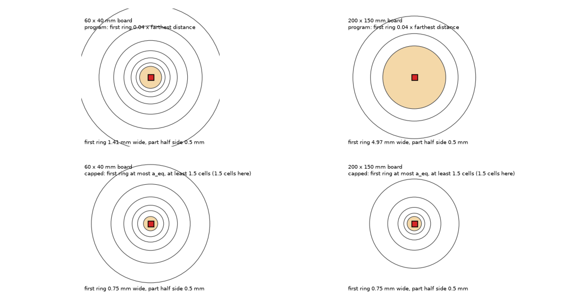
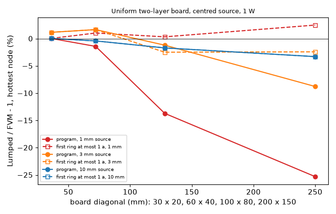
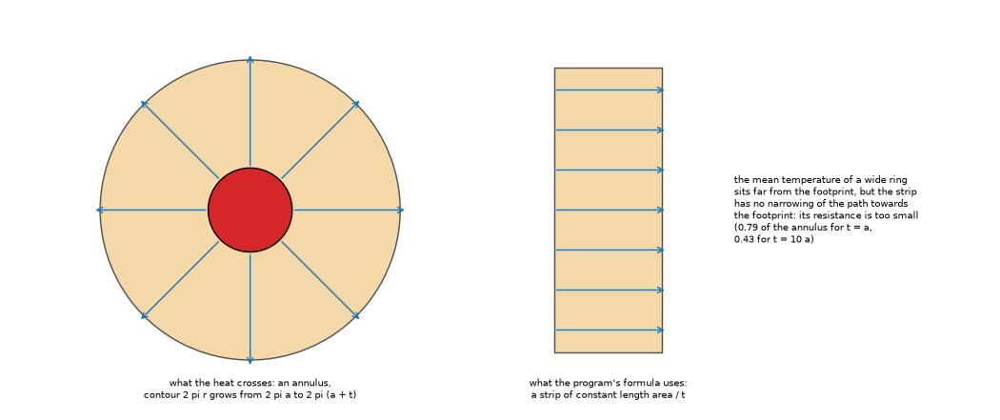
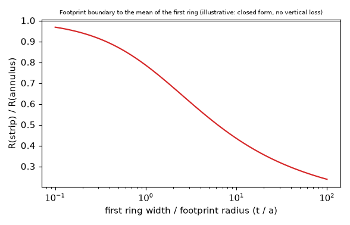
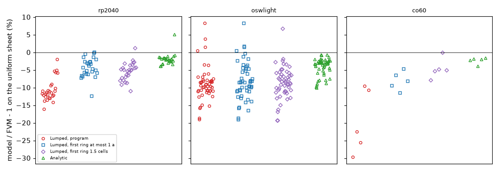
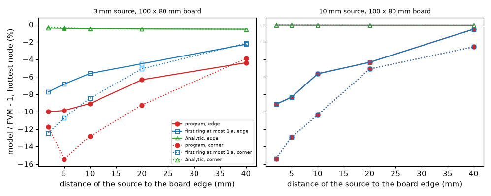
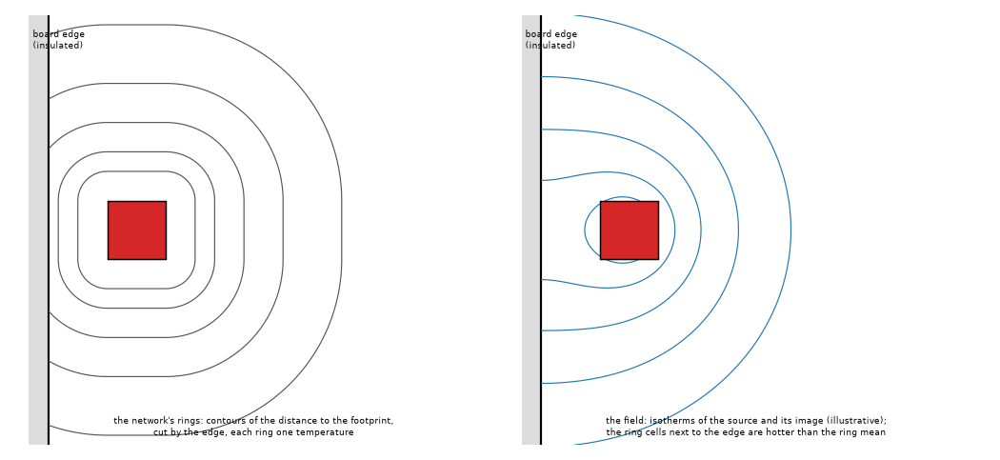
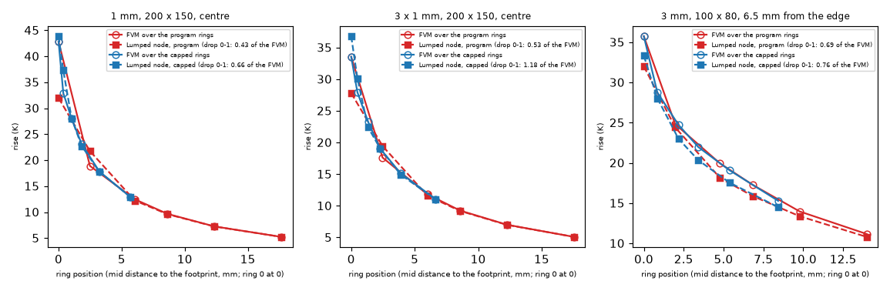

# Why the Lumped model reads cool on a uniform sheet: the width of its first ring

**Status (audit 2.6.1): the capped first ring is the program since 2.6.0** (`fix/lumped-first-ring`, `docs/validation.md` 31). "The program" in the tables below is the Lumped before 2.6.0; `lib/lumped_log.py` and `lib/patch_program.py` read `lumped.py` from the tag v2.5.1 so that the folder still compares with it.

Question (open finding of `research/reduced-models-imported-passives`, chapters 3 and 6): on a **uniform** layer-average sheet the Analytic model agrees with the FVM (-4 to +5 % on RP2040) but the Lumped reads cool by 2 to 16 % and by up to 30 % on CO60, and nobody knew why. The Analytic with the same equivalent rectangle is only 2 to 4 % cool on CO60, which pointed at the Lumped ring construction and not at the rectangle.

Every number below was printed by a script of `scripts/` (run from the repository root; the imported boards need `eval "$(pcb-library/scripts/link_env.sh)"`); the JSON files are in `out/` (git-ignored). Percentages are "model / FVM - 1" on the hottest node unless a table says "mean over the footprint". The program is not edited: the Lumped ring construction is changed on a copy built at import time from the program's own source (`lib/lumped_log.py`, which fails loudly if its anchors move and is bit-identical to the program at its defaults: `tests/test_lumped_log.py`).

## 1. Findings in short

* **Cause found.** The first ring of the Lumped network is `E1 = max(1.5 cells, 0.04 E_max)` wide, where `E_max` is the distance from the footprint to the **farthest cell of the board** (`lumped.ring_edges`, `docs/theory.md` 5, eq. 5.1). So the width of the ring next to a small part grows with the size of the board and with the distance of the part from the far corner. The link between ring means is the sum of two half rings taken as straight strips of length `area / width` (`docs/theory.md` 5, eq. 5.2); for a wide ring around a small footprint that strip has far less resistance than the annulus the heat really crosses (0.79 of it for a ring as wide as the footprint radius, 0.43 for ten radii, section 4), so the part reads cool. The review measured it directly (section 11.2): laying the program's rings on the FVM field, the drop from the footprint to the mean of the first ring is 0.43 (200 x 150 mm) and 0.50 (100 x 80 mm) of the FVM's, against 0.45 and 0.55 from the closed form, and the rings beyond the first are within 0.3 K. On the uniform sheets the effect is: 1 mm part on a two-layer board centred, 30 x 20 mm +0.0 %, 60 x 40 -1.4 %, 100 x 80 **-13.7 %**, 200 x 150 **-25.3 %**.
* **It is the only term that matters on a centred part.** One thing at a time on a 100 x 80 mm board (section 5): the ring count (6, 20, 40), the merge of thin rings, the vertical-loss (Bessel) factors, the footprint peak and the raster all leave the 1 mm deficit at -13 to -14 % (the cell of 1 mm makes it -21 %); the first ring alone takes it to +0.3 %.
* **Fix proposed** (a one-line change in `ring_edges`, a copy in `lib/lumped_log.py`): the first ring is at most one equivalent radius of the footprint wide (never less than 1.5 cells): `E1 = min(max(1.5 cells, 0.04 E_max), max(1.5 cells, a_eq))`, `a_eq = sqrt(footprint cells x cell area / pi)`. A footprint larger than `0.04 E_max` keeps the program's value, so **the 62 via boards of the earlier Lumped studies, the example board with its via arrays and every one of the 17 x 3 frozen records are bit-identical** (sections 6 and 7). A stronger variant, a first ring always 1.5 cells wide, takes small parts nearer the FVM but moves the example board and six frozen records at 2 mm (section 6): a decision for the maintainer.
* **Numbers of the fix.** Simple boards (section 5): a 1 mm part on 200 x 150 mm from -25.3 % to +2.5 %, on 100 x 80 mm from -13.7 % to +0.3 %; 2 mm sources on 100 x 80 mm for 1, 2 and 4 layers, fill 1 and 0.6, films 10 to 200 W/m2K, with and without edge convection: -5.5 to -10.8 % become -1.1 to -4.3 %; the independent 3D solver confirms (section 5.3: -15.0 % becomes -3.0 % for a 1 mm part). Imported boards on the uniform sheet (section 7): RP2040 27 parts mean -10.6 % to -4.2 %, CO60 5 parts -19.6 % to -8.0 % (C1 -29.7 % to -9 %), oswlight 51 parts -9.0 % to -8.1 % (this board is small: the first ring was not the cause there, section 8).
* **Review (section 11): go, with stated limits.** Every number above was reprinted by the scripts; the change as `INTEGRATION.md` writes it was applied to a copy of the tree and the program's own frozen test passed there (313 of 313 at 2, 1 and 0.5 mm, the 58 times to 63 % included); the step responses and a square-wave profile move with the steady state and towards the FVM (a 1 mm part: time to 63 % 1.76 s to 0.95 s, FVM 0.94 s). The review also found what the first text did not say: (1) the near-zero error of a 1 mm part with the cap is partly two errors cancelling (the footprint-to-ring-1 drop is still 0.66 of the FVM's, ring 1 is 3.8 to 4.4 K too hot); (2) the cap **creates hot cases**: rectangles of aspect 3 read +9.3 to +12.3 % (they were -2 to -17 %); (3) the answer is not smooth in the cap width (a 1 mm part on 100 x 80 mm: +0.3 % at 1 a_eq, +6.9 % at 1.5, -5.2 % at 2); (4) at the Lumped cell of 1 mm the gain is smaller (1 mm part on 200 x 150 mm -27.0 % to -15.5 %). Over 24 square and rectangular sources the mean error goes from 8.4 to 3.6 % at 0.5 mm and from 9.1 to 7.2 % at 1 mm, the worst cool case from -26.1 to -14.1 % (0.5 mm) and the worst hot case from +0.2 to +12.0 %.
* **What is left** (not fixed here): (a) a source **near a board edge or corner** is still 5 to 15 % cool in the Lumped (the Analytic is within 0.6 % there), section 9; the review placed it in the rings beyond the first (section 11.4); (b) on a board with an **outline** both reduced models run on the equivalent rectangle and read 10 to 19 % cool next to the outline (oswlight SW2: Analytic -9.7 %, Lumped -18.7 %, and without the outline +0.8 % / -5.5 %), section 8; (c) the Lumped on the **imported copper** stays 45 to 60 % cool because of the copper structure below the cell: this fix removes only the uniform-sheet part of that gap (RP2040 imported mean -59.6 % to -56.8 %).

## 2. How the uniform deficit was reproduced

`lib/variants.py` of `reduced-models-imported-passives` builds the uniform variant (one zone per layer at the layer-average fill, vias and outline kept); `scripts/study_imported_parts.py` runs it for every heat source, one part at a time, 1 W, cell 0.5 mm, FVM as the reference:

| Board | parts | Lumped, program: mean (range) | Analytic: mean (range) |
| :-- | --: | :-- | :-- |
| RP2040 (52 x 51 mm, 2 layers) | 27 | -10.6 % (-16.0 to -2.0) | -1.9 % (-3.9 to +5.1) |
| oswlight (36 x 36 mm, 4 layers) | 51 | -9.0 % (-19.0 to +8.3) | -4.1 % (-10.1 to -0.7) |
| CO60 (285 x 95 mm, 2 layers; R1, C1, U1, RGB1, D59) | 5 | -19.6 % (-29.7 to -9.5) | -2.3 % (-3.8 to -1.5) |

*Table 1 (`study_summary.py`).* The earlier folder's ranges are reproduced (RP2040 -2 to -16 %, CO60 up to -30 %, C1 -29.7 %). Removing the vias or the outline of RP2040 does not move the Lumped (C3 -12.1 % with both, -11.4 % without either), so neither is the cause there.

## 3. The simple boards separate the ring construction from the imported geometry

*Figure 1 (`fig_01_rings_small_and_large_board.png`, `make_diagrams.py`): the rings as `lumped.ring_edges` builds them around a 1 mm part, 0.5 mm cell, ten rings, to scale in the first 12 mm; top the program (first ring 1.41 mm on a 60 x 40 board, 4.97 mm on 200 x 150), bottom the first ring of at most one equivalent radius.*

`scripts/study_board_size_sweep.py`: two-layer full-copper boards, 35 um, films 10/15 W/m2K, edge 10 W/m2K, centred square source, 1 W, FVM at 0.25 mm (1 and 3 mm sources on boards up to 100 x 80) or 0.5 mm. Lumped hottest node against the FVM (per cent):

| board | source (mm) | FVM (K) | program | first ring 1.5 cells | first ring at most 1 a | Analytic |
| :-- | --: | --: | --: | --: | --: | --: |
| 30 x 20 | 1 / 3 / 10 | 95.00 / 82.91 / 70.46 | 0.0 / +1.2 / 0.0 | 0.0 / +1.2 / 0.0 | 0.0 / +1.2 / 0.0 | -2.1 / -0.3 / 0.0 |
| 60 x 40 | 1 / 3 / 10 | 53.19 / 41.08 / 28.46 | -1.4 / +1.7 / -0.4 | +1.0 / +0.7 / -0.5 | +1.0 / +1.7 / -0.4 | -3.8 / -0.5 / 0.0 |
| 100 x 80 | 1 / 3 / 10 | 44.63 / 32.52 / 19.87 | **-13.7** / -1.2 / -1.7 | +0.3 / +2.9 / +0.3 | +0.3 / -2.5 / -1.7 | -4.5 / -0.7 / -0.1 |
| 200 x 150 | 1 / 3 / 10 | 42.81 / 30.96 / 18.34 | **-25.3** / -8.8 / -3.3 | +2.5 / +1.3 / -0.9 | +2.5 / -2.4 / -3.3 | -4.5 / -0.6 / -0.1 |

*Table 2 (centred sources; the sweep also holds 6 and 20 mm: 200 x 150 gives -4.4 / -1.5 % for the program).*

*Figure 3 (`fig_03_deficit_against_board_size.png`): the same numbers against the diagonal of the board, three source sizes.*

The deficit is a function of the board size (it grows from nothing on 30 x 20 mm to a quarter of the rise), of the source size (largest for 1 mm) and of nothing else tried: the conditions of the table below change it very little.

| conditions (100 x 80 mm, 2 mm source unless stated) | program | first ring at most 1 a | first ring 1.5 cells |
| :-- | --: | --: | --: |
| 2 layers, fill 1, 10/15 W/m2K, edge 10 | -7.3 | -2.0 | +0.8 |
| 1 layer | -5.5 | -1.1 | +1.3 |
| 4 layers | -8.7 | -2.6 | +0.7 |
| 2 layers, fill 0.6 | -10.0 | -4.3 | -1.3 |
| 50 / 50 W/m2K | -8.9 | -2.5 | +0.7 |
| 200 / 200 W/m2K | -10.8 | -3.2 | +0.7 |
| no edge convection | -7.3 | -2.0 | +0.7 |

*Table 3 (`study_sensitivity.py`, table 2 of its output; sources of 6 and 10 mm are within -2.4 to +2.0 % in every row and equal for the two candidates but the 1.5-cells one).* The 2 mm source on the 60 x 40 board goes from +2.5 % to -1.7 % with the cap: both are inside the few per cent that the grid phase of a small source gives (section 7).

### 3.1 The independent 3D solver

`scripts/study_independent_3d.py`: board 70 x 70 mm, copper 35 um (400 W/mK), one FR-4 gap of 1.5 mm at 0.4 W/mK in every direction, films 10 W/m2K, insulated edges, 1 W. The solver is `research/effective-conductivity/lib/layered3d.py` (imports nothing of the program; it reproduces Seri Lee's plate and the coupon of Culham and Yovanovich there). Mean rise over the source cells:

| source (mm) | centre | 3D (K) | FVM 0.5 mm | Analytic | Lumped, program | Lumped, first ring at most 1 a |
| --: | :-- | --: | --: | --: | --: | --: |
| 1 | centre | 47.55 | -0.5 % | -3.9 % | -5.2 % | +1.0 % |
| 3 | centre | 33.31 | -0.3 % | -0.9 % | -1.0 % | -1.3 % |
| 10 | centre | 21.12 | -0.1 % | -0.2 % | -0.8 % | -0.8 % |
| 1 | (20, 17) | 50.66 | -0.5 % | -3.7 % | **-15.0 %** | -3.0 % |
| 3 | (20, 17) | 36.42 | -0.3 % | -0.8 % | -8.1 % | -5.9 % |
| 10 | (20, 17) | 24.25 | -0.1 % | -0.1 % | -8.0 % | -8.0 % |

*Table 4.* The FVM is within 0.5 % of the 3D solver, so it is a fair reference for the deficit; the off-centre rows also show the second cause (section 9).

## 4. Why a wide first ring cools the part

*Figure 2 (`fig_02_half_ring_strip_and_annulus.png`, `make_diagrams.py`): the first ring around a small footprint. The heat crosses an annulus whose contour grows with the radius; the program's resistance between the footprint boundary and the ring mean uses a strip of constant length `area / width` (theory 5.2).*

The ring mean is an area mean, so for a wide ring it is far from the footprint, and the resistance to it is `ln` shaped. The ratio of the strip's resistance to that of the annulus (closed form, pure conduction: mean of `ln(r/a)` over the annulus, my own derivation, not a published case):

*Figure 6 (`fig_06_strip_against_annulus.png`, `make_figures.py`): R(strip) / R(annulus) against the ring width over the footprint radius. Illustrative closed form, not a measurement.*

| width / radius | 0.5 | 1 | 2 | 5 | 10 | 25 |
| :-- | --: | --: | --: | --: | --: | --: |
| R(strip) / R(annulus) | 0.87 | 0.79 | 0.68 | 0.53 | 0.43 | 0.34 |

For a 1 mm part (footprint radius about 0.56 mm on the 0.5 mm raster) the first ring is 1.41 mm wide on 60 x 40 mm (2.5 radii), 2.53 mm on 100 x 80 (4.5 radii) and 4.97 mm on 200 x 150 (8.9 radii): resistance ratios of 0.64, 0.55 and 0.45, and deficits of 1.4, 13.7 and 25.3 %. (The first text gave 2.7 mm and 4.8 radii for 100 x 80; `ring_edges` prints 2.53 mm. The table gave 0.44 at ten radii; the closed form is 0.434.) The ratio fixes the sign and the order of magnitude; the review measured the drop itself on the FVM field (section 11.2: 0.50 and 0.43 of the FVM's on 100 x 80 and 200 x 150 mm), so the explanation is confirmed for the program. The ring 1 node of the program is also 2.8 to 3.3 K too hot (the outer half of a ring as a strip of the mean length is too resistive), which partly offsets the deficit.

The earlier tuning (ten rings, `0.04 E_max`) was done on boards of 30 to 100 mm with sources of several millimetres, where the first ring is narrower than the footprint: the example board and the via families are in that range and are untouched by the cap.

## 5. One thing at a time

`scripts/study_sensitivity.py`, table 1: 100 x 80 mm, two layers, full copper, centred source, Lumped hottest node against the FVM (per cent). Every column changes one thing of the program's construction (`lumped_log.configure`):

| source (mm) | FVM (K) | program | first ring 1.5 cells | first ring cap 1 a | 6 rings | 20 rings | 40 rings | no ring merge | merge at 2 cells | vertical-loss factors = 1 | footprint peak off | cell 1 mm | log link |
| --: | --: | --: | --: | --: | --: | --: | --: | --: | --: | --: | --: | --: | --: |
| 1 | 44.63 | -13.7 | +0.3 | +0.3 | -13.7 | -13.4 | -13.4 | -13.7 | -13.7 | -13.7 | -13.7 | -20.8 | +12.6 |
| 3 | 32.52 | -1.2 | +2.9 | -2.5 | -0.3 | -0.5 | -0.7 | -1.2 | -1.2 | -1.2 | -8.7 | -7.6 | +5.8 |
| 10 | 19.87 | -1.7 | +0.3 | -1.7 | -0.6 | -1.3 | -1.2 | -1.7 | -1.8 | -1.4 | -13.5 | -1.2 | +1.1 |

*Table 5.* The footprint peak and the cell matter for the hottest node of the larger sources (peak off: -8.7 and -13.5 % for 3 and 10 mm) but do not change the 1 mm deficit (-13.7 % with and without it). The "log link" column replaces the strip by the annulus formula in every half ring with the first ring at 1.5 cells: it overshoots by 6 to 13 % (the cell-based footprint radius and ring positions are inconsistent at 0.5 mm), so the annulus formula is **not** proposed. More rings do not help, and ring counts above 10 **without** the merge of thin rings are unstable (`study_ring_count.py`: 20 rings -7 to +15 %, 40 rings +10 to +27 %, 80 rings +25 to +67 % over the centred sources; it is the reason the merge exists: rings thinner than a cell have a wrong contour length); 40 rings looked good near an edge (+0.2 to +9 % at five places, section 9) only by that instability, since the same setting is +10 to +27 % on the centred sources.

## 6. What the fix changes in the program's own boards

* **62 boards of the via studies** (`study_family` 36 and `study_holdout` 26 of `lumped-via-groups`, with and without vias, `study_via_boards_unchanged.py`): bit-identical for both candidates (0 boards move, change of `T_max` and of the via effect 0.00e+00 K): boards of 30 mm (the default of the specs) with sources of at most 20 mm, where `0.04 E_max` is under 1.5 cells; the result that no number moves is what was printed, the reason is my reading of the specs.
* **The example board with its via variants** (`study_example_board_vias.py`, FVM at 0.25 mm): the cap leaves every row bit-identical (via effect -3.4 / -0.4 / -0.3 / -2.9 / -3.1 / -1.7 / -1.1 / -1.6 %, `T_max` +0.0 to +1.3 %). The 1.5-cells variant moves it to `T_max` +1.3 to +4.3 % (hotter, still on the safe side) and the via effect of the 7 x 7 and 20 x 20 copper-filled arrays to -4.6 to -4.9 %.
* **The 17 frozen boards at 2, 1 and 0.5 mm** (`study_frozen_impact.py`): the cap moves **no record** (every difference is exactly 0). The 1.5-cells variant moves six boards at the test's 2 mm (the Lumped cell is clipped to 1 mm): example and profile board -0.34 K, reference board +0.58 K, example cut to a T +0.26 K, plate with vias -0.38 K, two-layer partial copper -2.61 K (it was -0.3 %, becomes -2.2 % of the FVM rise), and at 0.5 mm many more (plate with a pad -10.6 K, one-layer pad -2.0 K: boards on which the Lumped is already 10 to 14 % cool, where it becomes 3 points cooler).
* **The program's own frozen test on a patched copy** (review, `study_frozen_patched_copy.py`): the change exactly as `INTEGRATION.md` 1 writes it (`lib/patch_program.py`) applied to a copy of `pcbthermal/` outside the repository; `PCBT_FROZEN_CELLS=2,1,0.5 pytest tests/regression/test_frozen_numbers.py` in that copy: **313 passed** (every model, the 58 times to 63 %; tolerance 1e-8 K). `study_frozen_impact.py` showed exact zeros for the steady Lumped maxima; this run covers the transients too.
* **Time runs** (review, `study_time_response.py`; the step responses and the profile runner build their networks with the same `ring_edges`): the example board is bit-identical (steady resistances, times to 63 %, square-wave peaks). Where the cap acts, the time response moves with the steady state and towards the FVM step response at 0.5 mm:

| board | heater | FVM: R (K/W) / t63 (s) | program: R / t63 / square-wave peak (degC) | capped: R / t63 / peak |
| :-- | --: | :-- | :-- | :-- |
| 1 mm part, 100 x 80, centre | 1 | 44.33 / 0.94 | 38.51 / 1.76 / 119.19 | 44.78 / 0.95 / 138.31 |
| 3 mm part, 200 x 150, at (60, 50) | 1 | 31.21 / 2.01 | 26.88 / 3.29 / 86.33 | 30.48 / 2.06 / 98.62 |
| 1 mm + 10 mm parts, 200 x 150 | 1 | 42.81 / 0.77 | 31.97 / 2.42 / 104.60 | 43.87 / 0.71 / 142.24 |
| 1 mm + 10 mm parts, 200 x 150 | 2 | 18.64 / 6.78 | 17.80 / 6.90 / 99.56 | 17.82 / 6.83 / 99.75 |

*Table 6b (square wave: three times the power, 20 s, duty 0.3, four cycles, resolved; the square-wave peak has no FVM column: the FVM profile runner was not run on these boards).* The program's time to 63 % of a small part was 1.6 to 3.1 times the FVM's, because its first ring holds a large capacity next to the part; the capped ring gives 0.92 to 1.03 times. The two-heater board shows the superposition: the 10 mm part moves by 0.1 % (its own first ring is barely capped).
* **Cost**: none; the ring construction does the same work.

## 7. The parts of the imported boards

`study_imported_parts.py` / `study_summary.py`, one part at a time, 1 W, cell 0.5 mm. Error of the hottest node against the FVM on the same sheet (mean and range over the parts):

| board | sheet | parts | Lumped, program | first ring at most 1 a | first ring 1.5 cells | Analytic |
| :-- | :-- | --: | :-- | :-- | :-- | :-- |
| RP2040 | uniform | 27 | -10.6 (-16.0 to -2.0) | **-4.2 (-12.4 to 0.0)** | -5.4 (-11.0 to +1.3) | -1.9 (-3.9 to +5.1) |
| RP2040 | imported copper | 27 | -59.6 (-74.1 to -31.2) | -56.8 (-71.3 to -31.2) | -57.1 (-72.2 to -28.9) | -55.5 (-74.5 to -21.6) |
| oswlight | uniform | 51 | -9.0 (-19.0 to +8.3) | -8.1 (-19.0 to +8.3) | -8.6 (-19.3 to +6.8) | -4.1 (-10.1 to -0.7) |
| CO60 | uniform | 5 | -19.6 (-29.7 to -9.5) | -8.0 (-11.5 to -4.6) | **-4.6 (-7.8 to 0.0)** | -2.3 (-3.8 to -1.5) |

*Figure 5 (`fig_05_uniform_sheet_parts.png`): the error on the uniform sheet of every part, per board.*

The RP2040 imported row confirms what the earlier folder found: the gap on the imported copper is the copper structure under the cell; this fix takes about three points off it. The residual -4 to -12 % on the uniform sheet of small parts is the grid: a 1.5 x 0.65 mm part moved by 0.125 mm on the grid reads 72.7 to 73.4 K in the FVM at 0.25 mm and 68.9 to 75.5 K at 0.5 mm, and the Analytic, which has no ring, is -2 to -7 % on the same parts.

## 8. What is not the cause, and the two other contributions

* **The equivalent rectangle is not the cause** (hypothesis c of the earlier folder). RP2040 is the same with and without the outline. On oswlight it matters, **for both reduced models**: SW2 (uniform, no vias) FVM 74.8 K, Analytic -10.5 %, Lumped -15.3 %; with the outline removed FVM 58.3 K, Analytic +0.8 %, Lumped -5.5 % (`study_outline_and_vias.py`). The FVM follows the true outline (the part sits 4 mm from an edge of a rounded board) and the rectangle of the same area does not: the known limit of `docs/validation.md` 13 (10 to 18 % cool near an edge), shared by both models.
* **Vias are not the cause**: removing them changes the Lumped by 1.4 to 3.8 points on oswlight (SW2 -18.7 % to -15.3 %) and nothing on RP2040 C3 and U1 beyond the FVM's own change.
* **Raster and shape**: the hottest node of a part smaller than three cells is a grid number (section 7).

## 9. A second deficit that this does not fix: a source near an edge

*Figure 4 (`fig_04_deficit_near_an_edge.png`): error against the distance of the source to the board edge (left edge, centred vertically) and to the corner, 100 x 80 mm board.*

`study_edge_distance.py`, 100 x 80 mm, two layers, full copper, edge 10 W/m2K (a 1.6 mm edge: nearly insulated), FVM 0.5 mm, hottest node:

| source | place | distance (mm) 2 / 5 / 10 / 20 / 40 | program | first ring at most 1 a | first ring 1.5 cells | Analytic |
| --: | :-- | :-- | :-- | :-- | :-- | :-- |
| 3 mm | edge | | -10.0 / -9.9 / -9.1 / -6.3 / -4.4 | -7.7 / -6.9 / -5.6 / -4.5 / -2.3 | -4.9 / -3.4 / -1.9 / -1.1 / +0.5 | -0.4 to -0.6 |
| 3 mm | corner | | -11.7 / -15.4 / -12.8 / -9.2 / -3.9 | -12.4 / -10.7 / -8.5 / -5.1 / -2.2 | -10.7 / -8.2 / -4.9 / -1.4 / +0.7 | -0.3 to -0.6 |
| 10 mm | edge | | -9.2 / -8.3 / -5.7 / -4.3 / -0.6 | same | -8.0 / -6.2 / -4.9 / -2.4 / +0.3 | -0.0 to -0.1 |
| 10 mm | corner | | -15.4 / -12.9 / -10.4 / -5.1 / -2.6 | same | -14.6 / -11.0 / -8.1 / -4.0 / -0.4 | -0.0 to -0.1 |

*Table 6 (the "first ring 1.5 cells" column is from `LRU_PROPOSAL="first 1.5 cells"` runs of the same script; the other columns were reprinted by the review).* The cosine series of the Analytic puts the image of the edge in (within 0.6 % of the FVM here); the ring network keeps one temperature per ring and cannot show that the side of a ring next to the source is hotter. This is a second construction limit (the "angular resolution" of the earlier Lumped studies), it grows with the size of the source and does not depend on the first ring. On boards in which parts sit near the edge (imported boards mostly do) the Lumped is 5 to 15 % cool for it. A fix would need a different representation (rings that are not closed contours, or an image term) and is a separate investigation (`research/ROADMAP.md` A23, closed by `lumped-near-edge/` with a warning and the small-part raster; what is left is A27; this folder first cited it as A21, the label the integration of 2.6.0 gave to the Seri Lee observation of `published-cases-followup/`). The review's measurement of where the error sits and a first try of an image term are in section 11.4.

*Figure 8 (`fig_08_source_near_an_edge.png`, `make_diagrams.py`): left, the rings of the network around a source 3 mm from an insulated edge (distance contours, cut by the edge, each held at one temperature); right, the isotherms of the source and its mirror image (illustrative, no vertical loss), which are not the distance contours.*

## 10. Limits and honest notes

* **Two errors in the capped result** (review, section 11.2): the first ring of 1.5 cells is quantised (the drop to it is 0.66 of the FVM's, not the 0.74 of the closed form) and the ring 1 node is too hot; for a 1 mm square part they cancel within 2.5 %, for a part of aspect 3 they do not (+9 to +12 %). The capped ring removes the trend with the board size; it is not a resolved construction near a small footprint.
* One construction (strip links, ten rings, 0.5 mm raster) was changed; the zone network (a footprint over a dense group of vias) calls the same `ring_edges`, and the two call sites of the copy pass the footprint radius to both; the zone model was not measured separately beyond the 62 via boards (bit-identical) and the example board.
* The FVM is the reference for most tables; it is within 0.5 % of the independent 3D solver on the uniform sheet (table 4) but is itself 5 to 12 % below the converged value for a hottest cell of 0.65 mm (research `reduced-models-imported-passives` 3.2), so the absolute errors of the smallest parts in sections 2 and 7 carry that uncertainty; the comparison of the candidates among themselves does not.
* Memory and cost: the CO60 uniform runs peaked at 3.1 GB (above the 2.5 GB of the brief; the peak is the import session and the 0.5 mm FVM of a 285 x 95 mm board), and the independent 3D solves at 70 x 70 mm with 8 sub-slabs peaked at 6.3 GB (a mistake of sizing on my side: a first attempt at 100 x 100 mm reached 4 GB before it was stopped); neither was repeated (the 3D references are kept in `out/ref3d_store.json`).
* The cell 0.5 mm clip of the API: `lumped.solve_steady` is run at the cell the API gives it (clipped to 0.5 to 1 mm); at 1 mm the program's first ring is `max(1.5 mm, 0.04 E_max)` and the cap changes less (a part 1 mm wide is one to four cells): the review measured it (section 11.3; a 1 mm part on 200 x 150 mm -27.0 % to -15.5 %, on 100 x 80 mm -20.8 % to -17.0 %). Every table of sections 3 to 9 is at 0.5 mm.
* The tests of this folder (`tests/test_lumped_log.py`, 6 tests, 3 s) check bit identity of the copy, the first ring width, the deficit and its removal, that the cap leaves a 10 mm source unchanged, and (review) that the change as written in `INTEGRATION.md` (`lib/patch_program.py`) gives the fields of the study switch.

## 11. Review

Status: **reviewed, go** for closing the investigation and for a `fix/` branch with the capped first ring in 2.6.0, with the limits of 11.3 written into the theory and the validation. The reviewer re-ran every study except the imported boards oswlight and CO60 and the 3D solves (kept in `out/ref3d_store.json`), and added five scripts (`study_ring_means.py`, `study_shape_and_cell.py`, `study_time_response.py`, `study_frozen_patched_copy.py`, `lib/patch_program.py`) and figures 7 and 8.

### 11.1 Reproduced

* Tables 2, 3, 4 (with the cached 3D values), 5, 6 and the via, example-board and frozen-impact checks: every number reprinted (`LRU_PROPOSAL="cap 1 a"` for the capped columns, the default `first 1.5 cells` of `lib/runner.py` at the time; the default is now the capped ring, the recommendation). The FVM references of the board-size sweep were computed again from scratch by the review (44.63, 42.81, 32.52, 30.96, 19.87, 18.34 K): equal to the cache.
* RP2040, uniform sheet, 27 parts: re-run, every value equal (mean -10.6 % to -4.2 %). oswlight and CO60 not re-run.
* The 3D solver `research/effective-conductivity/lib/layered3d.py` is the code of `tests/helpers/layered3d.py` (they differ only in a docstring note); both sides model the same board (copper 400 W/mK, FR-4 0.4 W/mK isotropic, films 10 W/m2K on both faces including under the source, insulated edges, sources aligned with the 0.5 mm cells).
* The closed form of section 4 (strip of half the ring width and length `area / width`, against the mean of `ln(r/a)` over the annulus): 0.786 at one radius, 0.434 at ten. The first text quoted 0.44 at ten in the table and the first ring of 100 x 80 mm as 2.7 mm: corrected (0.43; 2.53 mm).
* The frozen numbers with the change in place: 313 of 313 at 2, 1 and 0.5 mm (section 6).

### 11.2 The explanation measured

*Figure 7 (`fig_07_ring_means_fvm_and_lumped.png`, `make_figures.py` from `study_ring_means.py`): the FVM temperature averaged over each ring of the Lumped (circles) and the Lumped ring node (squares), program (red) and capped first ring (blue); a 1 mm part on 200 x 150 mm, a 3 x 1 mm part on 200 x 150 mm, a 3 mm part 6.5 mm from an edge.*

`study_ring_means.py` lays the Lumped's own rings on the FVM field of the same board and cell (0.5 mm; 1 mm for the last row) and compares the ring means with the network nodes:

| case | construction | first ring (mm) | Lumped hottest | node error rings 0 / 1 / 2 / 3 / 4 (K) | drop 0 to 1, Lumped / FVM |
| :-- | :-- | --: | --: | :-- | --: |
| 1 mm, 200 x 150, centre | program | 4.97 | -25.3 % | -10.83 / +2.84 / -0.24 / -0.07 / -0.02 | 0.43 |
| | capped | 0.75 | +2.5 % | +1.07 / +4.39 / -0.00 / -0.38 / -0.07 | 0.66 |
| 1 mm, 100 x 80, centre | program | 2.53 | -13.1 % | -5.82 / +3.34 / +0.01 / +0.09 / +0.00 | 0.50 |
| | capped | 0.75 | +1.0 % | +0.45 / +3.77 / +0.80 / +0.07 / +0.16 | 0.66 |
| 3 mm, 200 x 150, centre | program | 4.92 | -8.8 % | -2.75 / +1.28 / -0.19 / -0.00 / -0.00 | 0.67 |
| | capped | 1.69 | -2.4 % | -0.77 / +0.94 / -0.01 / -0.04 / -0.05 | 0.76 |
| 3 x 1 mm, 200 x 150, centre | program | 4.94 | -16.2 % | -5.74 / +1.82 / -0.23 / -0.06 / -0.03 | 0.53 |
| | capped | 0.98 | +9.3 % | +3.25 / +2.22 / -0.90 / +0.03 / -0.20 | 1.18 |
| 6 x 2 mm, 200 x 150, cell 1 mm | program | 4.88 | -5.8 % | -1.66 / +1.49 / -0.42 / -0.29 / -0.10 | 0.69 |
| | capped | 1.95 | +12.3 % | +3.36 / +2.35 / -0.64 / -0.05 / -0.43 | 1.19 |
| 3 mm, 100 x 80, 6.5 mm from the edge | program | 3.93 | -9.9 % | -3.74 / -0.40 / -1.80 / -1.39 / -0.60 | 0.69 |
| | capped | 1.69 | -6.5 % | -2.42 / -0.72 / -1.73 / -1.63 / -1.54 | 0.76 |

*Table 7 (percentages against the FVM at the same cell, so the 1 mm part on 100 x 80 mm reads -13.1 % here and -13.7 % against the 0.25 mm reference of table 2).* Read:
* **The cause is confirmed.** The program's deficit sits in the link from the footprint to ring 1: its drop is 0.43 to 0.53 of the FVM's on the centred small parts, the closed form says 0.45 to 0.55, and rings 2 to 4 are within 0.3 K. Ring 1 itself is 1.3 to 3.3 K too hot (the outer half of a wide ring as a strip of the mean contour is too resistive), which offsets part of the deficit.
* **The capped result is partly a cancellation.** With the cap the first link is still short (0.66 of the FVM's drop for the 1 mm part; the closed form at 1.33 radii would give 0.74: a ring 1.5 cells wide around a 2 x 2-cell footprint is a quantised ring) and ring 1 is 3.8 to 4.4 K too hot; the hottest node lands within 1 to 2.5 % because the two cancel. For the rectangles of aspect 3 the first link becomes too resistive (1.18 times the FVM's drop) and ring 1 is still hot, so they add: +9 to +12 %.

### 11.3 Shapes, cells and the width of the cap

`study_shape_and_cell.py`: squares of 0.5 to 40 mm, rectangles 3 x 1, 6 x 2, 20 x 2 mm and a 10 x 0.5 mm tab, centred on 100 x 80 and 200 x 150 mm boards, Lumped at 0.5 and 1 mm (the two cells the API allows), program, the capped ring, and caps of 1.5, 2 and 3 equivalent radii:

| board | source (mm) | cell | FVM (K) | program | capped (1 a) | cap 1.5 a | cap 2 a | cap 3 a | Analytic |
| :-- | :-- | --: | --: | --: | --: | --: | --: | --: | --: |
| 100 x 80 | 1 x 1 | 0.5 | 44.63 | -13.7 | +0.3 | +6.9 | -5.2 | -7.2 | -4.5 |
| 100 x 80 | 1 x 1 | 1 | 44.63 | -20.8 | -17.0 | -11.6 | -24.0 | -20.8 | -4.5 |
| 100 x 80 | 2 x 2 | 1 | 36.98 | -4.4 | +0.2 | +6.7 | -8.2 | -4.4 | -1.4 |
| 100 x 80 | 3 x 1 | 0.5 | 36.81 | -9.7 | **+9.9** | +0.1 | -2.8 | -9.7 | -1.9 |
| 100 x 80 | 6 x 2 | 1 | 29.24 | -2.5 | **+9.5** | -2.5 | -2.5 | -2.5 | -0.6 |
| 100 x 80 | 10 x 0.5 | 0.5 | 26.10 | -6.9 | -6.9 | -6.9 | -6.9 | -6.9 | -1.7 |
| 200 x 150 | 1 x 1 | 0.5 | 42.81 | -25.3 | +2.5 | +7.8 | -6.1 | -7.5 | -4.5 |
| 200 x 150 | 1 x 1 | 1 | 42.81 | -27.0 | -15.5 | -11.0 | -23.6 | -25.8 | -4.5 |
| 200 x 150 | 2 x 2 | 1 | 35.37 | -11.6 | +2.3 | +7.7 | -7.5 | -10.3 | -1.1 |
| 200 x 150 | 3 x 1 | 0.5 | 35.22 | -16.2 | **+9.3** | +0.7 | -3.0 | -9.2 | -1.9 |
| 200 x 150 | 6 x 2 | 1 | 27.70 | -6.0 | **+12.0** | -0.2 | -4.1 | -6.0 | -0.5 |
| 200 x 150 | 10 x 0.5 | 0.5 | 24.14 | -10.3 | -6.2 | -8.6 | -9.8 | -10.3 | +0.1 |

*Table 8 (selected rows; the script prints all 48: squares of 5 mm and more are within -6.2 to +0.2 % and equal for the program and the cap except 5 mm on 200 x 150 mm; the 0.5 mm square on 200 x 150 mm has the reference of the 1 mm square because its FVM at 0.5 mm covers the same cells).* Over the 24 sources:

| Lumped cell | program: mean abs. error / most cool / most hot | capped: mean abs. error / most cool / most hot |
| :-- | :-- | :-- |
| 0.5 mm | 8.4 % / -26.1 % / +0.2 % | 3.6 % / -14.1 % / +9.9 % |
| 1 mm | 9.1 % / -32.2 % / +0.2 % | 7.2 % / -28.9 % / +12.0 % |

* **Hot cases created by the cap**: rectangles of aspect 3 with a first ring of one equivalent radius (about one short side) read +9.3 to +12.3 %; the program had them -2 to -17 % cool. A safe-side error, but new; the README and `INTEGRATION.md` did not say it.
* **The answer is not smooth in the cap**: a change of the first ring by half an equivalent radius moves a small part by up to 12 points either way, because the next edges of the geometric series are merged or kept by the one-cell rule. The cap value 1 is the value that leaves every existing board unchanged, not an optimum, and no single value is good for every shape (1.5 a fixes the rectangles and makes the 1 mm squares +7 to +8 %).
* **At the 1 mm cell** the gain is smaller (1 mm parts -21 to -27 % become -15 to -17 %): there the part is one to four cells and the error is the raster, which no first-ring rule removes.
* **The tab** (10 x 0.5 mm): its equivalent radius (1.8 mm) is far larger than its half width; the cap leaves it unchanged on 100 x 80 mm and moves it from -10.3 to -6.2 % on 200 x 150 mm. For an elongated part the strip of the program is closer to the real contour (the contour grows from the perimeter by `2 pi w`, a small share), so the equivalent radius is a rough scale there, but it did no harm on the tab.
* **No hot case from large parts**: sources of 5 to 40 mm are equal for the program and the cap (their equivalent radius exceeds `0.04 E_max`) except the 5 mm square on 200 x 150 mm (-5.1 to -2.7 % at 0.5 mm, -4.8 to -6.2 % at 1 mm).

### 11.4 The near-edge deficit

* **Confirmed** (table 6 reprinted): a 3 or 10 mm source 2 to 20 mm from an edge or a corner reads 4 to 15 % cool in the Lumped with or without the cap; the Analytic is within 0.6 %.
* **Where it sits** (table 7, last row): the first link is as good as on a centred part of the same size (drop 0.69 / 0.76 of the FVM's, against 0.67 / 0.76 centred), but rings 2 to 4 are 1.4 to 1.8 K too cool, and the spread (standard deviation) of the FVM temperature inside those rings is 1.2 to 2.1 K, against 0.6 to 0.9 K for the same source centred on 200 x 150 mm. So it is not the strip of the first ring but the rings themselves: a ring cut by the edge is held at one temperature while its cells next to the edge are hotter than the rest (figure 8). Holding a set of cells at one temperature is like joining them by a perfect conductor, which can only lower the resistance of the path; that is why the error is always cool (an argument for the sign, not a derivation of the size: the strip links are not the cell network).
* **A cheap image term was tried** (scratch script, not kept: the free-field Lumped rise of the same source centred on the board plus the rise of that field at the mirror distance): +1.3 to +5.2 % at 2 to 5 mm from the edge, but +4.7 to +15.5 % at 20 to 40 mm, because the centred board already holds the reflections of its own far edges, and the image added to the near-edge network (which already loses the cut part of its rings) is +6.8 to +21.9 %. Not a fix as it stands; the item is `research/ROADMAP.md` A23 (first cited here as A21; what is left is A27).

### 11.5 Corrected in the folder

* `lib/runner.py`: the default candidate was `first 1.5 cells` while the README and `INTEGRATION.md` call the capped ring the proposal (the capped columns came from runs with `LRU_PROPOSAL="cap 1 a"`); the default is now the capped ring, and the docstrings of `study_frozen_impact.py` and `study_imported_parts.py` that still described "a first ring of at most 1.5 cells" as the proposal are corrected.
* Section references: equation 5.1 and 5.2 are in section 5 of `docs/theory.md`; 5.1 and 5.2 are the via and the two-zone subsections (the README, `INTEGRATION.md` and `docs/theory-text.md` said "theory 5.1" and "theory 5.2").
* The table of section 4 (0.44 -> 0.43) and the first ring of 100 x 80 mm (2.7 -> 2.53 mm, 4.8 -> 4.5 radii).
* "The Analytic is exact near an edge" -> within 0.6 % of the FVM.
* Figure 1: the lower row was labelled "first ring 1.5 cells"; it is the capped ring (equal to 1.5 cells for a 1 mm part); redrawn with that label.
* Not changed but stated: the claims of section 1 that the cap "takes the 1 mm deficit to +0.3 %" hold at 0.5 mm only and are partly a cancellation (11.2, 11.3).

## 12. What was read and what was not verified

* **No new source was opened.** The comparison uses the independent 3D layered solver of `research/effective-conductivity/lib/layered3d.py` (its own checks against Seri Lee's plate, the coupon of Culham and Yovanovich and an energy balance are in that folder's README, which was not re-run here: the solver was used as it is, with its source-edge alignment check). The closed form of section 4 (strip against annulus) is my own derivation, not a published case; no published numerical case about the ring construction exists in the bibliography of the program (`docs/theory.md` 5 cites the program's own derivation), so there is no reproduction of a publication in this folder, only of the program's own earlier numbers (section 2) and of the independent 3D solver (section 3.1). `research/theory/BIBLIOGRAPHY.md` needs no change.
* **Reproduced:** the uniform-sheet deficit of the earlier folder (RP2040 -2 to -16 %, CO60 up to -30 %, oswlight -7 to -19 %); the numbers of `reduced-models-imported-passives` Table 1 were not re-run beyond the uniform-sheet rows.
* **Not verified:** a physical board; boards with several heaters at once beyond the one two-heater board of the review (table 6b); the FVM profile runner on the boards of table 6b (only the step responses were compared); the zone network with a part larger than a core at the fix; the effect on `docs/validation.md` 27.7 numbers (the imported-copper warning text quotes 17 to 42 % and 22 to 75 % for the whole RP2040 board; only the uniform-sheet share of those moves); the first ring variants on boards with a metal block or a heatsink; the parts of oswlight on the imported copper with the cap (not run: the board is small, so the cap changes nothing there by construction, see the uniform rows).
* **Own doubts:** (1) the explanation of section 4 is supported by the one-at-a-time table and the ratio, but the size of the deficit is not predicted by the ratio alone; (2) the cap value 1 (equivalent radius) is a choice made for zero impact on the existing boards, not an optimum (1.5 cells is nearer the FVM on small parts); (3) `a_eq` is the radius of the cells that the footprint touches, which for a part smaller than a cell is the cell, not the part. (4, review) the review re-ran neither oswlight nor CO60 (CO60 needs 3.1 GB) nor the 70 x 70 mm 3D solves (6.3 GB; the cached values were used); the image-term test of 11.4 is a scratch calculation, not a kept script.
