# The via group term of the Lumped model (investigation A6b)

**Question.** The Lumped model's group (cluster, macro) term, added by `research/lumped-analytic-vias`, makes the via effect 18 to 32 % too small on dense arrays of the example board, while the micro well alone leaves compact clusters and rows 19 to 50 % too large, and no fixed factor on the group term fits (best 0.3 to 0.8 of theory). Does the group term double-count lateral spreading that the rings already carry inside the footprint (a hypothesis that was not tested)? If not, what is wrong with it, what replaces it, and if nothing reliable emerges, what is the stated limit of the model and its warning? (Roadmap row 9b, item A6b.)

**Answer in short.**

* **The hypothesis is rejected as stated, and the real fault is the placement of the resistance.** The rings carry no lateral resistance inside the footprint (the footprint is one node per layer), so there is nothing to double-count with: the group term restricted to the vias outside the footprint (`L_out`) is the micro well alone inside it, and that is up to 62 % **too cool** on arrays that cover part of the footprint (section 4.3). The sideways path is needed. What is wrong is that the group term puts it **in series with the barrel**, so that every watt of the footprint must cross it, as if the part of the footprint outside the vias had no way down of its own. That part conducts straight down through the dielectric and the films (the fin length of the top plane is 3.3 to 4.7 mm, comparable with the footprint). The oracle scan shows the symptom: the factor that would make E exact runs from 0.02 to 0.55 over 24 of 36 boards, lies outside 0 to 1 on 8, and on the other 4 (arrays that cover the whole footprint) the group term changes nothing (fig. 07), which is why no fixed factor works.
* **A two-zone footprint removes it.** Each layer of the footprint gets two nodes, the rest of the footprint A and the core C that the vias cover, joined by a lateral link in parallel with the vertical paths of both (figs. 01, 02, 05). The link is the logarithmic-potential resistance of the real shapes of A and C, which for concentric discs equals the Krogh resistance of the annulus plus `Q / (8 pi S)` of the core (checked to 0.1 %, test); the peak is the hottest point of A with the `K0` kernel of the lossy sheet, plus the rise of the rim of the cell of one via. The review added a third candidate to the peak: when the core is hotter than the rest of the footprint (sparse or weak vias) its own bump above its mean, which the researcher's version (`L_zone_r`) left out (section 12.1). **Against the fine-grid layered reference, over 36 boards (4 layers, 6 to 14 mm sources, 3 x 3 to 7 x 7 arrays at 0.8 to 3.5 mm pitch, open and copper-filled, 2 to 6 layers), on a 0.5 mm raster: mean error of the via effect 3.6 %, maximum 9.1 %, 36 of 36 within 10 % (the researcher's version: 4.4 / 20.1 %, 35 of 36), against 20.9 % for the program, 13.6 % for the micro well alone and 18.0 % for the series group term** (section 4.2). Boards that the vias cover only in part (30 boards): 3.8 % against 21.5, 15.4 and 20.8 %. On 26 held-out boards that were not used to build it (other films, thicknesses, layer counts, drills, pitches, rectangles, clusters off the centre): 4.5 % mean, 23 of 26 within 10 %, maximum +20.2 % on a cluster far off the centre of its footprint (section 12.2). The cluster in a uniformly heated cell (the simplest board): -0.6 to +2.4 % against 14 to 56 % (program) and 3.2 to 8.2 % (group term) (section 4.1). **On the 1.0 mm raster that the program gives the Lumped model by default** (it clips the Lumped cell to 0.5 to 1.0 mm, and its `Auto` cell gives 1.0 mm for any part wider than 4 mm) the zone model is 8.0 % mean, 20.8 % max, 27 of 36 within 10 %, its misses on the safe side (largest unsafe error +7.0 %; section 12.3).
* **Real board.** The example board of the program with arrays under U1 (10 x 10 mm footprint, partial top copper, a heatsink below): the zone model is within -7.1 to 0 % of the corrected FVM on the eight boards, **on the safe side** (the via effect is under-estimated), against +30 to -6 % for the program and -0.4 to -32 % for the series group term (section 8). On this board the micro well alone is also within 12 % (it has a weak bottom film, so the planes spread the heat and the lateral link matters less): the effect of each ingredient depends on the board, which is why the simple boards come first.
* **Limits that stay** (sections 7, 10 and 12): a lone via or a row beside a source (the rings are isotherms around the footprint): error -31 to +14 % on E of 0.1 to 2 K, the group term of the earlier investigation kept for rows (8.0 % mean, 10.9 % max); a footprint much more elongated than the equivalent disc (side ratio 2 to 2.6) or a cluster far off its centre: +10 to +21 % (the model too cool; section 6 and 12.2), which a warning on the side ratio and the offset of the core flags on every board tested; the program's 1 mm raster (above); vias that conduct little, for which the zone network alone is up to 2.1 K (5 % of the rise) cooler than the reference (section 12.1); transients not touched. Sparse arrays (pitch about the fin length), +9 to +21 % in the researcher's version, are within 7 % after the review.
* **The effective-vertical-conductivity route is not a replacement.** The published form (Shen 2019, Soleymani 2013, Fish 2017 eq. 43) is the limit of isothermal faces of the unit cell; Fish's own microspreading resistance (reproduced here to 2 %, section 9) is the constriction that the model leaves out when the faces carry a flux or a film. With the zones but without the micro wells (`L_zone_k`) the mean error rises from 3.6 to 7.6 % and the maximum from 9.1 to 32.0 % (36 boards).
* **Minimal proposal, if the zones are not adopted:** the micro well alone plus a warning (section 10 and `INTEGRATION.md`): it is within 10 % on 20 of 36 boards (13.6 % mean against 20.9 % for the program; on the held-out boards 22.6 % against 28.9 %), but it is up to 62 % too cool on boards whose vias cover less than a third of the footprint, and up to 153 % on a cluster off the centre of its footprint.

Nothing in `pcbthermal/` is edited: every measurement is on in-memory copies (`lib/lumped_groups.py` on `research/lumped-analytic-vias/lib/lumped_patch.py`, `lib/lumped_zones.py`). The review (section 12) re-ran every study, added the held-out boards and independent checks, and corrected the zone model and several statements of this README. What would enter the program is in `INTEGRATION.md`; the text for the project documents is in `docs/`.

## 1. Situation and method

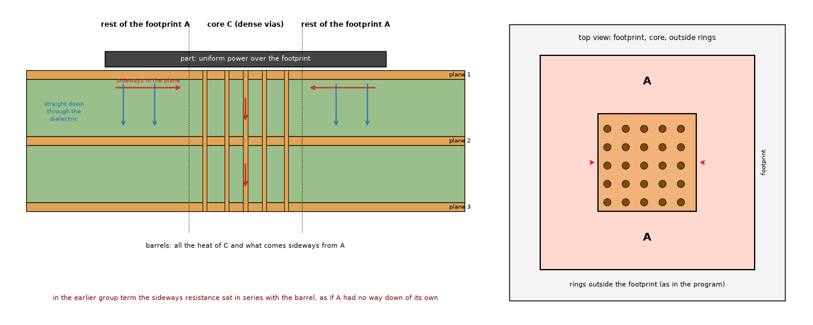

*Figure 1 (`figures/fig_01_footprint_core_section.png`): left, a section of three planes under a part: the heat of the rest of the footprint (A) goes sideways in the top plane to the core (C), and straight down through the dielectric under A; the barrels of C take it to the lower planes. Right, the top view: footprint, core, the rings outside it.*

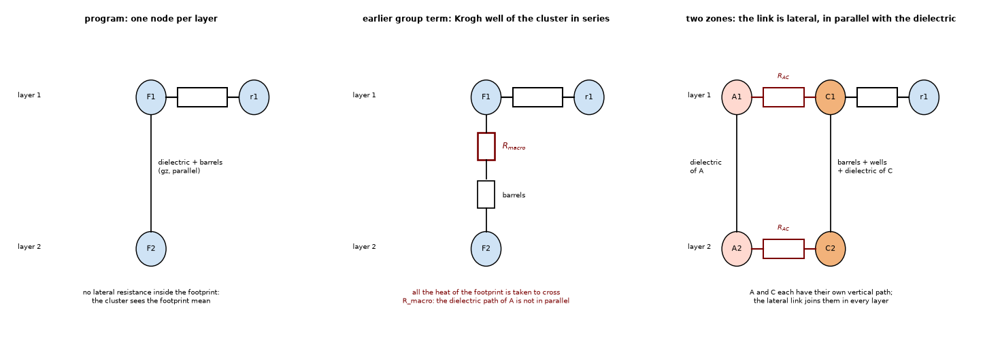

*Figure 2 (`figures/fig_02_networks_program_series_zones.png`): two layers under a footprint. Program: one node per layer, no lateral resistance. Earlier group term: a Krogh well of the cluster in series with the barrels (every watt crosses it). Zones: A and C in each layer, joined by a lateral link in parallel with the vertical paths.*

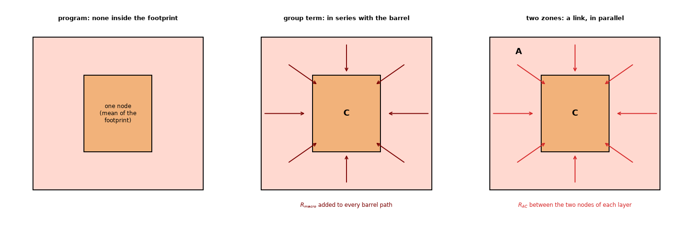

*Figure 5 (`figures/fig_05_where_the_lateral_resistance_sits.png`): the same footprint with a core in the three treatments.*

* **The model that is judged.** The Lumped model (`pcbthermal/lumped.py`, `_heater_network`) is one network per heater: ring 0 is the footprint (one node per layer), rings outside it are offset contours; the peak inside the footprint adds `(phi_mean - phi_min) Q_lateral / (2 pi S)`. `lumped-analytic-vias` added a Krogh well per via and plane in series with each barrel (the "micro well", cell = the Wigner-Seitz disc of the nearest neighbour, exact for a lattice) and a group term (the cluster as one disc inside the area of the rings it touches). The micro well is kept in every variant here.
* **References** (independent of the program): the layered fine-grid solver `sheets2d` of `research/point-via-convergence` (the layered model of the program on a 1/16 mm grid with every barrel drawn at its real size, nothing of the program imported by the solver) through `research/lumped-analytic-vias/lib/harness.py`; its through-thickness floor against a 3D solver with the barrels drawn is 1.6 % on the unit cell (`lumped-analytic-vias` 3.3). For the example board, `FVM_fix`, the FVM with the corrected via treatment on a 0.25 mm cell (the best the program has; it is not independent of the layered idealisation). Where the answer is exact, a closed form: the Krogh cell, the lossy cell (section 3).
* **Metric.** The via effect `E = T_max(no vias) - T_max(vias)` (K) and its error `100 (E / E_ref - 1)` %: positive means the model is cooler than the reference with vias (unsafe), negative hotter (safe). Reference values and variants for each board are in `out/family.json` (git-ignored; `scripts/run_studies.py` rebuilds it).
* **Simple boards first, each isolating one effect:**

| Board (script) | What it isolates | Independent answer |
| :-- | :-- | :-- |
| a unit cell of a lattice, a cluster of 1 to 16 vias in an 8 mm cell heated everywhere (`study_cluster_in_cell.py`, 4.1) | the lateral link between the cluster and the rest of the cell, with no ring outside (the footprint is the whole board) | fine-grid layered solver |
| an n x n array of 0.3 mm vias at 0.8 to 3.5 mm pitch under a 6, 10 or 14 mm source on a 30 mm board, 2 to 6 layers, open and copper-filled (`study_family.py`, 4.2) | the share of the footprint that the vias cover (0.05 to 1.0), the pitch against the fin length, the barrel resistance (open against copper), the stack-up | fine-grid layered solver |
| the same, layouts changed: source and array together off the board centre, a rectangular source, two clusters, one cluster off the centre of its footprint (`study_zone_sensitivity.py`, 6) | the concentric-disc assumption | fine-grid layered solver |
| 26 held-out boards: films, thickness, layer count, drill, pitch, rectangles, clusters off the centre (`study_holdout.py`, 12.2) | what the 36 boards keep fixed | fine-grid layered solver |
| a lone via and a row of five beside a 3 mm source (`study_outside.py`, 7) | vias outside the footprint | fine-grid layered solver |
| a via cell with a flux or film on its face (`study_fish_case.py`, 9) | the effective vertical conductivity of a dense array and the microspreading that it omits | published numbers (Fish 2017) |
| the annulus with a core and a loss (`study_cell_link.py`, 3) | the link between A and C | finite differences |
| the example board with arrays under U1 (`study_example_board.py`, 8) | a real layout: partial copper, a heatsink, two parts | corrected FVM |

* **The variants** (`lib/refs.py`, `VARIANTS`): `L_prog` the program; `L_ring` the micro well with the cell of the ring; `L_nn` the micro well with the nearest-neighbour cell (the micro well alone); `L_grp0` the series group term of `lumped-analytic-vias`; `L_out` the group term outside the footprint only (the hypothesis; for an array entirely inside the footprint it is `L_nn`); `L_loss` the group term with the lossy cell; then the ladder of the zone model, one change at a time: `L_zone0` (the Krogh link of concentric discs, the annulus peak), `L_zone_c1` (+ the core-internal resistance), `L_zone_disc` (+ the micro peak), `L_zone_p` (the link of the real shapes), `L_zone_r` (+ the peak of the real shapes with the lossy kernel: the researcher's proposal), **`L_zone`** (+ the bump of a core hotter than the rest and the block decimation of the peak integral: the proposal after the review, section 12.1), `L_zone_k` (`L_zone` with no micro well). The steps before `L_zone` keep the researcher's choices (`refs.OLD`).
* **Tests** (`tests/test_lumped_groups.py`, 16 tests): the axisymmetric solver against a homogeneous cell and the rule of mixtures; Fish's `R_msp` within 3 %; the cell problem against both closed forms; the annulus resistance and peak against numerical integration; the rim-to-mean resistance of the Krogh cell; the logarithmic-potential link against Krogh plus `1 / (8 pi)` for concentric discs (0.5 %); the potential peak against the annulus peak (within 3 % with the block decimation; the strided decimation is more than 10 % high there, kept as a check of the defect) and the effect of the loss; the copy of the group term against the patch of the earlier investigation (1e-9); the zone model without vias is the program bit by bit (trivially: no core, no zones) and, with vias that conduct nothing, within 1.5 % of it on a sparse array (the researcher's version 4.2 % below; section 12.1); its energy balance closes (`1e-9`) and the program is restored; a 3 x 3 array against the fine-grid reference (zone within 10 %, series group term not).

## 2. What the literature says (and does not)

* **Fish (2017), chapter 6** (read, pages 89 to 99): the effective vertical conductivity of a via unit cell is the rule of mixtures (eq. 43) only when the faces are isothermal; with a flux or convection on a face a **microspreading resistance** `R_msp` appears in series, `k_eff,z = L / (A (R_1D + R_msp))` (eq. 47), `R_msp = R_msp,max / (1 + (h P / (k_s H0))^beta)` (eq. 49, `H0` = 15.5, `beta` = 0.96) for a 60 um copper via at 100 um pitch in glass: `R_msp,max` = 1240 K/W. **Reproduced** to 2 % (section 9). The statement carries over to this problem: the copper planes of a PCB are the faces of the array, with a finite sheet conductance, so a dense array under a larger footprint is not an isothermal-face cell.
* **Shen, Wang, Blaabjerg, Zhao, Long (2019)** (read, sections II and III): a via array under a chip modelled with vertical resistances only ("the radial heat transfer of the inner-zone via array is not pronounced", a powerful heatsink below), the outer vias with distributed radial and vertical resistances, validated within 3.2 % against CFD (abstract summary). It is the published inner-zone and outer-zone idea, and, like ours, it splits the footprint region from what lies around it; it assumes a heatsink under the array and leaves out the spreading in the planes under the footprint.
* **Soleymani Koohbanani (thesis, SFU)** (read, chapter 3): the through-plane conductivity of a PCB with vias as a parallel network of barrel, air and FR-4 (1D), measured on nine round samples (model within 13 % of the measurement and 9 % of a COMSOL unit cell with isothermal faces). It is the effective-conductivity form, with isothermal faces by construction.
* **Not found**: a published model of a via group inside a larger heated footprint of a network with one node per layer (what the Lumped model is); the search returned vendor notes that give an equivalent conductivity for the via region and tell the user to model the internal planes explicitly, with no error data. Guenin (2004; section 17 of the bibliography) states the mechanism (a 1D via model up to 27 % optimistic, a circular-fin cell within 22 % and 6 % with the die spreading) but its tables were not readable. The closed forms used here (the lossy annulus, the logarithmic-potential link, the rim of the Krogh cell) are derived and checked numerically (status L); the reading status of every source is in `research/theory/BIBLIOGRAPHY.md`, section 18.

## 3. The cell problem behind the link

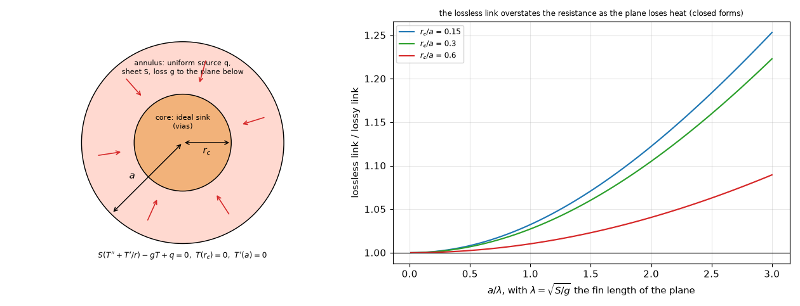

*Figure 3 (`figures/fig_03_cell_problem_link.png`): left, the cell: an annulus of sheet S with a uniform source q and a vertical loss g, an ideal sink in the core, an insulated rim; right, the lossless link (Krogh) divided by the lossy one for three core sizes: the lossless link overstates the resistance as the plane loses heat (closed forms).*

`study_cell_link.py` solves `S (T'' + T'/r) - g T + q = 0`, `T(r_c) = 0`, `T'(a) = 0` by finite differences (4000 points, no Bessel functions) and compares the mean temperature of the annulus over the heat taken by the core, which is the link of a two-node network, with the two closed forms of `lib/constriction.py`:

| r_c / a | a / lambda | link, 2 pi S (finite differences) | lossless Krogh / exact | lossy closed form / exact |
| --: | --: | --: | --: | --: |
| 0.30 | 0.05 | 0.6546 | 1.000 | 1.000 |
| 0.30 | 1.00 | 0.6372 | 1.027 | 1.000 |
| 0.30 | 2.00 | 0.5923 | 1.105 | 1.000 |
| 0.30 | 3.00 | 0.5352 | 1.223 | 1.000 |
| 0.60 | 1.00 | 0.2137 | 1.010 | 1.000 |
| 0.60 | 3.00 | 0.1982 | 1.089 | 1.000 |

(all 30 rows in `out/cell_link.txt`.) The lossy closed form is exact (1.000 on every row, an independent check of its implementation); the lossless Krogh form is within 3 % for `a / lambda` up to 1 and 7 % at 1.5; the fin length of the top plane is 3.3 to 4.7 mm against a footprint radius of 5.6 mm (`a / lambda` 1.2 to 1.7), so the lossless link is within a few percent of the lossy one for the boards of this study. The zone model nevertheless uses the lossless potential for the link and the lossy kernel for the peak, because the lossy cell assumes a loss to a layer at fixed temperature that the network does not have (the neighbouring layers are nodes too); with the concentric-disc link, the lossy closed form gave -2.4 / -1.6 % against -2.5 / -1.7 % on the 5 x 5 board in an earlier run of the sensitivity study (the option `link="loss"` of the library; that run is not in the final tables).

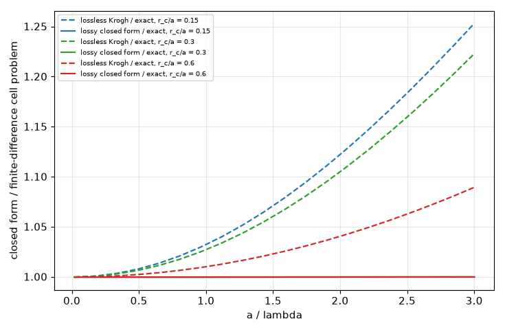

*Figure 11 (`figures/fig_11_cell_link_exact.png`): both closed forms against the finite-difference cell problem.*

## 4. The simple boards

### 4.1 The cluster in a uniformly heated cell (no ring outside)

`study_cluster_in_cell.py`: an n x n cluster at 1 mm pitch in the middle of an 8 mm cell heated everywhere on the top (2 and 4 layers, open and copper); error of E, percent:

| layers | fill | vias | E_ref K | `L_prog` | `L_nn` | `L_grp0` | `L_zone0` | **`L_zone`** |
| --: | :-- | --: | --: | --: | --: | --: | --: | --: |
| 2 | open | 1 | 18.35 | +31.3 | +4.5 | +4.5 | +4.5 | +0.7 |
| 2 | open | 4 | 39.47 | +28.0 | +22.7 | +7.5 | +4.1 | +0.5 |
| 2 | open | 9 | 52.70 | +20.3 | +17.5 | +5.6 | +5.1 | +2.1 |
| 2 | open | 16 | 61.31 | +13.6 | +11.9 | +3.7 | +2.7 | -0.2 |
| 2 | Cu | 4 | 49.86 | +35.9 | +28.3 | +8.2 | +4.9 | +0.3 |
| 2 | Cu | 16 | 66.92 | +14.0 | +12.2 | +3.2 | +2.4 | -0.6 |
| 4 | Cu | 9 | 57.50 | +22.6 | +19.1 | +5.4 | +5.1 | +2.4 |
| 4 | Cu | 16 | 63.78 | +14.2 | +12.2 | +3.2 | +2.3 | -0.5 |

(16 rows in `out/cluster_in_cell.txt`: `L_zone` -0.6 to +2.4 %, the series group term +3.2 to +8.2 %, the micro well alone +4.0 to +28.3 %.) Here the series group term is acceptable (up to 8 %), because the whole cell is heated: the "rest of the footprint" has the same vertical path as the core, so the series and the parallel arrangements differ little. The differences appear when the footprint is larger than the core and its vertical path matters (4.2).

### 4.2 An array under a larger footprint

`study_family.py`: 36 boards, a source of 6, 10 or 14 mm on a 30 mm board, 4 layers (also 2 and 6 for the 10 mm source and the 5 x 5 array), 3 x 3 to 7 x 7 vias of 0.3 mm at 0.8 to 3.5 mm pitch, open and copper-filled. "Core share" is the share of the footprint inside half a pitch of a via in the reference. Error of E, percent (all variants and the factor scan are in `out/family.txt`):

| source mm | layers | array | fill | core share | E_ref K | best f | `L_prog` | `L_nn` | `L_grp0` | `L_zone_r` | **`L_zone`** |
| --: | --: | :-- | :-- | --: | --: | --: | --: | --: | --: | --: | --: |
| 6 | 4 | 3x3 @ 1.0 | open | 0.25 | 20.50 | none | +4.0 | -2.6 | -17.7 | -4.5 | **-4.5** |
| 6 | 4 | 3x3 @ 1.0 | Cu | 0.25 | 24.58 | 0.49 | +22.2 | +12.1 | -9.8 | -3.1 | **-3.1** |
| 6 | 4 | 5x5 @ 1.2 | open | 1.00 | 26.68 | 0.51 | +9.0 | +5.1 | -4.4 | +4.4 | **+4.4** |
| 6 | 4 | 5x5 @ 0.8 | Cu | 0.44 | 30.66 | 0.52 | +11.1 | +7.9 | -6.3 | +7.4 | **+7.4** |
| 10 | 4 | 3x3 @ 1.0 | open | 0.09 | 11.06 | none | +8.1 | -0.3 | -31.1 | -6.1 | **-6.1** |
| 10 | 4 | 3x3 @ 1.0 | Cu | 0.09 | 13.29 | 0.43 | +45.2 | +28.7 | -22.7 | -6.9 | **-6.9** |
| 10 | 4 | 3x3 @ 2.0 | Cu | 0.36 | 16.36 | none | +18.0 | -2.4 | -19.1 | +7.4 | **+7.4** |
| 10 | 4 | 3x3 @ 3.5 | Cu | 1.00 | 14.49 | none | +33.2 | +4.7 | +4.7 | +1.6 | **+1.6** |
| 10 | 4 | 5x5 @ 1.2 | open | 0.36 | 17.42 | 0.02 | +5.7 | +0.4 | -18.6 | -0.5 | **-0.5** |
| 10 | 4 | 5x5 @ 1.2 | Cu | 0.36 | 19.86 | 0.38 | +17.9 | +10.8 | -13.9 | -2.6 | **-2.6** |
| 10 | 4 | 5x5 @ 0.8 | Cu | 0.16 | 16.78 | 0.55 | +39.5 | +33.5 | -16.8 | +0.5 | **+0.5** |
| 10 | 4 | 7x7 @ 1.0 | Cu | 0.49 | 22.58 | 0.34 | +10.2 | +7.0 | -11.3 | -4.0 | **-4.0** |
| 14 | 4 | 3x3 @ 1.0 | Cu | 0.05 | 8.29 | 0.41 | +67.6 | +44.6 | -31.5 | -4.9 | **-3.8** |
| 14 | 4 | 3x3 @ 3.5 | open | 0.56 | 7.64 | none | +0.7 | -16.1 | -21.9 | +20.1 | **-0.7** |
| 14 | 4 | 3x3 @ 3.5 | Cu | 0.56 | 11.31 | none | +22.8 | -8.6 | -18.1 | +9.8 | **+2.2** |
| 14 | 4 | 5x5 @ 1.2 | Cu | 0.18 | 12.41 | 0.48 | +45.0 | +33.6 | -20.9 | -5.0 | **-5.0** |
| 14 | 4 | 5x5 @ 0.8 | Cu | 0.08 | 10.46 | 0.52 | +72.2 | +62.5 | -25.6 | -1.8 | **-1.0** |
| 14 | 4 | 7x7 @ 1.0 | Cu | 0.25 | 14.39 | 0.50 | +36.2 | +30.9 | -18.5 | -9.1 | **-9.1** |
| 10 | 2 | 5x5 @ 1.2 | Cu | 0.36 | 20.94 | 0.14 | +9.7 | +3.7 | -18.2 | -0.4 | **-0.4** |
| 10 | 6 | 5x5 @ 1.2 | Cu | 0.36 | 18.16 | 0.48 | +22.3 | +14.3 | -11.6 | -2.2 | **-2.2** |

(20 of the 36 rows; the 36 are in `out/family.txt` and fig. 06. `L_zone` differs from `L_zone_r` on the boards whose core is hotter than the rest, the sparse arrays, and on the 14 mm sources, whose rest holds more than 700 cells, where the decimation changed.) Summary over the 36 boards (percent of E; "hotter" counts the negative errors, the safe side):

| variant | mean | max | within 10 % | within 5 % | model hotter than the reference |
| :-- | --: | --: | --: | --: | --: |
| `L_prog` (program) | 20.9 | 72.2 | 13 of 36 | 4 | 3 |
| `L_ring` (micro well, cell of the ring) | 11.6 | 50.4 | 22 | 9 | 11 |
| `L_nn` (micro well alone) | 13.6 | 62.5 | 20 | 12 | 8 |
| `L_grp0` (series group term) | 18.0 | 38.7 | 9 | 4 | 32 |
| `L_loss` (group term, lossy cell) | 19.8 | 83.1 | 7 | 1 | 31 |
| `L_zone0` (Krogh link, concentric discs) | 6.2 | 30.0 | 33 | 15 | 6 |
| `L_zone_c1` (+ core-internal resistance) | 5.8 | 23.4 | 29 | 19 | 23 |
| `L_zone_disc` (+ micro peak) | 5.3 | 20.2 | 30 | 22 | 24 |
| `L_zone_p` (real-shape link) | 4.1 | 20.1 | 35 | 25 | 20 |
| `L_zone_r` (+ real-shape lossy peak: the researcher's proposal) | 4.4 | 20.1 | 35 | 24 | 19 |
| **`L_zone`** (+ bump of a hot core, block decimation: after the review) | **3.6** | **9.1** | **36** | **26** | **19** |
| `L_zone_k` (`L_zone` with no micro well) | 7.6 | 32.0 | 26 | 20 | 10 |

Split by the share of the footprint the vias cover: the 30 boards with a share below 0.95: `L_prog` 21.5 % mean (72.2 max), `L_nn` 15.4 (62.5), `L_grp0` 20.8 (38.7), `L_zone_r` 4.8 (20.1), `L_zone` 3.8 (9.1); the 6 boards whose vias cover the footprint (a `L_zone` with no split): `L_prog` 18.2 (33.2), `L_nn` 4.5 (5.2), `L_grp0` 4.4 (5.5), `L_zone` 2.7 (4.5), where the micro well and the micro peak do the work. The two sparse boards (3 x 3 at 3.5 mm in a 14 mm footprint) were the researcher's worst (+20.1 and +9.8 %): their core is hotter than the rest of the footprint, and its peak was taken as its mean (section 12.1).

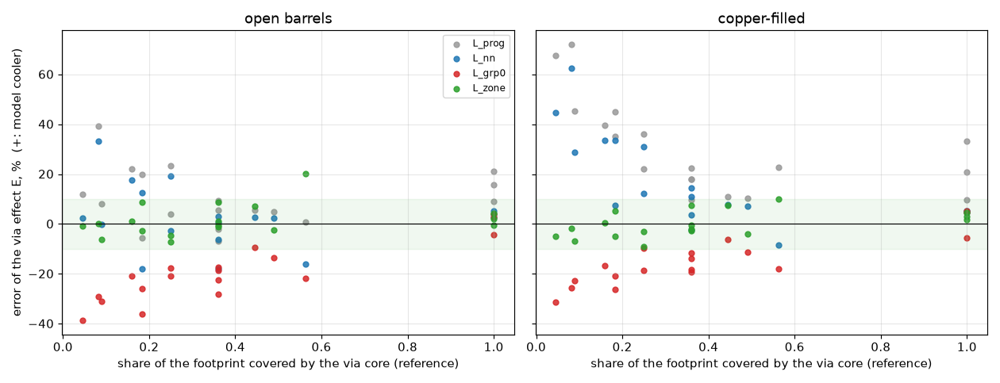

*Figure 6 (`figures/fig_06_family_errors.png`): the error of E of the program, the micro well alone, the series group term and the zone model against the share of the footprint that the vias cover, for open and copper-filled barrels; the band is the 10 % of the text. The series group term is hotter than the reference on every board with a partial core; the micro well alone is cooler; the zones lie between.*

### 4.3 The hypothesis, tested

The roadmap hypothesis: the rings already include the lateral spreading, so the group term double-counts it inside the footprint. Three tests:

1. **The rings carry nothing inside the footprint.** In `lumped.py` the footprint is ring 0: one node per layer; the rings are contours around it, and the only lateral resistance involving ring 0 is the footprint-to-ring-1 link and the peak term (both about the outflow). With the vias inside the footprint there is no lateral path inside it to count twice.
2. **The group term outside the footprint only** (`L_out`). For an array entirely in the footprint this is the micro well alone (`L_nn`): 15.4 % mean error and up to +62.5 % too cool over the 30 boards whose core covers part of the footprint (table 4.2: 10 mm source, 5 x 5 at 0.8 mm, copper, +33.5 %; 14 mm, 5 x 5 at 0.8 mm, +62.5 %); on the example board `L_out` is within -11.4 to 0 % (section 8), where the planes spread the heat for other reasons. The lateral resistance inside the footprint is needed.
3. **What the series group term does wrong.** The oracle scan (`best f`, fig. 07): the factor on the group term that would make E exact is 0.02 to 0.55 (24 boards), lies above 1 or below 0 on the other 12, and depends on the fill (0.02 for an open 5 x 5 array, 0.38 for the same copper-filled). That is the signature of a wrong structure, not of a wrong constant: the heat of the rest of the footprint has a vertical path in parallel with the sideways one, the open barrels have a weak vertical path and so see the resistance less, the copper ones more. The temperatures confirm it (fig. 08): on the 10 mm source with a copper 5 x 5 array the reference top plane is 30.16 K in A and 28.68 K in C; the series group term gives the footprint a mean of 31.5 K (and 21.0 K in the bottom layer against 20.1); the zones give 31.4 K in A and 28.3 K in C in the top layer (A is 1.3 K hot there: the link of the real shapes is a little long for this core) and are within 0.4 K of the reference in A and C of the three lower layers (the series group term is 0.2 to 0.9 K off there).

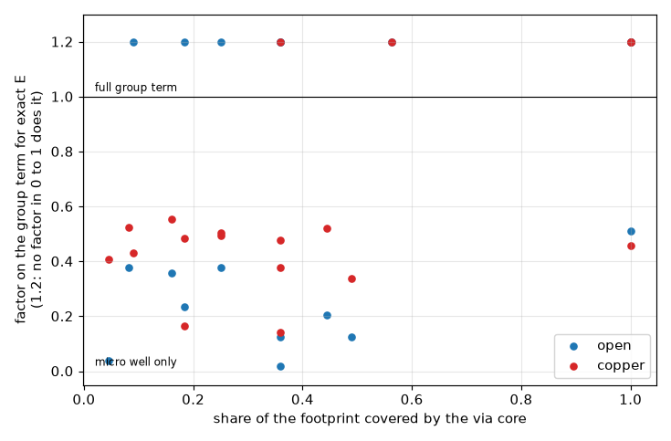

*Figure 7 (`figures/fig_07_best_group_factor.png`): the factor on the group term that makes E exact, board by board: it never takes one value.*

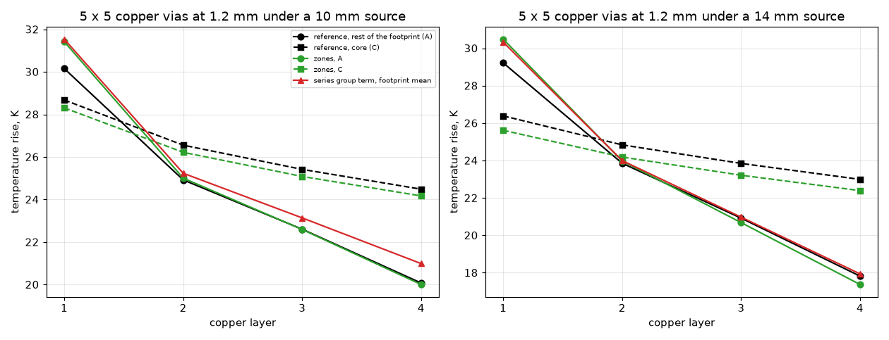

*Figure 8 (`figures/fig_08_zone_temperatures.png`): the temperatures of the rest of the footprint (A) and of the core (C) in each layer for the reference, the zone model and the footprint mean of the series group term, on 10 and 14 mm sources over a copper 5 x 5 array at 1.2 mm.*

## 5. The zone model

Formulation and tests are in `docs/theory-text.md`; the code is `lib/lumped_zones.py`.

* **Zones.** The core C is the set of cells of the footprint within `0.7071 d_nn` of a via of a group of two or more vias in the footprint (so that a square lattice is covered); A is the rest of the footprint. If the core covers more than 92 % of the footprint (or none of it) the footprint stays one node, with the micro wells and the micro peak.
* **Nodes and links.** Two nodes per layer for the footprint, ring 1 and the rest as in the program; the source in proportion to the area of A and C; each zone has its own films, dielectric and, in C, the barrels with the micro wells (Kron reduced, as in `lumped-analytic-vias`). The lateral link A-C in every layer is `(2 phi_AC - phi_AA - phi_CC) / (2 pi S)`, `phi_XY` the mean of `ln|x - y|` over the cells of X and Y (a uniform source over A and a uniform sink over C on a lossless sheet; for concentric discs it is the Krogh resistance of the annulus plus `1 / (8 pi S)` of the core, to 0.1 %). The link from A to ring 1 is the mean-to-outer-wall resistance of the annulus plus the half ring of the program.
* **Peak.** The hottest point of A above its mean, from the field of the net generation of A (`Q_in + Q_out`), the sink `Q_in` in C and the far-field sink `Q_out`, with the `K0` kernel of the layer (its fin length from its films and dielectric); the larger of this and the core temperature plus the rise of the rim of one via's Krogh cell (`I_via (rim - mean)`, the micro peak) **plus, when the core is hotter than A, the bump of the core above its mean** (the lossless potential of C heated uniformly with its net lateral outflow to A, the program's own peak formula for a footprint; added by the review, section 12.1). The peak integral aggregates the cells in blocks when a zone holds more than 700 cells (the review; the researcher's every-step-th-cell decimation was biased upwards, section 12.4). Groups outside the footprint keep the group term of the earlier investigation.
* **The ladder** (family summary of 4.2, mean / maximum error): the Krogh link alone 6.2 / 30.0; plus `Q / (8 pi S)` of the core 5.8 / 23.4 (the sign of the error turns from too cool to too hot on dense arrays: 6 boards hotter against 23); plus the micro peak 5.3 / 20.2 (it moves the boards where the core covers the footprint from +2.7..+5.2 % to -0.4..+4.5 %); the link of the real shapes 4.1 / 20.1 (it makes the model robust to the raster and to the shape, section 6); the peak of the real shapes with the lossy kernel 4.4 / 20.1 (the same mean, but the off-centre and the rectangular cases improve a lot: section 6; the researcher's proposal, `L_zone_r`); the bump of a hot core and the block decimation 3.6 / 9.1 (the sparse boards from +20.1 / +9.8 % to -0.7 / +2.2 %: the review, `L_zone`).
* **Cost.** Two dense potential matrices of at most `700 x 700` per heater on top of the program's network; the researcher measured hundredths of a second on the example board (not re-measured by the review, which ran on a shared machine: no timing is a result here).

## 6. Robustness

`study_zone_sensitivity.py` (5 x 5 at 1.2 mm under a 10 mm source on a 30 mm board unless stated; error of E, percent):

| layout | fill | `L_prog` | `L_nn` | `L_grp0` | `L_zone_disc` | `L_zone_r` | **`L_zone`** |
| :-- | :-- | --: | --: | --: | --: | --: | --: |
| centred | Cu | +17.9 | +10.8 | -13.9 | -2.5 | -2.6 | -2.6 |
| centred | open | +5.7 | +0.4 | -18.6 | -1.7 | -0.5 | -0.5 |
| source and array 2 mm off the board centre | Cu | +20.1 | +12.9 | -12.2 | -0.7 | -0.8 | -0.8 |
| source and array (3, 2) mm off the board centre | open | +7.0 | +1.6 | -17.9 | -0.2 | +1.2 | +1.2 |
| source 17.6 x 6.9 mm (side ratio 2.56) | Cu | +73.1 | +61.2 | +13.8 | +31.0 | +10.1 | +10.1 |
| source 17.6 x 6.9 mm (side ratio 2.56) | open | +50.3 | +42.1 | +7.0 | +31.8 | +14.2 | +14.2 |
| two 3 x 3 clusters, 6 mm apart, source 14 | Cu | +63.2 | +48.9 | -13.4 | -11.5 | +0.5 | +0.7 |
| two 3 x 3 clusters, 6 mm apart, source 14 | open | +30.8 | +22.5 | -18.7 | -7.1 | +3.4 | +3.3 |
| one 3 x 3 cluster 2.5 mm off the centre of a 14 mm source | Cu | +141.1 | +108.1 | -1.4 | +25.5 | +10.8 | +11.5 |
| one 3 x 3 cluster 2.5 mm off the centre of a 14 mm source | open | +66.5 | +52.3 | -8.8 | +29.3 | +19.9 | +21.4 |

**Corrected by the review**: the rows "off centre 2 mm" and "off centre (3, 2) mm" of the researcher move the source **and** its array together off the centre of the board (`offset` moves both in `cases.array`): the array stays centred in its footprint, so they test the board edge, not a cluster off the centre of the footprint; and the "12 x 7.5 mm (aspect 1.6)" source is 17.6 x 6.9 mm (`src_aspect` multiplies one side by 1.6 and divides the other, a side ratio of 2.56). A footprint of side ratio 1.5 and 2 and clusters off the centre of their footprint by 2 mm and (3.5, 1.5) mm are among the held-out boards of section 12.2 (side ratio 1.5: +1.0 / +3.1 %; 2: +4.3 / +7.3 %, +10.8 % with a bottom film of 10 W/m2K; clusters off the centre: +8.0 / +11.9 % and +20.2 %).

The concentric-disc model (`L_zone_disc`) fails for a rectangular footprint and for a cluster off the centre (+25 to +32 %); the logarithmic potentials of the real shapes cut the error to +10 to +21 %, which is still the largest of the study: the lossy peak is a one-term approximation of a field that is not axisymmetric, and the equivalent disc used for the link to ring 1 is not the real shape. **This is a stated limit** (the unsafe side); the warning of `INTEGRATION.md` 4 (side ratio above 1.5, core centroid more than a tenth of the smaller side off the footprint centroid) flags every board of this kind that was tested (section 12.2).

Knobs (the same board, Cu / open): the core radius around the vias, 0.5 `d_nn` -5.9 / -4.3, 0.7071 (as proposed) -2.6 / -0.5, 1.0 `d_nn` +5.0 / +6.5; the link times 0.75 +1.0 / +2.2 and times 1.25 -5.5 / -2.8; the through-flow link to ring 1 in the layers without the source -3.6 / -1.4; no peak term of the zones +0.2 / +2.2; the lossless peak -2.7 / -1.6; the annulus peak -2.1 / -1.4; no micro well +0.0 / +1.7; the researcher's version (no bump of a hot core, strided decimation) -2.6 / -0.5 (the core of this board is cooler than the rest). **Everything moves the result by 5 to 9 points at most**; none of these values is fitted: the radius 0.7071 is the one that closes a square lattice, the link is derived, the factors 0.75 and 1.25 are there to show the sensitivity, not as candidates.

Raster of the Lumped model (cell 0.5, 0.75, 1.0 mm): `L_zone` -2.6, +1.4 and -6.2 % (Cu), -0.5, +1.9 and -5.6 % (open); the concentric-disc version loses 14 % at 1 mm (a core of 6 cells across). **Corrected by the review**: the researcher's table had a 0.25 mm row identical to the 0.5 mm row in every column, because the program clips the Lumped cell to 0.5 to 1.0 mm (`api`: `min(max(cell_mm, 0.5), 1.0)`): it was the 0.5 mm run again and is removed. The program runs the Lumped model at 1.0 mm for any part wider than 4 mm unless the user picks a cell of 0.5 mm, so the 1 mm raster is the one that matters; on the 36 boards it is section 12.3.

## 7. Vias outside the footprint (rows and a lone via)

`study_outside.py` (2 and 4 layers, drill 0.3 and 0.6 mm, open and copper; a row of five at 1 mm pitch on a 16 mm board, a lone via 2, 4 and 8 mm from a 3 mm source on a 30 mm board; error of E, percent, mean and maximum over the 32 boards):

| board | `L_prog` | `L_ring` (micro well) | `L_grp0` | `L_loss` | `L_zone` |
| :-- | --: | --: | --: | --: | --: |
| lone via (24) | 73.4 / 287.8 | 15.1 / 31.4 | 15.1 / 31.4 | 15.1 / 31.4 | 15.1 / 31.4 |
| row of five (8) | 72.1 / 100.6 | 34.6 / 50.2 | 8.0 / 10.9 | 5.5 / 8.7 | 8.0 / 10.9 |

The zone model does not change vias outside the footprint (identical to `L_grp0`). The group term works for a row (it is a sink of its own beside the source, not a footprint with a vertical path of its own): 5.5 to 8.0 % mean, the lossy cell (`L_loss`) a little better (5.5 / 8.7), though the lossy cell was worse than the lossless one elsewhere; not adopted without a second study. A lone via stays the documented limit of the earlier investigation (the ring is an isotherm around the footprint, the heat must go tangentially to a point; -31 to +14 % on an E of 0.1 to 2 K); a warning is the proposal.

## 8. The example board

`study_example_board.py`: the 100 x 80 mm example board of the program (four layers, partial top copper 70 x 50 mm, U1 4 W on 10 x 10 mm and U2, a heatsink under U1, h 10 and 15 W/m2K) with its 9 vias at 3.5 mm and with 5 x 5 (1.2 mm), 7 x 7 (1.0 mm) and 20 x 20 (1.0 mm) arrays replacing them; reference `FVM_fix` at 0.25 mm; error of E, percent:

| board | fill | E_ref K | `L_prog` | `L_nn` | `L_grp0` | `L_out` | **`L_zone`** |
| :-- | :-- | --: | --: | --: | --: | --: | --: |
| 9 vias at 3.5 mm | open | 9.573 | +16.5 | -3.4 | -3.4 | -3.4 | -7.1 |
| 9 vias at 3.5 mm | Cu | 13.770 | +30.3 | -0.4 | -0.4 | -0.4 | -4.1 |
| 5 x 5 at 1.2 mm | open | 18.241 | -6.2 | -11.4 | -29.8 | -11.4 | -0.3 |
| 5 x 5 at 1.2 mm | Cu | 20.509 | +6.1 | -1.0 | -24.9 | -1.1 | -3.0 |
| 7 x 7 at 1.0 mm | open | 21.323 | -5.6 | -8.3 | -23.9 | -8.3 | -3.1 |
| 7 x 7 at 1.0 mm | Cu | 22.294 | -1.4 | -1.5 | -18.4 | -1.5 | -1.8 |
| 20 x 20 at 1.0 mm | open | 21.966 | +0.4 | -1.1 | -31.6 | -0.9 | -0.1 |
| 20 x 20 at 1.0 mm | Cu | 22.426 | -1.5 | -1.6 | -30.1 | -1.9 | -2.0 |

`L_zone_r` and `L_zone` are identical on these eight boards (no core is hotter than the rest of the footprint, and a 10 x 10 mm footprint at 0.5 mm holds 400 cells). The maximum temperatures behind `INTEGRATION.md` 3 are the last table of `out/example_board.txt` (printed since the review). Gain of the copper fill (reference 4.198 / 2.268 / 0.971 / 0.460 K): `L_prog` +61.8 / +104.7 / +88.6 / -92.7 %, `L_nn` +6.6 / +82.4 / +147.8 / -22.6, `L_grp0` +6.5 / +14.0 / +102.3 / +40.7, `L_zone` +2.9 / -24.6 / +28.8 / -95.4 % (the last two gains are 1.0 and 0.5 K: their percentages are not meaningful). The series group term reproduces the problem found by the review (18 to 32 % too small on the three dense arrays); the zone model removes it (0.1 to 3.1 % on the three). **Why the micro well alone does so well here and not on the simple boards**: the example board has a weak bottom film (15 W/m2K) and full planes, so the heat spreads in the planes below before it leaves, and the lateral path between the footprint and the cluster matters less; on the simple boards the bottom film is 200 W/m2K. The boards are two different regimes of the same model, and a rule calibrated on one fails on the other.

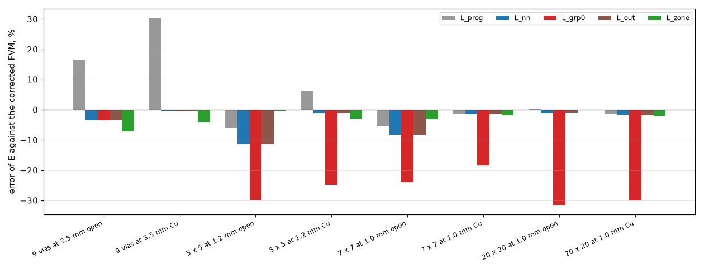

*Figure 9 (`figures/fig_09_example_board.png`): the error of E on the example board and its arrays under U1.*

## 9. The effective vertical conductivity route and the published case

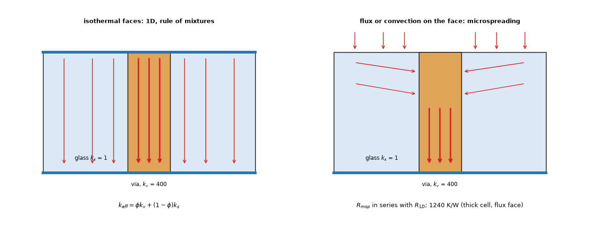

*Figure 4 (`figures/fig_04_microspreading_unit_cell.png`): the via unit cell of Fish (2017): with isothermal faces the flow is one-dimensional and the cell has the rule-of-mixtures conductivity; with a flux or film on a face the heat spreads sideways in the weak material before it reaches the via (the microspreading resistance, in series).*

**Reproduction** (`study_fish_case.py`, independent axisymmetric solver `lib/axisym_cell.py`, the equal-area disc of the 100 um cell; tests): the isothermal cell gives `k_eff,z` = 113.81 W/mK for every thickness from 25 to 500 um (the rule of mixtures; Fish quotes 114.5, which his eq. 43 itself does not give: 113.8); the thick-substrate microspreading resistance with a uniform flux on the top face is 1215.2 K/W against the published 1240 K/W (-2.0 %); against the correlation of eq. 49 over `h` = 1 to 1e7 W/m2K the ratios are 0.980, 0.980, 0.988, 1.014, 1.073, 1.097, 1.085 (the correlation is itself a fit of finite-element points); the resistance of a thin cell grows (1050 K/W at 25 um, 1210 K/W from 100 um up). The numbers are the published ones (marked: R_msp,max 1240 K/W and `H0`, `beta` are read from the text of page 99; the points of figures 42 to 44 were not read, only the correlation).

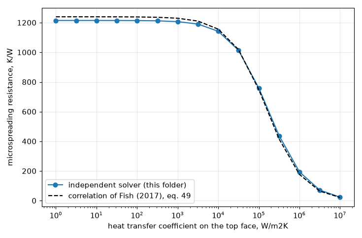

*Figure 10 (`figures/fig_10_fish_microspreading.png`): the microspreading resistance of the thick cell against the heat transfer coefficient of the top face: the independent solver and the correlation of the dissertation.*

**What it says for the Lumped model.** The "effective vertical conductivity of the array" is a 1D model of isothermal faces (Shen: radial transfer neglected; Soleymani: isothermal boundary conditions, unit cell by COMSOL within 9 %); with the faces being copper planes of finite sheet conductance, the heat has to reach the array through the planes, which is the microspreading of Fish and the constriction of `lumped-analytic-vias`. Tested here as `L_zone_k` (the zone model with the micro wells switched off, the planes isothermal at the barrels): 7.6 % mean and 32.0 % max against 3.6 and 9.1 % with the wells over the 36 boards (the researcher's version: 8.1 / 33.8 against 4.4 / 20.1 %), and +0.0 / +1.7 % against -2.6 / -0.5 % on the 5 x 5 board of section 6: worse on the simple boards. It was not run on the example board. The route is **not recommended as a replacement**; it is what the program does today (the barrels only, `L_prog`: 20.9 / 72.2 %).

## 10. Limits, the warning and what was not done

* **Limits that stay**: the vias outside the footprint (section 7); a footprint of side ratio 2 to 2.6 and a cluster off the centre of its footprint by a tenth of its side or more (+8 to +21 %, section 6 and 12.2); the program's 1 mm raster (8.0 % mean, 20.8 % max on the 36 boards, mostly on the safe side, section 12.3); vias that conduct little (the zone network alone up to 2.1 K, 5 % of the rise, cooler than the reference, section 12.1); several groups with different pitches in one footprint (the core is the union; the micro cell of each group is its own); the transient (the zoned network has no `K` and `C` attributes; the time models of the Lumped model were not touched); a block layer or a heatsink inside the footprint (the zones carry the film conductances per cell; nothing was tested with a block); the layered idealisation's own floor, up to 4 to 27 % on real barrels (`point-via-convergence` 3.3) and the through-thickness floor of 1.6 %.
* **Warnings proposed** (text in `INTEGRATION.md` 4): when a part has two or more vias in its footprint and the Lumped model has no zones, *"the Lumped model treats the vias of this part as one node: the via effect can be up to 60 % too small or 30 % too large depending on how much of the footprint they cover; use the FVM for via design"*; with the zones, *"the footprint of this part is elongated or its vias are off its centre: the via effect can be 20 % too large (the part too cool)"* (side ratio above 1.5 or the centroid of the core more than a tenth of the smaller side off the centroid of the footprint; the sparse-array rule of the researcher is dropped, section 12.2) and, for a lone via or a row outside the footprint, *"10 to 30 % off on an effect of 0.1 to 2 K"*.
* **Not done**: a Gerber board with many vias (the research environment of `gerber-import` was not installed here); a lossy link (`link="loss"` exists in the library and was tried on one board, no better); the lone-via limit; the Analytic model (it has no footprint node: its tiles resolve the cluster, `lumped-analytic-vias` 6.2); the peak of the zones for a block under the part.
* **Defects found in the program's models**: the finding of the earlier investigation stands (the series group term, if adopted as it was, is worse than the program on the dense arrays of the example board; this folder explains why and replaces it). The review found one small new one, measured on the program read-only (section 12.4): `lumped._footprint_potentials` keeps every step-th footprint cell in row order above 900 cells, and the mean-to-boundary term of the footprint's link to ring 1 comes out 4 to 11 % short on a square footprint of 1600 to 3600 cells (a 20 to 30 mm part at a 0.5 mm raster, or 40 mm and up at 1 mm); the peak term is within 0.4 %.

## 11. Reproducing

From the repository root (`.venv/bin/python`): `research/lumped-via-groups/scripts/run_studies.py` runs the studies in order and writes `out/*.txt` (the fine-grid references take about an hour the first time, cached in `out/refcache`; two at a time, 3 GB each), then `make_diagrams.py` and `make_figures.py`. Individual studies (the run times are the researcher's rough guide, not results): `study_fish_case.py`, `study_cell_link.py`, `study_cluster_in_cell.py`, `study_family.py` (most of the first run: its references), `study_example_board.py` (the FVM reference and its maximum are cached in `out/real_ref.json`), `study_outside.py`, `study_zone_sensitivity.py`, and the review's `study_holdout.py` (26 more references the first time) and `study_review.py` (both after `study_family.py`). Tests: `.venv/bin/python -m pytest research/lumped-via-groups/tests -q` (16 tests); the whole project's `tests/test_license_header.py` and `tests/test_docs.py` pass with this folder.

## 12. Review

Status: **reviewed**, program `develop` at 2.4.4 (last change of `pcbthermal/` `3d672f1`; `pcbthermal/`, `tests/`, `examples/`, `ico/` untouched: `git diff develop --stat` on them is empty). Every study was re-run by the reviewer with the cached references: `out/fish_case.txt`, `cell_link.txt`, `cluster_in_cell.txt`, `family.txt`, `example_board.txt`, `outside.txt` and `sensitivity.txt` were identical to the researcher's before the corrections below, and every number of sections 3 to 9 was checked against them (the counts "within 10 %", "within 5 %", "hotter" and the splits by core share recomputed from `out/family.json`). The absolute maxima of `INTEGRATION.md` 3, which no script printed, were reproduced to the digit and are now printed by `study_example_board.py`. The review's own checks are `scripts/study_holdout.py` (`out/holdout.txt`, fig. 12) and `scripts/study_review.py` (`out/review.txt`).

### 12.1 The via effect of the zone model was not all a via effect (defect of the study, corrected)

E is a difference of two maxima, and the run without vias is the program's single-node network while the run with vias is the zoned one, so E also holds whatever the split does by itself. Vias that conduct nothing (plating 1e-12 m, open barrel: the true E is 0) measure it (`study_review.py` part 1): the researcher's zone model reported **+0.0 to +4.2 K** of "via effect" on the 36 boards (up to 44 % of the effect of the real vias), the zone network with such vias being up to 3.5 K (6.3 % of the rise) cooler than the reference. Most of it came from one omission: when the core is hotter than the rest of the footprint (weak or sparse vias, or none that conduct) the hottest point is inside the core, above its mean, and the researcher's peak took the core mean (plus the micro peak). The review adds that bump (the lossless potential of the core heated uniformly with its net lateral outflow to A, the program's own footprint formula; `lumped_zones.patched(core_peak=True)`). With it the null-via offset is +0.0 to +2.8 K and the zone network with dead vias is at most 2.1 K (5.0 % of the rise) cooler than the reference; what remains is the difference between the zoned peak (A mean plus the lossy excess) and the program's single-node peak, which the program itself overstates by 0.5 to 2.2 K without vias. Effect on the results: the sparse boards of the family move from +20.1 / +9.8 % to -0.7 / +2.2 % (3 x 3 at 3.5 mm in 14 mm), the held-out sparse boards from +9.1 to +21.0 % to +0.9 to +7.0 %, the family summary from 4.4 / 20.1 % (35 of 36 within 10 %) to 3.6 / 9.1 % (36 of 36); the boards whose core is cooler than the rest do not change. Regression test: `test_zone_model_with_vias_that_conduct_nothing_stays_near_the_program`.

The absolute maximum with vias against the reference (part 2; model minus reference, mean / max of the absolute value in percent of the rise, boards where the model is cooler): program without vias 1.8 / 3.4 % (0 of 36), `L_prog` 6.8 / 22.1 % (30), `L_nn` 4.9 / 18.9 % (17), `L_grp0` 9.8 / 13.2 % (0), `L_zone_r` 2.9 / 7.3 % (7), `L_zone` 2.8 / 7.3 % (5). So the zone model is also the closest in the quantity a user reads, and on the safe side on 31 of 36 boards; the series group term is hot on every board (by up to 5.8 K), which is why its E is too small.

### 12.2 Held-out boards and the warning rules

The zone model was built on the 36 boards and the layouts of section 6, so it was run on 26 boards that change what they keep fixed (`study_holdout.py`, fig. 12): bottom films of 10 and 50 W/m2K, boards of 0.8 and 2.4 mm, 3 and 8 layers, drills of 0.2 and 0.5 mm, pitches of 0.6, 1.5, 2.5 and 3.0 mm, true rectangles of side ratio 1.5 and 2, clusters 2 mm and (3.5, 1.5) mm off the centre of a 12 mm footprint. Error of E, mean / max, within 10 %: `L_prog` 28.9 / 176.6 % (7 of 26), `L_nn` 22.6 / 152.9 % (11), `L_grp0` 16.0 / 41.4 % (9), `L_zone_r` 6.7 / 21.0 % (20), **`L_zone` 4.5 / 20.2 % (23)**. The three boards above 10 % are a cluster off the centre (+11.9 % open, +20.2 % for the (3.5, 1.5) mm offset) and the 14 x 7 mm source with a bottom film of 10 W/m2K (+10.8 %); all are on the unsafe side.

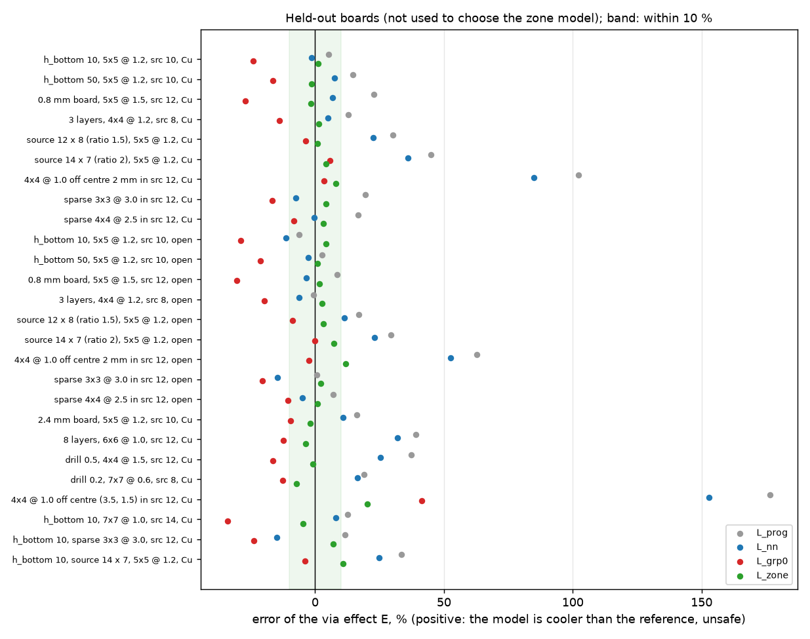

*Figure 12 (`figures/fig_12_holdout_errors.png`): the error of E of the program, the micro well alone, the series group term and the zone model after the review on the 26 held-out boards; the band is 10 %.*

The warning rules of the researcher (`d_nn` above 0.7 fin lengths, side ratio above 1.5, core centroid more than a quarter of the smaller side off) were checked on the 72 boards of the family, the layouts and the held-out set (`L_zone` more than 10 % too cool counted as "bad", 7 boards): they flag 4 and miss 3 (the clusters off the centre by 0.17 to 0.18 of the side), and flag 6 good boards. Side ratio above 1.5 **or** offset above 0.1 of the smaller side flags all 7 and 3 good boards (the sparse rule is no longer needed after 12.1, and no board reaches 0.7 fin lengths but the 3.5 mm pitch). This rule was chosen on the same 72 boards it is checked on.

### 12.3 The raster of the program (a limit the documents did not state)

The studies run the Lumped model on a 0.5 mm raster; the program clips the Lumped cell to 0.5 to 1.0 mm and its default cell and `Auto` (a quarter of the smallest part, at most 2 mm) give 1.0 mm for every part wider than 4 mm. The 36 boards at 1.0 mm (`study_holdout.py` part 3; mean / max, within 10 %): `L_prog` 20.1 / 73.8 % (15 of 36), `L_nn` 13.2 / 64.2 % (22), `L_grp0` 18.3 / 37.2 % (7), `L_zone_r` 9.1 / 20.8 % (24), `L_zone` 8.0 / 20.8 % (27). The misses of `L_zone` at 1 mm are on the safe side (-11.4 to -20.8 % on the 3 x 3 arrays at 1.0 mm and the 7 x 7 arrays, whose core is three to seven cells across); the largest unsafe error is +7.0 %. So the zone model needs either a Lumped raster tied to the core (a cell of a tenth of the core, or 0.5 mm under parts with vias) or the warning that its via effect may be 20 % too small at the default raster; this is a decision for the adoption (`INTEGRATION.md` 6).

### 12.4 The decimation of the potential integrals

`potential_excess` (the peak of A) kept every step-th cell in row order when a zone held more than 700 cells; on concentric discs with 0.2 mm cells (`study_review.py` part 4) that put the peak 17 to 25 % above the closed form of the annulus, and three times above it on a thin annulus (896 cells), because the kept cells form stripes and the maximum of the field over them is biased; the test that compared them allowed 25 % (its docstring said 10 %). Blocks of k x k cells with their own centroid and self distance give 0.98 to 0.99 (0.93 on the thin annulus, where every cell gives 1.17); the review uses them (`decimation="block"`) and the test now asks 3 %. On the studies it moves only the 14 mm sources (the rest of the footprint holds 700 to 750 cells at 0.5 mm) by 0.1 to 1.5 points. The link (`mutual_potentials`, means only) is within 0.3 % of Krogh plus `1 / (8 pi)` with the strided decimation and was left as it was.

The program has the same strided decimation in `lumped._footprint_potentials` (900 cells). Read-only, against every cell: the peak term `phi_mean - phi_min` is within 0.4 %, but the mean-to-boundary term of the link to ring 1 is 4 % short on a 20 mm square (1600 cells at 0.5 mm), 11 % on a 30 mm square (3600 cells), 5 % on a 20 mm disc. It enters only the footprint's half of `R_{0,1}` and only above 900 footprint cells; a defect of the program to fix with the zones or on its own (`docs/versions.md`, chapter 'Planned', if the maintainer agrees), not measured on a board here.

### 12.5 Other checks and corrections

* **A second layered reference** (`study_review.py` part 3): the corrected FVM of `point-via-convergence` at 0.25 mm gives the via effect of four boards within -0.1 to -0.3 % of the fine-grid solver, so the reference of the 36 boards is not a property of one solver. Both share the layered idealisation; no 3D reference with drawn barrels was run on these boards (its floor, 1.6 % on the unit cell and 4 to 27 % on real barrels, is that of `lumped-analytic-vias` and `point-via-convergence`).
* **Mislabelled layouts** (section 6): the "off centre" rows moved the source with its array; the "12 x 7.5 mm, aspect 1.6" source is 17.6 x 6.9 mm, side ratio 2.56. Labels of `study_zone_sensitivity.py`, the `refs.make_problem` docstring and section 6 corrected; real off-centre clusters and rectangles are in 12.2 (`src_wh` key of `refs.make_problem`).
* **The 0.25 mm raster row** was the 0.5 mm run (the program's clip); removed, 0.75 mm added (section 6).
* **The oracle scan**: "outside 0 to 1 on 12" is 8 boards outside and 4 (arrays that cover the footprint) where the group term changes nothing.
* **INTEGRATION 3**: option C moves the example board by -1.1 K (open 5 x 5) to +4.7 K (copper-filled 9 vias), not "+2.3 to -1.0 K".
* **Smaller statements**: the swapped "1.000 and 1.00 to 1.25" of the closed forms; Fish's correlation "within 2 to 10 %" is 1.2 to 9.7 %; the module header of `lib/lumped_zones.py` described the concentric-disc options as the model, not the defaults of `patched`; the timings of section 5 and 11 are no longer quoted as results.
* **Checked and right**: the zone network against `docs/theory.md` 5 (same rings, films, dielectric and block couplings by zone, the source split by area; the A-ring 1 link omits the program's Bessel factor `f_R`, which the null-via check bounds); the cell problem (both closed forms against finite differences, 30 rows); Fish's case (1215.2 K/W, 113.81 W/mK) re-run; the energy balance of the zoned network (`1e-9`); the 4.3 temperatures of A and C; the example board, outside and cluster tables; figures 1 to 12 against the text; no dates; licence headers and the Doxygen gate (`tests/test_docs.py`, `tests/test_license_header.py`: 279 passed); the bibliography entries of section 18 (statuses R for the parts read, S for the journal version, N where not opened, equation 8 of Shen marked as lost).
* **Not verified by the review**: a 3D reference with the barrels drawn on these boards, a Gerber board with many vias, the transient, a block under the part, irregular groups, an L-shaped footprint; the zone model's remaining null-via offset (up to 2.8 K of E) is bounded, not removed.

## What was read and what was not verified

* **Read in full or in the part that matters** (extracted to text in a scratch directory, nothing stored in the repository): Fish (2017) chapter 6, dissertation pages 89 to 99 (equations 40 to 49 as text; the figures only as captions); Shen, Wang, Blaabjerg, Zhao, Long (2019), the text of sections II and III (equation 8 lost in the extraction); Soleymani Koohbanani (thesis), chapter 3 (the formulas are images and were not read; the numbers of its results come from the text and a plot). **From the earlier investigation**, unchanged: the Krogh cell, the lossy cell, the micro well, the group term, the references. Reading status of each source is in `research/theory/BIBLIOGRAPHY.md`, section 18.
* **Reproduced**: the published unit cell of Fish (R_msp,max 1240 K/W: 1215 K/W here, -2.0 %; the rule of mixtures exactly; the correlation within 10 % (1.2 to 9.7 %) over h from 1 to 1e7 W/m2K), with an independent solver; the lossy and the Krogh cells against finite differences (ratios 1.000 and 1.00 to 1.25).
* **Derived here and checked numerically** (status L): the annulus mean-to-outer-wall resistance and the hottest point of the annulus (against integration), the logarithmic-potential link and its equality with Krogh plus `1 / (8 pi S)` (0.1 %), the rim-to-mean resistance of the Krogh cell (against integration), the peak of the real shapes (against the annulus form and the loss).
* **Not verified**: **no published numerical case of a via group inside a larger footprint was found or reproduced**; the agreement is against the fine-grid layered solver of this repository (the layered idealisation, 1.6 % from a 3D solver on the unit cell, up to 4 to 27 % on real barrels) and, for the example board, against the program's own corrected FVM; the zone model was not run on a Gerber board; transients and a block under the part were not run; the constants (core radius `0.7071 d_nn`, share 0.92 above which the footprint stays one node, the 700-cell decimation of the potentials) are assumed, not derived, and their sensitivity is in section 6. The review (section 12) re-ran every study and added held-out boards, vias that conduct nothing, the absolute maximum, a second layered reference and the decimation checks; it did not run a 3D reference, a Gerber board or a transient either.
* **Doubts of the author**: (1) the lossy kernel is used for the peak and the lossless one for the link, an asymmetry chosen because it fitted the layouts of section 6, not derived; (2) `A -> ring 1` uses the concentric annulus even for the real shapes; (3) the zone model has no free parameter but the 0.92, the 0.7071 and the micro-peak additivity are choices; (4) the core of sparse arrays (pitch about the fin length) is not a core in the physical sense and the model is 10 to 20 % too cool there (answered by the review: the core of those boards is hotter than the rest and its own bump was missing from the peak; with it they are within 7 %); (5) the reference of the example board is not independent of the layered idealisation.

## Library update after the point via and the via constriction of the program

`lib/lumped_zones.py` read the barrel from `net.gz`, which no longer holds it: it now reads `net.gz + net.gz_via` (the point barrel of the program up to `f2d5c03`, which is the model this study is about); its `zoned_network` and `_plain` accept the `vias` argument that the program passes since `fix/via-constriction` (ignored: the copy builds its own via couplings); `lib/refs.py` takes the baseline `L_prog` from `lumped_patch.patched("off")` (the program up to `f2d5c03`) because the current Lumped has the constriction of this line of work built in. The folder tests pass (16). The numbers of this README were NOT re-run; they are those of the program up to `f2d5c03`, so the columns named `program` or `L_prog` stay valid as the earlier program but no longer equal the current Lumped.
