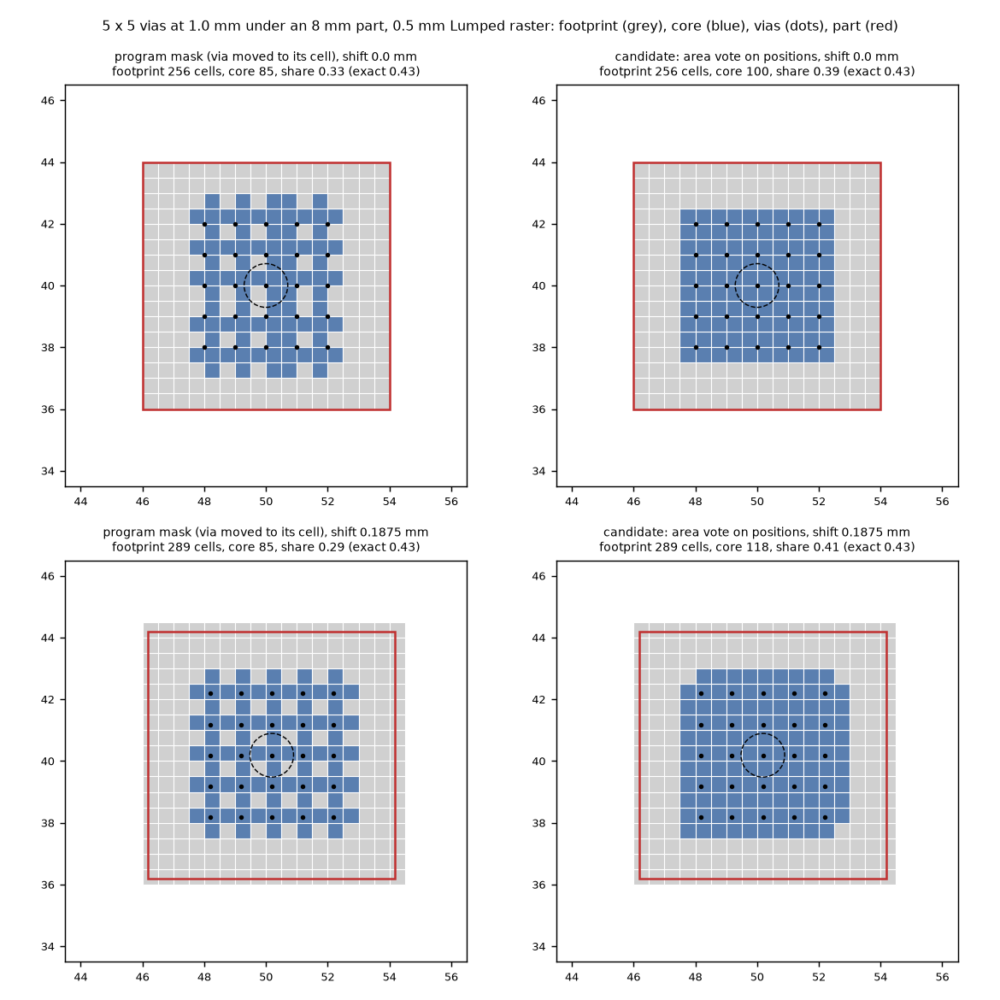
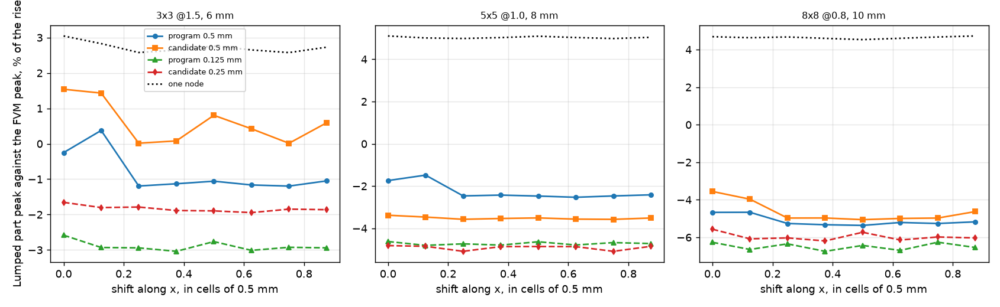

# The zoned Lumped footprint and its position on the raster (A46)

Branch `research/lumped-zone-placement`. Every board is a synthetic board of ours (those of `research/lumped-dense-via-group`). The program (`pcbthermal/`, `tests/`, `examples/`, the project documents) is untouched; every candidate rule is a monkeypatch on a copy, inside a context manager (`lib/placement.py`).

## 0. Summary

* **Question.** The zoned Lumped footprint (core C over the vias, rest A) reads the part peak -1.1 % on grid-aligned dense groups and -2.5 to -2.7 % (up to 7.2 %) when the part and the vias are shifted against the 0.5 mm raster, and the zone/one-node decision flips (`lumped-dense-via-group` 9.2). What is the mechanism, how large is the position noise, and is there a position-robust rule?
* **Mechanism (section 2, figure 1).** Four things depend on where the part and the vias fall on the raster: (a) the core mask moves each via to the centre of the cell that holds it, so the core is a lattice with holes and a lean (85 cells where the vias' own discs cover 100); (b) the core is a set of whole cells, so the area of C and the thickness of A change by a few cells with every sub-cell shift; (c) a via on the closed edge of the part is a member of the group or not depending on the last bit of a coordinate (the cell test), and the group then has 16 or 25 vias; (d) the gate that keeps a handful of cells in A counts every cell the part touches as a whole footprint cell. The fine 0.1 mm count that the program already uses for the decision is sound except for (c).
* **Noise (section 3).** On a sweep of 22 sub-cell placements (0 to 7/8 of a cell along x, y and the diagonal) the zoned part-peak error moves by 3.2, 2.1 and 1.3 points (3 x 3, 5 x 5, 8 x 8), while the FVM rise moves by 0.1 to 0.3 K of 50 to 66 K and the one-node reading by 0.3 to 0.6 points. The raster is the cause: at 0.125 mm the same sweep moves 0.8, 0.7, 0.9 points, at 0.25 mm 1.5, 1.1, 1.5.
* **Position-robust masks do not remove it (section 4).** Cell centre against via positions, a 0.1 mm area vote against the positions, with a membership tolerance and a coverage-weighted gate: the range is 2.4 to 2.9, 1.1, 2.3 to 2.9 points at 0.5 mm, i.e. a different but not a smaller noise. What they fix is the decision: vias on the part edge (5 x 5 at 2.0 mm under 8 mm) read zoned +4 to +10 % HOT or one node depending on the placement, range 13.1 points; with the rule R1 below it is one node at all 22 placements, range 3.6 points (the one-node range of that board).
* **The level is raster luck (section 5).** Against the independent 3D solver (which does not depend on the raster) the zoned Lumped reads -1.7 to +0.3 % at 0.5 mm but converges to -2.0 to -2.8 % at 0.125 mm; one node reads +2.1 to +2.9 %. Once the raster is converged the zones are no closer to the 3D than one node (|2.0 to 2.8| against |2.1 to 2.9| points), and on the cool (unsafe) side. The 0.5 mm raster's positive bias partly cancels that.
* **Recommended rule R1 (section 6, `INTEGRATION.md`)**: membership of a via on the closed footprint edge by a 1 micrometre tolerance, the core from the via positions (0.1 mm sub-grid area vote), the gate and the fine share weighted by the coverage, `MAX_CORE` 0.8 on the exact share. Measured: no frozen Lumped record moves (4 boards with vias, 12 records and 3 times), 66 cases at four placements: mean absolute peak error 1.52 against 1.51, largest placement spread 6.0 against 10.7 points. It does NOT reduce the 2 to 3 point noise of the dense groups; that needs a finer raster (0.25 mm moves `plate_vias` by 2.7 K and the level by 1.5 to 2 points down) or fractional weights (not tested).
* **A27 (the first link near an edge)** is additive and separable (section 7): the zoned minus one-node offset is -6.0 to -9.8 points at every gap to the side (3 to 25 mm), and the placement noise does not grow near the edge. The two can be one Lumped branch in either order; one pending-file rule (section 8).

## 1. Definitions

Peak with peak (hottest cell of the FVM under the footprint against the Lumped part row, `max(painted field, heater_peak)`) and mean with mean, in percent of the FVM rise at 0.5 mm, as in `lumped-dense-via-group` section 2. The reference FVM of every placement is run on the translated board (its own peak moves by at most 0.3 K, section 3). "Shift" translates the part and the via array together by k/8 of the 0.5 mm raster cell, the board stays. 'One node' is the Lumped with `lumped.ZONES = False`. The board is the 100 x 80 mm board of the dense-group folder (two layers unless said, `h` 10 W/m2K, edge 10 W/m2K).

## 2. The mechanism (study 1: `lib/placement.py` `geometry`, figure 1)

*Figure 1 (`figures/fig_01_core_mask_two_placements.png`): 5 x 5 vias at 1.0 mm under an 8 mm part on the 0.5 mm raster. Left column the program's mask, right column the candidate (area vote against the via positions); top row aligned, bottom row shifted by 0.1875 mm on both axes. Grey: footprint cells (touched by the part), blue: core, dots: vias, dashed circle: the core radius of one via.*

| placement | footprint cells (touched) | core cells, program | grid share | fine share (0.1 mm, the decision) | exact share (0.025 mm) | candidate core cells |
| :-- | --: | --: | --: | --: | --: | --: |
| 5x5 @1.0, aligned | 256 | 85 | 0.332 | 0.419 | 0.435 | 100 |
| 5x5 @1.0, shifted 0.125 | 289 | 85 | 0.294 | 0.426 | 0.435 | 110 |
| 5x5 @1.0, shifted 0.25 | 289 | 85 | 0.294 | 0.426 | 0.435 | 117 |
| 3x3 @1.5, 6 mm, aligned / shifted 0.125 | 144 / 169 | 87 / 93 | 0.604 / 0.550 | 0.653 / 0.666 | 0.669 | 96 / 93 |
| 5x5 @2.0, 8 mm (vias on the part edge), aligned / 0.125 | 256 / 289 | 198 / 273 | 0.773 / 0.945 | 0.826 / 0.998 | 0.828 / 1.000 | 210 / 289 |

*Table 2.1 (`placement.geometry` on the boards of `study_shift.py`; the 5 x 5 invariance of the exact share is held by `tests/test_zone_placement.py`).*

* (a) **Via moved to its cell.** `lumped._core_mask` seeds the cell that holds each via and takes the cells within `CORE_R d_nn` of the seed cells: on cell corners the seed is the upper right cell of four, so the mask is a lattice with holes (figure 1, top left), 85 cells against 100 from the positions, not symmetric about the array. It does not change with the shift (85, 85, 85) while the true core does not change either, but its shape and its boundary cells do.
* (b) **Whole cells.** The core is 85 to 118 cells of 256 to 289; a single boundary cell is 1 % of the footprint and 3 to 5 % of A, and A carries the peak (`peak_extra` is the hottest point of A's field). Moving an array by 0.0625 mm toggles boundary cells (3 x 3: 87 / 96 / 93 core cells at shifts 0 / 0.0625 / 0.125 diagonal).
* (c) **Membership of a via on the part edge.** The program asks whether the cell holding the via has coverage above zero. With the part on cell lines and vias on its edge, the via at x = 54.0 mm is in cell 108, which the part (46 to 54) does not touch: the group has 16 of 25 vias and the exact share is 0.828; shifted by 0.125 mm the vias are in a touched cell, all 25 count, the share is 1.0 (the discs of radius 1.414 mm on a 2.0 mm lattice cover every point). The 'regime (b)' of `lumped-dense-via-group` 9.2 is this.
* (d) **The gate counts touched cells whole.** `n_core <= MAX_CORE n_foot` uses cells with coverage above zero; a footprint on a non-aligned placement has a row and a column of slivers (256 to 289 cells), so the grid share falls from 0.33 to 0.29. It is not binding for the dense groups (their grid share is far below 0.92) and matters only near the threshold.
* The **decision count** (`_fine_core_share`, 0.1 mm) is sound: it follows the exact share to 0.02 (0.419 to 0.426 against 0.435; 0.826 to 0.836 against 0.828 to 0.842), except for (c).
* **What does not depend on the position**: the one-node reading (range 0.3 to 0.6 points) and the FVM (range 0.07 to 0.29 K of 50 to 66 K).

## 3. The noise on the sub-cell sweep (study 2: `scripts/study_shift.py`, 22 placements per group)

Zoned part-peak error against the FVM at 0.5 mm of the translated board, percent of the rise. Range = max minus min over the 22 placements (points); std in points.

| group | rule | zoned at | peak error mean | range | std | mean-with-mean: mean / range |
| :-- | :-- | --: | --: | --: | --: | --: |
| 3x3 @1.5, 6 mm | FVM rise range 0.285 K of 66.5 K | | | | | |
| | one node | - | +2.69 | 0.58 | 0.13 | +0.68 / 0.23 |
| | **program** | 22/22 | -0.77 | **3.18** | 0.74 | -0.99 / 2.81 |
| | program, zone raster 0.25 mm | 22/22 | -2.65 | 1.49 | 0.41 | -3.36 / 1.50 |
| | program, zone raster 0.125 mm | 22/22 | -3.01 | 0.80 | 0.21 | -3.91 / 0.92 |
| 5x5 @1.0, 8 mm | FVM rise range 0.122 K of 56.2 K | | | | | |
| | one node | - | +5.05 | 0.34 | 0.07 | +0.75 / 0.22 |
| | **program** | 22/22 | -2.73 | **2.11** | 0.62 | -2.43 / 2.19 |
| | program 0.25 / 0.125 mm | 22/22 | -4.74 / -4.82 | 1.10 / 0.72 | 0.31 / 0.18 | -4.05 / -4.06 |
| 8x8 @0.8, 10 mm | FVM rise range 0.187 K of 50.5 K | | | | | |
| | one node | - | +4.64 | 0.30 | 0.07 | +0.41 / 0.37 |
| | **program** | 22/22 | -5.33 | **1.33** | 0.40 | -3.57 / 1.69 |
| | program 0.25 / 0.125 mm | 22/22 | -5.83 / -6.59 | 1.50 / 0.90 | 0.41 / 0.25 | -3.89 / -4.20 |
| 5x5 @2.0, 8 mm (vias on the part edge) | one node | - | -1.35 | 3.61 | 1.27 | -1.55 / 2.52 |
| | **program** | 16/22 | +3.91 | **13.12** | 4.93 | +3.51 / 11.79 |
| | program 0.25 / 0.125 mm | 16 / 18 of 22 | +8.90 / +10.47 | 19.5 / 23.1 | 7.7 / 7.9 | |
| 5x5 @2.0, 10 mm | program = one node | 0/22 | -1.32 | 0.14 | 0.03 | -1.91 / 0.14 |

*Table 3.1 (`out/shift_report.txt`, git-ignored; rerun `study_shift.py`).*

*Figure 2 (`figures/fig_02_error_against_shift.png`): part-peak error of the Lumped against the shift along x for the three dense groups: program at 0.5 mm (blue), candidate rule at 0.5 mm (orange), program at 0.125 mm (green), candidate at 0.25 mm (red), one node (dotted).*

* The noise is of two kinds: a jump between the aligned placement and the first shifts (the part gains a row and a column of slivers; the program's reading goes from -1.7 to -2.5 on the 5 x 5) and a wiggle of 1 to 2 points on the 3 x 3. The aligned placement of all the earlier studies is the most favourable one for the zones (-0.8 against -2.5 % on the 66 cases, section 4).
* The raster is the cause of the wiggle: at 0.125 mm the 22 placements span 0.7 to 0.9 points. The level at 0.125 mm is 1.5 to 3.5 points cooler than at 0.5 mm.
* Vias on the part edge: the program reads that board +4 to +10 % hot at 16 placements and one node at 6, a range of 13 points; refining the raster makes it worse (19.5, 23.1): the zoned reading with a core that fills 83 to 91 % of the footprint is a thin-A artefact (`lumped-dense-via-group` 3.3), not a raster one.

## 4. Candidate rules (study 2, same sweep; study 3: `scripts/study_cases.py`, 66 cases x 4 placements)

Candidates are `lib/placement.py patched(...)`: `centre` (cell centre against via positions), `vote` (a cell is core when half of its 0.1 mm sub-grid is within `CORE_R d_nn` of a via position: an area-weighted cell share instead of 'the cell that contains a via'), `member_tol` (a via on the closed boundary of the touched cells is a member), `weighted_gate` (grid gate on the coverage-weighted share), `fine='vote'` (the decision share from the vote, not the replicated cells), `max_core`.

| group | program | centre+tol | vote+tol | vote+tol+gate+fine | R1 (that, `MAX_CORE` 0.8) |
| :-- | --: | --: | --: | --: | --: |
| 3x3 @1.5, 6 mm: peak mean / range | -0.77 / 3.18 | -0.02 / 2.43 | +0.21 / 2.78 | +0.21 / 2.78 | +0.21 / 2.78 |
| 5x5 @1.0, 8 mm | -2.73 / 2.11 | -3.71 / 1.06 | -3.63 / 1.06 | -3.63 / 1.06 | -3.63 / 1.06 |
| 8x8 @0.8, 10 mm | -5.33 / 1.33 | -5.15 / 2.34 | -5.07 / 2.94 | -5.07 / 2.94 | -5.07 / 2.94 |
| 5x5 @2.0, 8 mm (vias on the edge) | +3.91 / 13.12 | -0.86 / 14.29 (1 zoned) | -0.86 / 14.29 | -0.86 / 14.29 | **-1.35 / 3.61 (none zoned)** |
| vote+tol at zone raster 0.25 / 0.125 mm | | | 3x3 -1.97 / 0.77, 5x5 -5.02 / 0.79, 8x8 -6.11 / 1.11 (0.25); -2.90 / 0.83, -5.23 / 0.40, -6.63 / 0.67 (0.125) | | |

*Table 4.1 (`study_shift.py`).*

* **Position-robust masks trade noise for noise at 0.5 mm** (3x3: 3.2 to 2.4 to 2.8; 5x5: 2.1 to 1.1; 8x8: 1.3 to 2.3 to 2.9) and shift the level by +1 to -1 points: the mask is not what sets the 0.5 mm noise. The area vote is a little better than the cell centre only on the 5 x 5. Conclusion: no rule on a binary 0.5 mm core removes the quantisation; the answer is either a finer raster (spread 0.4 to 1.1 at 0.25 and 0.125 with the vote) or fractional node weights (the core a share per cell, not tested: it needs a rewrite of `_zone_network`'s sums and of `viaconstriction.ring_couplings`, which take one node index per cell).
* **What the rules do fix is the decision**, which the 66 cases show (peak error against the FVM at 0.5 mm, mean / mean absolute / largest absolute, percent of the rise):

| placement (part and array shifted along the diagonal) | program (zoned cases) | R1 rule (exact share <= 0.8) |
| --: | :-- | :-- |
| 0.0 | -0.83 / 1.61 / 7.3 (46) | -0.94 / 1.52 / 6.0 (43) |
| 0.125 | -2.47 / 2.59 / 6.9 (43) | -2.51 / 2.64 / 7.8 |
| 0.25 | -2.65 / 2.81 / 7.0 (43) | -2.33 / 2.61 / 8.4 |
| 0.375 | -2.50 / 2.60 / 7.2 (43) | -2.56 / 2.67 / 8.8 |

*Table 4.2 (`out/cases_report.txt`; the R1 column is the forced-zoned reading with the vote rule, selected by the threshold 0.8 on the exact share, so it is the rule without a flip from the program's own gate).*

| over the 66 cases | program | one node | R1 |
| :-- | --: | --: | --: |
| spread of one case over the four placements, mean / largest (points) | 1.99 / 10.7 | 1.03 / 6.0 | 1.90 / 6.0 (1.92 / 6.0 at T = 0.8) |

* The mean of the zoned level is placement-dependent for every rule (-0.9 at the aligned placement, -2.3 to -2.6 elsewhere): the mean absolute error at the aligned placement (1.51 to 1.61) is not the figure to quote; **-2.6 % mean, 2.6 to 2.8 mean absolute, 7 to 9 largest** is the honest one for the program at a non-aligned placement.
* Threshold T of the exact share is flat from 0.6 to 0.92 (mean absolute 2.61 to 2.73 at the shifted placements; largest 8.4 to 8.8, the 0.95 row jumps to 11.6 points of case spread): any T between 0.6 and 0.85 is equivalent on these 66 cases; 0.8 is chosen because it separates the thin-A regime (exact share 0.83 to 0.91 of the vias-on-the-edge boards, hot +4 to +10 %) from the dense groups (0.44 to 0.67). The 66 cases contain few points between 0.7 and 0.9: T is a choice on a small set of cases, not a fit.

## 5. Against the independent 3D solver (study 4: `scripts/study_independent_shift.py`)

The 3D solver (`research/lumped-dense-via-group/lib/ref3d.py`, `tests/helpers/layered3d.py`, 0.25 mm, centred part and array on a 40 x 40 mm board, insulated sides) does not know the Lumped raster, so it is computed once and the Lumped is run at eight diagonal shifts of 0 to 0.4375 mm (the reference is not recomputed for the shift: the board is unchanged, the distance to an insulated side changes by 2 %, negligible).

| group | 3D rise K (peak / mean) | one node peak % (range) | program 0.5 | candidate 0.5 | program 0.25 | candidate 0.25 | program 0.125 |
| :-- | --: | --: | --: | --: | --: | --: | --: |
| 3x3 @1.5, 6 mm | 131.23 / 126.67 | +2.06 (0.26) | +0.34 (1.79) | +0.48 (1.43) | -1.62 (0.62) | -1.34 (0.26) | -1.95 (0.33) |
| 5x5 @1.0, 8 mm | 120.51 / 117.71 | +2.85 (0.05) | -1.02 (1.04) | -1.34 (0.61) | -2.35 (0.51) | -2.51 (0.34) | -2.61 (0.24) |
| 8x8 @0.8, 10 mm | 114.43 / 111.79 | +2.85 (0.01) | -1.68 (0.51) | -1.63 (1.09) | -2.45 (0.54) | -2.52 (0.37) | -2.79 (0.32) |

*Table 5.1 (`out/independent_report.txt`): peak error mean % (range in points) over the eight shifts. 3D at 0.25 mm; the dense-group folder measured the 3D at 0.25 against 0.125 mm as +0.26 %.*

* Against the raster-free reference the zones converge to -2.0 to -2.8 % and one node reads +2.1 to +2.9 %: **equally far, opposite sides**. The 0.5 mm raster makes the zones look 1 to 2 points better (-1.7 to +0.3 %) through the same positive bias that makes the noise.
* The candidate mask at 0.25 mm halves the range again (0.26 to 0.37) and the level is converged (-1.3 to -2.5).

## 6. The rule R1 and what it moves (study 5: `scripts/study_frozen.py`)

R1: (i) a via on the closed boundary of the touched cells (1 micrometre) is a member of its group; (ii) the core mask: a cell is core when at least half of its 0.1 mm sub-grid is within `CORE_R d_nn` of a via position (area vote, no seed cell); (iii) the grid gate and the decision count weighted by the coverage (a sliver counts by its area); (iv) `MAX_CORE` 0.8 on that exact (raster-free) share instead of 0.92 on the replicated cells. Effects: table 4.2 (66 cases), table 4.1 (vias on the edge: range 13.1 to 3.6, no zoned placement), table 2.1 (the exact share, not the cells, is what is compared with 0.8).

**Frozen numbers.** `regress_harness.run_one(..., "lumped", cell)` for the 17 boards of `tests/regression` at 2, 1 and 0.5 mm and `regress_harness.t63` (1 mm), as the program and under each candidate (4 boards have two or more vias: `plate_vias`, `plate_lone_via` has one, the example boards have a group with a core share above 0.9 and stay one node; 12 records checked):

| candidate | records that move |
| :-- | :-- |
| R1 (vote+tol+gate+fine, `MAX_CORE` 0.92) | none |
| R1 with `MAX_CORE` 0.8 | none |
| R1 with `MAX_CORE` 0.75 | none |
| R1 with the zone raster 0.25 mm | `plate_vias|lumped|2`, `|1`, `|0.5` (+/- 2.68 K at the hottest point in each, cooler) and its time to 63 % 30.94 to 33.10 s |

*Table 6.1 (`study_frozen.py`).* So R1 leaves `lumped-part-readout.json` as it is; the 0.25 mm raster would move three of its 51 records and one time.

## 7. Interplay with A27 (study 6: `scripts/study_edge.py`)

5 x 5 at 1.0 mm under 8 mm and 8 x 8 at 0.8 mm under 10 mm, the part and the array moved so that the gap from the part to the left side is 3, 6, 12 and 25 mm, four sub-cell placements each, FVM at 0.5 mm of each board (edge coefficient 10 W/m2K).

| gap mm | 5x5 program / one node | 8x8 program / one node | zoned minus one node, 5x5 / 8x8 (points) |
| --: | --: | --: | --: |
| 3 | -11.92 / -5.95 | -14.28 / -6.80 | -6.0 / -7.5 |
| 6 | -10.58 / -4.08 | -12.67 / -4.57 | -6.5 / -8.1 |
| 12 | -8.28 / -1.19 | -10.08 / -1.18 | -7.1 / -8.9 |
| 25 | -6.29 / +1.51 | -7.61 / +2.19 | -7.8 / -9.8 |

*Table 7.1 (`out/edge_report.txt`, mean peak error % over the four placements; the board centre is 46 to 48 mm from the side: program -2.7 / -5.3, one node +5.1 / +4.6).*

* From a gap of 25 mm to 3 mm the zoned reading falls by 5.6 to 6.7 points and the one-node reading by 7.5 to 9.0 points: the near-edge deficit (A27) is a property of the first link and the rings, present in both, and **adds** to the position noise; the difference zoned minus one node is -6 to -10 points at every gap and changes by 2 points between 3 and 25 mm. The placement range at a given gap is 0.8 to 2.8 points at 0.5 mm (program 0.6 to 1.9, R1 1.3 to 2.8), not larger than in the centre; at 0.25 mm it is 0.3 to 0.8 points.
* So A27 can be measured on boards with vias and zones if the zone raster is fixed first (0.25 mm: range 0.3 to 0.8, the noise no longer blurs a 2 to 5 point A27 effect); at 0.5 mm the noise (up to 2.8 points) is about the size of the A27 gain on a small part. The two fixes both end in `lumped.py` (`_core_mask`, `_heater_network` for A46; the first link and ring 1 for A27) and touch different functions: one branch, A46 first.

## 8. Frozen numbers and the pending-file rule

`tests/regression/data/pending/lumped-part-readout.json` holds all 51 Lumped records (17 boards, three cells) and its times; `test_no_record_or_time_is_in_two_pending_files` forbids a record in two pending files. So the later Lumped branch (A46 + A27): if it moves nothing in A46 (R1 as measured), only A27's records change and the branch takes those out of `lumped-part-readout.json` into its own file (as the 2.6.0 integration did) or regenerates that one file under a combined item. If the zone raster goes to 0.25 mm, the three `plate_vias` records and its time are in A46's share. Do not run two Lumped fixes in parallel.

## 9. Limits and what was not verified

* The FVM reference is the cell-centred FVM at 0.5 mm; at 0.25 mm it differs by at most 0.15 point on the zoned error (`lumped-dense-via-group` 9.1); not re-measured here for every placement.
* Fractional (area-weighted) node weights, the one route that could remove the quantisation noise at 0.5 mm, were not built (they need the node sums, `viaconstriction.ring_couplings` and the peak fields to take weights per cell). Argument only: the 0.125 mm result is the limit such weights would approach, so they would remove the noise but also the 0.5 mm luck.
* Square arrays under square parts on two or four layers, one part per board; several groups in one footprint, non-square arrays, a metal block, an outline and the `h` sweep were not run (the same list as `lumped-dense-via-group` INTEGRATION.md 2). Shifts are the diagonal, along x and along y; no rotation.
* The 3D reference is centred on a 40 x 40 mm board (quadrant symmetry), so the shifts of section 5 are applied to the Lumped only (the reference is shift-free by symmetry of the physics, not recomputed).
* The threshold 0.8 is chosen on 66 cases and the three board families of section 3; the 66 cases hold few shares between 0.7 and 0.9. A decision for the reviewer.
* Not read in full by this study: `docs/theory.md` 5.2, `docs/validation.md` 31, 42, 48 (the numbers quoted from them come from the dense-group folder, which cites them); the code of `lumped.py` (`_core_mask`, `_fine_core_share`, `_heater_network`, `_zone_network`, `will_be_zoned`, `cell_for`) was read in full.
* The program was not edited; every number comes from monkeypatched copies of module names inside a context manager. `tests/test_zone_placement.py` (4 tests) checks that the patches restore the program, the exact share's invariance under translation, the symmetry of the candidate mask and the tolerance.

## What was read and what was not verified

* Read in full: the opinion's sections 5 and 6.4 brief (the part about A46), `research/lumped-dense-via-group` README (chapters 0, 3, 4.1, 9) and INTEGRATION.md, its `lib/viastudy.py`, `lib/variants.py`, `lib/ref3d.py`, `scripts/study_sweep.py`, `scripts/study_placement.py`, `scripts/study_independent.py`; `pcbthermal/lumped.py` around the zone model.
* From a summary or a grep only: `docs/theory.md` 5.2, validation 31, 42, 48, the A46 and A27 rows of `docs/versions.md` and `research/ROADMAP.md`.
* Reproduced: the program's numbers of `lumped-dense-via-group` 9.2 (-0.83 / -2.47 / -2.65 / -2.50 % mean peak over the 66 cases at the four placements against -1.11 / -2.91 / -3.18 / -2.96 % printed there: the printed rows there are over the 46 / 43 zoned cases, here over all 66 cases; the zoned-only figures were not re-run).
* Not run: fractional weights, a metal block, an outline, several groups, the reviewer's go.
