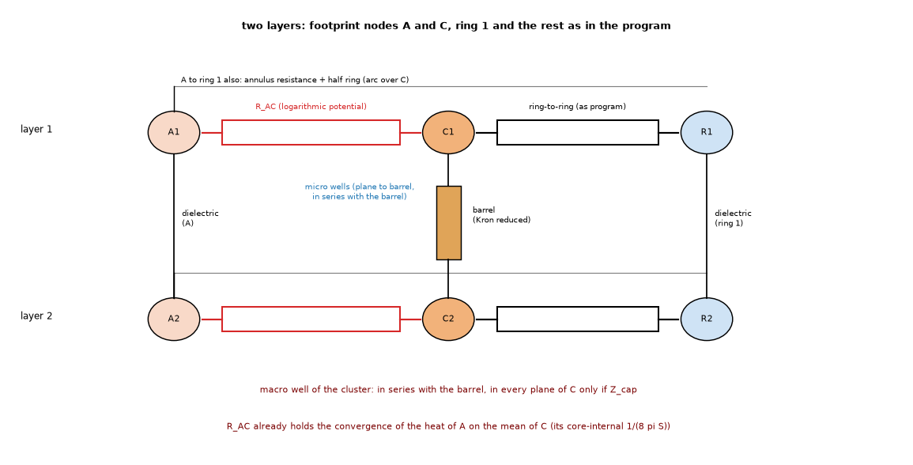
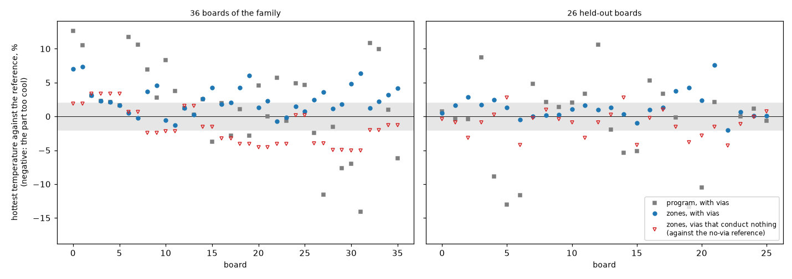
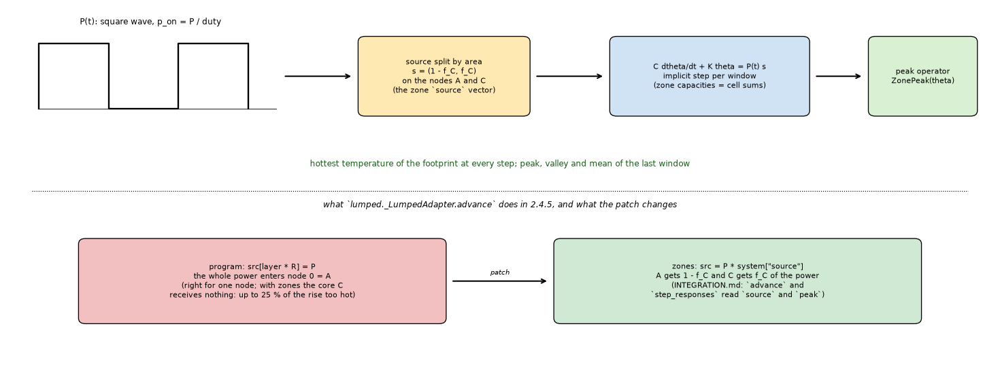
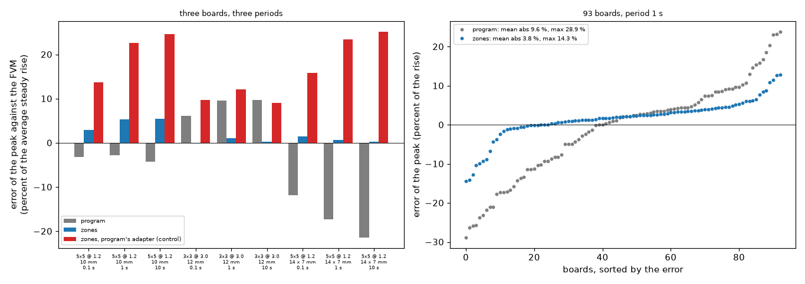
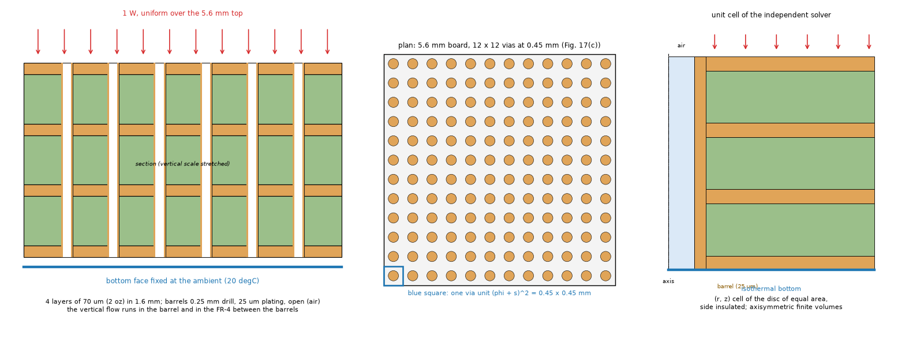
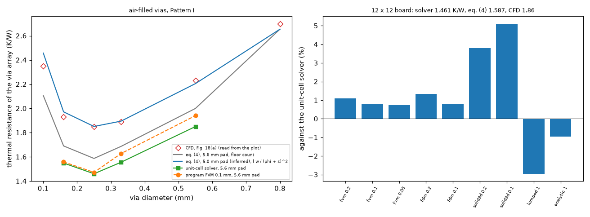
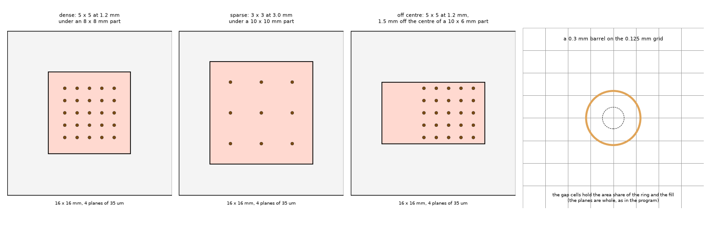
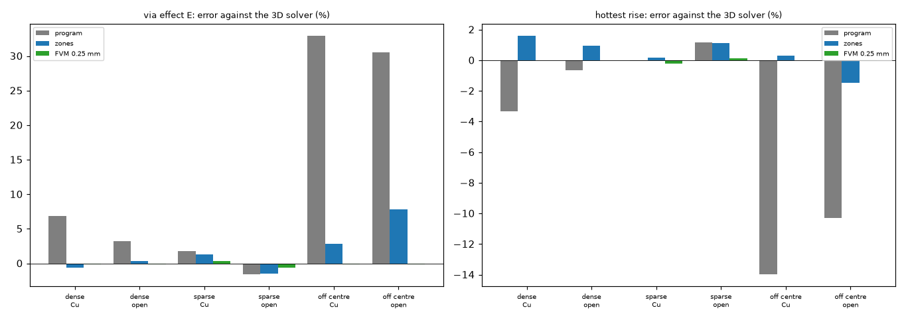

# The zonal Lumped model on the 2.4.5 via wells: results

**Status: run and reviewed (section 8: go for adoption with the conditions listed there; three statements of this README were corrected by the review and are marked); the checks the review left open were run in section 9 (profile with zones, published case of Shen and others, 3D check with drawn barrels, several groups in one footprint, cost) and were reviewed a second time in section 10 (go for the implementation, with the corrections listed there: the cause of the extra error of three profile runs, the start criterion, the reading of the CFD gap of the Shen case, a defect of the fine share in the prototype (fixed, no result moved), the records that the 0.5 mm cell moves, and the claim that the `cap` variant needs no change to `ring_couplings`).** Section 9 supersedes the "not verified" lists of 4.2, 4.7, 8.3, 8.6 and 8.9 where it says so. The 19 tests, the six studies and the figures 1 to 10 were run on the program of `develop` (2.4.5); section 9 was run on `develop` after the two Lumped fixes (the footprint potentials in blocks and the warning limits, which are in `develop` and not in 2.4.5) with the fine-grid references rebuilt at 1/8 mm. Section 3 holds the numbers of the earlier folder (program up to 2.4.4); every number in the sections 4.x under "Result" was measured here with the program of 2.4.5 and the fine-grid references rebuilt in this folder (cache `out/refcache`, git-ignored). The program (`pcbthermal/`, `tests/`, `examples/`, `ico/`) is untouched.

## 0. Summary

* Zones on top of the 2.4.5 well (variant `Z_none`) against the program (`P245`), error of the via effect against the fine-grid layered solver: **36 boards 3.9 % mean / 9.1 % max (36 of 36 within 10 %) against 10.8 / 32.0 (20 of 36)**; **26 held-out boards 4.5 / 20.2 (23 of 26) against 18.3 / 108.3 (12 of 26)**; example board: the original 9 vias are not touched by the zones (their core covers 98 to 100 % of the footprint, so the one-node fallback applies: bit-identical to the program at the same cell; *the first text said "no core", corrected in 10.5*), the 5 x 5 and 7 x 7 arrays under U1 move from -12.6 / -8.3 % to -0.3 / -3.1 % (open barrels), copper-filled stay within -3 % (4.1).
* The cluster (macro) well and the zones **do not double count in any measurable way**: keeping the program's cluster well in the zone nodes (`Z_cap`) changes the mean by 0.2 point (3.7 against 3.9 on the family, equal on the held-out); the rule written before the run (keep it only for at least 1 point on the sparse boards) says leave it out; the sparse boards (pitch 2 mm or more) differ by 0.2 point too (4.7 / 4.9). Either choice is safe; `Z_cap` needs no change to `viaconstriction.ring_couplings` (4.1).
* The step response of a zoned footprint follows the FVM at 0.01 to 100 s within 4 to 10 % on two boards and 0.3 to 36 % on the elongated one, where the program's own response is 63 to 74 % off at 0.01 s and 14 to 17 % off in steady state (4.2).
* The raster: at the program's 1.0 mm the zone model is 8.0 / 20.8 % (not 3.9 / 9.1); the tied cell recovers only part (4.8 / 17.2); warnings that fire on every board with a core under ten cells across catch all the boards above 10 % at 0.5 mm and all but one at 1.0 mm (4.3).
* **What the zones do not fix**: an array across the footprint edge is still up to +135 % in the via effect (6.6 K, 16 % of the rise, too cool), and an array just **outside** the footprint (1 to 4 mm) is 25 to 125 % too large in the effect in both models (4.4), which is 0.6 to 4.0 K, 1 to 9 % of the rise (review, 8.4). This is a limit of the ring network, not of the zones. *Corrected by the review:* an earlier version said that the 2.4.5 program does not warn about these boards; it does (its general warnings for vias under a footprint and outside every footprint fire on all of them), but the error bounds its texts quote (80 % and 56 % of the effect) are 2 to 3 times below the measured ones (8.4).
* The stride decimation of the footprint potentials is a real defect of the program (an aliasing of the row order: 4 to 11 % short on the link term at the cells the program uses, 0.5 to 1.0 mm, whenever the footprint has more than 900 cells and its width in cells is a multiple of the step; 22 % only at 0.25 mm, which the program does not use) but it moves the maximum rise by 0.06 to 0.31 K (0.2 to 0.7 %) on 16 to 60 mm sources, always making the part slightly too cool (4.5, review 8.5). *Corrected by the review of `fix/lumped-footprint-potentials`:* not always too cool and not always small: the stride error has either sign and depends on the board; a 35 x 35 mm part 10 mm off the board edge was +15 % on the link term (3.6 K too hot at 0.5 mm), and on a 2-layer board with copper on layer 1 only (20 W) a 40 mm square moved by +4.8 K at 0.5 mm and +0.8 K at 1 mm. The program now aggregates in blocks (`docs/theory.md`, Lumped, the footprint).
* **Review:** the agreement of the via effect is partly two errors cancelling (the cut of a uniform footprint into A and C makes it up to 2.9 K cooler by itself, which offsets a via effect of the zones that is 13 % too small); on the quantity the user reads, the hottest temperature, the zones are still clearly better than the program: 2.6 / 7.3 % against 5.2 / 14.1 % on the family, 1.6 / 7.6 against 5.2 / 17.3 on the held-out boards, and 0 and 1 boards more than 2 % too cool against 9 and 8 (8.2).
* Defects of the never-run prototype: three, fixed (section 5b).
* **Section 9 (the checks the review left open):** (1) **the square-wave profile with zones works once the profile runner is patched** (the source split between A and C, in `_LumpedAdapter.advance` and `step_responses`): the peak of the last window is within 5.4 % of the FVM's average steady rise on the three boards at 0.1, 1 and 10 s (program up to 21.4 %), and over the 93 boards at 1 s 3.8 % mean / 14.3 % max against 9.6 / 28.9 for the program; the control with the program's unpatched adapter (whole power on A) is up to 25 % too hot, so the patch is required (9.2). (2) **The published case of Shen and others** (a 5.6 mm board, 12 x 12 vias, 1 W): equations (2) to (5) were read from the rendered pages and implemented; the independent unit-cell solver gives 1.461 K/W and the program's FVM 1.472 K/W (+0.7 %), the other models -3 to +5 %; the paper's CFD number (1.86 K/W) is **not** reproduced (the solver is 21 % below it, equation (4) 15 % below) and the gap is reported, not adjusted (9.3); *the second review (10.2) places the gap in the paper's inputs, not in this folder: a second solver gives the same 1.456 to 1.470 K/W, equation (4) with the stated inputs is an upper bound that the CFD exceeds, and the paper's own analytical curve at 0.25 mm (about 1.82 K/W, plot) is not equation (4) with those inputs either.* (3) **3D check with the barrels drawn** on three 16 mm boards, copper-filled and open: the layered reference agrees with the independent 3D solver within 0.1 to 0.6 % in the via effect, the zones are within 0.3 to 7.8 % of it in the effect and 1.6 % in the hottest rise, the program is up to 33 % off in the effect and 14 % in the hottest rise on the off-centre board (9.4). (4) **Several groups in one footprint**: the single core still works, within 19 % of the effect and 2.5 % of the rise on four layouts (9.5). (5) **Cost**: the zones add nothing measurable, also inside the top-path and power-coefficient loops (9.6). (6) **The decision between zones and one node counted on the raster jumps** on the inverted-T example board (2.9 K between 1.0 and 0.5 mm) and on 4 of the 93 boards; a two-sided rule (share at most 92 % on the grid and on a 0.1 mm grid) removes the jump, and a probe shows that a core of 94 to 99 % of the footprint makes the zone network read the part up to 14 % hot, so the 92 % threshold must stay (9.7). (7) **Of the 17 boards of the frozen-numbers test one Lumped record moves materially** (`plate_vias`, -4.30 K; *with the 0.5 mm cell of the design, which 9.8 did not apply, -4.12 K, and the inverted-T example board -0.20 K: second review 10.5*), and the research copy is not bit-identical to the program on boards without a core (1e-6 K): the port must move the present code (9.8).

## 1. Question and why it matters

The Lumped model gives the footprint of a part one temperature per layer. When a dense group of vias (a "core") sits under a larger footprint, the heat of the rest of the footprint has to run sideways in the source layer to the core, in parallel with its own way down through the dielectric. One node cannot show that, and the via effect of such a part comes out too small: the part is read too cool, up to 60 % in the effect on the simple boards, against the fine-grid reference. The 2.4.5 program has the constriction of the heat on each barrel (a micro well per via, a cluster well per group with the macro radius capped at 0.75 fin lengths, Kron reduced) and warns for what it cannot resolve, and the zonal Lumped model was left in "Planned".

The earlier investigation of the via groups (`research/lumped-via-groups/`) designed the remedy: cut the footprint into two zones per layer, the core C (cells within 0.7071 nearest-neighbour distances of a via of a group in the footprint) and the rest A, join them by a lateral link, and take the hottest point of the footprint from the zone fields. It measured, **on the program up to 2.4.4 and on the micro well alone**: 3.6 % mean and 9.1 % maximum error of the via effect on 36 simple boards (the program's own 20.9 % and 72 %), 4.5 % / 20.2 % on 26 held-out boards, -7.1 to -0.1 % on the example board, and 8.0 % / 20.8 % when the Lumped raster is the program's 1 mm instead of 0.5 mm. The maintainer queued it for adoption after the 2.4.5 release ("we know the models have limits and we live with them", and this is the option chosen).

This folder prepares that adoption. It does **not** repeat the earlier derivation. It asks what the earlier work could not ask, because the 2.4.5 program did not exist then:

1. The zones were designed on the micro well alone. The 2.4.5 program adds a cluster (macro) well with a cap. Inside the zones, does that well still help, or does it count the same convergence of heat twice with the link between A and C? (Section 4.1, the main question.)
2. The zone network was built for the steady state only. Does the same network, with the capacities of the zones as sums of cell capacities, give the right time behaviour? (4.2)
3. At the program's default 1 mm raster the zone model loses a part of its accuracy. Is tying the raster to the core worth its cost, or is a warning enough? (4.3)
4. The worst cases of the 2.4.5 review (an array that straddles the footprint edge, a cluster off the centre of a long footprint): what do the zones do on them, and does the warning fire where it should? (4.4)
5. The program's own link from the footprint to the first ring is short by 4 to 11 % on large footprints because of the stride decimation of the footprint potentials. Fix it in the same change? (4.5)
6. What must not change: the board without vias, the zone code switched off, the energy balance, the vias that conduct nothing. (4.6)

## 2. How the proposal is built (so that the studies are readable)

Figures 1 and 2 show the situation and the network.

*Figure 1 (`figures/fig_01_footprint_zones_and_wells.png`): left, the section of a footprint with a dense core: the part heats the top plane; the heat of the rest A goes down through its own dielectric or sideways to the core C; the barrels of C carry it down, each with its micro well (dashed circle); the cluster well of 2.4.5 (red) treats the group as one disc. Right, the plan: footprint, core and the rings of the program outside.*

*Figure 2 (`figures/fig_02_network_two_layers_double_count.png`): the network of two layers: nodes A, C and ring 1 per layer; the link A-C (logarithmic potential of the real shapes); the barrel with its micro well under C; the place where the cluster well could count the convergence of the heat twice.*

The code is `lib/zoned_lumped.py`, a copy of `lumped._heater_network` of `develop` (2.4.5) with the zone branch, which imports the program and replaces `lumped._heater_network` in memory for the length of a context (`zoned_lumped.patched(...)`). The pieces:

* `core_mask`: groups of vias by the program's own single linkage (`viaconstriction.ViaSet.group`), the core is the cells within `0.7071` times the mean nearest-neighbour distance of a via of a group with two or more vias in the footprint. No core, or a core above 92 % of the footprint: one node, the program's network.
* `via_couplings`: `viaconstriction.ring_couplings` copied with two additions, a switch `zone_macro` that removes the cluster-well term from the two zone nodes (nothing else changes, groups outside the footprint keep it) and the barrel-only part of the coupling, which the micro peak needs. A test requires the copy to equal the program's function when the switch is not used.
* `mutual_potentials`: the link A-C, `(2 phi_AC - phi_AA - phi_CC) / (2 pi S)`, `phi_XY` the mean of `ln|x - y|` over the cells of X and Y (a uniform source over A and a uniform sink over C on a lossless sheet; for concentric discs it is the Krogh resistance of the annulus plus `1 / (8 pi S)` of the core).
* `annulus_out_resistance`: A to ring 1, the mean-to-outer-wall resistance of the annulus plus the half ring of the program.
* `ZonePeak`: the hottest point of the source layer, the largest of the hottest point of A (the field of A, `K0` kernel of the layer), the core mean plus the micro peak, and the core mean plus the micro peak plus the bump of a core hotter than A. The field is precomputed as a matrix (points x 2) so that the transient can evaluate the peak at every step with one product.
* `block_points`: the potential integrals of a zone with more than 700 cells aggregate the cells in blocks of k x k, not every step-th cell (the earlier review found the stride biased by 17 to 25 % on an annulus).
* `footprint_potentials`: the program's footprint potentials with an optional block decimation (4.5).
* `zone_warnings` and `tied_cell_mm`: the three warnings and the raster tied to the core (4.3, 4.4).
* `step_responses_zoned`: the program's step response with the source split between A and C and the zone peak.

Two differences from the earlier research copy are deliberate and are listed because they change what the studies compare: the via couplings are the program's own (2.4.5) and not the old micro well; and in the fallback (no core, or a core above 92 %), the footprint is the program's network exactly, without the micro peak of the old copy (`micro_peak_single=False`); whether the micro peak belongs there is not measured, and the earlier ladder attributed 0.5 point of mean error (5.8 to 5.3 %) to the micro peak in the zoned network.

## 3. Reference numbers carried over (earlier folder, program up to 2.4.4, not re-run here)

Error of the via effect, mean / maximum, percent, against the fine-grid layered solver (`sheets2d`, 1/16 mm, imports nothing of the program), raster 0.5 mm (`research/lumped-via-groups/README.md` 4.2, 12.2, 12.3 and `INTEGRATION.md` 3):

| set | program up to 2.4.4 (no wells) | micro well only | zones (micro well) |
| :-- | --: | --: | --: |
| 36 arrays under square sources | 20.9 / 72.2 | 13.6 / 62.5 | 3.6 / 9.1 |
| 26 held-out boards | 28.9 / 176.6 | 22.6 / 152.9 | 4.5 / 20.2 |
| the 36 at 1.0 mm raster | 20.1 / 73.8 | 13.2 / 64.2 | 8.0 / 20.8 |
| example board (8 layouts, against the program's corrected FVM) | -6 to +30 | -11.4 to -0.4 | -7.1 to -0.1 |

The program of 2.4.5 has the micro well and the capped cluster well built in, so its own column in the studies below is a new measurement, not the first column of this table.

## 4. The studies

Every study has its question, method, reference, success criterion (written before any run), the script, and what it does not verify. The results are under each study.

### 4.1 Zones on top of the 2.4.5 well (the main question)

* **Question.** With the zone network on the 2.4.5 program, is the accuracy of the earlier folder kept, and is the cluster well in the zone nodes useful, harmless or a double count?
* **Why a double count is possible (a hypothesis, not a finding).** The chain from the heat of the rest of the footprint to the barrel wall is: A mean, the link A-C to the core mean, the macro well from the core mean to the disc the group covers, the micro well from there to the barrel wall. The link A-C already holds the convergence on the core mean *including the internal term `1 / (8 pi S)` of the core as a uniform sink* (for concentric discs, Krogh plus `1 / (8 pi S)`). The macro well, when the group is the only content of the node, is `N_g R_K(S, R_macro, r_cl)` with `R_macro = sqrt(A_C / pi)` and `r_cl = sqrt(N_g) r_cell`: the shell between the disc of the group and the disc of the core. For a dense core (cell of each via filling the core) `r_cl` reaches `R_macro` and the term vanishes; for a sparse core (pitch near the fin length) it does not, and it describes the same radial spreading in the core that `1 / (8 pi S)` of the link describes. So the two variants can differ only for cores whose vias do not fill them, which is where the earlier folder found the model weakest.
* **Method.** `scripts/study_zones_on_245.py`: the 36 boards of the family, the 26 held-out boards and the example board (open and copper-filled, original 9 vias and 5 x 5, 7 x 7, 20 x 20 arrays), 0.5 mm raster, variants `P245` (the program), `Z_none` (zones, micro well in the zones, no macro term there), `Z_cap` (zones with the program's cluster well), and three ablations (`Z_none_nomp` without the micro peak, `Z_none_fr` with the Bessel factor of the program on the link to ring 1, `Z_cap_nocb` without the bump of a hot core).
* **Reference.** The fine-grid layered solver for the simple boards (cached references of the earlier folder are recomputed here because they were made with 2.4.4; `--old-cache` copies them, and the first run compares three boards of both caches); the program's own FVM at 0.25 mm for the example board (the program's FVM holds the mean-potential via since the point-via fix, so the earlier `FVM_fix` patch is the program; this reference is not independent of the layered idealisation).
* **Success criterion.** The chosen variant is within 6 % mean and 15 % maximum on the 36 boards, within 8 % mean on the held-out boards, on the safe side on the example board within 10 %, and not worse than the program on any board by more than 5 points. If `Z_cap` is not better than `Z_none` by at least 1 point of mean error on the sparse boards, the macro term is left out of the zone nodes (the simpler design).
* **Not verified.** A 3D reference with the barrels drawn on these boards (the layered idealisation is 1.6 % from a 3D solver on a unit cell and 4 to 27 % on real barrels, earlier folders); irregular groups, several groups in one footprint, an L-shaped footprint, a block under the part.
* **Result (study_zones_on_245, `out/study_zones_on_245.txt`).** Error of the via effect, percent of the reference, positive = part too cool; mean absolute / maximum absolute, boards within 10 %, signed range.

| set | variant | mean | max | within 10 % | signed range |
| :-- | :-- | --: | --: | --: | :-- |
| 36 family | P245 (program) | 10.8 | 32.0 | 20 of 36 | -18.7 to +32.0 |
| 36 family | Z_none | 3.9 | 9.1 | 36 of 36 | -9.1 to +8.9 |
| 36 family | Z_cap | 3.7 | 9.1 | 36 of 36 | -9.1 to +8.7 |
| 36 family | Z_none_nomp (no micro peak) | 4.0 | 9.1 | 36 of 36 | -9.1 to +8.9 |
| 36 family | Z_none_fr (Bessel factor on the link to ring 1) | 3.9 | 9.3 | 36 of 36 | -9.0 to +9.3 |
| 36 family | Z_cap_nocb (no bump of a hot core) | 4.5 | 20.1 | 35 of 36 | -9.1 to +20.1 |
| 26 held-out | P245 | 18.3 | 108.3 | 12 of 26 | -16.4 to +108.3 |
| 26 held-out | Z_none | 4.5 | 20.2 | 23 of 26 | -7.1 to +20.2 |
| 26 held-out | Z_cap | 4.5 | 20.2 | 23 of 26 | -7.1 to +20.2 |
| 26 held-out | Z_none_nomp | 5.0 | 20.2 | 22 of 26 | -7.1 to +20.2 |
| 26 held-out | Z_none_fr | 4.6 | 20.8 | 23 of 26 | -7.1 to +20.8 |
| 26 held-out | Z_cap_nocb | 6.7 | 21.0 | 20 of 26 | -7.1 to +21.0 |

  Sparse boards (pitch 2 mm or more; 10 of the family, 5 held-out): P245 8.8 / 18.5 and 8.5 / 14.9, Z_none 4.9 / 8.9 and 3.5 / 7.0, Z_cap 4.7 / 8.7 and 3.5 / 7.0. Dense boards (pitch under 2 mm; 26 and 21): P245 11.6 / 32.0 and 20.6 / 108.3, Z_none 3.5 / 9.1 and 4.8 / 20.2. The signed mean over the family is +1.3 (P245), +0.4 (Z_none), +0.1 (Z_cap); the boards read too cool by more than 5 %: 15 for the program, 9 for Z_none.

  Example board (the program's FVM at 0.25 mm is the reference, not independent of the layered idealisation), error of the effect in percent: the original 9 vias at 3.5 mm give the **same number in every variant** (-3.4 open, -0.4 copper-filled: the vias stand in no group under the footprint, the network is the program's; *corrected by the second review (10.5): they are a group whose core covers 98 to 100 % of the footprint, so the one-node fallback applies, which is why the number is the program's*); 5 x 5 at 1.2 mm open P245 -12.6, Z_none -0.3, copper -2.7 and -2.9; 7 x 7 at 1.0 mm open -8.3 and -3.1, copper -1.5 and -1.7; 20 x 20 at 1.0 mm open -1.1 and +0.2, copper -1.6 and -1.7. Maximum temperature, program / Z_none / FVM 0.25 mm: 5 x 5 open 78.76 / 76.50 / 76.49 degC, 7 x 7 open 75.14 / 74.03 / 73.41, 5 x 5 copper 74.74 / 74.79 / 74.22.

  The one board on which Z_none is worse than the program by more than 5 points is the 7 x 7 array at 0.6 mm pitch with a 0.2 mm drill under an 8 mm source (copper-filled): program +0.9 %, zones -7.1 % (the safe side: the part is read 7 % too hot).
* **Criterion.** Met: 3.9 against 6 and 9.1 against 15 on the family; 4.5 against 8 on the held-out; the example board stays on the safe side within 10 % (-3.4 to +0.2); not worse than the program by more than 5 points on one board (the one above, on the safe side). The 1-point rule for the macro term: not met by `Z_cap` (0.2 point, 0.2 on the sparse boards), so the macro term stays out of the zone nodes. The difference is below the scatter of the reference (a few tenths of a percent from the grid), so this is a choice of simplicity, not a finding that `Z_none` is more correct.
* **Double count.** The hypothesis that the cluster well in the zone nodes counts the convergence twice is **not supported**: if it did, `Z_cap` would be visibly hotter (the vias less effective) on the sparse boards, where the term does not vanish; it is only 0.3 point hotter on the signed mean (+0.1 against +0.4 on the family, +2.8 against +2.9 held-out), the direction a double count would have, but a size that is inside the scatter, and the mean errors differ by 0.2 point or less. A likely reason is that the core is built to be filled by the cells of its vias, so the macro term is small inside the zones (`r_cl` approaches `R_macro`); this was not separately measured.
* **Ablations.** The bump of a core hotter than A is essential (without it the maximum jumps from 9.1 to 20.1 % and the held-out mean from 4.5 to 6.7 %); the micro peak is worth 0.1 and 0.5 point; the Bessel factor on the link to ring 1 changes nothing within 0.2 point and is left off.

### 4.2 The step response of a zoned footprint

* **Question.** The zones have two nodes per layer whose capacities are sums of cell capacities. Does the step response of the hottest point agree with the FVM in time, not only in the steady value?
* **Method.** `scripts/study_transient.py`: three boards (5 x 5 at 1.2 mm in a 10 mm source, 3 x 3 at 3.0 mm in 12 mm, 5 x 5 in a 14 x 7 mm source), copper-filled; `lumped.step_responses` (program), `zoned_lumped.step_responses_zoned` in `Z_none` and `Z_cap`, `fvm.step_responses` at 0.5 mm.
* **Reference.** The FVM step response (the layered model with the mean-potential via).
* **Success criterion.** At 0.01, 0.1, 1 and 10 s the zoned response is within 10 % of the FVM or closer to it than the program's, and the 63 % time within 20 %.
* **Not verified.** A square-wave profile run (the profile runner of the program needs the source vector and the zone peak, INTEGRATION.md 4); a time response with a block (the Lumped model refuses blocks in time); zones with an outline (the equivalent rectangle).
* **Result (study_transient, `out/study_transient.txt`).** Step response of the hottest point, K/W (percent against the FVM at 0.5 mm in brackets); the run lasts 600 s so that the response reaches its steady value (the first run with the default ten board time constants stopped at 63 % of it and printed the same 63 % time for all models; corrected, see section 7).

| board | model | steady | 0.01 s | 0.1 s | 1 s | 10 s | 100 s |
| :-- | :-- | --: | --: | --: | --: | --: | --: |
| 5 x 5 at 1.2 in 10 mm | FVM | 10.352 | 0.136 | 1.003 | 3.086 | 6.506 | 10.352 |
| | P245 | 9.845 (-4.9 %) | 0.223 (+63.4) | 1.263 (+25.9) | 3.243 (+5.1) | 6.410 (-1.5) | 9.845 (-4.9) |
| | Z_none = Z_cap | 10.656 (+2.9 %) | 0.150 (+9.6) | 1.065 (+6.2) | 3.380 (+9.5) | 6.774 (+4.1) | 10.655 (+2.9) |
| 3 x 3 at 3.0 in 12 mm | FVM | 10.858 | 0.095 | 0.853 | 3.367 | 6.920 | 10.857 |
| | P245 | 11.351 (+4.5 %) | 0.165 (+73.8) | 1.202 (+41.0) | 4.003 (+18.9) | 7.478 (+8.1) | 11.351 (+4.5) |
| | Z_none = Z_cap | 10.826 (-0.3 %) | 0.103 (+8.4) | 0.941 (+10.4) | 3.496 (+3.8) | 6.938 (+0.3) | 10.825 (-0.3) |
| 5 x 5 at 1.2 in 14 x 7 mm | FVM | 11.260 | 0.140 | 1.217 | 3.840 | 7.329 | 11.260 |
| | P245 | 9.724 (-13.6 %) | 0.234 (+67.7) | 1.286 (+5.7) | 3.191 (-16.9) | 6.290 (-14.2) | 9.725 (-13.6) |
| | Z_none = Z_cap | 11.322 (+0.6 %) | 0.191 (+36.5) | 1.295 (+6.4) | 3.871 (+0.8) | 7.351 (+0.3) | 11.322 (+0.6) |

  The time to 63 % of the steady value is 11.1 s for the FVM and every model on the three boards; the step grid of the program is geometric with a ratio of 3 per stage, so this number resolves nothing finer than about a factor of 1.5 and is not a discriminating result.
* **Criterion.** Met in the sense written (within 10 % or closer than the program) at every time and board, except the 0.01 s response of the 14 x 7 mm part (+36.5 %, against +67.7 % for the program), which is closer than the program but above 10 %; the early response of a part whose heat has barely left the footprint is dominated by the lumped footprint capacity. Z_none and Z_cap are identical to four digits on these three boards (dense cores; the reason, that the macro term vanishes there, is expected from the geometry but was not separately checked).
* **Not verified.** A square-wave profile run (the profile runner needs the source vector and the zone peak, INTEGRATION.md 4).

### 4.3 The raster

* **Question.** The program clips the Lumped cell to 0.5 to 1.0 mm and gives 1.0 mm to any part wider than 4 mm. At 1.0 mm the core of a small array is three to seven cells across. Tie the raster to the core, or warn?
* **Method.** `scripts/study_raster.py`: the 36 and 26 boards at 0.5, 0.75 and 1.0 mm and at the tied cell (a tenth of the narrowest core, 0.5 to 1.0 mm, `zoned_lumped.tied_cell_mm`), the program and the zone variant of study 1 (`--variant`), the warnings counted per cell, and the run time of the example board at the three cells.
* **Success criterion.** The tied cell brings the zone variant within 6 % mean on the 36 boards and removes the "coarser than a tenth of the core" warning on every board whose core is at least 5 mm across; the run time on the example board stays under twice that of 1.0 mm.
* **Not verified.** Cells below 0.5 mm (the program's clip), boards of 200 mm and more where a 0.5 mm raster is 160 000 cells per layer (the cost is measured on the example board only).
* **Result (study_raster, `out/study_raster.txt`).** Mean / maximum absolute error of the effect in percent, boards within 10 %.

| set | variant | 0.5 mm | 0.75 mm | 1.0 mm | tied cell |
| :-- | :-- | --: | --: | --: | --: |
| 36 family | P245 | 10.8 / 32.0, 20 | 10.3 / 26.4, 21 | 10.9 / 33.4, 19 | 10.1 / 30.3, 21 |
| 36 family | Z_none | 3.9 / 9.1, 36 | 5.2 / 17.2, 29 | 8.0 / 20.8, 27 | 4.8 / 17.2, 32 |
| 26 held-out | P245 | 18.3 / 108.3, 12 | 17.9 / 108.6, 12 | 17.6 / 108.9, 12 | 16.8 / 108.3, 13 |
| 26 held-out | Z_none | 4.5 / 20.2, 23 | 6.3 / 14.7, 20 | 5.7 / 16.7, 21 | 5.5 / 20.2, 22 |

  Boards with the warning "raster coarser than a tenth of the core": family 6 of 36 at 0.5 mm, 22 at 0.75, 32 at 1.0, 10 with the tied cell; held-out 4, 8, 21 and 8. Boards with the warning "elongated or off centre": family 0, 0, 2, 0; held-out 6 at every cell. Of the family boards above 10 % in Z_none (9 at 1.0 mm, none at 0.5 mm) every one carries a warning; of the held-out boards above 10 %: 3 of 3 at 0.5 mm, 4 of 5 at 1.0 mm (the missed one is a sparse 3 x 3 array at 3 mm pitch with h_bottom 10, 10.6 % too cool). Run time of one Lumped solve of the example board, program / zones: 0.02 / 0.02 s at 1.0 mm, 0.03 / 0.03 at 0.75, 0.06 / 0.06 at 0.5 (the zones add nothing measurable; the example board has no zoned footprint (its core fills the footprint and falls back, 10.5), so this is the cost of the check, not of a zoned footprint).
* **Criterion.** The tied cell brings the family to 4.8 % mean, inside the 6 % written, but the maximum stays 17.2 % and 4 boards stay above 10 %; the warning does not disappear on every board whose core is 5 mm across (10 boards keep it, the floor of 0.5 mm stops the tie). Run time: met (no change on the example board).
* **Reading.** The raster is the largest remaining sensitivity of the zone model (3.9 to 8.0 % mean between 0.5 and 1.0 mm), more than the macro term or any ablation. A tie to the core is a partial remedy (to 4.8 %); a cell of 0.5 mm for any part with a core costs 0.06 s on the example board and removes the loss. The data do not support the tie as the only measure: the warning stays necessary in either case. Not verified: boards of 200 mm and more (a 0.5 mm raster is 160 000 cells per layer).

### 4.4 The edge of the footprint, the centre, the long footprint

*Figure 3 (`figures/fig_03_decimation_stride_vs_blocks.png`): the cells kept by the program's stride and by blocks on a 30 mm square at 0.5 mm (3600 cells); the stride keeps columns of points. It belongs to 4.5 and is drawn here with the geometry it explains.*

* **Question.** The 2.4.5 review measured an array that straddles the footprint edge up to 80 % too large in the Lumped model (the part too cool), and the earlier folder measured the zone model up to 21 % too cool on clusters off the centre. What do the zones do on them, and does the warning fire?
* **Method.** `scripts/study_edge_and_offcentre.py`: (a) a 5 x 5 array moved in x by 0 to 9 mm under a 12 x 12 mm footprint (inside, across the edge, outside); (b) clusters off the centre; (c) the same array under footprints of side ratio 1, 2 and 2.56; (d) a 3 x 3 array 1, 2 and 4 mm outside a 6 mm footprint, copper-filled and open. Variants `P245`, `Z_none`, `Z_cap`; warnings recorded.
* **Reference.** The fine-grid layered solver.
* **Success criterion.** With the zones, no board is more than 25 % too cool in the effect without a warning; the across-the-edge boards improve over the program or are flagged; the boards of (d) are equal (1e-9) between the program and the zone variants, because the zones do not touch groups outside the footprint.
* **Not verified.** Arrays wider than the footprint, several groups in one footprint, guard rings.
* **Result (study_edge_and_offcentre, `out/study_edge.txt`).** Error of the effect in percent against the fine-grid solver (positive = part too cool), mean / maximum over each group of boards, copper-filled and open together.

| group | P245 | Z_none | Z_cap | note |
| :-- | --: | --: | --: | :-- |
| (a) 5 x 5 across the edge, shift 0 to 9 mm under 12 x 12 | 102.0 / 220.7 | 66.6 / 134.9 | 66.3 / 133.5 | at 0 mm: P245 +20.4 (Cu), Z_none -4.2; at 2 mm: +56.6 and +3.5; at 4 mm: +106.8 and +47.3; at 7 mm: +220.7 and +134.9 |
| (b) off the centre (2.0, 0) and (3.5, 1.5) | 72.9 / 107.0 | 14.1 / 27.3 | 14.1 / 27.3 | the +80 % case of the 2.4.5 review: P245 +107.0 (Cu) at (3.5, 1.5), zones +17.6 |
| (c) footprint side ratio 1, 2, 2.56 | 30.2 / 59.0 | 6.9 / 13.4 | 6.9 / 13.4 | |
| (d) 3 x 3 array 1, 2 and 4 mm outside a 6 mm footprint | 48.2 / 75.7 | 48.2 / 75.7 | 48.2 / 75.7 | the zones do not act (no via in the footprint): equal to the program |

  Warnings: issued on every board of (b), on the elongated boards of (c) (not on the 12 x 12 square, which is not elongated), and on the across-the-edge boards from 2 mm on; **not issued** for the shift of 0 mm (nor needed), for the array fully outside (shift 9 mm, +125.8 % Cu, +80.3 % open) and for the four arrays of (d) (+25 to +75 %). Boards more than 25 % too cool with no warning: 8 (the four of (d) and the shift of 9 mm, copper and open).
* **Criterion.** Not met as written: with the zones, 8 boards stay more than 25 % too cool without a warning, and the across-the-edge boards improve over the program (220.7 to 134.9 at worst) but stay far from the reference unless flagged (they are, from 2 mm). The boards of (d) are equal between the program and the zones to 1e-9 as required. *Corrected by the review:* the script printed "equal on 4 of 6 boards"; the two others differ by 1.1e-9 and 1.2e-9 relative, and the fully outside board of (a) by 1.4e-7 relative (1e-6 K): rounding of the peak coefficient of the one-node path (5b, item 2), not a model difference.
* **Reading.** The zones fix the off-centre and elongated cases of the 2.4.5 review roughly by a factor of four (mean 72.9 to 14.1, 30.2 to 6.9). They cannot fix vias that stand outside or on the edge of the footprint: the heat of the part reaches them through the first rings, and the ring network is too crude there (an array just outside the footprint helps the part up to twice as much as the program says). That failure is in the 2.4.5 program as well. *Corrected by the review:* the earlier text said the program has no warning there; the released `checks.check_model_limits` warns on every one of these boards ("vias under the footprint" and "outside the footprint of every part"), but its bounds are too low (8.4). The 8 boards counted above have no warning of the **zone** model. A rule for a group outside a footprint is proposed in 8.4.
* **Not verified.** Arrays wider than the footprint, several groups in one footprint, guard rings.

### 4.5 The decimation of the footprint potentials (a defect of the program, measured on a copy)

* **Question.** `lumped._footprint_potentials` keeps every step-th footprint cell above 900 cells. The earlier folder read it against every cell: the mean-to-boundary term of the link to ring 1 is 4 % short on a 20 mm square, 11 % on a 30 mm square, 5 % on a 20 mm disc; the peak term is within 0.4 %. What are the numbers on a full set, and does the block decimation of this folder fix it?
* **Method.** `scripts/study_footprint_potential.py`: squares of 6, 10, 14, 20 and 30 mm and discs of 10, 20 and 30 mm at 1.0, 0.5 and 0.25 mm cells; the program's stride, the blocks and every cell (`footprint_potentials_exact`, chunked); the disc against the closed form `1/4` for both terms; the change of the maximum temperature of a 4-layer copper board with a 20 and a 30 mm source between the two decimations.
* **Success criterion.** The blocks are within 1 % of every cell in both terms on every case; the stride is outside 1 % on at least the 20 and 30 mm squares at 0.5 mm; the effect on the board is reported (a change above 0.5 K on a plausible board is a finding).
* **Not verified.** The effect on a board of a real part with an irregular footprint; this defect is in the program independent of the zones, and the study measures it on a copy.
* **Result (study_footprint_potential, `out/study_footprint_potential.txt`).** Error against every footprint cell of the link term (phi_boundary - phi_mean) and of the peak term (phi_mean - phi_min), program stride / blocks, percent; only the cases where either differs from zero are listed (all squares of 6 to 30 mm and discs of 10 to 30 mm at 1.0, 0.5 and 0.25 mm were run, 24 cases; at or under 900 cells the stride keeps every cell and both are exact).

| footprint | cell mm | cells | link: stride / blocks | peak: stride / blocks |
| :-- | --: | --: | --: | --: |
| square 10 | 0.25 | 1600 | -4.0 / 0.0 | -0.4 / -0.8 |
| square 14 | 0.25 | 3136 | -11.6 / 0.0 | -1.0 / -0.4 |
| square 20 | 0.5 | 1600 | -4.0 / 0.0 | -0.4 / -0.8 |
| square 20 | 0.25 | 6400 | -21.6 / 0.0 | -2.0 / -0.5 |
| square 30 | 0.5 | 3600 | -10.8 / 0.0 | -0.2 / 0.0 |
| square 30 | 0.25 | 14400 | -14.7 / 0.0 | -0.2 / -0.1 |
| disc 20 | 0.5 | 1308 | -0.7 / 0.0 | 0.0 / -1.0 |
| disc 30 | 0.5 | 2912 | -1.1 / 0.0 | -0.1 / 0.0 |

  The discs reproduce the closed form 1/4 for both terms (0.249 to 0.250 at 0.1 mm cells; the coarse cells read 0.231 to 0.265 because the boundary cells lie half a cell inside). The block decimation is within 0.0 % on the link term and within 1.0 % on the peak term in every case, the stride is outside 1 % on the link term for squares of 20 mm and more at 0.5 mm and for 14 mm and more at 0.25 mm.

  Effect on a 4-layer copper board with a square source (Lumped, K, maximum rise): 20 mm at 1.0 mm cell 88.21 / 88.21 (stride / block); 30 mm at 1.0 mm 48.72 / 48.72; 20 mm at 0.5 mm 88.32 / 88.45 (+0.13); 30 mm at 0.5 mm 48.17 / 48.48 (+0.31).
* **Criterion.** Met: blocks within 1 % on every case (maximum 1.0 %); the stride is outside 1 % on the 20 and 30 mm squares at 0.5 mm. The effect on the board is below the 0.5 K that would make it a finding: 0.00 K at the cell of 1.0 mm for these two sources and at most 0.31 K (0.6 %) at 0.5 mm. *Qualified by the review (8.5):* the 0.00 K at 1.0 mm holds only because a 20 or 30 mm source has at most 900 cells there; a 40 or 60 mm source at 1.0 mm is 4.0 and 10.8 % short on the link term and moves by 0.06 and 0.13 K (0.7 %), and a 24 mm source at 0.75 mm by 0.12 K. The defect is real and harmless in the program as it is used; the fix belongs with the zones only because the zones need blocks anyway (their own integrals use them).
* **Not verified.** A board of a real part with an irregular footprint.

### 4.6 Invariants

*Figure 4 (`figures/fig_04_raster_against_core.png`): the raster cells over a 5 x 5 array at 1.2 mm pitch (a core 6.5 mm across): 6.5, 13 and 26 cells across at 1.0, 0.5 and 0.25 mm; the warning is below ten.*

* **Question.** What must not change.
* **Method.** `scripts/study_invariants.py` and `tests/test_zoned_lumped.py`: (1) the board without vias, zones on, equals the program (1e-9 K); (2) zones off on a board with vias equals the program; (3) a group outside every footprint equals the program; (4) the energy balance (1e-6) and the residual (1e-9); (5) vias that conduct nothing (plating 1e-12 m, open barrel; the true effect is 0): the maximum with them against the maximum without any via, in K and percent of the rise (the earlier folder found up to 2.8 K left, bounded and not removed); (6) mirror and rotation symmetry (0.05 K); (7) the maximum at 1.0 and 0.5 mm (printed).
* **Success criterion.** The limits in the list. Check 5 is measured with the 2.4.5 well, not assumed.
* **Not verified.** The GUI (the temperature map shows the value of A in the whole footprint; INTEGRATION.md 3).
* **Result (study_invariants, `out/study_invariants.txt`; the tests of the folder, 16, pass).**

| check | boards | value | limit |
| :-- | :-- | --: | --: |
| 1. no vias, zones on vs the program (max dT) | example board, 5 x 5 at 1.2, 3 x 3 at 2.0 | 8.5e-14, 2.0e-13, 5.7e-14 K | 1e-9 K |
| 2. zones off vs the program | same three | 6.4e-14, 1.1e-13, 1.4e-14 K | 1e-9 K |
| 3. group outside the footprint, zones on vs the program | 3 x 3 at 3.5 mm, 10 mm from the centre | 8.5e-14 K | 1e-9 K |
| 4. energy balance | same three | 1.5e-15, 4.3e-15, 1.6e-15 | 1e-6 |
| 4. residual of the linear system | same three | 7.8e-15, 1.5e-14, 5.7e-15 | 1e-9 |
| 6. mirror and rotation (maximum rise, K) | 5 x 5 at 1.2 mm under 10 mm | spread 0.000 K in P245, Z_none and Z_cap | 0.05 K |

  Vias that conduct nothing (plating 1e-12 m, open barrel: the true effect is zero), maximum with them minus the maximum without any via, K (percent of the rise): 5 x 5 at 1.2 under 10 mm: P245 0.00 (0.0), Z_none -1.57 (-3.1), Z_cap -1.57 (-3.1); 3 x 3 at 3.0 under 12 mm: 0.00, -0.68 (-1.5), -0.68; 7 x 7 at 1.0 under 14 mm: 0.00, -2.60 (-6.1), -2.60. The rise of the same board at 1.0 and 0.5 mm (maximum, K): P245 29.34 and 29.53; Z_none 32.14 and 31.97.
* **Criterion.** Checks 1 to 4 and 6: met by many orders of magnitude. **Check 5 shows a bias of the zone model: with dead vias the maximum falls by 0.7 to 2.6 K (1.5 to 6.1 % of the rise), on the unsafe side (part too cool), where the program stays at 0.00.** The cause is the discretisation of one uniform footprint into two zones joined by the logarithmic link and the annulus resistance (a different, slightly cooler approximation of the same field than the one-node footprint of the program with its Bessel-calibrated peak); it exists whenever zones are on, with or without conducting vias, and is bounded at 6.1 % of the rise on these boards. It is the reason the zones never read more than about 6 % too hot on a board where the vias do nothing, and it adds to the error of a board where they do (the zones' error on the family is +0.4 % signed). The earlier folder found 2.8 K left on its boards, bounded and not removed; the 2.4.5 well does not change it. A regression test of the adoption would be this check with a 6.5 % limit. *Extended by the review (8.2):* on all 62 boards the offset is -2.9 to +0.2 K (-6.1 to +0.5 % of the rise, the maximum 6.1 % on the boards above, so the 6.5 % limit has little margin), and against the no-via reference the zones with dead vias are -1.6 % on the mean and down to -5.0 % (the program without vias: +1.1 to +3.4 %). The "cooler approximation" is therefore an error of the zone peak itself, not a correction of the program.

### 4.7 A published case (not run in the first pass: the sources were not opened; the Shen case was opened and run in 9.3)

No published numerical case of a via group inside a larger footprint was found in the earlier folder; the agreement is with a fine-grid layered solver of this repository. The sources that are closest to the situation, and what will be re-read, in the terms of `research/theory/BIBLIOGRAPHY.md` (statuses are those recorded there, nothing was opened for this plan):

* **Fish (2017), chapter 6** (status R for pages 89 to 99, equations 40 to 49; the figures only as captions): the microspreading resistance of a via unit cell, reproduced in the earlier folder (1215 against 1240 K/W, -2.0 %). To re-read: chapter 7 (page 114 on, the analytic model of microspreading in via-array unit cells), which was not read and may give a closed form for the shell between a group and its cell; and the figures 39 to 44 as images.
* **Shen, Wang, Blaabjerg, Zhao, Long (2019)** (status R for the text of sections II and III, equation 8 lost in the extraction; the agreement with CFD from a summary): the via array under a chip modelled with vertical resistances only, the outer vias with radial and vertical resistances. To re-read: equation 8 and the tables of the verification by rendering the pages of the accepted manuscript to images (a second copy is listed in the bibliography); the section on the design optimisation. Its inner-zone assumption is the one the zone model replaces; a published case with numbers would let the program and the zones be run on it.
* **Guenin (2004)** (status S: the text of the page was read; the tables and equations are images the page does not carry, so the case was not reproduced): a die on a BT substrate between two 35 micrometre planes joined by 0 x 0 to 11 x 11 vias (ANSYS reference, 15.9 K/W without vias). To obtain: the images of the tables, from the maintainer's machine (the fetch tools work there) or, failing that, from the author. If the table is readable, the board is representable in the layered program (a footprint on a laminate between two copper planes with an n x n array), and the study is: the layered fine-grid solver and the program and the zones on that board against the published numbers. **No script exists for this case**: its parameters (die size, pitch, drill, plating) are not known to this plan.
* **Not obtained:** the paid journal version of Fish, McCluskey and Bar-Cohen (2016) (the dissertation chapter was read instead); the DTIC report on via-array unit cells (HTTP 403 from the session).

### Figures of the results

*Figure 5 (`figures/fig_05_error_by_variant.png`): mean and maximum absolute error of the via effect of the program and the zone variants on the 36 and the 26 boards (4.1).*

*Figure 6 (`figures/fig_06_error_by_board.png`): the signed error board by board, program against zones; positive is the part too cool (4.1).*

*Figure 7 (`figures/fig_07_raster.png`): mean and maximum error against the Lumped raster cell, program and zones (4.3).*

*Figure 8 (`figures/fig_08_footprint_potentials.png`): error of the stride and of the block decimation against every cell, link and peak terms (4.5).*

*Figure 9 (`figures/fig_09_edge_and_offcentre.png`): the across-the-edge (a), off-centre (b), elongated (c) and outside (d) boards of 4.4, program and zones; left, the error of the via effect; right (the review, 8.4), the same error in kelvin over the reference rise, which is what the user reads.*

## 5. Reproducing

From the repository root, on a quiet machine, with the research environment of the program (`.venv`):

    .venv/bin/python research/lumped-zones-adoption/scripts/run_all.py              # tests, then the six studies, then the figures; output in out/*.txt
    .venv/bin/python research/lumped-zones-adoption/scripts/run_all.py --quick      # a few boards of every study, minutes
    .venv/bin/python research/lumped-zones-adoption/scripts/run_all.py --old-cache  # reuse the reference cache of lumped-via-groups (check three boards first)
    .venv/bin/python -m pytest -q research/lumped-zones-adoption/tests              # only the tests of the folder
    .venv/bin/python research/lumped-zones-adoption/scripts/study_review.py [--outside]  # the checks of the review (section 8); --outside adds new references at 1/8 mm, about 3 GB each
    # section 9 (one at a time; the references first, 1/8 mm, 1 GB, about 8 minutes):
    .venv/bin/python research/lumped-zones-adoption/scripts/warm_refs.py                 # the 93 references into out/refcache
    .venv/bin/python research/lumped-zones-adoption/scripts/study_profile.py --set simple  # then --set all (3 minutes)
    .venv/bin/python research/lumped-zones-adoption/scripts/study_shen.py                # a few seconds (the 3D solid at 0.1 mm is the longest)
    .venv/bin/python research/lumped-zones-adoption/scripts/study_3d_barrels.py          # 2 minutes, PEAK 4.8 GB (the off-centre board is solved whole)
    .venv/bin/python research/lumped-zones-adoption/scripts/study_solid3d_barrels.py     # 2 minutes, 2.8 GB; reads out/barrels_3d.json
    .venv/bin/python research/lumped-zones-adoption/scripts/study_multigroup.py          # 1 minute, 1 GB
    .venv/bin/python research/lumped-zones-adoption/scripts/study_cost.py                # seconds
    .venv/bin/python research/lumped-zones-adoption/scripts/study_core_raster.py         # 15 seconds; reads the cached references
    .venv/bin/python research/lumped-zones-adoption/scripts/study_frozen_impact.py       # seconds; imports the boards of tests/regression (read only)
    .venv/bin/python research/lumped-zones-adoption/scripts/make_figures.py --new        # figures 14 to 16 (without --new the figures 5 to 10 are redrawn from the earlier data files)

The fine-grid references (a 1/16 mm solve of 30 mm boards, with and without vias, for 36 + 26 + 36 boards) are the long part and are cached in `out/refcache` (git-ignored). The tests build small boards and need no reference. Check before committing results: `git diff develop --stat -- pcbthermal tests examples ico` is empty.

## 5b. Defects of the prototype found by the first run, and what changed

1. **Block decimation, boundary term** (`footprint_potentials(..., "block")`): the boundary cells took the potential of the block centroid that holds them, half a block inside the edge, which made the link term 8 % short on a 20 mm square at 0.5 mm (test `test_footprint_potentials_blocks_against_every_cell` failed: 0.208 against 0.226). Fixed: the boundary cells keep their own positions and are evaluated against the block sources; the test passes and the study 4.5 table is the corrected code (blocks within 0.0 % on the link term).
2. **Two tests asked too much**: the disc closed form (0.25 for the boundary term) ignores that the boundary cells lie half a cell inside the disc (0.25 - dx / (2 a); the test now uses that and 1 %), and the equality of the peak with the program to 1e-8 is out of reach because the Bessel factors of the interior relations are a difference of nearly equal numbers for a small footprint (1e-13 in a loss gives 1e-7 in the peak; the network matrix agrees to 2e-16 and the temperatures to 3e-13; the tolerance on the peak is 1e-5). No defect of the model; the earlier text of the library said "equal to rounding (1e-10)", which holds for temperatures and the matrix, not for the peak coefficient.
3. **The transient study stopped at 63 % of the steady value**: the default run length (ten board time constants of `board_time_constant`) is shorter than the response; every model printed the same 63 % time. The script now runs 600 s and prints 100 s; the 63 % time stays a coarse number (geometric steps).
4. Not a defect but a limit that the run found: check 5 of 4.6 (dead vias read 1.5 to 6.1 % cool).

The library had no other defect that the 16 tests, the invariants (1e-13) and the six studies exposed; the code was not exercised on a board with a block under the part, an outline or an L-shaped footprint (not verified).

## 6. Files

| path | what |
| :-- | :-- |
| `lib/zoned_lumped.py` | the proposal: the zone network, the closed forms, the peak, the decimations, the warnings, the transient |
| `lib/zref.py` | the boards and references of the earlier folders, the variants, the error tables |
| `scripts/study_zones_on_245.py` | 4.1 |
| `scripts/study_transient.py` | 4.2 |
| `scripts/study_raster.py` | 4.3 |
| `scripts/study_edge_and_offcentre.py` | 4.4 |
| `scripts/study_footprint_potential.py` | 4.5 |
| `scripts/study_invariants.py` | 4.6 |
| `scripts/study_review.py` | the checks of the review (section 8), `out/review.json` |
| `lib/shen_case.py` | 9.3: equations (2) to (5) of Shen and others, the independent axisymmetric unit-cell solver, the board as a `Problem` |
| `scripts/study_profile.py` | 9.2 (`_advance_zoned` and the patched `step_responses` are in `lib/zoned_lumped.py`) |
| `scripts/study_shen.py`, `study_3d_barrels.py`, `study_solid3d_barrels.py`, `study_multigroup.py`, `study_cost.py`, `study_core_raster.py`, `study_frozen_impact.py` | 9.3, 9.4, 9.4, 9.5, 9.6, 9.7, 9.8 |
| `scripts/warm_refs.py` | the references of the 93 simple boards (1/8 mm) |
| `scripts/run_all.py`, `make_diagrams.py`, `make_figures.py` | the one command (section 4 and 8 only), figures 1 to 4 and 11 to 13 (drawings), figures 5 to 10 and 14 to 16 (from the results) |
| `tests/test_zoned_lumped.py` | 20 tests: closed forms, equality with the program, invariants, rules, the profile with zones, the Shen equations and the unit-cell solver, the fallback decision across rasters, the fine share against a whole-board 0.1 mm count (second review) |
| `INTEGRATION.md` | the design for entering the program |
| `docs/` | text for the project documents when the work is adopted |

## 8. Review

An independent review of this folder (the reviewer agent): every claim re-run on the branch, the explanations tested directly, the warnings of the released program read. Script: `scripts/study_review.py` (`out/study_review.txt`, `out/review.json`); figures 9 (right panel) and 10.

### 8.1 What was re-run, and what it gave

* The 16 tests of the folder pass; `tests/test_docs.py` and `tests/test_license_header.py` pass with the new script.
* `study_zones_on_245.py` (all 62 boards and the example board, cached references) reprints `out/study_zones_on_245.txt` **identically**; so do `study_invariants.py` and `study_transient.py`. Every number of the tables 4.1, 4.2 and 4.6 is reproduced.
* The cache: two family boards (31 and 22) rebuilt at 1/16 mm in a scratch cache give the cached via effect to the last digit; at 1/8 mm they move by -0.13 and -0.41 %, so the reference is converged to a few tenths of a percent, as stated.
* `git diff develop --stat -- pcbthermal tests examples ico` is empty. The branch is behind `develop` by the merge of `research/memory-guard` (it shows that folder and 19 lines of `research/theory/BIBLIOGRAPHY.md` as deleted): `develop` must be merged into the branch before it is merged back.

### 8.2 The via effect agrees partly by two errors cancelling (finding)

The metric of 4.1 is the via effect `E = T(no vias) - T(vias)`, both runs of the model, and the no-via run of the zones is the program's one-node footprint (no vias, no core). The zones also cut the footprint when the vias conduct nothing (4.6, check 5), and that cut alone lowers the hottest temperature. Measured on all 62 boards (dead vias: plating 1e-12 m, open):

| quantity, percent | family (36) | held-out (26) |
| :-- | :-- | :-- |
| program, no vias, against the no-via reference (mean, range) | +1.8 (+1.1 to +3.4) | +1.3 (+0.4 to +2.3) |
| zones with dead vias, against the no-via reference (mean, range) | -1.6 (-5.0 to +3.4) | -1.0 (-4.3 to +2.7) |
| dead-via offset of the zones, K (mean, range) | -1.61 (-2.83 to 0.00) | -1.35 (-2.90 to +0.23) |
| via effect of the zones measured from their own dead-via state: mean abs / max abs | 13.4 / 34.9 (signed -34.9 to +5.2) | 10.7 / 35.3 (-35.3 to +10.9) |
| **hottest temperature with vias, program**: mean abs / max abs / signed range / boards more than 2 % too cool | 5.2 / 14.1 / -14.1 to +12.6 / 9 | 5.2 / 17.3 / -17.3 to +10.6 / 8 |
| **hottest temperature with vias, zones**: same | 2.6 / 7.3 / -1.3 to +7.3 / 0 | 1.6 / 7.6 / -2.1 to +7.6 / 1 |

Reading. The 3.9 % of 4.1 is the sum of a via effect that is on its own about 13 % too small (the part too hot) and a cut of the footprint that makes the part 1.6 K cooler on the average whether the vias conduct or not. The cut is an error of the zone peak (with dead vias it reads up to 5 % below the no-via reference, where the program reads 1 to 3 % above it), not a correction of the program. Removing the offset (the zones minus their own dead-via offset) makes the result safe but worse (family 7.3 / 16.1 % hot), so it is not a remedy. **On the quantity the user reads, the hottest temperature, the zones are still clearly better than the program and almost never on the unsafe side** (figure 10): this, and not the 3.9 / 9.1 % of the via effect, is the evidence for adoption. The implementation branch should report this metric too.

The vias that conduct nothing (4.6): the offset is not limited to three boards; it is -2.9 to +0.2 K, -6.1 to +0.5 % of the rise over the 62 boards. The regression test at 6.5 % of the rise is right as a guard (it fails if the offset grows), with 0.4 point of margin over the largest case measured.

*Figure 10 (`figures/fig_10_hottest_temperature_check.png`): the hottest temperature of every board against the reference, program and zones with vias, and the zones with dead vias against the no-via reference.*

### 8.3 The transient (study 4.2)

* The capacities of the zones are sums of the cell capacities, the same rule as the rings; with the peak term removed, the footprint node means follow the FVM maximum within -1.3 to -6.1 % at 0.01 s on the three boards. The capacities are sound.
* The early excess (program +63 to +74 % at 0.01 s, zones +8 to +36 %) is the **quasi-steady peak** term: the peak coefficient, built for the steady field, is applied to the instantaneous lateral flow while the field inside the footprint has not formed (its time is about L^2 / alpha, 0.2 s for 5 mm of copper). Measured directly: without it the program is -2 to -6 % at 0.01 s. It is on the safe side (too hot). The zones reduce it because their peak is split between A and C. At 1 s the program falls to -17 % (too cool) on the 14 x 7 mm part, the zones +0.8 %.
* The time to 63 % read as the first step above it gave 11.1 s for every model; interpolated in log time it is FVM 9.1 to 10.2 s, program -11 to +2 %, zones -4 to +1 %; the time to 10 % discriminates more: FVM 0.091 to 0.135 s, program 31 to 37 % early, zones 5 to 13 % early.
* Both sides are the layered idealisation (one node through each layer and the half dielectrics): at 0.01 s the diffusion length in FR-4 is about 40 um, so no layered model is right there; the 3D solid has no transient. The early times are a comparison of two layered models, not a validation.
* **Before adoption:** the profile runner (`lumped._LumpedAdapter`) puts the source on node 0 (`src[layer * R] = powers[i]`) and is not patched by `zoned_lumped.patched`; a square-wave run with the zones as they are would put the whole power on A. The implementation must give `_LumpedAdapter` the source vector and the zone peak, then compare a square-wave profile with the zones against the FVM profile on the three boards of 4.2 (peak and mean over a period, at a period of 0.1, 1 and 10 s) and the start from the steady state of the average power.

### 8.4 The released program on the edge and outside boards (a safety gap of 2.4.5, in its warning text)

`checks.check_model_limits(problem, ("lumped",), cell)` was called on every board of 4.4: it warns on all of them ("N vias under the footprint ... up to 80 % too large for an array across the edge ... use the FVM for via design", and "outside the footprint of every part ... 19 to 56 % too large ... use the FVM"). So 2.4.5 is not silent; its bounds are low:

| boards | quoted by the 2.4.5 text (effect) | measured, program (effect) | measured, program, K and % of the rise | zones, K and % of the rise |
| :-- | :-- | :-- | :-- | :-- |
| array across the edge, (a) 2 to 7 mm | up to +80 % | +40 to +221 % | +4.1 to +10.8 K, +11 to +26 % | +0.4 to +6.6 K, +1 to +16 % |
| off centre, (b) | up to +33 % (dense arrays) | +40 to +107 % | +4.1 to +9.7 K, +11 to +26 % | +0.4 to +2.1 K, +1 to +5 % |
| elongated, (c) | up to +33 % | +22 to +59 % | +3.0 to +7.1 K, +8 to +21 % | +0.7 to +1.4 K, +2 to +4 % |
| group 1 to 4 mm outside, (d), 30 mm board | 19 to 56 % | +25 to +76 % | +0.6 to +2.9 K, +1 to +5 % | equal to the program |
| group fully outside, (a) 9 mm | 19 to 56 % | +80 and +126 % | +2.1 and +4.0 K, +5 and +9 % | equal |
| symmetry board of 4.6 (5 x 5 Cu, 1.5 mm off the centre of a 12 x 8 mm part) | up to +33 % | +49 % | -17.5 % of the rise (6.3 K too cool) | +0.7 % |

A 3 x 3 group outside a 6 mm footprint on a 50 mm board (reference at 1/8 mm, new): copper-filled +14, +34, +46, +62 % of the effect at 1, 4, 8, 12 mm (0.46 to 0.12 K), open +1 to +25 % (0.02 to 0.08 K); at the 1.0 mm raster up to +100 % at 8 mm. In kelvin the group outside is small (under 1 % of the rise beyond 1 mm on the large board, up to 5 % on the 30 mm board, where the group is 4 mm from the board edge); the percentage of the effect grows as the effect vanishes, so it is the wrong quantity for a warning. **The unsafe cases in kelvin are an array under the footprint but off its centre, across its edge or under an elongated footprint: the released Lumped reads such a part up to 11 K, a quarter of its rise, too cool.**

Proposed warning rule for the released Lumped (no result changes), from these data: for every heater and every group of the program's `ViaSet` with two or more vias of which at least one lies in the footprint, warn "the Lumped model can read this part up to a quarter of its rise too cool (measured up to 11 K); use the FVM" when (i) the group has vias both inside and outside the footprint, or (ii) the distance from the centroid of its vias in the footprint to the footprint centroid exceeds 0.1 of the smaller footprint side, or (iii) the footprint side ratio exceeds 1.5. On the boards of 4.4 this fires on every board above 10 % of the rise (the (a) boards from 2 mm, (b), (c) elongated, the symmetry board) except the centred square, (a) at 0 mm (+10.4 % of the rise, copper), and on no centred square; centred squares are left to the general text, whose bound must also be corrected (its "up to 33 %" of the effect is met on the family, +32 %, but that is up to 14 % of the rise too cool, family board 31, which the text does not say). The group outside every footprint keeps the general warning with its bound corrected to "up to twice the effect (a few kelvin)". The thresholds 0.1 and 1.5 are the zone model's; they were not optimised for the program, and boards between the measured ones were not run.

Patch or minor version: the change is the text of two warnings and one geometric condition, with no result change; the gap is that a user of the Lumped model is told 80 % of the via effect where 221 % (a quarter of the rise) was measured. That fits a 2.4.6 if the maintainer issues one before 2.5.0; otherwise it goes with the zones in 2.5.0 (where the zone warnings replace most of it). Decision for the maintainer.

### 8.5 The decimation of the footprint potentials (program)

Reproduced independently (every-cell sum written for the review, against the program's `_footprint_potentials`): 20 mm square at 0.5 mm -4.0 % (link) and -0.4 % (peak), 30 mm -10.8 / -0.2 %. The cause is an aliasing of the row-major stride: when the footprint width in cells is a multiple of the step, every row keeps the same columns and the boundary mean is read almost only on the left side (figure 3: the right column is never sampled); a 31 mm square at 0.5 mm (step 5, 62 columns) is +0.2 %, a 50 mm square at 1.0 mm +0.6 %. At the cells the program uses: 16 and 24 mm at 0.5 and 0.75 mm -5.0 %, 40 mm at 1.0 mm -4.0 %, 60 mm at 1.0 mm -10.8 %. Effect on the hottest temperature of a four-layer board with the block decimation: +0.06 to +0.20 K (0.16 to 0.19 %) for 16 to 40 mm sources, +0.13 K (0.73 %) for 60 mm; the program reads the part slightly too cool. (These boards have four copper layers and h_bottom 200 W/m2K, which keep the change small; see the correction in the summary at the top.) **A small `fix/` item for 2.5.0** (about 20 lines, the block decimation of `lib/zoned_lumped.py` with the boundary cells at their own positions, a regression test against every cell on a 20 mm square at 0.5 mm, a CHANGELOG line because large footprints move by up to 0.7 %); no reason for a patch release.

### 8.6 Independence of the references, and what they can and cannot show

* The fine-grid solver `sheets2d` imports nothing of the program, but it **is the same idealisation**: one node per copper layer and cell, a vertical conductance per area through each dielectric, the barrel as a vertical conductance spread over the cells of its disc, the films and the insulated edge, and its layer parameters (sheet conductances, dielectric conductance, films, barrel conductances) are read from the program's own network (`program_cases.layer_parameters`). Both sides use the same board (copper 385, FR-4 0.3 W/mK in plane and through, no edge loss): checked in `cases.array`.
* So it can show the error of the **lumping** (one node per footprint or zone, rings, wells, peak formulas) and of the raster, and it cannot show the error of the layered idealisation itself: the constriction through the copper thickness, the spreading inside the dielectric, the barrel as a 3D tube, the plating and the pad. Earlier folders put that idealisation 1.6 % from a 3D solver on a unit cell and 4 to 27 % on real barrels.
* The example-board reference is the program's FVM at 0.25 mm: the same idealisation and the same mean-potential via as the models; it shows the lumping only.
* **Not done:** a 3D reference with the barrels drawn on these boards (`harness.reference_3d_uniform` exists; at 1/16 mm a 30 mm board is too large for the 3 GB budget of this review). It should be run on two or three boards (one dense, one sparse, the symmetry board) on a quiet machine before the release notes quote the gain.

### 8.7 Literature

The statuses of 4.7 and `docs/literature.md` agree with `research/theory/BIBLIOGRAPHY.md`, and the README says plainly that nothing was opened and no published case reproduced. Two notes: the bibliography holds duplicate entries with different statuses for the same sources ([ShenWang2019Vias] at its first entry says R for the verification section with the CFD numbers of a DPAK pad, 120.3 K/W without vias and 1.86 K/W with 0.25 mm vias, while the later entry says R for sections II and III and the CFD agreement S; [Fish2017] says chapter 6 not read in one entry and R in the other); the later entries are the ones that were read and should replace the earlier ones (a task for the theory folder). The DPAK case of Shen and others is a published number with a heatsink under the pad; it is a candidate for the published case that 4.7 says is missing (it needs the geometry from the paper's figures).

### 8.8 Go / no-go, and what the implementation branch must contain

**Go for adoption as a `feature/` item**, in 2.5.0 if it fits after the memory guard and the Gerber work, otherwise 2.6.0 (the maintainer's call: the gain is large and the cost nil, but the step is not small). The macro switch: `zone_macro="none"` (decision of 4.1 confirmed; the 0.2 point is inside the reference's scatter). The raster: a Lumped cell of 0.5 mm for any heater with a core (3.9 / 9.1 against 8.0 / 20.8 % at 1.0 mm, 0.06 s on the example board), plus the warning. Small steps on the branch, each with its tests and the battery:

1. The footprint-potential fix (blocks, 8.5) on its own `fix/` branch first, so that its 0.2 to 0.7 % moves are not mixed with the zones.
2. `viaconstriction.ring_couplings` with `zone_nodes` and `want_barrel` at defaults bit-identical; the two closed forms (`annulus_out_resistance`, `rim_minus_mean`) with their tests.
3. The zone branch of `lumped._heater_network` (core mask, link A-C, annulus to ring 1, source split, zone peak with the hot-core bump, capacities by cell sums), steady state only; tests: equality with the program when no zone applies, energy balance, symmetry, six family boards against stored references (mean under 6 %), the dead-via offset under 6.5 % of the rise, and the hottest-temperature metric of 8.2 on the same boards (no board more than 2 % too cool).
4. The transient: `step_responses` and `_LumpedAdapter` with the source vector and the zone peak; the square-wave comparison of 8.3 against the FVM; a stress scenario in `tests/test_gui_stress.py`.
5. The raster rule (0.5 mm for a heater with a core) in `api`, and the warnings: the two zone warnings, plus the edge rule of 8.4 (a group with vias both inside and outside the footprint) with a bound of "16 % of the rise" for the zones, and the corrected general bounds.
6. Documents: `docs/theory.md` 5 and 6.1 (figures 1, 2, 4), `docs/validation.md` with both metrics, the user guide, the CHANGELOG; the reviewer before the merge.
7. Before the release notes quote the gain: the 3D check of 8.6 on two or three boards.

### 8.9 Not verified by the review

The 3D reference with drawn barrels; a square-wave profile with the zones (the runner is not patched); boards between the measured edge distances; irregular groups, several groups in one footprint, an L-shaped footprint, a block under the part, an outline; a Gerber board; the cost inside the top-path and power-coefficient loops. The full `study_raster.py` and `study_edge_and_offcentre.py` were not re-run as scripts (their boards were re-run through `study_review.py` for 4.4, and the table of 4.3 was not); the figures 5 to 8 were checked against the printed tables, not recomputed independently.

## 9. The checks the review left open, run before the implementation

Four checks were left open by the review (8.3, 8.6, 8.9) and the maintainer moved the zonal model into 2.5.0: the square-wave profile with zones, a 3D check with the barrels drawn, a published case (4.7), and the cases the design cuts roughly (several groups, cost in the loops). Order of the work: the simple boards first (the three boards of 4.2, three 16 mm boards, the Shen board), then the 93 boards (36 family, 26 held-out, 30 of 4.4 and the symmetry board). Every number below was printed by a script of this folder (`out/*.txt`, git-ignored, run with `.venv/bin/python research/lumped-zones-adoption/scripts/<script>`). The program is untouched (`git diff develop --stat -- pcbthermal tests examples ico` is empty).

### 9.0 The ground the checks stand on

* The tree is `develop` with the two Lumped fixes that came after 2.4.5 (`fix/lumped-footprint-potentials`: the footprint potentials are aggregated in blocks; `fix/lumped-via-warning-limits`: the texts and the new warning of the group past the footprint edge). Study 5 (4.5) is therefore history: the "stride" column of `study_footprint_potential.py` calls the program's function, which now reads **0.0 % in the link term and at most 1.0 % in the peak term** against every cell on all 24 cases, as the blocks of this folder do (`out/study_footprint_potential.txt`); the research copy keeps the name "stride" for the program's function.
* The references of the 93 simple boards (the earlier cache was lost) were rebuilt at **1/8 mm instead of 1/16 mm**, because a 1/16 mm solve of a 30 mm board peaks at 4.0 GB, above the 3 GB budget of the runs of this branch (1 GB at 1/8 mm; `warm_refs.py`, `PCBT_REF_DX`). The review of the first run had found the cell of the reference moves two boards by -0.13 and -0.41 % of the effect.
* **Re-baseline** (the studies of section 4 re-run on this tree and these references; peak memory of the longest, the example board by the FVM at 0.25 mm, 5.8 GB, above the 3 GB declared: see "Load" at the end). Error of the via effect, percent, mean / maximum:

| set | 4.x (2.4.5, 1/16 mm references) | now (develop, 1/8 mm) |
| :-- | :-- | :-- |
| 36 family, program | 10.8 / 32.0 (20 of 36) | 10.8 / 31.8 (20 of 36) |
| 36 family, Z_none / Z_cap | 3.9 / 9.1 and 3.7 / 9.1 (36 of 36) | 4.0 / 9.3 and 3.8 / 9.1 (36 of 36) |
| 26 held-out, program | 18.3 / 108.3 (12 of 26) | 18.2 / 108.9 (12 of 26) |
| 26 held-out, Z_none / Z_cap | 4.5 / 20.2 (23 of 26) | 4.6 / 20.6 (23 of 26), equal for the two |
| across the edge (4.4 a), program / Z_none | 102.0 / 220.7 and 66.6 / 134.9 | 101.7 / 220.1 and 66.4 / 134.4 |
| off centre (b) / elongated (c) / outside (d), program | 72.9 / 107.0, 30.2 / 59.0, 48.2 / 75.7 | 72.7 / 106.6, 29.7 / 57.8, 49.3 / 76.9 |
| (b), (c), Z_none | 14.1 / 27.3 and 6.9 / 13.4 | 14.0 / 27.2 and 6.6 / 12.5 |
| hottest temperature, family: program / zones, boards more than 2 % too cool | 5.2 / 14.1, 9; 2.6 / 7.3, 0 | 5.1 / 14.2, 9; 2.6 / 7.2, 0 |
| hottest temperature, held-out: program / zones | 5.2 / 17.3, 8; 1.6 / 7.6, 1 | 5.2 / 17.4, 8; 1.6 / 7.6, 1 |
| example board (open and copper, 9 vias, 5 x 5, 7 x 7, 20 x 20) | -3.4 to +0.2 and the 5 x 5 / 7 x 7 open arrays -12.6 / -8.3 to -0.3 / -3.1 | identical to the digit |

  Every conclusion of section 4 and 8 stands; the numbers move by at most 1.2 points (the maximum of the boards outside the footprint, where the zones do not act), most by 0.1 to 0.2. The change comes from the cell of the reference and from the footprint-potential fix, which were not separated. The one board on which the zones are worse than the program by more than 5 points is the same as before (7 x 7 at 0.6 mm pitch, 0.2 mm drill, copper, under 8 mm; the safe side).

### 9.1 What the checks are not

The layered references (sheets2d, and the program's FVM for the example board) share the layered idealisation with the models, so section 4 shows the error of the lumping; 9.3 and 9.4 are the first looks at the idealisation itself on these boards, and they have their own limits, stated where they appear.

### 9.2 The square-wave profile with zones

*Figure 12 (`figures/fig_12_profile_runner_with_zones.png`): the square-wave run: the wave, the source split between A and C, the zone network, the peak operator; below, what the program's adapter does and what the patch changes.*

* **Question.** `lumped._LumpedAdapter.advance` puts the heater power on node 0 (`src[layer * R] = power`). With zones node 0 is A, so the core C (the barrels' node) would get no power. Does the profile run with zones agree with the FVM profile once the source is split, and does the program's profile decision (average or resolve) still work?
* **Method.** `lib/zoned_lumped.py` `_advance_zoned` replaces `_LumpedAdapter.advance` (the source is `power * system["source"]`, the unit source vector by area) and `step_responses_zoned` replaces `lumped.step_responses`, inside `patched()`. `scripts/study_profile.py`: the three boards of 4.2 (copper-filled) at periods of 0.1, 1 and 10 s, and the 93 boards at 1 s; a square wave of duty 0.5 with p_on = 2 P (average power P, p_off = 0); every heater forced to be resolved (threshold 0); start from the steady state of the average power; run until the cycle repeats (`stable_c` 0.05 K, Crank-Nicolson); the FVM profile at 0.5 mm (`profiles.run_fvm`) is the reference; the Lumped at 0.5 mm with 10 rings. Quantities of the last window: peak, valley, mean, as the error against the FVM in percent of the FVM's average steady rise. A control variant runs the zones with the program's **unmodified** adapter.
* **Success criterion (written before the run).** Peak and mean within 10 % of the rise on the three boards at every period; not worse than the program by more than 3 points on any of the 93; the start from the steady state leaves peak and valley within 0.5 K of the first window.
* **Result, three boards (`out/study_profile_simple.txt`).** Error of the peak / of the mean, percent of the average steady rise (FVM peak / valley K in brackets for the period of 1 s):

| board | period s | program | zones | zones, program's adapter (control) |
| :-- | --: | :-- | :-- | :-- |
| 5 x 5 at 1.2 mm in 10 mm | 0.1 / 1 / 10 | -3.1 / -4.9, -2.8 / -5.3, -4.3 / -6.2 | +2.9 / +3.0, +5.4 / +2.7, +5.4 / +0.8 | +13.6 / +11.5, +22.7 / +12.0, +24.6 / +11.7 |
| 3 x 3 at 3.0 mm in 12 mm | 0.1 / 1 / 10 | +6.1 / +4.6, +9.6 / +4.5, +9.7 / +3.0 | -0.1 / -0.3, +1.1 / -0.3, +0.3 / -0.9 | +9.7 / +5.3, +12.1 / +5.6, +9.0 / +6.3 |
| 5 x 5 at 1.2 mm in 14 x 7 mm | 0.1 / 1 / 10 | -11.8 / -13.7, -17.2 / -13.9, -21.4 / -14.5 | +1.5 / +0.5, +0.7 / +0.4, +0.3 / -1.0 | +15.8 / +11.9, +23.4 / +12.7, +25.2 / +13.0 |

  The FVM's average steady rise is 31.1, 32.6 and 33.8 K; its peak at 1 s is 36.9, 38.7 and 41.6 K and its valley 25.9, 27.0 and 26.7 K. Mean absolute error of the peak over the nine runs: program 9.6 % (max 21.4), zones 2.0 % (max 5.4), control 17.4 % (max 25.2; 2 of 9 within 10 %).
* **Result, 93 boards at 1 s (`out/study_profile_all.txt`).** Peak: program 9.6 % mean / 28.9 % max, 58 of 93 within 10 %; zones 3.8 / 14.3, 85 of 93; control 11.5 / 31.3, 44 of 93. Mean over the window: program 7.4 / 25.4 (65 within 10 %), zones 2.7 / 15.3 (87), control 6.5 / 15.5 (72). Valley: program 6.8 / 25.0, zones 2.3 / 16.5. The boards read more than 5 % too cool in the peak: program 29, zones 8 (more than 10 %: 23 and 4). On the 79 boards where the zones are active (the others have no core under the part and equal the program): program 10.8 / 28.9, zones 3.9 / 14.3. The largest zone errors are the three across-the-edge boards of 4.4 a (-14.3, -14.1, -12.7 % of the rise at 7, 6 and 5 mm), the same size as their steady error (4.4): the zones do not fix them in time either. Windows to repeat: at most 7 for both (FVM the same); run time per board, mean: FVM 0.26 s, zones 0.06 s, program 0.05 s.
* **Criterion.** Met on the three boards (peak within 5.4 %, mean within 3.0 %). On the 93 boards the "not worse than the program by more than 3 points" part is **not met on three boards** (family 19: zones +10.9, program -1.7; the 0.8 mm board with 5 x 5 at 1.5 mm: +6.1 and +2.2; the 7 x 7 at 0.6 mm with 0.2 mm drill: +12.7 and +7.4 % of the rise), **all on the safe side** (too hot): the valley error of those boards is -0.8 to +0.7 % (the program's -3.6 to -5.2 %), so it is the overshoot of the quasi-steady peak term at the switching edge (8.3), not a wrong mean. *Corrected by the second review (10.1):* only in part; on family 19 and on the 7 x 7 board at 0.6 mm the mean of the window is +5.5 and +6.7 % of the rise, which is the zones' own steady error on those boards (+5.9 and +7.8 % against the FVM), so about half of the excess over the program is the steady offset of the zones and half the overshoot; both are on the safe side. The third part of the criterion (start within 0.5 K of the first window) **was not evaluated**: the number of windows to repeat is printed (5 to 7), the first window is not compared. *Evaluated by the second review (10.1): not met by any model, because the criterion was ill-posed: the start from the steady state of the average power is the cycle mean, not the valley at which a period begins, so the first window runs hotter than the last by 0.6 K at 0.1 s to 2.4 K at 10 s in the zones, in the program and in the FVM alike (FVM +2.32 and +2.35 K at 10 s on two boards, zones +2.33 and +2.30).*
* **Reading.** The profile with zones is as good as the steady state: where the zones help in steady state (a dense core under a larger footprint) they help in time, and a profile run with the program's unpatched adapter would put the whole power on A and read the part up to 25 % of its rise too hot, so the two substitutions (the source vector and the peak) are **required in the adoption**, not an option (INTEGRATION.md 4). The program's own profile runs on a board with a core are 3 to 21 % of the rise off in the peak (up to 29 % on the 93), the same fault as its steady state.

*Figure 14 (`figures/fig_14_profile_zones_against_fvm.png`): the error of the peak of a square-wave run against the FVM; left, the three boards at three periods with the control (zones with the program's unpatched adapter); right, the 93 boards at 1 s, sorted.*

* **Not verified.** A table profile and a one-shot profile (only the square wave was run); two heaters with one of them zoned (the cross-heating reads `rho` and the state of the other heater's rings, unchanged by the zones, and was not run); an outline board (the Lumped runs no time simulation there); the start from the temperature instead of the average.

### 9.3 The published case of Shen and others (2020)

*Figure 11 (`figures/fig_11_shen_case_board_and_unit_cell.png`): the board of Fig. 17 of the paper (section, plan with 12 x 12 vias, one via unit) and the (r, z) unit cell of the independent solver.*

* **Question.** Can a published number of a via array be reproduced with an independent solver, and where do the program's models stand against it? The board is the case the zone model falls back on (the array is the whole footprint, a core above 92 %), so it also tests the vertical path of the program that the zones rest on.
* **Source and reading (status in `research/theory/BIBLIOGRAPHY.md`, [ShenWang2019Vias]).** The accepted manuscript was opened from the author's repository (`vbn.aau.dk`, 20 pages), the text extracted and **pages 1 to 6 and 13 to 14 rendered to images and read**: the nomenclature, Table I (copper 393, FR-4 0.29 through and 0.81 in plane, air 0.026 W/mK), equations (1) to (5) (pp. 3 and 4), Fig. 17 with its caption and the text of IV-A (p. 14: no vias 120.3 K/W, 0.25 mm vias 1.86 K/W, Icepak CFD; the board 5.6 x 5.6 x 1.6 mm, 4 layers of 2 oz, 1 W on the top surface, the bottom at 20 degC; 12 x 12 vias counted on Fig. 17(c)), and Fig. 18(a) (the CFD markers **read from the plot**). Not read in detail: the optimisation of II-B beyond equation (5), the outer-zone vias, the pad model of section III and the experiments of IV-B.
* **Method.** `lib/shen_case.py`: equations (2) to (5) (`shen_array_resistance`); an independent axisymmetric finite-volume solver of the via unit cell (`unit_cell`: (r, z), the disc of the area of the 0.45 mm square, hole of air, 25 um barrel, four copper layers of 70 um, harmonic means, graded grids, isothermal bottom, insulated side, flux on the solid top; nothing of the program imported); the same board as a `Problem` (`program_problem`: 4 layers of 70 um, copper 393, FR-4 0.29 / 0.81, the bottom film 1e7 W/m2K, no top or edge loss, air-filled vias `fill_k` 0.026). Assumed, because the text read does not state them: the via pitch 0.45 mm = phi + s (the paper's s = 0.2 mm), copper layers at the faces and at one third and two thirds of the thickness, the via hole through every layer. `scripts/study_shen.py`.
* **Success criterion (written before the run).** The solver within 5 % of equation (4) (which has no lateral spreading in the planes and should be the higher); the program's FVM within 5 % of the solver on the 12 x 12 board and on a diameter sweep; `Z_none` equal to `P245` to 1e-9. The CFD number was **not** expected to be reproduced to 5 %: it comes from a CFD whose model is not known in full.
* **Result (`out/study_shen.txt`).**
  * Equation (4) at the Fig. 17 geometry: **1.587 K/W** (the paper's CFD 1.86: -15 %). The one-dimensional no-via board: **145.17 K/W** from Table I (the paper's CFD 120.3: -17 %); 120.3 would be a through-plane FR-4 conductivity of 0.350 W/mK where Table I says 0.29 (unexplained; the CFD's own value is not given in the text read).
  * Fig. 18(a), air filler, Pattern I (CFD markers read from the plot: 2.35, 1.93, 1.85, 1.89, 2.23, 2.70 K/W at 0.1, 0.16, 0.25, 0.33, 0.55, 0.8 mm): equation (4) for a 5.6 mm pad with the floor count of equation (1) is 2 to 14 % below the markers; with a **5.0 mm pad and the continuous count l w / (phi + s)^2** it is within +5, +2, 0, 0, -1, -2 %. The 5.0 mm is a one-parameter fit that was not stated in the text read (the pad of Fig. 18 is the DPAK pad of the paper): it shows that equation (4) as transcribed is the paper's curve, not that the pad is 5.0 mm.
  * The unit-cell solver on three grids: 1.491, 1.469 and **1.461 K/W** (coarse, medium, fine; the spread of 2 % is the grid, and the fine value is taken): -8.0 % against equation (4) (the equation, without the lateral conduction in the four planes, is the higher, as expected) and **-21.4 % against the CFD 1.86**. A thinner plating moves it towards the CFD (20 um: 1.767 K/W; 15 um: 2.272), which is a sensitivity, not an explanation. **The published CFD number is not reproduced**; the board of the paper is reproduced only in the sense that the solver and equation (4) agree within 8 %, and the CFD's higher resistance (and its lower no-via resistance) need a model detail that the paper text does not give.
  * The program's models on the same board (maximum rise for 1 W, K/W; against the unit-cell solver):

| model | cell mm | with vias | against the solver |
| :-- | --: | --: | --: |
| FVM | 0.4 / 0.2 / 0.1 / 0.05 | 1.451 / 1.477 / 1.472 / 1.472 | -0.7 / +1.1 / +0.8 / +0.7 % |
| FDM | 0.2 / 0.1 | 1.481 / 1.472 | +1.3 / +0.8 % |
| 3D solid | 0.2 / 0.1 | 1.516 / 1.536 | +3.8 / +5.1 % |
| Lumped | 1 | 1.418 | -3.0 % |
| Analytic | 1 | 1.447 | -1.0 % |

  The no-via board: 145.147 K/W in every layered model and 145.167 in the 3D solid against 145.167 of the one-dimensional formula (0.01 %). A sweep of the diameter (pitch phi + 0.2 mm, as many vias as fit in 5.6 mm; solver / FVM at 0.1 mm / Lumped / Analytic): 0.16 mm (15 x 15) 1.549 / 1.559 / 1.499 / 1.515; 0.25 mm (12 x 12) 1.461 / 1.472 / 1.418 / 1.447; 0.33 mm (10 x 10) 1.556 / 1.628 / 1.543 / 1.591; 0.55 mm (7 x 7) 1.851 / 1.941 / 1.841 / 1.934; the FVM is within +0.6, +0.8, +4.6, +4.9 % of the solver (larger for the larger drills, where the barrel is more than three 0.1 mm cells across).
  * **Zones on this board**: `P245` and `Z_none` give 1.417963044 K/W both (difference 0): the core covers the whole footprint and the zones fall back on the program's network, as designed.

*Figure 15 (`figures/fig_15_shen_case_results.png`): left, the resistance of the via array against the via diameter: the CFD markers read from the plot, equation (4) for two pads, the unit-cell solver and the program's FVM; right, the models of the program against the solver on the 12 x 12 board.*

* **Criterion.** Not met as written for the first part: the solver is 8.0 % below equation (4), not within 5 %, and the reason is the one the criterion itself gave (no lateral spreading in the equation), so the criterion was too tight for it; the FVM within 5 % (+0.7 and +4.9 % at the extremes of the sweep) and the equality of `Z_none` with `P245` are met. The CFD is not reproduced.
* **What it shows for the program.** The vertical conduction of a via array under a part (a barrel in an air hole, four planes) is carried by the models of the program within 1 % (FVM, FDM) to 3 % (Lumped) and to 5 % (3D solid, the coarse barrel) of an independent solver, on a case that comes from a published paper; the published CFD number being 21 % above the solver, no statement about the absolute error against that CFD is made. The 3D solid reads 4 to 5 % high; a likely reason (not tested) is that its via is the footprint rule with a barrel area on a grid of 0.1 to 0.2 mm (a 0.25 mm drill is 1.3 to 2.5 cells).
* **Not verified.** The CFD model of the paper (the layers, the plating, the FR-4 values and the pad); the equal-area disc against the square cell (not measured); the junction and top-case resistances of the paper (Theta_jc 2.47, Theta_jt 44.12 K/W) and the experiments (not read).

### 9.4 A 3D check with the barrels drawn

*Figure 13 (`figures/fig_13_3d_check_boards.png`): the three 16 mm boards of the check and the way the independent 3D solver draws a 0.3 mm barrel on its 0.125 mm grid.*

* **Question.** Section 8.6 said the references of studies 1 to 4 share the layered idealisation, and that a 3D reference with the barrels drawn should be run on two or three boards before the release notes quote the gain. Does the gain survive?
* **Method.** `scripts/study_3d_barrels.py`: three **16 mm** boards (the 30 mm boards of the family are too large for a 3D solve at 1/8 mm in the 3 GB budget): dense 5 x 5 at 1.2 mm under an 8 mm part; sparse 3 x 3 at 3.0 mm under a 10 mm part; 5 x 5 at 1.2 mm 1.5 mm off the centre of a 10 x 6 mm part; copper-filled and open (six cases); four 35 um planes, FR-4 0.3 W/mK, h_top 10, h_bottom 200 W/m2K, insulated edges, 3 W. The independent 3D solver (`tests/helpers/layered3d.py` through `resolved_boards.board_3d`: the planes are whole slabs, the gap cells hold the area share of the barrel ring and of the fill, 2 sub-slabs per gap, cell 1/8 mm; a quadrant for the two centred boards, the whole board for the off-centre one) against the fine-grid layered reference (1/16 mm), the program, the zones and the program's FVM at 0.25 mm. `scripts/study_solid3d_barrels.py`: the program's own 3D solid (slabs with their thickness, the via by its footprint rule) at 0.25 and 0.16 mm as a second 3D view.
* **Success criterion (written before the run).** The zones within 15 % of the effect of the 3D solver on the two centred boards and within 25 % on the off-centre one; the hottest rise within 7 %; the zones nearer the 3D hottest rise than the program on at least five of the six; the layered reference within 10 % of the 3D one in the effect.
* **Result (`out/study_3d_barrels.txt`, `out/study_solid3d_barrels.txt`).** The via effect E in K and the error against the independent 3D solver (1/8 mm), percent (positive: cooler):

| board | fill | 3D E | layered | program | zones | FVM 0.25 | 3D hottest rise K | program / zones rise error % | 3D solid (0.16 mm) E, difference from the independent 3D |
| :-- | :-- | --: | --: | --: | --: | --: | --: | :-- | :-- |
| dense 5 x 5 at 1.2 in 8 mm | Cu | 47.69 | -0.1 | +6.9 | -0.6 | -0.1 | 72.19 | -3.3 / +1.6 | 47.52 (-0.3 %) |
| dense | open | 42.09 | -0.1 | +3.2 | +0.3 | -0.1 | 77.79 | -0.6 / +0.9 | 41.96 (-0.3 %) |
| sparse 3 x 3 at 3.0 in 10 mm | Cu | 35.91 | +0.6 | +1.8 | +1.3 | +0.4 | 78.41 | -0.0 / +0.2 | 35.78 (-0.4 %) |
| sparse | open | 26.18 | -0.4 | -1.6 | -1.5 | -0.6 | 88.14 | +1.2 / +1.1 | 25.88 (-1.2 %) |
| off centre 1.5 mm in 10 x 6 mm | Cu | 38.58 | -0.1 | **+32.9** | +2.8 | -0.2 | 81.37 | **-14.0** / +0.3 | 38.40 (-0.5 %) |
| off centre | open | 33.54 | -0.1 | **+30.5** | **+7.8** | -0.1 | 86.41 | **-10.3** / -1.5 | 33.44 (-0.3 %) |

  The 3D solid of the program agrees with the independent 3D solver within 0.3 to 1.2 % in the effect at 0.16 mm and within 0.3 % in the hottest rise, so either can stand for the 3D view. The largest error of the hottest rise: program 14.0 %, zones 1.6 %; the zones are nearer the 3D value than the program on 4 of the 6 (the dense open board and the sparse copper-filled board have the program nearer, by 0.3 and 0.2 points of the rise).
* **Criterion.** Met on the effect (zones within 7.8 % on all six, including the off-centre boards), on the hottest rise (1.6 % at most) and on the layered reference (within 0.6 % of the 3D one). "Nearer on at least five of six" is **not met as written (4 of 6)**: the dense open and the sparse copper-filled boards, which the program already reads within 0.6 %, are a near tie (0.2 to 0.3 point of the rise); no board has the zones worse than the program by more than 0.3 point of the rise.
* **Reading.** On these boards the gain of the zones is real in 3D, not an artefact of the layered reference: the program's error on the off-centre board (+33 / +31 % of the effect, 10 to 14 % of the rise too cool) is a property of the 3D board as well, and the zones remove most of it (+2.8 / +7.8 %, 1.5 % of the rise). The reference of the study (the layered solver) is within 0.1 to 0.6 % of the drawn-barrel 3D solver here, which supports its use on this family. **Limit of the check:** both 3D solvers draw a 0.3 mm barrel on a grid of 0.125 or 0.16 mm (about two cells across): the planes are whole and the barrel enters as an area share, so the constriction of the heat on a real plated barrel (earlier folders: 4 to 27 % against a resolved barrel) is NOT resolved by this check. That is what the axisymmetric solver of 9.3 sees at a barrel resolved in about ten radial cells (it agrees with the FVM within 1 % for 0.16 and 0.25 mm drills and within 5 % for 0.33 and 0.55 mm); no board of this family was checked against a 3D solver with the barrel resolved, because a 30 mm board with 0.3 mm barrels needs a cell of 0.03 mm.

*Figure 16 (`figures/fig_16_3d_barrels_check.png`): the error of the program, the zones and the FVM against the 3D solver with the barrels drawn: left the via effect, right the hottest rise.*

### 9.5 Several groups in one footprint

* **Question.** The design cuts the footprint into ONE core C (the union of the cells within 0.7071 nearest-neighbour distances of the vias of every group of two or more) and the rest A. Two clusters far apart make a core that is mostly bare laminate; is the model still within its error?
* **Method.** `scripts/study_multigroup.py`: 30 mm boards, a 20 mm part, 3 W, four planes: (a) two 3 x 3 clusters at 1.0 mm pitch, 10 mm apart; (b) four 3 x 3 clusters at the corners of an 8 mm square; (c) a 4 x 4 cluster at 1.0 mm and a 3 x 3 cluster at 2.0 mm, 5 mm apart; (d) one 5 x 5 at 1.2 mm for scale; copper-filled and open; the layered fine-grid reference at 1/8 mm; the effect and the hottest rise.
* **Success criterion (written before the run).** The zones within 20 % of the effect and within 7 % of the hottest rise on (a) to (c), and not worse than the program on the hottest rise.
* **Result (`out/study_multigroup.txt`).** Error of the effect / of the hottest rise, percent (positive effect error: cooler), program / zones (Z_cap):

| board | fill | reference E K | program | zones | zones with the macro term |
| :-- | :-- | --: | :-- | :-- | :-- |
| (a) two 3 x 3 | Cu | 5.83 | +47.9 / -7.9 | +12.0 / -0.9 | +8.0 / -0.1 |
| (a) | open | 4.72 | +24.1 / -2.3 | +19.1 / -1.5 | +16.2 / -1.1 |
| (b) four 3 x 3 | Cu | 9.51 | +21.6 / -6.3 | +5.5 / -0.4 | -1.2 / +2.1 |
| (b) | open | 7.71 | +14.1 / -2.4 | +12.9 / -2.0 | +7.3 / -0.5 |
| (c) 4 x 4 and 3 x 3 at 2 mm | Cu | 7.36 | +65.2 / -15.5 | +3.0 / +0.7 | +3.0 / +0.7 |
| (c) | open | 6.21 | +33.2 / -5.6 | +7.7 / -0.2 | +7.7 / -0.2 |
| (d) one 5 x 5 | Cu | 6.97 | +73.8 / -16.5 | -3.9 / +2.5 | -3.9 / +2.5 |
| (d) | open | 6.08 | +35.4 / -5.9 | +0.1 / +1.4 | +0.1 / +1.4 |

* **Criterion.** Met: the zones are within 19.1 % of the effect (the (a) open board) and 2.0 % of the hottest rise (program up to 15.5 %), never worse than the program on the rise. The "far apart" case (a) is the weakest (12 and 19 % of the effect) and the macro term helps there (8 and 16 %); on the four cases of (a) and (b) `Z_cap` is better than `Z_none` by 3 to 6 points of the effect, the only place of this folder where the difference is above 1 point, and on (c) and (d) the two are equal. The rule for the macro switch of 4.1 (1 point on the sparse boards) is **not changed by this**: these boards are the ones with several groups (not part of the sparse set of 4.1), and the 3 to 6 points on four of the eight cases are noted as an argument for `cap` that the maintainer may weigh (INTEGRATION.md 10).
* **Not verified.** Groups of the same footprint with very different drills, a guard ring around a group, and a footprint with more than four groups.

### 9.6 The cost

* **Question.** The earlier cost number (hundredths of a second) was measured on a board without a core, where no zone work is done. What does a zoned footprint cost, also in the loops that rebuild the network?
* **Method.** `scripts/study_cost.py`: one steady solve through `api.simulate` (Lumped, 0.5 mm) of a 70 mm board with a 5 x 5 core under footprints of 10, 20, 30 and 60 mm (the last two above the 700 cells at which the integrals use blocks) and a 20 x 20 array under 30 mm; with a top path (the split loop), with a power coefficient; a step response; best of 3 runs.
* **Success criterion (written before the run).** Within 3 times the program's time in every case, under 1 s per steady solve, a loop case under 5 s.
* **Result (`out/study_cost.txt`).** Program / zones, seconds: steady 10 mm 0.052 / 0.055, 20 mm 0.053 / 0.058, 30 mm 0.066 / 0.061, 60 mm 0.084 / 0.063, 20 x 20 under 30 mm 0.072 / 0.096; with the top-path split 0.085 / 0.091; with a power coefficient 0.123 / 0.135; step response 0.021 / 0.023. Ratio 0.8 to 1.3; peak memory of the process 0.18 GB.
* **Criterion.** Met. **Not verified:** a Gerber board of 100 or more vias with many groups (the cost of `core_mask` grows with the number of vias and of cells; not measured), and a 200 mm board at 0.5 mm (160 000 cells per layer, where the Lumped model itself is the cost).

### 9.7 The decision between zones and one node does not jump with the raster

* **Found by** `study_frozen_impact.py` (9.8): the inverted-T example board (the outline makes the Lumped run the equivalent rectangle, which scales the via positions by 0.862, so the nine vias at 3.5 mm become 3.02 mm apart: a 3 x 3 group under the 10 mm part U1) gives 93.14 degC with the program, **95.86 with the zones at 1.0 mm and 92.94 (the program's value) at 0.5 mm**; the FVM at 0.5 mm gives 94.43. The core covers 82 % of the footprint on the 1.0 mm grid (zones) and 94.8 % on the 0.5 mm grid (above 92 %: the one-node fallback), a step of 2.9 K (3 % of the rise) between two cells; both answers are within 2.1 % of the FVM, so the step is small against the model's error but it is a discontinuity in a value that the frozen-numbers test holds.
* **Method.** `scripts/study_core_raster.py`: the share of the footprint covered by the core on the Lumped grid at 1.0, 0.75 and 0.5 mm and on a 0.1 mm grid (`fine_core_share`, weighted by the coverage), for the 93 boards; the choice (zones or fallback) at each; the hottest-rise error of the zone variant with the share counted on the grid (`Z_none`) and with the two-sided rule (`Z_fine`: zones only when the share is at most 92 % on the grid **and** on the fine grid). A probe of the threshold (not a script of the folder; the numbers are quoted from the run): `Z_none` with `max_core` 0.80, 0.92, 0.97 and 0.995 on family 2, 4 and 5 (dense arrays under 10 mm parts) and the inverted-T board, at 1.0, 0.75 and 0.5 mm, against the references and the FVM.
* **Success criterion (written before the run).** No board changes choice between 0.5 and 1.0 mm, or the step of the hottest rise is below 2 % of the rise on every board that does.
* **Result (`out/study_core_raster.txt`).** The choice differs between 1.0 and 0.5 mm on **4 of the 93 boards** (family 2 to 5: dense 5 x 5 and 3 x 3 arrays whose core fills the footprint, share 0.99 to 1.00 on the fine grid and 0.69 to 0.75 at 1.0 mm); the largest step of the hottest-rise error between the two cells on those is 4.5 % of the rise (family 5: +6.2 % at 1.0 mm, +1.7 % at 0.5 mm; the program +1.0 and +1.7). Over the 93 boards the zone variant's hottest-rise error changes between 1.0 and 0.5 mm by 2.1 % on the mean and 7.5 % at most (the program 0.6 and 4.1): the raster dependence is the zones' own discretisation (4.3), not the fallback. Hottest-rise error, mean abs / max: `Z_none` 4.02 / 13.97 % at 1.0 mm and 2.91 / 14.81 at 0.5 mm; `Z_fine` 3.97 / 13.97 and 2.91 / 14.81; program 7.08 / 24.88 and 7.15 / 24.97. **No board of the 93 has a fine share between 0.85 and 0.97**: the 92 % constant is not exercised by them. On the inverted-T board `Z_fine` gives the program's value at 1.0, 0.75 and 0.5 mm (93.14, 92.40, 92.94 degC; the FVM 94.43).
* **The probe of the threshold.** With `max_core` raised to 0.97 or 0.995 the zone network is used with a handful of A cells and the part is read hot: family 2 at 0.5 mm +7.2 % of the rise (the program +2.9, the one-node network +2.9), the inverted-T board +14.3 % at 0.75 mm and +5.8 % at 0.5 mm (the program -2.9 and -2.1). A first version of the two-sided rule that took the fine share alone (without the grid share) chose the zones on the inverted-T board at 0.75 mm, where the grid core has few A cells, and gave 104.4 degC (+12 K): so **both counts must pass** (INTEGRATION.md 11.2) and the 0.92 constant protects against a range of shares (about 0.94 to 0.99) where the network is poorly conditioned in the physical sense; the cause (the link A-C and the peak field of a nearly empty A) was not analysed.
* **Criterion.** Not met as written: four boards change choice and one of the 93 steps by 4.5 % (above 2 %). The remedy (the two-sided rule) removes the inverted-T jump and changes the 93-board numbers by 0.05 point (4.02 to 3.97 % at 1.0 mm), so it is proposed for the case it solves and not because of the family. The raster of 0.5 mm for a heater with a core (INTEGRATION.md 0.2) removes most of the rest.
* *Second review (10.4):* the first version of `fine_core_share` moved the vias outside the bounding box of the footprint onto its border cells (the grid index is clipped), so a group that straddles the footprint edge or a larger array counted too much core on the fine grid (0.136 instead of 0.118 for the 5 x 5 array 6 mm off the centre of a 12 mm part; the share of 16 of the 93 boards changes by 0.003 to 0.018, with either sign, because the clipped vias also enter the mean nearest-neighbour distance that sets the core radius). Fixed (the vias outside the box are dropped), with a test against a whole-board 0.1 mm grid; no choice changes on the 93 boards (every affected share is below 0.31), and `study_core_raster.py` and `study_frozen_impact.py` reprint their outputs identically after the fix.
* **Not verified.** The behaviour for a core share between 0.85 and 0.97 on a board where it occurs on the fine grid (none of the 93; the T board is 0.95 on the 0.5 mm grid and falls back); the cause of the hot reading with a nearly empty A.
* **Test of the folder.** `test_fallback_decision_does_not_jump_with_the_raster`: the inverted-T board, `Z_fine` equal to the program at the three rasters, the grid rule jumping by more than 2 K.

### 9.8 The records of the frozen-numbers test that the zones would move

* **Question.** The regression test (`tests/regression`) freezes the five models on 17 boards at 2 mm to 1e-8 K. Which Lumped records would the adoption move, and by how much?
* **Method.** `scripts/study_frozen_impact.py`: every board of `regress_boards.board_names()` built read only, the Lumped steady maximum at the 2 mm setting (the API clips it to 1.0 mm) and at 0.5 mm with the program, `Z_none` and `Z_fine`.
* **Result (`out/study_frozen_impact.txt`).** Of the 17 boards, **`plate_vias` (a 4 x 4 array of 16 vias under a pad) moves by -4.30 K at the 2 mm setting and -3.91 K at 0.5 mm** (140.36 to 136.06 degC; 3 % of the rise), the zones read the part cooler as they should for a dense array; with the share counted on the Lumped grid only, the inverted-T example board also moves, +2.71 K at the 2 mm setting (9.7); every other board, the example board with its nine vias at 3.5 mm included (a core of 98 to 100 % of the footprint: the fallback; the first text said no core, 10.5), has no zone and differs from the program by 2.6e-7 to 1.3e-6 K on 31 runs: **the research copy is not the program's code line for line in the one-node branch** (it recomputes the peak coefficient of the single node, where the Bessel factors of a small footprint amplify 1e-13 rounding to 1e-6), so a port must move the present code, not copy the research function (INTEGRATION.md 11.2).
* *Second review (10.5):* the table runs the zones at the cell the API gives today (1.0 mm for the 2 mm setting); the design (INTEGRATION.md 11.3) gives the whole board a 0.5 mm cell as soon as one heater has a core, also when that heater falls back to one node. The nine vias of the example board are a group whose core covers 98 to 100 % of the footprint of U1 (grid share 0.99 at 1.0 mm, 0.978 at 0.5 mm, fine share 1.00), so U1 "has a core" and falls back to one node; the statement of 4.1 and 9.8 that it has no core is wrong (the result there is right: the fallback is the program's network). With the rule as written ("0.5 mm when a heater has a core") the records of the 2 mm setting would become, from the 0.5 mm rows of the same table: `example_board` and `profile_board` 86.6277 -> 85.4469 degC (-1.18 K, the one-node network at 0.5 mm), `example_cut_to_T` 93.1443 -> 92.9413 degC (-0.20 K), `plate_vias` 140.3555 -> 136.2359 degC (-4.12 K); the other 13 boards have no group of two vias in a footprint. With the rule the review proposes (INTEGRATION.md 11.3: 0.5 mm only for a heater that will be zoned, decided on the raster-free fine share) only `plate_vias` moves (-4.12 K) and the three example boards stay bit-identical.
* **Criterion.** None was written (an impact table). **Not measured:** the times to 63 % of the Lumped step response on `plate_vias` (they move; by how much is not known) and the four other models (unchanged by construction).

### 9.9 What the checks change in the recommendation

* **Go stands, and the conditions grow by four:** the profile runner must be changed in the same step (9.2: not optional); the release notes may quote the 3D check of 9.4 (on three small boards) for the gain on boards with a core off the centre of the footprint, with its limit (barrels not resolved); the decision between zones and one node must not jump with the raster and must keep the 92 % margin on two counts (9.7); the one-node branch must be the program's own code (9.8).
* **What they add to the case:** the hottest temperature in a square-wave run is as good as in the steady state (3.8 % against 9.6 % of the rise on 93 boards; 2.0 against 9.6 on the three boards); the independent 3D solver puts the layered reference within 0.6 % on 16 mm boards; the single core copes with several groups (within 19 % of the effect); the cost is nil.
* **What they do not change:** the three limits of 4.4 and 8.4 (an array across or just outside the footprint edge: up to -14 % of the rise in the profile as in the steady state; dead vias 1.5 to 6 % cool), the third part of the criterion of 9.2 not evaluated, the published CFD number not reproduced.
* **Load of the runs.** One job at a time, the machine quiet (load average 2.5 to 4.3). Peak memory (resident, `/usr/bin/time -l`): the 3D check with the independent solver **4.8 GB** (the whole-board solve of the off-centre board at 1/8 mm, 164 000 cells), the re-run of study 1 **5.8 GB** (the example board by the FVM at 0.25 mm), above the 3 GB declared at the start; the others between 0.1 and 2.8 GB (`solid3d` at 0.16 mm 2.8 GB; the references 1.0 GB). Swap grew from 0.53 to 1.20 GB over the whole session (below the 1.5 GB stop limit; the two large runs are the likely cause).

## 10. Second review (the checks of section 9)

An independent review of section 9 and of the design of INTEGRATION.md 11 (the reviewer agent). Every check below was re-run on this branch with probes written for the review (kept outside the repository; the numbers are quoted from their output) or with the scripts of the folder; the program is untouched. Load: one job at a time, the largest 2.0 GB resident, swap steady at 1.06 to 1.11 GB.

### 10.1 The square-wave profile (9.2), re-run on seven boards with another integrator and another reference

* **The source on node A is a real defect of the program's adapter for a zoned system, measured exactly.** A constant power through `_LumpedAdapter.advance` (implicit Euler, 60 steps of 1e4 s, start at the ambient) must end on the steady peak. With the split source of the prototype it does, to 1e-12 % on all seven boards (the three of 9.2, family 19, the 7 x 7 array at 0.6 mm with a 0.2 mm drill, the 5 x 5 array 5 mm across the footprint edge, the symmetry board); with the program's adapter (the whole power on A) it ends 5.4 to 16.9 % hot (+10.0, +6.8, +13.2, +9.6, +5.4, +6.0, +16.9 %). The patch is required, as 9.2 says.
* **Square wave at 1 s, implicit Euler instead of Crank-Nicolson, the FVM at 0.25 mm as the reference** (the FVM at 0.5 mm is within 0.2 to 1.8 % of it): error of the peak / valley / mean in percent of the average steady rise, program and zones: 5 x 5 in 10 mm -0.9 / -7.3 / -4.1 and +7.0 / +0.9 / +3.9; 3 x 3 in 12 mm +9.7 / -0.4 / +4.7 and +1.3 / -1.4 / -0.2; 5 x 5 in 14 x 7 mm -16.0 / -10.6 / -13.2 and +1.7 / +0.5 / +1.2; family 19 -1.4 / -5.0 / -3.2 and +10.9 / +0.7 / +5.8; the 7 x 7 at 0.6 mm +8.7 / -4.7 / +2.0 and +13.8 / +1.5 / +7.6; across the edge (5 mm) -25.2 / -23.0 / -24.1 and -12.3 / -14.5 / -13.4; symmetry -22.5 / -13.2 / -17.8 and +2.8 / -1.9 / +0.5. The pattern of 9.2 is reproduced (within 2 points of its peak errors at 1 s where both exist).
* **Correction of the reading of 9.2.** The three boards on which the zones are worse than the program by more than 3 points are not "the overshoot, not a wrong mean": on family 19 and the 7 x 7 board the mean of the window is +5.8 and +7.6 % of the rise, equal to the zones' steady error on those boards against the same FVM (+5.9 and +7.8 %). About half of the excess is the steady hot offset of the zones (dense cores that fill most of the footprint), the other half the overshoot at the switching edge. Both are on the safe side; the conclusion (acceptable) stands, the explanation is corrected in 9.2.
* **The third criterion of 9.2 (start within 0.5 K of the first window)** evaluated from `history_max`: the first window is hotter than the last by +0.4 to +1.0 K at 0.1 s, +0.5 to +1.7 K at 1 s and +1.7 to +2.4 K at 10 s with the zones on all seven boards, and by the same amounts in the program (+1.07 / +2.14 K, +1.53 / +2.35 K at 1 and 10 s on two boards) and in the FVM (+2.32 and +2.35 K at 10 s). The start from the steady state of the average power is the mean of the cycle, while a period begins at its valley; the criterion was ill-posed, it is not a property of the zones.

### 10.2 The Shen case (9.3): the CFD gap is in the paper's inputs

* **The pages were re-read** (the accepted manuscript fetched again from the Aalborg repository, pages 4 and 14 rendered to images, the text of all 20 pages extracted; nothing stored here): equations (1) to (3) and Table I agree with `lib/shen_case.py` symbol for symbol (barrel area `pi t_PTH (phi - t_PTH)`, filler `pi (phi/2 - t_PTH)^2`, layers over `(phi + s)^2 - pi phi^2 / 4`); t_PTH = 25 um and s = 0.2 mm are stated in the text; Fig. 17(c) shows 12 x 12 vias; the legend of Fig. 17(a) gives a top temperature of 140.32 degC (120.3 K/W) and 17(b) 21.9 degC.
* **A second unit-cell solver** written for the review (vectorised finite volumes, uniform radial spacing of 1.25 to 5 um, 2 900 to 45 000 unknowns, a different grid family from `unit_cell`): 1.4699, 1.4621, 1.4581 K/W for the 144 cells with the flux on the top (area mean), so the converged value is about 1.456 and the 1.461 of 9.3 is within 0.3 %; the hottest top point is 0.3 % above the mean and an isothermal top 0.2 % below it, so the definition of the resistance (mean, maximum, isothermal) does not matter here.
* **Why the CFD number cannot be reached from the stated inputs.** Equation (4) treats each via unit as parallel columns with no lateral exchange; with isothermal faces that constraint can only raise the resistance, so 1.587 K/W is an upper bound for the stated board, and the solvers (1.456 to 1.470) sit below it as they must. The CFD's 1.86 K/W lies 17 % above that bound. The paper's own analytical curve in Fig. 18(a) passes about 1.82 K/W at 0.25 mm (read from the plot), which is not equation (4) with the inputs of Fig. 17 either (1.587); 9.3 showed it is equation (4) with about 123 units instead of 144 (a 5.0 mm pad with the continuous count). So the CFD and the analytical curve of the paper correspond to another board than the one its text states (fewer units, a thinner plating, about 21 um, or another detail not given); the discrepancy is the paper's, not a defect of this folder.
* **The no-via number** (120.3 against 145.2 K/W) corresponds to a through-plane FR-4 of 0.350 W/mK; 0.35 W/mK is, from memory and not checked here, the conductivity of the FR-4 of the Icepak material library, which suggests that the CFD used the library material instead of Table I. With FR-4 at 0.35 W/mK isotropic the via board moves only to 1.460 K/W (second solver), so the conductivity of the FR-4 does not explain the via number.
* **Verdict.** The case stands as a check of the vertical path (the program's models within 1 to 5 % of two independent solvers), not as a reproduction of the published CFD; the README and the bibliography say so.

### 10.3 The 3D check with drawn barrels (9.4), on another mesh

The same six cases with the 3D solver of the program's tests (`tests/helpers/layered3d.py`) through barrel fractions written for the review (24 x 24 samples per cell, rectangular domains), the off-centre board on a half domain by its symmetry in y (the study solved it whole), three sub-slabs per gap instead of two: via effect E at 1/6 mm 47.79, 42.30, 35.86, 25.91, 38.67, 33.73 K (study at 1/8 mm: 47.69, 42.09, 35.91, 26.18, 38.58, 33.54); the dense board at 1/10 mm 47.72 and 42.15 K. The hottest rise moves by at most 0.3 %. The errors of 9.4 move by at most 1.0 point (the sparse open board, whose E moves by 1.0 %; the off-centre open board: program +30.5 -> +29.8 %, zones +7.8 -> +7.2 %): the 3D numbers are mesh-converged to about 1 %. What the check cannot do is unchanged: both 3D solvers draw a 0.3 mm barrel as an area share of about two to three cells, so the constriction on a plated barrel is not resolved (9.4 says so).

### 10.4 The fallback decision and the raster (9.7)

* The probe of the threshold was reproduced exactly (family 2 at 0.5 mm +2.9 / +7.2 / +7.2 % with `max_core` 0.92 / 0.97 / 0.995; the inverted-T board +14.3 % at 0.75 mm and +5.8 % at 0.5 mm with 0.97, against the FVM at 0.5 mm). Family 4 and 5 do not move with the threshold (their grid share at 0.5 mm is 1.00).
* **Defect of the prototype (fixed):** `fine_core_share` clipped the vias outside the box of the footprint onto its border cells (`geometry.cell_index_of_point` clips), see 9.7. Fixed in `lib/zoned_lumped.py` (`_ViaView` drops them), test `test_fine_share_ignores_the_vias_outside_the_footprint_box` (the fine share equals a whole-board 0.1 mm count to 1e-9); `study_core_raster.py` and `study_frozen_impact.py` reprint identically. The port must drop the vias outside the box too.
* **The role of the two-sided rule.** With a 0.5 mm cell for every heater that has a core (the rule of INTEGRATION.md 11.3 as written), the Lumped grid of such a board no longer depends on the user's cell, so the jump of 9.7 cannot occur between two settings; the rule's real use is the one of 10.5: to decide *before* the grid is chosen whether a heater will be zoned, from a count that does not depend on the raster. It does not remove every jump: a fine share below 0.92 with a grid share that crosses 0.92 between rasters would still jump; no board of the 93 is in that range (none has a fine share between 0.85 and 0.97).

### 10.5 The records the design moves (9.8)

`study_frozen_impact.py` runs the zones at today's cell; the design runs a board at 0.5 mm as soon as one heater "has a core". The nine vias of the program's example board are such a core (98 to 100 % of U1, so it falls back to one node), so the rule as written moves the example board and the profile board by -1.18 K at the 2 mm setting (86.6277 -> 85.4469 degC), the inverted-T board by -0.20 K and `plate_vias` by -4.12 K, with their field checksums and times to 63 %. The review proposes that the 0.5 mm cell is given only to a heater that will be zoned (fine share at most 0.92, the count of 9.7, computed on a 0.1 mm grid of the footprint box before the Lumped grid is chosen): then only `plate_vias` moves, the example boards stay bit-identical, and a heater that falls back keeps the 1.0 mm cell at which the program is today. This changes INTEGRATION.md 11.1 and 11.3 (done).

### 10.6 The design of INTEGRATION.md 11

Implementable as written, with five changes (made in INTEGRATION.md):

1. `cell_for` decides on "will be zoned" (10.5), not "has a core".
2. The claim that `zone_macro="cap"` needs no change to `viaconstriction.ring_couplings` is wrong: the micro peak of both variants reads the barrel-only couplings and the cells of each group (`via_gz`, `seen`), which the program's function does not return; `want_barrel` is needed in both variants, `zone_nodes` only with `none`.
3. The fine count drops the vias outside the box (10.4).
4. The cell is one per board: on a board with several heaters, one zoned heater moves the whole board's Lumped grid to 0.5 mm, so the other heaters' numbers move too (by the raster, as the program does today between 1.0 and 0.5 mm). The documents and the CHANGELOG must say so; the cost of a large board at 0.5 mm (200 mm, many heaters: the distance transforms run per heater on the whole grid) is to be measured on the branch before the merge.
5. The square-wave test against stored FVM values (11.6, step 4) and a test of the constant-power end state of the adapter (exact to 1e-9 with the split source, 5 to 17 % hot without it), which is a sharper control than the square wave.

### 10.7 The unmet criteria of section 9: acceptable?

* Equation (4) 8 % above the unit-cell solver (criterion 5 %): acceptable; the criterion ignored that equation (4) is an upper bound (10.2).
* The zones nearer the 3D hottest rise on 4 of 6 boards (criterion 5): acceptable; the two others are ties of 0.2 and 0.3 point of the rise, where the program is already within 0.6 %.
* Three boards worse than the program by more than 3 points in a profile: acceptable, safe side, half steady offset and half overshoot (10.1); the release notes must not say that the zones are never hotter than the program.
* The start criterion of 9.2: ill-posed, not a zone property (10.1).
* The raster criterion of 9.7: with the 0.5 mm cell for a zoned heater decided on the fine count, the user's cell no longer changes the choice.

### 10.8 The five decisions of the maintainer (recommendations, INTEGRATION.md 10)

1. **Macro term: `cap`** (the program's cluster well kept in the zone nodes). Same accuracy on the 62 boards (3.7 against 3.9 % mean, equal on the held-out), better by 3 to 6 points of the effect on four of the eight several-group cases (the realistic layout of a power part with several via clusters), one rule for every node, and one argument fewer in `ring_couplings`; the double count that motivated `none` was not supported (4.1). The cost: on board (b) copper-filled the hottest rise is +2.1 % with `cap` against -0.4 % with `none` (safe side either way).
2. **Paint the core in the map: yes**, in the same step as the zone branch: the map, the zone statistics and the hot-spot list read the field, and a footprint painted at node A hides a core that is hotter (the bump) or cooler than A; a test that the area mean of the painted footprint equals the coverage-weighted mean of A and C.
3. **Micro peak in the one-node fallback: no**. The fallback must be the program's code line for line (condition 4), the fallback boards (cores that fill the footprint) are read +1.7 to +2.9 % hot already, and the 0.5 point attributed to the micro peak was measured in the zoned network, not in the fallback.
4. **0.5 mm cell: yes, for a heater that will be zoned** (10.5), not for every heater with a core; the tie to the core is not worth it (4.3).
5. **Warning text: as INTEGRATION.md 11.4 proposes**, post-run from the network of the run: for a zoned heater with a group across the edge "up to 16 % of the rise too cool" (the steady 4.4 and the profile 10.1 agree: -12 to -15 %), the softer text for off-centre and elongated zoned footprints, the present text for one-node heaters.

### 10.9 Go / no-go

**Go for the implementation** on `feature/lumped-zones`, with the conditions of INTEGRATION.md 0.2 as corrected here. The folder is ready to be merged into `develop` after this review (the tests of the folder pass, 20; the program is untouched). Not verified by this review: a 3D solver with the barrel resolved; the profile with a table or one-shot power, two heaters of which one is zoned; a Gerber board; the cost of a 200 mm board at 0.5 mm; the Icepak library value of FR-4 (from memory); the figures 5 to 10 (not redrawn from the rebuilt data, as 9 says); figures 11 to 16 were looked at and agree with the tables.

## What was read and what was not verified

* **Read for this work (in full, in the repository):** `research/lumped-via-groups/` (README, INTEGRATION.md, libraries and the family, holdout and example scripts), `research/young-omega-tiles/INTEGRATION.md`, `docs/theory.md` sections 5 and 6.1, `pcbthermal/lumped.py` and `pcbthermal/viaconstriction.py` as in `develop` (2.4.5 and the two Lumped fixes after it: `_footprint_potentials_blocks`, the profile runner `_LumpedAdapter`, `step_responses`).
* **Opened and read from a source (this pass, 9.3):** Shen, Wang, Blaabjerg, Zhao and Long, IEEE Trans. Power Electron. 35(1), 882-900 (2020), the accepted manuscript of the Aalborg repository (`vbn.aau.dk`, 20 pages; nothing of it is stored in the repository): the text of all pages extracted and searched, **pages 1 to 6 and 13 to 14 rendered to images and read** (nomenclature, Table I, equations (1) to (5) on pp. 3 and 4, Fig. 17 and its caption, the text of IV-A on p. 14, Fig. 18(a) and (b)); the plot values of Fig. 18(a) are **read from the plot**. **Not read in detail:** the optimisation of II-B beyond equation (5), the outer-zone vias, the pad model of section III, the experiments of IV-B (the status is in `research/theory/BIBLIOGRAPHY.md`, [ShenWang2019Vias], both entries). The other sources of 4.7 (Fish 2017 chapter 7, Guenin 2004) were **not opened again** and keep their statuses.
* **Reproduced:** the equations (2) to (5) of the paper (the Fig. 18(a) curve within 5 % for a pad of 5.0 mm that the text read does not state), the one-dimensional no-via resistance; **not reproduced:** the paper's CFD numbers (1.86 and 120.3 K/W): an independent unit-cell solver gives 1.461 K/W (-21 %) and 145.2 K/W (the Table I value), and the paper's CFD model is not known in full. No claim of agreement with the CFD is made, and no number was adjusted to it.
* **Run (this folder, program of `develop` after 2.4.5):** the 19 tests; the six studies of section 4 and the review study (re-run in 9.0 with references at 1/8 mm: every conclusion stands, the numbers move by 0.1 to 1.2 points); the studies of section 9 (profile on 3 + 93 boards, Shen case, 3D check with the barrels drawn on six cases, several groups on eight cases, cost, the share rule across rasters, the frozen records); the figures 1 to 16. Figures 11 to 16 were looked at one by one (the review should look again); figures 5 to 10 are those of the first run (the data files were rebuilt, the figures not redrawn).
* **Independent reference:** the fine-grid layered solver `sheets2d` (now 1/8 mm; 1/16 mm in the first run), the independent 3D solver `layered3d` with the barrels drawn (within 0.1 to 0.6 % of the layered reference on the 16 mm boards, 9.4), the axisymmetric unit-cell solver of 9.3 (new, written here, nothing of the program imported; its own tests check it against the closed form of a solid column). The program's own FVM at 0.25 mm stands for the example board and is **not** independent of the layered idealisation. The percentages are errors against these references, not against reality; no model of this repository has been compared with a measurement of a board.
* **Not verified:** a 3D reference with the barrel **resolved** (a 0.3 mm barrel on a 0.125 mm grid is about two cells across: 9.4); the CFD of the paper; a table or one-shot profile with zones, two parts with one of them zoned, the start-from-steady-state criterion of 9.2; irregular groups, a guard ring, more than four groups in a footprint; an L-shaped footprint; a block under the part; an outline; a Gerber board with 100 or more vias; the cost on a 200 mm board; the GUI; the constants 0.7071, 0.92, 700 (sensitivity in the earlier folder); the rule for vias outside the footprint (proposed, not measured); the zones' bias with dead vias (3 boards in 4.6, 62 in 8.2); the reference cell effect separated from the footprint fix in 9.0.
* **Second review (section 10):** the Shen manuscript re-read (pages 4 and 14 rendered to images, the text of all pages searched); the profile, the 3D check, the threshold probe and the frozen impact re-run or re-measured with probes of the review (second unit-cell solver, constant-power end state, another 3D mesh, first-window comparison); the Icepak FR-4 value of 0.35 W/mK is from memory (status M), not checked.
* **Load of the runs:** one job at a time, `nice` not used; the load average 2.5 to 4.3 throughout. Peak resident memory: references 1.0 GB, profile runs 0.17 GB, the 3D check with the independent solver **4.8 GB** and the re-run of study 1 **5.8 GB** (both above the 3 GB declared at the start, the second because of the example board at 0.25 mm), `solid3d` at 0.16 mm 2.8 GB, the other studies under 1 GB. Swap grew from 0.53 to 1.20 GB over the whole session (below the 1.5 GB limit).
