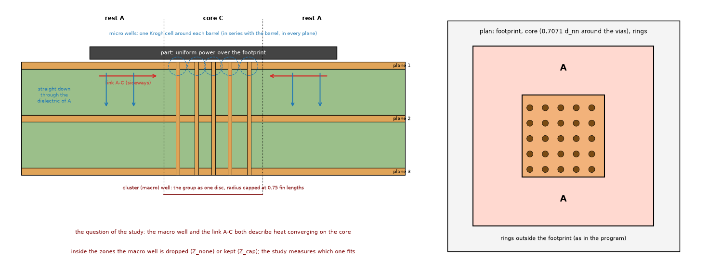
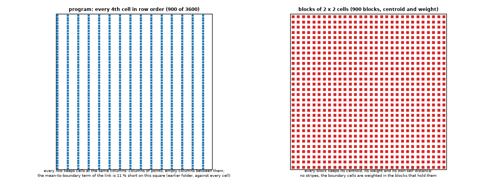
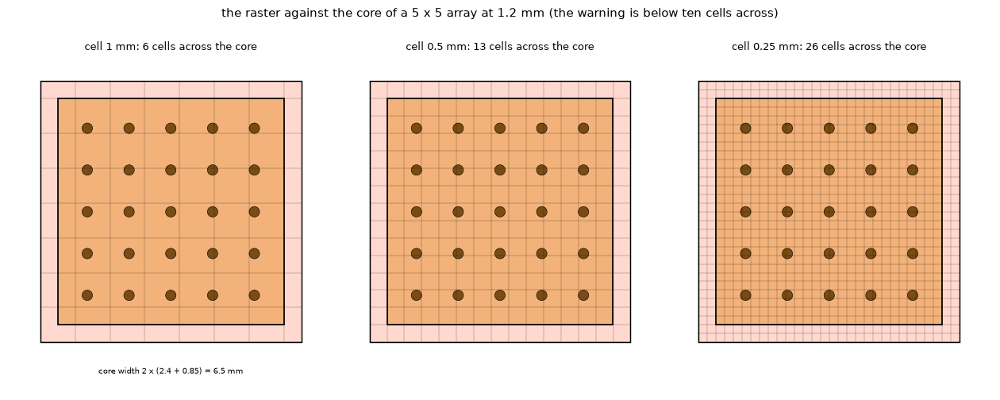
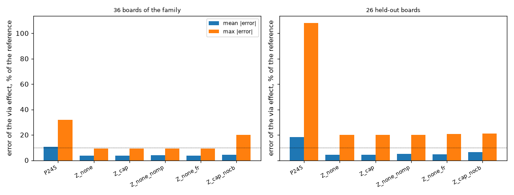
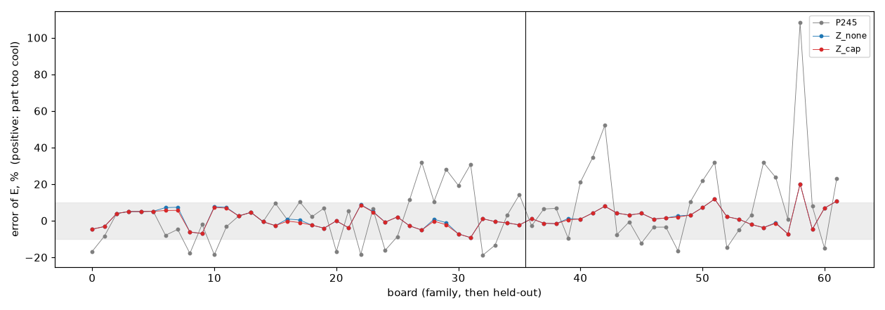
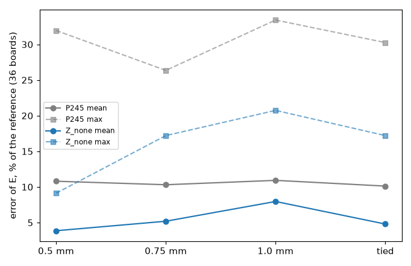
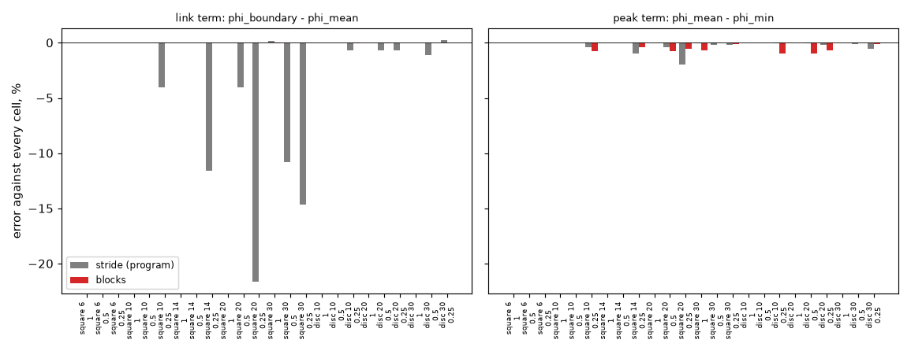
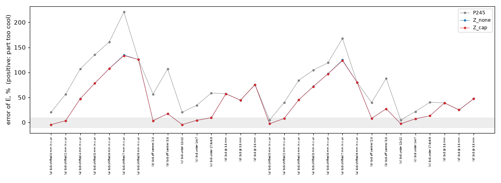

# The zonal Lumped model on the 2.4.5 via wells: results

**Status: run, ready for the reviewer.** The 16 tests, the six studies and the figures were run on the program of `develop` (2.4.5). Section 3 holds the numbers of the earlier folder (program up to 2.4.4); every number in the sections 4.x under "Result" was measured here with the program of 2.4.5 and the fine-grid references rebuilt in this folder (cache `out/refcache`, git-ignored). The program (`pcbthermal/`, `tests/`, `examples/`, `ico/`) is untouched.

## 0. Summary

* Zones on top of the 2.4.5 well (variant `Z_none`) against the program (`P245`), error of the via effect against the fine-grid layered solver: **36 boards 3.9 % mean / 9.1 % max (36 of 36 within 10 %) against 10.8 / 32.0 (20 of 36)**; **26 held-out boards 4.5 / 20.2 (23 of 26) against 18.3 / 108.3 (12 of 26)**; example board: the original 9 vias are not touched by the zones (no core under the footprint: bit-identical to the program), the 5 x 5 and 7 x 7 arrays under U1 move from -12.6 / -8.3 % to -0.3 / -3.1 % (open barrels), copper-filled stay within -3 % (4.1).
* The cluster (macro) well and the zones **do not double count in any measurable way**: keeping the program's cluster well in the zone nodes (`Z_cap`) changes the mean by 0.2 point (3.7 against 3.9 on the family, equal on the held-out); the rule written before the run (keep it only for at least 1 point on the sparse boards) says leave it out; the sparse boards (pitch 2 mm or more) differ by 0.2 point too (4.7 / 4.9). Either choice is safe; `Z_cap` needs no change to `viaconstriction.ring_couplings` (4.1).
* The step response of a zoned footprint follows the FVM at 0.01 to 100 s within 4 to 10 % on two boards and 0.3 to 36 % on the elongated one, where the program's own response is 63 to 74 % off at 0.01 s and 14 to 17 % off in steady state (4.2).
* The raster: at the program's 1.0 mm the zone model is 8.0 / 20.8 % (not 3.9 / 9.1); the tied cell recovers only part (4.8 / 17.2); warnings that fire on every board with a core under ten cells across catch all the boards above 10 % at 0.5 mm and all but one at 1.0 mm (4.3).
* **What the zones do not fix** and what the 2.4.5 program does not warn about: an array across the footprint edge is still up to +135 % too cool, and an array just **outside** the footprint (1 to 4 mm) is 25 to 125 % too cool in both models, with no warning (4.4). This is a limit of the ring network, not of the zones.
* The stride decimation of the footprint potentials is a real defect of the program (4 to 22 % short on the link term for large squares at 0.5 mm or finer) but it moves the maximum rise by 0.00 K at the 1.0 mm cell and 0.13 to 0.31 K (0.2 to 0.6 %) at 0.5 mm (4.5).
* Defects of the never-run prototype: three, fixed (section 5b).

## 1. Question and why it matters

The Lumped model gives the footprint of a part one temperature per layer. When a dense group of vias (a "core") sits under a larger footprint, the heat of the rest of the footprint has to run sideways in the source layer to the core, in parallel with its own way down through the dielectric. One node cannot show that, and the via effect of such a part comes out too small: the part is read too cool, up to 60 % in the effect on the simple boards, against the fine-grid reference. The 2.4.5 program has the constriction of the heat on each barrel (a micro well per via, a cluster well per group with the macro radius capped at 0.75 fin lengths, Kron reduced) and warns for what it cannot resolve, and the zonal Lumped model was left in "Planned".

The earlier investigation of the via groups (`research/lumped-via-groups/`) designed the remedy: cut the footprint into two zones per layer, the core C (cells within 0.7071 nearest-neighbour distances of a via of a group in the footprint) and the rest A, join them by a lateral link, and take the hottest point of the footprint from the zone fields. It measured, **on the program up to 2.4.4 and on the micro well alone**: 3.6 % mean and 9.1 % maximum error of the via effect on 36 simple boards (the program's own 20.9 % and 72 %), 4.5 % / 20.2 % on 26 held-out boards, -7.1 to -0.1 % on the example board, and 8.0 % / 20.8 % when the Lumped raster is the program's 1 mm instead of 0.5 mm. The maintainer queued it for adoption after the 2.4.5 release ("we know the models have limits and we live with them", and this is the option chosen).

This folder prepares that adoption. It does **not** repeat the earlier derivation. It asks what the earlier work could not ask, because the 2.4.5 program did not exist then:

1. The zones were designed on the micro well alone. The 2.4.5 program adds a cluster (macro) well with a cap. Inside the zones, does that well still help, or does it count the same convergence of heat twice with the link between A and C? (Section 4.1, the main question.)
2. The zone network was built for the steady state only. Does the same network, with the capacities of the zones as sums of cell capacities, give the right time behaviour? (4.2)
3. At the program's default 1 mm raster the zone model loses a part of its accuracy. Is tying the raster to the core worth its cost, or is a warning enough? (4.3)
4. The worst cases of the 2.4.5 review (an array that straddles the footprint edge, a cluster off the centre of a long footprint): what do the zones do on them, and does the warning fire where it should? (4.4)
5. The program's own link from the footprint to the first ring is short by 4 to 11 % on large footprints because of the stride decimation of the footprint potentials. Fix it in the same change? (4.5)
6. What must not change: the board without vias, the zone code switched off, the energy balance, the vias that conduct nothing. (4.6)

## 2. How the proposal is built (so that the studies are readable)

Figures 1 and 2 show the situation and the network.

*Figure 1 (`figures/fig_01_footprint_zones_and_wells.png`): left, the section of a footprint with a dense core: the part heats the top plane; the heat of the rest A goes down through its own dielectric or sideways to the core C; the barrels of C carry it down, each with its micro well (dashed circle); the cluster well of 2.4.5 (red) treats the group as one disc. Right, the plan: footprint, core and the rings of the program outside.*

*Figure 2 (`figures/fig_02_network_two_layers_double_count.png`): the network of two layers: nodes A, C and ring 1 per layer; the link A-C (logarithmic potential of the real shapes); the barrel with its micro well under C; the place where the cluster well could count the convergence of the heat twice.*

The code is `lib/zoned_lumped.py`, a copy of `lumped._heater_network` of `develop` (2.4.5) with the zone branch, which imports the program and replaces `lumped._heater_network` in memory for the length of a context (`zoned_lumped.patched(...)`). The pieces:

* `core_mask`: groups of vias by the program's own single linkage (`viaconstriction.ViaSet.group`), the core is the cells within `0.7071` times the mean nearest-neighbour distance of a via of a group with two or more vias in the footprint. No core, or a core above 92 % of the footprint: one node, the program's network.
* `via_couplings`: `viaconstriction.ring_couplings` copied with two additions, a switch `zone_macro` that removes the cluster-well term from the two zone nodes (nothing else changes, groups outside the footprint keep it) and the barrel-only part of the coupling, which the micro peak needs. A test requires the copy to equal the program's function when the switch is not used.
* `mutual_potentials`: the link A-C, `(2 phi_AC - phi_AA - phi_CC) / (2 pi S)`, `phi_XY` the mean of `ln|x - y|` over the cells of X and Y (a uniform source over A and a uniform sink over C on a lossless sheet; for concentric discs it is the Krogh resistance of the annulus plus `1 / (8 pi S)` of the core).
* `annulus_out_resistance`: A to ring 1, the mean-to-outer-wall resistance of the annulus plus the half ring of the program.
* `ZonePeak`: the hottest point of the source layer, the largest of the hottest point of A (the field of A, `K0` kernel of the layer), the core mean plus the micro peak, and the core mean plus the micro peak plus the bump of a core hotter than A. The field is precomputed as a matrix (points x 2) so that the transient can evaluate the peak at every step with one product.
* `block_points`: the potential integrals of a zone with more than 700 cells aggregate the cells in blocks of k x k, not every step-th cell (the earlier review found the stride biased by 17 to 25 % on an annulus).
* `footprint_potentials`: the program's footprint potentials with an optional block decimation (4.5).
* `zone_warnings` and `tied_cell_mm`: the three warnings and the raster tied to the core (4.3, 4.4).
* `step_responses_zoned`: the program's step response with the source split between A and C and the zone peak.

Two differences from the earlier research copy are deliberate and are listed because they change what the studies compare: the via couplings are the program's own (2.4.5) and not the old micro well; and in the fallback (no core, or a core above 92 %), the footprint is the program's network exactly, without the micro peak of the old copy (`micro_peak_single=False`); whether the micro peak belongs there is not measured, and the earlier ladder attributed 0.5 point of mean error (5.8 to 5.3 %) to the micro peak in the zoned network.

## 3. Reference numbers carried over (earlier folder, program up to 2.4.4, not re-run here)

Error of the via effect, mean / maximum, percent, against the fine-grid layered solver (`sheets2d`, 1/16 mm, imports nothing of the program), raster 0.5 mm (`research/lumped-via-groups/README.md` 4.2, 12.2, 12.3 and `INTEGRATION.md` 3):

| set | program up to 2.4.4 (no wells) | micro well only | zones (micro well) |
| :-- | --: | --: | --: |
| 36 arrays under square sources | 20.9 / 72.2 | 13.6 / 62.5 | 3.6 / 9.1 |
| 26 held-out boards | 28.9 / 176.6 | 22.6 / 152.9 | 4.5 / 20.2 |
| the 36 at 1.0 mm raster | 20.1 / 73.8 | 13.2 / 64.2 | 8.0 / 20.8 |
| example board (8 layouts, against the program's corrected FVM) | -6 to +30 | -11.4 to -0.4 | -7.1 to -0.1 |

The program of 2.4.5 has the micro well and the capped cluster well built in, so its own column in the studies below is a new measurement, not the first column of this table.

## 4. The studies

Every study has its question, method, reference, success criterion (written before any run), the script, and what it does not verify. The results are under each study.

### 4.1 Zones on top of the 2.4.5 well (the main question)

* **Question.** With the zone network on the 2.4.5 program, is the accuracy of the earlier folder kept, and is the cluster well in the zone nodes useful, harmless or a double count?
* **Why a double count is possible (a hypothesis, not a finding).** The chain from the heat of the rest of the footprint to the barrel wall is: A mean, the link A-C to the core mean, the macro well from the core mean to the disc the group covers, the micro well from there to the barrel wall. The link A-C already holds the convergence on the core mean *including the internal term `1 / (8 pi S)` of the core as a uniform sink* (for concentric discs, Krogh plus `1 / (8 pi S)`). The macro well, when the group is the only content of the node, is `N_g R_K(S, R_macro, r_cl)` with `R_macro = sqrt(A_C / pi)` and `r_cl = sqrt(N_g) r_cell`: the shell between the disc of the group and the disc of the core. For a dense core (cell of each via filling the core) `r_cl` reaches `R_macro` and the term vanishes; for a sparse core (pitch near the fin length) it does not, and it describes the same radial spreading in the core that `1 / (8 pi S)` of the link describes. So the two variants can differ only for cores whose vias do not fill them, which is where the earlier folder found the model weakest.
* **Method.** `scripts/study_zones_on_245.py`: the 36 boards of the family, the 26 held-out boards and the example board (open and copper-filled, original 9 vias and 5 x 5, 7 x 7, 20 x 20 arrays), 0.5 mm raster, variants `P245` (the program), `Z_none` (zones, micro well in the zones, no macro term there), `Z_cap` (zones with the program's cluster well), and three ablations (`Z_none_nomp` without the micro peak, `Z_none_fr` with the Bessel factor of the program on the link to ring 1, `Z_cap_nocb` without the bump of a hot core).
* **Reference.** The fine-grid layered solver for the simple boards (cached references of the earlier folder are recomputed here because they were made with 2.4.4; `--old-cache` copies them, and the first run compares three boards of both caches); the program's own FVM at 0.25 mm for the example board (the program's FVM holds the mean-potential via since the point-via fix, so the earlier `FVM_fix` patch is the program; this reference is not independent of the layered idealisation).
* **Success criterion.** The chosen variant is within 6 % mean and 15 % maximum on the 36 boards, within 8 % mean on the held-out boards, on the safe side on the example board within 10 %, and not worse than the program on any board by more than 5 points. If `Z_cap` is not better than `Z_none` by at least 1 point of mean error on the sparse boards, the macro term is left out of the zone nodes (the simpler design).
* **Not verified.** A 3D reference with the barrels drawn on these boards (the layered idealisation is 1.6 % from a 3D solver on a unit cell and 4 to 27 % on real barrels, earlier folders); irregular groups, several groups in one footprint, an L-shaped footprint, a block under the part.
* **Result (study_zones_on_245, `out/study_zones_on_245.txt`).** Error of the via effect, percent of the reference, positive = part too cool; mean absolute / maximum absolute, boards within 10 %, signed range.

| set | variant | mean | max | within 10 % | signed range |
| :-- | :-- | --: | --: | --: | :-- |
| 36 family | P245 (program) | 10.8 | 32.0 | 20 of 36 | -18.7 to +32.0 |
| 36 family | Z_none | 3.9 | 9.1 | 36 of 36 | -9.1 to +8.9 |
| 36 family | Z_cap | 3.7 | 9.1 | 36 of 36 | -9.1 to +8.7 |
| 36 family | Z_none_nomp (no micro peak) | 4.0 | 9.1 | 36 of 36 | -9.1 to +8.9 |
| 36 family | Z_none_fr (Bessel factor on the link to ring 1) | 3.9 | 9.3 | 36 of 36 | -9.0 to +9.3 |
| 36 family | Z_cap_nocb (no bump of a hot core) | 4.5 | 20.1 | 35 of 36 | -9.1 to +20.1 |
| 26 held-out | P245 | 18.3 | 108.3 | 12 of 26 | -16.4 to +108.3 |
| 26 held-out | Z_none | 4.5 | 20.2 | 23 of 26 | -7.1 to +20.2 |
| 26 held-out | Z_cap | 4.5 | 20.2 | 23 of 26 | -7.1 to +20.2 |
| 26 held-out | Z_none_nomp | 5.0 | 20.2 | 22 of 26 | -7.1 to +20.2 |
| 26 held-out | Z_none_fr | 4.6 | 20.8 | 23 of 26 | -7.1 to +20.8 |
| 26 held-out | Z_cap_nocb | 6.7 | 21.0 | 20 of 26 | -7.1 to +21.0 |

  Sparse boards (pitch 2 mm or more; 10 of the family, 5 held-out): P245 8.8 / 18.5 and 8.5 / 14.9, Z_none 4.9 / 8.9 and 3.5 / 7.0, Z_cap 4.7 / 8.7 and 3.5 / 7.0. Dense boards (pitch under 2 mm; 26 and 21): P245 11.6 / 32.0 and 20.6 / 108.3, Z_none 3.5 / 9.1 and 4.8 / 20.2. The signed mean over the family is +1.3 (P245), +0.4 (Z_none), +0.1 (Z_cap); the boards read too cool by more than 5 %: 15 for the program, 9 for Z_none.

  Example board (the program's FVM at 0.25 mm is the reference, not independent of the layered idealisation), error of the effect in percent: the original 9 vias at 3.5 mm give the **same number in every variant** (-3.4 open, -0.4 copper-filled: the vias stand in no group under the footprint, the network is the program's); 5 x 5 at 1.2 mm open P245 -12.6, Z_none -0.3, copper -2.7 and -2.9; 7 x 7 at 1.0 mm open -8.3 and -3.1, copper -1.5 and -1.7; 20 x 20 at 1.0 mm open -1.1 and +0.2, copper -1.6 and -1.7. Maximum temperature, program / Z_none / FVM 0.25 mm: 5 x 5 open 78.76 / 76.50 / 76.49 degC, 7 x 7 open 75.14 / 74.03 / 73.41, 5 x 5 copper 74.74 / 74.79 / 74.22.

  The one board on which Z_none is worse than the program by more than 5 points is the 7 x 7 array at 0.6 mm pitch with a 0.2 mm drill under an 8 mm source (copper-filled): program +0.9 %, zones -7.1 % (the safe side: the part is read 7 % too hot).
* **Criterion.** Met: 3.9 against 6 and 9.1 against 15 on the family; 4.5 against 8 on the held-out; the example board stays on the safe side within 10 % (-3.4 to +0.2); not worse than the program by more than 5 points on one board (the one above, on the safe side). The 1-point rule for the macro term: not met by `Z_cap` (0.2 point, 0.2 on the sparse boards), so the macro term stays out of the zone nodes. The difference is below the scatter of the reference (a few tenths of a percent from the grid), so this is a choice of simplicity, not a finding that `Z_none` is more correct.
* **Double count.** The hypothesis that the cluster well in the zone nodes counts the convergence twice is **not supported**: if it did, `Z_cap` would be visibly hotter (the vias less effective) on the sparse boards, where the term does not vanish; it is only 0.3 point hotter on the signed mean (+0.1 against +0.4 on the family, +2.8 against +2.9 held-out), the direction a double count would have, but a size that is inside the scatter, and the mean errors differ by 0.2 point or less. A likely reason is that the core is built to be filled by the cells of its vias, so the macro term is small inside the zones (`r_cl` approaches `R_macro`); this was not separately measured.
* **Ablations.** The bump of a core hotter than A is essential (without it the maximum jumps from 9.1 to 20.1 % and the held-out mean from 4.5 to 6.7 %); the micro peak is worth 0.1 and 0.5 point; the Bessel factor on the link to ring 1 changes nothing within 0.2 point and is left off.

### 4.2 The step response of a zoned footprint

* **Question.** The zones have two nodes per layer whose capacities are sums of cell capacities. Does the step response of the hottest point agree with the FVM in time, not only in the steady value?
* **Method.** `scripts/study_transient.py`: three boards (5 x 5 at 1.2 mm in a 10 mm source, 3 x 3 at 3.0 mm in 12 mm, 5 x 5 in a 14 x 7 mm source), copper-filled; `lumped.step_responses` (program), `zoned_lumped.step_responses_zoned` in `Z_none` and `Z_cap`, `fvm.step_responses` at 0.5 mm.
* **Reference.** The FVM step response (the layered model with the mean-potential via).
* **Success criterion.** At 0.01, 0.1, 1 and 10 s the zoned response is within 10 % of the FVM or closer to it than the program's, and the 63 % time within 20 %.
* **Not verified.** A square-wave profile run (the profile runner of the program needs the source vector and the zone peak, INTEGRATION.md 4); a time response with a block (the Lumped model refuses blocks in time); zones with an outline (the equivalent rectangle).
* **Result (study_transient, `out/study_transient.txt`).** Step response of the hottest point, K/W (percent against the FVM at 0.5 mm in brackets); the run lasts 600 s so that the response reaches its steady value (the first run with the default ten board time constants stopped at 63 % of it and printed the same 63 % time for all models; corrected, see section 7).

| board | model | steady | 0.01 s | 0.1 s | 1 s | 10 s | 100 s |
| :-- | :-- | --: | --: | --: | --: | --: | --: |
| 5 x 5 at 1.2 in 10 mm | FVM | 10.352 | 0.136 | 1.003 | 3.086 | 6.506 | 10.352 |
| | P245 | 9.845 (-4.9 %) | 0.223 (+63.4) | 1.263 (+25.9) | 3.243 (+5.1) | 6.410 (-1.5) | 9.845 (-4.9) |
| | Z_none = Z_cap | 10.656 (+2.9 %) | 0.150 (+9.6) | 1.065 (+6.2) | 3.380 (+9.5) | 6.774 (+4.1) | 10.655 (+2.9) |
| 3 x 3 at 3.0 in 12 mm | FVM | 10.858 | 0.095 | 0.853 | 3.367 | 6.920 | 10.857 |
| | P245 | 11.351 (+4.5 %) | 0.165 (+73.8) | 1.202 (+41.0) | 4.003 (+18.9) | 7.478 (+8.1) | 11.351 (+4.5) |
| | Z_none = Z_cap | 10.826 (-0.3 %) | 0.103 (+8.4) | 0.941 (+10.4) | 3.496 (+3.8) | 6.938 (+0.3) | 10.825 (-0.3) |
| 5 x 5 at 1.2 in 14 x 7 mm | FVM | 11.260 | 0.140 | 1.217 | 3.840 | 7.329 | 11.260 |
| | P245 | 9.724 (-13.6 %) | 0.234 (+67.7) | 1.286 (+5.7) | 3.191 (-16.9) | 6.290 (-14.2) | 9.725 (-13.6) |
| | Z_none = Z_cap | 11.322 (+0.6 %) | 0.191 (+36.5) | 1.295 (+6.4) | 3.871 (+0.8) | 7.351 (+0.3) | 11.322 (+0.6) |

  The time to 63 % of the steady value is 11.1 s for the FVM and every model on the three boards; the step grid of the program is geometric with a ratio of 3 per stage, so this number resolves nothing finer than about a factor of 1.5 and is not a discriminating result.
* **Criterion.** Met in the sense written (within 10 % or closer than the program) at every time and board, except the 0.01 s response of the 14 x 7 mm part (+36.5 %, against +67.7 % for the program), which is closer than the program but above 10 %; the early response of a part whose heat has barely left the footprint is dominated by the lumped footprint capacity. Z_none and Z_cap are identical to four digits on these three boards (dense cores; the reason, that the macro term vanishes there, is expected from the geometry but was not separately checked).
* **Not verified.** A square-wave profile run (the profile runner needs the source vector and the zone peak, INTEGRATION.md 4).

### 4.3 The raster

* **Question.** The program clips the Lumped cell to 0.5 to 1.0 mm and gives 1.0 mm to any part wider than 4 mm. At 1.0 mm the core of a small array is three to seven cells across. Tie the raster to the core, or warn?
* **Method.** `scripts/study_raster.py`: the 36 and 26 boards at 0.5, 0.75 and 1.0 mm and at the tied cell (a tenth of the narrowest core, 0.5 to 1.0 mm, `zoned_lumped.tied_cell_mm`), the program and the zone variant of study 1 (`--variant`), the warnings counted per cell, and the run time of the example board at the three cells.
* **Success criterion.** The tied cell brings the zone variant within 6 % mean on the 36 boards and removes the "coarser than a tenth of the core" warning on every board whose core is at least 5 mm across; the run time on the example board stays under twice that of 1.0 mm.
* **Not verified.** Cells below 0.5 mm (the program's clip), boards of 200 mm and more where a 0.5 mm raster is 160 000 cells per layer (the cost is measured on the example board only).
* **Result (study_raster, `out/study_raster.txt`).** Mean / maximum absolute error of the effect in percent, boards within 10 %.

| set | variant | 0.5 mm | 0.75 mm | 1.0 mm | tied cell |
| :-- | :-- | --: | --: | --: | --: |
| 36 family | P245 | 10.8 / 32.0, 20 | 10.3 / 26.4, 21 | 10.9 / 33.4, 19 | 10.1 / 30.3, 21 |
| 36 family | Z_none | 3.9 / 9.1, 36 | 5.2 / 17.2, 29 | 8.0 / 20.8, 27 | 4.8 / 17.2, 32 |
| 26 held-out | P245 | 18.3 / 108.3, 12 | 17.9 / 108.6, 12 | 17.6 / 108.9, 12 | 16.8 / 108.3, 13 |
| 26 held-out | Z_none | 4.5 / 20.2, 23 | 6.3 / 14.7, 20 | 5.7 / 16.7, 21 | 5.5 / 20.2, 22 |

  Boards with the warning "raster coarser than a tenth of the core": family 6 of 36 at 0.5 mm, 22 at 0.75, 32 at 1.0, 10 with the tied cell; held-out 4, 8, 21 and 8. Boards with the warning "elongated or off centre": family 0, 0, 2, 0; held-out 6 at every cell. Of the family boards above 10 % in Z_none (9 at 1.0 mm, none at 0.5 mm) every one carries a warning; of the held-out boards above 10 %: 3 of 3 at 0.5 mm, 4 of 5 at 1.0 mm (the missed one is a sparse 3 x 3 array at 3 mm pitch with h_bottom 10, 10.6 % too cool). Run time of one Lumped solve of the example board, program / zones: 0.02 / 0.02 s at 1.0 mm, 0.03 / 0.03 at 0.75, 0.06 / 0.06 at 0.5 (the zones add nothing measurable; the example board has no core, so this is the cost of the check, not of a zoned footprint).
* **Criterion.** The tied cell brings the family to 4.8 % mean, inside the 6 % written, but the maximum stays 17.2 % and 4 boards stay above 10 %; the warning does not disappear on every board whose core is 5 mm across (10 boards keep it, the floor of 0.5 mm stops the tie). Run time: met (no change on the example board).
* **Reading.** The raster is the largest remaining sensitivity of the zone model (3.9 to 8.0 % mean between 0.5 and 1.0 mm), more than the macro term or any ablation. A tie to the core is a partial remedy (to 4.8 %); a cell of 0.5 mm for any part with a core costs 0.06 s on the example board and removes the loss. The data do not support the tie as the only measure: the warning stays necessary in either case. Not verified: boards of 200 mm and more (a 0.5 mm raster is 160 000 cells per layer).

### 4.4 The edge of the footprint, the centre, the long footprint

*Figure 3 (`figures/fig_03_decimation_stride_vs_blocks.png`): the cells kept by the program's stride and by blocks on a 30 mm square at 0.5 mm (3600 cells); the stride keeps columns of points. It belongs to 4.5 and is drawn here with the geometry it explains.*

* **Question.** The 2.4.5 review measured an array that straddles the footprint edge up to 80 % too large in the Lumped model (the part too cool), and the earlier folder measured the zone model up to 21 % too cool on clusters off the centre. What do the zones do on them, and does the warning fire?
* **Method.** `scripts/study_edge_and_offcentre.py`: (a) a 5 x 5 array moved in x by 0 to 9 mm under a 12 x 12 mm footprint (inside, across the edge, outside); (b) clusters off the centre; (c) the same array under footprints of side ratio 1, 2 and 2.56; (d) a 3 x 3 array 1, 2 and 4 mm outside a 6 mm footprint, copper-filled and open. Variants `P245`, `Z_none`, `Z_cap`; warnings recorded.
* **Reference.** The fine-grid layered solver.
* **Success criterion.** With the zones, no board is more than 25 % too cool in the effect without a warning; the across-the-edge boards improve over the program or are flagged; the boards of (d) are equal (1e-9) between the program and the zone variants, because the zones do not touch groups outside the footprint.
* **Not verified.** Arrays wider than the footprint, several groups in one footprint, guard rings.
* **Result (study_edge_and_offcentre, `out/study_edge.txt`).** Error of the effect in percent against the fine-grid solver (positive = part too cool), mean / maximum over each group of boards, copper-filled and open together.

| group | P245 | Z_none | Z_cap | note |
| :-- | --: | --: | --: | :-- |
| (a) 5 x 5 across the edge, shift 0 to 9 mm under 12 x 12 | 102.0 / 220.7 | 66.6 / 134.9 | 66.3 / 133.5 | at 0 mm: P245 +20.4 (Cu), Z_none -4.2; at 2 mm: +56.6 and +3.5; at 4 mm: +106.8 and +47.3; at 7 mm: +220.7 and +134.9 |
| (b) off the centre (2.0, 0) and (3.5, 1.5) | 72.9 / 107.0 | 14.1 / 27.3 | 14.1 / 27.3 | the +80 % case of the 2.4.5 review: P245 +107.0 (Cu) at (3.5, 1.5), zones +17.6 |
| (c) footprint side ratio 1, 2, 2.56 | 30.2 / 59.0 | 6.9 / 13.4 | 6.9 / 13.4 | |
| (d) 3 x 3 array 1, 2 and 4 mm outside a 6 mm footprint | 48.2 / 75.7 | 48.2 / 75.7 | 48.2 / 75.7 | the zones do not act (no via in the footprint): equal to the program |

  Warnings: issued on every board of (b), on the elongated boards of (c) (not on the 12 x 12 square, which is not elongated), and on the across-the-edge boards from 2 mm on; **not issued** for the shift of 0 mm (nor needed), for the array fully outside (shift 9 mm, +125.8 % Cu, +80.3 % open) and for the four arrays of (d) (+25 to +75 %). Boards more than 25 % too cool with no warning: 8 (the four of (d) and the shift of 9 mm, copper and open).
* **Criterion.** Not met as written: with the zones, 8 boards stay more than 25 % too cool without a warning, and the across-the-edge boards improve over the program (220.7 to 134.9 at worst) but stay far from the reference unless flagged (they are, from 2 mm). The boards of (d) are equal between the program and the zones to 1e-9 as required.
* **Reading.** The zones fix the off-centre and elongated cases of the 2.4.5 review roughly by a factor of four (mean 72.9 to 14.1, 30.2 to 6.9). They cannot fix vias that stand outside or on the edge of the footprint: the heat of the part reaches them through the first rings, and the ring network is too crude there (an array just outside the footprint helps the part up to twice as much as the program says). That failure is in the 2.4.5 program as well and has no warning; a rule "a group of two or more vias within a few mm outside a footprint" is the obvious candidate and is **not measured here**.
* **Not verified.** Arrays wider than the footprint, several groups in one footprint, guard rings.

### 4.5 The decimation of the footprint potentials (a defect of the program, measured on a copy)

* **Question.** `lumped._footprint_potentials` keeps every step-th footprint cell above 900 cells. The earlier folder read it against every cell: the mean-to-boundary term of the link to ring 1 is 4 % short on a 20 mm square, 11 % on a 30 mm square, 5 % on a 20 mm disc; the peak term is within 0.4 %. What are the numbers on a full set, and does the block decimation of this folder fix it?
* **Method.** `scripts/study_footprint_potential.py`: squares of 6, 10, 14, 20 and 30 mm and discs of 10, 20 and 30 mm at 1.0, 0.5 and 0.25 mm cells; the program's stride, the blocks and every cell (`footprint_potentials_exact`, chunked); the disc against the closed form `1/4` for both terms; the change of the maximum temperature of a 4-layer copper board with a 20 and a 30 mm source between the two decimations.
* **Success criterion.** The blocks are within 1 % of every cell in both terms on every case; the stride is outside 1 % on at least the 20 and 30 mm squares at 0.5 mm; the effect on the board is reported (a change above 0.5 K on a plausible board is a finding).
* **Not verified.** The effect on a board of a real part with an irregular footprint; this defect is in the program independent of the zones, and the study measures it on a copy.
* **Result (study_footprint_potential, `out/study_footprint_potential.txt`).** Error against every footprint cell of the link term (phi_boundary - phi_mean) and of the peak term (phi_mean - phi_min), program stride / blocks, percent; only the cases where either differs from zero are listed (all squares of 6 to 30 mm and discs of 10 to 30 mm at 1.0, 0.5 and 0.25 mm were run, 24 cases; at or under 900 cells the stride keeps every cell and both are exact).

| footprint | cell mm | cells | link: stride / blocks | peak: stride / blocks |
| :-- | --: | --: | --: | --: |
| square 10 | 0.25 | 1600 | -4.0 / 0.0 | -0.4 / -0.8 |
| square 14 | 0.25 | 3136 | -11.6 / 0.0 | -1.0 / -0.4 |
| square 20 | 0.5 | 1600 | -4.0 / 0.0 | -0.4 / -0.8 |
| square 20 | 0.25 | 6400 | -21.6 / 0.0 | -2.0 / -0.5 |
| square 30 | 0.5 | 3600 | -10.8 / 0.0 | -0.2 / 0.0 |
| square 30 | 0.25 | 14400 | -14.7 / 0.0 | -0.2 / -0.1 |
| disc 20 | 0.5 | 1308 | -0.7 / 0.0 | 0.0 / -1.0 |
| disc 30 | 0.5 | 2912 | -1.1 / 0.0 | -0.1 / 0.0 |

  The discs reproduce the closed form 1/4 for both terms (0.249 to 0.250 at 0.1 mm cells; the coarse cells read 0.231 to 0.265 because the boundary cells lie half a cell inside). The block decimation is within 0.0 % on the link term and within 1.0 % on the peak term in every case, the stride is outside 1 % on the link term for squares of 20 mm and more at 0.5 mm and for 14 mm and more at 0.25 mm.

  Effect on a 4-layer copper board with a square source (Lumped, K, maximum rise): 20 mm at 1.0 mm cell 88.21 / 88.21 (stride / block); 30 mm at 1.0 mm 48.72 / 48.72; 20 mm at 0.5 mm 88.32 / 88.45 (+0.13); 30 mm at 0.5 mm 48.17 / 48.48 (+0.31).
* **Criterion.** Met: blocks within 1 % on every case (maximum 1.0 %); the stride is outside 1 % on the 20 and 30 mm squares at 0.5 mm. The effect on the board is below the 0.5 K that would make it a finding: **0.00 K at the cell of 1.0 mm, which every part wider than 4 mm gets by default, and at most 0.31 K (0.6 %) at 0.5 mm**. The defect is real and harmless in the program as it is used; the fix belongs with the zones only because the zones need blocks anyway (their own integrals use them).
* **Not verified.** A board of a real part with an irregular footprint.

### 4.6 Invariants

*Figure 4 (`figures/fig_04_raster_against_core.png`): the raster cells over a 5 x 5 array at 1.2 mm pitch (a core 6.5 mm across): 6.5, 13 and 26 cells across at 1.0, 0.5 and 0.25 mm; the warning is below ten.*

* **Question.** What must not change.
* **Method.** `scripts/study_invariants.py` and `tests/test_zoned_lumped.py`: (1) the board without vias, zones on, equals the program (1e-9 K); (2) zones off on a board with vias equals the program; (3) a group outside every footprint equals the program; (4) the energy balance (1e-6) and the residual (1e-9); (5) vias that conduct nothing (plating 1e-12 m, open barrel; the true effect is 0): the maximum with them against the maximum without any via, in K and percent of the rise (the earlier folder found up to 2.8 K left, bounded and not removed); (6) mirror and rotation symmetry (0.05 K); (7) the maximum at 1.0 and 0.5 mm (printed).
* **Success criterion.** The limits in the list. Check 5 is measured with the 2.4.5 well, not assumed.
* **Not verified.** The GUI (the temperature map shows the value of A in the whole footprint; INTEGRATION.md 3).
* **Result (study_invariants, `out/study_invariants.txt`; the tests of the folder, 16, pass).**

| check | boards | value | limit |
| :-- | :-- | --: | --: |
| 1. no vias, zones on vs the program (max dT) | example board, 5 x 5 at 1.2, 3 x 3 at 2.0 | 8.5e-14, 2.0e-13, 5.7e-14 K | 1e-9 K |
| 2. zones off vs the program | same three | 6.4e-14, 1.1e-13, 1.4e-14 K | 1e-9 K |
| 3. group outside the footprint, zones on vs the program | 3 x 3 at 3.5 mm, 10 mm from the centre | 8.5e-14 K | 1e-9 K |
| 4. energy balance | same three | 1.5e-15, 4.3e-15, 1.6e-15 | 1e-6 |
| 4. residual of the linear system | same three | 7.8e-15, 1.5e-14, 5.7e-15 | 1e-9 |
| 6. mirror and rotation (maximum rise, K) | 5 x 5 at 1.2 mm under 10 mm | spread 0.000 K in P245, Z_none and Z_cap | 0.05 K |

  Vias that conduct nothing (plating 1e-12 m, open barrel: the true effect is zero), maximum with them minus the maximum without any via, K (percent of the rise): 5 x 5 at 1.2 under 10 mm: P245 0.00 (0.0), Z_none -1.57 (-3.1), Z_cap -1.57 (-3.1); 3 x 3 at 3.0 under 12 mm: 0.00, -0.68 (-1.5), -0.68; 7 x 7 at 1.0 under 14 mm: 0.00, -2.60 (-6.1), -2.60. The rise of the same board at 1.0 and 0.5 mm (maximum, K): P245 29.34 and 29.53; Z_none 32.14 and 31.97.
* **Criterion.** Checks 1 to 4 and 6: met by many orders of magnitude. **Check 5 shows a bias of the zone model: with dead vias the maximum falls by 0.7 to 2.6 K (1.5 to 6.1 % of the rise), on the unsafe side (part too cool), where the program stays at 0.00.** The cause is the discretisation of one uniform footprint into two zones joined by the logarithmic link and the annulus resistance (a different, slightly cooler approximation of the same field than the one-node footprint of the program with its Bessel-calibrated peak); it exists whenever zones are on, with or without conducting vias, and is bounded at 6.1 % of the rise on these boards. It is the reason the zones never read more than about 6 % too hot on a board where the vias do nothing, and it adds to the error of a board where they do (the zones' error on the family is +0.4 % signed). The earlier folder found 2.8 K left on its boards, bounded and not removed; the 2.4.5 well does not change it. A regression test of the adoption would be this check with a 6.5 % limit.

### 4.7 A published case (not run: the sources were not opened)

No published numerical case of a via group inside a larger footprint was found in the earlier folder; the agreement is with a fine-grid layered solver of this repository. The sources that are closest to the situation, and what will be re-read, in the terms of `research/theory/BIBLIOGRAPHY.md` (statuses are those recorded there, nothing was opened for this plan):

* **Fish (2017), chapter 6** (status R for pages 89 to 99, equations 40 to 49; the figures only as captions): the microspreading resistance of a via unit cell, reproduced in the earlier folder (1215 against 1240 K/W, -2.0 %). To re-read: chapter 7 (page 114 on, the analytic model of microspreading in via-array unit cells), which was not read and may give a closed form for the shell between a group and its cell; and the figures 39 to 44 as images.
* **Shen, Wang, Blaabjerg, Zhao, Long (2019)** (status R for the text of sections II and III, equation 8 lost in the extraction; the agreement with CFD from a summary): the via array under a chip modelled with vertical resistances only, the outer vias with radial and vertical resistances. To re-read: equation 8 and the tables of the verification by rendering the pages of the accepted manuscript to images (a second copy is listed in the bibliography); the section on the design optimisation. Its inner-zone assumption is the one the zone model replaces; a published case with numbers would let the program and the zones be run on it.
* **Guenin (2004)** (status S: the text of the page was read; the tables and equations are images the page does not carry, so the case was not reproduced): a die on a BT substrate between two 35 micrometre planes joined by 0 x 0 to 11 x 11 vias (ANSYS reference, 15.9 K/W without vias). To obtain: the images of the tables, from the maintainer's machine (the fetch tools work there) or, failing that, from the author. If the table is readable, the board is representable in the layered program (a footprint on a laminate between two copper planes with an n x n array), and the study is: the layered fine-grid solver and the program and the zones on that board against the published numbers. **No script exists for this case**: its parameters (die size, pitch, drill, plating) are not known to this plan.
* **Not obtained:** the paid journal version of Fish, McCluskey and Bar-Cohen (2016) (the dissertation chapter was read instead); the DTIC report on via-array unit cells (HTTP 403 from the session).

### Figures of the results

*Figure 5 (`figures/fig_05_error_by_variant.png`): mean and maximum absolute error of the via effect of the program and the zone variants on the 36 and the 26 boards (4.1).*

*Figure 6 (`figures/fig_06_error_by_board.png`): the signed error board by board, program against zones; positive is the part too cool (4.1).*

*Figure 7 (`figures/fig_07_raster.png`): mean and maximum error against the Lumped raster cell, program and zones (4.3).*

*Figure 8 (`figures/fig_08_footprint_potentials.png`): error of the stride and of the block decimation against every cell, link and peak terms (4.5).*

*Figure 9 (`figures/fig_09_edge_and_offcentre.png`): the error on the across-the-edge, off-centre, elongated and outside boards, copper-filled then open (4.4).*

## 5. Reproducing

From the repository root, on a quiet machine, with the research environment of the program (`.venv`):

    .venv/bin/python research/lumped-zones-adoption/scripts/run_all.py              # tests, then the six studies, then the figures; output in out/*.txt
    .venv/bin/python research/lumped-zones-adoption/scripts/run_all.py --quick      # a few boards of every study, minutes
    .venv/bin/python research/lumped-zones-adoption/scripts/run_all.py --old-cache  # reuse the reference cache of lumped-via-groups (check three boards first)
    .venv/bin/python -m pytest -q research/lumped-zones-adoption/tests              # only the tests of the folder

The fine-grid references (a 1/16 mm solve of 30 mm boards, with and without vias, for 36 + 26 + 36 boards) are the long part and are cached in `out/refcache` (git-ignored). The tests build small boards and need no reference. Check before committing results: `git diff develop --stat -- pcbthermal tests examples ico` is empty.

## 5b. Defects of the prototype found by the first run, and what changed

1. **Block decimation, boundary term** (`footprint_potentials(..., "block")`): the boundary cells took the potential of the block centroid that holds them, half a block inside the edge, which made the link term 8 % short on a 20 mm square at 0.5 mm (test `test_footprint_potentials_blocks_against_every_cell` failed: 0.208 against 0.226). Fixed: the boundary cells keep their own positions and are evaluated against the block sources; the test passes and the study 4.5 table is the corrected code (blocks within 0.0 % on the link term).
2. **Two tests asked too much**: the disc closed form (0.25 for the boundary term) ignores that the boundary cells lie half a cell inside the disc (0.25 - dx / (2 a); the test now uses that and 1 %), and the equality of the peak with the program to 1e-8 is out of reach because the Bessel factors of the interior relations are a difference of nearly equal numbers for a small footprint (1e-13 in a loss gives 1e-7 in the peak; the network matrix agrees to 2e-16 and the temperatures to 3e-13; the tolerance on the peak is 1e-5). No defect of the model; the earlier text of the library said "equal to rounding (1e-10)", which holds for temperatures and the matrix, not for the peak coefficient.
3. **The transient study stopped at 63 % of the steady value**: the default run length (ten board time constants of `board_time_constant`) is shorter than the response; every model printed the same 63 % time. The script now runs 600 s and prints 100 s; the 63 % time stays a coarse number (geometric steps).
4. Not a defect but a limit that the run found: check 5 of 4.6 (dead vias read 1.5 to 6.1 % cool).

The library had no other defect that the 16 tests, the invariants (1e-13) and the six studies exposed; the code was not exercised on a board with a block under the part, an outline or an L-shaped footprint (not verified).

## 6. Files

| path | what |
| :-- | :-- |
| `lib/zoned_lumped.py` | the proposal: the zone network, the closed forms, the peak, the decimations, the warnings, the transient |
| `lib/zref.py` | the boards and references of the earlier folders, the variants, the error tables |
| `scripts/study_zones_on_245.py` | 4.1 |
| `scripts/study_transient.py` | 4.2 |
| `scripts/study_raster.py` | 4.3 |
| `scripts/study_edge_and_offcentre.py` | 4.4 |
| `scripts/study_footprint_potential.py` | 4.5 |
| `scripts/study_invariants.py` | 4.6 |
| `scripts/run_all.py`, `make_diagrams.py`, `make_figures.py` | the one command, figures 1 to 4 (drawings), figures 5 to 9 (from the results) |
| `tests/test_zoned_lumped.py` | 16 tests: closed forms, equality with the program, invariants, rules |
| `INTEGRATION.md` | the design for entering the program |
| `docs/` | text for the project documents when the work is adopted |

## What was read and what was not verified

* **Read for this work (in full, in the repository):** `research/lumped-via-groups/` (README, INTEGRATION.md, libraries and the family, holdout and example scripts), `research/young-omega-tiles/INTEGRATION.md`, `docs/theory.md` sections 5 and 6.1, `pcbthermal/lumped.py` and `pcbthermal/viaconstriction.py` as in `develop` (2.4.5). **No source was opened for this run**: nothing new was read, downloaded or reproduced from a publication. The sources of 4.7 keep the statuses of `research/theory/BIBLIOGRAPHY.md` (Fish 2017 chapter 6 R in part; Shen and others 2019 sections II and III R in part, equation 8 lost; Guenin 2004 S, tables not obtained); the published case of a via group inside a larger footprint was **not reproduced** and no number here is a published number.
* **Run (this folder, program 2.4.5):** the 16 tests; the six studies (4.1 to 4.6) in full on 36 + 26 boards and the example board; the figures 1 to 9, which were looked at one by one (figure 1 has the label of the link A-C over the arrow, figure 3 captions touching the frame, figure 9 labels very small: legible but not polished; figure 8 shows the blocks slightly worse than the stride on the peak term in four cases, up to 1.0 %).
* **Independent reference:** the fine-grid layered solver `sheets2d` (1/16 mm, imports nothing of the program) of the earlier folder, rebuilt here for all 62 boards (the earlier cache was lost); on the example board the program's own FVM at 0.25 mm, which is **not** independent of the layered idealisation and, since the point-via fix, holds the same mean-potential via as the program. The layered solver is itself 1.6 % from a 3D solver on a unit cell and 4 to 27 % on real barrels (earlier folders), so the percentages above are errors against a layered reference, not against reality; no model of this repository has been compared with a measurement of a board. The mean error of the program on the family and the held-out boards (10.8 and 18.3 %) matches the numbers the maintainer quoted for the released 2.4.5 on the family (10.8 / 32.0, 20 of 36).
* **Not verified:** a 3D reference with the barrels drawn on these boards; irregular groups; several groups in one footprint; an L-shaped footprint; a block under the part; a profile (square wave) run with the zones; the GUI; a Gerber board with 100 or more vias; the cost of the zones inside the top-path and power-coefficient loops (the cost measured is one solve of the example board, which has no core); the rule for vias outside the footprint (proposed, not measured); the choice of the constants 0.7071, 0.92, 700 (sensitivity in the earlier folder). The zones' bias with dead vias (4.6, check 5) is measured on three boards only.
* **Load of the runs:** one job at a time, `nice -n 10`; the reference solves ran with 2 processes of about 1.2 GB each; the other studies one process under 1 GB; no swap.
