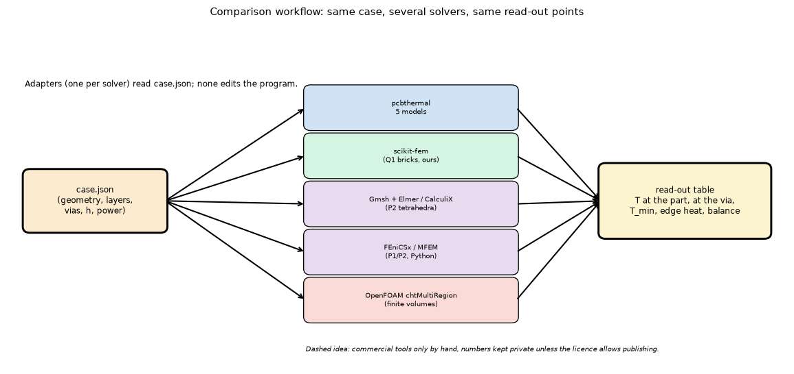
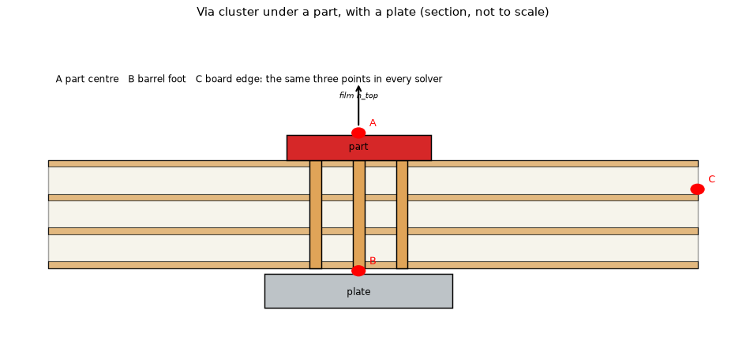

# Comparison of the program's models with other finite-element and thermal solvers on the market (study)

**Status: desk study, nothing run; reviewed (section 7): deferred by the maintainer's decision, the plan of INTEGRATION.md is kept as the future design (roadmap A47).** Question: besides our own reference (`research/independent-fem-edge`, `research/independent-fem-extensions`, scikit-fem, BSD-3), can the five
models be compared with OTHER solvers, is it feasible and is it licit? The study opened the vendors' and projects' pages (section 6 marks how each statement was obtained),
checked what installs on this machine (`scripts/check_candidates.py`, nothing was installed) and ends in a recommendation (section 4) and a plan (INTEGRATION.md).
Hours, memory and risks are ESTIMATES of the author, not measurements. No measured board is involved: every comparison here is numerical against numerical.

Legend of statuses (as `research/theory/BIBLIOGRAPHY.md`): **R** a page fetched and quoted (the fetch tool returns a summary of the page, so a quotation is checked to the page text it returned, not to a printed licence file); **S** a search snippet; **M** memory; **N** not obtained.

## 1. What the comparison is for, and what it cannot be

*Figure 1 (fig_01_workflow.png): one case description feeds the program and each external solver through an adapter; every solver writes the same read-out points.*

*Figure 2 (fig_02_case_section.png): section of the via-cluster case with a plate and the three read-out points shared by all solvers (not to scale).*

The cases are those of `research/independent-fem-extensions` (README 2 and 8): (1) the hollow plated barrel against the program's barrel length `d + 0.5 t_cu`; (2) a part over a via cluster with a plate under the board;
(3) stripes (copper aligned with mesh lines); (4) the L outline (and the T of `independent-fem-edge`); (5) the transient (step response, time to 63 %).
What an extra solver adds over scikit-fem: **an independent code, mesh generator and assembly path** (a bug in our own `fem.py` or in our meshes cannot be shared), **a different formulation**
(second-order tetrahedra or serendipity bricks in place of our trilinear bricks; cell-centred finite volumes in OpenFOAM), and a **name that a reader knows** (a statement 'agrees with CalculiX/Elmer' is weighed more than 'agrees with our own tool').
What it cannot add: **any physical truth**. All of them solve the same conduction equation with the same boundary conditions we give them; the idealisations (film coefficients, layered laminate, hollow barrel as a wall) are ours. Agreement shows the discretisation and the
meshing are right, not that the board behaves like that: only a measurement does (the measured board stays a separate item).

## 2. The candidates

Licence column: SPDX-like, `C` marks copyleft. 'How a case is described' decides the cost of building our cases. Hours are the author's estimate for the five cases with the adapter and one tested case (section 5).

### 2.1 Free and open source

| Tool | Licence (status) | Platform on this machine (macOS arm64) | How a case is described | Our cases: effort | Verdict |
| :-- | :-- | :-- | :-- | :-- | :-- |
| FEniCSx / DOLFINx | LGPL-3.0-or-later, `C` weak (R: repository README and the conda-forge page) | conda-forge `osx-arm64` builds of 0.11.0 for Python 3.11 and 3.12 (R: anaconda.org file list, review); README lists conda (recommended), pip beta wheels for Apple silicon on macOS 15 or later without PETSc, Docker arm64 (R) | **Python API**, weak forms in UFL; any element order | 14 to 20 h | **Recommended 1** |
| CalculiX (ccx, cgx) | GPL-2.0-or-later `C` (R: calculix.de, 'either version 2 of the License, or (at your option) any later version', review; the study had GPL-2, S) | Homebrew tap `costerwi/homebrew-calculix` by a third party, tested on an M2 (S: CalculiX forum); conda-forge `calculix` 2.22 for `osx-arm64` (S, review) | text input deck (`.inp`), heat transfer step (`*HEAT TRANSFER`), quadratic bricks C3D20 and tets C3D10; mesh from Gmsh (M) | 16 to 24 h | **Recommended 2** |
| Elmer FEM | GPL-2 and LGPL-2.1 badges (R: repository page, re-read in the review); which part carries which is in a policy file that was not obtained (N: the raw path tried in the review answered 404) | macOS compile guide, built regularly on Apple silicon (S: a mirror's issue); Homebrew formula reported inconsistent (S) | text `.sif` file, a `Heat Equation` solver, meshes from Gmsh or ElmerGrid (M); Python only through ElmerPy (M) | 18 to 26 h | Alternate of CalculiX (the install is the risk) |
| OpenFOAM (`chtMultiRegionFoam`, Foundation or ESI) | GPL-3 `C` (R: openfoam.org licence page, Foundation line; ESI line S) | the Foundation line points Mac users to Multipass (an Ubuntu VM) (S); ESI line has a native third-party app `gerlero/openfoam-app`, v2406 via Homebrew, Apple silicon needs macOS 14 (S) | dictionaries (`blockMesh`, `snappyHexMesh`, region files, `thermophysicalProperties`); no Python | 30 to 45 h; a 25 um barrel wall is hard in a finite-volume mesh | Only for a finite-volume cross-check; do last, or skip |
| MFEM | BSD-3-Clause (R: the `LICENSE` file of the repository; the review found that mfem.org itself prints no licence, so the study's 'R: mfem.org' was not right) | Docker images (R); a pip name `mfem` exists, version list printed by the script (it builds from source: M) | C++ or Python wrapper (PyMFEM); example heat solvers exist (M) | 20 to 28 h | Not needed if FEniCSx works; BSD makes it the cleanest licence |
| deal.II | 'open source', LGPL-2.1-or-later (M), the page did not print it (R) | not stated (R: page); conda/Homebrew (M) | C++ only | 30 h or more | Not recommended (C++ build cost) |
| FreeFEM | LGPL-3.0 (R: freefem.org) | 'All platforms' (R); macOS binary packages discussed in the forum (S) | own scripting language | 12 to 18 h | Possible, but a language only for this; lower priority |
| Code_Aster with Salome-Meca | GPL (code_aster, S); SALOME LGPL-2.1-or-later (S) | mainly Linux/Unix; the Docker image found is 8 years old (S) | Python command files | 40 h or more | Not recommended (Linux heavy, large) |
| MOOSE | LGPL-2.1 (M); the page fetch failed (403) (N) | conda on macOS (M) | text input files; Heat Conduction module | 25 to 35 h | Not recommended (install and learning cost) |
| Gmsh | GPL-2.0-or-later in the PyPI metadata (R: pypi json) and on gmsh.info, 'with an exception to allow for easier linking with external libraries' (R: gmsh.info, review; the exception names no library on that page, the licence file on gitlab.onelab.info refused the fetch, N); a commercial licence is needed only to integrate Gmsh into closed-source software (R) | wheel `macosx_12_0_arm64` for 4.15.2 (R); pip index OK on this machine (script) | scripted geometry in Python or `.geo`; **a mesher, not a solver** | shared by all (about 6 h, counted in the tools above) | Use as the common mesher |
| Salome (mesher and platform) | LGPL-2.1-or-later (S) | Linux and Windows listed, macOS unconfirmed (S) | GUI plus Python | not needed | Not needed |
| Python wrappers and I/O | meshio MIT (M), pygmsh (M), PyVista MIT (M), pyfreefem, FiPy (public-domain NIST, M) | all install by pip here (script: versions printed) | Python | small | meshio and PyVista only as helpers |

### 2.2 Electronics-thermal and commercial tools

| Tool | Licence and cost | Platform | How a case is described | Publishing numbers | Verdict |
| :-- | :-- | :-- | :-- | :-- | :-- |
| Ansys Icepak / Mechanical / Fluent | commercial; free **student** product limited to 'student instruction, student projects and student demonstrations'; **research needs a research licence**; academic licences bar commercial work (R: ansys.com academic terms) | Windows and Linux (S: the help pages list those; macOS not found) | GUI, Workbench, PyAnsys scripting (M) | the academic licence form says 'may not be used for competitive analysis (such as benchmarking)' and screenshots, name and logo may not appear in a benchmarking work (R) | **No** |
| COMSOL Multiphysics | commercial; trial licence: functionality test only, no commercial or academic use, **'Nor may you publish any results obtained through the use of a license to a trial version'** (R: licence agreement of the 6.4 documentation, section 2(m), re-read in the review); no benchmarking clause, but section 2(h)(xi) bars using the Programs 'for the purpose of developing an independent software program containing functionality that is the same as, substantially similar to, competitive with' them (R, review): a check made with COMSOL to develop this program could fall under it even with a paid licence | Windows, Linux, macOS (M); Apple silicon version not confirmed here (N) | GUI, Java/Python (MPh, M), Model Builder | allowed with a paid licence as far as that page shows; a licence of the maintainer's own would need reading | Only if the maintainer already holds a licence: one case by hand |
| Cadence Celsius (Thermal Solver, EC Solver) | commercial, trial form exists (S) | Windows; Linux for the solve nodes as an option (S) | GUI, from Allegro | EULA not obtained (N) | No |
| Siemens Simcenter Flotherm / Flotherm XT | commercial (S) | Windows listed in a directory page (S); no macOS | GUI, Flotherm XT scriptable (M) | EULA not obtained (N); benchmark restrictions are usual in vendor EULAs (M) | No |
| Autodesk CFD | commercial; status in 2026 unclear (S) | Windows (M) | GUI | not obtained (N) | No |
| Fusion 360 simulation | personal tier free for non-commercial use under a revenue limit; whether thermal is included on it: Autodesk's page says yes, a third-party guide says no (S, conflicting) | Windows and macOS (M) | GUI | not obtained (N); personal licence is non-commercial | No (undecided facts, closed meshing) |
| SolidWorks Simulation, Altair, KiCad | SolidWorks Windows only (M); Altair student edition not researched (N); KiCad has no thermal solver (M) | - | - | - | No |
| SimScale (cloud) | free **Community** plan: up to 2000 core hours, 10 unrestricted simulations, qualitative output beyond that, private projects only as a paid add-on; heat transfer and conjugate heat transfer marked 'Limited', not defined (R: simscale.com/pricing). Terms and conditions (R, review): Free Plan licences 'for non-commercial use only' (3.1); academic use needs SimScale's prior written approval (3.1); Free Plan content is Community Content 'accessible by third-party users' (5.2) and the user grants SimScale and third parties a non-exclusive, sublicensable, transferable right to reproduce, publish and modify it (5.2); no benchmarking clause; no scraping or building databases from the Services (3.5(g)) | browser | GUI plus a Python SDK (M) | publishing our own number is not forbidden; the case becomes Community Content under a broad licence; whether the work of an MIT project that may be sold later is 'non-commercial' is not settled by the text | Not now (deferred); a public case of our own geometry is harmless, but the 'Limited' thermal tier and the non-commercial clause make it the last option |
| OnScale Solve | free private account, 500 core hours a year in 2019 to 2021 coverage (S); today's terms not obtained (N) | cloud | Python scripting (M) | not obtained (N) | Not worth a try before SimScale |
| Open PCB thermal tools | `KiCad_Thermal_Sim` (MIT, a 2.5D layout estimator, S), Circuit Nova (a browser tool, S), `fcad_pcb` and Salome-Elmer pipelines (S) | - | - | - | Estimators and pipelines, not references; none is a solver independent enough to add value |

### 2.3 What installs here (script `scripts/check_candidates.py`, nothing installed)

`pip index versions` on this machine printed (re-run in the review with the corrected script, section 7.1): gmsh 4.15.2, meshio 5.3.5, scikit-fem 12.0.2, pygmsh 7.1.17, mfem (PyMFEM) 4.10.0.1, fenics-basix 0.11.0, pyvista 0.49.2, pyfreefem 1.1.5, fipy 4.0.3 and **no distribution of `fenics-dolfinx`** (it is a conda package; PyPI has only beta wheels: R, README of the repository, and this Python's pip finds none), `femm` none (a Windows tool). Platform tags: the Gmsh 4.15.2 release has a
`macosx_12_0_arm64` wheel (R). The script prints only the index; the wheel tag of the others was not checked (N).

## 3. The licence rule of CLAUDE.md applied

* **Never vendored, never copied.** Every copyleft tool above (Gmsh GPL, CalculiX GPL, Elmer GPL, OpenFOAM GPL, DOLFINx LGPL) is an EXTERNAL program or a library imported by a research script in a scratch
  environment (as scikit-fem and pyamg already are in `independent-fem-edge`); nothing is added to `requirements.txt`; no source, mesh template or input deck of a third party is committed. Our own adapters (MIT) write input decks that we generate.
* **Importing a GPL library inside a research process** (the Gmsh Python module is GPL-2.0-or-later) does not change the licence of our MIT scripts so long as we do not distribute the combination; the research scripts do not ship the library. The GPL FAQ (R, review) says 'The GPL does not require you to release your modified version, or any part of it' and puts the obligations on distribution. This is not legal advice;
  a calling-as-a-subprocess route (Gmsh as an executable) removes the question (the FAQ: 'pipes, sockets and command-line arguments are communication mechanisms normally used between two separate programs', R) and costs one more hour. Decision of the review: section 7.3.
* **Numbers printed by a GPL program** are ours to publish: 'The output of a program is not, in general, covered by the copyright on the code of the program' (GPL FAQ, R, review).
* **Comparison numbers**: for a free tool the number is ours (we computed it) and can be published with the tool's name and version. For commercial tools the EULA decides: Ansys academic terms forbid benchmarking use (R, re-read in the review: 'may not be used for competitive analysis (such as benchmarking)'; the student products only for 'student instruction, student projects and student demonstrations'), COMSOL forbids publishing results of a TRIAL licence and, in any licence, use for developing a competing program (R); the others were not read (N).
  So the plan has no commercial solver in the committed numbers.

## 4. Recommendation (1): which solvers, on which cases, in which order

1. **FEniCSx (DOLFINx)**, first. Python makes the adapter cheap, second-order Lagrange elements on Gmsh tetrahedra or bricks give a different discretisation from our Q1 bricks, and the transient (implicit Euler or Crank-Nicolson in UFL) is a few lines, so
   it is the only free candidate that serves all five cases. Install by conda-forge in a scratch environment (R: README). Case order: hollow barrel (the barrel wall of 25 um needs 3 to 4 layers of elements across it: a quadratic element is the test); part over the via cluster with the plate; stripes; L outline; transient last.
2. **CalculiX**, second. It is the solver an engineer outside the project recognises, reads a plain input deck that our adapter can write (C3D20 quadratic bricks or C3D10 tets from the same Gmsh mesh), and runs heat transfer natively (S). Order: the plate/via-cluster case and the L outline (the two where mesh and boundary handling differ most), then the hollow barrel; skip the transient unless the first three agree.
3. **Third only if the first two disagree with each other or with the program**: Elmer if CalculiX does not install, or OpenFOAM `chtMultiRegionFoam` only for the cell-centred finite-volume formulation (the L outline and stripes: the cut-cell and edge-film questions of the program are formulation-sensitive there). The cost and the thin hollow barrel make OpenFOAM the last choice.
4. **Outside, no code of ours** (the review decided against it, section 7.4): one SimScale Community run of the plate/via-cluster case, for the existence of a third independent vendor path, only if the maintainer wants it (public project, 2000 core hours, 'Limited' heat transfer: the free plan may not run a case with a thermal-via cluster; to be checked in the account, N).

## 5. Recommendation (2) and (3): value, cost, memory, risks

| Item | FEniCSx | CalculiX | Elmer (alternate) | OpenFOAM (last) |
| :-- | :-- | :-- | :-- | :-- |
| What it adds over scikit-fem | independent code, P2 elements, own meshing path (Gmsh) | industry-known code, C3D20 / C3D10, input deck | same as CalculiX, different code | finite-volume formulation, no mesh element shared with any of the others |
| Hours for the five cases (estimate) | 14 to 20 | 16 to 24 | 18 to 26 | 30 to 45 |
| Hours to a first tested case | 5 to 7 | 6 to 9 | 8 to 12 | 12 to 16 |
| Memory of one solve (estimate; the cases of the extensions folder are at most about 2 GB for our tool) | under 3 GB at 300 000 unknowns (P2 tets cost more per unknown than Q1) | under 3 GB with the sparse direct solver (SPOOLES or PaStiX: M) | under 3 GB | 2 to 4 GB |
| Main risk | conda environment size (several GB on disk); pip wheels beta | brew formula by a third party; mesh converters; check that thin copper layers keep their anisotropy | macOS build fragility (S) | a thin wall and the sub-gap rule are hard on a hexahedral mesh; no Python, long learning |

**What agreement would mean.** A match within the discretisation error of the cases the extensions folder already has (about 0.1 to 1 %) with two further codes would remove the objection that the whole reference is one program; a mismatch would be a finding about our reference (not about the five models) and would be investigated before anything is said about the program.

## 6. What was read and what was not verified

Obtained **R** (page fetched and quoted by the fetch tool, which returns a summary of the page): COMSOL licence agreement 6.4 section 2 (trial, publishing, no benchmarking clause); Ansys academic terms and conditions (tiers, benchmarking, screenshots);
SimScale pricing (Community plan); Elmer repository page (licence badges, platforms); DOLFINx repository README (licence, install routes, Python); FreeFEM home page (LGPL-3.0, own language); MFEM home (BSD-3-Clause); PyPI JSON of Gmsh (version, `GPLv2+`, arm64 wheel).
**S** (search snippets only): CalculiX licence and Homebrew taps; Elmer Apple silicon status; OpenFOAM Foundation and ESI macOS routes; Ansys, Cadence, Flotherm and Autodesk platforms and status; conda-forge DOLFINx osx-arm64 build; Fusion 360 personal tier (conflicting); OnScale; Salome and Code_Aster licences and platforms; open PCB thermal tools.
**M** (memory): deal.II and MOOSE licences, MFEM and deal.II install routes, the Gmsh licence exception, Flotherm and Autodesk EULA habits, the Python-scripting routes of commercial tools, the input-deck details of CalculiX and Elmer, solver names.
**N** (not obtained): the deal.II licence page, MOOSE (403), the Elmer licence policy file, any Celsius, Flotherm and Autodesk EULA, the COMSOL licence of the maintainer, the SimScale terms of service, any Apple silicon proof for COMSOL, the Altair student licence.
Not done: no tool was installed or run, no case was built, no memory or time was measured; every hour and memory figure above is an estimate. The licence texts are not legal advice. Vendor terms change: re-read a clause on the day it matters.
**Raised by the review** (pages re-opened with the fetch tool, section 7.2): CalculiX licence (calculix.de, S to R), Gmsh licence and its linking exception (gmsh.info, R), the conda-forge `osx-arm64` builds of DOLFINx 0.11.0 (S to R), the OpenFOAM Foundation licence page (S to R), the MFEM `LICENSE` file (the study's R was for a page that prints no licence), the SimScale terms and conditions (N to R), the COMSOL clause 2(h)(xi) (R) and the GPL FAQ entries on private use, program output and separate programs (R). Still N: the Elmer licence policy file (404), the Gmsh licence file (the server refused the fetch).

## 7. Review

Independent review of the desk study (the author's tip `3ac8c37e`). The maintainer delegated the decisions to the reviewer and then took the overall one himself: **for now the work stays on scikit-fem (`independent-fem-edge`, `independent-fem-extensions`); no other solver is started; the comparison with market solvers is deferred to the map of future investigations (`ROADMAP.md` A47), to start when the scikit-fem work of 2.8.0 is closed**. This chapter keeps the review as the record and fixes the choices the future work will start from.

### 7.1 Findings, by severity

1. **Defect in the study script, fixed** (`scripts/check_candidates.py`): it kept the LAST 300 characters of the pip output and printed their first line, so for a package with a long version list it printed a fragment of the oldest versions. Section 2.3 quoted those fragments as the versions on this machine: scikit-fem 0.2.0 (the folder `independent-fem-edge` uses 12.x), meshio 1.2.0, pygmsh 2.7.0, mfem 4.3.0.1, pyvista 4.0, and fipy was silently missing. The script now keeps the head; re-run on this machine: gmsh 4.15.2, meshio 5.3.5, scikit-fem 12.0.2, pygmsh 7.1.17, mfem 4.10.0.1, fenics-basix 0.11.0, pyvista 0.49.2, pyfreefem 1.1.5, fipy 4.0.3; `fenics-dolfinx` and `femm` none. Section 2.3 is corrected.
2. **Wrong or weak licence statements, corrected in section 2** (7.2): CalculiX is GPL-2.0-or-later, not GPL-2; the MFEM licence was attributed to a page that prints none; the DOLFINx osx-arm64 build was a snippet for 0.10.0 (the file list shows 0.11.0); SimScale's terms were not read and the plan treated the free plan as fit for an open repository without the non-commercial clause; the COMSOL competing-software clause was missed.
3. **Memory estimate optimistic for P2 with a direct solver** (README 5, INTEGRATION 1): 'under 3 GB at 300 000 unknowns' holds for a Krylov solver with algebraic multigrid (CG with hypre BoomerAMG, which the conda build of DOLFINx carries through PETSc), not for a sparse LU of second-order tetrahedra, whose fill grows much faster than the trilinear bricks of our tool (an estimate of the reviewer, M; not measured). The future plan says: CG + AMG, a stated budget of 3 GB per solve, measured and refused above it as `independent-fem-extensions` does.
4. **Hours** (35 to 50 for steps 1 to 5): plausible for a working pipeline; the thin hollow barrel (25 um wall, 3 to 4 elements across) and the anisotropic laminate in each input deck are where they will overrun. The figure stays an estimate; the first step below is sized so that it says whether the rest is worth it.
5. **Limits stated correctly by the study** (no change): agreement proves the discretisation, not the physics; no measured board is involved; the commercial tools stay out of committed numbers.

### 7.2 The licence claims, re-opened (R unless marked)

| Claim | Primary page | Verdict |
| :-- | :-- | :-- |
| DOLFINx LGPL-3.0-or-later | repository README; conda-forge page | right |
| DOLFINx on osx-arm64 via conda-forge | anaconda.org file list: `osx-arm64` builds of 0.11.0, Python 3.11 and 3.12 | right (version corrected); pip wheels beta, macOS 15 or later, without PETSc (README) |
| CalculiX GPL | calculix.de: GPL 'version 2 of the License, or (at your option) any later version' | corrected to GPL-2.0-or-later; mesh from Gmsh in the `.inp` format (M, the Gmsh exporter); conda-forge `calculix` 2.22 osx-arm64 and a third-party Homebrew tap (S) |
| Gmsh GPLv2+ and the arm64 wheel | PyPI JSON (`GPLv2+`, `gmsh-4.15.2-...-macosx_12_0_arm64.whl`); gmsh.info (GPL 2 or later 'with an exception to allow for easier linking with external libraries'; commercial licence only for closed-source integration) | right; exception added |
| Elmer GPL-2 and LGPL-2.1 | repository badges | right as badges; the split by component not obtained (N) |
| OpenFOAM GPL-3 | openfoam.org licence page (GPLv3) | right (Foundation); ESI S |
| MFEM BSD-3-Clause | `LICENSE` of the repository | right, source corrected |
| SimScale community terms | pricing page; terms and conditions 3.1, 3.5, 5.2 | public by design (Community Content), non-commercial only, academic use by written approval, broad licence to SimScale and third parties, no benchmarking clause; 'Limited' heat transfer undefined |
| Ansys academic benchmarking | ansys.synopsys.com academic terms (ansys.com redirects there) | right: 'may not be used for competitive analysis (such as benchmarking)'; no Ansys name or screenshot in a benchmarking work; student products not for research |
| COMSOL trial publication | licence agreement in the 6.4 documentation, 2(m) | right; plus 2(h)(xi), the competing-program clause |

### 7.3 The licence rule of CLAUDE.md applied (the reviewer's reading; not legal advice)

* **Calling a GPL solver as an external executable** from a research script and committing only our own scripts (MIT), the input decks they generate from our own geometry, and the numbers the solver printed: **acceptable**. The GPL obligations follow distribution of the program; we distribute neither the solver nor a combination with it (it is installed in a git-ignored scratch environment), the pipe or command line is the FAQ's example of separate programs, and the output of a program is not covered by its copyright. This is exactly the rule 'import or call, never vendor' of CLAUDE.md.
* **Importing the Gmsh Python module in a research process**: under GPL-2.0-or-later private use without distribution carries no obligation, so it is **permitted** for a git-ignored scratch environment. **Decision: Gmsh as an executable** (a `.geo` file written by our script, `gmsh -3 -format msh4`) all the same, because it costs about one hour, keeps every committed script free of a GPL import (a script that imports `gmsh` would be a GPL-dependent file in an MIT folder, which a reader could take as a combined work), and makes the same script usable with any Gmsh build. The DOLFINx module (LGPL-3.0-or-later) may be imported: the LGPL allows use by a separate work, and nothing is distributed.
* **Committed numbers**: only from free solvers (and our own); never from a commercial licence (Ansys academic: benchmarking barred; COMSOL: trial publication barred, competing-program clause in every licence) and **not from SimScale** for now (non-commercial clause and an undefined thermal tier).

### 7.4 Decisions (delegated by the maintainer; the go/no-go is the maintainer's own)

1. **No-go for now, deferred** (maintainer): the market comparison is not started; it is `ROADMAP.md` A47, to start when the scikit-fem work of 2.8.0 (A43 finer levels) is closed. The plan of INTEGRATION.md is kept as its design.
2. **Two solvers, when it starts: DOLFINx (FEniCSx), then CalculiX.** Elmer only if CalculiX does not install; OpenFOAM only if the two disagree and a finite-volume formulation is needed; MFEM is the fallback of DOLFINx (BSD-3).
3. **Gmsh as an executable**, not as an imported module (7.3).
4. **SimScale: no** (7.3); revisit only with a written answer from SimScale on non-commercial status and if the thermal tier runs the case.
5. **No commercial solver in committed numbers.** A licence the maintainer owns may be used for a private look; its numbers are not committed (COMSOL 2(h)(xi) makes even that doubtful for COMSOL).
6. **Budgets**: one solve at most 3 GB resident (Krylov with AMG; refused above, measured and printed), one heavy job at a time under the machine rule of CLAUDE.md; disk at most 6 GB for the scratch environments (one conda environment for DOLFINx with PETSc and hypre, about 2 to 3 GB (M); CalculiX and Gmsh binaries under 0.5 GB (M)), outside the repository and git-ignored; outputs in `out/`.

### 7.5 The cheapest first step that already adds independent evidence (proposed for A47)

**DOLFINx, the stripes-and-pad board of `independent-fem-extensions` study 3 and its plain-copper control, at three mesh levels, against the scikit-fem result.** Why this case: every copper edge is a mesh line, so DOLFINx's own `create_box` with a coordinate map makes the mesh (no Gmsh, no GPL question at all); the scikit-fem reference has only two levels (73.3435 / 73.7400 K stripes, 56.9358 / 57.1020 K plain) and is NOT extrapolated (its README 8.4 says the converged value is probably 0.3 to 0.6 % higher), so a third code with second-order hexahedra (Q2) at three levels and a Richardson extrapolation both checks our tool with an independent code and element order and closes a stated gap of the reference. Checks first: the 1D parallel and series stripes and a slab with a film (closed forms), the heat balance. Estimate (M): 6 to 8 hours including the conda environment, under 2 GB per solve with CG + AMG, about 3 GB of disk. Second step, only if the first agrees within the discretisation band: the hollow barrel (study 1, the 0.16 mm open core at 200 W/m2K, E 0.9838 / 0.9894 / 0.9852 K) with a Gmsh O-grid made by the Gmsh executable, in DOLFINx and then CalculiX.

### 7.6 Not verified by the review

No tool was installed or run (the maintainer's decision); the hour, memory and disk figures stay estimates (M); the Elmer policy file and the Gmsh licence file were not obtained; the SimScale 'Limited' thermal tier and the ESI OpenFOAM licence were not checked on a primary page; the third-party Homebrew tap of CalculiX was not opened.
