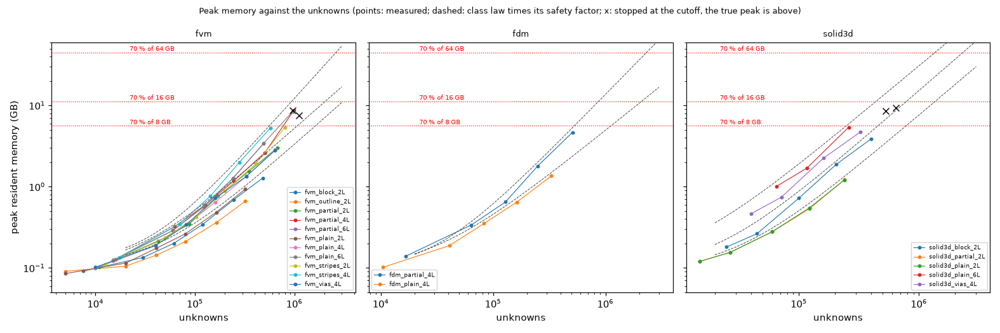
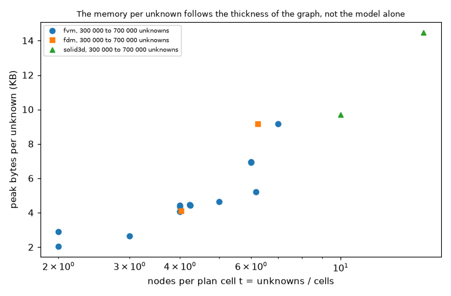
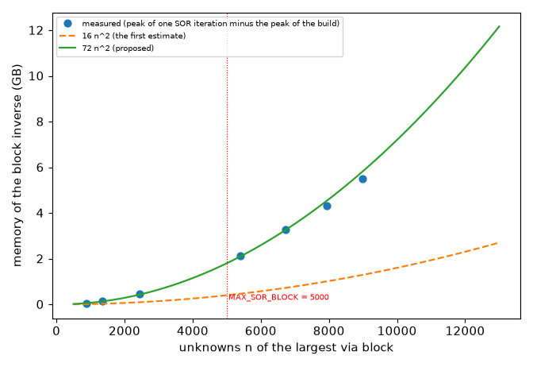

# Memory limit and guard

**Status: run, waits for the reviewer.** The ladder (150 records), the class fit, the SOR block study and the figures were run on the maintainer's 16 GB Mac (program 2.4.5, `develop` d28142a). Sections 4 to 11 are the results with the numbers the scripts printed; 12 says how to repeat them; 13 answers the questions; 14 says what was read and what was not verified. The numbers of section 2 are quoted from other folders; every other number comes from `out/ladder.jsonl`, `out/class_fit.json` and `out/sor_block.json` (ignored by version control, produced by the scripts).

## 1. The question

The program solves sparse systems whose size is set by the cell the user chooses. Nothing stops a cell that needs more memory than the machine has: the maintainer's monkey test once hung on a 1 million unknown 3D solid, and the layered models have only a note "slow" above 500 000 unknowns in the panel. The fixed `solid3d.MAX_CELLS = 250 000` is a rule for one model and one machine, and the SOR guard `fvm.MAX_SOR_BLOCK = 5000` is another fixed number. The item 'memory limit and guard' of `docs/versions.md` (Planned, release 2.5.0) asks for one guard by **estimated memory**: the physical memory of the machine, a default limit of 70 % editable in Preferences, an estimate of the peak memory of each model from its unknown count and class, and a verdict (ok, slow, refuse) used by `api.simulate`, the jobs, the interface and the command line.

What would answer it:

1. A **law** for the peak memory of each class of model against its unknowns, fitted on a ladder of boards, with the error of the fit and a margin so that the estimate does not fall below the measurement.
2. A **detector** of the physical memory that works on macOS, Linux and Windows without a new dependency.
3. The **cell-major numbering** of the unknowns, measured once as a gain of memory and time and shown to give the same answer.
4. The **memory of the SOR block** (a dense inverse) replacing the constant 5000.
5. A **design** of `pcbthermal/memory.py` and where it is called (`INTEGRATION.md`), with a stress scenario.

### 1.1 Pictures

Drawn by `scripts/make_diagrams.py` (no data):

* `figures/fig_01_guard_flow.png`: from the board to the verdict and the four places that use it.
* `figures/fig_02_board_section_and_unknowns.png`: a section of a two-layer board with copper absent in part of each layer, the copper nodes and the laminate nodes that exist only next to absent copper. It shows why the unknown count is not layers times cells and why the count shown in the panel must come from `fvm.unknowns`.
* `figures/fig_03_numbering_and_matrix_pattern.png`: the matrix pattern of a three-layer board in the layer-major and in the cell-major numbering.

Drawn by `scripts/make_figures.py` from the measurements: `fig_04_memory_against_unknowns.png`, `fig_05_time_and_cell_major.png`, `fig_06_bytes_per_unknown_against_t.png` and `fig_07_sor_block_memory.png` (shown in sections 5, 6 and 9).

## 2. What is already measured (quoted, not reproduced here)

All of these were measured on the maintainer's 16 GB machine by other folders; they are the starting values of the provisional coefficients in `lib/memory_model.py` and the test of whether the new ladder agrees with them.

| Model and board | Unknowns | Time | Peak memory | Source |
| :-- | --: | --: | --: | :-- |
| 3D solid, plain two-layer board (6 slabs) | 158 000 / 248 000 / 393 000 / 500 000 | 2.0 / 3.5 / 7.5 / 9.3 s | 0.75 / 1.2 / 2.65 / 3.3 GB | `research/solid3d-verification/docs/for-the-project-documents.md` |
| 3D solid, example board (16 slabs) | 158 000 / 247 000 / 392 000 / 512 000 | 7.2 / 15.3 / 32.8 / 57.7 s | 2.15 / 3.5 / 7.4 / 9.9 GB | same |
| layered FVM, plain board | 992 000 / 1 975 000 | 5.2 / 12.4 s | 2.7 / 5.5 GB | same |
| layered FVM, laminate rule, 2 layers, 0.25 mm | 637 000 | 21 s (21.4) | 4.5 GB | `docs/versions.md` Planned, after `fix/laminate-nodes` |
| layered FVM, laminate rule, 4 layers, 0.25 mm | 681 000 | 66 s | 7.6 GB | same |
| same 2-layer board, cell-major numbering | 637 000 | 12.7 s | 3.0 GB | reviewer of `fix/laminate-nodes` (4 layers: 50 s; memory not recorded here) |

What the table suggested before the ladder was run (superseded: the plain layered FVM is linear only for t = 2, see 5.2):

* The plain layered board is **linear** in the unknowns between 1 and 2 million (2.7 and 5.5 GB: exponent 1.0, 2.7 KB per unknown), not N^(4/3). The 3D solid on the example board is steeper: 3.5 to 9.9 GB for 247 000 to 512 000 unknowns is an exponent of about 1.4, and on the plain 6-slab board about 1.3 (these two exponents are computed here from the table above, nothing else).
* The memory per unknown is **not constant across classes**: 2.7 KB (plain layered), 6.6 KB (3D plain), 7 KB and 11 KB (laminate rule, 2 and 4 layers, layer-major), 14 to 19 KB (3D example board). A guard with one constant would be wrong by a factor of 7 either way; hence the classes.
* The two laminate-rule boards are the dangerous ones for the layered models, since the count shown by the panel was wrong for them (`docs/versions.md` Planned: the panel shows 2 400 where 9 600 are solved on a case; corrected by `fix/unknown-count`, with `fvm.unknowns` now counting the ragged nodes).

## 3. Sources to read (status in the vocabulary of `research/theory/BIBLIOGRAPHY.md`)

Section 22 of the bibliography lists them with their status; none was opened in this preparation (status **N** or **M**). What each would give:

| Key | What it gives to this study | Plan |
| :-- | :-- | :-- |
| [George1973] A. George, "Nested dissection of a regular finite element mesh", SIAM J. Numer. Anal. 10 (1973) 345-363 | Fill-in of the factor of an n x n grid is O(n^2 log n) and the operation count O(n^3); on a k x k x k grid fill O(k^4) = O(N^(4/3)). It is the reason for the exponent 4/3 of a 3D-like graph and for 1 (up to a logarithm) of a thin one. | Find the paper (SIAM, paywalled; the result is also in textbooks); read the theorem statements and write the page numbers. Marked M until then. |
| [Davis2006] T. A. Davis, *Direct Methods for Sparse Linear Systems*, SIAM, 2006 | Fill-in, orderings (minimum degree, nested dissection), the memory of LU and Cholesky; the effect of a different numbering on the ordering. | Chapter 7 (orderings) and 8 (fill) from a library copy or the author's pages; extract the statements on tie-breaking. M until read. |
| [LiSuperLU2005] X. S. Li, "An overview of SuperLU: algorithms, implementation, and user interface", ACM Trans. Math. Softw. 31 (2005) 302-325, and the SuperLU user guide | What the memory of `splu` holds: the L and U factors, the permuted copy, the work arrays; the meaning of `permc_spec` (MMD_AT_PLUS_A). | The user guide is open (the author's site, `crd-legacy.lbl.gov/~xiaoye/SuperLU`); read the sections on memory and column ordering. N now. |
| [SciPySuperLU] SciPy documentation, `scipy.sparse.linalg.splu` and `spsolve` | The arguments (`permc_spec`, `diag_pivot_thresh`), the copy of the matrix SciPy makes (`spsolve` converts to CSC/CSR), so the peak is more than the factor. | Open the page, read the notes; the version installed here is read from `pip show`. M now (the entry exists in the bibliography as M). |
| [GeorgeLiu1981] A. George, J. W. H. Liu, *Computer Solution of Large Sparse Positive Definite Systems*, Prentice-Hall, 1981 | The minimum-degree algorithm and its tie-breaking (the reason the numbering changes the ordering). | Only if Davis is not enough. N. |
| [Python resource] Python `resource.getrusage` and `os.wait4` documentation; `man getrusage` on macOS and Linux | `ru_maxrss` unit (bytes on macOS, kilobytes on Linux) and that `wait4` returns the usage of one child. | Open the documentation page and the man pages; one test of the wrapper checks it (section 8). M now. |

Nothing of a third party is stored here. The claim "exponent 4/3 in three dimensions" is not used as a fact: the fit decides, and the literature is used to explain the exponents found.

## 4. The ladder: what was run and how

`scripts/study_memory_ladder.py --run`: square boards of 100 mm at cells from 2 to 0.25 mm, every point in its own subprocess (`lib/measure.py`, peak resident size from the kernel through `os.wait4`; a watchdog kills a child above the cutoff). Series: FVM plain 2, 4 and 6 layers, with vias (4 layers), partial copper 2, 4 and 6 layers, outline, metal block, **stripes** 2 and 4 layers (added after the first pass, see 4.2), cell-major copies of five of them; FDM plain and partial 4 layers; 3D solid plain 2 and 6 layers, vias 4, partial 2, block 2; Lumped plain and partial; Analytic plain, vias plus heatsink 2 and 4 layers; the baseline (a 20 mm board: **0.08 GB**, the interpreter with NumPy and SciPy) and four small boards solved in both numberings in one process. The file `out/ladder.jsonl` holds 150 records, 145 of them measured and 5 stopped by the watchdog.

Passes: (1) `--run --quick`, 52 points, all measured; (2) `--run`, cutoff 10 GB (60 % of 17.2 GB), where the **provisional estimate skipped** the 0.25 mm points of the layered boards (it predicted 6.9 to 12 GB where 2.8 to 8.6 were measured, see 5.3); (3) `--run --est-scale 0.35 --cutoff-gb 8.5`, which runs those points with the watchdog as the only protection; (4) the stripes series, and a rerun of one point with the cutoff at 7.5 GB (4.2). Five points were stopped by the watchdog and are in figure 04 as crosses; their true peak is above the cutoff: 4-layer partial copper cell-major 983 200 unknowns (8.81 GB), 6-layer partial 960 000 (8.63 GB), 3D plain 6 layers 531 674 (8.50 GB), 3D vias 640 000 (9.33 GB), and 4-layer stripes 1 120 000 layer-major (7.51 GB).

### 4.1 Checks of the method (section 12 of the plan, "things to look at first")

* Baseline peak 0.08 GB: a few hundred MB at most, as expected.
* Unknown count of the program before the run (`fvm.unknowns`, `fdm.unknowns`, `solid3d.unknowns`) against the count of the assembled network: **96 points checked, 0 differ** (`study_class_fit.py`, last block). The laminate-node count of the rule is therefore the one the solver builds.
* The sampled resident size against the kernel's high-water mark: on the 99 points of 50 000 unknowns or more the ratio sampled / kernel has median 0.98 and maximum 1.00; it is low (0.24 to 0.8) only for points that last under half a second, which the 0.2 s sampling misses. The kernel value is used everywhere.
* Safety: see section 11 (the swap file grew once, in the stripes pass).

### 4.2 Defects of the study's own scripts found by running them

1. `tests/test_memory_model.py::test_cell_that_fits_really_fits` asked that a cell 20 % smaller does not fit; the search grows the cell by 10 % rounded up to 0.1 mm, so it can overshoot by a third at 0.3 mm. The test asks 30 % now (a test defect; `cell_that_fits` is right).
2. `study_memory_ladder.py` lost the parent's unknown count (`setdefault` kept the child's), so the check of the count could not be made from the file; the record has `unknowns_parent` now, and the check recounts every point in `study_class_fit.py`.
3. The provisional coefficients were 2 to 3 times too high for the laminate boards (5.3), so the skip rule skipped the points that matter; `--est-scale` was added (the watchdog stays).
4. The family "partial" (copper on the left 60 % of every layer) does not reproduce the board of the reviewer of `fix/laminate-nodes` (637 000 unknowns, 21 s, 4.5 GB; this family has 675 200 unknowns, 6.7 s, 3.0 GB); a family **stripes** (ten copper stripes per layer, shifted by half a period on alternate layers, bare laminate spread over the whole board) was added to `lib/cases.py` and run for 2 and 4 layers in both numberings. It is not his board either (6).
5. The first run of the 4-layer stripes point at 0.25 mm (1 120 000 unknowns, layer-major) took 171 s and read a peak of 4.05 GB while the machine swapped: the point is **disturbed** (the resident size falls when pages are swapped out). It was removed from the ladder (kept in `out/disturbed_stripes_4L_025.jsonl`) and rerun alone with the cutoff at 7.5 GB: the watchdog stopped it.
6. The SOR block study, planned in the plan as a series of the ladder, needed its own script: `study_sor_block.py`. Its first board (0.3 mm vias at 0.4 mm pitch) gave blocks of 8 unknowns because footprints merge only when they share a cell; the vias of the final board are 0.8 mm at 0.8 mm pitch.
7. `make_diagrams.py`: two labels of figure 02 overlapped the cells; moved.
8. `memory_model.sor_block_bytes` said 16 n^2 and the program's comment says 8 n^2; measured 72 n^2 (section 9). Corrected in the prototype, with a test.

## 5. Study 1: the memory law of each class

### 5.1 The first fit and why it was replaced

The first fit (`study_memory_ladder.py --fit`) uses the classes of the provisional table: plain, laminate with 2 layers, laminate with 3 or more layers, solid few, solid many. Its measured/fitted ratios run from 0.52 to 1.85 in the plain class and 0.63 to 1.68 in the 3D class, which no margin can cover. The bytes per unknown do not depend on the layer count alone but on the **nodes per plan cell** t = unknowns / cells (the thickness of the graph that is factored): a plain two-layer board has t = 2 and 2.9 KB per unknown at 320 000 unknowns, a plain four-layer board t = 4 and 4.1 KB, a two-layer board with laminate nodes t = 4.2 and 4.5 KB, a six-layer board t = 6 and 7.0 KB at 490 000 and 8.8 KB at 960 000 unknowns. The 4-layer plain and the 2-layer partial boards have the same t and about the same bytes per unknown (figure 06). The program knows t (unknowns and plan cells).



*Figure 04 (fig_04_memory_against_unknowns.png): measured peak per series for the FVM, the FDM and the 3D solid; dashed, the class law times its safety factor; red dotted, 70 % of 8, 16 and 64 GB; crosses, points stopped at the cutoff.*



*Figure 06 (fig_06_bytes_per_unknown_against_t.png): peak bytes per unknown of the points between 300 000 and 700 000 unknowns against the nodes per plan cell.*

### 5.2 The classes by t (output of `scripts/study_class_fit.py`)

Fit of `peak = 0.08 GB + k N (N / 500 000)^(p - 1)` on the layer-major points with N of at least 100 000 (50 000 for the FDM and the 3D solid); ratios over all points of the class with N of at least 50 000; "largest from others" = the largest point predicted from the others; safety = the largest ratio times 1.1:

```
class              pts     p k B/u@500k  ratio min-max (N>=50k)  largest from others  safety = max x 1.1 series
fvm_t_le_3.5        10  1.10       2409       0.81 - 1.14                 1.07                1.25      fvm_block_2L,fvm_outline_2L,fvm_plain_2L
fvm_t_3.5_4.5       12  1.08       4174       0.88 - 1.05                 1.03                1.16      fvm_partial_2L,fvm_plain_4L,fvm_vias_4L
fvm_t_gt_4.5        23  1.36       6441       0.75 - 1.33                 1.07                1.46      fvm_partial_4L,fvm_partial_6L,fvm_plain_6L,fvm_stripes_2L,fvm_stripes_4L
fdm_t_le_4.5         3  1.12       4041       0.99 - 1.01                 1.01                1.11      fdm_plain_4L
fdm_t_gt_4.5         4  1.41       8793       0.89 - 1.06                 1.06                1.16      fdm_partial_4L
solid3d_t_le_6       6  1.26       5609       0.96 - 1.02                 1.04                1.12      solid3d_partial_2L,solid3d_plain_2L
solid3d_t_6_12       3  1.28      10510       0.96 - 1.07                 0.96                1.18      solid3d_block_2L
solid3d_t_gt_12      6  1.23      18641       0.80 - 1.27                 0.71                1.40      solid3d_plain_6L,solid3d_vias_4L
```

Reading of the table (answer to 13.a):

* **The plain layered FVM is linear only for thin graphs.** The exponent is 1.08 to 1.10 for t up to 4.5 and **1.36 for t above 4.5**; 1.41 for the FDM with laminate nodes; 1.23 to 1.28 for the 3D solid (whose points reach only 240 000 to 400 000 unknowns, so its laws are extrapolated beyond them). The statement of section 2 that the plain layered FVM is linear (2.7 KB per unknown from 1 to 2 million unknowns) is true for t = 2 and not general: a six-layer plain board takes 8.8 KB per unknown at 960 000.
* Between the last two points of the six-layer plain board (490 776 and 960 000 unknowns) the peak goes from 3.42 to 8.41 GB (local exponent 1.34); of the 4-layer partial board (504 790 and 983 200) from 2.63 to 8.62 GB (1.78). The power law through all the points leaves a spread that the safety factor covers (1.46 for t above 4.5).
* The FDM with laminate nodes takes 1.7 to 1.8 times the memory of the FVM of the same board at the same cell (4.67 GB at 509 425 unknowns against 2.63 GB at 504 790).
* Classes with the largest spread: FVM t above 4.5 (ratio 0.75 to 1.33) and 3D t above 12 (0.80 to 1.27; its largest point is predicted from the others with an error of 29 %, with two series and one size range). The FDM classes have 3 and 4 points.

### 5.3 The provisional coefficients of the preparation against the measurements

```
layered_laminate_few     points  13  measured/provisional 0.41 - 0.92  (>1 means the provisional estimate was BELOW the measurement)
layered_laminate_many    points  13  measured/provisional 0.52 - 0.91  (>1 means the provisional estimate was BELOW the measurement)
layered_plain            points  26  measured/provisional 0.45 - 2.96  (>1 means the provisional estimate was BELOW the measurement)
solid3d_few              points   6  measured/provisional 0.65 - 0.89  (>1 means the provisional estimate was BELOW the measurement)
solid3d_many             points   9  measured/provisional 0.58 - 1.42  (>1 means the provisional estimate was BELOW the measurement)
```

The provisional classes were **both too high and too low**: for the laminate boards the estimate was 1.1 to 2.4 times the measurement (so the skip rule skipped valid points), but for the class `layered_plain` the measured peak reaches **2.96 times** the estimate (a six-layer board with copper everywhere: 8.4 GB measured against 2.7 KB x 960 000 = 2.6 GB). A guard built on the table of section 2 would have let it through. The measured table of `lib/memory_model.py` (`MEASURED`, `estimate_measured`) is tested: its estimate with the safety factor covers ten measured points and stays within 2.2 times of them.

### 5.4 Time (answer to 13.c)

```
fvm_t_le_3.5       t(500k) =    1.5 s  q = 1.32   N at 70 % of 16 GB (with safety) =   3076077   predicted solve time there     17 s
fvm_t_3.5_4.5      t(500k) =    5.4 s  q = 1.31   N at 70 % of 16 GB (with safety) =   2039385   predicted solve time there     34 s
fvm_t_gt_4.5       t(500k) =    9.2 s  q = 1.50   N at 70 % of 16 GB (with safety) =    937991   predicted solve time there     24 s
fdm_t_gt_4.5       t(500k) =   11.5 s  q = 1.47   N at 70 % of 16 GB (with safety) =    866902   predicted solve time there     26 s
solid3d_t_le_6     t(500k) =   11.2 s  q = 1.70   N at 70 % of 16 GB (with safety) =   1363521   predicted solve time there     62 s
solid3d_t_6_12     t(500k) =   14.8 s  q = 1.52   N at 70 % of 16 GB (with safety) =    786373   predicted solve time there     29 s
solid3d_t_gt_12    t(500k) =   44.1 s  q = 1.50   N at 70 % of 16 GB (with safety) =    438875   predicted solve time there     36 s
```

Time laws t = a N^q on the points with N of at least 100 000, q = 1.3 to 1.7; the last column is the solve time predicted at the limit of 70 % of 16 GB (with the safety factor on the memory law), 17 to 62 s. The times are of this machine shared with other work, so lower bounds for a loaded one.

## 6. Study 2: the cell-major numbering (answer to 13.f)

```
partial  2L cell 0.25 N=  675200  layer  3.02 GB    6.7 s   cell  3.00 GB    6.5 s
partial  2L cell 0.35 N=  346346  layer  1.54 GB    3.4 s   cell  1.51 GB    2.9 s
partial  2L cell 0.50 N=  170000  layer  0.76 GB    1.4 s   cell  0.70 GB    1.0 s
partial  4L cell 0.35 N=  504790  layer  2.63 GB    6.9 s   cell  2.59 GB    6.5 s
partial  4L cell 0.50 N=  246400  layer  1.18 GB    2.4 s   cell  1.15 GB    2.2 s
partial  4L cell 0.70 N=  126841  layer  0.60 GB    1.2 s   cell  0.59 GB    1.2 s
plain    4L cell 0.25 N=  640000  layer  2.85 GB    8.8 s   cell  2.80 GB    7.3 s
plain    4L cell 0.35 N=  327184  layer  1.33 GB    2.7 s   cell  1.37 GB    2.5 s
plain    4L cell 0.50 N=  160000  layer  0.64 GB    1.0 s   cell  0.65 GB    0.9 s
stripes  2L cell 0.25 N=  800000  layer  5.37 GB   15.9 s   cell  5.38 GB   16.6 s
stripes  2L cell 0.35 N=  408980  layer  1.90 GB    5.8 s   cell  1.94 GB    7.4 s
stripes  2L cell 0.50 N=  200000  layer  0.89 GB    2.1 s   cell  0.88 GB    1.8 s
stripes  2L cell 0.70 N=  102245  layer  0.42 GB    0.7 s   cell  0.45 GB    0.8 s
stripes  4L cell 0.35 N=  572572  layer  5.26 GB   15.0 s   cell  5.29 GB   14.5 s
stripes  4L cell 0.50 N=  280000  layer  2.00 GB    5.0 s   cell  1.39 GB    6.3 s
stripes  4L cell 0.70 N=  143143  layer  0.77 GB    2.0 s   cell  0.75 GB    2.0 s
```

Equality of the answer: the four small boards solved in both numberings in one process (partial 2 and 4 layers, outline, plain 4 layers) differ by at most **1.15e-12 K** (7.6e-14, 1.15e-12, 1.06e-12, 2.2e-13), far below the 1e-9 K criterion; `tests/test_measure_and_ordering.py` asks the same on five boards.

What the numbers say:

* On 2-layer boards (partial, plain, vias, stripes) the gain is **within the noise**: the peak differs by 8 % at most, the time between 0.7 and 1.3 times in either direction (partial copper at 0.5 mm 1.4 s against 1.0 s; stripes at 0.35 mm 5.8 s against 7.4 s).
* **The reviewer's gain of `fix/laminate-nodes` (21.4 s and 4.5 GB to 12.7 s and 3.0 GB) was not reproduced**: the partial-copper board at 675 200 unknowns takes 6.7 s and 3.02 GB in layer-major order and 6.5 s and 3.00 GB in cell-major; the stripes board at 800 000 takes 15.9 s / 5.37 GB and 16.6 s / 5.38 GB. His board was not available, so it is not known whether its pattern is one where the numbering matters.
* A gain appears where the layer-major order falls into the steep regime: the 4-layer stripes board at 0.25 mm (1 120 000 unknowns, t = 6.2) takes **35.1 s and 6.86 GB** cell-major, while the layer-major run was stopped by the watchdog above 7.5 GB (the first, disturbed run took 171 s while the machine swapped). At 0.5 mm the same board takes 2.00 GB layer-major and 1.39 GB cell-major, but at 0.35 mm 5.26 and 5.29 GB. On the 4-layer partial board at 0.25 mm both orders went above 8.5 GB (layer-major 8.62 GB measured; cell-major stopped at 8.81 GB), so the numbering did not rescue that board.
* Nothing is lost on these boards: no point is slower than 1.3 times or takes more than 1.08 times the memory.

So the numbering is **harmless, with a gain that is conditional** (one board at 1.1 million unknowns in this ladder). It does not change the class laws within the margin. Adopting it changes the last digits of every result of the factorised models (not bit-identical), which the frozen reference numbers would have to confirm; not run.

## 7. Study 4: the unknown count

96 points checked (every FVM, FDM and 3D solid point of the ladder, layer-major): zero differences between the count the program makes before the run and the count of the assembled network (4.1). The families are those of `lib/cases.py` (plain, vias, partial, outline, block, stripes); boards from a Gerber import (many cells with partial copper) are not tested.

## 8. Study 5: the physical memory (answer to 13.d)

`memory_model.ram_bytes()` returned 17 179 869 184 bytes on this Mac (equal to `sysctl hw.memsize`). Windows and container paths were not run.

Installed against available, with the numbers of this machine: `vm_stat` at an idle moment after the runs showed 11.0 GB of free pages and 12.6 GB free + inactive + speculative, so about 12 GB are usable at rest out of the 17.2 installed. 70 % of the installed memory is 12.0 GB, that is **all of it**: a run at the limit leaves nothing for the interface (the application with Qt is more than the 0.08 GB baseline child), the operating system or another program. What happened here when work ran beside a large solve: in the stripes pass the swap file of the machine went from 2 to 5 GB (4.9 GB used) while series at 5 to 7 GB ran, next to another researcher's jobs and two Claude sessions (load average 6); the first stripes point at 1.1 million unknowns took 171 s. The installed memory alone is therefore **not a safe basis on a 16 GB machine that is being used**. Options: a lower default (60 % = 10.3 GB), or the minimum of the fraction of the installed memory and the available memory read at the start of the run (`vm_stat`, `MemAvailable`, `GlobalMemoryStatusEx`'s available field; no dependency). The measurements show the problem, they do not choose the option: maintainer decision.

## 9. Study 3: the dense block of the SOR (answer to 13.g)

`scripts/study_sor_block.py`: a 40 mm two-layer board with 625 vias of 0.8 mm at 0.8 mm pitch over 20 mm, so the footprints merge into one block; `fvm.MAX_SOR_BLOCK` raised in the child; peak of the child (kernel value through `/usr/bin/time`) with one iteration of `solve_sor` minus the peak of the network build (printed table):

```
cell  n_block  peak build  peak sor  diff GB  8 n^2 GB  diff/(8n^2)
1.00      880        0.08      0.13     0.05      0.01        8.24
0.80     1352        0.09      0.22     0.13      0.01        9.22
0.60     2450        0.09      0.54     0.45      0.05        9.34
0.40     5400        0.12      2.24     2.12      0.23        9.08
0.35     6728        0.11      3.40     3.28      0.36        9.07
0.32     7938        0.13      4.43     4.30      0.50        8.54
0.30     8978        0.14      5.64     5.50      0.64        8.53
0.28    10554   stopped by the watchdog (8.2 GB)
0.26    12168   stopped by the watchdog (9.1 GB)
```



*Figure 07 (fig_07_sor_block_memory.png): measured memory of the block inverse against the block size, with 16 n^2 (the first estimate) and 72 n^2.*

* The cost is **72 n^2 bytes** (8.2 to 9.3 times the 8 n^2 of the dense inverse itself; the build holds the dense block, its inverse, LAPACK's work and the sparse copy that the iterations keep). The first estimate 16 n^2 was 4.5 times too low, and the comment of `fvm.py` ("5 000 unknowns are 200 MB") is wrong: **5 000 unknowns take about 1.8 GB** (2.12 GB measured at n = 5 400). The block size is not a smooth function of the cell (footprints merge at some cells and not at others: 128 unknowns in 25 blocks at 0.5 mm, 880 in one block at 1.0 mm).
* Rule that replaces `MAX_SOR_BLOCK`: `72 n^2 <= share x limit`. With a share of 25 %: 70 % of 16 GB gives n up to 6 200; 8 GB at 70 % gives 4 400; 64 GB gives 12 500. The constant 5 000 is 1.8 GB, 16 % of the 16 GB limit. The SOR is a comparison solver, so a small share is enough; the share is a decision.
* Not measured: a block above 9 000 unknowns (the watchdog stopped it), and several blocks together (the sum of the squares is assumed: the colours are inverted one after another and their sparse inverses stay in memory).

## 10. Study 7: the ceiling of the 3D solid (answer to 13.e)

The measured 3D laws with their safety factor give, at 70 % of 16 GB = 11.2 GB (table 5.4): **1.36 million unknowns for a plain 2-layer board (6 slabs), 786 000 for the 10-slab board, 439 000 for 16 to 26 slabs**, against the fixed 250 000 of `solid3d.MAX_CELLS` (5.4, 3.1 and 1.8 times more). These are extrapolations: the largest 3D points measured are 240 000 (6 slabs), 400 000 (10 slabs), 327 184 (16 slabs) and 260 000 (26 slabs), and the two points above them were stopped at the cutoff (531 674 unknowns of 26 slabs at 8.5 GB, 640 000 of 16 slabs at 9.3 GB; the law gives 10.1 GB and 12.6 GB without the safety factor for them, consistent). The documents' values for the example board (3.5 GB at 247 000 and 7.4 GB at 392 000 unknowns, 16 slabs) are within 12 % of the law of the class (3.9 and 6.9 GB), so they are not contradicted.

The absolute ceiling of 2 million unknowns does not bind on a 16 GB machine; with the laws above the memory limit equals it from about 26 GB of installed memory for a 6-slab board (the safety factor included) and about 100 GB for 26 slabs, where the predicted solve time of the 6-slab board at 2 million unknowns is about 120 s (t = 11.2 s x (N / 500 000)^1.70). Keep it, as proposed.

## 11. Load and swap during the runs

The ladder runs one point at a time and the SOR study one child at a time, both with `nice -n 10`; another researcher ran light studies next to me and two Claude sessions were open; the load average read about 6 in the stripes pass. Swap in use at the start: 0.86 GB of 2 GB, unchanged through passes 1 to 3. In the stripes pass the macOS swap file grew to 5 GB (4.9 GB used) and returned to about 1.2 GB when the series ended. The pass ran as one foreground command, so I could not stop it when the monitor reported the growth; afterwards I removed the one disturbed point (4.2, item 5) and reran it with a 7.5 GB cutoff, which stopped it without swap. The maintainer's rule "never let the machine swap" was therefore **broken once**, in that pass. The other points were not affected as far as the data show (their sampled and kernel peaks agree, 4.1), but this is a judgement: the points of that pass are the stripes series, 2 and 4 layers, both orders, and the cell-major 4-layer point at 0.25 mm (35.1 s, 6.86 GB) ran after the swap episode had begun and is the one to repeat on a quiet machine. The SOR block study ran afterwards, nothing else heavy running by me; its two largest points were stopped at 8.2 and 9.1 GB. After everything the swap stood at 1.2 GB.

## 12. How to run it again

All commands from the repository root with the program's environment:

```sh
.venv/bin/python -m pytest -q research/memory-guard/tests                                              # 38 tests, seconds
.venv/bin/python research/memory-guard/scripts/study_memory_ladder.py --plan                            # the points and the provisional estimates
.venv/bin/python research/memory-guard/scripts/study_memory_ladder.py --run --quick                     # about 10 minutes
.venv/bin/python research/memory-guard/scripts/study_memory_ladder.py --run                             # resumable (out/ladder.jsonl)
.venv/bin/python research/memory-guard/scripts/study_memory_ladder.py --run --est-scale 0.35 --cutoff-gb 7.5   # the fine points the provisional estimate skips
.venv/bin/python research/memory-guard/scripts/study_memory_ladder.py --fit                             # the first fit and the ordering check
.venv/bin/python research/memory-guard/scripts/study_class_fit.py                                       # the classes by t, time, cell-major, count check (out/class_fit.json)
.venv/bin/python research/memory-guard/scripts/study_sor_block.py                                       # the SOR block (out/sor_block.json)
.venv/bin/python research/memory-guard/scripts/make_diagrams.py && .venv/bin/python research/memory-guard/scripts/make_figures.py
```

Close the other heavy programs first and watch `sysctl vm.swapusage`; a point above the cutoff is killed by the watchdog, but the machine can still swap below it when other work runs (section 11).

## 13. Answers to the questions and decisions left to the maintainer

(a) **Coefficients and growth law**: section 5.2. Classes by t (nodes per plan cell); k from 2.4 to 18.6 KB per unknown at 500 000 unknowns; exponent 1.08 to 1.10 for t up to 4.5, 1.36 above (FVM), 1.41 (FDM with laminate nodes), 1.23 to 1.28 (3D solid, extrapolated). The plain layered FVM is linear only for thin graphs, not in general.

(b) **Safety margin**: the largest measured/fitted ratio times 1.1 gives 1.11 to 1.46 (FVM 1.25, 1.16, 1.46; FDM 1.11, 1.16; 3D 1.12, 1.18, 1.40). Proposal: the per-class factor of the table (`MEASURED`), never below 1.15. The 1.46 and the 1.40 come from the steep regime and the extrapolation and are the ones to revisit with a second machine.

(c) **The slow mark**: at the memory limit of a 16 GB machine the predicted solve times are 17 to 62 s, so a time rule would hardly fire before the memory refuses; the 35 % of the RAM placeholder is not supported (points near 5.6 GB, 35 % of 16 GB, took 15 to 25 s). Proposal: "slow" when the predicted solve time of the class exceeds 30 s, with the estimate in the message; refusing on time is not proposed. Times scale with the processor; not verified on another machine.

(d) **Installed against available**: section 8: the installed memory alone is not safe on a used 16 GB machine (12 GB usable at rest, limit 12.0 GB). Proposal: limit = fraction x installed, lowered to the available memory at the start of the run, or a default of 60 %. Maintainer decision.

(e) **3D ceiling**: section 10: keep 2 million; at 70 % of 16 GB the 3D solid gets 1.36 million (6 slabs), 786 000 (10 slabs), 439 000 (16 to 26 slabs), extrapolated beyond 240 000 to 400 000.

(f) **Cell-major**: section 6: same answer to 1.2e-12 K; no loss; a gain only on the stripes 4-layer board at 1.1 million unknowns; the reviewer's gain not reproduced. Adopt only if the maintainer wants those boards to run; the classes do not change.

(g) **SOR block**: section 9: 72 n^2, a share-of-limit rule; 5 000 unknowns take 1.8 GB (the comment says 200 MB).

(h) **Cost of the laminate rule at 0.25 mm** (the documents say about 7 GB per million unknowns on refined boards): 4.5 GB per million for the 2-layer partial-copper board (675 200 unknowns, 3.02 GB), 6.7 GB per million for the 2-layer stripes board (800 000, 5.37 GB), **8.8 GB per million for the 4-layer board with laminate nodes** (983 200, 8.62 GB) and for the 6-layer plain board (960 000, 8.41 GB, no laminate node at all). About 7 GB per million is the right order for a board at 0.25 mm with laminate nodes and 2 to 4 layers. The cost follows t, not the rule as such; the rule makes t larger.

Decisions left to the maintainer: the margin (b); the slow mark (c); installed or available memory and the default fraction (d); the cell-major numbering (f); the share of the limit for the SOR block (g); psutil (not adopted: the available memory can be read without it); a second machine to repeat the ladder.

## 14. What was read and what was not verified

* **Read in full:** the code of `pcbthermal/fvm.py` (`Network`, `solve_steady`, `solve_sor`, `_sor_block_groups`, `unknowns`, `MAX_SOR_BLOCK`), `viawell.unknown_blocks`, `laminate.uses_rule`, and the code of this folder. `fdm.py`, `solid3d.py`, `analytic.py`, `api.py` and `gui/panels.py` were read in the preparation of the folder and not re-read in this run.
* **Reproduced from earlier measurements (section 2):** the 3D solid on a plain 2-layer board 1.21 GB at 240 000 unknowns (documents: 1.2 GB at 248 000) and the 16-slab board within 12 % of the law through the documents' points; the layered laminate board 4.5 GB per million (documents: 4.5 GB at 637 000); the 7 GB per million only for 4 layers (8.8). **Not reproduced: the reviewer's cell-major numbers (21.4 s and 4.5 GB to 12.7 s and 3.0 GB); the plain layered FVM linear at 2.7 KB per unknown (true only for t = 2).**
* **Literature:** none of [George1973], [Davis2006], [LiSuperLU2005], [GeorgeLiu1981] was opened in this run; the explanations that the exponent grows with the thickness of the graph and that the minimum-degree ordering depends on the numbering are hypotheses that fit the measurements, status M, not results. The unit of `ru_maxrss` and the child's usage by `wait4` were checked by the measurement (baseline 0.08 GB, kernel value equal to the sampled peak), not by reading the manual.
* **Not verified:** the transient factor 2 (no time simulation was measured); the computed-h loop's effect on the peak; the quadratic law of the Analytic (with vias and a heatsink it took 0.52 GB at 640 000 unknowns and 4 layers, 0.31 GB at 320 000 with 2 layers: far below every limit, but the number of via tiles was not varied); the Lumped (455 B per unknown at 500 000, 0.32 GB at 675 200: small); Windows and container detection; a machine other than this 16 GB Mac (the coefficients are those of SuperLU in the installed SciPy and the macOS allocator); boards from a Gerber import; 8 or more copper layers; the 3D solid above 400 000 unknowns (extrapolated); any point between 8.6 GB and the 11.2 GB limit; the FDM beyond 509 000 unknowns (3 and 4 points per class); the effect of the application itself (Qt, a second process) on the base; the stripes cell-major point at 0.25 mm (run during the swap episode, section 11). Times are those of a machine shared with other work.
