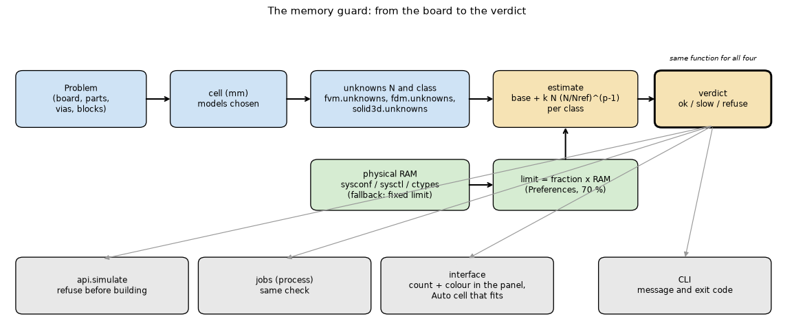
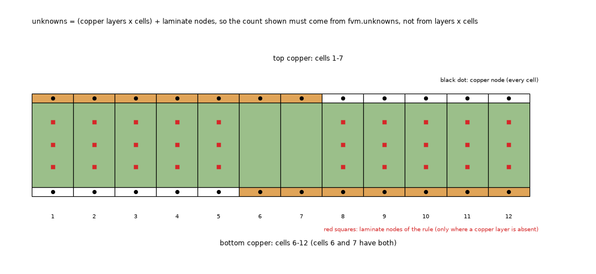
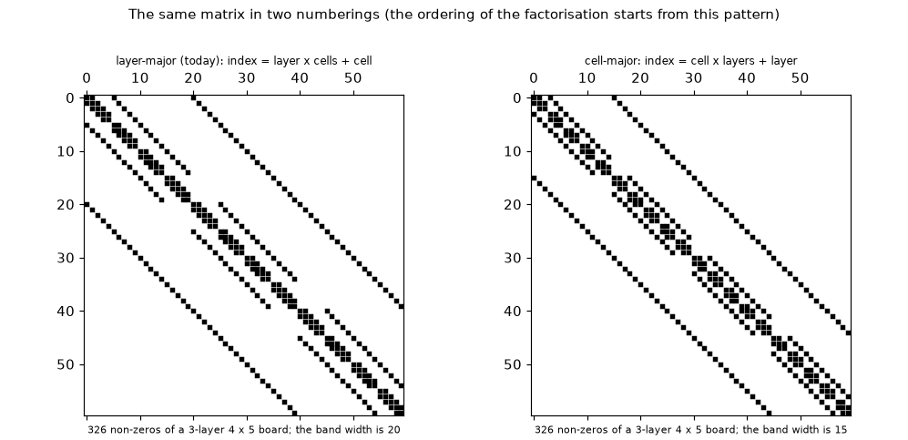
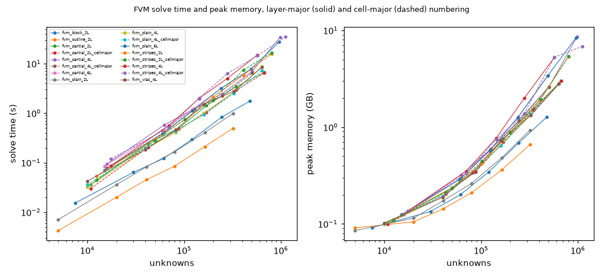

# Memory limit and guard

**Status: reviewed (section 14): go for 2.5.0 with the changes of 14.10.** The ladder (150 records), the class fit, the SOR block study and the figures were run on the maintainer's 16 GB Mac (program 2.4.5, `develop` d28142a). Sections 4 to 11 are the results with the numbers the scripts printed; 12 says how to repeat them; 13 answers the questions; 14 is the review (the class table of 5.2 is replaced by a continuous law, the transient factor and the SOR cost are corrected); 15 says what was read and what was not verified. The numbers of section 2 are quoted from other folders; every other number comes from `out/ladder.jsonl`, `out/class_fit.json` and `out/sor_block.json` (ignored by version control, produced by the scripts).

## 1. The question

The program solves sparse systems whose size is set by the cell the user chooses. Nothing stops a cell that needs more memory than the machine has: the maintainer's monkey test once hung on a 1 million unknown 3D solid, and the layered models have only a note "slow" above 500 000 unknowns in the panel. The fixed `solid3d.MAX_CELLS = 250 000` is a rule for one model and one machine, and the SOR guard `fvm.MAX_SOR_BLOCK = 5000` is another fixed number. The item 'memory limit and guard' of `docs/versions.md` (Planned, release 2.5.0) asks for one guard by **estimated memory**: the physical memory of the machine, a default limit of 70 % editable in Preferences, an estimate of the peak memory of each model from its unknown count and class, and a verdict (ok, slow, refuse) used by `api.simulate`, the jobs, the interface and the command line.

What would answer it:

1. A **law** for the peak memory of each class of model against its unknowns, fitted on a ladder of boards, with the error of the fit and a margin so that the estimate does not fall below the measurement.
2. A **detector** of the physical memory that works on macOS, Linux and Windows without a new dependency.
3. The **cell-major numbering** of the unknowns, measured once as a gain of memory and time and shown to give the same answer.
4. The **memory of the SOR block** (a dense inverse) replacing the constant 5000.
5. A **design** of `pcbthermal/memory.py` and where it is called (`INTEGRATION.md`), with a stress scenario.

### 1.1 Pictures

Drawn by `scripts/make_diagrams.py` (no data):



*Figure 01 (fig_01_guard_flow.png): from the board to the verdict and the four places that use it.*



*Figure 02 (fig_02_board_section_and_unknowns.png): a section of a two-layer board with copper absent in part of each layer, the copper nodes and the laminate nodes that exist only next to absent copper. It shows why the unknown count is not layers times cells and why the count shown in the panel must come from `fvm.unknowns`.*



*Figure 03 (fig_03_numbering_and_matrix_pattern.png): the matrix pattern of a three-layer board in the layer-major and in the cell-major numbering.*

Drawn by `scripts/make_figures.py` from the measurements: `fig_04_memory_against_unknowns.png`, `fig_05_time_and_cell_major.png`, `fig_06_bytes_per_unknown_against_t.png` and `fig_07_sor_block_memory.png` (shown in sections 5, 6 and 9; figure 05 below).

## 2. What is already measured (quoted, not reproduced here)

All of these were measured on the maintainer's 16 GB machine by other folders; they are the starting values of the provisional coefficients in `lib/memory_model.py` and the test of whether the new ladder agrees with them.

| Model and board | Unknowns | Time | Peak memory | Source |
| :-- | --: | --: | --: | :-- |
| 3D solid, plain two-layer board (6 slabs) | 158 000 / 248 000 / 393 000 / 500 000 | 2.0 / 3.5 / 7.5 / 9.3 s | 0.75 / 1.2 / 2.65 / 3.3 GB | `research/solid3d-verification/docs/for-the-project-documents.md` |
| 3D solid, example board (16 slabs) | 158 000 / 247 000 / 392 000 / 512 000 | 7.2 / 15.3 / 32.8 / 57.7 s | 2.15 / 3.5 / 7.4 / 9.9 GB | same |
| layered FVM, plain board | 992 000 / 1 975 000 | 5.2 / 12.4 s | 2.7 / 5.5 GB | same |
| layered FVM, laminate rule, 2 layers, 0.25 mm | 637 000 | 21 s (21.4) | 4.5 GB | `docs/versions.md` Planned, after `fix/laminate-nodes` |
| layered FVM, laminate rule, 4 layers, 0.25 mm | 681 000 | 66 s | 7.6 GB | same |
| same 2-layer board, cell-major numbering | 637 000 | 12.7 s | 3.0 GB | reviewer of `fix/laminate-nodes` (4 layers: 50 s; memory not recorded here) |

What the table suggested before the ladder was run (superseded: the plain layered FVM is linear only for t = 2, see 5.2):

* The plain layered board is **linear** in the unknowns between 1 and 2 million (2.7 and 5.5 GB: exponent 1.0, 2.7 KB per unknown), not N^(4/3). The 3D solid on the example board is steeper: 3.5 to 9.9 GB for 247 000 to 512 000 unknowns is an exponent of about 1.4, and on the plain 6-slab board about 1.3 (these two exponents are computed here from the table above, nothing else).
* The memory per unknown is **not constant across classes**: 2.7 KB (plain layered), 6.6 KB (3D plain), 7 KB and 11 KB (laminate rule, 2 and 4 layers, layer-major), 14 to 19 KB (3D example board). A guard with one constant would be wrong by a factor of 7 either way; hence the classes.
* The two laminate-rule boards are the dangerous ones for the layered models, since the count shown by the panel was wrong for them (`docs/versions.md` Planned: the panel shows 2 400 where 9 600 are solved on a case; corrected by `fix/unknown-count`, with `fvm.unknowns` now counting the ragged nodes).

## 3. Sources to read (status in the vocabulary of `research/theory/BIBLIOGRAPHY.md`)

Section 22 of the bibliography lists them with their status; none was opened in this preparation (status **N** or **M**). What each would give:

| Key | What it gives to this study | Plan |
| :-- | :-- | :-- |
| [George1973] A. George, "Nested dissection of a regular finite element mesh", SIAM J. Numer. Anal. 10 (1973) 345-363 | Fill-in of the factor of an n x n grid is O(n^2 log n) and the operation count O(n^3); on a k x k x k grid fill O(k^4) = O(N^(4/3)). It is the reason for the exponent 4/3 of a 3D-like graph and for 1 (up to a logarithm) of a thin one. | Find the paper (SIAM, paywalled; the result is also in textbooks); read the theorem statements and write the page numbers. Marked M until then. |
| [Davis2006] T. A. Davis, *Direct Methods for Sparse Linear Systems*, SIAM, 2006 | Fill-in, orderings (minimum degree, nested dissection), the memory of LU and Cholesky; the effect of a different numbering on the ordering. | Chapter 7 (orderings) and 8 (fill) from a library copy or the author's pages; extract the statements on tie-breaking. M until read. |
| [LiSuperLU2005] X. S. Li, "An overview of SuperLU: algorithms, implementation, and user interface", ACM Trans. Math. Softw. 31 (2005) 302-325, and the SuperLU user guide | What the memory of `splu` holds: the L and U factors, the permuted copy, the work arrays; the meaning of `permc_spec` (MMD_AT_PLUS_A). | The user guide is open (the author's site, `crd-legacy.lbl.gov/~xiaoye/SuperLU`); read the sections on memory and column ordering. N now. |
| [SciPySuperLU] SciPy documentation, `scipy.sparse.linalg.splu` and `spsolve` | The arguments (`permc_spec`, `diag_pivot_thresh`), the copy of the matrix SciPy makes (`spsolve` converts to CSC/CSR), so the peak is more than the factor. | Open the page, read the notes; the version installed here is read from `pip show`. M now (the entry exists in the bibliography as M). |
| [GeorgeLiu1981] A. George, J. W. H. Liu, *Computer Solution of Large Sparse Positive Definite Systems*, Prentice-Hall, 1981 | The minimum-degree algorithm and its tie-breaking (the reason the numbering changes the ordering). | Only if Davis is not enough. N. |
| [Python resource] Python `resource.getrusage` and `os.wait4` documentation; `man getrusage` on macOS and Linux | `ru_maxrss` unit (bytes on macOS, kilobytes on Linux) and that `wait4` returns the usage of one child. | Open the documentation page and the man pages; one test of the wrapper checks it (section 8). M now. |

Nothing of a third party is stored here. The claim "exponent 4/3 in three dimensions" is not used as a fact: the fit decides, and the literature is used to explain the exponents found.

## 4. The ladder: what was run and how

`scripts/study_memory_ladder.py --run`: square boards of 100 mm at cells from 2 to 0.25 mm, every point in its own subprocess (`lib/measure.py`, peak resident size from the kernel through `os.wait4`; a watchdog kills a child above the cutoff). Series: FVM plain 2, 4 and 6 layers, with vias (4 layers), partial copper 2, 4 and 6 layers, outline, metal block, **stripes** 2 and 4 layers (added after the first pass, see 4.2), cell-major copies of five of them; FDM plain and partial 4 layers; 3D solid plain 2 and 6 layers, vias 4, partial 2, block 2; Lumped plain and partial; Analytic plain, vias plus heatsink 2 and 4 layers; the baseline (a 20 mm board: **0.08 GB**, the interpreter with NumPy and SciPy) and four small boards solved in both numberings in one process. The file `out/ladder.jsonl` holds 150 records, 145 of them measured and 5 stopped by the watchdog.

Passes: (1) `--run --quick`, 52 points, all measured; (2) `--run`, cutoff 10 GB (60 % of 17.2 GB), where the **provisional estimate skipped** the 0.25 mm points of the layered boards (it predicted 6.9 to 12 GB where 2.8 to 8.6 were measured, see 5.3); (3) `--run --est-scale 0.35 --cutoff-gb 8.5`, which runs those points with the watchdog as the only protection; (4) the stripes series, and a rerun of one point with the cutoff at 7.5 GB (4.2). Five points were stopped by the watchdog and are in figure 04 as crosses; their true peak is above the cutoff: 4-layer partial copper cell-major 983 200 unknowns (8.81 GB), 6-layer partial 960 000 (8.63 GB), 3D plain 6 layers 531 674 (8.50 GB), 3D vias 640 000 (9.33 GB), and 4-layer stripes 1 120 000 layer-major (7.51 GB).

### 4.1 Checks of the method (section 12 of the plan, "things to look at first")

* Baseline peak 0.08 GB: a few hundred MB at most, as expected.
* Unknown count of the program before the run (`fvm.unknowns`, `fdm.unknowns`, `solid3d.unknowns`) against the count of the assembled network: **96 points checked, 0 differ** (`study_class_fit.py`, last block). The laminate-node count of the rule is therefore the one the solver builds.
* The sampled resident size against the kernel's high-water mark: on the 99 points of 50 000 unknowns or more the ratio sampled / kernel has median 0.98 and maximum 1.00; it is low (0.24 to 0.8) only for points that last under half a second, which the 0.2 s sampling misses. The kernel value is used everywhere.
* Safety: see section 11 (the swap file grew once, in the stripes pass).

### 4.2 Defects of the study's own scripts found by running them

1. `tests/test_memory_model.py::test_cell_that_fits_really_fits` asked that a cell 20 % smaller does not fit; the search grows the cell by 10 % rounded up to 0.1 mm, so it can overshoot by a third at 0.3 mm. The test asks 30 % now (a test defect; `cell_that_fits` is right).
2. `study_memory_ladder.py` lost the parent's unknown count (`setdefault` kept the child's), so the check of the count could not be made from the file; the record has `unknowns_parent` now, and the check recounts every point in `study_class_fit.py`.
3. The provisional coefficients were 2 to 3 times too high for the laminate boards (5.3), so the skip rule skipped the points that matter; `--est-scale` was added (the watchdog stays).
4. The family "partial" (copper on the left 60 % of every layer) does not reproduce the board of the reviewer of `fix/laminate-nodes` (637 000 unknowns, 21 s, 4.5 GB; this family has 675 200 unknowns, 6.7 s, 3.0 GB); a family **stripes** (ten copper stripes per layer, shifted by half a period on alternate layers, bare laminate spread over the whole board) was added to `lib/cases.py` and run for 2 and 4 layers in both numberings. It is not his board either (6).
5. The first run of the 4-layer stripes point at 0.25 mm (1 120 000 unknowns, layer-major) took 171 s and read a peak of 4.05 GB while the machine swapped: the point is **disturbed** (the resident size falls when pages are swapped out). It was removed from the ladder (kept in `out/disturbed_stripes_4L_025.jsonl`) and rerun alone with the cutoff at 7.5 GB: the watchdog stopped it.
6. The SOR block study, planned in the plan as a series of the ladder, needed its own script: `study_sor_block.py`. Its first board (0.3 mm vias at 0.4 mm pitch) gave blocks of 8 unknowns because footprints merge only when they share a cell; the vias of the final board are 0.8 mm at 0.8 mm pitch.
7. `make_diagrams.py`: two labels of figure 02 overlapped the cells; moved.
8. `memory_model.sor_block_bytes` said 16 n^2 and the program's comment says 8 n^2; measured 72 n^2 (section 9). Corrected in the prototype, with a test.

## 5. Study 1: the memory law of each class

### 5.1 The first fit and why it was replaced

The first fit (`study_memory_ladder.py --fit`) uses the classes of the provisional table: plain, laminate with 2 layers, laminate with 3 or more layers, solid few, solid many. Its measured/fitted ratios run from 0.52 to 1.85 in the plain class and 0.63 to 1.68 in the 3D class, which no margin can cover. The bytes per unknown do not depend on the layer count alone but on the **nodes per plan cell** t = unknowns / cells (the thickness of the graph that is factored): a plain two-layer board has t = 2 and 2.9 KB per unknown at 320 000 unknowns, a plain four-layer board t = 4 and 4.1 KB, a two-layer board with laminate nodes t = 4.2 and 4.5 KB, a six-layer board t = 6 and 7.0 KB at 490 000 and 8.8 KB at 960 000 unknowns. The 4-layer plain and the 2-layer partial boards have the same t and about the same bytes per unknown (figure 06). The program knows t (unknowns and plan cells).


*Figure 04 (fig_04_memory_against_unknowns.png): measured peak per series for the FVM, the FDM and the 3D solid; dashed, the class law times its safety factor; red dotted, 70 % of 8, 16 and 64 GB; crosses, points stopped at the cutoff.*



*Figure 05 (fig_05_time_and_cell_major.png): FVM solve time and peak memory against the unknowns, layer-major (solid) and cell-major (dashed) numbering (drawn by `scripts/make_figures.py` from `out/ladder.jsonl`).*


*Figure 06 (fig_06_bytes_per_unknown_against_t.png): peak bytes per unknown of the points between 300 000 and 700 000 unknowns against the nodes per plan cell.*

### 5.2 The classes by t (output of `scripts/study_class_fit.py`)

Fit of `peak = 0.08 GB + k N (N / 500 000)^(p - 1)` on the layer-major points with N of at least 100 000 (50 000 for the FDM and the 3D solid); ratios over all points of the class with N of at least 50 000; "largest from others" = the largest point predicted from the others; safety = the largest ratio times 1.1:

```
class              pts     p k B/u@500k  ratio min-max (N>=50k)  largest from others  safety = max x 1.1 series
fvm_t_le_3.5        10  1.10       2409       0.81 - 1.14                 1.07                1.25      fvm_block_2L,fvm_outline_2L,fvm_plain_2L
fvm_t_3.5_4.5       12  1.08       4174       0.88 - 1.05                 1.03                1.16      fvm_partial_2L,fvm_plain_4L,fvm_vias_4L
fvm_t_gt_4.5        23  1.36       6441       0.75 - 1.33                 1.07                1.46      fvm_partial_4L,fvm_partial_6L,fvm_plain_6L,fvm_stripes_2L,fvm_stripes_4L
fdm_t_le_4.5         3  1.12       4041       0.99 - 1.01                 1.01                1.11      fdm_plain_4L
fdm_t_gt_4.5         4  1.41       8793       0.89 - 1.06                 1.06                1.16      fdm_partial_4L
solid3d_t_le_6       6  1.26       5609       0.96 - 1.02                 1.04                1.12      solid3d_partial_2L,solid3d_plain_2L
solid3d_t_6_12       3  1.28      10510       0.96 - 1.07                 0.96                1.18      solid3d_block_2L
solid3d_t_gt_12      6  1.23      18641       0.80 - 1.27                 0.71                1.40      solid3d_plain_6L,solid3d_vias_4L
```

*Review (14.2): this table is flat in t inside and beyond its bins; four of six points measured at 8 and 12 copper layers are above its estimate with the safety factor (up to 1.41 times). It is replaced by one continuous law per model in t_eff.*

Reading of the table (answer to 13.a):

* **The plain layered FVM is linear only for thin graphs.** The exponent is 1.08 to 1.10 for t up to 4.5 and **1.36 for t above 4.5**; 1.41 for the FDM with laminate nodes; 1.23 to 1.28 for the 3D solid (whose points reach only 240 000 to 400 000 unknowns, so its laws are extrapolated beyond them). The statement of section 2 that the plain layered FVM is linear (2.7 KB per unknown from 1 to 2 million unknowns) is true for t = 2 and not general: a six-layer plain board takes 8.8 KB per unknown at 960 000.
* Between the last two points of the six-layer plain board (490 776 and 960 000 unknowns) the peak goes from 3.42 to 8.41 GB (local exponent 1.34); of the 4-layer partial board (504 790 and 983 200) from 2.63 to 8.62 GB (1.78). The power law through all the points leaves a spread that the safety factor covers (1.46 for t above 4.5).
* The FDM with laminate nodes takes 1.7 to 1.8 times the memory of the FVM of the same board at the same cell (4.67 GB at 509 425 unknowns against 2.63 GB at 504 790).
* Classes with the largest spread: FVM t above 4.5 (ratio 0.75 to 1.33) and 3D t above 12 (0.80 to 1.27; its largest point is predicted from the others with an error of 29 %, with two series and one size range). The FDM classes have 3 and 4 points.

### 5.3 The provisional coefficients of the preparation against the measurements

```
layered_laminate_few     points  13  measured/provisional 0.41 - 0.92  (>1 means the provisional estimate was BELOW the measurement)
layered_laminate_many    points  13  measured/provisional 0.52 - 0.91  (>1 means the provisional estimate was BELOW the measurement)
layered_plain            points  26  measured/provisional 0.45 - 2.96  (>1 means the provisional estimate was BELOW the measurement)
solid3d_few              points   6  measured/provisional 0.65 - 0.89  (>1 means the provisional estimate was BELOW the measurement)
solid3d_many             points   9  measured/provisional 0.58 - 1.42  (>1 means the provisional estimate was BELOW the measurement)
```

The provisional classes were **both too high and too low**: for the laminate boards the estimate was 1.1 to 2.4 times the measurement (so the skip rule skipped valid points), but for the class `layered_plain` the measured peak reaches **2.96 times** the estimate (a six-layer board with copper everywhere: 8.4 GB measured against 2.7 KB x 960 000 = 2.6 GB). A guard built on the table of section 2 would have let it through. The measured table of `lib/memory_model.py` (`MEASURED`, `estimate_measured`) is tested: its estimate with the safety factor covers ten measured points and stays within 2.2 times of them.

### 5.4 Time (answer to 13.c)

```
fvm_t_le_3.5       t(500k) =    1.5 s  q = 1.32   N at 70 % of 16 GB (with safety) =   3076077   predicted solve time there     17 s
fvm_t_3.5_4.5      t(500k) =    5.4 s  q = 1.31   N at 70 % of 16 GB (with safety) =   2039385   predicted solve time there     34 s
fvm_t_gt_4.5       t(500k) =    9.2 s  q = 1.50   N at 70 % of 16 GB (with safety) =    937991   predicted solve time there     24 s
fdm_t_gt_4.5       t(500k) =   11.5 s  q = 1.47   N at 70 % of 16 GB (with safety) =    866902   predicted solve time there     26 s
solid3d_t_le_6     t(500k) =   11.2 s  q = 1.70   N at 70 % of 16 GB (with safety) =   1363521   predicted solve time there     62 s
solid3d_t_6_12     t(500k) =   14.8 s  q = 1.52   N at 70 % of 16 GB (with safety) =    786373   predicted solve time there     29 s
solid3d_t_gt_12    t(500k) =   44.1 s  q = 1.50   N at 70 % of 16 GB (with safety) =    438875   predicted solve time there     36 s
```

Time laws t = a N^q on the points with N of at least 100 000, q = 1.3 to 1.7; the last column is the solve time predicted at the limit of 70 % of 16 GB (with the safety factor on the memory law), 17 to 62 s. The times are of this machine shared with other work, so lower bounds for a loaded one.

## 6. Study 2: the cell-major numbering (answer to 13.f)

```
partial  2L cell 0.25 N=  675200  layer  3.02 GB    6.7 s   cell  3.00 GB    6.5 s
partial  2L cell 0.35 N=  346346  layer  1.54 GB    3.4 s   cell  1.51 GB    2.9 s
partial  2L cell 0.50 N=  170000  layer  0.76 GB    1.4 s   cell  0.70 GB    1.0 s
partial  4L cell 0.35 N=  504790  layer  2.63 GB    6.9 s   cell  2.59 GB    6.5 s
partial  4L cell 0.50 N=  246400  layer  1.18 GB    2.4 s   cell  1.15 GB    2.2 s
partial  4L cell 0.70 N=  126841  layer  0.60 GB    1.2 s   cell  0.59 GB    1.2 s
plain    4L cell 0.25 N=  640000  layer  2.85 GB    8.8 s   cell  2.80 GB    7.3 s
plain    4L cell 0.35 N=  327184  layer  1.33 GB    2.7 s   cell  1.37 GB    2.5 s
plain    4L cell 0.50 N=  160000  layer  0.64 GB    1.0 s   cell  0.65 GB    0.9 s
stripes  2L cell 0.25 N=  800000  layer  5.37 GB   15.9 s   cell  5.38 GB   16.6 s
stripes  2L cell 0.35 N=  408980  layer  1.90 GB    5.8 s   cell  1.94 GB    7.4 s
stripes  2L cell 0.50 N=  200000  layer  0.89 GB    2.1 s   cell  0.88 GB    1.8 s
stripes  2L cell 0.70 N=  102245  layer  0.42 GB    0.7 s   cell  0.45 GB    0.8 s
stripes  4L cell 0.35 N=  572572  layer  5.26 GB   15.0 s   cell  5.29 GB   14.5 s
stripes  4L cell 0.50 N=  280000  layer  2.00 GB    5.0 s   cell  1.39 GB    6.3 s
stripes  4L cell 0.70 N=  143143  layer  0.77 GB    2.0 s   cell  0.75 GB    2.0 s
```

Equality of the answer: the four small boards solved in both numberings in one process (partial 2 and 4 layers, outline, plain 4 layers) differ by at most **1.15e-12 K** (7.6e-14, 1.15e-12, 1.06e-12, 2.2e-13), far below the 1e-9 K criterion; `tests/test_measure_and_ordering.py` asks the same on five boards.

What the numbers say:

* On 2-layer boards (partial, plain, vias, stripes) the gain is **within the noise**: the peak differs by 8 % at most, the time between 0.7 and 1.3 times in either direction (partial copper at 0.5 mm 1.4 s against 1.0 s; stripes at 0.35 mm 5.8 s against 7.4 s).
* **The reviewer's gain of `fix/laminate-nodes` (21.4 s and 4.5 GB to 12.7 s and 3.0 GB) was not reproduced**: the partial-copper board at 675 200 unknowns takes 6.7 s and 3.02 GB in layer-major order and 6.5 s and 3.00 GB in cell-major; the stripes board at 800 000 takes 15.9 s / 5.37 GB and 16.6 s / 5.38 GB. His board was not available, so it is not known whether its pattern is one where the numbering matters.
* A gain appears where the layer-major order falls into the steep regime: the 4-layer stripes board at 0.25 mm (1 120 000 unknowns, t = 6.2) takes **35.1 s and 6.86 GB** cell-major, while the layer-major run was stopped by the watchdog above 7.5 GB (the first, disturbed run took 171 s while the machine swapped). At 0.5 mm the same board takes 2.00 GB layer-major and 1.39 GB cell-major, but at 0.35 mm 5.26 and 5.29 GB. On the 4-layer partial board at 0.25 mm both orders went above 8.5 GB (layer-major 8.62 GB measured; cell-major stopped at 8.81 GB), so the numbering did not rescue that board.
* Nothing is lost on these boards: no point is slower than 1.3 times or takes more than 1.08 times the memory.

So the numbering is **harmless, with a gain that is conditional** (one board at 1.1 million unknowns in this ladder). It does not change the class laws within the margin. Adopting it changes the last digits of every result of the factorised models (not bit-identical), which the frozen reference numbers would have to confirm; not run.

## 7. Study 4: the unknown count

96 points checked (every FVM, FDM and 3D solid point of the ladder, layer-major): zero differences between the count the program makes before the run and the count of the assembled network (4.1). The families are those of `lib/cases.py` (plain, vias, partial, outline, block, stripes); boards from a Gerber import (many cells with partial copper) are not tested.

## 8. Study 5: the physical memory (answer to 13.d)

`memory_model.ram_bytes()` returned 17 179 869 184 bytes on this Mac (equal to `sysctl hw.memsize`). Windows and container paths were not run.

Installed against available, with the numbers of this machine: `vm_stat` at an idle moment after the runs showed 11.0 GB of free pages and 12.6 GB free + inactive + speculative, so about 12 GB are usable at rest out of the 17.2 installed. 70 % of the installed memory is 12.0 GB, that is **all of it**: a run at the limit leaves nothing for the interface (the application with Qt is more than the 0.08 GB baseline child), the operating system or another program. What happened here when work ran beside a large solve: in the stripes pass the swap file of the machine went from 2 to 5 GB (4.9 GB used) while series at 5 to 7 GB ran, next to another researcher's jobs and two Claude sessions (load average 6); the first stripes point at 1.1 million unknowns took 171 s. The installed memory alone is therefore **not a safe basis on a 16 GB machine that is being used**. Options: a lower default (60 % = 10.3 GB), or the minimum of the fraction of the installed memory and the available memory read at the start of the run (`vm_stat`, `MemAvailable`, `GlobalMemoryStatusEx`'s available field; no dependency). The measurements show the problem, they do not choose the option: maintainer decision.

## 9. Study 3: the dense block of the SOR (answer to 13.g)

`scripts/study_sor_block.py`: a 40 mm two-layer board with 625 vias of 0.8 mm at 0.8 mm pitch over 20 mm, so the footprints merge into one block; `fvm.MAX_SOR_BLOCK` raised in the child; peak of the child (kernel value through `/usr/bin/time`) with one iteration of `solve_sor` minus the peak of the network build (printed table):

```
cell  n_block  peak build  peak sor  diff GB  8 n^2 GB  diff/(8n^2)
1.00      880        0.08      0.13     0.05      0.01        8.24
0.80     1352        0.09      0.22     0.13      0.01        9.22
0.60     2450        0.09      0.54     0.45      0.05        9.34
0.40     5400        0.12      2.24     2.12      0.23        9.08
0.35     6728        0.11      3.40     3.28      0.36        9.07
0.32     7938        0.13      4.43     4.30      0.50        8.54
0.30     8978        0.14      5.64     5.50      0.64        8.53
0.28    10554   stopped by the watchdog (8.2 GB)
0.26    12168   stopped by the watchdog (9.1 GB)
```


*Figure 07 (fig_07_sor_block_memory.png): measured memory of the block inverse against the block size, with 16 n^2 (the first estimate) and 72 n^2.*

* *Review (14.1, 14.6): two points repeated at 74.1 and 74.7 n^2; the guard takes the largest measured value, 75 n^2 (5 000 unknowns: 1.9 GB); the program's build of the inverse takes 63 n^2 where a dense inverse would take 27 n^2.*
* The cost is **72 n^2 bytes** (8.2 to 9.3 times the 8 n^2 of the dense inverse itself; the build holds the dense block, its inverse, LAPACK's work and the sparse copy that the iterations keep). The first estimate 16 n^2 was 4.5 times too low, and the comment of `fvm.py` ("5 000 unknowns are 200 MB") is wrong: **5 000 unknowns take about 1.8 GB** (2.12 GB measured at n = 5 400). The block size is not a smooth function of the cell (footprints merge at some cells and not at others: 128 unknowns in 25 blocks at 0.5 mm, 880 in one block at 1.0 mm).
* Rule that replaces `MAX_SOR_BLOCK`: `72 n^2 <= share x limit`. With a share of 25 %: 70 % of 16 GB gives n up to 6 200; 8 GB at 70 % gives 4 400; 64 GB gives 12 500. The constant 5 000 is 1.8 GB, 16 % of the 16 GB limit. The SOR is a comparison solver, so a small share is enough; the share is a decision.
* Not measured: a block above 9 000 unknowns (the watchdog stopped it), and several blocks together (the sum of the squares is assumed: the colours are inverted one after another and their sparse inverses stay in memory).

## 10. Study 7: the ceiling of the 3D solid (answer to 13.e)

*Review (14.3, 14.4): the limit used here is 0.7 x 16e9; the program's 70 % is 0.7 x 17.2e9 = 12.0 GB; with the continuous law the ceilings at 12.0 GB are 1 167 000 (6 slabs), 795 000 (10), 558 000 (16) and 387 000 (26 slabs), trusted to about +-20 %.*

The measured 3D laws with their safety factor give, at 70 % of 16 GB = 11.2 GB (table 5.4): **1.36 million unknowns for a plain 2-layer board (6 slabs), 786 000 for the 10-slab board, 439 000 for 16 to 26 slabs**, against the fixed 250 000 of `solid3d.MAX_CELLS` (5.4, 3.1 and 1.8 times more). These are extrapolations: the largest 3D points measured are 240 000 (6 slabs), 400 000 (10 slabs), 327 184 (16 slabs) and 260 000 (26 slabs), and the two points above them were stopped at the cutoff (531 674 unknowns of 26 slabs at 8.5 GB, 640 000 of 16 slabs at 9.3 GB; the law gives 10.1 GB and 12.6 GB without the safety factor for them, consistent). The documents' values for the example board (3.5 GB at 247 000 and 7.4 GB at 392 000 unknowns, 16 slabs) are within 12 % of the law of the class (3.9 and 6.9 GB), so they are not contradicted.

The absolute ceiling of 2 million unknowns does not bind on a 16 GB machine; with the laws above the memory limit equals it from about 26 GB of installed memory for a 6-slab board (the safety factor included) and about 100 GB for 26 slabs, where the predicted solve time of the 6-slab board at 2 million unknowns is about 120 s (t = 11.2 s x (N / 500 000)^1.70). Keep it, as proposed.

## 11. Load and swap during the runs

The ladder runs one point at a time and the SOR study one child at a time, both with `nice -n 10`; another researcher ran light studies next to me and two Claude sessions were open; the load average read about 6 in the stripes pass. Swap in use at the start: 0.86 GB of 2 GB, unchanged through passes 1 to 3. In the stripes pass the macOS swap file grew to 5 GB (4.9 GB used) and returned to about 1.2 GB when the series ended. The pass ran as one foreground command, so I could not stop it when the monitor reported the growth; afterwards I removed the one disturbed point (4.2, item 5) and reran it with a 7.5 GB cutoff, which stopped it without swap. The maintainer's rule "never let the machine swap" was therefore **broken once**, in that pass. The other points were not affected as far as the data show (their sampled and kernel peaks agree, 4.1), but this is a judgement: the points of that pass are the stripes series, 2 and 4 layers, both orders, and the cell-major 4-layer point at 0.25 mm (35.1 s, 6.86 GB) ran after the swap episode had begun and is the one to repeat on a quiet machine. The SOR block study ran afterwards, nothing else heavy running by me; its two largest points were stopped at 8.2 and 9.1 GB. After everything the swap stood at 1.2 GB.

## 12. How to run it again

All commands from the repository root with the program's environment:

```sh
.venv/bin/python -m pytest -q research/memory-guard/tests                                              # 59 tests, seconds
.venv/bin/python research/memory-guard/scripts/study_memory_ladder.py --plan                            # the points and the provisional estimates
.venv/bin/python research/memory-guard/scripts/study_memory_ladder.py --run --quick                     # about 10 minutes
.venv/bin/python research/memory-guard/scripts/study_memory_ladder.py --run                             # resumable (out/ladder.jsonl)
.venv/bin/python research/memory-guard/scripts/study_memory_ladder.py --run --est-scale 0.35 --cutoff-gb 7.5   # the fine points the provisional estimate skips
.venv/bin/python research/memory-guard/scripts/study_memory_ladder.py --fit                             # the first fit and the ordering check
.venv/bin/python research/memory-guard/scripts/study_class_fit.py                                       # the classes by t, time, cell-major, count check (out/class_fit.json)
.venv/bin/python research/memory-guard/scripts/study_sor_block.py                                       # the SOR block (out/sor_block.json)
.venv/bin/python research/memory-guard/scripts/make_diagrams.py && .venv/bin/python research/memory-guard/scripts/make_figures.py
.venv/bin/python research/memory-guard/scripts/study_review.py --points    # the review: 6 points at 8 and 12 layers, at most 3 GB each, stops above 1.5 GB of swap
.venv/bin/python research/memory-guard/scripts/study_review.py --paths     # api.simulate, computed h, the transient and its one-factor copy
.venv/bin/python research/memory-guard/scripts/study_review.py --sor       # the SOR block inverse, program path against dense
.venv/bin/python research/memory-guard/scripts/study_review.py --fit       # the continuous law, the checks, the ceilings
```

Close the other heavy programs first and watch `sysctl vm.swapusage`; a point above the cutoff is killed by the watchdog, but the machine can still swap below it when other work runs (section 11).

## 13. Answers to the questions and decisions left to the maintainer

(a) **Coefficients and growth law**: section 5.2. Classes by t (nodes per plan cell); k from 2.4 to 18.6 KB per unknown at 500 000 unknowns; exponent 1.08 to 1.10 for t up to 4.5, 1.36 above (FVM), 1.41 (FDM with laminate nodes), 1.23 to 1.28 (3D solid, extrapolated). The plain layered FVM is linear only for thin graphs, not in general.

(b) **Safety margin**: the largest measured/fitted ratio times 1.1 gives 1.11 to 1.46 (FVM 1.25, 1.16, 1.46; FDM 1.11, 1.16; 3D 1.12, 1.18, 1.40). Proposal: the per-class factor of the table (`MEASURED`), never below 1.15. The 1.46 and the 1.40 come from the steep regime and the extrapolation and are the ones to revisit with a second machine.

(c) **The slow mark**: at the memory limit of a 16 GB machine the predicted solve times are 17 to 62 s, so a time rule would hardly fire before the memory refuses; the 35 % of the RAM placeholder is not supported (points near 5.6 GB, 35 % of 16 GB, took 15 to 25 s). Proposal: "slow" when the predicted solve time of the class exceeds 30 s, with the estimate in the message; refusing on time is not proposed. Times scale with the processor; not verified on another machine.

(d) **Installed against available**: section 8: the installed memory alone is not safe on a used 16 GB machine (12 GB usable at rest, limit 12.0 GB). Proposal: limit = fraction x installed, lowered to the available memory at the start of the run, or a default of 60 %. Maintainer decision.

(e) **3D ceiling**: section 10: keep 2 million; at 70 % of 16 GB the 3D solid gets 1.36 million (6 slabs), 786 000 (10 slabs), 439 000 (16 to 26 slabs), extrapolated beyond 240 000 to 400 000.

(f) **Cell-major**: section 6: same answer to 1.2e-12 K; no loss; a gain only on the stripes 4-layer board at 1.1 million unknowns; the reviewer's gain not reproduced. Adopt only if the maintainer wants those boards to run; the classes do not change.

(g) **SOR block**: section 9: 72 n^2, a share-of-limit rule; 5 000 unknowns take 1.8 GB (the comment says 200 MB).

(h) **Cost of the laminate rule at 0.25 mm** (the documents say about 7 GB per million unknowns on refined boards): 4.5 GB per million for the 2-layer partial-copper board (675 200 unknowns, 3.02 GB), 6.7 GB per million for the 2-layer stripes board (800 000, 5.37 GB), **8.8 GB per million for the 4-layer board with laminate nodes** (983 200, 8.62 GB) and for the 6-layer plain board (960 000, 8.41 GB, no laminate node at all). About 7 GB per million is the right order for a board at 0.25 mm with laminate nodes and 2 to 4 layers. The cost follows t, not the rule as such; the rule makes t larger.

*Answers changed by the review (section 14): (a) and (b) one continuous law per model in t_eff with safety factors 1.40 (FVM), 1.24 (FDM), 1.30 (3D solid) instead of the classes; (d) recommended: refusal at 60 % of the installed memory, a warning (not a refusal) above the available memory (maintainer decision); (e) the ceilings at the program's 12.0 GB are 1 167 000 / 795 000 / 558 000 / 387 000 unknowns; (g) 75 n^2 bytes; the transient factor is 3.5 (2 with one factor kept), not 2; the command line exits with 3, not 2.*

Decisions left to the maintainer: the margin (b); the slow mark (c); installed or available memory and the default fraction (d); the cell-major numbering (f); the share of the limit for the SOR block (g); psutil (not adopted: the available memory can be read without it); a second machine to repeat the ladder.

## 14. Review

Independent review of this run (reviewer agent), on the same 16 GB Mac shared with another study (two processes of 3.3 to 4.4 GB). Every point of the review ran alone with `nice -n 10`, the swap read before and after; the review stopped running points when the swap in use passed 1.5 GB (it went from 1.1 GB to 6 GB while the other study ran), so one check asked of it (the cell-major point) was made later on a loaded machine and one (the 4-layer stripes point) was not made (14.9). The review's measurements are made by `scripts/study_review.py` (`--points`, `--paths`, `--sor`, `--fit`); its copies of two program paths are in `lib/review_copies.py`, and its tests in `tests/test_memory_model.py` and `tests/test_review_copies.py` (59 tests pass).

**Verdict: go for 2.5.0, with the changes of 14.10.** The class table of 5.2 is not to be implemented as it is (14.2); the measurements of the ladder are sound and reproduced; the SOR finding is confirmed; the transient factor was wrong (14.5).

### 14.1 What was re-run and reproduced

* The 38 tests of the folder pass; `study_class_fit.py` prints every table of 5.2, 5.3, 5.4, 6 and the count check (96 points, 0 differ) to the printed digit from `out/ladder.jsonl`.
* SOR block, two points re-run with the study's own child: n = 1 352 took 0.135 GB (74.1 n^2 bytes), n = 2 450 took 0.449 GB (74.7 n^2); the table of 9 has 0.13 and 0.45. So a block of 1 500 unknowns takes about 0.16 to 0.17 GB and one of 5 000 about 1.8 to 1.9 GB, and the comment at `pcbthermal/fvm.py:43` ("8 n^2 bytes, so 5 000 unknowns are 200 MB") is wrong by a factor of 9: a program defect of the comment and of the constant it justifies (`MAX_SOR_BLOCK = 5000` lets a 1.9 GB inverse through).
* The unit of `ru_maxrss` on macOS: the local `man getrusage` reads "the maximum resident set size utilized (in bytes)".
* The real entry points against the ladder's path: the ladder measured the FVM through `fvm.Network` and `solve_steady` (the FDM and the 3D solid through `api.simulate`). On the 4-layer plain board at 0.5 mm (160 000 unknowns) `api.simulate` peaks at 0.643 GB, the same as the network path, so the FVM laws hold for the program's entry. With computed coefficients (`h_mode = "computed"`) the peak is 0.727 GB (+13 %, inside every safety factor; one point). The calculation process of the application, with `pcbthermal.jobs` and `pcbthermal.plots` imported, starts at 0.108 GB (the ladder's base is 0.08 GB).

### 14.2 R1: the class table is flat in t beyond its last edge (defect of the proposal, high)

The classes of 5.2 have one law per bin of t, so the estimate does not grow with t inside a bin and beyond the last one (t above 4.5 for the FVM, above 12 for the 3D solid), and it jumps by a factor of 1.9 at t = 4.5 (at 500 000 unknowns: 2.51 GB with the safety factor at t = 4.4, 4.82 GB at t = 4.6). The ladder stops at t = 7 (FVM) and 26 (3D); the program's stack-up templates go to 12 copper layers, and the laminate nodes double t. Six points measured by the review at 8 and 12 copper layers, outside both fits (`study_review.py --points`, then `--fit`):

| Model, board | Unknowns | t (t_eff) | Measured | Class table x safety | Measured / estimate | Continuous law | Measured / law |
| :-- | --: | --: | --: | --: | --: | --: | --: |
| FVM, 12 layers, 1.0 mm | 120 000 | 12 | 1.12 GB | 0.79 GB | **1.41** | 0.97 GB | 1.15 |
| FVM, 8 layers, 0.7 mm | 163 592 | 8 | 1.17 GB | 1.15 GB | **1.02** | 1.03 GB | 1.14 |
| FVM, 12 layers, 0.7 mm | 245 388 | 12 | 2.28 GB | 1.90 GB | **1.20** | 2.25 GB | 1.01 |
| 3D solid, 12 layers, 3.0 mm | 60 984 | 56 (19.4) | 0.70 GB | 1.09 GB | 0.64 | 0.71 GB | 0.99 |
| 3D solid, 8 layers, 2.0 mm | 90 000 | 36 | 1.92 GB | 1.70 GB | **1.14** | 1.98 GB | 0.97 |
| 3D solid, 12 layers, 2.5 mm | 89 600 | 56 (28.6) | 1.45 GB | 1.69 GB | 0.86 | 1.59 GB | 0.91 |

Four of six are **above the guard's estimate with its safety factor**: the guard of `INTEGRATION.md` 1 would let a run through that takes up to 1.41 times its limit. The measurements quoted from other folders (section 2) show the same on the 3D solid with 6 slabs, out of the ladder's range: 2.65 GB at 393 000 and 3.30 GB at 500 000 unknowns are 1.23 and 1.14 times the class law, above its safety factor 1.12.

The review replaces the bins by **one continuous law per model**: peak = base + k1 t_eff^a N (N / 500 000)^(p - 1), with t_eff = min(t, cells / t). Fitted on the same ladder points (layer-major, N of at least 50 000):

```
fvm      pts  45  k1   1469 B  p 1.24  a 0.79   ladder measured/law 0.73 - 1.27 (safety 1.40)   class table measured/law 0.75 - 1.33
fdm      pts   7  k1   1228 B  p 1.34  a 1.03   ladder measured/law 0.87 - 1.12 (safety 1.24)   class table measured/law 0.89 - 1.05
solid3d  pts  15  k1   1063 B  p 1.30  a 0.98   ladder measured/law 0.84 - 1.18 (safety 1.30)   class table measured/law 0.80 - 1.27
```

It fits the ladder as well as the eight classes with three numbers per model, and it predicts the six review points within 0.91 to 1.15 and the quoted 3D points within 0.91 to 1.14, all inside its safety factor. The memory per unknown grows with the thickness of the graph (a = 0.8 to 1.0): figure 06 already shows it. The minimum with cells / t is needed when the graph is thicker than it is wide (the 3D solid of 56 slabs on 33 x 33 cells: with t = 56 the law gives 1.91 GB, with t_eff = 19.4 0.71 GB, measured 0.70); the explanation, that the smallest separator of such a graph is a horizontal plane and not a vertical one, is the nested-dissection argument of [George1973] (status M) and is supported by two points only. The price: on thin graphs at large N the continuous law is conservative, the documents' plain FVM points (t = 2) at 1 and 2 million unknowns are 0.88 and 0.78 of it, so a plain two-layer board is refused from about 2.3 million unknowns at 12.0 GB instead of 3.3 million. The prototype has it (`memory_model.CONTINUOUS`, `estimate_continuous`); `tests/test_memory_model.py` checks that it covers the ladder and review points and that the class table falls below the 12-layer and 8-layer points (the regression of this finding).

The rule "never below 1.15" of 13.b was not applied in the table (`fdm_t_le_4.5` 1.11, `solid3d_t_le_6` 1.12); with the continuous law the factors are 1.24 to 1.40 and the point is moot.

### 14.3 R2: the limit of 5.4 and 10 is 0.7 x 16e9, the program's is 0.7 x 17.2e9 (defect of the study, low)

`study_class_fit.py` takes the limit as 0.7 x 16e9 = 11.2 GB; `ram_bytes()` reads 17 179 869 184 bytes (16 GiB), so the guard's 70 % is 12.0 GB, as section 8 says. The ceilings of 5.4 and 10 are therefore for a smaller limit than the one the program would use, and the documents mix GB of 1e9 bytes with "16 GB" machines of 16 GiB. Largest N within the limit with the safety factor (`study_review.py --fit`):

| Board | Continuous law, 11.2 GB | Continuous law, 12.0 GB | Class table, 12.0 GB | Largest point measured |
| :-- | --: | --: | --: | --: |
| 3D solid, 6 slabs | 1 105 000 | 1 167 000 | 1 443 000 | 240 000 (ladder), 500 000 (documents) |
| 3D solid, 10 slabs | 752 000 | 795 000 | 834 000 | 400 000 |
| 3D solid, 16 slabs | 528 000 | 558 000 | 464 000 | 327 184 |
| 3D solid, 26 slabs | 366 000 | 387 000 | 464 000 | 260 000 |
| FVM, t = 2 | 2 178 000 | 2 308 000 | 3 281 000 | 1 975 000 (documents) |
| FVM, t = 6 | 1 082 000 | 1 147 000 | 990 000 | 960 000 |
| FVM, t = 12 | 696 000 | 738 000 | 990 000 | 245 388 (review) |

A guard message should say GB of 10^9 bytes and the Preferences should show the detected memory in the same unit (17.2 GB here).

### 14.4 R3: the 3D ceilings and how far the extrapolation is trusted

At the program's 12.0 GB the 3D solid would be allowed 1.17 million unknowns with 6 slabs, 795 000 with 10, 558 000 with 16 and 387 000 with 26 (continuous law), against the fixed 250 000. These are 2.3 times (6 slabs, counting the documents' 500 000 point), 2.0, 1.7 and 1.5 times the largest measured points. Expected error: the ladder's scatter about the law is -16 % to +18 %, and an error of 0.05 in the exponent moves the estimate by 4 % at twice the measured range and 8 % at five times; so about +-20 % at the ceilings, which the safety factor 1.30 covers. The two 3D points stopped by the watchdog (8.50 GB and 9.33 GB, 26 and 16 slabs) are below the law (14.1 and 11.2 GB without the safety factor) and so do not contradict it. Of the FVM points stopped by the watchdog, the 6-layer partial board (960 000 unknowns, stopped at 8.63 GB) is at least 1.26 times the law (6.87 GB); its layer-major twin with copper everywhere took 8.41 GB (1.22), so it is expected inside the safety factor 1.40, but its true peak is not known. One quiet point of the 6-slab board near 1 million unknowns (about 7 GB) would close the question; it was not run (machine rule).

The absolute ceiling of 2 million unknowns: with the continuous law (24 GB for 6 slabs at 2 million, with the safety factor) it binds from about 35 GB of installed memory at 70 % (41 GB at 60 %) for 6 slabs and about 150 GB for 26 slabs; keep it.

### 14.5 R4: the animation transient keeps ten factors (defect in the program, medium; the transient factor of the proposal was wrong)

`fvm.transient_from_network` (used by `fvm.solve_transient` and `fdm.solve_transient`) keeps the LU factor of every distinct time step in a dictionary; the logarithmic time grid has ten stages, so ten factors stay alive although a stage never comes back. Measured on the 4-layer plain board at 0.5 mm (`study_review.py --paths`): steady 0.643 GB, transient **2.245 GB (3.5 times)**, the copy that keeps one factor (`lib/review_copies.py`) **1.230 GB (1.9 times)**, with the same 11 frames bit for bit (`tests/test_review_copies.py`). The `TRANSIENT_FACTOR = 2` of the prototype was not measured and was too low for the program as it is; it is 3.5 in the prototype now. A rerun of the program's transient while the other study pushed the swap to 3.5 GB read 1.67 GB: such a point is disturbed (resident pages are swapped out) and is not used. Not measured: the power-profile path (`profiles.py` holds the steady factor and one step factor), `step_responses` (one factor per stage, two alive while the next is made), the FDM transient (same function, so the same ten factors are expected).

### 14.6 R5: the SOR block: 75 n^2, and 27 n^2 with a dense inverse

The guard should use the largest measured cost, 75 n^2 (the prototype said 72, the middle value; corrected, with its test). Where it comes from: `fvm.Network._sor_block_groups` inverts the block dense and then turns the full inverse into a CSR matrix and a block-diagonal sparse matrix (row and column indices for every one of the n^2 entries). On a synthetic block of 2 450 unknowns (`study_review.py --sor`) the program's path grows the peak by 62.7 n^2 bytes and the dense inverse alone by 26.7 n^2 (the dense block, its inverse and LAPACK's copy); the two hold the same numbers (`tests/test_review_copies.py`). Keeping the inverse dense (or a Cholesky factor) and applying it with a dense product would take 2.3 to 2.8 times less memory: a proposal for the program, `INTEGRATION.md` 2.5.

### 14.7 R6: installed against available memory, and the default

Section 8 shows that 70 % of the installed memory is all the memory that is free at rest on this machine. During this review the available memory (free + inactive + speculative + purgeable pages of `vm_stat`, the prototype's new `available_bytes()`) read **3.0 GB of 17.2** while the other study ran. A refusal on the available memory would therefore make the same project run or not depending on the moment (and the tests would depend on the machine's load); a limit on the installed memory alone lets a run page when other programs hold memory. Recommendation:

* the **refusal** on a fraction of the installed memory, default **60 %** (10.3 GB on this machine: room for the interface, the system and an editor), editable in Preferences (10 to 90 %);
* at Run, the available memory is read (`/proc/meminfo` MemAvailable, `vm_stat`, `GlobalMemoryStatusEx` ullAvailPhys; no dependency) and an estimate above it gives an amber **warning**, "other programs hold memory: X GB available now, the run may page", not a refusal; a Preferences switch "also refuse above the available memory" (off by default) for those who want it;
* the cgroup limit, as in the prototype, lowers the installed memory inside a container.

Decision for the maintainer: 60 % or 70 %, and whether the available-memory check warns or refuses.

### 14.8 R7: the disturbed-point policy

Removing the point that ran while the machine swapped and repeating it with a lower cutoff is sound. Its justification for the other points is not: the sampled and the kernel peaks are both resident sizes, and both fall when pages are swapped out, so their agreement does not show that a point was undisturbed. The other points of the stripes pass lie on the curves of the other series (the 4-layer stripes go from 2.00 to 5.26 GB between 0.5 and 0.35 mm, a local exponent of 1.35, no dip), so they are kept, but the stripes series and its cell-major copy are flagged to be repeated on a quiet machine, and a ladder should record the swap before and after each point (`study_review.py` does). Swap is not enough: on macOS the memory compressor lowers the resident size without any swap (14.9: 2.36 GB read where the quiet ladder read 3.02 GB), so a measurement point should also record the free pages and the pages held by the compressor (`vm_stat`), and the ladder for the coefficients should be run on a machine with nothing else large running.

### 14.9 Not verified by the review

* The cell-major numbering on the 2-layer partial-copper board at 0.25 mm (675 200 unknowns) was run once the swap had come back to 1.24 GB, both orders one after the other: layer-major 2.36 GB and 12.0 s, cell-major 2.35 GB and 10.2 s. The two orders agree (no gain of the kind 21.4 s / 4.5 GB to 12.7 s / 3.0 GB), which supports 6. But the absolute numbers are **disturbed**: the ladder read 3.02 GB and 6.7 s on the same board; this time the other study held 8.5 GB, the free pages were about 0.25 GB and the swap did not grow, so the likely cause is the memory compressor of macOS (compressed pages leave the resident size; a hypothesis, the compressor was not read). A resident peak read on a loaded Mac can therefore be low by 20 % or more without any swap. The review's six points of 14.2 ran with the same study present (swap steady at 1.1 GB); at that time the check point of 14.1 read 0.643 GB, equal to the ladder's 0.64, so no bias was seen then; if some were present, the true peaks are higher, which makes R1 stronger for the class table and would narrow the margin of the continuous law. The 4-layer stripes point (above 3 GB) was not run.
* A machine other than this one, Windows and containers, the Analytic's tile law, the power-profile and FDM transients, the Gerber importer's memory (the research importer needs about 6.5 GB for CO60 at 0.025 mm, all layers at once: that is a cost the guard of the solvers does not see, see 14.10).

### 14.10 The design of `INTEGRATION.md` for 2.5.0: what changes

1. The law: the continuous law per model in t_eff (R1), not the bins; the base is the process's own resident size at the start (0.108 GB measured for the calculation process).
2. The limit: refusal at 60 % of the installed memory by default, warning above the available memory (R6); GB of 10^9 bytes everywhere (R2).
3. The transient: either the one-factor fix in `fvm.transient_from_network` first (bit-identical, factor 1.9) or a factor of 3.5 for the transient and animation jobs (R4); the power-profile runs keep two factors (factor 2, not measured).
4. The SOR: 75 n^2 within 25 % of the limit; the comment of `fvm.py` corrected; the dense inverse is a separate optimisation (R5).
5. The command line: **exit code 3, not 2**: `argparse` (used by `pcbthermal/cli.py`) already exits with 2 on a usage error, so 2 would not tell a refusal from a typing error.
6. The 3D solid: keep `solid3d.size_limit()` for the studies and the 2 million ceiling; `check_size` becomes the guard's call.
7. Computed coefficients add 13 % (one point): inside the safety factor; the guard needs no special case, but the first runs should log estimate against measurement.
8. The importer (Gerber, 2.5.0) is not a solve: it should estimate its raster in bytes (pixels x layers drawn at once) and draw one layer at a time, so that the importer's peak stays far below the solver's; its own small guard, in the same module.

### 14.11 Figures and literature

The seven figures are legible and quote only numbers of this README. Two will be out of date when the design is decided: figure 01 says "limit = fraction x RAM (70 %)" and "per class", figure 04 draws the class laws and "70 % of 16 GB" at 11.2 GB (the program's 70 % is 12.0 GB); redraw them with the adopted law and limit. The literature statuses are honest: none of [George1973], [Davis2006], [GeorgeLiu1981], [LiSuperLU2005] was opened, and the README says the explanations of the exponents are hypotheses; the t_eff argument of R1 rests on [George1973] as well (M). [PythonResource] is now read for macOS (the man page); Linux not read.

### 14.12 The vias in the memory law (`fix/memory-law-vias`)

**Question**: the law of `memory.CONTINUOUS` was fitted on boards without vias; the reviewer of `feature/imported-copper` measured 5.5 GB at 541 500 unknowns on CO60 (769 holes) against 4.1 GB estimated (ratio 1.34). **Method**: `scripts/study_via_law.py` (one child process per case, kernel peak, `lib/cases.py` families `viagrid` and `co60`; the boards of `research/gerber-real-boards/data` through `PCBT_REAL_BOARDS`, never copied), FVM and FDM, peak resident memory of a fresh process, one run at a time.

| board (FVM) | cell (mm) | unknowns | peak without vias (GB) | peak with vias (GB) | measured / estimate before | after |
| :-- | --: | --: | --: | --: | --: | --: |
| CO60, copper full | 0.5 | 218 122 | 0.61 | 0.76 | 1.02 | 0.76 |
| CO60, copper full | 0.7 | 110 976 | 0.34 | 0.39 | 1.03 | 0.80 |
| CO60, copper in stripes | 1.0 | 135 375 | 0.54 | 0.60 | 0.72 | 0.53 |
| CO60, copper in stripes | 0.7 | 277 440 | 1.18 | 1.48 | 0.79 | 0.57 |
| CO60, copper in stripes | 0.5 | 545 305 | 2.42 | 3.96 | 0.94 | 0.68 |
| plate 150 mm, 4 layers, 400 vias in 30 mm | 0.5 | 360 000 | 1.51 | 2.60 | 1.21 | 0.89 |
| plate 150 mm, 4 layers, 100 vias in 45 mm | 0.5 | 360 000 | 1.51 | 3.40 | 1.58 | 1.34 |
| plate 150 mm, 4 layers, 400 vias in 90 mm | 0.5 | 360 000 | 1.51 | 6.38 | 2.96 | 2.19 |

The FDM rows (CO60 full copper 0.5 and 0.7 mm, striped 0.7 and 1.0 mm) behave like the FVM: 1.24, 1.25, 0.70 and 0.71 of the estimate before, 0.93, 0.99, 0.51 and 0.52 after. The CO60 striped FDM at 0.5 mm and the whole of the transient and 3D solid were not run (free memory below the 12 GB the heavy run asked for at the time).

**Result 1, the term**: a board with vias needs up to 1.64 times the memory of the same board without them (CO60 striped, 0.5 mm) and the gain grows with the finer cell and the thicker graph; one via costs nothing. The factor `1 + 0.40 (1 - exp(-F/500))` (`F` the footprint cells) puts the estimate at or above every measured point of the scattered layouts (CO60 and the arrays of 25 to 100 vias) with 1.0 to 2.0 times; it multiplies the allocated part, not the base, leaves the lower bound a lower bound, and is 1 without vias (bit-identical estimates, test). **Result 2, the limit**: on 44 regular arrays at 0.5 mm (a 150 mm plate, 2 and 4 layers, 100 to 1 600 vias of 0.3 mm in squares of 12 to 90 mm) 14 are above the law without the term and 8 above it with it (largest 3.2 times: 2 layers, 1 600 vias in 60 mm, 2.56 GB and 17.6 s against 0.56 GB and 0.7 s without vias; 4 layers, 400 vias in 90 mm, 6.38 GB and 235 s). The number of vias, the cells of the footprints and their squares do not predict it (a 400-via array in 12 mm costs nothing, one in 30 mm 1.1 GB more); none at 1 and 0.7 mm and none in CO60. **Result 3, the cause and the cure** (measured on copies of the call, not in the program): `nnz(L + U)` is the same (93.4 against 94.9 million on the 4-layer plate), the time and the workspace are not; `splu` with `diag_pivot_thresh=0.0` and `SymmetricMode` gives 4.3 s and 2.6 GB against 17.7 s and 4.3 GB there, 3.7 s and 1.5 GB against 224 s and 7.8 GB on the worst plate, 7.9 s and 2.39 GB against 29 s and 3.95 GB on CO60 striped at 0.5 mm, temperatures equal to 3e-15 relative; the factorisation row permutation equals the column one in both runs, so the search, not the pivots, is the cost (not studied further). Proposal in `docs/versions.md` 'Planned'.

**Not verified**: the reviewer's 5.5 GB (imported copper with the face construction) was not reproduced, the 3.96 GB here is the solve of the same plan with plain zones; the footprint count is a mean over six positions of the centre, not the footprints of the real positions; the transient factor with vias, the 3D solid and the SOR were not measured; one machine (16 GB, macOS), the load average was 3 to 4 during the runs.

## 15. What was read and what was not verified

* **Read in full:** the code of `pcbthermal/fvm.py` (`Network`, `solve_steady`, `solve_sor`, `_sor_block_groups`, `unknowns`, `MAX_SOR_BLOCK`), `viawell.unknown_blocks`, `laminate.uses_rule`, and the code of this folder. `fdm.py`, `solid3d.py`, `analytic.py`, `api.py` and `gui/panels.py` were read in the preparation of the folder and not re-read in this run.
* **Reproduced from earlier measurements (section 2):** the 3D solid on a plain 2-layer board 1.21 GB at 240 000 unknowns (documents: 1.2 GB at 248 000) and the 16-slab board within 12 % of the law through the documents' points; the layered laminate board 4.5 GB per million (documents: 4.5 GB at 637 000); the 7 GB per million only for 4 layers (8.8). **Not reproduced: the reviewer's cell-major numbers (21.4 s and 4.5 GB to 12.7 s and 3.0 GB); the plain layered FVM linear at 2.7 KB per unknown (true only for t = 2).**
* **Literature:** none of [George1973], [Davis2006], [LiSuperLU2005], [GeorgeLiu1981] was opened in this run; the explanations that the exponent grows with the thickness of the graph and that the minimum-degree ordering depends on the numbering are hypotheses that fit the measurements, status M, not results. The unit of `ru_maxrss` and the child's usage by `wait4` were checked by the measurement (baseline 0.08 GB, kernel value equal to the sampled peak), not by reading the manual.
* **Read by the review:** `fvm.transient_from_network`, `fvm.step_responses_from_network`, `fvm.Network._sor_block_groups` and `solve_steady`, `jobs.job_transient`, the argument parser of `cli.py`, the panel's notes in `gui/panels.py` (`MAX_CELLS`, the 500 000 note), `man getrusage` (macOS). The review's six points, the entry-point and SOR checks were measured by the reviewer (14); the ladder was not re-run (machine rule), its file was re-read.
* **Not verified:** the transient factor of the power-profile and FDM paths (the animation's was measured by the review, 14.5); the computed-h loop's effect on the peak; the quadratic law of the Analytic (with vias and a heatsink it took 0.52 GB at 640 000 unknowns and 4 layers, 0.31 GB at 320 000 with 2 layers: far below every limit, but the number of via tiles was not varied); the Lumped (455 B per unknown at 500 000, 0.32 GB at 675 200: small); Windows and container detection; a machine other than this 16 GB Mac (the coefficients are those of SuperLU in the installed SciPy and the macOS allocator); boards from a Gerber import; 8 or more copper layers; the 3D solid above 400 000 unknowns (extrapolated); any point between 8.6 GB and the 11.2 GB limit; the FDM beyond 509 000 unknowns (3 and 4 points per class); the effect of the application itself (Qt, a second process) on the base; the stripes cell-major point at 0.25 mm (run during the swap episode, section 11). Times are those of a machine shared with other work.
