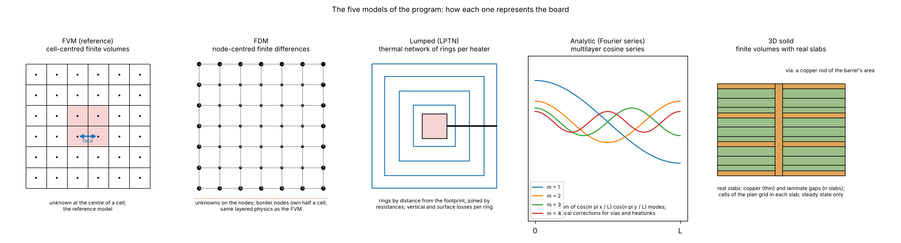
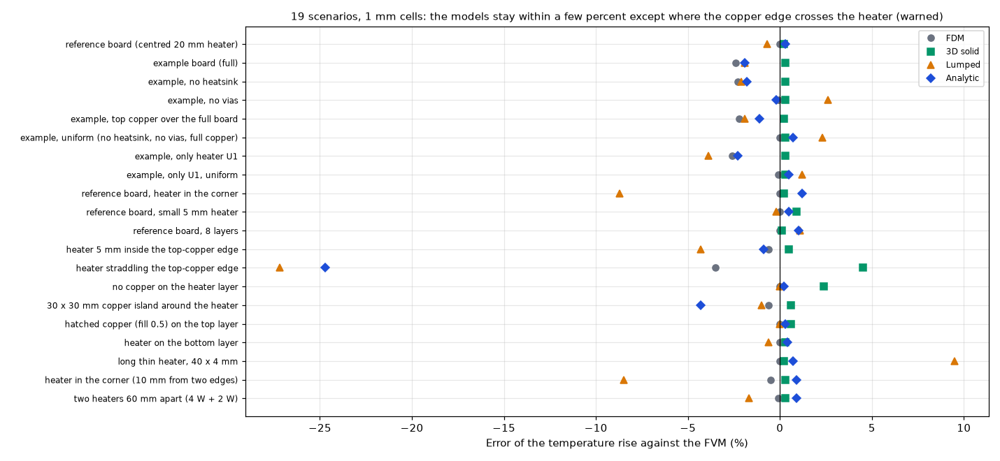
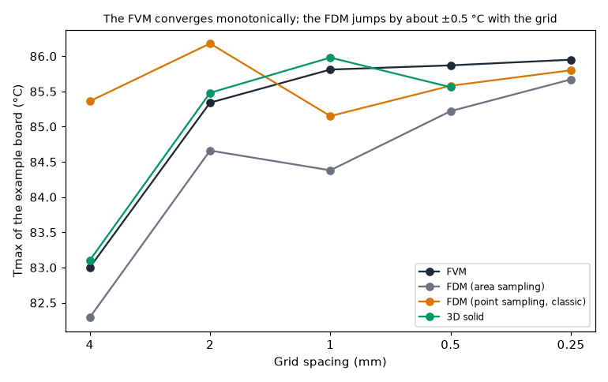
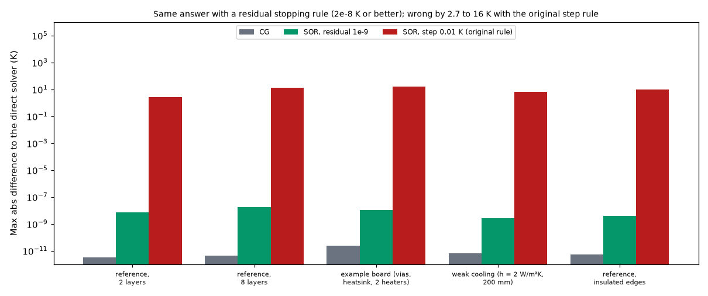

# The five models against each other: scenarios, grids, solvers, time

Status: **implemented**; the comparison is repeated whenever a model changes. Studies: `validation_study.py`, `accuracy_study.py`, `stress_study.py`, `solver_equivalence.py`; figures: `make_figures.py`.

## 1. The questions

1. How far are the other models (FDM, 3D solid, Lumped, Analytic) from the FVM, the reference, on the example board and on 19 scenarios, and where do they stop being reliable?
2. Does each model converge with the grid?
3. Do the linear solvers (direct, conjugate gradients, SOR) give the same temperatures, and what was wrong with the original program's SOR?

### 1.1 Diagram



*Figure 4 (`figures/fig_04_the_five_models_schematic.png`): How each of the five models represents the board: cell-centred finite volumes (FVM, the reference), node-centred finite differences (FDM), rings around the footprint (Lumped), cosine modes (Analytic) and real slabs with via rods (3D solid).*

## 2. Findings in short

* On ordinary boards every model is within a few percent of the FVM (FDM about 2 % low where a via is sampled at the nearest node, 3D solid within 1 % above, Lumped within 4 % and Analytic within 2 %). Energy balance closes to 1e-11 in every model.
* The models stop being reliable where the copper edge crosses a heater (Lumped −27 %, Analytic −25 %: the input checks warn), for a heater in a corner (Lumped −8.7 %) and for a long thin heater (Lumped +9.5 %).
* The FVM converges monotonically with the grid; the FDM jumps by about ±0.5 °C with it.
* Direct, CG and SOR with a residual stopping rule agree to 1e-8 K on five boards; the original program's step rule stops 2.7 to 16 K away from the solution.

## 3. Folder layout

| File | What it is |
| :-- | :-- |
| `scripts/validation_study.py` | Every scenario in every model and the grid study (the tables of section 4.2; about 1.5 minutes alone). |
| `accuracy_study.py`, `stress_study.py` | The scenario lists for the Lumped and Analytic models (accuracy; stress cases). |
| `scripts/solver_equivalence.py` | Direct, CG and SOR on five boards (section 4.4; about 5 seconds). |
| `scripts/make_figures.py` | Draws the three figures (about 5 minutes). |
| `scripts/make_diagrams.py` | Draws the schematic diagram (figure 4; no data, no program; uses `research/diagram_kit.py`). |
| `figures/` | `fig_01` to `fig_04`; figure 4 is the schematic diagram. |
| `LOG.md` | What was read and how; what was not reproduced. (The comparison also uses `../solid3d-verification/fem3d_validation.py` with `--fem`.) |

```sh
.venv/bin/python research/models-comparison/scripts/validation_study.py [--fem]    # --fem adds the 3D finite-element solid (scikit-fem)
.venv/bin/python research/models-comparison/scripts/accuracy_study.py
.venv/bin/python research/models-comparison/scripts/stress_study.py
.venv/bin/python research/models-comparison/scripts/solver_equivalence.py
.venv/bin/python research/models-comparison/scripts/make_figures.py
```

## 4. Results

### 4.1 One scenario, every model: the example board

a 30 W/m²K heatsink on the bottom. Maximum temperature [°C]:

| Model | Tmax | Error on the rise | Time |
| :-- | --: | --: | --: |
| FVM (0.5 mm) | 85.87 | reference | 0.9 s |
| FDM (0.5 mm) | 85.22 | −1.1 % | 0.8 s |
| Analytic | 84.69 | −1.9 % | 0.05 s |
| Lumped | 84.66 (1 mm) | −1.9 % | 0.01 s |
| 3D solid (finite elements, 0.5 mm, vias as copper rods) | 85.59 | −0.5 % (FVM +0.5 %) | |

Every model closes the energy balance below 1e-11 (heat out equals power in).

### 4.2 Many scenarios, every model

`python research/models-comparison/scripts/validation_study.py`

| Scenario | FVM [°C] | FDM | 3D solid | Lumped | Analytic | Input check |
| :-- | --: | --: | --: | --: | --: | :-: |
| reference board (centred 20 mm heater) | 90.13 | 90.13 (+0.0 %) | 90.27 (+0.2 %) | 89.70 (−0.7 %) | 90.35 (+0.3 %) | - |
| example board (full) | 85.81 | 84.38 (−2.4 %) | 85.98 (+0.3 %) | 84.66 (−1.9 %) | 84.65 (−1.9 %) | - |
| example, no heatsink | 88.91 | 87.47 (−2.3 %) | 89.08 (+0.3 %) | 87.60 (−2.1 %) | 87.78 (−1.8 %) | - |
| example, no vias | 94.67 | 94.58 (−0.1 %) | 94.91 (+0.3 %) | 96.51 (+2.6 %) | 94.56 (−0.2 %) | - |
| example, top copper over the full board | 85.29 | 83.94 (−2.2 %) | 85.42 (+0.2 %) | 84.14 (−1.9 %) | 84.62 (−1.1 %) | - |
| example, uniform (no heatsink, no vias, full copper) | 96.68 | 96.66 (−0.0 %) | 96.88 (+0.3 %) | 98.34 (+2.3 %) | 97.15 (+0.7 %) | - |
| example, only heater U1 | 79.97 | 78.54 (−2.6 %) | 80.12 (+0.3 %) | 77.82 (−3.9 %) | 78.71 (−2.3 %) | - |
| example, only U1, uniform | 90.30 | 90.27 (−0.1 %) | 90.51 (+0.3 %) | 91.10 (+1.2 %) | 90.62 (+0.5 %) | - |
| reference board, heater in the corner | 109.40 | 109.39 (−0.0 %) | 109.54 (+0.2 %) | 102.09 (−8.7 %) | 110.42 (+1.2 %) | - |
| reference board, small 5 mm heater | 103.06 | 103.06 (+0.0 %) | 103.73 (+0.9 %) | 102.87 (−0.2 %) | 103.44 (+0.5 %) | - |
| reference board, 8 layers | 65.70 | 65.70 (+0.0 %) | 65.72 (+0.1 %) | 66.17 (+1.1 %) | 66.11 (+1.0 %) | - |
| heater 5 mm inside the top-copper edge | 94.45 | 94.04 (−0.6 %) | 94.78 (+0.5 %) | 91.45 (−4.3 %) | 93.83 (−0.9 %) | - |
| heater straddling the top-copper edge | 143.89 | 139.77 (−3.5 %) | 149.27 (+4.5 %) | 111.52 (−27.2 %) | 114.54 (−24.7 %) | warns |
| no copper on the heater layer | 150.16 | 150.14 (−0.0 %) | 153.19 (+2.4 %) | 150.12 (−0.0 %) | 150.44 (+0.2 %) | warns |
| 30 x 30 mm copper island around the heater | 92.38 | 91.96 (−0.6 %) | 92.78 (+0.6 %) | 91.66 (−1.1 %) | 89.49 (−4.3 %) | - |
| hatched copper (fill 0.5) on the top layer | 105.78 | 105.78 (+0.0 %) | 106.23 (+0.6 %) | 105.72 (−0.1 %) | 106.00 (+0.3 %) | warns |
| heater on the bottom layer | 88.37 | 88.37 (+0.0 %) | 88.58 (+0.3 %) | 87.97 (−0.6 %) | 88.65 (+0.4 %) | - |
| long thin heater, 40 x 4 mm | 67.84 | 67.84 (+0.0 %) | 67.92 (+0.2 %) | 71.90 (+9.5 %) | 68.12 (+0.7 %) | - |
| heater in the corner (10 mm from two edges) | 105.34 | 104.92 (−0.5 %) | 105.54 (+0.3 %) | 98.51 (−8.5 %) | 106.06 (+0.9 %) | - |
| two heaters 60 mm apart (4 W + 2 W) | 100.41 | 100.33 (−0.1 %) | 100.62 (+0.3 %) | 99.10 (−1.7 %) | 101.07 (+0.9 %) | - |

Reading:

* **FDM and FVM agree to about 0.1 % wherever there are no vias** (and exactly where the geometry lies on the grid). With the via array the FDM is 2 to 3 % low at 1 mm, because it puts a point feature on the nearest grid point; the gap closes with the grid (section 2.1).
  It is 3.5 % low when a copper edge crosses the heater.
* **Analytic** is exact on uniform boards and within 2.3 % with partial copper, vias, heatsinks, corners, thin heaters and several heaters; it fails (−25 %) when a copper edge crosses the heater, and the input check warns.
* **Lumped** stays within about 4 % in most cases, 9 % at worst (corners, thin heaters), and also fails when a copper edge crosses the heater.

### 2.1 Against the grid (example board)

| Spacing [mm] | FVM | FDM (area sampling) | FDM (point sampling, classic) | 3D solid |
| --: | --: | --: | --: | --: |
| 4 | 83.00 | 82.29 | 85.36 | 83.10 |
| 2 | 85.34 | 84.66 | 86.18 | 85.48 |
| 1 | 85.81 | 84.38 | 85.15 | 85.98 |
| 0.5 | 85.87 | 85.22 | 85.58 | 85.56 |
| 0.25 | 85.95 | 85.67 | 85.80 | - |

The FVM rises monotonically to its limit (within 0.2 % from 1 mm; the via array is a point feature that keeps adding a little constriction as the mesh is refined). The classic point-sampled FDM jumps around it
(±0.5 °C) because it samples the copper edge, the heater footprint and the vias at points; area sampling removes the jumps on geometry that is not aligned with the grid. A board whose heater is not on the grid
(reference board, 4 W, 10.4 × 10.7 mm heater at 30.3 mm; 1 mm cells; reference 103.63 °C at 0.2 mm): FVM 103.59, FDM area 103.18, FDM point 105.69.



*Figure 1: `figures/fig_01_models_against_the_fvm.png`.*



*Figure 2: `figures/fig_02_grid_convergence_of_the_models.png`.*

Output of `accuracy_study.py` (Lumped and Analytic on the scenarios) and `stress_study.py` (their stress cases):

| Case | FVM Tmax [°C] | Lumped Tmax | Lumped ΔT error | Analytic Tmax | Analytic ΔT error | Analytic warns |
| :-- | --: | --: | --: | --: | --: | :-: |
| reference board (centred 20 mm heater) | 90.13 | 89.70 | -0.7 % | 90.35 | +0.3 % | - |
| example board (full) | 85.81 | 84.66 | -1.9 % | 84.65 | -1.9 % | - |
| example, no heatsink | 88.91 | 87.60 | -2.1 % | 87.78 | -1.8 % | - |
| example, no vias | 94.67 | 96.51 | +2.6 % | 94.56 | -0.2 % | - |
| example, top copper over the full board | 85.29 | 84.14 | -1.9 % | 84.62 | -1.1 % | - |
| example, uniform (no heatsink, no vias, full copper) | 96.68 | 98.34 | +2.3 % | 97.15 | +0.7 % | - |
| example, only heater U1 | 79.97 | 77.82 | -3.9 % | 78.71 | -2.3 % | - |
| example, only U1, uniform | 90.30 | 91.10 | +1.2 % | 90.62 | +0.5 % | - |
| reference board, heater in the corner | 109.40 | 102.09 | -8.7 % | 110.42 | +1.2 % | - |
| reference board, small 5 mm heater | 103.06 | 102.87 | -0.2 % | 103.44 | +0.5 % | - |
| reference board, 8 layers | 65.70 | 66.17 | +1.1 % | 66.11 | +1.0 % | - |

| Case | FVM Tmax [°C] | Lumped Tmax | Lumped ΔT error | Analytic Tmax | Analytic ΔT error | Input check |
| :-- | --: | --: | --: | --: | --: | :-- |
| heater 5 mm inside the top-copper edge | 94.45 | 91.45 | -4.3 % | 93.83 | -0.9 % | - |
| heater straddling the top-copper edge | 143.89 | 111.52 | -27.2 % | 114.54 | -24.7 % | warns |
| no copper on the heater layer | 150.16 | 150.12 | -0.0 % | 150.44 | +0.2 % | warns |
| 30 x 30 mm copper island around the heater | 92.38 | 91.66 | -1.1 % | 89.49 | -4.3 % | - |
| hatched copper (fill 0.5) on the top layer | 105.78 | 105.72 | -0.1 % | 106.00 | +0.3 % | warns |
| heater on the bottom layer | 88.37 | 87.97 | -0.6 % | 88.65 | +0.4 % | - |
| long thin heater, 40 x 4 mm | 67.84 | 71.90 | +9.5 % | 68.12 | +0.7 % | - |
| heater in the corner (10 mm from two edges) | 105.34 | 98.51 | -8.5 % | 106.06 | +0.9 % | - |
| two heaters 60 mm apart (4 W + 2 W) | 100.41 | 99.10 | -1.7 % | 101.07 | +0.9 % | - |

### 4.3 Why the FVM and the Analytic model give about the same numbers

1. **They solve the same model.** Both treat every layer as a thin conducting sheet, the dielectric as a vertical resistance, one constant `h` per face, the same material properties. The Analytic is the **exact** solution of that model on a
   uniform sheet; the FVM is its **numerical** solution; two correct solutions of one model agree, within the FVM's mesh error (0.2 to 1 %).
2. **The real board is not that model, and that error is shared** (section 3: 0.4 to 3 % from the 3D solid). Neither can be better than the layered model; "FVM = more precise" does not hold in general. What the FVM has is **freedom of geometry**.
3. **Part of the agreement was engineered**: the Lumped and Analytic models were tuned against the FVM (copper weighted with the heater influence, fin lengths, Bessel factors), so tables 1 and 2 measure agreement with the FVM; the 3D solid does not depend on that tuning.
4. **They diverge where the geometry is not uniform near the heater** (section 2: pads, copper edges, corners).

### 4.4 Linear solvers: direct, conjugate gradients, SOR

`python research/models-comparison/scripts/solver_equivalence.py`. Same boards, same physics, different ways of solving `K θ = Q`:

| Board | Solver | Tmax [°C] | max diff to direct [K] | Residual | Sweeps | Time [s] |
| :-- | :-- | --: | --: | --: | --: | --: |
| reference, 2 layers | direct (sparse LU) | 90.0657 | 0 | 3e-14 | - | 0.01 |
| reference, 2 layers | CG (Jacobi) | 90.0657 | 1.8e-12 | 9e-13 | - | 0.01 |
| reference, 2 layers | SOR, residual 1e-9, automatic ω | 90.0657 | 7.6e-09 | 1e-09 | 656 | 0.05 |
| reference, 2 layers | SOR, step 0.01 K, ω = 1.5 (original rule) | 87.3447 | 2.7 | 6e-02 | 369 | 0.03 |
| reference, 8 layers | direct (sparse LU) | 65.6612 | 0 | 1e-13 | - | 0.23 |
| reference, 8 layers | SOR, residual 1e-9, automatic ω | 65.6612 | 1.7e-08 | 1e-09 | 3247 | 0.69 |
| reference, 8 layers | SOR, step 0.01 K, ω = 1.5 (original rule) | 53.1158 | 13 | 1e-01 | 384 | 0.08 |
| example board | direct (sparse LU) | 85.8143 | 0 | 1e-13 | - | 0.23 |
| example board | SOR, residual 1e-9, automatic ω | 85.8143 | 1.1e-08 | 1e-09 | 2247 | 0.76 |
| example board | SOR, step 0.01 K, ω = 1.5 (original rule) | 69.6449 | 16 | 1e-01 | 562 | 0.18 |
| weak cooling (h = 2 W/m²K, 200 mm) | direct / SOR (residual) | 44.2990 | 2.6e-09 | 1e-09 | 2237 | 0.07 / 0.48 |
| weak cooling (h = 2 W/m²K, 200 mm) | SOR, step 0.01 K, ω = 1.5 (original rule) | 37.5624 | 6.7 | 3e-01 | 162 | 0.04 |

Direct, CG and SOR with the residual criterion agree to **1e-8 K** or better on all five boards; the original program's stopping rule stops 2.7 to 16 K from the solution with a violated heat balance. The direct solver is the default
(3 to 30 times faster than a correct SOR); SOR stays available as an independent check. (After this table was made the direct solver got a symmetric ordering that makes it about 40 % faster.)



*Figure 3: `figures/fig_03_solver_equivalence.png`.*

### 4.5 The removed wxPython program against the current one

(Recorded from the review; the old code is in git history at tag `legacy-wxpython-1.0.0`, so these numbers are not re-run here.)

Same example board (reference 85.81 °C). Old numbers were obtained by running the original code (git tag `legacy-wxpython-1.0.0`, commit `641da87` with the comparison script).

| Program | Model | Tmax [°C] | Error on the rise | Power used [W] | Note |
| :-- | :-- | --: | --: | --: | :-- |
| old | Analytic, basic | 603.95 | +851 % | 5.50 | dimensionally wrong conduction term |
| old | Lumped, basic | 32.24 | −88 % | 5.50 | not a valid network |
| old | Analytic, advanced | 34081 | +55 845 % | 5.50 | |
| old | Lumped, advanced | 449.00 | +597 % | 5.50 | |
| old | FDM, 10 mm (defaults) | 124.93 | +64 % | **8.17** | injected 8.17 W for 5.50 W |
| old | FDM, 2 mm (defaults) | 76.94 | −15 % | 5.50 | "converged" |
| old | FDM, 1 mm (defaults) | 66.56 | **−32 %** | 5.50 | error grows when the mesh is refined (step-size stopping rule) |
| old | FDM, 1 mm (tight tolerance, ω = 1.9) | 82.50 | −5.5 % | 5.50 | the rest is modelling |
| new | FVM, 1 mm | 85.81 | 0 | 5.50 | energy balance −7e-13 |
| new | FDM (area sampling), 1 mm | 84.38 | −2.4 % | 5.50 | same physics, point features at nodes |
| new | Lumped | 84.66 | −1.9 % | 5.50 | |
| new | Analytic | 84.65 | −1.9 % | 5.50 | |

What went wrong in the old FDM was not the finite-difference idea: a stopping rule on the step size (false convergence), a heater power that depended on the grid, no lateral conduction in FR-4, solid vias, heatsinks on inner layers ignored,
boundary nodes with a full cell. All were fixed (conservative cell balance, exact power, anisotropic FR-4, hollow vias). A correct FDM (section 2) lands within about 1 % of the FVM.

### 4.6 Time-dependent results

(From the tests named in the text; not produced by the scripts of this folder.)

* **Step response, exact check** (`tests/test_fvm.py`): one layer, a heater over the whole board, insulated edges (`C dθ/dt = P − Gθ`, time constant 109.1 s, steady rise 40 K); maximum error in K over three time constants:
  implicit Euler 3.06 / 1.67 / 0.87 / 0.45 for Δt, Δt/2, Δt/4, Δt/8 (first order); Crank-Nicolson 0.315 / 0.077 / 0.019 / 0.005 (second order); stored plus lost heat equals the injected heat within 0.2 %.
* **Step animation, FVM against FDM** (example board, 2 mm; hottest point [°C] at t = 0, 0.12, 0.82, 3.6, 15, 60, 120 s): FVM 25.0, 30.4, 43.6, 53.3, 61.3, 70.7, 76.6; FDM 25.0, 30.3, 43.1, 52.7, 60.6, 70.0, 75.9: within 0.7 °C at every output time (steady maxima 85.3 and 84.7 °C). Power-profile time simulation of the profile example: peak 134.2 °C (FVM) against 129.6 °C (FDM) at 2 mm, where the 6 mm heater is only three cells wide.
* **Step animation, FVM against Analytic** (example board, 4 W + 1.5 W, 1 mm; hottest point [°C] at t = 0, 0.12, 0.35, 0.82, 1.8, 3.6, 7.4, 15, 30, 60, 120 s): FVM 25.0, 30.5, 37.4, 44.0, 49.3, 53.7, 57.7, 61.7, 66.1, 71.2, 77.1; Analytic 25.0, 30.6, 37.4, 43.4, 48.0, 52.0, 55.8, 59.8, 64.1, 69.4, 76.0:
  within 2 °C at every time, after calibrating the vias per heater (without it the Analytic was up to 10 °C off). The hottest point reaches 63 % of its final rise in about 19 s; the whole board needs minutes.
* **Power profiles** (`tests/test_profiles.py`): the exact mean power per step reproduces the energy exactly for any step; against the exact periodic solution of a uniform board (an RC circuit) the decision's peak is within 0.3 % and Crank-Nicolson time stepping within 0.4 %;
  averaging a fast heater changes the peak by less than the oscillation that was neglected, with 40 times fewer steps; a table equals the equivalent square wave to round-off.
  Example (`example_profile_board`: U1 100 Hz, 30 % duty, 13.3 W on → oscillation 0.4 °C, averaged; U2 20 s period, 25 % duty, 6 W on → oscillation 84.8 °C, resolved): peak of the hottest point FVM 135.3 °C, Analytic 134.7, Lumped 131.8;
  steady with the average power 85.8 / 84.8 / 84.7 °C; bound with the on-state powers 231.6 °C (FVM).
* **CSV example** (`examples/csv_profiles`): U1 a repeating 30 s cycle (12 W, 5 W, 0.5 W), U2 a one-shot start-up: peak FVM 119.5 °C, Lumped 116.1, Analytic 115.1 (within 4 %); steady with the average powers 66.5 °C; bound 201.6 °C.

### 4.7 Computed heat transfer coefficients

(From the tests and the studies named in the text.)

Example board, FVM, Tmax [°C], typed `h` (10 top / 15 bottom) against computed (horizontal board, emissivity 0.9):

| Power [W] | Typed | Computed | Difference | Computed h top / bottom [W/m²K] | Vertical | 2 m/s air | Convection ×0.8 |
| --: | --: | --: | --: | :-: | --: | --: | --: |
| 0.55 | 31.1 | 31.9 | +0.8 | 10.4 / 7.9 | 32.0 | 29.9 | 32.1 |
| 1.4 | 40.2 | 41.4 | +1.2 | 11.6 / 8.6 | 41.7 | 37.2 | 42.0 |
| 5.5 | 85.8 | 85.8 | 0.0 | 14.2 / 10.1 | 86.7 | 73.5 | 88.1 |
| 11 | 146.6 | 141.2 | −5.4 | 16.1 / 11.3 | 142.7 | 121.5 | 145.3 |
| 22 | 268.3 | 245.3 | −23.0 | 18.6 / 13.1 | 247.8 | 215.6 | 252.0 |

A constant `h` is right near one operating point and over-estimates the rise by 10 % at 22 W (the typed pair happens to be right near 5.5 W). Radiation is 43 % of the computed top coefficient and 60 % of the bottom one; the bottom face (facing down) cools worse than the top.
Air properties agree with textbook values within 1 to 3 %; the three models agree on the coefficients within 0.1 W/m²K.

## 5. Limits of this study

* Model against model on one family of boards (the example board and variants), at 1 mm cells unless stated; the 3D finite-element reference is offline and needs scikit-fem.
* No measurement of a physical board: no model has been compared with a real one.
* The FVM is the reference because it is conservative and converges monotonically, not because it is exact; the independent 3D check is in `../solid3d-verification/`.

## 6. Sources

Own computation. The removed program is documented by its code at tag `legacy-wxpython-1.0.0`; literature on FDM and FVM and on PCB thermal models is listed in `docs/validation.md` section 10.
