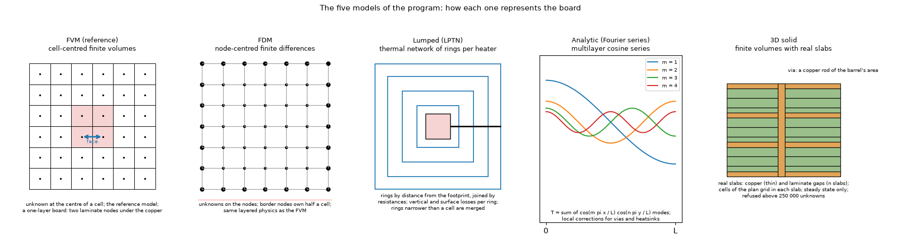
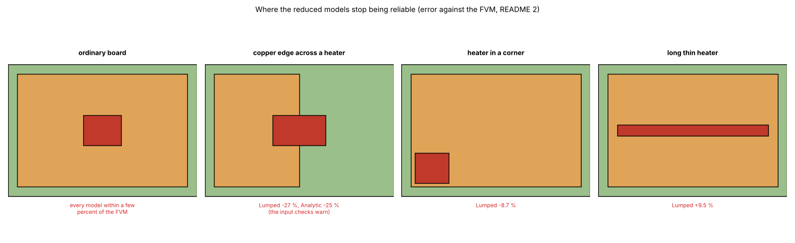

# The five models against each other: scenarios, grids, solvers, time

Status: **implemented**; the comparison is repeated whenever a model changes. Studies (all in `scripts/`): `validation_study.py`, `accuracy_study.py`, `stress_study.py`, `solver_equivalence.py`, `study_complex_boards.py`, `study_lumped_rings.py`, `study_complex_boards_independent.py`, `study_time_and_coefficients.py`, `study_offgrid_heater.py`; figures: `make_figures.py`, `make_diagrams.py`. Every number of section 4 was re-run on the program at `0ea5f07` (reviewed 2026-10-24, see section 7); where it is from somewhere else the text says so.

## 1. The questions

1. How far are the other models (FDM, 3D solid, Lumped, Analytic) from the FVM, the reference, on the example board and on 19 scenarios, and where do they stop being reliable?
2. Does each model converge with the grid?
3. Do the linear solvers (direct, conjugate gradients, SOR) give the same temperatures, and what was wrong with the original program's SOR?

### 1.1 Diagrams and illustrations



*Figure 8 (`figures/fig_08_the_five_models_schematic.png`): How each of the five models represents the board: cell-centred finite volumes (FVM, the reference), node-centred finite differences (FDM), rings around the footprint (Lumped), cosine modes (Analytic) and real slabs with via rods (3D solid).*



*Figure 9 (`figures/fig_09_where_models_fail.png`): the cases where the Lumped and Analytic models stop being reliable, drawn as boards: copper edge across a heater, heater in a corner, long thin heater, next to an ordinary board (errors of section 4.2).*


*Figure 10 (`figures/fig_10_measurement_setup.png`): the planned measurement on a physical board (a plan, not a result): a heater of known electrical power, thermocouples at several distances, an infrared camera on a painted area, an ambient thermocouple and a still-air enclosure; and the chain from the reading to the comparison with the models (`docs/measurement-protocol.md`).*

## 2. Findings in short

* On ordinary boards every model is within a few percent of the FVM (FDM about 2 % low where a via is sampled at the nearest node, 3D solid within 1 % above, Lumped within 4 %, Analytic within 2.3 %, except a copper island 30 mm wide around the heater: −4.3 %). Energy balance closes to 2e-12 in every model.
* The models stop being reliable where the copper edge crosses a heater (Lumped −27 %, Analytic −25 %: the input checks warn), for a heater in a corner (Lumped −8.7 %) and for a long thin heater (Lumped +9.5 %).
* The FVM converges monotonically with the grid; the FDM does not (area sampling 0.3 to 1.4 °C below the FVM, largest at 1 mm; point sampling from +2.4 °C at 4 mm to −0.7 °C at 1 mm).
* Direct, CG and SOR with a residual stopping rule agree to 2e-8 K on five boards; the original program's step rule stops 2.7 to 16 K away from the solution.
* Nine boards closer to real ones against the 3D solid, before and after the corrections of the review (4.8): mean error FVM 3.8 -> 1.0 %, FDM 5.3 -> 2.9 %, Lumped 6.9 -> 5.2 %, Analytic 5.5 -> 5.5 %; the multilayer boards do not move. The Lumped no longer depends on the ring count (4.9).

## 3. Folder layout

| File | What it is |
| :-- | :-- |
| `scripts/validation_study.py` | Every scenario in every model and the grid study (the tables of section 4.2; about 5 minutes alone, most of it the 3D solid at 0.5 mm). With `--fem` it adds the finite-element solid of `../solid3d-verification/scripts/fem3d_validation.py` (section 4.1; scikit-fem, several minutes). |
| `scripts/accuracy_study.py`, `scripts/stress_study.py` | The scenario lists for the Lumped and Analytic models (accuracy; stress cases). |
| `scripts/solver_equivalence.py` | Direct, CG and SOR on five boards (section 4.4; about 5 seconds). |
| `scripts/study_complex_boards.py` | Nine boards closer to real ones in every model against the 3D solid; runs on any version of the program (`--root`) and compares two runs (`--compare`), section 4.8 (about 2 minutes per run). |
| `scripts/study_lumped_rings.py` | The Lumped model against the ring count and the source size, before and after the minimum ring width (section 4.9; about 1 minute). |
| `scripts/study_complex_boards_independent.py` | Three one-layer boards of section 4.8 against the independent solver of `../solid3d-verification/lib/layered3d.py`, and the grid error of the 3D solid that section 4.8 uses as its reference (about 2 minutes). |
| `scripts/study_offgrid_heater.py` | A heater whose edges fall between cell edges: FVM and FDM (area and point sampling) against the FVM at 0.1 mm (section 4.2.1; seconds). |
| `scripts/study_time_and_coefficients.py` | The exact check of the time integrator, the power-step animations, the power-profile and CSV examples and the computed coefficients (sections 4.6 and 4.7; about 1 minute). |
| `scripts/make_figures.py` | Draws the data figures 1 to 3 and 4 to 7 (about 8 minutes; figure 4 needs `out/complex_boards_before.json`, see section 4.8). |
| `scripts/make_diagrams.py` | Draws the schematic diagram and the illustrations (figures 8 to 10; no data, no program; uses `research/diagram_kit.py`). |
| `figures/` | `fig_01` to `fig_10`; figures 5 and 7 are drawings of the boards and of the laminate nodes; figures 8 to 10 are diagrams and illustrations (`make_diagrams.py`). |
| `docs/measurement-protocol.md` | The protocol of a measurement on a physical board (a plan: nothing was measured). |
| `docs/for-the-project-documents.md` | Corrections for `docs/validation.md` found by the review of this folder (the project documents are not edited on a research branch). |

```sh
.venv/bin/python research/models-comparison/scripts/validation_study.py [--fem]    # --fem adds the 3D finite-element solid (scikit-fem)
.venv/bin/python research/models-comparison/scripts/accuracy_study.py
.venv/bin/python research/models-comparison/scripts/stress_study.py
.venv/bin/python research/models-comparison/scripts/solver_equivalence.py
.venv/bin/python research/models-comparison/scripts/study_offgrid_heater.py
.venv/bin/python research/models-comparison/scripts/study_time_and_coefficients.py
.venv/bin/python research/models-comparison/scripts/study_complex_boards_independent.py
.venv/bin/python research/models-comparison/scripts/make_figures.py
```

## 4. Results

### 4.1 One scenario, every model: the example board

`example_board()`: 100 × 80 mm, 4 layers, top copper only over 15 to 85 × 15 to 65 mm, planes on layers 2 to 4, heaters U1 (4 W, 10 × 10 mm) and U2 (1.5 W, 6 × 6 mm), a 3 × 3 array of 0.3 mm vias under U1,
a 30 W/m²K heatsink on the bottom. Maximum temperature [°C] (times of one run on the reviewer's machine):

| Model | Tmax | Error on the rise | Time |
| :-- | --: | --: | --: |
| FVM (0.5 mm) | 85.87 | reference | 1.1 s |
| FDM (0.5 mm) | 85.22 | −1.1 % | 0.9 s |
| Analytic (0.5 mm sampling; 84.65 at its default 1 mm) | 84.69 | −1.9 % | 0.06 s |
| Lumped (1 mm) | 84.66 | −1.9 % | 0.01 s |
| 3D solid of the program (finite volumes, 0.5 mm) | 85.56 | −0.5 % | 57 s |
| 3D solid (finite elements, 0.5 mm, vias as copper rods; `docs/validation.md` section 3.1) | 85.59 | −0.5 % (FVM +0.5 %) | |

Every model closes the energy balance below 2e-12 W/W (heat out equals power in; FVM −1.4e-12, FDM −1.4e-12, Lumped and Analytic about 1e-15, 3D solid −1.1e-13 at 1 mm).

The finite-element solid (`validation_study.py --fem`, the solid of `../solid3d-verification/scripts/fem3d_validation.py`, 1 mm elements; the layered models at 0.5 mm, Lumped and Analytic with their defaults) on four boards; error on the rise. Re-run 2026-10-24: the same numbers as `docs/validation.md` section 3. *The `--fem` option failed with an import error since the scripts moved out of `examples/`; fixed in the review.*

| Board | 3D FEM [°C] | FVM | FDM | 3D solid (FV) | Lumped | Analytic |
| :-- | --: | --: | --: | --: | --: | --: |
| 4 layers, full copper | 90.6 | 90.3 (-0.4 %) | 90.3 (-0.5 %) | 90.5 (-0.1 %) | 91.1 (+0.7 %) | 90.6 (-0.0 %) |
| 2 layers, 40 mm top pad | 112.2 | 111.5 (-0.8 %) | 111.2 (-1.2 %) | 112.4 (+0.2 %) | 112.1 (-0.1 %) | 106.8 (-6.2 %) |
| 2 layers, 20 mm top pad | 136.2 | 133.7 (-2.2 %) | 131.7 (-4.0 %) | 138.0 (+1.6 %) | 131.1 (-4.5 %) | 109.6 (-23.9 %) |
| example board (partial copper, 9 vias, bottom heatsink) | 85.6 | 85.9 (+0.5 %) | 85.2 (-0.6 %) | 85.6 (-0.0 %) | 84.7 (-1.5 %) | 84.7 (-1.5 %) |

### 4.2 Many scenarios, every model

`python research/models-comparison/scripts/validation_study.py`

| Scenario | FVM [°C] | FDM | 3D solid | Lumped | Analytic | Input check |
| :-- | --: | --: | --: | --: | --: | :-: |
| reference board (centred 20 mm heater) | 90.13 | 90.13 (+0.0 %) | 90.27 (+0.2 %) | 89.69 (−0.7 %) | 90.35 (+0.3 %) | - |
| example board (full) | 85.81 | 84.38 (−2.4 %) | 85.98 (+0.3 %) | 84.66 (−1.9 %) | 84.65 (−1.9 %) | - |
| example, no heatsink | 88.91 | 87.47 (−2.3 %) | 89.08 (+0.3 %) | 87.60 (−2.1 %) | 87.78 (−1.8 %) | - |
| example, no vias | 94.67 | 94.58 (−0.1 %) | 94.91 (+0.3 %) | 96.51 (+2.6 %) | 94.56 (−0.2 %) | - |
| example, top copper over the full board | 85.29 | 83.94 (−2.2 %) | 85.42 (+0.2 %) | 84.14 (−1.9 %) | 84.62 (−1.1 %) | - |
| example, uniform (no heatsink, no vias, full copper) | 96.68 | 96.66 (−0.0 %) | 96.88 (+0.3 %) | 98.34 (+2.3 %) | 97.15 (+0.7 %) | - |
| example, only heater U1 | 79.97 | 78.54 (−2.6 %) | 80.12 (+0.3 %) | 77.82 (−3.9 %) | 78.71 (−2.3 %) | - |
| example, only U1, uniform | 90.30 | 90.27 (−0.1 %) | 90.51 (+0.3 %) | 91.10 (+1.2 %) | 90.62 (+0.5 %) | - |
| reference board, heater in the corner | 109.40 | 109.39 (−0.0 %) | 109.54 (+0.2 %) | 102.09 (−8.7 %) | 110.42 (+1.2 %) | - |
| reference board, small 5 mm heater | 103.06 | 103.06 (+0.0 %) | 103.73 (+0.9 %) | 102.87 (−0.2 %) | 103.44 (+0.5 %) | - |
| reference board, 8 layers | 65.70 | 65.70 (+0.0 %) | 65.72 (+0.1 %) | 66.16 (+1.1 %) | 66.11 (+1.0 %) | - |
| heater 5 mm inside the top-copper edge | 94.45 | 94.04 (−0.6 %) | 94.78 (+0.5 %) | 91.45 (−4.3 %) | 93.83 (−0.9 %) | - |
| heater straddling the top-copper edge | 143.89 | 139.77 (−3.5 %) | 149.27 (+4.5 %) | 111.52 (−27.2 %) | 114.54 (−24.7 %) | warns |
| no copper on the heater layer | 150.16 | 150.14 (−0.0 %) | 153.19 (+2.4 %) | 150.12 (−0.0 %) | 150.44 (+0.2 %) | warns |
| 30 x 30 mm copper island around the heater | 92.38 | 91.96 (−0.6 %) | 92.78 (+0.6 %) | 91.71 (−1.0 %) | 89.49 (−4.3 %) | - |
| hatched copper (fill 0.5) on the top layer | 105.78 | 105.78 (+0.0 %) | 106.23 (+0.6 %) | 105.79 (+0.0 %) | 106.00 (+0.3 %) | warns |
| heater on the bottom layer | 88.37 | 88.37 (+0.0 %) | 88.58 (+0.3 %) | 88.02 (−0.6 %) | 88.65 (+0.4 %) | - |
| long thin heater, 40 x 4 mm | 67.84 | 67.84 (+0.0 %) | 67.92 (+0.2 %) | 71.91 (+9.5 %) | 68.12 (+0.7 %) | - |
| heater in the corner (10 mm from two edges) | 105.34 | 104.92 (−0.5 %) | 105.54 (+0.3 %) | 98.51 (−8.5 %) | 106.06 (+0.9 %) | - |
| two heaters 60 mm apart (4 W + 2 W) | 100.41 | 100.33 (−0.1 %) | 100.62 (+0.3 %) | 99.10 (−1.7 %) | 101.07 (+0.9 %) | - |

Reading:

* **FDM and FVM agree to about 0.1 % wherever there are no vias** (and exactly where the geometry lies on the grid). With the via array the FDM is 2 to 3 % low at 1 mm, because it puts a point feature on the nearest grid point; the gap narrows below 1 mm (−1.1 % at 0.5 mm, −0.5 % at 0.25 mm, section 4.2.1), but not monotonically (−1.1 % at 2 mm).
  It is 3.5 % low when a copper edge crosses the heater.
* **Analytic** is within 1 % of the FVM on uniform boards (0.3 to 1.0 %, not exact: the FVM has its own mesh error) and within 2.3 % with partial copper, vias, heatsinks, corners, thin heaters and several heaters, except a copper island around the heater (−4.3 %, no warning); it fails (−25 %) when a copper edge crosses the heater, and the input check warns.
* **Lumped** stays within about 4 % in most cases, 9 % at worst (corners, thin heaters), and also fails when a copper edge crosses the heater.

### 4.2.1 Against the grid (example board)

| Spacing [mm] | FVM | FDM (area sampling) | FDM (point sampling, classic) | 3D solid |
| --: | --: | --: | --: | --: |
| 4 | 83.00 | 82.29 | 85.36 | 83.10 |
| 2 | 85.34 | 84.66 | 86.18 | 85.48 |
| 1 | 85.81 | 84.38 | 85.15 | 85.98 |
| 0.5 | 85.87 | 85.22 | 85.58 | 85.56 |
| 0.25 | 85.95 | 85.67 | 85.80 | - |

The FVM rises monotonically to its limit (within 0.25 % of the 0.25 mm value from 1 mm; the via array is a point feature that keeps adding a little constriction as the mesh is refined). The classic point-sampled FDM falls from above it (+2.4 °C at 4 mm, +0.8 at 2 mm) to below it (−0.7 °C at 1 mm, −0.3 at 0.5 mm, −0.15 at 0.25 mm) because it samples the copper edge, the heater footprint and the vias at points; area sampling stays below the FVM at every spacing (−0.3 to −1.4 °C) and is not monotonic either (84.66 °C at 2 mm, 84.38 at 1 mm): on this board, with the via array, it does not remove the dependence on the grid. *An earlier version said the FDM "jumps by about ±0.5 °C" and that area sampling "removes the jumps"; the table it stood under does not show that.* The 3D solid (program, finite volumes) is not monotonic either (85.98 °C at 1 mm, 85.56 at 0.5 mm; the finite-element solid gives 85.55 and 85.59, `docs/validation.md` section 3.1). A board whose heater is not on the grid (`scripts/study_offgrid_heater.py`; reference board, 2 layers, full copper, 4 W, heater polygon (30.3, 30.3) to (40.7, 41.0) mm, area 10.4 × 10.7 = 111.28 mm²; reference: FVM at 0.1 mm, where every edge is on the grid, 102.25 °C):

| Cell [mm] | FVM | FDM (area) | FDM (point) |
| --: | --: | --: | --: |
| 2 | 101.77 (−0.48) | 100.72 (−1.54) | 104.98 (+2.72) |
| 1 | 102.01 (−0.25) | 101.59 (−0.67) | 104.36 (+2.11) |
| 0.5 | 102.29 (+0.04) | 102.25 (0.00) | 102.50 (+0.25) |
| 0.2 | 102.25 (−0.01) | 102.24 (−0.01) | 102.45 (+0.20) |

(differences from the 0.1 mm FVM in brackets, °C). The FVM, which weights each cell by the covered fraction, is within 0.5 °C from 2 mm; area sampling converges as well; point sampling sits above the reference by 2 to 3 °C at 1 to 2 mm. **The earlier case of `docs/validation.md` (FVM 103.59, FDM area 103.18, FDM point 105.69; "10.4 × 10.7 mm heater at 30.3 mm", reference 103.63 °C) is not reproduced**: no script printed it, the history of the repository does not hold the board (the number appears first in the commit that merged the documents), and the readings tried (heater corner or centre at 30.3 mm in x, y or both; 2 layers, 1 mm) gave 100.70 to 104.70 °C, none 103.59. The case above replaces it; the point-sampling excess has the same sign and size as the old 105.69 against 103.63.


*Figure 1: `figures/fig_01_models_against_the_fvm.png`.*


*Figure 2: `figures/fig_02_grid_convergence_of_the_models.png`.*

Output of `accuracy_study.py` (Lumped and Analytic on the scenarios) and `stress_study.py` (their stress cases):

| Case | FVM Tmax [°C] | Lumped Tmax | Lumped ΔT error | Analytic Tmax | Analytic ΔT error | Analytic warns |
| :-- | --: | --: | --: | --: | --: | :-: |
| reference board (centred 20 mm heater) | 90.13 | 89.69 | -0.7 % | 90.35 | +0.3 % | - |
| example board (full) | 85.81 | 84.66 | -1.9 % | 84.65 | -1.9 % | - |
| example, no heatsink | 88.91 | 87.60 | -2.1 % | 87.78 | -1.8 % | - |
| example, no vias | 94.67 | 96.51 | +2.6 % | 94.56 | -0.2 % | - |
| example, top copper over the full board | 85.29 | 84.14 | -1.9 % | 84.62 | -1.1 % | - |
| example, uniform (no heatsink, no vias, full copper) | 96.68 | 98.34 | +2.3 % | 97.15 | +0.7 % | - |
| example, only heater U1 | 79.97 | 77.82 | -3.9 % | 78.71 | -2.3 % | - |
| example, only U1, uniform | 90.30 | 91.10 | +1.2 % | 90.62 | +0.5 % | - |
| reference board, heater in the corner | 109.40 | 102.09 | -8.7 % | 110.42 | +1.2 % | - |
| reference board, small 5 mm heater | 103.06 | 102.87 | -0.2 % | 103.44 | +0.5 % | - |
| reference board, 8 layers | 65.70 | 66.16 | +1.1 % | 66.11 | +1.0 % | - |

| Case | FVM Tmax [°C] | Lumped Tmax | Lumped ΔT error | Analytic Tmax | Analytic ΔT error | Input check |
| :-- | --: | --: | --: | --: | --: | :-- |
| heater 5 mm inside the top-copper edge | 94.45 | 91.45 | -4.3 % | 93.83 | -0.9 % | - |
| heater straddling the top-copper edge | 143.89 | 111.52 | -27.2 % | 114.54 | -24.7 % | warns |
| no copper on the heater layer | 150.16 | 150.12 | -0.0 % | 150.44 | +0.2 % | warns |
| 30 x 30 mm copper island around the heater | 92.38 | 91.71 | -1.0 % | 89.49 | -4.3 % | - |
| hatched copper (fill 0.5) on the top layer | 105.78 | 105.79 | +0.0 % | 106.00 | +0.3 % | warns |
| heater on the bottom layer | 88.37 | 88.02 | -0.6 % | 88.65 | +0.4 % | - |
| long thin heater, 40 x 4 mm | 67.84 | 71.91 | +9.5 % | 68.12 | +0.7 % | - |
| heater in the corner (10 mm from two edges) | 105.34 | 98.51 | -8.5 % | 106.06 | +0.9 % | - |
| two heaters 60 mm apart (4 W + 2 W) | 100.41 | 99.10 | -1.7 % | 101.07 | +0.9 % | - |

### 4.3 Why the FVM and the Analytic model give about the same numbers

1. **They solve the same model.** Both treat every layer as a thin conducting sheet, the dielectric as a vertical resistance, one constant `h` per face, the same material properties. The Analytic is the **exact** solution of that model on a
   uniform sheet; the FVM is its **numerical** solution; two correct solutions of one model agree, within the FVM's mesh error (0.2 to 1 %).
2. **The real board is not that model, and that error is shared** (`docs/validation.md` section 3 and `../solid3d-verification/`: the FVM is 0.4 to 2.2 % from the finite-element solid on the four boards of section 4.1). Neither can be better than the layered model; "FVM = more precise" does not hold in general. What the FVM has is **freedom of geometry**.
3. **Part of the agreement was engineered**: the Lumped and Analytic models were tuned against the FVM (copper weighted with the heater influence, fin lengths, Bessel factors), so the tables of sections 4.1 and 4.2 measure agreement with the FVM; the 3D solid does not depend on that tuning.
4. **They diverge where the geometry is not uniform near the heater** (section 4.2: pads, copper edges, corners).

### 4.4 Linear solvers: direct, conjugate gradients, SOR

`python research/models-comparison/scripts/solver_equivalence.py`. Same boards, same physics, different ways of solving `K θ = Q`:

| Board | Solver | Tmax [°C] | max abs diff to direct [K] | Residual | Sweeps | Time [s] |
| :-- | :-- | --: | --: | --: | --: | --: |
| reference, 2 layers | direct (sparse LU) | 90.0657 | 0.0e+00 | 3e-14 | - | 0.01 |
| reference, 2 layers | cg (Jacobi) | 90.0657 | 3.3e-12 | 9e-13 | - | 0.01 |
| reference, 2 layers | SOR, residual 1e-9, auto omega | 90.0657 | 7.6e-09 | 1e-09 | 656 | 0.06 |
| reference, 2 layers | SOR, step 0.01 K, omega 1.5 (original rule) | 87.3447 | 2.7e+00 | 6e-02 | 369 | 0.03 |
| reference, 8 layers | direct (sparse LU) | 65.6612 | 0.0e+00 | 8e-14 | - | 0.13 |
| reference, 8 layers | cg (Jacobi) | 65.6612 | 4.6e-12 | 1e-12 | - | 0.03 |
| reference, 8 layers | SOR, residual 1e-9, auto omega | 65.6612 | 1.7e-08 | 1e-09 | 3247 | 0.79 |
| reference, 8 layers | SOR, step 0.01 K, omega 1.5 (original rule) | 53.1158 | 1.3e+01 | 1e-01 | 384 | 0.10 |
| example board (vias, heatsink, 2 heaters) | direct (sparse LU) | 85.8143 | 0.0e+00 | 1e-13 | - | 0.15 |
| example board (vias, heatsink, 2 heaters) | cg (Jacobi) | 85.8143 | 2.5e-11 | 1e-12 | - | 0.09 |
| example board (vias, heatsink, 2 heaters) | SOR, residual 1e-9, auto omega | 85.8143 | 1.1e-08 | 1e-09 | 2247 | 0.91 |
| example board (vias, heatsink, 2 heaters) | SOR, step 0.01 K, omega 1.5 (original rule) | 69.6449 | 1.6e+01 | 1e-01 | 562 | 0.23 |
| weak cooling (h = 2 W/m²K, 200 mm) | direct (sparse LU) | 44.2990 | 0.0e+00 | 1e-13 | - | 0.04 |
| weak cooling (h = 2 W/m²K, 200 mm) | cg (Jacobi) | 44.2990 | 6.6e-12 | 1e-12 | - | 0.03 |
| weak cooling (h = 2 W/m²K, 200 mm) | SOR, residual 1e-9, auto omega | 44.2990 | 2.6e-09 | 1e-09 | 2237 | 0.60 |
| weak cooling (h = 2 W/m²K, 200 mm) | SOR, step 0.01 K, omega 1.5 (original rule) | 37.5624 | 6.7e+00 | 3e-01 | 162 | 0.05 |
| reference, insulated edges | direct (sparse LU) | 90.3925 | 0.0e+00 | 2e-13 | - | 0.04 |
| reference, insulated edges | cg (Jacobi) | 90.3925 | 5.6e-12 | 1e-12 | - | 0.04 |
| reference, insulated edges | SOR, residual 1e-9, auto omega | 90.3925 | 3.9e-09 | 1e-09 | 1391 | 0.36 |
| reference, insulated edges | SOR, step 0.01 K, omega 1.5 (original rule) | 80.3174 | 1.0e+01 | 2e-01 | 550 | 0.14 |

Direct, CG and SOR with the residual criterion agree to **2e-8 K** or better on all five boards; the original program's stopping rule stops 2.7 to 16 K from the solution with a violated heat balance. The direct solver is the default
(6 to 15 times faster than a correct SOR on these boards, timings of one run on the reviewer's machine); SOR stays available as an independent check. *The earlier table showed CG on one board only, left out the fifth board (insulated edges) and quoted timings from before the symmetric ordering of the direct solver ("3 to 30 times"); it is replaced by the printed output.*


*Figure 3: `figures/fig_03_solver_equivalence.png`.*

### 4.5 The removed wxPython program against the current one

(Recorded from the review; the old code is in git history at tag `legacy-wxpython-1.0.0`, so the "old" rows are not re-run here. The "new" rows are the current output of `validation_study.py`.)

Same example board (reference 85.81 °C). Old numbers were obtained by running the original code (git tag `legacy-wxpython-1.0.0`, commit `641da87` with the comparison script).

| Program | Model | Tmax [°C] | Error on the rise | Power used [W] | Note |
| :-- | :-- | --: | --: | --: | :-- |
| old | Analytic, basic | 603.95 | +851 % | 5.50 | dimensionally wrong conduction term |
| old | Lumped, basic | 32.24 | −88 % | 5.50 | not a valid network |
| old | Analytic, advanced | 34081 | +55 845 % | 5.50 | |
| old | Lumped, advanced | 449.00 | +597 % | 5.50 | |
| old | FDM, 10 mm (defaults) | 124.93 | +64 % | **8.17** | injected 8.17 W for 5.50 W |
| old | FDM, 2 mm (defaults) | 76.94 | −15 % | 5.50 | "converged" |
| old | FDM, 1 mm (defaults) | 66.56 | **−32 %** | 5.50 | error grows when the mesh is refined (step-size stopping rule) |
| old | FDM, 1 mm (tight tolerance, ω = 1.9) | 82.50 | −5.5 % | 5.50 | the rest is modelling |
| new | FVM, 1 mm | 85.81 | 0 | 5.50 | energy balance −1.4e-12 |
| new | FDM (area sampling), 1 mm | 84.38 | −2.4 % | 5.50 | same physics, point features at nodes |
| new | Lumped | 84.66 | −1.9 % | 5.50 | |
| new | Analytic | 84.65 | −1.9 % | 5.50 | |

What went wrong in the old FDM was not the finite-difference idea: a stopping rule on the step size (false convergence), a heater power that depended on the grid, no lateral conduction in FR-4, solid vias, heatsinks on inner layers ignored,
boundary nodes with a full cell. All were fixed (conservative cell balance, exact power, anisotropic FR-4, hollow vias). A correct FDM (section 4.2) lands within 2.4 % of the FVM on this board at 1 mm and 1.1 % at 0.5 mm (within 0.1 % where there are no vias). *An earlier version said "within about 1 %" next to the −2.4 % of the same table.*

### 4.6 Time-dependent results

`.venv/bin/python research/models-comparison/scripts/study_time_and_coefficients.py` prints every number of this section and of 4.7 (re-run 2026-10-24 on `0ea5f07`). *Before the review this section was copied from `docs/validation.md` and no script printed it; the FVM rows of both animations had gone stale (by 0.2 to 0.4 °C) and the FDM row too.*

* **Step response, exact check** (as `tests/test_fvm.py`): one layer, a heater over the whole board, insulated edges, the laminate nodes switched off so that the board is one node (`C dθ/dt = P − Gθ`, time constant 109.1 s, steady rise 40.00 K); maximum error in K over three time constants, Δt = τ/2:
  implicit Euler 3.06 / 1.67 / 0.875 / 0.448 for Δt, Δt/2, Δt/4, Δt/8 (first order); Crank-Nicolson 0.315 / 0.0772 / 0.0192 / 0.00479 (second order); stored plus lost heat equals the injected heat within 0.01 % (trapezoidal integral of the loss).
* **Step animation, FVM against FDM** (example board, 2 mm; hottest point [°C] at t = 0, 0.12, 0.82, 3.6, 15, 60, 120 s): FVM 25.0, 30.6, 44.0, 53.6, 61.5, 70.9, 77.0; FDM 25.0, 30.5, 43.6, 53.0, 60.8, 70.2, 76.3: within 0.69 °C at every output frame (steady maxima 85.34 and 84.66 °C). Power-profile time simulation of the profile example: peak 134.2 °C (FVM) against 129.6 °C (FDM) at 2 mm, where the 6 mm heater is only three cells wide.
* **Step animation, FVM against Analytic** (example board, 4 W + 1.5 W, 1 mm; hottest point [°C] at t = 0, 0.12, 0.35, 0.82, 1.8, 3.6, 7.4, 15, 30, 60, 120 s): FVM 25.0, 30.7, 37.8, 44.4, 49.7, 54.0, 58.0, 61.9, 66.3, 71.4, 77.4; Analytic 25.0, 30.6, 37.4, 43.4, 48.0, 52.0, 55.8, 59.8, 64.1, 69.4, 76.0:
  within 2.2 °C at every time (the Analytic runs below the FVM from 0.8 s on), after calibrating the vias per heater (the statement that without it the Analytic was up to 10 °C off is from the development record and was not re-run). The hottest point reaches 63 % of its final rise in 19.2 s (FVM); the whole board needs minutes.
* **Power profiles** (`tests/test_profiles.py`, not re-run here beyond the example): the exact mean power per step reproduces the energy exactly for any step; against the exact periodic solution of a uniform board (an RC circuit) the decision's peak is within 0.3 % and Crank-Nicolson time stepping within 0.4 % (the tolerances the tests assert);
  averaging a fast heater changes the peak by less than the oscillation that was neglected, with 40 times fewer steps; a table equals the equivalent square wave to round-off.
  Example (`example_profile_board`, 1 mm: U1 100 Hz, 30 % duty, 13.3 W on → oscillation 0.4 °C, averaged; U2 20 s period, 25 % duty, 6 W on → oscillation 84.9 °C, resolved): peak of the hottest point FVM 135.3 °C, Analytic 134.7, Lumped 131.8;
  steady with the average power FVM 85.8, Analytic 84.8, Lumped 84.7 °C; bound with the on-state powers 231.6 °C (FVM). At 2 mm the FVM gives 134.2 °C (bound 230.1).
* **CSV example** (`examples/csv_profiles`, 1 mm): U1 a repeating 30 s cycle (12 W, 5 W, 0.5 W), U2 a one-shot start-up: peak FVM 119.5 °C, Lumped 116.1, Analytic 115.1 (the Analytic 4.7 % below the FVM on the rise above the 25 °C ambient, the Lumped 3.6 %); steady with the average powers 66.5 °C; bound 201.6 °C.

### 4.7 Computed heat transfer coefficients

Same script. Example board, FVM at 1 mm, Tmax [°C], typed `h` (10 top / 15 bottom) against computed (horizontal board, emissivity 0.9):

| Power [W] | Typed | Computed | Difference | Computed h top / bottom [W/m²K] | Vertical | 2 m/s air | Convection ×0.8 |
| --: | --: | --: | --: | :-: | --: | --: | --: |
| 0.55 | 31.1 | 31.9 | +0.8 | 10.4 / 7.9 | 32.0 | 29.9 | 32.1 |
| 1.38 | 40.2 | 41.4 | +1.2 | 11.6 / 8.6 | 41.7 | 37.2 | 42.0 |
| 5.5 | 85.8 | 85.8 | +0.0 | 14.2 / 10.1 | 86.7 | 73.5 | 88.1 |
| 11 | 146.6 | 141.2 | -5.4 | 16.1 / 11.3 | 142.7 | 121.4 | 145.2 |
| 22 | 268.3 | 245.3 | -23.0 | 18.6 / 13.1 | 247.8 | 215.6 | 252.0 |

A constant `h` is right near one operating point and over-estimates the rise by 10 % at 22 W (the typed pair happens to be right near 5.5 W). Radiation is 43 % of the computed top coefficient and 60 % of the bottom one at 5.5 W; the bottom face (facing down) cools worse than the top.
The FVM, Lumped and Analytic models agree on the coefficients within 0.07 W/m²K (0.55, 5.5 and 22 W). That air properties agree with textbook values within 1 to 3 % is the assertion of `tests/test_convection.py` (not re-run here).

### 4.8 Nine boards closer to real ones, before and after the corrections of the review

`scripts/study_complex_boards.py` builds nine boards with the program's own builder (figure 5): the example board, the same with a metal block, a six-layer board with inner planes and a part on the bottom, a two-layer round board, and five one-layer boards (an LED strip, a vertical power board with computed coefficients, a round board, a bare 20 mm pad, full copper on 3.2 mm). Every board runs in the five models; the 3D solid is the reference (on one-layer boards it agrees with an independent 3D solver within 0.2 % at 0.5 mm, `../solid3d-verification/README.md` 4.3; at the 1 mm of this table it carries its own grid error, see the check below). The same script was run on the program before the corrections (a worktree of the commit before them, `--root`) and after:

```sh
git worktree add /tmp/pcbthermal-before 1ffb4ef
.venv/bin/python research/models-comparison/scripts/study_complex_boards.py --root /tmp/pcbthermal-before --out research/models-comparison/out/complex_boards_before.json
.venv/bin/python research/models-comparison/scripts/study_complex_boards.py --out research/models-comparison/out/complex_boards_after.json
.venv/bin/python research/models-comparison/scripts/study_complex_boards.py --compare research/models-comparison/out/complex_boards_before.json research/models-comparison/out/complex_boards_after.json
```

Error of the board maximum rise against the 3D solid, 1 mm cells:

| board | 3D solid rise (K) | fvm before → after | fdm before → after | lumped before → after | analytic before → after |
| :-- | --: | --: | --: | --: | --: |
| example board (4 layers, vias, heatsink) | 60.98 | -0.3 → -0.3 % | -2.6 → -2.6 % | -2.2 → -2.2 % | -2.2 → -2.2 % |
| example board with a metal block | 52.63 | -0.3 → -0.3 % | -3.1 → -3.1 % | -4.2 → -4.2 % | -2.5 → -2.5 % |
| 6 layers, inner planes, a part on the bottom | 46.06 | +0.9 → +0.9 % | -0.6 → -0.6 % | +0.8 → +0.8 % | +6.9 → +6.9 % |
| 2 layers, round board | 58.55 | -0.3 → -0.3 % | -0.5 → -0.5 % | +3.8 → +3.8 % | +2.0 → +2.0 % |
| 1 layer, LED strip, three pads on a trace | 55.25 | -8.1 → -2.0 % | -10.0 → -5.3 % | -8.2 → -4.6 % | +3.3 → +5.9 % |
| 1 layer, power board, vertical, computed h | 44.17 | -4.2 → -0.8 % | -5.9 → -3.2 % | -13.7 → -12.5 % | +5.4 → +6.6 % |
| 1 layer, round board, 1.0 mm | 39.10 | -1.9 → -0.2 % | -2.3 → -0.8 % | +3.8 → +5.3 % | +8.7 → +10.0 % |
| 1 layer, 20 mm pad | 56.92 | -11.8 → -3.5 % | -15.5 → -9.5 % | -16.8 → -10.7 % | -13.0 → -11.0 % |
| 1 layer, full copper, 3.2 mm | 76.89 | -6.8 → -0.3 % | -6.8 → -0.4 % | -9.0 → -2.7 % | -5.7 → -2.2 % |

Mean absolute error against the 3D solid, before → after: fvm 3.8 → 1.0 %; fdm 5.3 → 2.9 %; lumped 6.9 → 5.2 %; analytic 5.5 → 5.5 %. Mean absolute error on the one-layer boards only, before → after: fvm 6.5 → 1.4 %; fdm 8.1 → 3.9 %; lumped 10.3 → 7.2 %; analytic 7.2 → 7.2 %.

* The multilayer boards do not move: the corrections act on one-layer boards (laminate nodes) and on rings thinner than a cell.
* On one-layer boards the FVM goes from 6.5 to 1.4 % mean error, the FDM from 8.1 to 3.9 % and the Lumped from 10.3 to 7.2 %.
* The Analytic model is unchanged on average: better with full copper (−5.7 → −2.2 %), hotter on the partial-copper boards where it was already too hot (LED strip +3.3 → +5.9 %, power board +5.4 → +6.6 %, round board +8.7 → +10.0 %) and less cool on the 20 mm pad (−13.0 → −11.0 %). The series film adds the laminate resistance on the way to the bottom face, so every one-layer result rises; that helps where the model was cool and hurts where it was hot. *An earlier version explained the hot boards by a uniform sheet that "spread the heat too far": a sheet that spreads too far gives a cool answer, not a hot one, so that explanation does not fit the sign. Why the Analytic is hot on those three boards was not isolated.*
* What stays: a bare pad on a one-layer board for the Lumped and the Analytic, and the pad edge for the FDM; the FVM is within 3.5 % on every board.

**Check of the reference (review, 2026-10-24).** The 3D solid of this table runs at 1 mm. Halving its cell moves its rise by +0.8 % on the 20 mm pad (56.92 → 56.46 K), −0.2 % on the LED strip and 0.0 % on the full-copper board and on the two-layer round board. Against the independent solver (`../solid3d-verification/lib/layered3d.py`, 0.5 mm cells, 8 laminate slabs; the same boards made isotropic, FR-4 0.3 W/mK, and without the edge loss, because that solver has neither) the program's 3D solid at 1 mm is +0.0 % (full copper 3.2 mm), +0.4 % (LED strip) and +1.4 % (20 mm pad), and at 0.5 mm +0.0, +0.1 and +0.2 %. On those isotropic boards the FVM is −0.0, −1.7 and −1.7 % from the independent solver, the FDM −0.1, −8.1 and −11.5 %, the Lumped −2.7, −11.9 and −16.0 %, the Analytic −1.1, −2.9 and −29.3 % (`scripts/study_complex_boards_independent.py`). So the reference of the table is good to about 1 % at 1 mm on pads and the ranking of the models holds against a solver that shares none of their code; the FVM's −3.5 % on the 20 mm pad is about −2.7 % against the 3D solid at 0.5 mm.


*Figure 5: `figures/fig_05_complex_boards_layouts.png`: the nine boards (copper of the top layer in orange, other layers pale; parts in red; heatsinks dashed; vias as dots).*


*Figure 4: `figures/fig_04_complex_boards_before_after.png`: error of every model against the 3D solid, now (filled) and before the corrections (dashed outline).*


*Figure 7: `figures/fig_07_one_layer_laminate_nodes.png`: left, one node with both films (the laminate is not crossed); right, the copper node and two laminate nodes (`pcbthermal/laminate.py`).*

### 4.9 The rings of the Lumped model

`scripts/study_lumped_rings.py`. Rings thinner than a cell held a cell count that did not match their width: their contour length came out short, their resistance high, and the result grew with the ring count and jumped with the source size. The program now merges ring edges closer than one cell (`lumped.ring_edges`, `RING_MIN_WIDTH = 1`); the old behaviour is `RING_MIN_WIDTH = 0`. The 50 mm Cu / FR-4 / Cu coupon (2.5 W, sources of 26 to 44 mm), against the FVM:

| rings | before: range over the sources | largest step between 1 mm sizes | now: range | largest step |
| --: | --: | --: | --: | --: |
| 10 | +0.2 to +2.3 % | 1.0 % | +0.2 to +0.4 % | 0.2 % |
| 20 | +0.4 to +4.3 % | 1.9 % | +0.2 to +0.4 % | 0.2 % |
| 40 | +0.5 to +7.0 % | 2.6 % | +0.2 to +0.4 % | 0.2 % |

The example board (rise against the FVM):

| rings | before | now |
| --: | --: | --: |
| 10 | -1.9 % | -1.9 % |
| 20 | +0.5 % | -2.6 % |
| 40 | +4.8 % | -2.5 % |


*Figure 6: `figures/fig_06_lumped_rings.png`: left and middle, the rings around one corner of a 30 mm source with 40 rings asked for, before (40 rings, the inner ones thinner than a cell) and now (20 rings used); right, the error against the FVM for 10, 20 and 40 rings, before (dashed) and now.*

## 5. Limits of this study

* Model against model on one family of boards (the example board and variants), at 1 mm cells unless stated; the 3D finite-element reference is offline and needs scikit-fem.
* No measurement of a physical board: no model has been compared with a real one.
* Section 4.8 compares the board maximum only (the Lumped model gives its peak as a separate number), at 1 mm cells, against the 3D solid, which is itself a model (verified in `../solid3d-verification/`).
* The FVM is the reference because it is conservative and converges monotonically, not because it is exact; the independent 3D check is in `../solid3d-verification/`.

## 6. Sources

Own computation. The removed program is documented by its code at tag `legacy-wxpython-1.0.0`; literature on FDM and FVM and on PCB thermal models is listed in `docs/validation.md` section 10.

## 7. Review of 2026-10-24

The `reviewer` agent re-ran every script of the folder on the program at `0ea5f07` (`validation_study.py` with and without `--fem`, `accuracy_study.py`, `stress_study.py`, `solver_equivalence.py`, `study_complex_boards.py` with `--compare` against `out/complex_boards_before.json`, `study_lumped_rings.py`) and compared every printed number with this README and with `docs/validation.md`. What it found and changed:

1. **Stale numbers.** The Lumped column of the 19 scenarios (section 4.2, both tables) held the values from before the minimum ring width in six rows (up to 0.07 K; `docs/validation.md` already had the current ones). The two step animations of 4.6 had stale FVM rows (0.2 to 0.4 °C) and a stale FDM row; the FVM-Analytic gap is 2.2 °C, not "within 2". The solver table of 4.4 showed CG on one board only, left out the fifth board and quoted timings from before the symmetric ordering. All replaced by the printed output.
2. **Numbers no script printed.** Sections 4.6 and 4.7 came from `docs/validation.md` and the tests; `scripts/study_time_and_coefficients.py` now prints them. The off-grid heater of 4.2.1 (103.59 °C) could not be rebuilt from its description or from the history; it is replaced by an explicit polygon case (`scripts/study_offgrid_heater.py`, 102.25 °C reference) and the old number is stated as not reproduced.
3. **Statements the tables contradict.** The FDM does not "jump by ±0.5 °C" around the FVM and area sampling does not remove the grid dependence on the example board (4.2.1); the FDM is not "within about 1 %" of the FVM on the board of 4.5 (−2.4 % at 1 mm); the Analytic is not "exact" on uniform boards (0.3 to 1.0 % from the FVM) and is −4.3 % on the copper island; the explanation of the Analytic's hot one-layer boards had the wrong sign (4.8).
4. **A broken option.** `validation_study.py --fem` failed with an import error (the finite-element solid moved to `../solid3d-verification/scripts/`); fixed, and its table (4.1) is the one of `docs/validation.md` section 3, digit for digit.
5. **Independent check of the reference of 4.8** (`scripts/study_complex_boards_independent.py`): the 3D solid at 1 mm is within 1.4 % of a solver that shares no code with the program on three one-layer boards (0.2 % at 0.5 mm); the models keep their ranking against it.
6. **Folder layout.** The folder table named scripts without their `scripts/` folder and a `fem3d_validation.py` path that does not exist; the figure 3 title said 1e-9 K where the table shows up to 1.7e-8 K.

The corrections that `docs/validation.md` needs (it cannot be edited on this branch) are in `docs/for-the-project-documents.md`.

## What was read and what was not verified

* Not verified: no measurement of a physical board. A protocol for the first one (one board, a heater of known power, three powers, five models, the agreement criterion fixed beforehand) is in `docs/measurement-protocol.md`: it is a plan, nothing was built or measured.
* Not re-run: the "old" rows of section 4.5 (the removed wxPython program, tag `legacy-wxpython-1.0.0`; it needs wxPython and the comparison script of that time); the power-profile and convection tests quoted in 4.6 and 4.7 (their numbers are the tolerances the tests assert, and the battery runs them); the remark that the Analytic animation was 10 °C off before its vias were calibrated per heater (development record).
* Timings (4.1, 4.4) are of one run on one machine and only indicate an order of magnitude.
