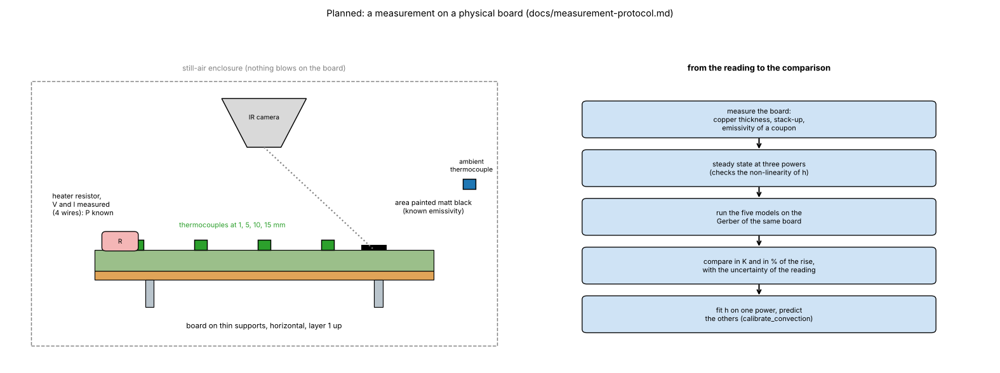

# A measurement on a physical board: protocol (a plan, nothing was measured)

*Figure 10 (`figures/fig_10_measurement_setup.png`): the set-up (a heater resistor of known electrical power, thermocouples at several distances, an infrared camera looking at a painted area, an ambient thermocouple, a still-air enclosure) and the chain from the reading to the comparison with the models.*

## 1. Why

Every error figure in this project is against another calculation (an exact solution, the FVM, the 3D solid, a finite-element solid, a pixel reference). **No model has been compared with a physical board.** That is the largest gap of validity (`research/theory/topics/29-verification-ladder.md`). The measurement below closes the first rung: one board, one heater of known power, a few temperatures, five models.

## 2. The board

The 40 x 40 mm IC board of `research/gerber-import/lib/our_board.py` (an IC in the middle, eight signal nets on circular arcs, a ground net with four thermal vias; single copper layer plus the plated holes, copper 10 % of the area). Its Gerber and drill files are written by the script; it is already the bench of the Gerber research (reader, mapping, five models), so the measured board and the modelled board are the same files. A **second board** with a track at 0 degrees and an identical one at 45 degrees would test the diagonal conduction physically (`research/gerber-models/README.md` 4.42 to 4.49): the model changes by a known amount between the two, the measurement says whether the board does.

To fix before ordering: the stack-up and finished copper weight asked of the fabricator (and then **measured**: the finished outer copper moves the rise by 5.7 % for a 15 % change, `docs/validation.md` section 12), the surface finish, the solder mask (its emissivity matters, not its conduction).

## 3. What is measured

| Quantity | How | Why |
| :-- | :-- | :-- |
| power of the heater | a resistor on the exposed pad driven with a stabilised supply, voltage and current read with four wires: `P = V I` | the power is known to the accuracy of the meter, not estimated |
| temperatures at 1, 5, 10 and 15 mm from the heater along one radial track | thin-wire thermocouples fixed with a small drop of epoxy | the fall with distance tells how well the board spreads the heat; the level tells `h` |
| the temperature field | an infrared camera on an area painted matt black (known emissivity) | a map to compare with the models' map (a bare package top is about 0.9 and bare copper 0.05 to 0.1, so an unpainted copper reading is wrong) |
| ambient | one thermocouple in the enclosure, away from the board | the rises are measured against it |
| the board itself | copper thickness (weighing or a cross-section of a spare), emissivity of a painted coupon, dimensions | to put the real numbers in the model |

A thermocouple that touches the board disturbs the field (a contact resistance and a conducting wire), so the wire is thin and the point is repeated with the heater off to read the zero; an infrared spot is too large for a small part, so the camera is used for the map and the thermocouples for the numbers (`docs/calculators.md` section 3 and the sources of topic 23).

## 4. Conditions

* Still air: the board horizontal, layer 1 up, on thin supports in an enclosure that stops draughts; no fan. The computed convection of the program is for still air (topic 08).
* **Steady state at three powers** (low, medium and high within the heater's rating). The program's constant-`h` result is known to overestimate the rise by 10 % at 22 W and underestimate it at low power (`docs/roadmap.md` section 2), so the three powers test the computed convection itself, not one point.
* Wait until the temperature changes by less than the resolution of the reading for several minutes (the whole board needs minutes; the hottest point reaches 63 % of its rise in tens of seconds, `docs/validation.md` section 7).
* Optional: one **power step** with the thermocouple at the heater logged against time, to compare with the time simulation (topic 33).

## 5. The comparison, decided before the measurement

1. The five models run on the Gerber of the same board, with the **measured** copper thickness and the measured emissivity, computed convection, still air, horizontal, the same power. The mapping of the copper is the program's fill fraction first, then (as options) `lambda 0.5`, the cell problem and the flow-based faces of `research/gerber-models/`, so the measurement also says which mapping the physical board prefers.
2. The comparison is the **rise** (temperature minus ambient), in K and in % of the rise, at each point and power.
3. **Uncertainty budget** (to be filled with the specifications of the instruments actually used; no figure is assumed here): the reading of the thermocouple and its calibration, the ambient reading, the power (voltage and current meters), the copper thickness, the emissivity, the position of each thermocouple (a 1 mm error is large near a heater), the repeatability between runs. Combined as the root of the sum of squares of the contributions that matter, as the Power calculator does (`docs/calculators.md` section 1.1b).
4. **Agreement criterion**: a model agrees at a point when its rise lies within the expanded uncertainty of the measured rise. A model that does not is reported as it is, with the sign and size of the difference; nothing is tuned to make it agree.
5. **Prediction test**: fit the convection multiplier (`calibrate_convection`) on **one** power and predict the other two; the error of the prediction is the honest figure for the computed convection.

## 6. What the result would decide

* Whether the layered models, the Lumped and Analytic reductions, the computed convection and the fill-fraction mapping are within their stated errors on a real board.
* Which copper mapping is worth entering the program (`research/gerber-models/INTEGRATION.md`).
* Whether the disclaimer "a design aid, to be validated by measurement" can say what the validation was (roadmap, section on solvers and validation).

## 7. Limits of the plan

One board, one heater, still air, steady state (and at most one step); no enclosure, no forced convection, no component with a junction. It does not validate vias in depth (four thermal vias on one board) or a heatsink; those need their own boards. The plan is a design: nothing was built, ordered or measured in this work.

## 8. Sources

The standard ASME V&V 20 for the frame of comparing a simulation with data (`E = S - D`, a validation uncertainty combined from the numerical, input and experimental parts, an interval rather than pass or fail; `research/theory/BIBLIOGRAPHY.md`, [ASMEVV20]); the Power calculator document for the limits of thermocouples, infrared and emissivity (`docs/calculators.md`, [PohankaRaudensky], [OSTI21026063] through `research/theory/BIBLIOGRAPHY.md`); the roadmap for the non-linearity of the convection; the validation document for the sensitivity to the copper.

*What was read and what was not verified:* the protocol is written from the repository's own documents (read in full); no instrument specification was consulted and none is quoted.
