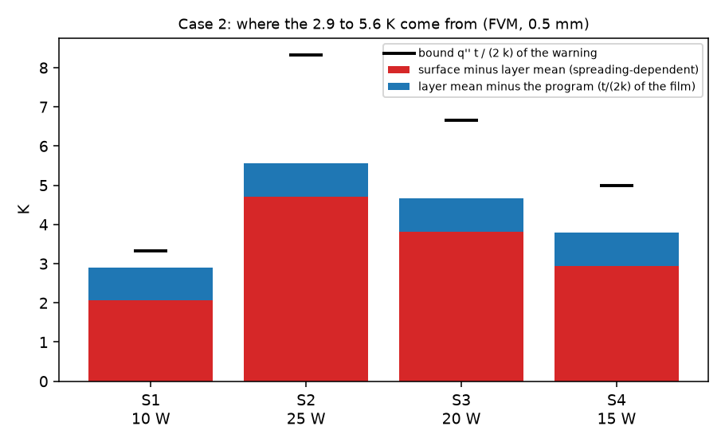
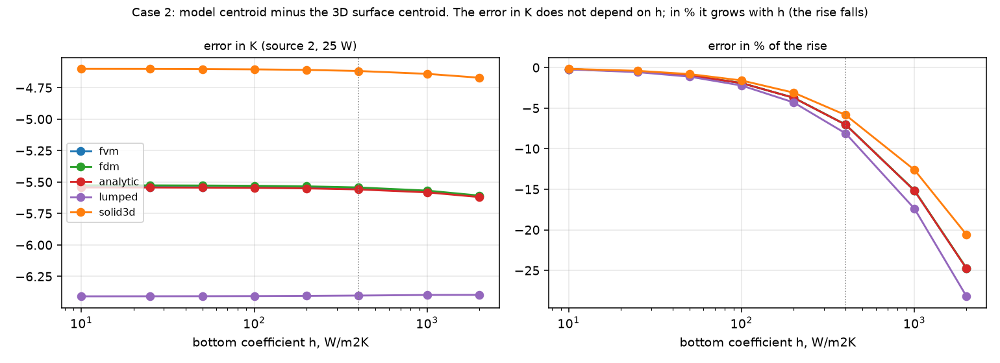

# Case 2 of Muzychka, Culham and Yovanovich (2003): why the layered models read 3 to 5.5 K low, and why the window shows other numbers

A user reported that the Analytic model gives centroid temperatures 3 to 5.5 degC below the published case 2 (a 10 mm baseplate, four 10 x 10 mm sources) and below the independent 3D solver, that the error seems to grow for lower heat transfer coefficients, and that the window does not show the numbers of the study script. This folder reproduces the numbers, separates the causes and runs the case through the real main window. Nothing of the program is edited; the fixes are proposals (`INTEGRATION.md`).

Scripts, from the repository root: `study_case2_reproduce.py`, `study_case2_h_sweep.py`, `study_case2_gui.py` (offscreen), `make_figures.py`; shared code `lib/case2.py`; tests `tests/test_case2.py` (6 passed, 8 s). Outputs go to the git-ignored `out/`.

## 1. The case and the quantities

Plate 50 x 50 x 10 mm, k 150 W/mK, h 400 W/m2K on the bottom face, top face and sides adiabatic, four 10 x 10 mm isoflux sources, 10 W at (12.5, 12.5), 25 W at (37.5, 12.5), 20 W at (12.5, 37.5), 15 W at (37.5, 37.5) mm (paper text, case 2 and Tables 3 and 4, read in the text layer of the paper in the local library; the ambient of case 2 is not printed, 25 C is assumed as in the other cases: the independent solver then reproduces Table 4, section 2).

*Figure 1 (`figures/fig_01_case2_section.png`): left, plan with the four sources; middle, the section through the 10 and 25 W sources with the heat paths and the single node of a layered model at mid-thickness; right, the temperature through the thickness under the centroid of the 25 W source from the independent 3D solver, with the surface value (the paper's quantity), the layer mean (what one node per layer stands for) and the FVM, FDM and Analytic value.*

What each thing reports (this is the source of most of the confusion):

| source | quantity |
| :-- | :-- |
| paper Table 4 | the temperature of the **top surface**: at the centroid of each source and the mean over the source |
| independent 3D solver (`tests/helpers/layered3d.py`) | both: surface (extrapolated from the top slab) and the thickness-weighted **mean of the column**; centroid = the four cells around the centre |
| FVM, FDM, Analytic, Lumped, 3D solid | the temperature of the **one node of the layer** (the mean through the thickness), read at the centroid (four cells) or averaged over the source cells; the 3D solid also holds one slab for the copper |
| the Results table of the window | per part, `t_max` (peak of the node field over the footprint) and `t_mean`; not the centroid |

## 2. Reproduction (`study_case2_reproduce.py`)

Independent 3D solver at 0.5 mm: surface centroids 97.41, 103.85, 101.31, 99.95 C with 8 sub-slabs through the thickness, 97.39, 103.81, 101.27, 99.93 with 16 (paper 97.40, 103.82, 101.28, 99.94), at 0.25 mm and 8 sub-slabs identical to 0.5 mm (so the plan is converged); surface means 96.92, 102.53, 100.26, 99.19 (8) and 96.88, 102.42, 100.18, 99.12 (16) against the paper's 96.85, 102.33, 100.10, 99.07 (the mean needs more sub-slabs, as the theory-sources folder found). The bottom mean is 95.00 C. **The solver reproduces the paper to 0.03 K at the centroids.** The report's numbers for the paper and the 3D are the same as ours; the garbled 3D values are the 8-slab means.

The program, centroid of the layer temperature, cell 1 mm (the results hardly move from 2 to 0.25 mm):

| model | S1 | S2 | S3 | S4 | minus 3D surface | minus 3D layer mean |
| :-- | --: | --: | --: | --: | :-- | :-- |
| paper | 97.40 | 103.82 | 101.28 | 99.94 | | |
| 3D surface | 97.41 | 103.85 | 101.31 | 99.95 | 0 | +2.1 to +4.7 |
| 3D column mean | 95.35 | 99.15 | 97.49 | 97.01 | -2.1 to -4.7 | 0 |
| FVM | 94.46 | 98.30 | 96.62 | 96.13 | -2.95, -5.55, -4.68, -3.82 | -0.89, -0.85, -0.86, -0.88 |
| FDM | 94.50 | 98.26 | 96.61 | 96.14 | -2.91, -5.59, -4.70, -3.81 | -0.85 to -0.89 |
| Analytic | 94.46 | 98.30 | 96.63 | 96.13 | -2.95, -5.55, -4.68, -3.82 | -0.84 to -0.89 |
| Lumped | 94.74 | 97.56 | 96.42 | 95.88 | -2.67, -6.30, -4.89, -4.07 | -0.61, -1.59, -1.07, -1.13 |
| 3D solid | 95.39 | 99.23 | 97.56 | 97.07 | -2.02, -4.62, -3.75, -2.89 | +0.04 to +0.09 |

The Analytic, the FVM and the FDM agree to 0.05 K at 0.5 mm (and to 0.1 K at 1 mm): the Analytic is not the odd one out; all three sit **2.9, 5.5, 4.7 and 3.8 K** below the paper, which is the user's 3 to 5.5 K. The Analytic modes (default, 60, 120) do not change the answer (plan truncation is not a cause).

## 3. The cause: two terms, and the second was not documented for thick plates

The gap paper to FVM splits exactly into two (`study_case2_reproduce.py` section 3, FVM 0.5 mm):

| term | S1 | S2 | S3 | S4 | what it is |
| :-- | --: | --: | --: | --: | :-- |
| 3D surface minus 3D layer mean | 2.06 | 4.70 | 3.82 | 2.94 | **through the thickness**: one node per layer is the mean of the column, the surface under a source is hotter. 56 to 62 % of the bound `q'' t / (2 k)` (3.33, 8.33, 6.67, 5.00 K) |
| 3D layer mean minus the FVM, FDM, Analytic | 0.84 | 0.85 | 0.84 | 0.84 | **the film**: the face film acts on the node, so the half layer `t / (2 k)` between the node and the face is left out. Uniform 0.84 K, the estimate `Q t / (2 k A)` with the mean flux of the whole plate gives 0.93 K |
| total, surface minus FVM | 2.90 | 5.55 | 4.66 | 3.79 | paper minus FVM 2.89, 5.52, 4.64, 3.77 |

*Figure 3 (`figures/fig_03_case2_decomposition.png`): the two terms for each source, with the bound of the program's warning as a tick.*

* The through-thickness term is the documented limit (`docs/theory.md` 7.5, `checks.check_thick_plates`). It does not explain the whole gap.
* **The film term is a separate simplification** (`docs/theory.md` 1.2: "the half copper layer in between, `t_cu/(2k)`, is 5e-7 of `1/h` for 35 um at 10 W/m2K and is neglected"). That is true for PCB copper and false for a 10 mm plate of k 150 at h 400 (1.3 % of `1/h`, 0.84 K here, 1.2 % of the 70 K of the board). The earlier statement in `research/theory-sources` (README 3.7, `INTEGRATION.md` 2.3) that the shortfalls are "67 to 89 % of the bound" and that this confirms the through-thickness effect is **misleading**: part of the 67 to 89 % is the film term, which has nothing to do with the bound, and the bound-term alone is 56 to 62 % of the bound.
* The 3D solid shows only the through-thickness term (it reads the layer mean within 0.1 K, so the previous "3D solid 2.0 to 4.6 K low" is the through-thickness term alone); the layered models carry both. This also shows that the 3D solid, whose copper is one slab, is also not a surface read-out.
* Test of the film term without touching the program: replace `h_bottom` by `1 / (1/h + t/(2k))` = 394.74 W/m2K in the input: FVM, FDM and Analytic then read the 3D layer mean within 0.10 K (the 3D solid within 0.1 K already). The Lumped stays 0.2 to 0.8 K off the layer mean (its rings), 1.7 K below it at S2 without the correction.
* The program shows the warning for S2, S3 and S4 (bounds 8.3, 6.7 and 5.0 K, 11, 9 and 7 % of the rise) in every model, **and not for S1** (3.3 K, 4.8 % of its 69.6 K, just under the 5 % limit), although S1 is also 3.0 K low. The warning's number is a bound on the through-thickness term only; it does not mention the film term.

## 4. Does the error grow for a lower h? (`study_case2_h_sweep.py`)

No. For h from 10 to 2000 W/m2K the error in K of the FVM, FDM and Analytic against the 3D surface is constant (S2: -5.53 to -5.62 K; the Analytic -5.54 at h 10 and -5.62 at 2000), the Lumped -6.40 to -6.41 K, the 3D solid -4.60 to -4.67 K. The error in **percent of the rise** grows with a **higher** h because the rise falls: FVM S2 -0.2 % at h 10, -1.9 % at 100, -7.0 % at 400 (the paper), -15.2 % at 1000, -24.8 % at 2000. Against the layer mean the layered models are -0.84 to -0.89 K at every h (the Lumped -1.7 K). Both terms are set by the flux and by `t / k`, not by h, which is what the closed forms say. A lower h would look worse only if the comparison is made after the default top and edge coefficients of a new board are left on (section 5) or if the user also lowers the power.

*Figure 2 (`figures/fig_02_case2_error_vs_h.png`): error of each model against the 3D surface centroid of the 25 W source, in K (left) and in % of the rise (right), h from 10 to 2000 W/m2K; the dotted line is the paper's 400.*

## 5. The window against the script (`study_case2_gui.py`, real `MainWindow`, offscreen)

The script maps the plate as one copper layer of 10 mm with k 150, `h_top` 1e-6, `h_side` None, manual coefficients, 25 C (`lib/case2.py`, as `study_muzychka_more_cases.py`). Through the window:

* **Route A, the script's project opened in the window** (File - Open equivalent), FVM 1 mm: Results table `t_max` 94.59, 98.31, 96.64, 96.17 and `t_mean` 94.31, 97.68, 96.17, 95.83 C; the script's centroids 94.46, 98.30, 96.62, 96.13. The peak over the footprint is 0.01 to 0.13 K above the centroid; otherwise identical, the same three warnings. Analytic: 94.59, 98.32, 96.64, 96.17. **The window and the script agree when the same project is loaded.**
* **Route C, the defaults of a new board on the same plate**: `h_top` 10 lowers the centroids by 1.71 K, `h_side` 10 (edges lose heat, on by default) by 1.36 K, both by 3.01 K (S1 94.46 to 91.45, S2 98.30 to 95.29): a user who types only the bottom coefficient 400 on a new board gets 3 K lower than the script. Set `h_top` 0 and untick the edge box to reproduce the paper (the paper's top and sides are adiabatic).
* **Route B, the plate typed in the Board dock cannot be built**: the copper box stops at **210 um** (the board thickness box at 10 mm, the coefficients at 500 W/m2K). Typing 10 000 um leaves 210 um; with a zone over the board and k 150 the plate is a 0.21 mm copper sheet on 9.79 mm of FR-4 and the part rows read **673 to 812 C** (h_top 10, h_side 10) or **991 to 1138 C** (adiabatic), with **no warning**. A project file can hold 10 mm copper (route A).
* **A defect of the Board dock (route A2)**: after opening the project (copper 10 000 um), **any edit of any field of the Board dock** (here h_bottom 400 to 401 and back) writes the clamped copper box back, `copper_thickness` becomes 210 um (`panels.BoardPanel` `mutate`: `bd.copper_thickness = [self.copper.value() * 1e-6] * bd.layers` in the simple stack-up), and the next run reads 991 to 1138 C, again without a warning. The same happens to a stored `h_bottom` above 500 or a thickness above 10 mm. This is a program defect, independent of the physics, and a likely cause of "the window does not match" for anyone who opened a project with thick copper and touched a field.

## 6. What is what

| item | class |
| :-- | :-- |
| 2.9 to 5.5 K low in the FVM, FDM, Analytic (Lumped 2.7 to 6.4) | the idealisation, two terms: through-thickness (documented, 56 to 62 % of its bound) and film `t/(2k)` (neglected, documented only for thin copper) |
| "grows for a lower h" | not reproduced: constant in K, the percentage grows with a higher h |
| window differs from the script | inputs: new-board defaults (3.0 K), peak against centroid (0.1 K), the 210 um limit and the dock write-back (hundreds of K, no warning) |
| the earlier text "67 to 89 % of the bound, confirms the effect" | misleading, to correct |
| Analytic itself | no defect found: equals the FVM to 0.05 K, modes and cell do not matter |

## 7. Limits of this study

One geometry (a single flat plate with adiabatic top and sides), one conductivity (k 50 would need its own sweep: the through-thickness term scales with 1/k and the film term with `t/k` too); the film-term fix was tested only by changing the input coefficient, not by editing the solvers (so the edge film, vias and the block faces, which already have their own treatment in `blocks.py`, were not examined); the 8 sub-slab 3D means are 0.1 K above the paper (the 16 sub-slab ones 0.03 to 0.09 K); case 1 (a) and the cross were not re-run (their film term is 0.2 to 0.5 % of `1/h`, so it is small there, but the check was not made); the GUI part is offscreen, the user's figure was not seen, so which default produced his difference is a hypothesis (section 5 lists the three candidates); no measured board is involved.

## 8. What was read and what was not verified

* **Read (R):** the text layer of Muzychka, Culham and Yovanovich (2003) in the local papers library (`md/Muzychka2003.md`): case 2 description (page of Case 2), Tables 3 and 4 (the centroid and mean values 97.40 / 96.85, 103.82 / 102.33, ...), and that the temperature is the surface of the baseplate. Nothing of the paper is stored here.
* **Reproduced:** Table 4 centroids by the independent 3D solver within 0.03 K (16 sub-slabs); the means within 0.06 to 0.2 K (sub-slab count, as `research/theory-sources` 3.7 explains).
* **Run on the program (not edited):** the five models at four cells, the Analytic with more modes, the h sweep, the real main window offscreen.
* **Not verified:** the user's own figure and project; the real display; the paper's ambient (assumed 25 C, supported by the match); the Lumped's own error (1.7 K from the layer mean at S2 with the film corrected is only measured, not explained); the phrase "about 5 degC error, marginally low" was not found verbatim in `docs/validation.md`; the closest texts are `research/theory-sources/README.md` 3.7 and `INTEGRATION.md` 2.3 ("4 to 7 % of the rise", "no change") and `docs/theory.md` 7.5 (which cites the first case and the cross, not case 2).
