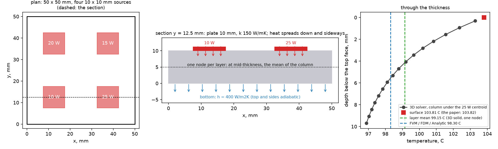

# Case 2 of Muzychka, Culham and Yovanovich (2003): why the layered models read 3 to 5.5 K low, and why the window shows other numbers

A user reported that the Analytic model gives centroid temperatures 3 to 5.5 degC below the published case 2 (a 10 mm baseplate, four 10 x 10 mm sources) and below the independent 3D solver, that the error seems to grow for lower heat transfer coefficients, and that the window does not show the numbers of the study script. This folder reproduces the numbers, separates the causes and runs the case through the real main window. Nothing of the program is edited; the fixes are proposals (`INTEGRATION.md`).

Scripts, from the repository root: `study_case2_reproduce.py` (peak about 7.5 GB: its finest 3D reference, 0.25 mm and 8 sub-slabs, stays resident, which is also why the memory guard of the later runs in the same process prints estimates of 7.5 GB for a 1250-unknown board; `--quick` skips it), `study_case2_h_sweep.py` (1.3 GB), `study_case2_gui.py` (offscreen), `study_case2_review.py` (the checks of the review, section 8), `study_case2_followup.py` (section 9; the reporter's project is passed as a path, never stored), `make_figures.py`; shared code `lib/case2.py`; tests `tests/test_case2.py` (8 passed, about 10 s, 1.3 GB). Outputs go to the git-ignored `out/`.

## 1. The case and the quantities

Plate 50 x 50 x 10 mm, k 150 W/mK, h 400 W/m2K on the bottom face, top face and sides adiabatic, four 10 x 10 mm isoflux sources, 10 W at (12.5, 12.5), 25 W at (37.5, 12.5), 20 W at (12.5, 37.5), 15 W at (37.5, 37.5) mm (paper text, case 2 and Tables 3 and 4, read in the text layer of the paper in the local library; the ambient of case 2 is not printed, 25 C is assumed as in the other cases: the independent solver then reproduces Table 4, section 2).

*Figure 1 (`figures/fig_01_case2_section.png`): left, plan with the four sources; middle, the section through the 10 and 25 W sources with the heat paths and the single node of a layered model at mid-thickness; right, the temperature through the thickness under the centroid of the 25 W source from the independent 3D solver, with the surface value (the paper's quantity), the layer mean (what one node per layer stands for) and the FVM, FDM and Analytic value.*

What each thing reports (this is the source of most of the confusion):

| source | quantity |
| :-- | :-- |
| paper Table 4 | the temperature of the **top surface**: at the centroid of each source and the mean over the source |
| independent 3D solver (`tests/helpers/layered3d.py`) | both: surface (extrapolated from the top slab) and the thickness-weighted **mean of the column**; centroid = the four cells around the centre |
| FVM, FDM, Analytic, Lumped, 3D solid | the temperature of the **one node of the layer** (the mean through the thickness), read at the centroid (four cells) or averaged over the source cells; the 3D solid also holds one slab for the copper |
| the Results table of the window | per part, `t_max` (peak of the node field over the footprint) and `t_mean`; not the centroid |

## 2. Reproduction (`study_case2_reproduce.py`)

Independent 3D solver at 0.5 mm: surface centroids 97.41, 103.85, 101.31, 99.95 C with 8 sub-slabs through the thickness, 97.39, 103.81, 101.27, 99.93 with 16 (paper 97.40, 103.82, 101.28, 99.94), at 0.25 mm and 8 sub-slabs identical to 0.5 mm (so the plan is converged); surface means 96.92, 102.53, 100.26, 99.19 (8) and 96.88, 102.42, 100.18, 99.12 (16) against the paper's 96.85, 102.33, 100.10, 99.07 (the mean needs more sub-slabs, as the theory-sources folder found). The bottom mean is 95.00 C. **The solver reproduces the paper to 0.03 K at the centroids.** The report's numbers for the paper and the 3D are the same as ours; the garbled 3D values are the 8-slab means.

The program, centroid of the layer temperature, cell 1 mm (the results hardly move from 2 to 0.25 mm):

| model | S1 | S2 | S3 | S4 | minus 3D surface | minus 3D layer mean |
| :-- | --: | --: | --: | --: | :-- | :-- |
| paper | 97.40 | 103.82 | 101.28 | 99.94 | | |
| 3D surface | 97.41 | 103.85 | 101.31 | 99.95 | 0 | +2.1 to +4.7 |
| 3D column mean | 95.35 | 99.15 | 97.49 | 97.01 | -2.1 to -4.7 | 0 |
| FVM | 94.46 | 98.30 | 96.62 | 96.13 | -2.95, -5.55, -4.68, -3.82 | -0.89, -0.85, -0.86, -0.88 |
| FDM | 94.50 | 98.26 | 96.61 | 96.14 | -2.91, -5.59, -4.70, -3.81 | -0.85 to -0.89 |
| Analytic | 94.46 | 98.30 | 96.63 | 96.13 | -2.95, -5.55, -4.68, -3.82 | -0.84 to -0.89 |
| Lumped | 94.74 | 97.56 | 96.42 | 95.88 | -2.67, -6.30, -4.89, -4.07 | -0.61, -1.59, -1.07, -1.13 |
| 3D solid | 95.39 | 99.23 | 97.56 | 97.07 | -2.02, -4.62, -3.75, -2.89 | +0.04 to +0.09 |

The Analytic, the FVM and the FDM agree to 0.05 K at 0.5 mm (and to 0.1 K at 1 mm): the Analytic is not the odd one out; all three sit **2.9, 5.5, 4.7 and 3.8 K** below the paper, which is the user's 3 to 5.5 K. The Analytic modes (default, 60, 120) do not change the answer (plan truncation is not a cause).

## 3. The cause: two terms, and the second was not documented for thick plates

The gap paper to FVM splits exactly into two (`study_case2_reproduce.py` section 3, FVM 0.5 mm):

| term | S1 | S2 | S3 | S4 | what it is |
| :-- | --: | --: | --: | --: | :-- |
| 3D surface minus 3D layer mean | 2.06 | 4.70 | 3.82 | 2.94 | **through the thickness**: one node per layer is the mean of the column, the surface under a source is hotter. 56 to 62 % of the bound `q'' t / (2 k)` (3.33, 8.33, 6.67, 5.00 K) |
| 3D layer mean minus the FVM, FDM, Analytic | 0.84 | 0.85 | 0.84 | 0.84 | **the film**: the face film acts on the node, so the half layer `t / (2 k)` between the node and the face is left out. Uniform 0.84 K, the estimate `Q t / (2 k A)` with the mean flux of the whole plate gives 0.93 K |
| total, surface minus FVM | 2.90 | 5.55 | 4.66 | 3.79 | paper minus FVM 2.89, 5.52, 4.64, 3.77 |

*Figure 3 (`figures/fig_03_case2_decomposition.png`): the two terms for each source, with the bound of the program's warning as a tick.*

* The through-thickness term is the documented limit (`docs/theory.md` 7.5, `checks.check_thick_plates`). It does not explain the whole gap.
* **The film term is a separate simplification** (`docs/theory.md` 1.2: "the half copper layer in between, `t_cu/(2k)`, is 5e-7 of `1/h` for 35 um at 10 W/m2K and is neglected"). That is true for PCB copper and false for a 10 mm plate of k 150 at h 400 (1.3 % of `1/h`, 0.84 K here, 1.2 % of the 70 K of the board). The earlier statement in `research/theory-sources` (README 3.7, `INTEGRATION.md` 2.3) that the shortfalls are "67 to 89 % of the bound" and that this confirms the through-thickness effect is **misleading**: part of the 67 to 89 % is the film term, which has nothing to do with the bound, and the bound-term alone is 56 to 62 % of the bound.
* The 3D solid shows only the through-thickness term (it reads the layer mean within 0.1 K, so the previous "3D solid 2.0 to 4.6 K low" is the through-thickness term alone); the layered models carry both. This also shows that the 3D solid, whose copper is one slab, is also not a surface read-out.
* Test of the film term without touching the program: replace `h_bottom` by `1 / (1/h + t/(2k))` = 394.74 W/m2K in the input: FVM, FDM and Analytic then read the 3D layer mean within 0.10 K (the 3D solid within 0.1 K already). The Lumped stays 0.2 to 0.8 K off the layer mean (its rings), 1.7 K below it at S2 without the correction.
* The program shows the warning for S2, S3 and S4 (bounds 8.3, 6.7 and 5.0 K, 11, 9 and 7 % of the rise) in every model, **and not for S1** (3.3 K, 4.8 % of its 69.6 K, just under the 5 % limit), although S1 is also 3.0 K low. The warning's number is a bound on the through-thickness term only; it does not mention the film term.

## 4. Does the error grow for a lower h? (`study_case2_h_sweep.py`)

No. For h from 10 to 2000 W/m2K the error in K of the FVM, FDM and Analytic against the 3D surface is constant (S2: -5.53 to -5.62 K; the Analytic -5.54 at h 10 and -5.62 at 2000), the Lumped -6.40 to -6.41 K, the 3D solid -4.60 to -4.67 K. The error in **percent of the rise** grows with a **higher** h because the rise falls: FVM S2 -0.2 % at h 10, -1.9 % at 100, -7.0 % at 400 (the paper), -15.2 % at 1000, -24.8 % at 2000. Against the layer mean the layered models are -0.84 to -0.89 K at every h (the Lumped -1.7 K). Both terms are set by the flux and by `t / k`, not by h, which is what the closed forms say. A lower h would look worse only if the comparison is made after the default top and edge coefficients of a new board are left on (section 5) or if the user also lowers the power.

*Figure 2 (`figures/fig_02_case2_error_vs_h.png`): error of each model against the 3D surface centroid of the 25 W source, in K (left) and in % of the rise (right), h from 10 to 2000 W/m2K; the dotted line is the paper's 400.*

## 5. The window against the script (`study_case2_gui.py`, real `MainWindow`, offscreen)

The script maps the plate as one copper layer of 10 mm with k 150, `h_top` 1e-6, `h_side` None, manual coefficients, 25 C (`lib/case2.py`, as `study_muzychka_more_cases.py`). Through the window:

* **Route A, the script's project opened in the window** (File - Open equivalent), FVM 1 mm: Results table `t_max` 94.59, 98.31, 96.64, 96.17 and `t_mean` 94.31, 97.68, 96.17, 95.83 C; the script's centroids 94.46, 98.30, 96.62, 96.13. The peak over the footprint is 0.01 to 0.13 K above the centroid; otherwise identical, the same three warnings. Analytic: 94.59, 98.32, 96.64, 96.17. **The window and the script agree when the same project is loaded.**
* **Route C, the defaults of a new board on the same plate**: `h_top` 10 lowers the centroids by 1.71 K, `h_side` 10 (edges lose heat, on by default) by 1.36 K, both by 3.01 K (S1 94.46 to 91.45, S2 98.30 to 95.29): a user who types only the bottom coefficient 400 on a new board gets 3 K lower than the script. Set `h_top` 0 and untick the edge box to reproduce the paper (the paper's top and sides are adiabatic).
* **Route B, the plate typed in the Board dock cannot be built**: the copper box stops at **210 um** (the board thickness box at 10 mm, the coefficients at 500 W/m2K). Typing 10 000 um leaves 210 um; with a zone over the board and k 150 the plate is a 0.21 mm copper sheet on 9.79 mm of FR-4 and the part rows read **673 to 812 C** (h_top 10, h_side 10) or **991 to 1138 C** (adiabatic), with **no warning**. A project file can hold 10 mm copper (route A).
* **A defect of the Board dock (route A2)**: after opening the project (copper 10 000 um), **any edit of any field of the Board dock** (here h_bottom 400 to 401 and back) writes the clamped copper box back, `copper_thickness` becomes 210 um (`panels.BoardPanel` `mutate`: `bd.copper_thickness = [self.copper.value() * 1e-6] * bd.layers` in the simple stack-up), and the next run reads 991 to 1138 C, again without a warning. The same happens to a stored `h_bottom` above 500 or a thickness above 10 mm. This is a program defect, independent of the physics, and a likely cause of "the window does not match" for anyone who opened a project with thick copper and touched a field.

## 6. What is what

| item | class |
| :-- | :-- |
| 2.9 to 5.5 K low in the FVM, FDM, Analytic (Lumped 2.7 to 6.4) | the idealisation, two terms: through-thickness (documented, 56 to 62 % of its bound) and film `t/(2k)` (neglected, documented only for thin copper) |
| "grows for a lower h" | not reproduced (confirmed by the review, 8.1): constant in K, the percentage grows with a higher h |
| window differs from the script | inputs: new-board defaults (3.0 K), peak against centroid (0.1 K), the 210 um limit and the dock write-back (hundreds of K, no warning) |
| the earlier text "67 to 89 % of the bound, confirms the effect" | misleading, to correct |
| Analytic itself | no defect found: equals the FVM to 0.05 K, modes and cell do not matter |

## 7. Limits of this study

One geometry (a single flat plate with adiabatic top and sides), one conductivity (k 50 would need its own sweep: the through-thickness term scales with 1/k and the film term with `t/k` too); the film-term fix was tested only by changing the input coefficient, not by editing the solvers (so the edge film, vias and the block faces were not examined; **corrected by the review**: the block faces have no treatment of their own, `blocks.extra_layers` puts the exposed film `h_tot A` on the block node and the board link without half the block, the same simplification as the copper node, section 8.3); the 8 sub-slab 3D means are 0.1 K above the paper (the 16 sub-slab ones 0.03 to 0.09 K); case 1 (a) and the cross were not re-run (their film term is 0.2 to 0.5 % of `1/h`, so it is small there, but the check was not made); the GUI part is offscreen, the user's figure was not seen, so which default produced his difference is a hypothesis (section 5 lists the three candidates).

## 8. Review

Independent review of the folder (program on `development` 5fc91430 merged into the branch; nothing of the program edited). Verdict: **GO** for the merge of the research branch, with the corrections below written into this README and `INTEGRATION.md`.

### 8.1 What was re-run, and what it printed

* `study_case2_reproduce.py` (full, 55 s): every number of sections 2 and 3 reproduced to the printed digit (3D surface centroids 97.41 / 103.85 / 101.31 / 99.95 at 8 sub-slabs and 97.39 / 103.81 / 101.27 / 99.93 at 16; FVM, FDM, Analytic, Lumped and 3D solid rows at 2, 1, 0.5 and 0.25 mm; the decomposition 2.06 / 4.70 / 3.82 / 2.94 K through the thickness and 0.84 to 0.85 K of film; the film-corrected input 394.74 W/m2K putting FVM, FDM and Analytic +0.07 to +0.10 K from the 3D column mean; the Analytic unchanged at 60 and 120 modes; the warnings S1, S2, S3 of the program, which are S2, S3, S4 of this README).
* `study_case2_h_sweep.py` (18 s, 1.3 GB): section 4 reproduced (FVM S2 -5.54 K at h 10 to -5.62 K at 2000; -0.2 / -1.9 / -7.0 / -15.2 / -24.8 % of the rise at 10 / 100 / 400 / 1000 / 2000; the layer-mean error -0.84 to -0.89 K at every h). **The user's "the error grows for a lower h" is not reproduced**: the error in K does not depend on h, its share of the rise grows with a higher h.
* `study_case2_gui.py` (real main window, offscreen): routes A, B, A2 and C reproduced (A: 94.59 / 98.31 / 96.64 / 96.17 C in the Results rows; B2 and A2 991.48 to 1137.89 C with no warning; C 3.01 K for both defaults).
* The tests of the folder: 8 passed (two added by the review, below).

### 8.2 The 'up to' of the thick-plate warning is not an upper bound (new, `study_case2_review.py` part 1)

`checks.check_thick_plates` and `docs/theory.md` 1.2 say that the surface under a source "can be hotter than the model shows by up to `q'' t / (2 k)`". That bounds the through-thickness term only. The film term of section 3 comes on top, and in the one-dimensional limit it is as large: a source of 70 W over the whole top face of the case 2 plate (a column) reads 96.87 C on the 3D surface and 95.09 C in the FVM, a gap of **1.77 K against the stated bound of 0.93 K** (the exact one-dimensional gap is `q'' t / k` = 1.87 K: half below the node, half above); a central 30 x 30 mm source, 2.88 K against 2.59 K. Neither run shows the warning (1.3 and 3.6 % of the rise). In case 2 itself the bound happens to hold for every source (gaps 2.90 / 5.55 / 4.66 / 3.79 K against 3.33 / 8.33 / 6.67 / 5.00 K) because the 10 mm sources spread. A valid bound with the program as it is: `q'' t / (2 k) + q_face t / (2 k) <= q'' t / k`, with `q_face` the flux through the film of that layer; once the film term is in the models (proposal 2), `q'' t / (2 k)` is a bound again. Test `test_warning_bound_is_exceeded_by_a_column`.

### 8.3 The film term in the program elsewhere

* **The 3D solid** puts the face film in series with half of its top and bottom slab (`solid3d.face_g`), and its straight edges with half a cell (`solid3d.py`, the edge loop); this is why it reads the column mean (section 2).
* **The FVM edge film** is put in series with the conduction from the node to the closest outline point (`fvm.Network._cut_edge_film`, `docs/theory.md` 2.1.1, after Barrett and others): the edge already has its half-cell term.
* **Metal blocks** (`blocks.extra_layers`): the exposed film `h_tot A c` acts on the block node and the link to the board is the interface plus half the laminate slab, without half the block. A block is the program's own way to model thick metal, so the block has the same film term as the copper node of case 2 (for a 5 mm aluminium block under a fan, `h t/(2k)` of order 1e-3 to 1e-2 of `1/h`). Not measured here.
* **The face of a part over bare laminate** already adds the half layer (`laminate.face_terms`, theory 1.4).

So the program is not consistent: the resolved 3D model and the newer edge treatments include the half slab, the face films of the layered models do not. The size of `t / (2 k)` against `1/h` decides whether it matters: 5e-7 for 35 um copper at 10 W/m2K, 1.3e-2 for the case 2 plate.

### 8.4 Which ratio, `t/(2k)` or `t/(3k)`

The measured film term is 0.84 K; the closed form with the mean flux of the plate is 0.93 K for `t/(2k)` (heat entering through the opposite face, a linear profile) and 0.62 K for `t/(3k)` (heat arriving sideways and leaving through one face, a parabolic profile). Case 2 sits between, nearer `t/(2k)`. `t/(2k)` is the choice of the 3D solid and of the face term, and the hot side; it is the one to use.

### 8.5 The S1 source and the warning limit

S1 (10 W) is silent at 4.8 % of its rise with a 5 % limit. Its real gap is 2.90 K, 4.0 % of its 72.4 K rise on the 3D surface, so the silence is consistent with the 5 % rule itself; lowering the limit to 4 % (the study's suggestion) would tune the limit to this one case and is **not recommended**. What is wrong is the bound (8.2), not the limit: with `q'' t / (2 k) + q_face t / (2 k)` the S1 bound is about 4.3 K (6 %) and the warning fires.

### 8.6 The Board dock writes back every field, not only three (wider than section 5)

`panels.BoardPanel._apply` (`pcbthermal/gui/panels.py` lines 323 to 349) runs on the change of any box and writes ALL the board fields from the boxes, so every value the boxes cannot hold is replaced by the box value at the first edit of any field (`study_case2_review.py` part 2, real main window):

| field | box (`panels.py` 108 to 221) | stored | after one unrelated edit |
| :-- | :-- | :-- | :-- |
| copper per layer | 5 to 210 um, 1 decimal | 10 000 um | 210 um |
| thickness | 0.2 to 10 mm, 3 decimals | 10.001 mm | 10.0 mm |
| `h_top`, `h_bottom`, `h_side` | 0 to 500 W/m2K, 1 decimal | 600 | 500 (also 1e-6 to 0.0) |
| width, height | 5 to 1000 mm, **1 decimal** | 50.04 mm (63.47 mm) | 50.0 mm (63.5 mm), also on an imported board whose size boxes are greyed |
| ambient | 1 decimal | 25.37 C | 25.4 C |
| copper k | 1 to 1000, **0 decimals** | 150.4 | 150 |
| laminate k through, in-plane | 0.05 to 20, 2 decimals | 0.345 | 0.34 |
| via plating | 1 to 200 um, 0 decimals | 18.5 um | 19 um |
| copper of a simple stack-up with unequal layers | one box for all layers | 70 / 17.5 / 17.5 / 70 um | 70 / 70 / 70 / 70 um |

The edit is one undo step ("Board parameters"), but nothing tells the user that a field he did not touch changed. The case 2 consequence (991 to 1138 C instead of 94 to 98 C) is the worst of these, the roundings are small; all are silent. A project from a file, the command line, a script or another program (and every project of the research studies that model a plate as a 10 mm copper layer) is exposed. The unequal simple stack-up can only come from a file or the API (the program's own simple stack-up has equal copper). On an imported board the rounded width stays inside the extent tolerance of the masks (`copper.EXTENT_TOLERANCE`, 0.2 % of the side plus 1.5 pixels) for sides above about 25 mm; smaller boards with a fine pixel could be refused at the run (not reproduced). Test `test_one_dock_edit_rewrites_fields_it_did_not_touch` (it documents the defect and will fail when the program is fixed: then turn the assertion around).

### 8.7 What the review corrected in this folder

* Section 7: the block faces do not "already have their own treatment" (8.3).
* Section 3 and `INTEGRATION.md` 3: the S1 silence is not a reason to lower the 5 % limit (8.5); the warning's number is not a bound (8.2).
* Section 5: the write-back is wider than copper, thickness and h (8.6).
* The script header: the peak memory of `study_case2_reproduce.py`.
* `research/theory-sources/README.md` 3.7 and `INTEGRATION.md` 2.3 carry a correction line pointing here ("67 to 89 % of the bound ... confirms": the bound covers only one of the two terms, which are 56 to 62 % and 0.84 K).

### 8.8 Not verified by the review

The Lumped residual (0.2 to 0.8 K from the column mean with the film corrected, 1.7 K at S2 without) is measured, not explained; the film term of a metal block was not measured; the user's own project and figure were not seen (the three candidates of section 5 stay hypotheses, of which the write-back is the only one that produces a large, silent difference); a heat-sink baseplate modelled as a metal block under a thin board (the route the program intends for thick metal) was not run.

*Note: after the fixes of the thick-plate estimate and of the Board dock write-back were merged, `tests/test_case2.py` was updated: the three tests that had frozen the old behaviour (warning for three sources, copper box at 210 um, dock rewriting fields) now guard the corrected behaviour (warning for all four sources with the film term, a 10 mm plate held, other fields left unchanged).*

## 9. Follow-up from the reporter: the 3D solid in the window

The reporter found the coefficient boxes of the Board dock (`h_top`, `h_bottom`, the edge box) and sent a project in which the 3D solid reads closer to the paper than the 3D solid of `research/theory-sources/scripts/study_muzychka_more_cases.py` (95.39, 99.23, 97.56, 97.07 C). His file was opened read-only from a copy (`package.load_any`); the numbers below are printed by `study_case2_followup.py`.

**His project.** 50 x 50 mm, advanced stack-up of 2 layers: 4 mm "copper" per layer, one dielectric gap of 2 mm with k 150 W/mK both ways, total 10 mm; copper k 150; **no copper zone** (the 4 mm layers hold no copper; the numbers are those of a k 150 solid, so the absent copper takes the dielectric of the stack-up: inferred from the results, not traced in the code); `h_top` 0, `h_bottom` 400, edges insulated, manual coefficients, ambient 25 C; the four 10 x 10 mm sources of the paper on layer 1 (U1 to U4, 10 / 25 / 20 / 15 W, junction resistance 0); 3D solid only, cell 1 mm, the slab rule of the 3D solid (10 slabs in the 2 mm gap).

| read-out (3D solid, his project, 1 mm) | U1 | U2 | U3 | U4 | against the paper |
| :-- | --: | --: | --: | --: | :-- |
| Results table, part peak (`t_max`) | 97.64 | 104.37 | 101.71 | 100.25 | +0.24 to +0.55 K |
| layer 1 at the centroid | 96.20 | 101.02 | 99.01 | 98.20 | -1.2 to -2.8 K |
| study script (one 10 mm copper layer) | 95.39 | 99.23 | 97.56 | 97.07 | -2.0 to -4.6 K |

**Why his numbers are closer.** (a) His top node is the mean of the upper 5 mm of the plate (4 mm layer plus half the gap), not of the whole 10 mm column, so it is hotter than the column mean of the script. (b) His sources sit over absent copper, so the part rows add the face term of a part over bare laminate (`laminate.face_terms`, `Q t/(2 k A)` with the 4 mm layer and k 150: 1.33, 3.33, 2.67, 2.00 K), which happens to resemble the through-thickness term of section 3; the peak of the rows is that value plus the node peak. It is a closer number by a coincidence of the mapping, not a resolved surface. The window also warns "there is no copper under it ... the heat can only spread through the FR-4 and the part will run very hot", which is wrong for a dielectric of k 150 (the text names FR-4 whatever the dielectric).

**The study script does not misuse the 3D solid, but its mapping cannot show the surface.** The 3D solid keeps every copper layer as ONE slab and cuts only the dielectric gaps into slabs (`solid3d.slab_rule`, at least 4); the script maps the plate as one 10 mm copper layer, so the 3D solid reads its column mean (95.39 against 95.35 of the independent column mean, section 2), as the theory-sources README already said ("its slab is also one node thick"). **What the 3D solid should give, and does**: with the plate mapped as a dielectric gap of k 150 between two 1 um copper layers (full copper zones, so no face term), the program's 3D solid reads 97.32 / 103.76 / 101.21 / 99.86 C at 1 mm (16 slabs by the rule) and **97.39 / 103.81 / 101.27 / 99.93 C at 0.5 mm, the independent reference to the digit** (means 96.88 / 102.42 / 100.18 / 99.12, the 16 sub-slab means of section 2); 32 slabs change the 1 mm values by at most 0.01 K (0.5 mm with 32 slabs is refused by the memory guard, 13.3 GB). So the 3D solid itself is right; the script now prints this resolved row as well (`solid3d resolved`, 1 mm). The script peaks at about 5 GB (31 s), most of it its independent reference; run it on a quiet machine.

**Limit to record (program, not a defect of the solver):** a thick metal plate drawn as a copper layer is one slab in the 3D solid too, so the 3D solid is not a surface read-out for it; the user guide does not say so. Thick metal is resolved by the 3D solid when it is a dielectric gap (or a metal block: not checked here). INTEGRATION item 7.

## 10. What was read and what was not verified

* **Read (R):** the text layer of Muzychka, Culham and Yovanovich (2003) in the local papers library (`md/Muzychka2003.md`): case 2 description (page of Case 2), Tables 3 and 4 (the centroid and mean values 97.40 / 96.85, 103.82 / 102.33, ...), and that the temperature is the surface of the baseplate. Nothing of the paper is stored here.
* **Reproduced:** Table 4 centroids by the independent 3D solver within 0.03 K (16 sub-slabs); the means within 0.06 to 0.2 K (sub-slab count, as `research/theory-sources` 3.7 explains).
* **Run on the program (not edited):** the five models at four cells, the Analytic with more modes, the h sweep, the real main window offscreen.
* **Not verified:** the user's own figure and project; the real display; the paper's ambient (assumed 25 C, supported by the match); the Lumped's own error (1.7 K from the layer mean at S2 with the film corrected is only measured, not explained); the phrase "about 5 degC error, marginally low" was not found verbatim in `docs/validation.md`; the closest texts are `research/theory-sources/README.md` 3.7 and `INTEGRATION.md` 2.3 ("4 to 7 % of the rise", "no change") and `docs/theory.md` 7.5 (which cites the first case and the cross, not case 2).
