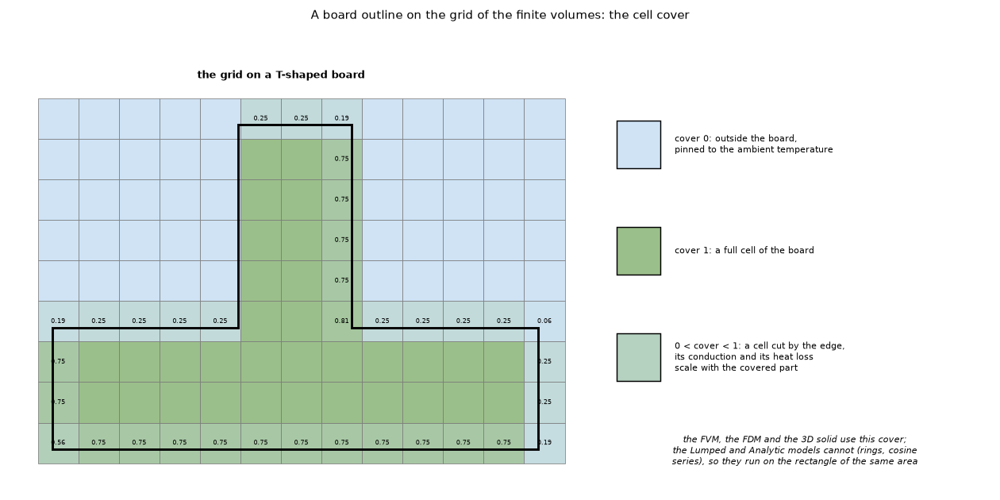

# Lumped and Analytic models on a board with an outline

Status: **implemented** in the program (see the program's `docs/versions.md` and `docs/validation.md`). Studies: `scripts/outline_rectangle_study.py`, `scripts/study_outline_time_constant.py`, `scripts/study_disc_reference.py`, `scripts/study_edge_on_grid_lines.py`; figures: `scripts/make_figures.py`, `scripts/make_diagrams.py`. Reviewed on 2026-10-24 (section 7); numbers re-run after the edge fix of the program (4.6).

## 1. The question

The finite volumes, the finite differences and the 3D solid handle any board outline (cells outside it are pinned to ambient). The Lumped model (rings) and the Analytic model (cosine series) are built on a rectangle. What is the best rectangle to run them on when the board has an outline?

### 1.1 Diagrams and illustrations


*Figure 4 (`figures/fig_04_outline_to_rectangle_schematic.png`): The rule for a board with an outline: the board (a T) with its bounding box, the rectangle of the same area on which the Lumped and Analytic models run (box and positions scaled by the square root of the area ratio, the parts keep their size) and the three steps with the accuracy found.*



*Figure 5 (`figures/fig_05_cells_on_an_outline.png`): a T-shaped board on the finite-volume grid: cells outside the board (cover 0, pinned to ambient), full cells and cells cut by the edge (cover fraction written in the cell).*

## 2. Findings in short

* Run them on the **rectangle of the same area** (`Problem.equivalent_rectangle`: box and positions scaled by √(area ratio), parts keep their size, the field is stretched back over the real box).
* Growing the box outwards (1.1 × the bounding box) is the worst choice in 29 of the 30 model-and-layout cells of the table: more area means more convection, so the board runs 5 to 35 % too cool.
* The bounding box is 6 to 10 % cool on the ellipse with the parts away from the edge and up to 29 % on a T; the same-area rectangle is within 0.4 to 2.9 % away from the edge (ellipse, T at the centre), on either side.
* It fails near the edge of the real board or in the arm of a T: the Lumped model is 6 to 18 % cool there, the Analytic 0 to 16 %. The program says so in a warning in the Results summary.
* Checked against an independent reference (4.5): on a round board with a centred round part, a radial solution of the same layered model puts the FVM within 0.5 % (1 mm cells), the 3D solid within 0.01 %, and the Lumped and Analytic models on the same-area square within +2.2 % and +0.5 % of the maximum rise.
* **A defect found in a later review, now corrected in the program** (4.4): the cells off the board are pinned to ambient with 1 W/K, and that pin was counted in the board time constant, so a round board had 0.02 s instead of 107 s and the step responses of the power profiles stopped at 12 % of the steady resistance. The corrected time constant matches the closed form C/G within 0.1 % on round boards of one, two and four layers.
* **A second defect found in this review, now corrected in the program** (4.6): the FVM and the 3D solid dropped the edge loss of a side of the outline that lies on a grid line with the board on the other side (70 of 240 mm on a T; a T and the same T upside down differed by 0.3 K, the time constant by 1 %), and of the slivers of board that a slanted or curved side leaves in cells taken as off the board (2 to 6.5 % of the perimeter of a disc, an ellipse or a turned square, at every cell size). Corrected by `geometry.edge_length_per_cell` (samples nudged inward) and the new `geometry.edge_length_on_board` (edge of an inactive thin slice moved to the nearest cell on the board), used by the FVM, the FDM and the 3D solid; `docs/validation.md` sections 13 and 20, `CHANGELOG.md` "Outline edge on grid lines and thin slices". The table of 4.2 and the numbers of 4.4 to 4.6 below were re-run on the corrected program. Effect on the table of 4.2: the L row and the ellipse rows move by at most 0.2 points.

## 3. Folder layout

| File | What it is |
| :-- | :-- |
| `scripts/outline_rectangle_study.py` | The study: five outlines, four layouts, three rectangles, error of the lumped and analytic models against the FVM on the real shape. |
| `scripts/study_outline_time_constant.py` | The time constant, the step response and the transient mean of a round board, with the pin of the off-board cells counted (the old rule) and left out, against the closed form C/G (seconds). |
| `scripts/study_disc_reference.py` | Independent reference: the round board solved as a radial (axisymmetric) problem, steady and transient, against every model (section 4.5). |
| `scripts/study_edge_on_grid_lines.py` | The edge loss of an outline side that lies on a grid line (section 4.6). |
| `scripts/make_figures.py` | Draws the data figures (1 to 3 and 6). |
| `scripts/make_diagrams.py` | Draws the schematic diagram and the illustration (figures 4 and 5; no data, no program; uses `research/diagram_kit.py`). |
| `figures/` | `fig_01` to `fig_06`; figures 4 and 5 are the diagram and the illustration (`make_diagrams.py`). |

## 4. How to run, and the results

```sh
.venv/bin/python research/outline/scripts/outline_rectangle_study.py      # prints the table below (about a minute)
.venv/bin/python research/outline/scripts/study_outline_time_constant.py # section 4.4 (about 10 seconds)
.venv/bin/python research/outline/scripts/study_disc_reference.py        # section 4.5 (about 30 seconds)
.venv/bin/python research/outline/scripts/study_edge_on_grid_lines.py    # section 4.6 (about 15 seconds)
.venv/bin/python research/outline/scripts/make_figures.py                 # the data figures (about 30 seconds)
.venv/bin/python research/outline/scripts/make_diagrams.py                # figures 4 and 5
```

### 4.1 The method

`.venv/bin/python research/outline/scripts/outline_rectangle_study.py` prints the table (re-run on the program with the edge fix of 4.6); `tests/test_outline.py` checks that the rectangle of the same area keeps the area, the part sizes and the original problem, and that it beats the bounding box on an ellipse.
Board of the study: the example board, 100 × 80 mm, two parts (5 W and 1.5 W) moved to the positions of the *Parts* column, FVM at 1 mm on the real outline as the reference, lumped and analytic at 1 mm. Error = difference of the maximum temperature divided by the FVM rise above ambient, in percent (negative = too cool), shown as lumped / analytic.


*Figure 1: `figures/fig_01_outlines_and_rectangles.png`.*

### 4.2 The table

| Outline | Parts | Area ratio | FVM Tmax | bounding box | same area (used) | 1.1 × box |
| :-- | :-- | --: | --: | --: | --: | --: |
| ellipse | example | 0.783 | 90.8 | -9.3 / -9.3 | -1.8 / +0.5 | -16.2 / -15.0 |
| ellipse | centre | 0.783 | 114.3 | -7.4 / -5.8 | +0.9 / +2.9 | -9.9 / -11.5 |
| ellipse | off-centre | 0.783 | 104.4 | -10.4 / -8.7 | -2.0 / -0.6 | -15.7 / -13.8 |
| ellipse | near the edge | 0.783 | 119.7 | -16.4 / -14.0 | -10.1 / -5.7 | -21.2 / -19.2 |
| L | near the edge | 0.750 | 115.6 | -12.7 / -10.1 | -6.0 / +0.3 | -17.7 / -15.6 |
| T | example | 0.667 | 109.1 | -29.0 / -29.0 | -17.8 / -16.0 | -34.5 / -33.5 |
| T | centre | 0.667 | 123.4 | -15.9 / -14.5 | -1.7 / -0.4 | -18.2 / -19.7 |
| chamfer | example | 0.964 | 86.4 | -2.9 / -2.9 | -2.8 / -1.8 | -10.3 / -9.1 |
| chamfer | centre | 0.964 | 110.1 | -2.9 / -1.2 | -3.4 / +0.4 | -5.5 / -7.2 |
| chamfer | off-centre | 0.964 | 99.1 | -3.9 / -2.1 | -4.8 / -0.8 | -9.6 / -7.6 |
| chamfer | near the edge | 0.964 | 112.6 | -9.6 / -7.0 | -9.7 / -5.7 | -14.8 / -12.7 |
| rounded | example | 0.984 | 86.1 | -2.3 / -2.3 | -3.0 / -2.0 | -9.8 / -8.5 |
| rounded | centre | 0.984 | 109.8 | -2.5 / -0.8 | -5.5 / -0.3 | -5.2 / -6.8 |
| rounded | off-centre | 0.984 | 98.6 | -3.3 / -1.6 | -5.0 / -0.9 | -9.1 / -7.1 |
| rounded | near the edge | 0.984 | 112.0 | -9.1 / -6.4 | -10.3 / -5.8 | -14.2 / -12.1 |

* Enlarging the box (the idea of growing outwards) is the worst choice in 29 of the 30 model-and-layout cells (5 to 35 % too cool: more area means more convection); the exception is the Lumped model on the rounded board with the parts at the centre (-5.5 on the same-area box against -5.2). Shrinking to the same area is the best on average (mean absolute error, Lumped / Analytic: bounding box 9.2 / 7.7 %, same area 5.7 / 2.9 %, 1.1 × box 14.1 / 13.3 %). The error of the same-area box is mostly on the cool side but not always: +0.8 / +2.9 (ellipse, centre), +0.4 (Analytic: ellipse example, chamfer centre), +0.1 (Analytic: L near the edge). *(Corrected in the review: the earlier text said "worst in every row", "10 to 20 %" and "always on the cool side", which the table does not support.)*
* For a strongly cut shape (ellipse, L, T; area ratio below 0.8) the bounding box ignores 22 to 33 % of the board and is 6 to 29 % cool; the same-area rectangle brings parts away from the edge (ellipse example, centre, off-centre; T centre) to within 0.4 to 2.9 %.
* Where it fails: a part near the edge of the real board or in the arm of a T has less board to spread into than the scaled rectangle gives it: Lumped 6 to 18 % cool, Analytic 0 to 16 % (the Analytic is within 0.1 % on the L and 6 % on the ellipse, chamfer and rounded boards; both are 16 to 18 % cool on the T example). For nearly rectangular outlines (chamfer, rounded: area ratio above 0.95) the three boxes differ by a few percent either way and the same-area box is not better than the bounding box (Lumped 3 to 5.5 % cool away from the edge). Scaling about the area centroid of the outline instead of the box centre gave no consistent gain (tried, not kept; no script reproduces it, not re-checked in the review).
* The FVM reference of the earlier version of this table dropped part of the edge loss (4.6): with the edge counted the L row reads -6.0 / +0.3 (FVM 115.6 °C) instead of -6.2 / +0.1 (115.8 °C), the ellipse rows moved by at most 0.2 points and the T, chamfer and rounded rows did not change. The table above is the corrected one.
* Not covered: parts in the cut region (they are off the board), holes, outlines with more than one lobe, and the time simulation (not available for these two models on an outline).


*Figure 3: `figures/fig_03_lumped_error_by_rectangle.png` (the lumped half of the table; regenerated in the review).*

### 4.3 One case in pictures

The T-shaped board with the parts at the centre (FVM, 1 mm cells, same colour scale): the real shape has Tmax 123.4 °C and its same-area rectangle 122.7 °C (the FVM itself on the rectangle, 1.0 % of the rise cool; printed in the figure titles by `make_figures.py`); the black cells of the left map are off the board. The parts sit on the line where the arm meets the bar.


*Figure 2: `figures/fig_02_t_outline_maps.png`.*

### 4.4 The time constant of a board with an outline (a defect, corrected)

The FVM and the FDM keep a cell (node) for every point of the box; the cells off the board carry no heat and are pinned to the ambient with 1 W/K so that the matrix stays regular. The board time constant `τ = ΣC / ΣG` sets the length of the step responses that the power profiles use to decide between the average and the resolved power (ten time constants) and the animation length the application offers (five). The pin was counted in `ΣG`; it is now kept apart (`g_pin`) and left out (`fvm.board_time_constant`). `scripts/study_outline_time_constant.py`, a 60 mm board with full copper and 2 W on 6 × 6 mm, 2 mm cells; the closed form is the heat capacity of the copper and the laminate over `(h_top + h_bottom) A + h_side t P` (area A, perimeter P):

| board | τ, pin counted (before) | τ (now) | closed form C/G |
| :-- | --: | --: | --: |
| square 60 × 60 mm | 106.99 s | 107.0 s | 107.0 s |
| round, 59.8 mm across | 0.02 s | 107.0 s | 107.0 s |
| one layer, square | 104.60 s | 104.6 s | 104.6 s |
| one layer, round | 0.02 s | 104.6 s | 104.6 s |
| four layers, square | 111.78 s | 111.8 s | 111.8 s |
| four layers, round | 0.01 s | 111.8 s | 111.8 s |

The one-layer board (laminate nodes) and the four-layer board carry the pin on every node of an off-board cell; it is left out in both.

| step response of the round board | end | steady resistance | end / steady |
| :-- | --: | --: | --: |
| FVM, now | 1070 s, 30.452 K/W | 30.452 K/W | 1.0000 |
| FDM, now | 1070 s, 30.472 K/W | 30.472 K/W | 1.0000 |
| FVM with the old length (0.2 s) | 3.670 K/W | 30.452 K/W | 0.1205 |

The transient mean counted the cells off the board at the ambient too: at 600 s it read 47.39 °C for the round board against 52.37 °C for the board itself (40 output frames; it is now weighted by the board area of every cell). *(Corrected in the review: the earlier 46.84 / 51.71 °C came from 10 frames, whose last doubling step is 300 s long, and were about 3 % low on the rise; 4.5 measures this. Re-run after the edge fix of 4.6: the round board lost 3 % of its edge before, so its time constant read 107.1 s, its steady resistance 30.464 K/W and its transient mean 47.41 / 52.39 °C; with the whole edge counted they are 107.0 s, 30.452 K/W and 47.39 / 52.37 °C, equal to the closed form.)* The square and the round board have the same time constant because the face loss scales with the area and the edge loss with the perimeter, and the inscribed circle has the same perimeter-to-area ratio as the square (4/D); a T of the same box has a shorter one (104.85 s in closed form, 4.6; before the edge fix the program read 106.72 s). *(The earlier text said only "both scale with the board area", which leaves out the edge.)* Regression tests in `tests/test_outline.py`.


*Figure 6: `figures/fig_06_outline_time_constant.png`: left, the round board on its 2 mm grid (grey cells are off the board and pinned); middle, the time constant of the square and the round board, pin counted and left out; right, the step response of the round board, full length and cut at 0.2 s.*

### 4.5 An independent reference: the round board as a radial problem

A round board with a round part at its centre is axisymmetric, so the layered model of the program (two copper sheets coupled through the dielectric, films on the faces, an edge film on the rim; `docs/theory.md`) reduces to two coupled equations in the radius. `scripts/study_disc_reference.py` solves them with its own radial finite volumes (2000 to 8000 rings give the same digits), which share neither the program's square grid, nor its cover fractions, nor its edge rule. Board: 80 mm across, two layers of full copper (35 µm), 1.6 mm, h 10 / 15 / 10 W/m²K (top, bottom, edge), part of 2 W and 4 mm radius (both circles are 128-gons of the same area in the program).

| model | cells | max rise (K) | error | mean rise (K) | error |
| :-- | --: | --: | --: | --: | --: |
| radial reference | 2000 rings | 50.457 | | 15.616 | |
| FVM, real outline | 1 mm | 50.197 | -0.52 % | 15.611 | -0.03 % |
| FVM, real outline | 0.5 mm | 50.378 | -0.16 % | 15.615 | -0.00 % |
| FDM, real outline | 1 mm | 50.201 | -0.51 % | 15.616 | +0.00 % |
| FDM, real outline | 0.5 mm | 50.378 | -0.16 % | 15.616 | +0.00 % |
| 3D solid, real outline | 1 mm | 50.449 | -0.02 % | 15.620 | +0.03 % |
| Lumped, same-area square | 1 mm | 51.577 | +2.22 % | 15.691 | +0.49 % |
| Analytic, same-area square | 1 mm | 50.687 | +0.46 % | 16.034 | +2.68 % |

* The FVM reference of 4.2 converges to the radial solution (-0.5 % at 1 mm, -0.2 % at 0.5 mm; the mean rise within 0.03 %, it was within 0.1 % before the edge fix), and the 3D solid, which resolves the thickness, agrees within 0.02 %: on this board the layered idealisation and the cover fractions of the cut cells cost nothing measurable.
* With the part at the centre the same-area square is slightly warm (Lumped +2.2 %, Analytic +0.5 % of the maximum rise; the Lumped and Analytic numbers did not move), in line with the ellipse-centre row of 4.2 (+0.8 / +2.9 %).
* Time constant: closed form 108.10 s, program 108.10 s (2 mm cells) and 108.10 s (1 mm); before the edge fix 108.18 and 108.21 s (the lost sliver of the edge). Board mean rise 600 s after the step: radial implicit Euler with a 0.05 s step 15.554 K, program FVM with a constant 1 s step 15.548 K (15.561 before the edge fix), program FVM with the doubling step and 10 frames 15.060 K (3.2 % low: a time-step error of that setting, not of the outline).

### 4.6 The edge loss of the outline: two defects of the program, now corrected

**What was wrong.** `geometry.edge_length_per_cell` gave every sample of the outline to the cell that contains it, and the FVM and the 3D solid multiplied the result by `active`. Two things dropped edge loss: (1) a side that lies on a grid line with the board on the other side was given (by the floor and by rounding) to a cell off the board; (2) a slanted or curved side leaves slivers of board in cells that the cover sub-samples take as off the board, and the edge in them was dropped too. The FDM shifts the outline by half a cell and was not affected by (1).

**What was corrected, and by which change.** The program now nudges every sample a thousandth of a cell towards the inside of the board (`geometry.edge_length_per_cell`) and moves the edge of cells taken as off the board to the nearest cell on the board (`geometry.edge_length_on_board`, split equally between equally near cells so that mirror images stay mirror images); the FVM, the FDM and the 3D solid use it (`docs/validation.md` sections 13 and 20, `CHANGELOG.md` "Outline edge on grid lines and thin slices", `tests/test_outline.py`). The first part is what this folder proposed (a prototype of the inward nudge); the second (thin slices) was found afterwards in the program's own review and is not in this folder's earlier text.

`scripts/study_edge_on_grid_lines.py` now measures the current program (it used to patch `fvm.edge_length_per_cell`, which no longer exists) and reproduces the old behaviour with a local function `edge_before` (the old assignment copied into the script; the program is not patched). It reads the perimeter back from the `g_side` array of the FVM network, on a T (60 mm box, sides at 0, 20, 30, 40, 60 mm, all on the 1 and 2 mm grid lines) and on the same T upside down:

| board | cells | real perimeter | counted by the FVM, old rule | counted now | τ closed form | τ FVM, old rule | τ FVM now |
| :-- | :-- | --: | --: | --: | --: | --: | --: |
| T | 2 and 1 mm | 240 mm | 170 mm | 240 mm | 104.85 s | 106.72 s | 104.85 s |
| T upside down | 2 and 1 mm | 240 mm | 210 mm | 240 mm | 104.85 s | 105.64 s | 104.85 s |

The "old rule" columns are the local copy of the old assignment applied to the cells of the current network (the old time constant is the same capacity over the conductance with that edge length); they equal what the review measured on the old program (170 of 240 mm, 106.72 s). Thin slices, the same measurement on shapes that are not on grid lines (perimeter lost by the old rule, from the same script):

| shape | real perimeter | counted now | counted by the old rule | lost before |
| :-- | --: | --: | --: | --: |
| disc 59.8 mm (128-gon), 2 mm cells | 187.8 mm | 187.8 mm | 182.0 mm | 3.1 % |
| disc 59.8 mm (128-gon), 1 mm cells | 187.8 mm | 187.8 mm | 181.6 mm | 3.3 % |
| ellipse 60 × 40 mm, 1 mm cells | 158.0 mm | 158.0 mm | 156.9 mm | 0.7 % |
| square 40 mm turned 20°, 1 mm cells | 160.0 mm | 160.0 mm | 156.4 mm | 2.2 % |

(The program's own review reports 2 to 6.5 % over discs, ellipses and squares turned by 3 to 45°; this script prints four shapes and finds 0.7 to 3.3 %, so the upper end of that range is not reproduced here.) The temperatures on the current program, 1 mm cells:

| board, 1 mm | FVM Tmax | FDM | 3D solid | 3D solid, sum of the side conductances |
| :-- | --: | --: | --: | --: |
| T | 93.009 °C | 92.944 °C | 93.393 °C | 0.003820 W/K |
| T upside down | 93.009 °C | 92.944 °C | 93.393 °C | 0.003820 W/K |

* Before the correction (measured by the review on the old program, on a copy of the rule; not recomputed now because that needs the old code): FVM 93.474 °C (T) and 93.167 °C (T upside down), 3D solid 93.854 and 93.550 °C, FDM 92.944 °C for both. The mirror images differed by 0.31 K (0.5 % of the rise) in the FVM and the 3D solid and not in the FDM. Now the two mirror images agree to the last digit in all three models, the FVM equals the value of the review's inward-rule prototype (93.009 °C), the 3D solid too (93.393 °C), and the time constant equals the closed form to the digit.
* Effect on this study: the row "L, near the edge" has FVM 115.64 °C and errors -6.0 / +0.3 (it was 115.8 °C and -6.2 / +0.1); the T rows (sides at 33.3 and 66.7 mm and at 40 mm) do not move (109.06 and 123.38 °C). The ellipse rows move by at most 0.2 points; the chamfer and rounded rows do not move (their straight sides are on the box, where the index is clipped back onto the board).
* The size was small with the default edge film (10 W/m²K on 1.6 mm), and larger with a thick board, a large edge coefficient or a small board (the program's review: the round board of 80 mm with an edge film of 100 W/m²K had a time constant 0.8 % high and a board mean rise 0.64 % high).

## 5. Limits of this study

* One board (the example board), two parts, five outline presets; the numbers are for those layouts, not a guarantee.
* The reference is the FVM at 1 mm, not a measurement; the FVM, FDM and 3D solid agree on the example board to within about 1 % (`docs/validation.md` section 1), and on a round board the FVM is within 0.5 % of an independent radial solution (4.5), so the choice of reference does not change the ranking. The FVM used to drop part of the edge loss of the outline (4.6, corrected in the program); the table of 4.2 is the one re-run after the correction.
* Not covered: parts in the cut region, holes, outlines with several lobes; the time simulation only through the time constant, the step response and the transient mean of one round board (4.4).

## 6. Sources

Own computation only; no literature was used for this study. The independent references of the review are closed forms (C/G of a uniform board) and an own axisymmetric solution of the same layered model (4.5).

## What was read and what was not verified

* Not verified: no physical board measurement; the study uses one board and two parts.
* Not implemented: scaling about the area centroid of the outline (tried, no consistent gain), parts inside the cut region, holes.
* Reproduced for the time constant (4.4): the square and the round board give the same time constant once the pin is left out (107.0 and 107.1 s), and the step response of the round board ends on its steady resistance to four digits in the FVM and the FDM; the old values are recomputed from the same network (the pin counted), not from the old code.
* Checked in the review against independent references: the time constant against the closed form C/G (one, two and four layers, round and square, within 0.1 %; a T within 0.0 % now that the edge rule of 4.6 is corrected in the program), the steady field of a round board against a radial solution (4.5), the transient board mean against a radial implicit Euler (4.5).
* Not reproduced: the claim that scaling about the area centroid gave no consistent gain (no script). Not checked: the stretch of the field back over the real box (the maps of the Lumped and Analytic models on an outline), beyond the maximum and the mean.

## 7. Review (2026-10-24)

Independent review by the reviewer agent, on the program at `0ea5f07` (merged into this branch). Every script was re-run; the numbers of sections 4.2 to 4.6 are the ones they print now.

* **Stale numbers** in the table of 4.2 after the corrections of the program: T centre, Lumped on the same-area box 0.0 -> -1.7 % (the minimum ring width of the Lumped model), ellipse centre +0.9 -> +0.8, T centre bounding box -16.0 -> -15.9, chamfer centre -3.5 -> -3.4; figure 3 regenerated. The transient mean of 4.4 (46.84 / 51.71 °C) came from a 300 s last time step; the study now uses 40 frames (47.41 / 52.39 °C).
* **Claims the table contradicted**: "the 1.1 × box is the worst in every row" (29 of 30 cells), "10 to 20 % too cool" (5 to 35 %), "the error is always on the cool side" (five cells are warm, up to +2.9 %), "10 to 18 % cool near the edge" (true for the Lumped model only, the Analytic is 0 to 16 %), "within 0.2 to 3 %" (0.4 to 2.9 %), "ignores 20 to 33 %" (22 to 33 %). Corrected here and in the diagram of figure 4 (`make_diagrams.py`; regenerated, it falls back to the default Matplotlib font on this machine); figure 5 is unchanged.
* **An explanation never tested**: "the square and the round board have the same time constant because both scale with the area" leaves out the edge loss; it holds because the inscribed circle has the perimeter-to-area ratio of the square. Tested with a T (4.6).
* **New independent checks**: the closed form C/G (4.4), a radial solution of the round board, steady and transient (4.5).
* **A defect of the program found** (4.6): the edge loss of outline sides on grid lines in the FVM and the 3D solid. Measured on a copy (research branch). **Now corrected in the program** by `geometry.edge_length_per_cell` (inward nudge) and `geometry.edge_length_on_board` (thin slices), see the follow-up below.
* The same stale ranges ("10 to 20 %", "0.2 to 3 %", "10 to 18 %", "always on the cool side") are in `docs/validation.md` section 13, `docs/theory.md` (Lumped and Analytic on an outline) and the docstring of `Problem.equivalent_rectangle`: replacement text in `docs/for-the-project-documents.md`. The theory topic `research/theory/topics/20-board-outline.md` repeats them (left to the review of that folder).
* The folder has no `IMPLEMENTED.md` and no `LOG.md` (the layout of `CLAUDE.md` asks for them); where the work lives in the program is in section 4.4 and in `docs/versions.md`. Left to the maintainer, as in the other folders.

### Follow-up after the correction of the program

* `develop` was merged into this branch with the edge fix. `scripts/study_edge_on_grid_lines.py` patched the removed `fvm.edge_length_per_cell` and raised `AttributeError`; it was rewritten to measure the current program and to reproduce the old assignment with a local function (4.6).
* Re-run on the corrected program: `outline_rectangle_study.py`, `study_outline_time_constant.py`, `study_disc_reference.py`, `study_edge_on_grid_lines.py`, `make_figures.py` (figures 3 and 6 regenerated; figure 2 is unchanged at the pixel level). Numbers that moved: the L row and the ellipse rows of 4.2 (at most 0.2 points; mean absolute error of the 1.1 × box 14.2 -> 14.1 % for the Lumped model), the round-board values of 4.4 (107.1 -> 107.0 s, 30.464 -> 30.452 K/W, 47.41 / 52.39 -> 47.39 / 52.37 °C) and of 4.5 (FVM 50.208 -> 50.197 K at 1 mm, 50.391 -> 50.378 K at 0.5 mm, the 3D solid 50.460 -> 50.449 K, the time constant 108.18 / 108.21 -> 108.10 s).
* What was wrong in this folder: the "not corrected" statement of 4.6 and the section 2 summary were true only before the program's correction; the program's correction is wider than the proposal (it also handles thin slices of curved sides, which this folder had not found), so the range "70 of 240 mm" described only the grid-line case.
* Not reproduced: the lost edge of 2 to 6.5 % over many outlines (the program's own sweep); this script covers four shapes (0.7 to 3.3 %). The temperatures of the old program in 4.6 are the review's, not recomputed.
