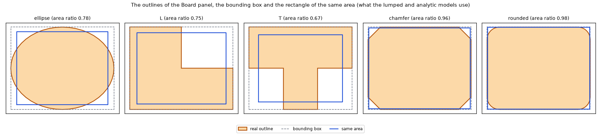
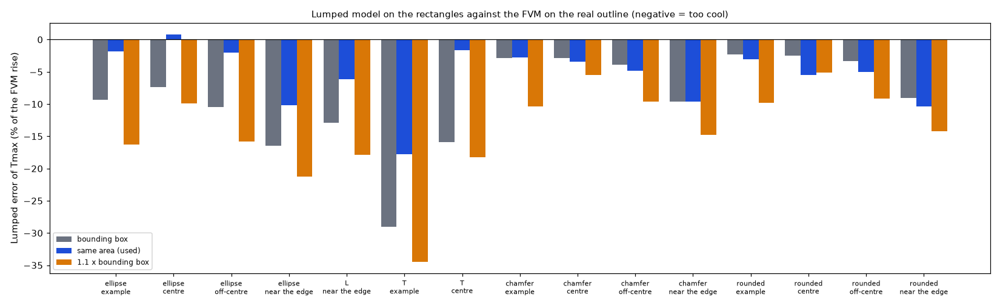
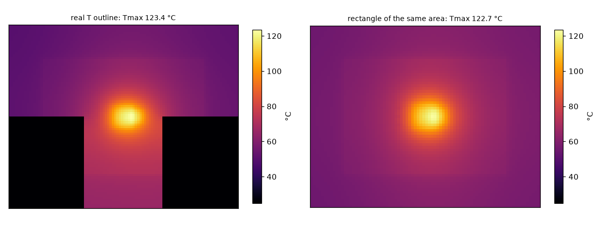
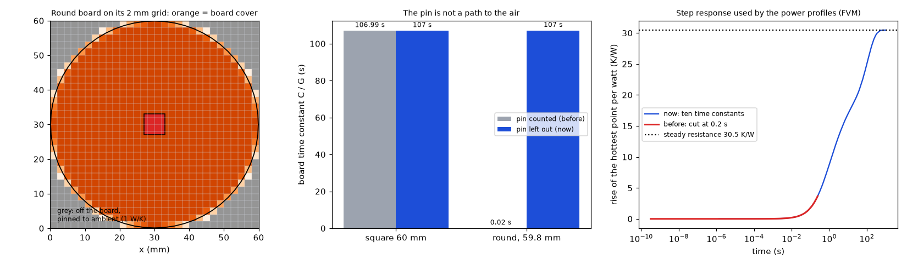

# Lumped and Analytic models on a board with an outline

Status: **implemented** in the program (see `IMPLEMENTED.md`). Investigated on 2026-10-22; moved to this folder on 2026-10-23. Studies: `outline_rectangle_study.py`; figures: `make_figures.py`.

## 1. The question

The finite volumes, the finite differences and the 3D solid handle any board outline (cells outside it are pinned to ambient). The Lumped model (rings) and the Analytic model (cosine series) are built on a rectangle. What is the best rectangle to run them on when the board has an outline?

## 2. Findings in short

* Run them on the **rectangle of the same area** (`Problem.equivalent_rectangle`: box and positions scaled by √(area ratio), parts keep their size, the field is stretched back over the real box).
* Growing the box outwards (1.1 × the bounding box) is the worst choice everywhere: more area means more convection, so the board runs 10 to 20 % too cool.
* The bounding box is 6 to 10 % cool on a circle and up to 29 % on a T; the same-area rectangle is within 0.2 to 3 % away from the edge.
* It fails near the edge of the real board or in the arm of a T (10 to 18 % cool). The program says so in a warning in the Results summary.
* **A defect found in a later review, now corrected in the program** (4.4): the cells off the board are pinned to ambient with 1 W/K, and that pin was counted in the board time constant, so a round board had 0.02 s instead of 107 s and the step responses of the power profiles stopped at 12 % of the steady resistance.

## 3. Folder layout

| File | What it is |
| :-- | :-- |
| `scripts/outline_rectangle_study.py` | The study: five outlines, four layouts, three rectangles, error of the lumped and analytic models against the FVM on the real shape. |
| `scripts/study_outline_time_constant.py` | The time constant, the step response and the transient mean of a round board, with the pin of the off-board cells counted (the old rule) and left out (seconds). |
| `scripts/make_figures.py` | Draws the four figures. |
| `figures/` | `fig_01` to `fig_04`. |
| `IMPLEMENTED.md`, `LOG.md` | Where it lives in the program; what was read and how. |

## 4. How to run, and the results

```sh
.venv/bin/python research/outline/scripts/outline_rectangle_study.py      # prints the table below (several minutes)
.venv/bin/python research/outline/scripts/study_outline_time_constant.py # section 4.4 (about 20 seconds)
.venv/bin/python research/outline/scripts/make_figures.py                 # the figures (about 3 minutes)
```

### 4.1 The method

`python research/outline/scripts/outline_rectangle_study.py` prints the table; `tests/test_outline.py` checks that the rectangle of the same area keeps the area, the part sizes and the original problem, and that it beats the bounding box on an ellipse.
Board of the study: the example board, 100 × 80 mm, two parts (5 W and 1.5 W) moved to the positions of the *Parts* column, FVM at 1 mm on the real outline as the reference, lumped and analytic at 1 mm. Error = difference of the maximum temperature divided by the FVM rise above ambient, in percent (negative = too cool), shown as lumped / analytic.



*Figure 1: `figures/fig_01_outlines_and_rectangles.png`.*

### 4.2 The table

| Outline | Parts | Area ratio | FVM Tmax | bounding box | same area (used) | 1.1 × box |
| :-- | :-- | --: | --: | --: | --: | --: |
| ellipse | example | 0.783 | 90.8 | -9.3 / -9.3 | -1.9 / +0.4 | -16.3 / -15.1 |
| ellipse | centre | 0.783 | 114.3 | -7.4 / -5.8 | +0.9 / +2.9 | -9.9 / -11.5 |
| ellipse | off-centre | 0.783 | 104.4 | -10.4 / -8.8 | -2.0 / -0.6 | -15.8 / -13.9 |
| ellipse | near the edge | 0.783 | 119.7 | -16.5 / -14.0 | -10.2 / -5.8 | -21.2 / -19.3 |
| L | near the edge | 0.750 | 115.8 | -12.9 / -10.3 | -6.2 / +0.1 | -17.8 / -15.8 |
| T | example | 0.667 | 109.1 | -29.0 / -29.0 | -17.8 / -16.0 | -34.5 / -33.5 |
| T | centre | 0.667 | 123.4 | -16.0 / -14.5 | +0.0 / -0.4 | -18.2 / -19.7 |
| chamfer | example | 0.964 | 86.4 | -2.9 / -2.9 | -2.8 / -1.8 | -10.3 / -9.1 |
| chamfer | centre | 0.964 | 110.1 | -2.9 / -1.2 | -3.5 / +0.4 | -5.5 / -7.2 |
| chamfer | off-centre | 0.964 | 99.1 | -3.9 / -2.1 | -4.8 / -0.8 | -9.6 / -7.6 |
| chamfer | near the edge | 0.964 | 112.6 | -9.6 / -7.0 | -9.7 / -5.7 | -14.8 / -12.7 |
| rounded | example | 0.984 | 86.1 | -2.3 / -2.3 | -3.0 / -2.0 | -9.8 / -8.5 |
| rounded | centre | 0.984 | 109.8 | -2.5 / -0.8 | -5.5 / -0.3 | -5.2 / -6.8 |
| rounded | off-centre | 0.984 | 98.6 | -3.3 / -1.6 | -5.0 / -0.9 | -9.1 / -7.1 |
| rounded | near the edge | 0.984 | 112.0 | -9.1 / -6.4 | -10.3 / -5.8 | -14.2 / -12.1 |

* Enlarging the box (the idea of growing outwards) is the worst choice in every row: more area means more convection, so the board runs 10 to 20 % too cool. Shrinking to the same area is the best on average, and the error is always on the cool side.
* For a strongly cut shape (ellipse, L, T; area ratio below 0.8) the bounding box ignores 20 to 33 % of the board and is 6 to 29 % cool; the same-area rectangle brings parts away from the edge to within 0.2 to 3 %.
* Where it fails: a part near the edge of the real board or in the arm of a T has less board to spread into than the scaled rectangle gives it (10 to 18 % cool). For nearly rectangular outlines (chamfer, rounded: area ratio above 0.95) the three boxes differ by a few percent either way and the same-area box is not better than the bounding box (lumped 3 to 5 % cool). Scaling about the area centroid of the outline instead of the box centre gave no consistent gain (tried, not kept).
* Not covered: parts in the cut region (they are off the board), holes, outlines with more than one lobe, and the time simulation (not available for these two models on an outline).



*Figure 3: `figures/fig_03_lumped_error_by_rectangle.png` (the lumped half of the table).*

### 4.3 One case in pictures

The T-shaped board with the parts at the centre (FVM, 1 mm cells, same colour scale): the real shape has Tmax 123.4 °C and its same-area rectangle 122.7 °C; the black cells of the left map are off the board.



*Figure 2: `figures/fig_02_t_outline_maps.png`.*

### 4.4 The time constant of a board with an outline (a defect, corrected)

The FVM and the FDM keep a cell (node) for every point of the box; the cells off the board carry no heat and are pinned to the ambient with 1 W/K so that the matrix stays regular. The board time constant `τ = ΣC / ΣG` sets the length of the step responses that the power profiles use to decide between the average and the resolved power (ten time constants) and the animation length the application offers (five). The pin was counted in `ΣG`; it is now kept apart (`g_pin`) and left out (`fvm.board_time_constant`). `scripts/study_outline_time_constant.py`, a 60 mm two-layer board with full copper and 2 W on 6 × 6 mm, 2 mm cells:

| board | τ, pin counted (before) | τ (now) |
| :-- | --: | --: |
| square 60 × 60 mm | 106.99 s | 107.0 s |
| round, 59.8 mm across | 0.02 s | 107.1 s |

| step response of the round board | end | steady resistance | end / steady |
| :-- | --: | --: | --: |
| FVM, now | 1071 s, 30.464 K/W | 30.464 K/W | 1.0000 |
| FDM, now | 1070 s, 30.472 K/W | 30.472 K/W | 1.0000 |
| FVM with the old length (0.2 s) | 3.670 K/W | 30.464 K/W | 0.1205 |

The transient mean counted the cells off the board at the ambient too: at 600 s it read 46.84 °C for the round board against 51.71 °C for the board itself; it is now weighted by the board area of every cell. The square and the round board have the same time constant because heat capacity and loss both scale with the board area. Regression tests in `tests/test_outline.py`.



*Figure 4: `figures/fig_04_outline_time_constant.png`: left, the round board on its 2 mm grid (grey cells are off the board and pinned); middle, the time constant of the square and the round board, pin counted and left out; right, the step response of the round board, full length and cut at 0.2 s.*

## 5. Limits of this study

* One board (the example board), two parts, five outline presets; the numbers are for those layouts, not a guarantee.
* The reference is the FVM at 1 mm, not a measurement; the FVM, FDM and 3D solid agree on the example board to within about 1 % (`docs/validation.md` section 1), so the choice of reference does not change the ranking.
* Not covered: parts in the cut region, holes, outlines with several lobes; the time simulation only through the time constant, the step response and the transient mean of one round board (4.4).

## 6. Sources

Own computation only; no literature was used for this study.
