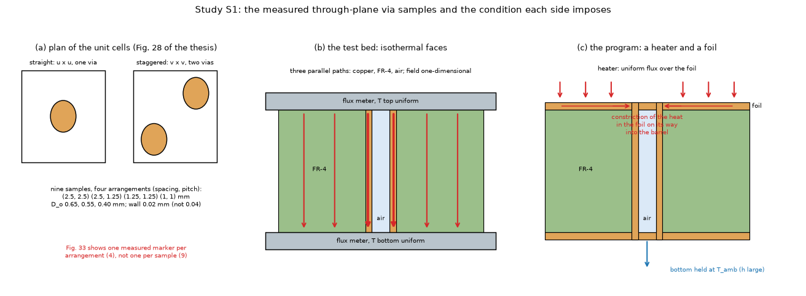
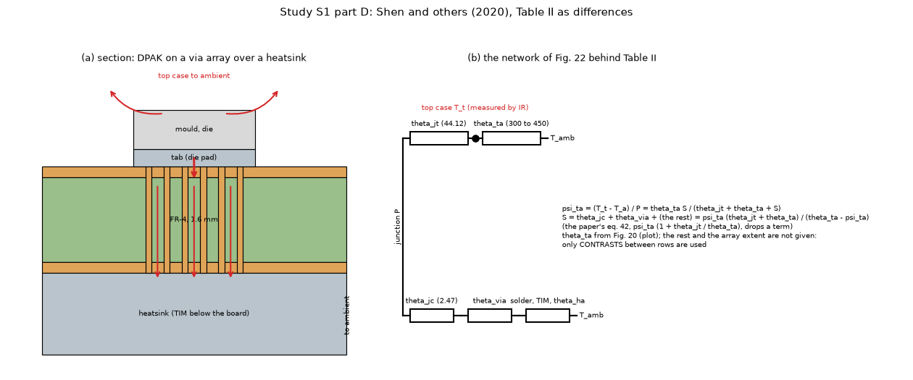
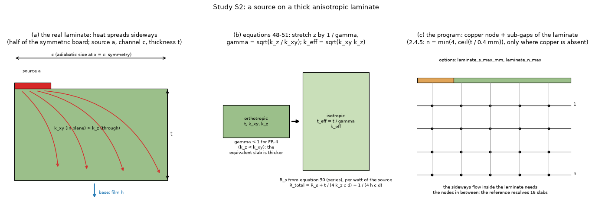
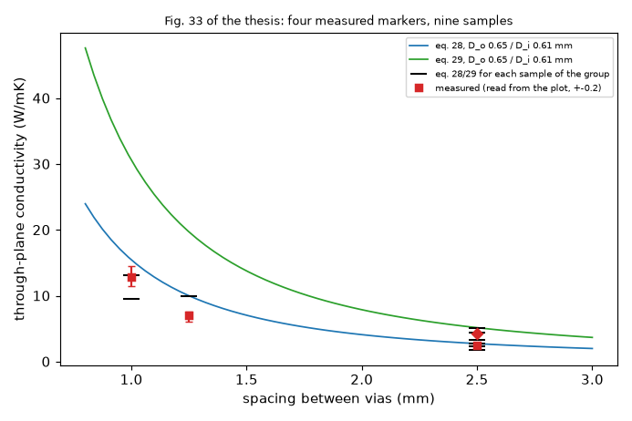

# Paper case studies: measured vias and the thick anisotropic laminate

Status: **planned and written, not run.** This folder holds two studies, their independent references, their tests and their drawings, prepared while the 2.5.0 work was closing; the runs wait for a quiet machine and for the reviewer to read this folder first. What exists below as a number was computed by a closed form or a unit test in seconds (marked "closed form" or "test"); no study script has been run, and every verdict in section 3 is written before any result exists.

The two studies are the ones of `research/theory-sources/PLAN-PAPER-STUDIES.md` that compare the program with a **measurement** (S1 here, B2 there) and with a **published closed form on a thick anisotropic laminate** (S2 here, A2 there). The numbers S1 and S2 follow the request that opened this folder; the plan numbers them the other way round.

## 1. The questions

**S1, measured vias.** The program's via treatment (the barrel in a footprint of cells, a Peaceman well, Kron reduction; `docs/theory.md` 2.6) has been checked against idealised references (a 12 x 12 array, a unit-cell solver, a 3D solid) and against a published CFD number, never against a measurement. Two measurements are held: the through-plane conductivity of nine round PCB samples with via arrays (Soleymani Koohbanani 2016, Fig. 33: a plot only) and the top-case temperatures of a DPAK diode on via arrays of four diameters, two patterns and two fillers (Shen and others 2020, Table II: printed numbers). The question: **how far are the five models from a measured through-plane via result, once the measurement itself has been checked by an independent solver?** It informs whether `docs/validation.md` can carry a first statement against a measurement, and whether the barrel rule or the plating default needs a note.

**S2, thick anisotropic laminate.** The laminate sub-gap rule of 2.4.5 (at most 4 sub-gaps of 0.4 mm between copper nodes, only where copper is absent next to a gap) was chosen against our own resolved 3D reference, which gave -18.44 % to -3.07 % (1.6 mm) and -34.19 % to -9.13 % (3.2 mm) for a 6 mm window (`research/laminate-nodes`). That reference has never been checked against a published number. The question: **is the error real (a published closed form for a source on an orthotropic channel agrees with the reference), and do the new options (`laminate_s_max_mm`, `laminate_n_max`) remove it?** It informs whether the rule stays, its constants change, or only the limit text in theory 1.4 grows.

### 1.1 Diagrams of the situations

*Figure 01 (`fig_01_via_cell_and_boundary_conditions.png`). (a) Plan of the straight and staggered unit cells and what Table 9 and Fig. 33 hold. (b) The test bed of the thesis: both faces on metal flux meters, so the field is one-dimensional and the three paths (copper, FR-4, air) are in parallel. (c) The only condition the program can impose: a heater over the face, the heat enters a copper foil and converges on the barrel (the red constriction), the bottom held at the ambient.*

*Figure 02 (`fig_02_shen_diode_on_vias.png`). (a) Section of the DPAK on the via array over a heatsink, the heat paths through the vias and from the top case. (b) The network of equation 42; the numbers are those printed in the text (44.12 and 2.47 degC/W); the others are not given, which is why only contrasts between rows are used.*

*Figure 03 (`fig_03_thick_laminate_and_nodes.png`). (a) The real heat paths in the laminate under a small source. (b) The orthotropic transformation of equations 48 to 51: stretching z by 1 / gamma makes the problem isotropic with k_eff and t_eff. (c) The program's nodes: one copper node and n sub-gaps of the laminate.*

*Figure 04 (`fig_04_fig33_markers_against_eq28.png`, `make_figures.py`, closed form and plotted markers only). The black ticks are equations 28 and 29 for each sample of the group (Table 9 diameters); the red markers are the measurement read from the plot of Fig. 33. The straight 1.25 mm marker lies far below its sample (section 5).*

## 2. What the sources say (read for this plan)

### 2.1 Soleymani Koohbanani (2016), chapter 3 (thesis pages 56 to 64; PDF pages 73 to 81)

* Equations 17 to 29 are images: **read from the page images** (PDF pages 75 and 76, thesis pages 58 and 59). Equation 28 (straight) and 29 (staggered): `k = [k_FR4 (u^2 - pi/4 D_o^2) + k_Cu pi/4 (D_o^2 - D_i^2) + k_air pi/4 D_i^2] / u^2`, with pi/2 and v for the staggered cell (two vias). The thesis states that k_overall does not depend on the thickness (true only without a copper foil, section 4.1).
* Table 9 (page 60) lists nine samples (spacing, pitch, inner diameter, outer diameter, "copper barrel thickness"). The last column, 0.04 mm for every row, is the **difference of the two diameters** (0.65 - 0.61), so the wall is **0.02 mm**; a test checks this. Four arrangements: (2.5, 2.5), (2.5, 1.25), (1.25, 1.25), (1, 1) mm. The thickness of the board, the number of copper layers and whether a foil is on the faces are **not stated** in the pages read. The sample is a round disc of 25.4 mm in a guarded heat-flux-meter test bed.
* Table 10 (page 61) is the thesis's own COMSOL benchmark: FR-4 0.33, copper 385 W/mK, isothermal top (323 K) and bottom (303 K), sides insulated; the thesis finds its analytical model within 13 % of the experiment and 9 % of the numerical result (page 62, text).
* **Fig. 33 (page 63) is the only place the measurements are**: a plot of k (W/mK) against the spacing. By pixel read of the page image at 4x, **there are four measured markers, not nine** (one per arrangement; the other markers of the figure are the thesis's own numerical simulation and analytical model): straight 1.0 mm 12.9 (error bar about 11.5 to 14.5), straight 1.25 mm 7.0 (about 6.1 to 7.6), straight 2.5 mm 2.5, staggered 2.5 mm 4.3 (the diamond is partly hidden by a triangle, so its centroid is biased). All "plot", reading uncertainty +-0.2 W/mK (`lib/measured_data.py`).

### 2.2 Shen and others (2020), section IV and Table II (manuscript page 17)

* Table II (printed numbers, read in full): top-case temperature T_t and psi_ta = (T_t - T_a) / P of the DPAK diode VS-6EWL06FN-M3 at 2.8 W, for Pattern I with solder filling, Pattern II with air, Pattern I with air, at via diameters 0.2, 0.25, 0.4, 0.8 mm. Example: Pattern I, air, 0.25 mm: 74.1 degC, 17.5 degC/W.
* **Derived, not printed**: (T_t - psi P) is 25.0 in every one of the twelve cells (a test, tolerance 0.06 degC/W for the rounding), so the ambient of the experiment is 25 degC.
* The text gives the package numbers theta_jc = 2.47 and theta_jt = 44.12 degC/W (CFD) and equation 42, `theta_via = psi_ta (1 + theta_jt/theta_ta) - theta_jc - theta_solder - theta_TIM - theta_ha`. It does **not** give theta_ta (equation 39 with the package dimensions of Fig. 16(b); Fig. 20 plots it), the heatsink and TIM resistances, the board thickness or the extent of the via array of the experiment (Fig. 21(b) is a photograph). So **an absolute comparison is not possible**; the study uses **contrasts between rows** (the unknown constant cancels) and sweeps the two unknowns that remain (theta_ta, array side). Figs. 16, 20 and 22 are still to be read from the page images (4.4).
* A second measured set exists in the same pages: Fig. 24 prints the maximum temperatures of four 2-layer 70 um boards with a rectangular copper pad (7.8 x 8.4 to 26 x 28 mm) at 0.5 and 1 W (75.9, 64.0, 53.2, 44.6 degC and 116, 96.0, 76.2, 66.6 degC), natural convection. It is a board-level test for the five models, not a via test; the board outline and thickness are not stated in the text read. Not part of S1; recorded in `lib/measured_data.py` for a later study if they are found.

### 2.3 Muzychka, Yovanovich and Culham (2004), J. Thermophys. Heat Transfer 18 (1), pages 49 and 50

* Orthotropic transformation (equations 41 to 49, 57, 58): xi = z / gamma, gamma = sqrt(k_z / k_xy), k_eff = sqrt(k_xy k_z), t_eff = t / gamma. Equation 50 (the rectangular source on the channel, three series), 51 (phi), eigenvalues delta_m = m pi / c, lambda_n = n pi / d, beta_mn. **Equations 50 and 51 were read from the page image** (PDF page 6); the text conversion lost "zeta t_eff" in equation 51.
* Equation 51 equals (x + Bi tanh x) / (Bi + x tanh x), x = zeta t_eff, Bi = h t_eff / k_eff; a test checks the printed exponential form against the code. In the limit a = c, b = d, R_s = 0 (a test).
* **R_s is per watt of the whole source** (a, b, c, d are half sizes; the quarter carries a quarter of the heat). The first reading of this study took it per watt of the quarter and was 4 times too small; the half-space test found it: R_s k (2a) must tend to I / (2 pi) = 0.4732, where I = 2.9732 is the mean reciprocal distance of a unit square (computed in the test by a double integral, independent of the equation); the series give 0.461 (97 %) for a channel of 50 a and a depth of 100 a. Fixed in `lib/flux_channel.py` and in the scripts before anything was run.

## 3. Success and failure criteria (written before any run)

Every number is a threshold chosen now; none is tuned to a result.

| Id | Criterion | If it fails |
| :-- | :-- | :-- |
| B1 | The unit-cell solver equals equations 28 and 29 to 1e-6 (isothermal faces, no foil). Tested to 1e-9. | A code defect: stop. |
| B2 | For each arrangement, the plotted measurement lies within 15 % of the nearest value of equations 28/29 over the samples of the group (the thesis's 13 % plus the plot reading). | The group is "not usable as a reference" and said so; it does not enter C2. |
| C1 | On the periodic patch with the same boundary condition as the solver: fvm and fdm within 5 %, solid3d within 8 %, analytic within 10 % of the solver's node-to-node resistance (lumped: reported, 25 % as the alarm); the error of fvm and fdm must not grow when the grid is halved. | Classified: one model above its threshold but under twice it is "attention"; above twice it or a trend that flips sign over the four arrangements is "no-go" for that model's via rule in the validation row. |
| C2 | The program's value translated to the test bed (by the solver's own ratio of the isothermal to the flux condition) within 20 % of the measurement, for the usable groups. | The row is quoted with its distance; a note on the plating or the barrel rule is proposed only if C1 passes and C2 fails for every usable group. |
| D1 | The signs of the contrasts with |measured| >= 0.4 degC/W are reproduced by the reference and by fvm and fdm; the contrasts solder against air and Pattern II against Pattern I within a factor 2 of the measured, for every swept theta_ta and array side. | Table II is "not informative at this level" and is not quoted in `validation.md`. |
| L1 | The 3D reference agrees with equation 50 to 1 % of the total resistance on all 33 bare combinations; its own refinement (pixel S/32, n_sub 32) changes it by less than 0.5 %. | Not a reference: stop; told apart by the limit a = c (R_s = 0), the isotropic case and the half-space limit. |
| L2 | The default rule (0.4 mm, 4) keeps fvm and fdm within 5 % of R' at 1.6 and 3.2 mm, S >= 5 mm, FR-4 (0.9, 0.3), and within 10 % everywhere. | Go to L3. |
| L3 | A pair of options brings every row within 3 % with at most 3 times the unknowns of the default: it is proposed (a `fix/` with its cost). | If none: the limit text, with the error map. |
| L4 | solid3d within 3 %, analytic within 15 % of R'; lumped reported. | Reported, not decisive. |

R' is the mean temperature of the source per watt of the whole source minus the film term 1 / (h W^2) of the base (the same in every model by energy balance), so that a weak film does not hide the laminate term.

## 4. Design of the studies

### 4.1 S1 references and the boundary condition

* **Closed form**: equations 28 and 29 (`lib/axisym_cell.py`, `k_overall_straight`, `k_overall_staggered`). Pre-run values (closed form, Table 9 diameters, k_FR4 0.33, copper 385, air 0.026): samples 1 to 9 give 2.752, 2.370, 1.795, 5.174, 4.409, 3.259, 10.018, 13.078, 9.483 W/mK.
* **Independent solver**: `lib/axisym_cell.py::unit_cell_k`, an axisymmetric finite-volume solver of the unit cell (equal-area disc, barrel wall 0.02 mm, air core, FR-4, optional 35 um foils on both faces, the drill through them), nothing of the program imported (a test reads the imports). Tests: it equals the closed form to 1e-9 with isothermal faces and no foil, closes the energy balance to 1e-9, and halving the cells moves the flux-condition result by under 1 %. For Shen's boards the existing `research/lumped-zones-adoption/lib/shen_case.py::unit_cell` is reused (also independent of the program).
* **The boundary condition is the real difficulty.** The test bed gives isothermal faces (one-dimensional field, parallel paths: equations 28/29 are exact). The program can only impose a heater flux on a face. With a foil on the face this adds a constriction of the heat in the foil on its way into the barrel (Figure 01 (c)); for the sparse arrays (2.5 mm) a back-of-the-envelope value is of the order of the barrel resistance itself, so the program value of such a sample is expected well below the measurement and the unit-cell solver of both conditions (`bc="isothermal"`, `bc="flux"`) is the bridge: the program is compared with the solver **under the same condition** (C1), and the program value is then translated to the test bed with the solver's own ratio (C2). Part A of the study prints that ratio, the effect of a 35 um foil and of the thickness (0.8, 1.6, 3.2 mm; the thesis's "independent of the thickness" holds without foil only, a test).
* The unknown thickness is assumed 1.6 mm and the foil 35 um on both faces (neither is stated); both are in the sensitivity of part A.

### 4.2 S1 boards and parameters

* **Part C, the program on a periodic patch**: 6 x 6 cells of each of the nine samples (straight: one via at the centre of each u x u cell; staggered: two vias, at a quarter and three quarters of the diagonal of each v x v cell, i.e. rows offset by half the in-row spacing), 2 layers of 35 um, 1.6 mm, FR-4 0.33 isotropic and copper 385 W/mK (the thesis's values), plating 0.02 mm, open barrel, a 1 W heater over the whole top, h_top 0, h_side 0, h_bottom 1e6, grid spacing/8, /16 (and /32 for fvm and fdm; the grid floor of the program is 0.05 mm, so the finest levels of the 1 mm and 1.25 mm samples are clamped and the study says so in the table). Models: fvm, fdm, solid3d, analytic, lumped. Read: the resistance between the mean temperatures of the two copper layers; reference: the solver's `r_nodes` for the same condition divided by the number of vias.
* **Part D, Shen Table II** (contrasts only): the array of Pattern I (pitch phi + 0.2 mm) or II (rows sqrt(3)/2 pitch apart, alternate rows offset by half a pitch), as many cells as fit in a nominal side of 4.0, 5.6, 7.0 mm (the 12 x 12 array of Fig. 17 at 5.6 mm), four copper layers of 70 um, 1.6 mm, Table I conductivities (copper 393, FR-4 0.29 through and 0.81 in plane, solder 57.3 W/mK, air 0.026), plating 25 um, a heater over the array, bottom h = 1e6. The reference is the unit-cell solver per row divided by the number of vias; the program is fvm and fdm (the 3D solid is not in the default list). The contrasts (air minus solder at each diameter, Pattern I minus Pattern II at each diameter) are divided by (1 + theta_jt / theta_ta) with theta_ta swept over 20, 30, 40 degC/W (**assumed, not read**) and compared with the measured contrasts of psi_ta.
* A thickness of the thesis's samples, an array extent and a theta_ta that disagree with the experiment move the contrasts: that is why D1 asks for the same verdict over the whole sweep.

### 4.3 S2 references and cases

* **Published closed form**: equation 50 with the orthotropic transformation (`lib/flux_channel.py`): a source 2a x 2b at the centre of a channel 2c x 2d of thickness t, k_xy in plane, k_z through, adiabatic top outside the source and adiabatic sides, base film h. Tests: tanh form equals the printed exponential form; R_s = 0 at a = c, b = d; the half-space limit; the invariance under the orthotropic transformation.
* **Independent 3D reference**: `research/gerber-real-boards/lib/ref3d.py` (anisotropic laminate in sub-slabs, copper masks per layer, adiabatic sides, films on both faces). A test reads its imports: it imports only numpy and scipy (the copy in `research/laminate-nodes/lib/ref3d.py` imports that folder's `boards`, which imports the program, so it is not used). It is first compared with equation 50 on the bare-laminate geometry (L1), then used where there is no closed form (a 35 um copper pad under the source).
* **Cases (33)**: S x W in {2 x 20, 5 x 20, 10 x 40} mm; t in {0.8, 1.6, 3.2} mm; FR-4 (k_xy, k_z) = (0.9, 0.3) [the program's] with h in {10, 1e3, 1e6} W/m2K (27), plus (0.3, 0.3) and (2.7, 0.3) at S = 5, h = 1e3 (6). The reference solves the quarter (source at the corner, adiabatic sides) at pixel S/16 with 16 sub-slabs; the program solves the whole board (a 4 W heater) at cells 0.5 and 0.25 mm.
* **Program configurations**: fvm at 0.25 mm with (s_max, n_max) in {(0.4, 4) the default, (0.4, 1) cutting off, (0.2, 8), (0.1, 16), (0.8, 2)} and at 0.5 mm with the default; fdm, solid3d (0.5 mm for the 40 mm board, which the 250 000-unknown limit would refuse at 0.25), analytic and lumped at one setting each. Two boards per case: **bare** (two layers, nothing drawn: exactly the geometry of equation 50; the program warns about copper, which is the point) and **pad** (copper under the source on layer 1 only: the real case, no closed form).
* The program may refuse a board without copper; the script reports a refusal in its table and the study then uses a 1 um copper pad as the bare variant (to be decided at the run, README to be updated).

### 4.4 What must still be read before part D can run

Fig. 16(b) (package outline: a1, b1, c1, a2, b2, c2), Fig. 20 (theta_ta against the case temperature, CFD and equation 39) and Fig. 22 (vertical structure), from the page images of the accepted manuscript; the first gives theta_ta by equation 39 at the case temperatures of Table II (emissivities are not stated: to be assumed and swept). Until then theta_ta is the swept unknown. Also the text near Fig. 24/25 for the board of the pad set.

### 4.5 Declared cost

| Study part | Time | Peak memory | Notes |
| :-- | :-- | :-- | :-- |
| S1 A and B (closed forms, solver) | seconds | under 0.2 GB | |
| S1 C (five models x nine samples x two or three grids) | about 5 to 10 min | at most 2 GB | the largest patch run is fvm/fdm at spacing/32 on 96 x 96 or 192 x 192 cells of about 6 node layers; the 3D solid is not run at /32 |
| S1 D (12 rows x 3 array sides, fvm and fdm, reference) | about 10 min | at most 1.5 GB | |
| S2 L1 (closed form, 33 reference solves, bare) | about 5 min | under 1 GB | 115 000 unknowns at most (pixel S/16, 18 slabs) |
| S2 program (bare and pad, about 12 solves per case) | about 15 min | under 2 GB | 160 x 160 cells at 0.25 mm on the 40 mm board, 16 sub-gaps at most |
| S2 `--convergence` (pixel S/32: 460 000 unknowns; n_sub 32) | about 5 min | at most 3 GB | run alone |

All runs are one at a time (a 16 GB machine); the program's memory guard refuses a run above its fraction, and a refusal is printed in the table, not hidden.

## 5. What is known before running (closed form and tests only)

* **Measured markers against equations 28/29 (part B, closed form, no solver)**: straight 2.5 mm: measured 2.5, samples 1.795 to 2.752: inside. Staggered 2.5 mm: measured 4.3, samples 3.259 to 5.174: inside. Straight 1.0 mm: measured 12.9, samples 9.483 to 13.078: inside. **Straight 1.25 mm: measured 7.0 (error bar 6.1 to 7.6), one sample (7) at 10.018: 43 % above the measurement, outside the 15 % of B2.** The thesis's own analytical curve at 1.25 mm lies near 8 on the plot, so its curve was not computed with the Table 9 diameters of sample 7; the group is expected to be reported "not usable" unless the full run (or another reading of the thesis) explains it. This is a prediction of the arithmetic, not a result of the study.
* **Ambient of Shen's experiment**: 25 degC in all twelve cells (a test).
* **Tests**: 18 tests of this folder pass (the data and its consistency; the solver against the closed form; the flux condition worse than the isothermal and converged; the references import nothing of the program; the lattices; the 33 combinations; both scripts print their plan with `--dry-run` and import nothing of the program); `tests/test_docs.py` and `tests/test_license_header.py` pass with the new files.

## 6. Scripts, libraries, tests, figures

| File | What |
| :-- | :-- |
| `lib/measured_data.py` | Table 9, Table 10, the Fig. 33 markers (plot, with the reading uncertainty), Shen Table II and the package numbers, each with its reading status |
| `lib/axisym_cell.py` | equations 28 and 29; the axisymmetric unit-cell solver (isothermal faces or flux, foils) |
| `lib/flux_channel.py` | equations 48 to 51: the spreading resistance of a rectangular source on an orthotropic channel |
| `scripts/study_measured_vias.py` | S1 (parts A to D; `--parts`, `--dry-run`, `--quick`) |
| `scripts/study_thick_laminate.py` | S2 (`--dry-run`, `--convergence`, `--no-program`) |
| `scripts/make_diagrams.py`, `scripts/make_figures.py` | figures 01 to 03 (diagrams), 04 (data, closed form) and 05 and 06 (results, drawn from `out/*.json` after the runs: the average of the models against the solver per sample, and the error of each option pair of the laminate rule) |
| `tests/test_paper_case_studies.py` | the fast tests above |

Run order for the executor, from the repository root (nothing has been run): `pytest -q research/paper-case-studies/tests`; `study_measured_vias.py --dry-run` and `study_thick_laminate.py --dry-run`; S1 parts A and B; S2 `--no-program` (L1, decides whether S2 continues); S1 C; S2 program; S1 D after 4.4; `make_figures.py`. S2 `--convergence` alone.

## 7. Limits and doubts

* **The test-bed condition cannot be reproduced in the program.** The translation by the solver's ratio is the assumption that the program's error in the flux condition carries to the isothermal one; a metal block of high conductivity over the face (a heatsink with thickness) would approximate isothermal faces and is an exploratory variant, not in the scripts yet.
* The thickness and the foil of the thesis's samples are unknown; the thesis's own claim of independence from the thickness holds only without foil.
* Fig. 33 is a plot: the four markers are known to about 0.2 W/mK, the staggered one with a bias; the thesis gives no table of the measurements and no uncertainty of its own test bed was read (chapter 2 has an uncertainty analysis, "Uncertainty Analysis for Guarded Heat Flux Meter Device", p. 77 of the contents, not read).
* Shen's Table II is a differential test with two assumed unknowns; its experimental resolution (the IR camera) is not stated in the text read; the contrasts of 0.4 degC/W are about 1 degC at 2.8 W. The program side of part D assumes four copper layers and 1.6 mm like the CFD board of Fig. 17; the experimental board is not described.
* The staggered cell is the thesis's (v x v with two vias); its via positions in the patch are the natural reading of Fig. 28, which was not rendered here.
* Equation 50 evaluated by a truncated double series (2000 terms each way, no tail extrapolation); the test shows 0.461 against 0.4732 for the half-space at a finite box, so a truncation or finite-box effect of a few percent is in the closed form itself for very small sources; the study prints the dependence on the number of terms (`n_max`) for the smallest source (S = 2 mm on 20 mm) before L1 is judged, and a value of the closed form that moves by more than 0.3 % with `n_max` is extrapolated or its term count raised.
* The 3D reference is a finite-volume solver with a uniform pixel in plane: a source of 2 mm is 16 pixels wide, a pixel of 0.125 mm; its refinement is part of L1.

## 8. What was read and what was not verified

* **Read in full (R)**: Soleymani Koohbanani (2016) thesis pages 56 to 64 (text from the extraction; equations 20 to 29 from the page images; Table 9 and Table 10 as printed; Fig. 33 rendered at 2x and 4x and read by pixel centroid, "plot"); Shen and others (2020) section IV text, Table II and Figs. 23 to 25 (images), Table I and the equations 2 to 5, 37 to 42 (text conversion); Muzychka, Yovanovich and Culham (2004) pages 49 and 50 (equations 37 to 58, equations 50 and 51 from the page image).
* **Read in part (S)**: the rest of the Soleymani thesis (chapter 3 literature review pages 54 to 56 and the numerical-study text of pages 61 and 62 only; the guarded heat-flux-meter chapter and its uncertainty analysis are not read); Shen section II to III (the formulas relied on are those quoted in `research/lumped-zones-adoption` and `research/theory-sources` 8.1).
* **Not obtained or not read**: Shen Fig. 16(b), 20, 22 (to read from the page images, 4.4); the photograph Fig. 21(b); Fig. 28 of the thesis as an image; the measurements of Soleymani in any form other than the plot; a published value of the half-space constant (the test derives 0.4732 itself by a double integral; it was not compared with Yovanovich's table).
* **Reproduced**: nothing yet by a study. Reproduced by tests: equations 28/29 by the unit-cell solver (1e-9); the printed exponential form of equation 51 against the code; the half-space limit of equation 50 within its finite-box reading (0.461 against 0.4732); Table II's ambient (25 degC) from its own numbers.
* **Not verified**: every verdict of section 3; the program side of S1 and S2 (no program model has been run on these boards; the programs' acceptance of a bare two-layer board and of a clamped grid is untested); the cost figures of 4.5 are estimates from similar runs of the earlier folders, not measurements.
