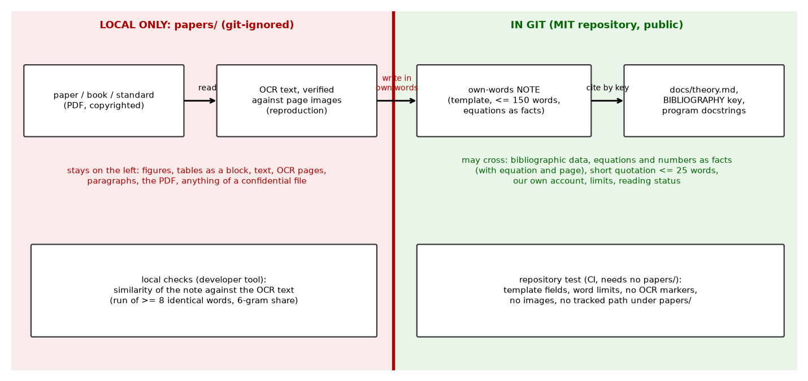

# Paper notes in git: is it possible, and under what rules?

**Research, not legal advice.** The authors are engineering agents reading public pages; nothing here replaces a lawyer. Branch `research/paper-notes-policy`; roadmap item F10 (the Thermal Sources Atlas) rests on its answer. Nothing here is adopted: the rules of `INTEGRATION.md` enter the project only when the maintainer decides. The three pilot notes (removed from the tree on the maintainer's order, kept locally; they remain in the git history) and the checker were illustrations. Reviewed: section 6.

## 1. The answer

**Possible, under conditions: yes for our own notes, no for anything that reproduces the source.**

| What | Verdict |
| :-- | :-- |
| A note in our own words: the idea, the method, the equations as facts with equation and page numbers, the numbers of the cases we test against, limits, how the program uses it, reading status | **Possible for every class of source** except the confidential one. It is what `research/theory/BIBLIOGRAPHY.md` (290 entries, 243 distinct keys on the tree of this review) and `docs/theory.md` already do today, so the practice is not new. |
| A summary that follows the source sentence by sentence (close paraphrase), a machine-condensed rewrite of the OCR text, long quotations | **Not possible** (a derivative of the expression) unless the source licence allows adaptation (CC BY, CC BY-SA, public domain). |
| Figures, a table copied whole, the OCR text, a transcription | **Not possible** for copyrighted sources; possible only for CC BY / CC BY-SA / CC0 / public-domain sources, with attribution and a marked-as-modified notice, and the earlier opinion (`releases/2.7.0/final-opinion/papers-in-git-opinion.md`) recommends against even that for now. |
| Standards (JEDEC, IPC, ISO, IEC, Gerber/Ucamco text) | **Possible only in a thin form**: the citation and the few numbers or formulas we test against, with the clause or table id; no restatement of the normative text. Publishers say plainly that reproducing any part needs permission (IEEE standards: even a small amount; JEDEC: "all rights reserved"). |
| Vendor datasheets and application notes (TI, Infineon, ROHM) | **Possible as facts**: the datasheet value we compare against, with the document id. Their terms allow personal or non-commercial copying unchanged, not republishing in modified form. |
| The confidential ODB++ specification | **Not possible**: nothing beyond the bibliographic entry the guard already allows. |

The risk is not the idea of notes; it is (a) a note that drifts into close paraphrase, (b) a note made by a model from the whole text without a human check of "own words", (c) the public, rewrite-forbidden history: a takedown would force either breaking the no-rewrite rule or losing the repository (section 5). The rules of `INTEGRATION.md` answer these.

## 2. Evidence

### 2.1 Law (statuses: R read on the official or primary page, S search snippet or summary, M memory, N not obtained)

| Point | Finding | Status |
| :-- | :-- | :-- |
| Ideas, methods, mathematical concepts are not protected, whatever the form in which they are described | 17 USC 102(b): no protection "to any idea, procedure, process, system, method of operation, concept, principle, or discovery", regardless of the form in which it is described, explained, illustrated or embodied (copyright.gov; re-read by the review on Cornell LII) | R |
| Facts are free, the arrangement of a compilation is protected thinly | Feist v. Rural (US 1991): facts not original; a compilation is protected only in original selection and arrangement ("thin"), not the facts; sweat of the brow rejected (the opinion's own page was blocked, 403; read through search summaries of Cornell LII / govinfo texts) | S |
| Berne | Art. 9(1) authors' exclusive right of reproduction "in any manner or form"; Art. 9(2) exceptions only in special cases not conflicting with normal exploitation; Art. 10(1) quotation from a lawfully published work, "compatible with fair practice", extent not beyond the purpose (WIPO Lex text). The idea/expression principle itself is WCT Art. 2 / TRIPS Art. 9(2), **not opened** | R for the Berne articles, M for WCT and TRIPS |
| EU quotation | Directive 2001/29 Art. 5(3)(d): "quotations for purposes such as criticism or review", the work already lawfully made available, source and author named unless impossible, fair practice, not beyond the specific purpose; Art. 5(5) three-step test (consolidated text on legislation.gov.uk). EUR-Lex itself was not reachable. CJEU Spiegel Online (C-516/17) read only through summaries | R (text), S (case) |
| EU text and data mining | Directive 2019/790 Art. 4: any user with lawful access may copy and extract for TDM, kept as long as needed, **unless rightholders expressly reserved their rights in an appropriate manner (machine-readable for online content)**; Art. 3 is the research-organisation exception. The opt-out is unsettled in practice (commentary) | R (text), S (commentary) |
| Portugal | CDADC art. 75(2)(g) (the numbering of Lei 50/2004) allows the inclusion of quotations or summaries of another's work to support one's own doctrine, or for criticism, discussion or teaching; Decreto-Lei 47/2023 added text and data mining exceptions to art. 75(2); art. 75(5) stops a contract overriding the free uses (search summaries of the Diário da República and university guides). The consolidated wording of art. 75 and the conditions of art. 76 (naming the author and the source) were not reached | S |
| US fair use | 17 USC 107: four factors (purpose and commercial nature; nature of the work; amount and substantiality; market effect) (copyright.gov). Not the governing law for a Portuguese maintainer, but a US-hosted public repository can meet a DMCA notice | R |
| US government works | 17 USC 105(a): no copyright in a work of the US Government (the Government may hold assigned copyrights) | R |
| CC BY 4.0 | Allows reproduction and sharing in whole or in part and adaptation, with attribution, licence reference, indication of changes; moral rights not licensed; where fair use or an exception applies the licence is not needed | R |

**Consequence.** A summary in our own words of ideas and facts is generally on the free side of the line; the line is crossed by expression: wording, structure that tracks the source, figures, whole tables. How short a quotation must be is not a number in any of these texts ("extent not beyond the purpose", "fair practice"); the proposal uses 25 words as a conservative house rule, not as law.

### 2.2 Publisher and licence pages read (the terms of the classes we cite)

| Source | What the page says | Status |
| :-- | :-- | :-- |
| arXiv, licence help page | Authors choose CC BY 4.0, CC BY-SA, CC BY-NC-SA, CC BY-NC-ND, the arXiv non-exclusive licence, or CC0; the default arXiv licence gives arXiv the right to distribute and "limits re-use of any type from other entities or individuals" | R |
| arXiv abstract page of Jaffer 2201.02612 | links to the arXiv non-exclusive licence (so the preprint is NOT CC BY, although the journal version in Thermo (MDPI) is CC BY 4.0, see the next row: the version matters) | R |
| MIT DSpace record of the published Jaffer paper (handle 1721.1/148015, via search; the page and MDPI refused the fetch) | the published version (Thermo 3 (1) 148-175) carries CC BY 4.0 | S |
| Creative Commons BY 4.0 legal code | see 2.1 | R |
| Frontiers | all articles CC BY ("unrestricted use, distribution, and reproduction in any medium" with credit) | R |
| Springer Nature, open science page | OA articles carry Creative Commons licences; subscription articles do not (authors may archive the accepted manuscript after an embargo) | R |
| Elsevier, text and data mining policy | subscribers may text mine for non-commercial research; others by permission helpdesk; the page says nothing on CC BY articles or on redistributing extracted text | R |
| IEEE rights page (short summary content returned) | reuse of portions of an IEEE article generally needs permission; open-access articles are CC BY; "brief excerpts" are named as a permitted form | S |
| ASME rights and permissions | ASME holds copyright; including a paper "or some or all of its elements" in another work needs ASME permission via CCC; authors keep rights to ideas and processes | R |
| TI website terms of use | services protected; without written consent not to be copied, modified or redistributed; personal or non-commercial download, copy and share allowed **unmodified with notices kept**; classroom use credited; no statement about datasheets as such | R |
| Infineon (website terms copy and 2026 documentation notice, via search) | personal or non-commercial reproduction without modification and with notices; documents reserve commercial text and data mining (German Copyright Act s. 44b); "All Rights Reserved" | S |
| ROHM (website terms and datasheet notices via search) | content protected; datasheet notice: no reproduction in part or whole without ROHM's consent; no licence granted | S |
| JEDEC copyright information (via search) | JEDEC owns the copyright; files may be downloaded free; distributing them otherwise needs purchase or written permission; downloaders agree not to charge for or resell | S |
| IPC (via search) | no IPC-specific page found; Techstreet says IPC protects its publications; IEEE and ISO/IEC pages say that even small reproductions from a standard need permission | S |
| Lienhard, *A Heat Transfer Textbook* (the book's page, ahtt.mit.edu, opened by the review) | "copyrighted under U.S. Copyright Law"; the authors grant download and printing for personal or non-profit instructional use; copying, distributing or modifying for commercial purposes is reserved: free to read is not an open licence | R |
| Wiley and Springer Nature text and data mining (library guides, via search) | non-commercial TDM for subscribers, through an API and agreement; nothing found on publishing results or snippets; UChicago guide: derived information may be public, the source documents may not be redistributed | S |
| Elmer Models Manual and OpenFOAM User Guide licences (via search) | Elmer Models Manual 2023: CC BY-ND 3.0; OpenFOAM User Guide recent versions: CC BY-NC-ND 3.0 (older OpenFOAM guides GNU FDL): open-source software, yet **documentation that forbids derivatives** | S |

Not obtained (N): MDPI open-access page (403), Springer Nature TDM page (404), EUR-Lex (page blocked), Justia's Feist (403), JEDEC terms page (404), Infineon legal notice (404), ROHM terms (404), SIAM (403), AIAA (404), the IIETA licence, the OpenFOAM guide page (404), the Elmer site (403). The licences of IIETA and of most PDFs we hold are therefore **unchecked** (Thermo: S, row above); 281 of the 290 entries of the bibliography still say `Licence: not checked` (4 `public domain`, 3 `all rights reserved`, 1 `confidential`, 1 a pointer to a guide, 1 empty; the study was written on 286 entries with 282 `not checked`, 3 `public domain`, 1 `confidential`: the bibliography grew on `development` since).

### 2.3 What open-source scientific projects do (three examples)

1. **SciPy** (`scipy.sparse.linalg.splu`, read): one sentence naming the library used and a numbered references list with a link; parameters point to the section of the SuperLU users' guide; no text of the guide is reproduced (R).
2. **Elmer** and 3. **OpenFOAM** (licences only, via search): the manuals describe the models with their formulas and cite the literature, and are themselves CC BY-ND / CC BY-NC-ND; nobody can adapt them, which is the position our notes would be in with respect to the papers if we copied expression (S). The practice shared by all three: **name the source and the clause, give the formula, say what the code does; do not carry the source's prose**.

### 2.4 Machine-made notes: provider terms

Anthropic commercial terms (read): the customer owns the outputs, **but must have all rights and permissions to submit the inputs** (section L.1), and defends Anthropic against claims tied to its inputs (K.2); the paid-use indemnity excludes the customer's own inputs (K.3). Google Gemini API terms (read; the page now redirects to aistudio.google.com/docs/terms, re-read by the review): Google does not claim ownership of generated content; the free tier uses submitted content and responses to improve its products and humans may read them; do not submit sensitive, confidential or personal information to the unpaid services. So: **owning the output of a model gives no right over the work it was fed**; the copyright question is that of 2.1, and the provider adds the responsibility for feeding it only material we may use (open copies for the free tier, as CLAUDE.md already says). EU Art. 4 TDM is a defence for the copying done in the process only where no opt-out was reserved (Infineon says it reserves one); that concerns the analysis, not the publication of the result.

## 3. Classification of the keys (`scripts/study_classify_keys.py`)

Heuristic from the citation text plus a hand list (`MANUAL`): an **estimate to plan the work**, not a licence finding (the licence of an entry is not checked). Output of the script on the tree of this review (243 distinct keys):

| Class | Keys | Checked by hand | May keep (rule of INTEGRATION.md 2) |
| :-- | --: | :-- | :-- |
| Journal or conference article (IEEE, ASME, AIAA, Elsevier, SIAM, Springer, trade magazines such as Electronics Cooling, ...) | 99 | in part | own-words summary; formulas and numbers with equation and page |
| Vendor note, datasheet, software documentation, sample files, fabricator pages | 64 | in part | facts with the document id; summary of what we use |
| Book, lecture notes, reference work | 36 | in part | references only (equation, page) plus our own account |
| arXiv or open preprint | 15 | in part | as a journal article; more only if the paper's own licence is CC BY / CC BY-SA / CC0 (read it on the abstract page; the preprint and the journal version can differ) |
| Standard or specification (JEDEC, IPC, ASTM, ASME V&V 20, Gerber/Ucamco, XNC) | 13 | every key | citation plus the numbers we test against with the clause; no restatement |
| Thesis | 11 | in part | as a journal article |
| US government work (NACA, NIST, DTIC report) | 4 | every key | public domain in the US (17 USC 105) only when written by government employees; still written in our words |
| Confidential (ODB++ specification) | 1 | every key | nothing beyond the citation |

**Corrected by the review.** The first version printed 81 / 50 / 38 / 33 / 14 / 10 / 12 / 2 on 240 keys (reproduced on the bibliography of its commit). The three strict classes were wrong in most rows: 25 of the 38 "standards" were magazine articles (Electronics Cooling), vendor application notes (ROHM, TI), sample files, software, a textbook (**Lienhard2024, one of the pilot keys**) and two papers; 8 of the 12 "US government" keys were a thesis, an arXiv paper, conference papers and journal papers hosted on NTRS or indexed by OSTI (a host is not an author: only works of US government employees are public domain); one of the 2 "confidential" keys was a SIAM article. The review read every key of these three classes and added them to `MANUAL` (test `tests/test_classify_keys.py`). The other classes are still heuristic: in a random sample of 30 keys outside the hand list (seed 1) 4 were wrong (added to `MANUAL`), and in a second sample of 30 drawn after the correction (seed 7) **6 of 30 (20 %) were wrong** and were left so that the rate stays an honest measure (journal papers read as books, theses or preprints). So the counts of the first four rows carry an error of about 20 %, and a standard filed under another class is not excluded.

Open-licence candidates (CC BY / public domain): the 4 entries marked `public domain` plus perhaps 5 to 10 gold-open-access items (Frontiers, MDPI-type journals, 10 keys with an open-access hint in the citation) whose licences have **not** been read per paper; Jaffer's journal version is CC BY 4.0 (S, 2.2). A class never makes an exception to the "own words" rule; an open licence only relaxes it.

## 4. Pilot: three notes (illustration only)

The three pilot notes were removed from the tree on the maintainer's order (kept locally in the git-ignored `papers/notes/atlas-pilot/`); they remain in the git history. The numbers below record what was done on them.

Similarity of each note against the local text of its paper (`scripts/study_pilot_similarity.py`, which needs the git-ignored papers library; words of three letters or more, formulas and code removed): the longest run of words shared with the paper, the share of the note's word 6-grams found in it, the same run with the citation line included, the words of the summary, and the number of flags of the checker on the note and on the note with a passage of 40 words of the paper pasted into its summary:

| Note | Class | Words | Longest run | 6-grams shared | Run with citation | Summary words | Flags / with 40 pasted words |
| :-- | :-- | --: | --: | --: | --: | --: | :-- |
| `Jaffer2023.md` | open-access journal article (CC BY 4.0, S) read as the arXiv preprint (arXiv licence, R) | 299 | 4 | 0.0 % | 7 | 89 | 0 / 2 |
| `YovanovichJafarpur1993.md` | institutional report (copyrighted) | 240 | 3 | 0.0 % | 12 (the title) | 83 | 0 / 2 |
| `Lienhard2024.md` | book (copyrighted; free to read for personal or non-profit teaching use, R) | 219 | 4 | 0.0 % | 4 | 83 | 0 / 2 |

Each note is 367 to 420 words with its header fields (`wc -w`), has no figure, no quotation (none was needed), the equations as facts with their numbers, and the program use. The checker is a prototype with first-guess thresholds (run of 8 identical words, 5 % shared 6-grams); an honest note sits far below them (run 3 to 4, 0 %) and a pasted passage of 40 words far above (run 40, 12 to 17 % of the 6-grams), so the thresholds separate these cases, but they were not calibrated on shorter pastes or on close paraphrase. **It cannot decide close paraphrase, only copied words**, so the reviewer's "own words" reading stays (section 6.2).

*Figure 1, fig_01_paper_to_note_line.png: the paper and its verified transcription stay on the local side; only the own-words note crosses into git, checked by a local similarity tool and a repository test.*

## 5. Risks and what a takedown would look like

- **Close paraphrase.** The failure mode: a note written by condensing the OCR text. Counter: template limits, the similarity tool, a human (reviewer) reading for "own words".
- **Machine notes.** Provider terms add no right over the source (2.4); a model that sees the whole paper tends to follow its order and phrases. Counter: the note is written from our verified findings (formulas, cases, page ids), not from a request "summarise this paper", and is reviewed.
- **Public history.** The repository is public; published history is never rewritten (CLAUDE.md). A rightholder notice to GitHub would ask to remove a file or the repository; removing a file from history would require the forbidden rewrite, so a mistaken copy is costly for ever. This is the reason for a conservative template and a test that blocks the accident before the commit.
- **Standards and vendors** are the strictest classes: JEDEC, IEEE, ISO/IEC say even small reproductions need permission; keep these notes to facts and ids.
- **Not checked.** Per-paper licences, Portuguese art. 75 wording, EU quotation case law beyond summaries. A lawyer should look before any commercial version or distribution of a bundle.

## 6. Review

The independent review of the folder (the reviewer agent): the sources re-opened, the pilot notes compared with the page images, the studies and tests re-run, the folder tidied to the research layout. **Not legal advice**: the review checks that the documents say what their sources say, not what a court would decide.

### 6.1 The legal and licence claims against their sources

Re-opened by the review (R): 17 USC 102(b) and 105(a) (Cornell LII), Berne Art. 9(1) and 10(1) (WIPO Lex), Directive 2001/29 Art. 5(3)(d) and 5(5) and Directive 2019/790 Art. 4 (legislation.gov.uk), the arXiv licence page and the Jaffer abstract page, the Anthropic commercial terms (sections B, K.2, K.3, L.1), the Gemini API terms (unpaid services) and the Lienhard book page. Each says what the tables of section 2 say. Changed: the Lienhard licence from S to R (the page states the grant of personal and non-profit teaching use); the Jaffer journal licence from M to S (CC BY 4.0, from the MIT DSpace record through a search; MDPI and DSpace refused the fetch); the Portuguese row made precise (art. 75(2)(g), the 2023 reform); the "US government" class restricted to works of government employees (a report hosted by NTRS, DTIC or OSTI is not public domain because of the host). Not re-opened: Feist, CC BY 4.0 legal code (the study read it), the publisher pages of 2.2 other than arXiv, the Elmer and OpenFOAM licences.

### 6.2 The pilot notes against the page images

The pages were rendered from the PDFs of the local library (never copied into the repository) and read: Jaffer arXiv v6 pages 4, 5 and 15; Yovanovich and Jafarpur pages 1, 3, 8 and 11; Lienhard 6.00 printed pages 419, 421, 435 and 436. **All three notes are in our own words**: no sentence follows the source's wording or order, the summaries are our account, the only matching strings are equations, numbers and the title. Every equation and number of the notes matches the page (eq. 2 and its range, Table 1 ranges, Table 6 biases; eq. 1, 25, 26, the page-8 constants 0.44 to 0.527 and 0.475; eq. 8.13a, Example 8.1 Pr 0.710, Ra 6.78e7, Nu 47.33, h 4.22, eq. 8.35 and 8.37a/b with their ranges). Corrected in the notes: (a) Jaffer: the four biases are those of the author's own formula (his eq. 55, Table 6), not of eq. 2 as the note's layout implied, and "differs by under one percent in rms relative error" became what the page says (the two RMSRE values differ by less than one percent); the published pages (148-175) and the page numbers of the facts added; "fits to plot values" now says that the author presents his formulas as derived; (b) Lienhard: the summary said both horizontal-plate laws use the area over perimeter; only eq. 8.37 does, eq. 8.35 says the length scale is immaterial; (c) Yovanovich and Jafarpur: the 0.475 is a mean of the Goldstein and Lau results that the report summarises (named now), and the pointer to the face-down decision was `CLAUDE.md`, which no longer holds decisions (now `docs/decisions-log.md`). The figure-legend 0.570 (page 13) and Lienhard's Example 6.5 (page 311) were not re-checked here; they rest on the image checks recorded in `research/theory/BIBLIOGRAPHY.md`.

### 6.3 Studies and tests re-run

`study_classify_keys.py` reproduces the first version's table on the bibliography of its commit (240 keys) and gives the corrected table of section 3 on the tree of this review; the claimed bibliography counts (286 entries, 240 keys, 282 `not checked`, about 139 entries with status R) reproduce on that commit (140 on this tree). The checker on the three notes: no flag (README claim confirmed), with the counts of section 4 now printed by `study_pilot_similarity.py`. Tests: `tests/test_similarity.py` (3) and the new `tests/test_classify_keys.py` (2), 5 passed; `tests/test_docs.py` and `tests/test_license_header.py` of the project pass on the folder.

### 6.4 Defects of the checker (limits recorded, not fixed)

1. The citation line is excluded from the similarity test entirely, so copied text placed on that line is not seen (the title alone gives a run of 12 on Yovanovich and Jafarpur).
2. Only quotation blocks (`>` lines) are recognised; an inline quotation in inverted commas is counted as own text, and the "at most one quotation" rule of `INTEGRATION.md` 2 is not tested.
3. The required fields tested are `Key`, `Reading status`, `Licence of the source`, `Summary` and `Used in the program`; `Citation`, `Class` and the other sections of the template are not (`INTEGRATION.md` 3 said the checker tests all fields; corrected).
4. Close paraphrase (synonyms, reordered clauses) is invisible to word runs and 6-grams; the human reading stays the control.

### 6.5 Verdict

**GO** for merging into `development` as a closed investigation of a policy question (documents and research code only; no program file touched). It adopts nothing: the decisions of `INTEGRATION.md` 7 stay with the maintainer, and F10 starts only on his word.

## 7. What was read and what was not verified

- Read (R): the pages marked R in 2.1 and 2.2 (those re-opened by the review are listed in 6.1); the existing opinion `releases/2.7.0/final-opinion/papers-in-git-opinion.md`; `tests/test_third_party_text.py`; the structure of `research/theory/BIBLIOGRAPHY.md`; the page images listed in 6.2.
- Snippet or summary (S): Feist, Portuguese art. 75 and the 2023 reform, the CJEU case, JEDEC, IPC, Infineon, ROHM, Wiley/Springer TDM, Elmer and OpenFOAM licences, the IEEE rights page, the CC BY licence of Jaffer's journal version.
- Memory (M): WCT and TRIPS idea/expression; the class of the keys outside the hand list (heuristic, about 20 % wrong).
- Not obtained (N): the pages listed at the end of 2.2.
- Not verified: the class counts outside the strict classes (20 % error in a sample of 30); the similarity thresholds on short pastes and on paraphrase; the per-paper licences of the bibliography; no lawyer has read any of this. The Yovanovich figure legends and Lienhard Example 6.5 rest on earlier image checks.
