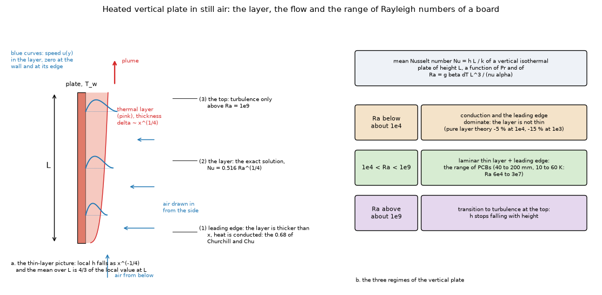
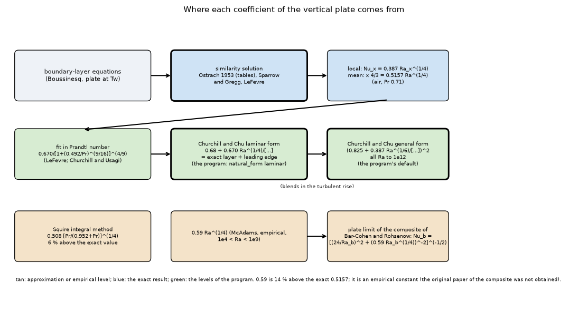
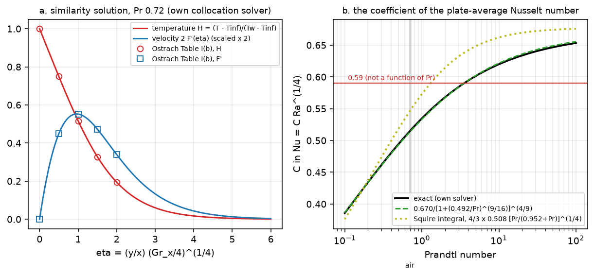
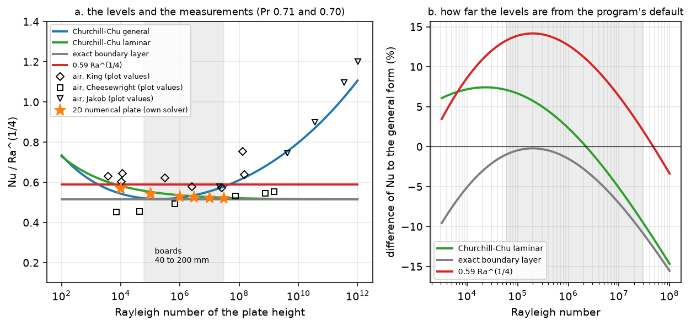
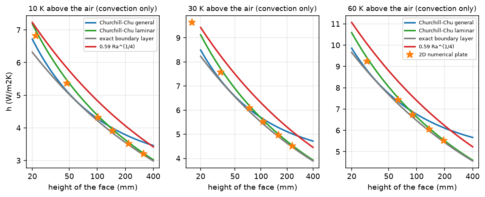
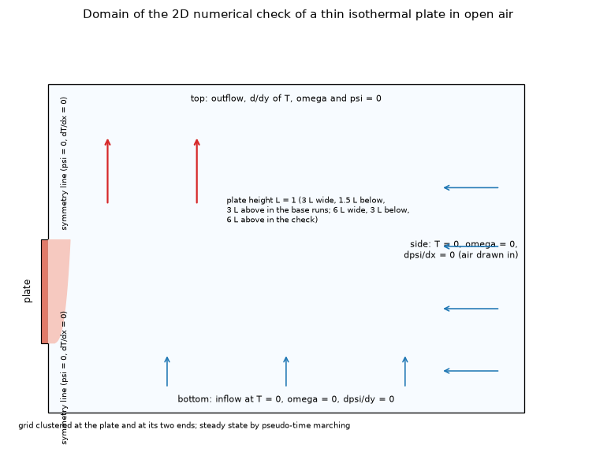
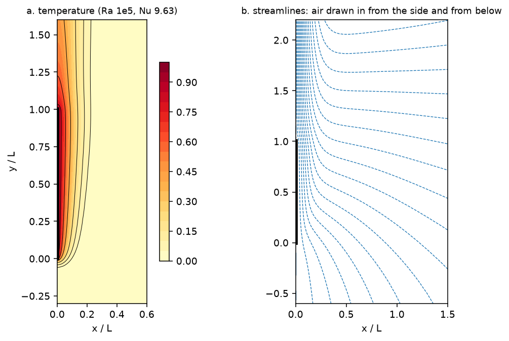
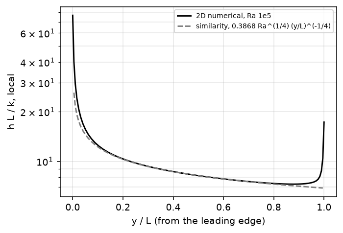
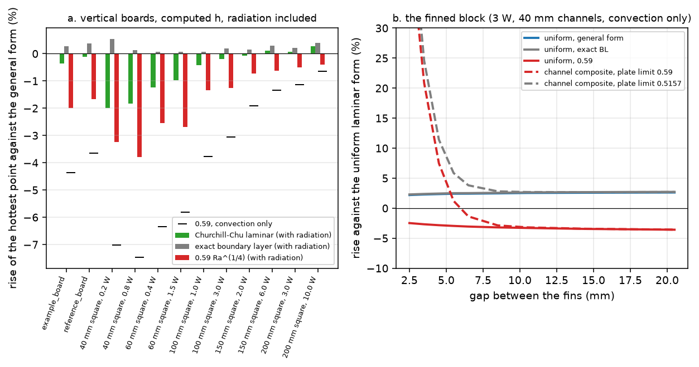

# plate-h-level: which natural-convection level for a vertical face

The question (from the review of `research/fin-channel`, README 10 and `INTEGRATION.md` 6, item 5): which level of the coefficient of an isothermal vertical plate should the program use, and by how much does the choice matter? The program uses Churchill and Chu (`pcbthermal/convection.py`, `Board.natural_form` `general` or `laminar`); the composite of Bar-Cohen and Rohsenow has a plate limit of `0.59 Ra^(1/4)`; laminar boundary-layer theory gives about `0.516 Ra^(1/4)`. The program is not touched: everything below runs on copies in memory (`lib/levels.py`).

**Summary.** (1) The exact laminar boundary-layer solution (own solver, Ostrach's Table I reproduced to 0.02 %) gives `Nu = 0.5157 Ra^(1/4)` at Pr 0.71; the `0.515` quoted is the Churchill-Usagi fit (0.5142), `0.508` is Squire's integral-method constant, and `0.59` is 14.4 % above the exact value, empirical, not a boundary-layer result. (2) The laminar form of Churchill and Chu is the exact coefficient plus a leading-edge term of 0.68: within 0.3 % of "exact + 0.68" over `Ra` 1e3 to 1e9. (3) A full 2D numerical plate (grid-converged to about 0.2 %, checked by the review on a finer grid) puts the mean Nusselt number of a finite plate 2.2 / 1.8 / 1.3 / 0.8 % below the laminar form at `Ra` 1e4 / 1e5 / 1e6 / 1e7, 4.8 % above the all-range form at 1e4 and 1e5 and 6 % below it at 1e7, and 4 to 12 % below `0.59 Ra^(1/4)` (that is, 0.59 is 4 to 13 % above it); the published air data (three sets, plot values) scatter by +-15 % and cannot separate the levels. (4) The choice moves the rise of a vertical board by 2 % at most between the two forms of Churchill and Chu (40 mm boards; 0.4 % from 100 mm), by 2 to 4 % for `0.59` (7.5 % convection only), and the rise of the finned block of `fin-channel` by 2 to 4 %, as much as the channel effect at 5.5 to 6.5 mm. (5) Recommendation in `INTEGRATION.md`: the two options are the all-range form and the laminar boundary-layer form of Churchill and Chu; `0.59` is not offered.

## 1. The situation

*Figure 1 (`figures/fig_01_boundary_layer_on_a_vertical_plate.png`): a heated vertical plate in still air: the thin layer that grows up the plate, the air drawn in from the side and from below, and the three places where a correlation has to do something (the leading edge, the layer, the top). Right: the three regimes; the boards of the program (40 to 200 mm, 10 to 60 K) are in the middle one.*

*Figure 2 (`figures/fig_02_where_the_levels_come_from.png`): where each coefficient comes from. The levels, with `Nu` the plate-average Nusselt number, `Ra` the Rayleigh number of the plate height, `Pr = 0.71` (air):*

| Level (key in `lib/levels.py`) | Nu | What it is |
| :-- | :-- | :-- |
| Churchill and Chu, all `Ra` (`general`) | `(0.825 + 0.387 Ra^(1/6)/[1+(0.492/Pr)^(9/16)]^(8/27))^2` | the program's default |
| Churchill and Chu, laminar (`laminar`) | `0.68 + 0.670 Ra^(1/4)/[1+(0.492/Pr)^(9/16)]^(4/9)` | `Board.natural_form = "laminar"` |
| exact boundary layer (`bl`) | `C(Pr) Ra^(1/4)`, `C(0.71) = 0.5157` | the similarity solution, no leading edge |
| exact boundary layer + 0.68 (`bl_le`) | `0.68 + C(Pr) Ra^(1/4)` | the laminar form with the exact coefficient |
| `0.59 Ra^(1/4)` (`mcadams`) | | the plate limit of the Bar-Cohen and Rohsenow composite; the empirical constant of textbooks |
| Squire integral (`squire`) | `(4/3) 0.508 [Pr/(0.952+Pr)]^(1/4) Ra^(1/4)` | a historical approximation |

The Rayleigh numbers of a vertical face of a board (air at the film temperature, `study_similarity.py` part 4): 6.2e4 / 1.6e5 / 2.6e5 for a 40 mm face at 10 / 30 / 60 K above 20 degC; 9.7e5 / 2.5e6 / 4.0e6 at 100 mm; 7.7e6 / 2.0e7 / 3.2e7 at 200 mm. So the range of interest is `Ra` 6e4 to 3e7, laminar everywhere (the transition of a free-convection layer in air is at about 1e9).

## 2. Sources and how they were read

| Source | What it gave | Status |
| :-- | :-- | :-- |
| Ostrach, NACA Report 1111 (1953), open copy NASA NTRS 19930092147 | the similarity equations, Table I (`-H'(0)` at eight Prandtl numbers, `F''(0)`, the profiles of Pr 0.72), the comparison with Schmidt and Beckmann | **R**: 18 pages, the tables read as page images (Table I pages 77 and 78, the rows of Table I(b) at zoom) |
| Jaffer, arXiv:2201.02612v6 (2023) | the Churchill and Chu equation, the data sets Churchill and Chu used (Table 1), the bias of each against his formula (Table 6), Figure 6 with the markers | **R** for the figure (the markers taken from its **vector drawing**) and tables; the data are his digitisation of the graphs of Churchill and Chu: **plot values**, not the measurements |
| A paper on the integral method for the vertical wall (hosted by IIETA; header not recovered) | equation 12 (Churchill and Chu local form `0.503 ...`), equation 13 (Squire `0.508 [Pr/(0.952+Pr)]^(1/4)`), equation 14 (LeFevre), the limits 0.677 and `0.68 Pr^(1/4)` | **S** (equations read from the text layer of a secondary paper) |
| Churchill and Chu (1975) | the equations (through Jaffer's equation 2 and the program's earlier entry) | **N** (abstract only on the page found; not opened) |
| Sparrow and Gregg (1958), Raithby and Hollands (Handbook of Heat Transfer chapter), Squire (1938), LeFevre (1956), McAdams (1954), King (1932), Cheesewright (1968), Jakob | named by the secondary sources above | **N**; the search summaries only (**S**) for Sparrow and Gregg and McAdams |

The status of each is in `research/theory/BIBLIOGRAPHY.md` (entries `[Ostrach1953]`, `[Jaffer2023]`, `[IIETAIntegral]`, `[SparrowGregg1958]`, `[McAdams0.59]`, and `[ChurchillChu1975]`, unchanged).

## 3. The exact coefficient

`lib/similarity.py` solves the similarity equations `f''' + 3 f f'' - 2 f'^2 + theta = 0`, `theta'' + 3 Pr f theta' = 0` by two independent routes (own RK4 shooting and scipy collocation). The local Nusselt number is `Nu_x = -theta'(0) (Gr_x/4)^(1/4)`; the local coefficient falls as `x^(-1/4)`, so the plate average is `4/3` of the local value at `L`: `Nu_L = (4/3) (-theta'(0)) / (4 Pr)^(1/4) Ra_L^(1/4)`.

**3.1 Against Ostrach's Table I** (`study_similarity.py`, part 1; `-H'(0)`):

| Pr | own collocation | own shooting | Ostrach (page 77 or 78) | difference (%) |
| --: | --: | --: | --: | --: |
| 0.01 | 0.0806 | not converged | 0.0812 | -0.75 |
| 0.72 | 0.5046 | 0.5046 | 0.5046 | +0.01 |
| 0.733 | 0.5079 | 0.5079 | 0.5080 | -0.02 |
| 1 | 0.5671 | 0.5670 | 0.5671 | +0.01 |
| 2 | 0.7165 | 0.7162 | 0.7165 | 0.00 |
| 10 | 1.1693 | not converged | 1.1694 | -0.01 |
| 100 | 2.1914 | not converged | 2.191 | +0.02 |

`F''(0)` agrees to 4 digits from Pr 0.72 up (0.6760, 0.6742 / 0.6741, 0.6422 / 0.6421, 0.5713, 0.4192, 0.2517). The profile rows of Table I(b) (Pr 0.72, `eta` 0.5 / 1 / 1.5 / 2): `H` 0.7493 / 0.5168 / 0.3281 / 0.1945 (reproduced to 4 digits) and `F'` 0.2247 / 0.2760 / 0.2364 / 0.1700 against 0.2246 / 0.2759 / 0.2363 / 0.1697 (read from the image). The shooting route is stable only for `0.5 <= Pr <= 2` (the growing mode of the far-field condition), where it agrees with the collocation to 0.07 %; at Pr 0.01 the solver is 0.75 % below the report (the solver is converged in the domain, 0.0806 at `eta_max` 50 to 100; the report's table at that Prandtl number is not checked further; irrelevant for air). Ostrach's own worked value (Nu 63.6 at Pr 0.72, Gr 1e9, page 71 of the report) is 0.3 % above what his Table I gives (63.45).

*Figure 4 (`figures/fig_04_similarity_solution_and_coefficient.png`): left, the temperature and velocity profiles of the similarity solution at Pr 0.72 with the tabulated values of Ostrach (markers); right, the coefficient `C(Pr)` of `Nu = C Ra^(1/4)` and the fits.*

**3.2 The coefficient of the plate average** (`study_similarity.py`, part 2):

| Pr | exact | Churchill and Chu `0.670/[..]^(4/9)` | LeFevre `0.503 x 4/3 /[..]^(4/9)` | Squire |
| --: | --: | --: | --: | --: |
| 0.5 | 0.4946 | 0.4934 (-0.26 %) | 0.4938 (-0.16 %) | 0.5189 (+4.9 %) |
| 0.71 | **0.5157** | 0.5142 (-0.28 %) | 0.5148 (-0.18 %) | 0.5476 (+6.2 %) |
| 1 | 0.5347 | 0.5333 (-0.26 %) | 0.5338 (-0.16 %) | 0.5730 (+7.2 %) |
| 10 | 0.6200 | 0.6216 (+0.27 %) | 0.6222 (+0.37 %) | 0.6621 (+6.8 %) |
| 100 | 0.6533 | 0.6555 (+0.34 %) | 0.6562 (+0.44 %) | 0.6757 (+3.4 %) |

At Pr 0.71 the exact local coefficient is 0.3868 and the average 0.5157. The `0.515` or `0.516` quoted for air is the Churchill-Usagi / LeFevre fit (`0.670/[1+(0.492/Pr)^(9/16)]^(4/9)` = 0.5142, 0.28 % below the exact value); **`0.508` is not an air coefficient: it is Squire's integral-method constant for the local Nusselt number** (`0.508 [Pr/(0.952+Pr)]^(1/4)`, 6 % above the exact value at Pr 0.71 once averaged); `0.503` is LeFevre's large-Prandtl local limit (`4/3 x 0.503 = 0.671`). The `0.59` is **14.4 % above** the exact value at Pr 0.71; the plate limit of the Churchill (1977) channel formula, `0.75/[..]^(4/9)`, is 0.5756 (+11.6 %); the Raithby and Hollands 0.62 is +20.2 %. So the composites' plate limits are not the boundary-layer coefficient: their origin is empirical, and their original papers were not obtained, so this study cannot say why they are higher (the formulas themselves were checked in `research/fin-channel`).

Correction to what was said before: 0.59 is **not** "the Raithby-Hollands / Churchill-Usagi value for the composite". The Churchill-Usagi value is 0.514; 0.59 is the empirical constant of the textbooks for `1e4 < Ra < 1e9`.

## 4. The levels against Rayleigh number

*Figure 5 (`figures/fig_05_levels_against_rayleigh_and_data.png`): left, `Nu/Ra^(1/4)` of every level against `Ra` with the air measurements of Churchill and Chu (plot values) and the 2D numerical plate (section 6); right, the difference of each level to the program's general form. The shaded band is the range of the boards of the program.*

`study_similarity.py`, part 3 (`Nu` at Pr 0.71 and the difference to the general form):

| Ra | general | laminar | exact BL | exact BL + 0.68 | 0.59 |
| --: | --: | --: | --: | --: | --: |
| 1e3 | 3.426 | 3.572 (+4.3 %) | 2.900 (-15.4 %) | 3.580 (+4.5 %) | 3.318 (-3.2 %) |
| 1e4 | 5.433 | 5.822 (+7.2 %) | 5.157 (-5.1 %) | 5.837 (+7.4 %) | 5.900 (+8.6 %) |
| 1e5 | 9.213 | 9.825 (+6.6 %) | 9.170 (-0.5 %) | 9.850 (+6.9 %) | 10.492 (+13.9 %) |
| 1e6 | 16.558 | 16.942 (+2.3 %) | 16.307 (-1.5 %) | 16.987 (+2.6 %) | 18.657 (+12.7 %) |
| 1e7 | 31.213 | 29.598 (-5.2 %) | 28.999 (-7.1 %) | 29.679 (-4.9 %) | 33.178 (+6.3 %) |
| 1e8 | 61.065 | 52.105 (-14.7 %) | 51.569 (-15.6 %) | 52.249 (-14.4 %) | 59.000 (-3.4 %) |
| 1e9 | 122.857 | 92.127 (-25.0 %) | 91.704 (-25.4 %) | 92.384 (-24.8 %) | 104.918 (-14.6 %) |

* The laminar form of Churchill and Chu **is** the exact boundary layer plus a leading-edge term: its `Ra^(1/4)` coefficient is within 0.28 % of the exact one and the 0.68 is added (`exact BL + 0.68` is within 0.3 % of it at every `Ra` above 1e3). The level "exact" and the laminar form of Churchill and Chu are therefore one and the same level to 0.3 %.
* Pure boundary-layer theory (no 0.68) fails below `Ra` 1e5 (-5 % at 1e4, -15 % at 1e3), because the layer is not thin compared with the plate.
* The `0.59` is 1 to 14 % above the laminar form over `1e4 <= Ra <= 1e8` (1.013 at 1e4, 1.068 at 1e5, 1.101 at 1e6, 1.121 at 1e7, 1.132 at 1e8), and the gap grows with `Ra` to 14.7 % at infinity (0.59 / 0.5142; it is 14.4 % above the exact coefficient 0.5157). Where the program's general and laminar forms agree: `Ra` = 135 and 2.2e6; above 2.2e6 the general form includes the turbulent rise that a laminar layer does not have (it is +7.6 % above the exact boundary layer at 1e7, +18 % at 1e8): below 1e9 the laminar form is the one for a laminar layer, as the authors of the correlation themselves say (the program's docstring: the laminar form is "meant for Ra < 1e9").

*Figure 6 (`figures/fig_06_coefficient_against_height.png`): the coefficient (convection only) of a vertical face against its height at 10, 30 and 60 K above 20 degC for each level, with the 2D numerical plate (stars).*

## 5. The published measurements

`study_air_data.py`: the three air data sets of Churchill and Chu (King, Cheesewright, Jakob) as redrawn in Figure 6 of Jaffer, centres of the markers taken from the vector drawing (8, 6 and 5 points, the counts of Jaffer's Table 6). **Plot values of a secondary source.** Mean of data / level (bias), its standard deviation (scatter) and the root mean square of (data/level - 1), over the 9 points of `1e4 <= Ra <= 1e8` (King 5, Cheesewright 3, Jakob 1):

| set | general | laminar | exact BL | exact BL + 0.68 | 0.59 |
| :-- | --: | --: | --: | --: | --: |
| King (5) | 1.118 / 0.076 | 1.096 / 0.035 | 1.173 / 0.052 | 1.093 / 0.034 | 1.023 / 0.046 |
| Cheesewright (3) | 0.901 / 0.035 | 0.917 / 0.086 | 0.958 / 0.061 | 0.915 / 0.085 | 0.836 / 0.053 |
| Jakob (1) | 1.017 | 1.106 | 1.124 | 1.103 | 0.981 |
| all air (9), bias / scatter / RMSRE | 1.035 / 0.116 / 12.1 % | 1.037 / 0.102 / 10.9 % | 1.096 / 0.112 / 14.7 % | 1.035 / 0.102 / 10.7 % | 0.956 / 0.097 / 10.7 % |

The sets disagree with one another by 10 to 20 % (King is 10 % above the laminar form, Cheesewright 8 % below, Jakob 11 % above), more than the whole difference between the levels; the mean of all points sits within 4.4 % of every level except the pure boundary layer (+9.6 %, which is the missing leading edge), and the standard error of the mean (0.10 / 3) is 3 to 4 %. **The air data cannot tell the laminar form from the general form or from 0.59**; they exclude only the pure boundary layer at low `Ra`. The check of the extraction: the biases against the general form for the points below 1e9 (King +11.9 %, Cheesewright -13.4 %, Jakob +1.7 %) are close to Jaffer's Table 6 against his own formula (+11.1, -15.4, +3.1 %).

Cheesewright's points are the lowest set; at his highest point in the laminar range (`Ra` 7.7e8) the data are 20 % below the general form (ratio 0.803) and 5 % above the laminar form (1.055).

## 6. The finite plate by the full 2D problem

Because the measurements cannot separate the levels, the finite plate was solved numerically: `lib/plate2d.py` (independent of the program; stream function and vorticity, a thin isothermal plate on the symmetry line of the half plane, air drawn in from the side and from below, free outflow above, stretched grids, pseudo-time marching to the steady state; 10 to 30 minutes per case at the finest). `study_plate2d.py` (Pr 0.71; `Nu` is the plate-average, "balance" is the heat leaving the domain over the heat leaving the plate, 1 for a conservative converged solution):

*Figure 3 (`figures/fig_03_numerical_domain.png`): the domain and the boundary conditions of the 2D check.*

| Ra | grid | Nu | balance | Nu / general | Nu / laminar | Nu / exact BL | Nu / 0.59 |
| --: | :-- | --: | --: | --: | --: | --: | --: |
| 1e4 | coarse 60 x 50 | 5.679 | 1.007 | 1.045 | 0.975 | 1.101 | 0.962 |
| 1e4 | base 90 x 80 | **5.694** | 1.010 | 1.048 | 0.978 | 1.104 | 0.965 |
| 1e4 | wide domain | 5.707 | 1.008 | 1.050 | 0.980 | 1.107 | 0.967 |
| 1e5 | coarse | 9.636 | 0.996 | 1.046 | 0.981 | 1.051 | 0.918 |
| 1e5 | base | **9.651** | 1.001 | 1.048 | 0.982 | 1.052 | 0.920 |
| 1e5 | wide | 9.664 | 1.002 | 1.049 | 0.984 | 1.054 | 0.921 |
| 1e6 | coarse | 16.716 | 0.980 | 1.009 | 0.987 | 1.025 | 0.896 |
| 1e6 | base | **16.720** | 0.990 | 1.010 | 0.987 | 1.025 | 0.896 |
| 3e6 | base | **21.846** | 0.984 | 0.980 | 0.989 | 1.018 | 0.890 |
| 1e7 | coarse | 29.402 | 0.955 | 0.942 | 0.993 | 1.014 | 0.886 |
| 1e7 | base | **29.358** | 0.973 | 0.941 | 0.992 | 1.012 | 0.885 |
| 3e7 | base | **38.517** | 0.962 | 0.900 | 0.994 | 1.009 | 0.882 |

*Figure 8 (`figures/fig_08_computed_field_of_the_plate.png`): isotherms and streamlines of the numerical plate at `Ra` = 1e5 (coarse grid): the thin layer, the air drawn in from the side and from below.*

*Figure 9 (`figures/fig_09_local_nusselt_number.png`): the local `h L / k` of the numerical plate at `Ra` 1e5 against the similarity solution `0.3868 Ra^(1/4) (y/L)^(-1/4)`: they coincide from `y/L` 0.1 to 0.8; the numerical solution rises at the two ends (the leading edge, where the layer is thicker than the distance, and the top edge, where the flow turns).*

* **Checks of the solver.** The local coefficient reproduces the exact similarity solution in the middle of the plate (Figure 9) without any input from it; the energy balance is 0.98 to 1.01 up to `Ra` 1e6 and 0.96 to 0.97 at 1e7 and 3e7; the grid and the domain change `Nu` by 0.3 % (coarse to base) and by 0.2 to 0.3 % (base to the domain twice as wide, three times as tall) at 1e4 and 1e5. The first version read the balance of 0.96 to 0.97 at 1e7 and 3e7 as an uncertainty of 3 to 4 % of `Nu`; the review's checks (`study_plate2d.py review`) show that it is the error of the flux summed over the far boundaries, not of the wall: on a finer grid (135 x 120, first cell 6e-4 L) the balance rises to 0.987 at 1e7 (0.998 at 1e6, 1.005 at 1e5) while `Nu` changes by -0.01 % at 1e7 (29.356 against 29.358), +0.07 % at 1e6 (16.732) and +0.11 % at 1e5 (9.661); marching on for as many steps again after the convergence flag moves `Nu` by 0.03 % at most; and the local number in the middle of the plate (`y/L` 0.25 to 0.75) is within 0.3 % of the similarity solution from 1e5 to 1e7 (1.2 to 1.6 % above it at 1e4, where the layer is not thin). So the mean `Nu` is good to about 0.2 % at 1e5 to 1e7 (3e7 was not re-checked on the finer grid). There is no published numerical case of a finite thin plate to compare with in what was read (Ostrach's and Jaffer's are the boundary layer and measurements), so **this solver is validated against the similarity solution (local) and against its own energy balance and grids, not against a published finite-plate value**.
* **Result.** The numerical plate lies **2.2 % below the laminar form of Churchill and Chu at `Ra` 1e4, 1.8 % at 1e5, 1.3 % at 1e6, 1.1 % at 3e6, 0.8 % at 1e7 and 0.6 % at 3e7**, **4.8 % above the all-range form at 1e4 and 1e5** (1.0 % above at 1e6, 2 % below at 3e6, **6 % below at 1e7 and 10 % below at 3e7**), **8 to 12 % below `0.59 Ra^(1/4)`** from 1e5 up (3.5 % at 1e4), and 10 % above the pure boundary layer at 1e4 (5 % at 1e5, 1 to 2.5 % from 1e6). So over the whole range of the boards the laminar form of Churchill and Chu, that is, the exact boundary-layer coefficient plus the leading-edge term, is the closest level, a little high (0.6 to 2.2 %); the all-range form is low at the small boards and high at the large ones; `0.59` is high by 4 to 13 %. The numerical plate exceeds the pure boundary layer by an additive 0.54 / 0.48 / 0.41 / 0.38 / 0.36 / 0.35 at `Ra` 1e4 / 1e5 / 1e6 / 3e6 / 1e7 / 3e7 (the effect of the two ends of the plate): the 0.68 of Churchill and Chu is a constant fitted to measurements, larger than what the 2D plate gives, and that is why the laminar form is a little high; calling it "the leading-edge term" is this study's reading, not a statement of the source.
* **Limits.** 2D (an infinitely wide plate, no side entrainment), Boussinesq, constant properties at the film temperature, a thin plate with the same temperature on both faces and symmetric flow (a real board has components, an edge, a neighbour); steady laminar (the 2D steady solution exists and converged at all `Ra` run; physical transition is far above); `Pr` 0.71 only. A real board loses 3D side entrainment to the edges: a narrow board has a higher mean coefficient than the 2D plate (not studied).

## 7. How much the choice moves the rise of a board

`study_board_effect.py`: the program's own FVM (cell 2 mm), vertical board, computed `h` (`Board.h_mode = "computed"`, `orientation = "vertical"`, emissivity 0.9 on both faces, radiation to the ambient included as the program does), with `convection.h_natural_vertical` replaced in memory by each level. The two example boards (100 x 80 mm with 4 layers, vias and a heatsink; 100 x 100 mm, 2 layers) and two-layer square boards with full copper and one 10 x 10 mm part. Rise of the hottest point; the difference to the general form (the program's default); the last column is the 0.59 level with the emissivity set to zero (convection only):

| case | general (K) | laminar | exact BL | exact BL + 0.68 | 0.59 | 0.59, convection only |
| :-- | --: | --: | --: | --: | --: | --: |
| example_board, vertical | 61.3 | -0.4 % | +0.3 % | -0.4 % | -2.0 % | -4.4 % |
| reference_board, vertical | 67.0 | -0.1 % | +0.4 % | -0.1 % | -1.7 % | -3.7 % |
| 40 mm, 0.2 W | 7.8 | -2.0 % | +0.5 % | -2.1 % | -3.2 % | -7.0 % |
| 40 mm, 0.8 W | 27.9 | -1.8 % | +0.1 % | -1.9 % | -3.8 % | -7.5 % |
| 60 mm, 0.4 W | 10.6 | -1.2 % | +0.1 % | -1.3 % | -2.6 % | -6.3 % |
| 60 mm, 1.5 W | 36.6 | -1.0 % | +0.1 % | -1.0 % | -2.7 % | -5.8 % |
| 100 mm, 1.0 W | 20.4 | -0.4 % | +0.1 % | -0.4 % | -1.3 % | -3.8 % |
| 100 mm, 3.0 W | 59.1 | -0.2 % | +0.2 % | -0.2 % | -1.3 % | -3.1 % |
| 150 mm, 2.0 W | 39.4 | -0.1 % | +0.1 % | -0.1 % | -0.7 % | -1.9 % |
| 150 mm, 6.0 W | 115.5 | +0.1 % | +0.3 % | +0.1 % | -0.6 % | -1.3 % |
| 200 mm, 3.0 W | 56.9 | +0.1 % | +0.2 % | 0.0 % | -0.5 % | -1.1 % |
| 200 mm, 10.0 W | 185.3 | +0.3 % | +0.4 % | +0.3 % | -0.4 % | -0.6 % |

*Figure 7 (`figures/fig_07_effect_on_the_rise.png`): left, the change of the rise of vertical boards with the level; right, the finned block of section 8.*

* The choice moves the rise of a board by **at most 2 % for the laminar form against the general form (small boards), 4 % for 0.59 with radiation, 7.5 % for 0.59 convection only**. It is small because the radiation (about half of the total coefficient at these temperatures) does not depend on the level, and because the copper spreads the heat: the part's rise is set by the spreading as much as by the face coefficient. The effect is largest for the small boards (40 and 60 mm) where `Ra` is 6e4 to 3e5 and the levels differ most; for 100 mm and above the laminar form and the general one differ by 0.4 % or less.
* The numerical plate (section 6) says the real coefficient is 4.8 % above the general form and 2 % below the laminar form at these `Ra`: the laminar form lowers the rise of the small boards by 1 to 2 % against the general form, which is towards the numerical plate, and leaves it 2 % of the face coefficient (about 1 % of the rise) too cool; from 100 mm up the two forms give the same rise to 0.4 %.

## 8. Against the channel effect of `fin-channel`

`study_finned_block.py`: the block of `research/fin-channel` (60 x 40 mm, 3 W, aluminium block 40 x 30 x 3 mm, fins 15 x 1.5 mm, 40 mm channels, convection only, FVM 1 mm), run with `research/fin-channel/lib` and the plate level of each run (`uniform`: every face and fin has the isolated-plate coefficient of the level; `channel`: the composite of Bar-Cohen and Rohsenow with its plate limit 0.59, and with the plate limit replaced by the exact 0.5157; in each channel run the board faces carry the plate coefficient of the matching level; the first version of `fin-channel` kept the laminar coefficient on the board faces). Rise of the hottest point (K):

| gap (mm) | uniform general | uniform laminar | uniform exact BL | uniform 0.59 | channel 0.59 | channel exact |
| --: | --: | --: | --: | --: | --: | --: |
| 2.5 | 65.7 | 64.3 | 65.8 | 62.7 | 93.6 | 97.0 |
| 3.5 | 68.9 | 67.3 | 68.9 | 65.5 | 81.4 | 83.9 |
| 4.5 | 71.5 | 69.8 | 71.5 | 67.8 | 75.0 | 77.8 |
| 5.5 | 73.6 | 71.9 | 73.7 | 69.8 | 72.8 | 76.1 |
| 6.5 | 75.5 | 73.7 | 75.5 | 71.4 | 72.7 | 76.5 |
| 8.5 | 78.5 | 76.6 | 78.5 | 74.1 | 74.4 | 78.7 |
| 10.5 | 80.8 | 78.8 | 80.9 | 76.2 | 76.3 | 80.9 |
| 14.5 | 84.1 | 82.0 | 84.2 | 79.2 | 79.2 | 84.2 |
| 20.5 | 87.4 | 85.2 | 87.5 | 82.1 | 82.1 | 87.5 |

* **The level moves the finned block by 2.2 to 3.6 %** (uniform general +2.2 to +2.6 %, exact boundary layer +2.3 to +2.7 %, 0.59 -2.5 to -3.6 %, all against the laminar form that `fin-channel` used as its baseline; the general form is hotter than the laminar one because at `Ra` 6e4 to 2e5 it is the lower of the two). A level moves the rise of the block as much as the channel effect at a 5.5 to 6.5 mm gap.
* **The channel effect proper**, each composite against the uniform run of its own plate limit: with 0.59, +24 / +11 / +4.3 / +1.7 % at 3.5 / 4.5 / 5.5 / 6.5 mm and 0.0 % from 14.5 mm (the wide-gap limit of the composite is the uniform 0.59 run: 82.1 K at 20.5 mm in both); with the exact plate limit +22 / +8.8 / +3.3 / +1.3 % and 0.0 % from 14.5 mm (87.5 K in both). These are the `phi` numbers of `fin-channel` (+27 / +11.8 / +4.7 / +1.9 %, computed there against the Churchill and Chu laminar baseline and the `phi` form) to within 0.2 to 5 points: the channel effect does not depend on the level to the precision of the study.
* So the finding of `fin-channel` that the composite "cancels" against the plate at 6.5 mm is explained, and the review measured the two parts directly (last line of `study_finned_block.py`) in the configuration of `fin-channel` (board faces at the laminar form, the composite on the fins and the free base): the 0.59 plate alone on the finned face, with no channel, lowers the rise by 1.8 % (72.3 K against 73.7 K: at the `Ra` of these 40 mm channels, about 1e5, 0.59 is 7 % above the laminar form, not 14 %, because the laminar form carries the 0.68), and the channel effect raises it by 1.7 % from there (73.6 K, the -0.1 % of `fin-channel`); the `phi` form on the laminar coefficient gives +1.9 % (75.1 K). In this study's own runs, where the board faces also carry the level of the composite, `channel 0.59` (72.7 K at 6.5 mm) is lower than the laminar plate (73.7) by the 0.59 offset on every face and higher than its own wide-gap limit (71.4 K) by the channel effect; against the exact boundary layer, which has no 0.68, the 0.59 is 14 % higher and worth 5 % of the rise (71.4 K against 75.5 K). (The first version explained the -0.1 % with the 14 % offset to the exact boundary layer; the baseline of `fin-channel` is the laminar form, against which the offset is 7 %.) **A channel correction should multiply the coefficient of whatever level the program uses (the `phi` form of `fin-channel`), not replace it by the composite with its 0.59.**

## 9. What was read and what was not verified

* **Read in full**: Ostrach, NACA Report 1111 (18 pages as images; Table I read for Pr 0.01 to 100); Jaffer (2023), the pages 2 to 5, 10 to 15 (the equation of Churchill and Chu, the data table, the figure and Table 6); the integral-method paper's equations 11 to 14 (a secondary source, text layer).
* **From a summary only**: Sparrow and Gregg (1958), McAdams / the 0.59 and its range, the textbook place of the 0.59 and of the Churchill-Chu equations (web search summaries and calculators).
* **Not obtained**: Churchill and Chu (1975), Raithby and Hollands (Handbook of Heat Transfer), LeFevre (1956), Squire (1938), King, Cheesewright and Jakob (the original measurements), Bar-Cohen and Rohsenow (1984), Incropera and DeWitt and Bejan (chapter 9 and 4). The numbers for those authors come from the secondary sources above; the claim "0.59 is the McAdams / textbook constant" is **not verified in a primary source**.
* **Reproduced**: Ostrach's Table I (`-H'(0)` and `F''(0)`) and four profile rows with an independent solver (section 3.1); the program's two Churchill and Chu forms against its own code (`tests`); the measured air points' extraction against Jaffer's Table 6 (section 5, within 3 points).
* **Not reproduced**: any published finite-plate numerical value (none was found), any measurement table (only plot values), the behaviour at `Ra` below 1e4 or above 3e7 in 2D, `Pr` other than 0.71.
* **Mine, not a source**: the finding that the laminar form is the exact boundary layer plus the leading edge (shown by the numbers of section 4), the 2D solver and its results (section 6), the recommendation of `INTEGRATION.md`.
* **Tests**: `research/plate-h-level/tests/test_plate_h_level.py` (Ostrach's table and profile rows, shooting against collocation, the exact coefficient and its fits, the levels against the program and the patch restored, the 2D solver's energy balance, its position between the levels, the fall of the local number up the plate).

## 10. Review

* **Status**: reviewed by the independent reviewer on the branch, program at `5979a4f`; every study re-run (`study_similarity.py`, `study_air_data.py`, `study_board_effect.py`, `study_finned_block.py`, both figure scripts; `study_plate2d.py` re-run at `Ra` 1e4, 1e5, 1e6 and 1e7 on the base grid, which reproduced 5.694 / 9.651 / 16.720 / 29.358 to the printed digit), the folder tests, `tests/test_docs.py`, `tests/test_license_header.py`, `research/theory/tests` and `research/check_figures.py` pass; the data figures are bit-identical. Ready for the maintainer's decisions (`INTEGRATION.md` 6).
* **Independent checks**: a second similarity solver written by the reviewer (Newton on a finite-difference grid with Richardson extrapolation, no shooting and no `solve_bvp`) gives `-H'(0)` 0.50463 / 0.56715 / 0.71647 at Pr 0.72 / 1 / 2 (Ostrach 0.5046 / 0.5671 / 0.7165) and, at Pr 0.71, the local 0.3868, the mean 0.5157 and the ratios 0.5142 (-0.28 %), Squire +6.2 %, 0.5756 +11.6 %, 0.59 +14.4 %, 0.62 +20.2 %; the program's two forms evaluated through `convection.h_natural_vertical` at `Ra` 1e3 to 1e9 (10 and 30 K) are within 0.25 to 0.35 % of exact + 0.68 and cross the general form at `Ra` 135 and 2.2e6; the INTEGRATION test values of `h` recomputed; the 2D solver read against its equations (vorticity sign and buoyancy term, Thom's wall formula, boundary rows, the outward fluxes of the balance) and re-checked on a finer grid and by marching on (section 6); the -0.1 % of `fin-channel` taken apart (section 8). The sibling folder `research/fin-channel-sources` (section 6, its own solver and a third finite-difference one) gives the same Table I to 0.02 %, the same 0.75 % at Pr 0.01, 0.5165 and -0.28 % at Pr 0.72; it cites Ostrach's Table I as PDF pages 15 and 16, which are the report pages 77 and 78 quoted here, and reads in Bar-Cohen, Iyengar and Kraus (2003) that the isolated-plate constant is reported between 0.515 and 0.59, which agrees with section 3.2.
* **Defects found and corrected**: (1) the energy balance of 0.96 to 0.97 at `Ra` 1e7 and 3e7 had been read as a 3 to 4 % uncertainty of `Nu`: it is the far-boundary flux, `Nu` moves by 0.01 % on the finer grid (section 6, `INTEGRATION.md` 1); (2) the explanation of the -0.1 % of `fin-channel` used the 14 % offset to the exact boundary layer, while that study's baseline is the laminar form, 7 % below 0.59 at those `Ra` (section 8, now measured: -1.8 % offset, +1.7 % channel); (3) "0.59 is 4 to 12 % high" and "the all-range form 6 to 10 % high" were the inverse ratios: 4 to 13 % and 6 to 11 %; the gap of 0.59 to the laminar form tends to 14.7 %, not 14.4 %; (4) the 0.68 was presented as "the leading-edge term": the 2D plate gives an additive 0.35 to 0.54, so the 0.68 is a fitted constant and the reason the laminar form is slightly high (section 6, `docs/theory-text.md`); (5) Figures 1 and 2: text overflowing its boxes, regimes with gaps (1e3 to 1e4, 1e8 to 1e9), a legend that called the tan boxes pink.
* **Limits**: the 2D plate is isothermal, infinitely wide and symmetric, while a board is not isothermal (the program applies the correlation to the mean face temperature) and entrains air at its sides; 3e7 was not re-checked on the finer grid; the air data are plot values of a secondary source; Churchill and Chu (1975), McAdams and Bar-Cohen and Rohsenow were not opened by the author nor by the reviewer, and Ostrach's scans were not re-opened (the table was checked through the second solver).
* **Text for the project documents**: `docs/` of this folder as corrected here; the recommendation (laminar default for new projects, old files keep the all-range form, no 0.59, the channel correction multiplies the level in use) is supported by the numbers, with the weight of evidence stated in `INTEGRATION.md` 2.
