# The point via and the cell size (investigation A5)

**Question.** In the FVM and FDM a via is added to the vertical conductance of the one cell (node) that holds its centre. On cells finer than about 0.5 mm the effect of the via then drifts (the copper-fill gain of the example board is -4.91, -4.49, -3.89, -3.59 and -3.29 K at 2, 1, 0.5, 0.25 and 0.125 mm) and the 3D solid shows a cell dependence of its own. Which treatment of the barrel makes the via converge with the cell, in the FVM, the FDM and the 3D solid?

**Answer in short.**

* The drift has a cause that can be computed: a unit sink in one cell of a five-point stencil has the potential of a hole of radius `r_eq = 0.19851 Δx` (exact lattice constant, section 2; Peaceman's rounded value is 0.2 and his radial-flow argument gives 0.2079). The via is a hole of radius `r_v` (0.15 mm for a 0.3 mm drill): for `r_eq > r_v` (cells above 0.76 mm) the grid under-constricts the heat flowing into the barrel, for `r_eq < r_v` (below 0.76 mm) it over-constricts it by `ln(r_v / r_eq) / (2π S)` per plane, a constriction that grows without limit as the cell shrinks and that no series resistance can remove (it is negative).
* A treatment that converges exists and needs no new unknown: **the sheet reaches the barrel through the weighted mean temperature of a footprint of cells** (the disc of the via, enlarged only if its lattice effective radius is too small) **and a Peaceman well** between that mean and the barrel for the surplus radius; the barrel nodes are reduced (Kron) to couplings between plane means added to the matrix. With the radius to reproduce set to `0.78 r_v` (`e^(-1/4) r_v`, the radius of the uniform sink density of the layered idealisation, checked against the 3D solver), it brings the via effect to within **0.7 % (cells 1 mm), 0.5 % (0.5 mm) and 0.4 % (0.25 mm and finer)** of an independent fine-grid reference over 12 unit-cell cases (diameter 0.2 to 1 mm, pitch 2 to 8 mm, open and copper-filled, the via on a cell corner, edge or centre), where the program is 7 %, 10 % and 20 % off (section 4.1). The copper-fill gain of the 3 x 3 board is -4.42 to -4.51 K from 1 mm to 0.0625 mm (reference -4.51 / -4.47 to -4.52, 3D with the barrels drawn) against -4.78 to -3.34 K in the program (section 4.2). *(Review, section 9: these errors measure the convergence of the grid towards the layered model with the barrel spread over its disc, which is the radius `0.78 r_v` by construction; the reference and the treatment share it. Against an axisymmetric 3D solve of other stack-ups the layered model with `0.78 r_v` is -2.1 to +3.4 % off in the via effect with whole planes and up to +3.9 % with drilled planes (section 3.3): `0.78 r_v` is a good single constant, better than `r_v` in almost every case, but not a derivation of the physics of a real via.)*
* The simpler plan (a) of the roadmap (a Peaceman well while `r_eq > r_v`, area-weighted spread below) is **not enough**: it jumps at the change (-5.30 K at 0.5 mm on the 3 x 3 board, 4 to 14 % error in the unit cell) because the area weights of a via on a cell edge or corner are cut across cells with a radius larger than the via (0.72 `Δx` for four equal quarters) and because the radius of a uniform area spread is 0.78 `r_v`, not `r_v`. Plan (b), always area-weighted, is wrong at coarse cells for the same reason (unit cell at 1 mm: +3 to +25 % for the 0.2 to 0.5 mm vias, -4.5 % for the 1 mm via).
* The 3D solid varies for the same lattice reason plus a rule of its own (section 6): its program rule treats a via **by its own area against the cell area**, so an open via (0.0216 mm2) stays a point while a copper-filled via (0.0707 mm2) of the same board is spread at 0.25 mm; the "gain" is the difference of two different treatments (-5.65 K at 0.25 mm, -5.34 K at 0.1667 mm). The same footprint for both removes it (-4.54 / -4.42 K); the missing well at coarse cells (-4.77 K at 1 mm) is not corrected there.

Everything is measured on copies in memory (`lib/program_patch.py`, `lib/solid_patch.py`); `pcbthermal/` is untouched. What changes if it is adopted, the impact on the examples and the risks are in `INTEGRATION.md`; the text for the project documents is in `docs/`.

## 1. Situation and method

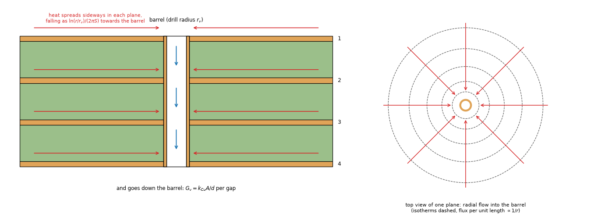

*Figure 1 (`figures/fig_01_via_section_and_flux.png`): section of a via through a four-plane board (heat spreads in each plane towards the barrel and goes down it) and the top view of one plane (radial flow, isotherms dashed).*

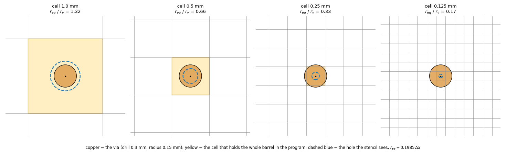

*Figure 2 (`figures/fig_02_via_on_the_cell_grid.png`): the 0.3 mm via drawn to scale on the cells of the sweep; yellow = the cell that holds the barrel in the program, dashed blue = the hole the stencil sees (`r_eq / r_v` = 1.32, 0.66, 0.33, 0.17).*

* **References, independent of the program** (`lib/`, nothing imported from `pcbthermal`): `lattice.py` (the potential kernel of the stencil and the point-sink radius), `sheets2d.py` (the layered model on a fine grid, the barrel spread over its disc by the area of the disc in each cell, and the closed form of a via in a sheet with loss, K0 and K1), `layered3d.py` (the existing 3D solver, imported from `research/solid3d-verification/lib`, with the barrel drawn at its real size: copper ring, bore of air or fill, FR-4 around).
* **The program on copies**: `program_patch.py` rebuilds `fvm.Network.__init__`, `fvm.Network._assemble` and `fdm.Network.__init__` from their source with the via loop replaced by a hook (`inspect.getsource`, recompiled in the module of the program, restored on exit); `solid_patch.py` does the same for the via fraction of `solid3d.Solid`. The treatment `point` reproduces the program to 1e-12 (test).
* **Boards**: `program_cases.py` (the 21 mm 3 x 3 array board of `via-fill`; the periodic unit cell of a via lattice, a p x p board with insulated edges, a source over the whole top and one via; a lone via and a row of five next to a 3 mm source; the example board). The numbers of the layered model (sheet conductances, dielectric conductance per area, films, barrel conductances) are read from the program's own network of a copy without vias and handed to the independent solvers as numbers.
* **Metric.** The via effect `E = T_max(no via) - T_max(with vias)` (K), or the copper-fill gain `T_max(copper fill) - T_max(open)`.

## 2. The point sink on the lattice

`lib/lattice.py` builds the potential kernel `a(x)` of the five-point stencil exactly (`a(1,0) = 1`, `a(n,n) = (4/π) Σ 1/(2k-1)`, the harmonic recurrence for the rest; tested against the known values `4/π`, `4 - 8/π`, `8/π - 1`): a unit sink at one node gives the potential `φ(0) - φ(x) = a(x) / (4S)`, and `a(x) → (2/π) ln|x| + κ`, `κ = (2γ + 3 ln 2)/π = 1.0291`. Matching `ln(r / r_eq) / (2π S)` far away gives

| Constant | Value (`r_eq / Δx`) | Source |
| :-- | --: | :-- |
| `exp(-(γ + 1.5 ln 2))` (exact, from the kernel) | 0.19851 | computed here |
| finite solve, 301 x 301 nodes, three probes | 0.19850 (three probes 0.19844 to 0.19854) | `lattice.point_sink_solve`, residual 4e-14 |
| `0.14 √2` (Peaceman 1978, as remembered) | 0.19799 | memory, patents |
| `exp(-π/2)` (radial-flow argument, [Ibraguimov2022] section 5.1) | 0.20788 | read |
| `0.2` (Peaceman's abstract) | 0.2 | abstract seen |

So **the 0.198 of the program documents is the exact constant**; 0.208 is Peaceman's radial argument (the four neighbours taken as equal, the radial law taken as exact at the first neighbour), an approximation 4.7 % above it. It matters for the choice of cell: the cell at which the grid has the real constriction of a 0.3 mm via is `r_v / 0.19851` = 0.756 mm.

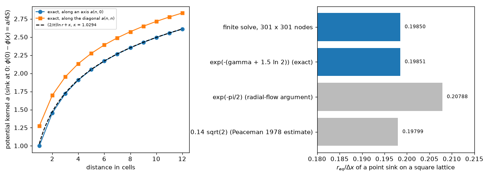

*Figure 6 (`figures/fig_06_lattice_equivalent_radius.png`): the potential kernel along an axis and the diagonal against its asymptote, and the four values of the equivalent radius.*

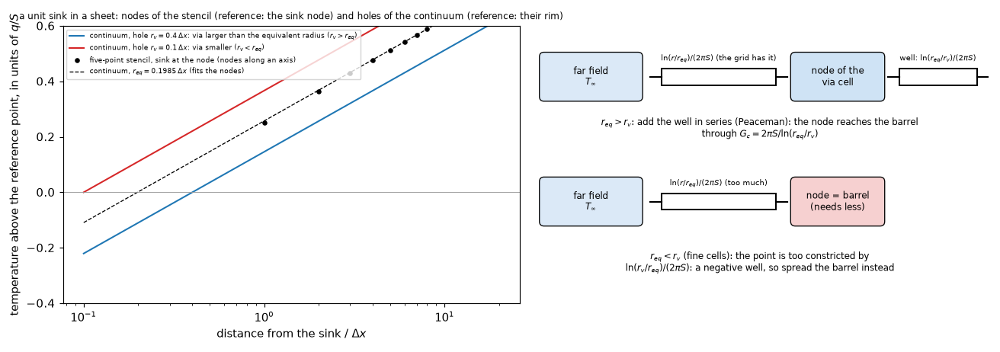

*Figure 3 (`figures/fig_03_peaceman_well.png`): left, the potential of the nodes of a sink on the lattice against the continuum holes (the nodes lie on the hole of radius 0.1985 Δx); right, the resistance bookkeeping: add a well when `r_eq > r_v`, a negative well (so: spread) when `r_eq < r_v`.*

A footprint (weights `w_a`, sum 1) is seen by the sheet as a sink of effective radius `ln r_eff = (π/2)(E - κ)`, `E = Σ_ab w_a w_b a(a-b)` (`lattice.effective_radius`; for one cell `E = 0`). Checked: four equal quarters on the corners of a cell give `r_eff = 0.718 Δx`; the area weights of a disc at `Δx = r_v/4 ... r_v/12` give `r_eff / r_v` = 0.7787 to 0.7796 (the value `e^(-1/4) = 0.7788` of a uniform density over the disc) and the weights of the circle give 1.008 to 1.014. This is the tool that shows why spreading by area is not neutral: it moves the effective radius by factors from 0.4 to 7 (figure 7) depending on where the via sits in the cell.

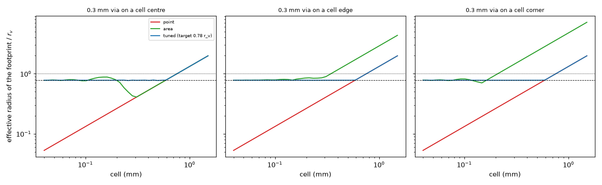

*Figure 7 (`figures/fig_07_effective_radius_of_footprints.png`): effective radius of the point, of the area weights of the disc and of the tuned footprint (target 0.78 r_v) against the cell, for a 0.3 mm via at the centre, edge and corner of a cell.*

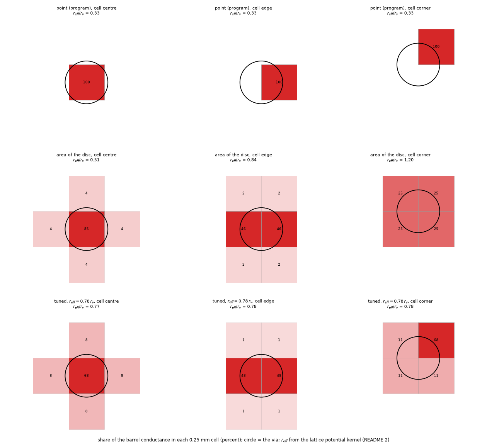

*Figure 4 (`figures/fig_04_footprint_of_the_barrel.png`): shares of the barrel conductance per 0.25 mm cell for the point, the area weights and the tuned weights, at three positions, with `r_eff / r_v`.*

## 3. The references

### 3.1 `sheets2d` against the closed form

A fixed-temperature via of radius 0.4 mm in a sheet with loss (λ = 2 mm), uniform source: the heat taken by the via is 13.697 mW by the closed form (`2π S (a/λ)(q/h) K1(a/λ) / K0(a/λ)`) and, on quarter domains of 10 λ, 13.07, 13.45 and 13.55 mW at `a/Δx` = 4, 8 and 16 (errors -4.6, -1.8 and -1.1 %: the staircase disc, first order). `tests/test_sheets2d_lattice.py` requires 2 % at 16 cells per radius. Also tested: a series circuit and the energy balance, the area of the sampled disc, the Kron reduction against a series/parallel/star-mesh circuit.

### 3.2 `sheets2d` against the 3D solver

The via effect of the unit cell (p = 4 mm, four planes) by the layered fine-grid solver and by the 3D solver with the barrel drawn (quarter domain, 1/16, 1/32, 1/48 mm): 0.3 mm open -0.0 / -0.7 / -1.0 %, 0.3 mm copper fill -0.5 / -0.6 / -0.7 %, 0.6 mm open +0.5 / +0.2 / -0.0 %, 0.6 mm copper fill +0.2 / +0.2 / +0.2 % (3D relative to 2D; the 3D value itself moves by up to 1 % over this range of cells, so the agreement is within the convergence of the 3D reference). On the 3 x 3 board: open 40.47 K and gain -4.51 K (2D, 1/16 and 1/32 mm) against 40.46 / -4.52 K (3D, 0.1 mm) and 40.51 / -4.47 K (3D, 1/12 mm). The ring of copper in the 3D barrel is closer to the uniform area density (`r = 0.78 r_v`) than to an equipotential circle (`r = r_v`, which would give +1 to +3 % of E): the reason for the radius chosen below.

*Review:* the unit-cell numbers above were printed by no script of the folder; `scripts/study_reference_3d.py` (written by the review) prints them: 3D relative to the layered solver at 1/16, 1/32, 1/48 mm, 0.3 mm open +0.06 / -0.66 / -1.06 %, 0.3 mm copper -0.40 / -0.62 / -0.70 %, 0.6 mm open +0.54 / +0.23 / -0.02 %, 0.6 mm copper +0.27 / +0.19 / +0.16 % (the first column of the copper rows differs from the -0.5 and +0.2 written above by 0.1 %). The 3D value is still moving at 1/48 mm for the 0.3 mm open via. The 3D solver here keeps the plane whole across the bore, as `layered3d.py` and the program's 3D solid draw it; a real plane is drilled (section 3.3).

### 3.3 The target radius on other stack-ups (review)

The fine-grid reference spreads the barrel uniformly over its disc, so its effective radius is `e^(-1/4) r_v` by construction: the agreement of `mw_disc@eta` with it (section 4) is agreement with the same idealisation, and only a 3D solve can say which radius a real barrel has. `scripts/study_target_radius.py` (written by the review; numpy and scipy only, independent of `lib/` and of the program) solves the unit cell of a via lattice (the circle of the same area) in axisymmetric 3D with the barrel drawn and in the layered model with the via as an equipotential circle of radius `r_t`, and finds the radius `r_t*` that gives the 3D via effect. Five stack-ups (2 planes 1.6 and 0.8 mm, 4 planes with equal gaps and with 0.21 / 1.07 / 0.21 mm, 6 planes), drills 0.2, 0.3, 0.6, 1.0 mm, pitch 2 and 4 mm, open and copper-filled, the plane whole or drilled through. Grid convergence (4 planes, 4 mm, 0.3 mm open): `r_t* / r_v` = 0.628, 0.631, 0.632 for radial cells of 5, 2.5, 1.25 µm; the 3D energy balance closes to 1e-9; the circle cell agrees with the square cell of section 3.2 within 0.3 % in E.

| Stack-up | plane | `r_t* / r_v` | error of E at `0.78 r_v` | at `r_v` |
| :-- | :-- | --: | --: | --: |
| 2 planes, 1.6 mm | whole | 0.73 to 0.93 | -1.0 to +0.3 % | +0.1 to +1.5 % |
| 2 planes, 0.8 mm | whole | 0.75 to 0.94 | -2.1 to +0.3 % | +0.2 to +2.5 % |
| 4 planes, equal gaps | whole | 0.49 to 0.90 | -0.9 to +1.6 % | +0.1 to +2.5 % |
| 4 planes, 0.21 / 1.07 / 0.21 | whole | 0.47 to 0.90 | -0.7 to +1.4 % | +0.1 to +2.1 % |
| 6 planes, 1.6 mm | whole | 0.27 to 0.89 | -0.8 to +3.4 % | +0.2 to +4.2 % |
| 2 planes, 1.6 / 0.8 mm | drilled, open | 0.65 to 0.80 | -0.2 to +0.5 % | +0.5 to +3.1 % |
| 4 planes (both) | drilled, open | 0.43 to 0.64 | +0.7 to +1.9 % | +1.1 to +2.8 % |
| 6 planes | drilled, open | 0.23 to 0.51 | +1.3 to +3.9 % | +1.7 to +4.7 % |

(FR-4 0.3 W/mK in the plane; with 0.9 W/mK the ranges move by at most 0.3 %. The drilled rows leave out the vias whose hole removes more than 4 % of the plane of the cell, where the missing copper, which the program does not model, dominates: up to +27 %.) The smallest `r_t*` belong to small vias at the wide pitch on many planes, where the junction of a thin ring with each plane adds a resistance that the layered idealisation does not have. So `0.78 r_v` is the better single constant (`r_v` is worse in 62 of the 80 whole-plane cases and in all 40 drilled ones), it is not general, and the error of the layered model of the via, -2 to +4 %, is larger than the 0.4 to 0.7 % of the treatment against its reference. (A drilled plane is the section of figure 1: the planes end at the barrel wall; a whole plane covers the bore.)

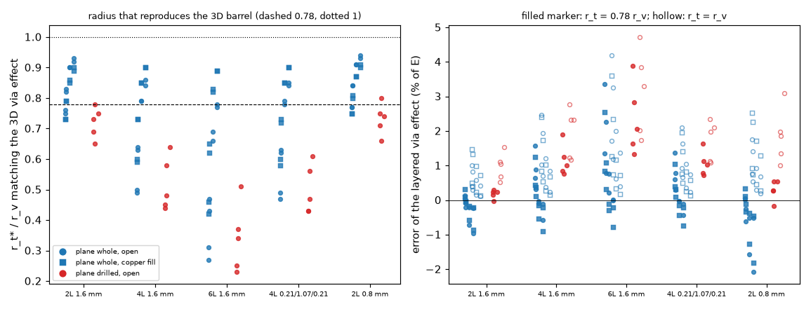

*Figure 14 (`figures/fig_14_target_radius_against_3d.png`): left, the radius that reproduces the axisymmetric 3D via effect for every case of `study_target_radius.py` (blue: plane whole, red: drilled; circles open, squares copper fill; the drills grow from left to right inside each group); right, the error of the layered via effect with `r_t = 0.78 r_v` (filled) and `r_t = r_v` (hollow).*

## 4. The treatments in the FVM and FDM

Treatments (names of the tables; `viakernel.py`, `program_patch.py`):

| Name | What it does |
| :-- | :-- |
| program | all the barrel conductance in the cell of the centre |
| peaceman | independent links: a point with Peaceman wells while `r_eq > r_v`, else the area weights of the disc (plan (a)) |
| area / ring | independent links over the area weights of the disc / the length of its circle (plan (b)) |
| tuned | independent links over weights tuned to `r_eff = r_v` |
| mw_point, mw_ring, mw_area, mw_tuned | mean-potential coupling (the via as one conductor reached through the footprint mean and a well) with that footprint, target radius `r_v` |
| mw_area@eta, mw_tuned@eta | the same with target radius `0.78 r_v` |
| **mw_disc@eta** | the same with the footprint = area weights of the disc of the via **centred on its true position**, enlarged until its `r_eff` reaches `0.78 r_v` if it is smaller; a positive well for any surplus |

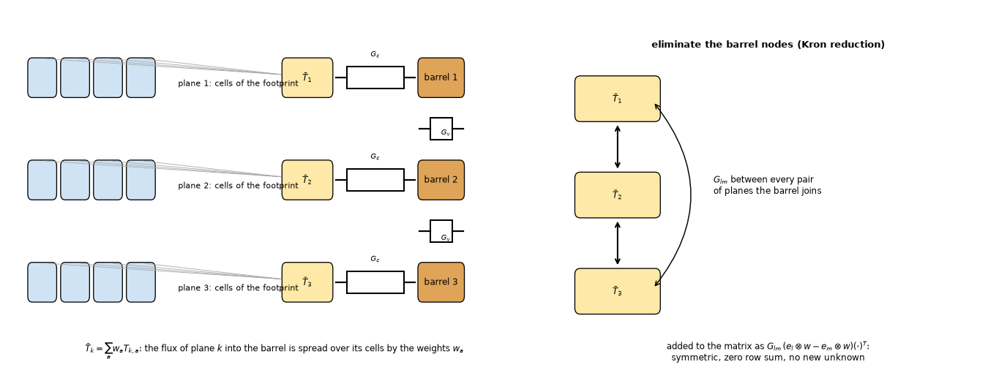

*Figure 5 (`figures/fig_05_mean_potential_coupling.png`): the footprint cells averaged into one temperature per plane, the wells, the barrel nodes and their Kron reduction to couplings between plane means.*

### 4.1 The unit cell of a via lattice (FVM)

p x p board (four planes), uniform source, one via; 12 cases; the via on a cell corner, edge and centre; reference: the fine-grid solver at 1/32 mm for each position. Worst error of `E` (percent of `E`) over all cases and positions:

| Treatment | cells 1 mm | 0.5 mm | 0.25 mm and finer |
| :-- | --: | --: | --: |
| program | 7.3 | 9.7 | **20.1** (grows at every halving, 0.0625 mm) |
| peaceman (plan (a)) | 8.2 | 14.0 | 4.8 |
| area (plan (b)) | 24.8 | 14.0 | 4.8 |
| tuned (independent links) | 3.8 | 3.6 | 3.5 |
| mw_ring | 4.5 | 4.0 | 2.7 |
| mw_tuned (target r_v) | 2.8 | 2.6 | 2.7 |
| mw_area@eta | 4.5 | 4.0 | 4.8 |
| mw_tuned@eta | 3.7 | 1.9 | 0.7 |
| **mw_disc@eta** | **0.7** | **0.5** | **0.4** |

Selected cases (error of `E`, percent; `E_ref` from the reference):

| Case | `E_ref` (K) | treatment | 1 mm | 0.5 | 0.25 | 0.125 | 0.0625 |
| :-- | --: | :-- | --: | --: | --: | --: | --: |
| p 4, 0.3 mm, open | 1.73 | program | +2.2 | -1.9 | -4.0 | -6.3 | -8.6 |
| | | mw_disc@eta | -0.2 | -0.1 | -0.1 | -0.0 | -0.0 |
| p 4, 0.3 mm, copper | 2.24 | program | +2.9 | -2.1 | -5.0 | -7.9 | -10.8 |
| | | mw_disc@eta | -0.4 | -0.2 | -0.1 | -0.1 | -0.1 |
| p 4, 1.0 mm, copper | 2.76 | program | -7.3 | -9.7 | -12.7 | -15.7 | -18.7 |
| | | mw_disc@eta | -0.7 | -0.5 | -0.4 | -0.4 | -0.4 |
| p 8, 0.3 mm, copper | 0.29 | program | +6.2 | -3.7 | -9.6 | -15.1 | -20.1 |
| | | mw_disc@eta | -0.3 | -0.2 | -0.2 | -0.2 | -0.2 |

The full tables of the 12 cases (nine treatments) are printed by `scripts/study_unit_cell.py` (`out/unit_cell.txt`). Remaining error at the finest cells: -0.1 to -0.4 % (the 1 mm via: -0.4 %), the difference between the uniform-density target and the real reference at large `r_v / p`.

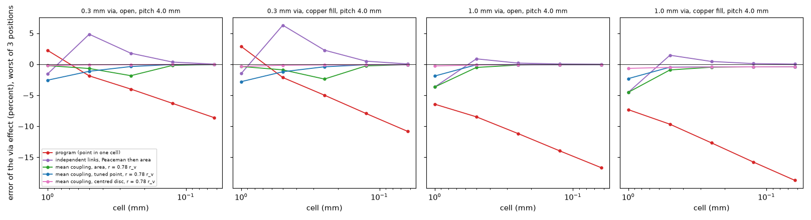

*Figure 8 (`figures/fig_08_unit_cell_error_against_cell.png`): error of the via effect against the cell for four of the cases; worst of three positions.*

### 4.2 The 3 x 3 via-array board

Reference: fine-grid layered solver 40.47 K open and -4.51 K gain; 3D with barrels drawn 40.46 to 40.51 K and -4.52 to -4.47 K. Open rise / copper-fill gain (K):

FVM:

| Treatment | 1 mm | 0.5 | 0.25 | 0.125 | 0.0625 |
| :-- | --: | --: | --: | --: | --: |
| program | 40.39 / -4.78 | 40.76 / -4.38 | 41.05 / -3.98 | 41.35 / -3.64 | 41.65 / -3.34 |
| peaceman | 40.56 / -4.58 | 39.77 / -5.30 | 40.22 / -4.79 | 40.49 / -4.50 | 40.47 / -4.52 |
| area | 39.66 / -5.52 | 39.77 / -5.30 | 40.22 / -4.79 | 40.49 / -4.50 | 40.47 / -4.52 |
| mw_tuned (r_v) | 40.56 / -4.58 | 40.48 / -4.63 | 40.37 / -4.66 | 40.33 / -4.66 | 40.33 / -4.66 |
| mw_area@eta | 40.52 / -4.50 | 40.50 / -4.47 | 40.48 / -4.49 | 40.50 / -4.47 | 40.48 / -4.49 |
| **mw_disc@eta** | 40.52 / -4.50 | 40.50 / -4.47 | 40.48 / -4.49 | 40.48 / -4.49 | 40.48 / -4.49 |

FDM:

| Treatment | 1 mm | 0.5 | 0.25 | 0.125 | 0.0625 |
| :-- | --: | --: | --: | --: | --: |
| program | 40.59 / -4.63 | 40.58 / -4.41 | 40.96 / -3.99 | 41.31 / -3.65 | 41.63 / -3.34 |
| peaceman | 40.77 / -4.45 | 40.58 / -4.41 | 40.71 / -4.32 | 40.42 / -4.57 | 40.47 / -4.51 |
| mw_area@eta | 40.41 / -4.42 | 40.58 / -4.41 | 40.74 / -4.22 | 40.48 / -4.49 | 40.48 / -4.49 |
| **mw_disc@eta** | 40.41 / -4.42 | 40.49 / -4.51 | 40.48 / -4.49 | 40.48 / -4.49 | 40.48 / -4.49 |

On the fine series of 13 cells from 1 to 0.0625 mm (`study_array_board.py --sweep`) the gain of `mw_disc@eta` is -4.42 to -4.51 K (FVM -4.46 to -4.50, FDM -4.42 to -4.51), that of the program -4.78 to -3.34 K; `mw_area@eta` has one outlier in the FDM (-4.22 K at 0.25 mm: the area weights of this cell size leave the footprint too small).

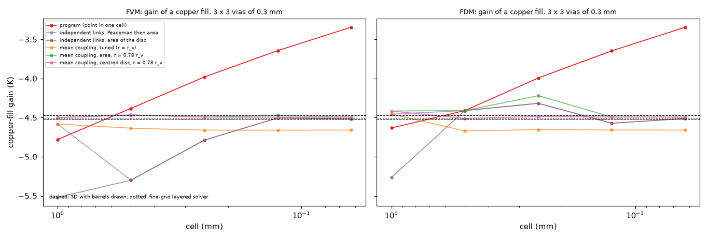

*Figure 9 (`figures/fig_09_array_board_gain_against_cell.png`): copper-fill gain against the cell, FVM and FDM; dashed: 3D with the barrels drawn; dotted: fine-grid layered solver.*

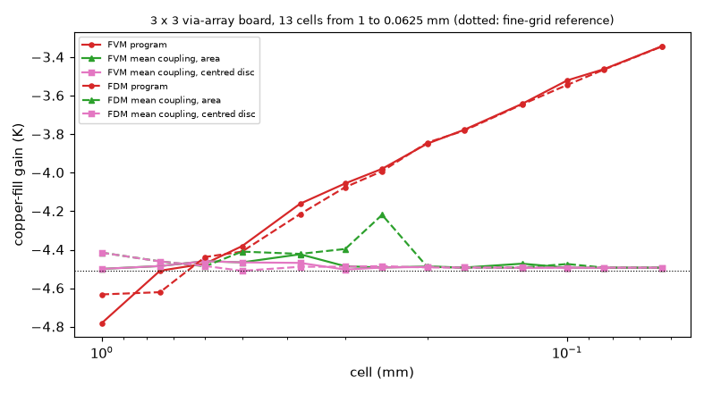

*Figure 10 (`figures/fig_10_array_board_fine_sweep.png`): the same board on 13 cells from 1 to 0.0625 mm.*

### 4.3 The example board (FVM and FDM; 100 x 80 mm, nine vias under U1)

Open maximum temperature (°C) / copper-fill gain (K); the board without vias is 94.36, 94.67, 94.71, 94.72, 94.72 °C at 2, 1, 0.5, 0.25, 0.125 mm (FVM).

| FVM | 2 mm | 1 mm | 0.5 mm | 0.25 mm | 0.125 mm |
| :-- | --: | --: | --: | --: | --: |
| program | 85.34 / -4.91 | 85.81 / -4.49 | 85.87 / -3.89 | 85.95 / -3.59 | 86.17 / -3.29 |
| area (resolved at fine cells) | 83.96 / -5.08 | 84.19 / -5.26 | 84.32 / -5.09 | 84.84 / -4.51 | 85.16 / -4.23 |
| **mw_disc@eta** | 85.07 / -3.70 | 85.22 / -4.14 | 85.17 / -4.19 | 85.15 / -4.20 | 85.14 / -4.21 |

| FDM | 2 mm | 1 mm | 0.5 mm | 0.25 mm |
| :-- | --: | --: | --: | --: |
| program | 84.66 / -4.89 | 84.38 / -4.55 | 85.22 / -4.09 | 85.67 / -3.68 |
| **mw_disc@eta** | 84.26 / -3.57 | 85.12 / -4.15 | 85.12 / -4.20 | 85.13 / -4.20 |

At the default 1 mm the FVM open temperature goes from 85.81 to 85.22 °C (-0.59 K) and the FDM from 84.38 to 85.12 °C (+0.74 K): the two models, 1.4 K apart in the program, are 0.1 K apart with the treatment. The gain converges to -4.20 K from 0.5 mm (the program's range over 0.125 to 1 mm is 1.2 K); the area spread of the same program copy at 0.125 mm (-4.23 K, not an independent reference and still moving: -4.51 K at 0.25 mm) is 0.02 K from it, while the board's own independent reference was not built (the example board has zones, a heatsink and two parts; `sheets2d` is for uniform boards). At 2 mm (nx = 50, the via is on the corner of four cells) the gain is -3.70 K: coarse cells remain a limit.

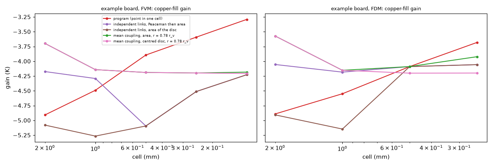

*Figure 11 (`figures/fig_11_example_board_gain_against_cell.png`): copper-fill gain of the example board against the cell.*

### 4.4 A lone via and a row of five next to a source

16 mm two-plane board, 0.5 W in a 3 mm square, vias 1 mm from its edge (pitch 1 mm), reference at 1/32 mm. Worst error of `E` (percent): FVM program 12.7 / 25.9 / 30.6 / 41.8 at 1 / 0.5 / 0.25 / 0.0625-0.125 mm; `mw_disc@eta` 8.6 / 3.5 / 1.5 / 1.0. FDM program 33.2 / 15.7 / 27.0 / 41.1; `mw_disc@eta` 4.3 / 1.4 / 0.9 / 0.9. The error at 1 mm (8.6 %) is not only the via: `E` is 1.0 K of a 40 K rise and the whole board sits on cells of 1 mm; it was not separated from the discretisation of the rest. The residual 1.0 % of the 0.6 mm copper fill at fine cells is the same uniform-density difference as in 4.1.

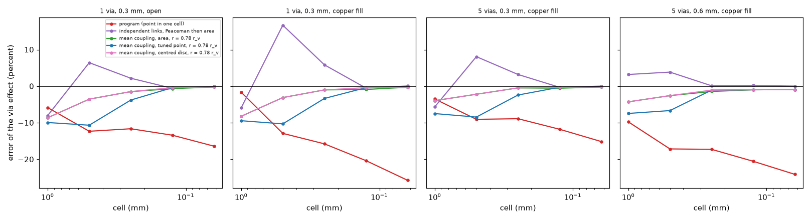

*Figure 12 (`figures/fig_12_lone_via_and_row.png`): error of the via effect against the cell for a lone via and a row of five.*

## 5. Why `mw_disc@eta`

* The constriction of a via in the sheet is `ln(r_eff / r_target) / (2π S)` and only that; the footprint decides `r_eff`, the well supplies the rest. A footprint centred on the real position of the via keeps the barrel where it is; the first version of the tuned weights mixed the weights with a point in the cell of the centre, which moves the barrel by up to 0.7 `Δx` and failed for a lone via near a source (error 10.7 % at 0.5 mm against 3.5 %).
* The independent-links treatments (each cell its own vertical link, as the 3D solid has) cannot be exact: with strong links (copper fill) the cells of the footprint are tied to one potential, with weak links (open) they are not, so the effect of the footprint depends on the fill (`tuned`: 3.5 % error at fine cells, `mw_tuned` 2.7 %). The mean-potential coupling makes the via one conductor reached through one mean temperature per plane, whatever the strength of the links.
* The radius `r_t = 0.78 r_v`: the layered model of the program (and the 3D solid) puts the barrel conductance uniformly over the disc of the via, which has the mean potential of a circle of `e^(-1/4)` times its radius; the 3D solver with the barrel drawn confirms it within 1 % (3.2). With `r_t = r_v` all mean-potential variants are 1.0 to 1.3 % high at fine cells (the gain -4.66 K instead of -4.51). The value is a derivation checked against one 3D solver on one stack-up, not a measurement on a board. *Review:* the uniform density over the disc is a property of the fine-grid reference (and of the 3D solid's spread), not of a real barrel; on other stack-ups the radius that matches an axisymmetric 3D solve is 0.27 to 0.94 `r_v` with whole planes and 0.23 to 0.80 `r_v` with drilled planes, and `0.78 r_v` leaves -2.1 to +3.9 % in the via effect (section 3.3).

## 6. The 3D solid

The solid builds the vertical conductivity of every slab of a cell from the copper area of the barrel (`via_frac`): a point if the area fits in the cell, spread over the disc by area if it does not (`solid3d.py`, 2.4.3). Gain of a copper fill on the 3 x 3 board (open rise / gain, K; reference -4.5 K):

| Rule | 1 mm | 0.5 | 0.25 | 0.1667 |
| :-- | --: | --: | --: | --: |
| program | 40.42 / -4.77 | 40.80 / -4.35 | 41.17 / **-5.65** | 41.46 / **-5.34** |
| always the cell of the centre | 40.42 / -4.77 | 40.80 / -4.35 | 41.17 / -3.56 | 41.46 / -0.89 |
| area weights always | 39.69 / -5.52 | 39.79 / -5.29 | 40.27 / -4.75 | 40.55 / -4.44 |
| tuned, r = r_v | 40.42 / -4.77 | 40.48 / -4.74 | 40.41 / -4.67 | 40.39 / -4.64 |
| tuned, r = 0.78 r_v | 40.42 / -4.77 | 40.67 / -4.51 | 40.58 / -4.54 | 40.57 / -4.42 |

* **Cause.** The program's rule depends on the area of the via against the cell: at 0.25 mm the copper fill (0.0707 mm2 > 0.0625 mm2) is spread over several cells while the open barrel (0.0216 mm2) stays a point, so the board "with fill" and the board "open" are different models. The gain is the difference of two treatments, -5.65 K at 0.25 mm and -5.34 K at 0.1667 mm against -4.35 K at 0.5 mm (where neither is spread). Always the cell of the centre (the 2.4.2 rule) is worse: the copper fill is clipped at 1 per cell below 0.266 mm and the gain collapses (-3.56 and -0.89 K). The same footprint for every fill removes the variation: tuned at 0.78 `r_v`: -4.77 / -4.51 / -4.54 / -4.42 K, within 0.1 K of the reference from 0.5 mm; the maximum of the open rise 40.57 to 40.67 K against 40.47 to 40.51 K.
* **It is the same defect as in the FVM** (a point sink in one cell has the lattice radius 0.1985 `Δx`: the 3D copper planes are slabs in which the barrel is a column of cells), plus the inconsistent rule above. At coarse cells (1 mm: -4.77 K, 0.27 K too large a gain) the missing piece is the well; the 3D solid has no node for it, and a series resistance in the pillar was not tried.
* **Position.** Shifting the whole array by 0.125 to 0.375 mm inside 0.5 mm cells: the program does not change at all (all vias stay in the same cell), while area weights change the gain between -5.29 and -4.35 K (the weights of a via on a cell edge or corner); the tuned footprint (0.78 `r_v`) changes it by 0.00 K (-4.51 at every shift); the centred disc without a well (`disc_eta`) is as bad as the area weights at the position 0 (-5.29, -4.56, -4.51, -4.56 K): in the 3D solid a footprint centred on the via needs the well that the solid has no node for.
* The board of the roadmap note (-2.18, -1.84, -2.64 K at 1, 0.5, 0.25 mm) was not found in the repository, so it was not reproduced; the variation was reproduced on the board of `via-fill` (-4.77, -4.35, -5.65 K).

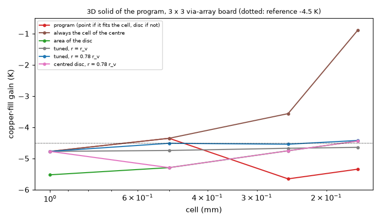

*Figure 13 (`figures/fig_13_solid3d_gain_against_cell.png`): copper-fill gain of the 3D solid against the cell for the footprint rules.*

## 7. Lumped and Analytic

Not touched. The Lumped model uses the grid arrays of the FVM network (`lumped.py` sums `net.gz` over rings; the Analytic model computes its own via conductances per tile and does not read `gz`, review): a change of the FVM that moves the via out of `gz` would remove the vias from the Lumped model unless the point conductance is kept (`INTEGRATION.md`). Their overstatement of the copper fill by 35 to 52 % is item A6.

## 8. Limits

* Uniform boards (full copper, one drill diameter per board) for the references; the example board has no independent reference of its own. Square cells, via inside the board (a footprint cut by the board edge is renormalised; not tested near an outline). *Review* (`scripts/study_edge_via.py`): a 0.3 mm copper-filled via 0.16 mm from an insulated edge (10 mm 4-layer board, source 3 mm away): `mw_disc@eta` gives E = 3.62, 3.36, 3.18, 3.15, 3.15 K at 1 to 0.0625 mm (+15 % at 1 mm against its own fine value: the lattice kernel has no image of the edge), the program 3.75 to 2.59 K; behind an outline edge at 7.03 mm the same, 8.39 to 7.52 K against 8.97 to 6.34 K. The footprint did not reach cells off the board here; the prototype does not drop such cells (only cells off the grid), so on adoption the weights must be restricted to cells on the board (covered cells pinned to the ambient would otherwise be coupled to the barrel).
* The model is the layered idealisation of the program: its own error against the 3D barrel (up to 1 %, section 3.2) is not removed.
* The target radius `0.78 r_v` was checked against one 3D solver on 0.3 and 0.6 mm vias in a four-plane board; the clearance of a real via (anti-pad), via-in-pad solder, the plated cap and tented/filled structures are not modelled (as in the program).
* No measured board. Transients were not run with the patched matrix (the couplings are in `K`, so the steady state and the transient networks share them, but no transient was compared). The whole validation study and the stress tests were not re-run with the patch. Coarse cells (2 mm and above) remain outside the claim: the via is then a fraction of a cell and the error is in the sheet.
* A footprint costs 30 area samplings for the enlargement of the disc per via; a board with thousands of vias needs the weights computed once per via with vectorised sampling (see `INTEGRATION.md`). *Review* (`scripts/study_edge_via.py`): measured 0.06 to 1.9 ms per via (1 to 29 cells from 1 to 0.0625 mm), so 10 000 vias cost up to about 20 s of set-up; the larger risk is the matrix: a four-plane via couples 4 x 30 unknowns densely at 0.0625 mm (5 400 entries), which the direct solver turns into fill-in; not measured on a Gerber board.

## 9. Review

* **Status**: reviewed by the independent reviewer on the branch with the program at `3d672f1`; `scripts/run_all.sh` re-run in full, the 18 folder tests, `tests/test_docs.py`, `tests/test_license_header.py` and `research/check_figures.py` pass; every table of sections 4 and 6 reproduced to the printed digit (the outputs are identical to the researcher's; the unit-cell references, kept in a cache, were recomputed for five cases and agree exactly). The treatment is sound and converges; the claim of its accuracy is narrowed (below). Ready for the maintainer's decisions (`INTEGRATION.md`).
* **Independent checks** (reviewer's own code): the lattice constant by an FFT Green's function of the five-point stencil on a 2048² periodic lattice, `r_eq / Δx` = 0.19849 to 0.19869 from five probes (exact 0.19851; Peaceman's radial argument 0.20788); `a(1,0)` = 1, `a(1,1)` = 4/π; four equal quarters 0.7187 `Δx`, a sampled disc of 4, 8, 12 cells 0.784, 0.781, 0.780 times its radius (`e^(-1/4)` = 0.7788). The program documents quote "0.198 Δx (Peaceman)", which is the exact constant to three digits and Peaceman's 1983 form `0.14 √2`. The target radius against an axisymmetric 3D solve on five stack-ups (`scripts/study_target_radius.py`, section 3.3): the fine-grid reference is the layered model with `0.78 r_v` built in, so the 0.4 to 0.7 % of section 4 is agreement with the same idealisation; a real barrel matches 0.23 to 0.94 `r_v`, and `0.78 r_v` is -2.1 to +3.9 % off in the via effect. The circular-cell layered model agrees with `sheets2d` within 0.3 % in E (an independent check of the reference). The unit-cell 3D numbers of 3.2 were printed by no script: `scripts/study_reference_3d.py` reproduces them within 0.1 %. SOR and CG (`scripts/study_solvers.py`): CG within 1e-11 K; SOR stops with a "did not converge" warning 19.4 to 21.9 K low (26.7 K was written).
* **Defects found and corrected** (studies and documents; the program is untouched): (1) the accuracy and the "derivation" of `0.78 r_v` were stated as physics; corrected in the answer, sections 3.3, 5, the theory text and the text for the project documents; (2) the SOR figure, and the unit-cell 3D figures, had no script (three scripts added, `run_all.sh` runs them); (3) `lib/lattice.py` gave 0.19846 for the constant it computes as 0.19851; (4) the fine-sweep range was -4.42 to -4.50 K in four places, the FDM reaches -4.51; (5) the area spread of the example board at 0.125 mm was called an independent resolved limit; (6) section 7 said the Analytic model reads the FVM arrays (only the Lumped model does); (7) the doubt on the 1 mm error quoted the 3.7 % of another treatment; (8) plan (b) at 1 mm is +3 to +25 % and -4.5 % for the 1 mm via, not "+8 to +25 %"; (9) the bibliography said topics 02 to 04 cite the new sources (none does yet).
* **Limits**: no measured board and no published numerical case of a via on a mesh; transients, the validation study and the stress tests were not run with the patch; a via near an edge is +12 to +15 % at 1 mm (the kernel has no image of the edge; `scripts/study_edge_via.py`); a footprint is not yet restricted to cells on the board (outline); the matrix fill-in with thousands of vias on fine cells was not measured; the 3D solid keeps a 0.27 K too large gain at 1 mm (no well).
* **Text for the project documents**: `docs/` of this folder, with the target radius described as a single constant within -2 to +4 % of a 3D barrel (not within 1 %), and the convergence figures stated against the layered reference.

## What was read and what was not verified

**Read in full or in the part that matters.** The arXiv paper of Ibraguimov, Zakirov, Indrupskiy and Anikeev on the Peaceman well-block radius (text extracted; sections 1 and 5.1: the five-point balance, the argument that gives `R0 = Δ e^(-π/2)`; their Theorem 3 not read). The IEEE TPEL manuscript of Shen, Wang, Blaabjerg, Zhao and Long (Aalborg copy; the abstract, the introduction and the verification section; the formulas of the via array not checked; it has no rule for the mesh of a via). The abstract and introduction of Gjerde, Kumar and Nordbotten (singularity removal, arXiv 1812.03055).

**Seen as a summary or an abstract only.** Peaceman (1978): the abstract (well-block pressure equals the flowing pressure at about 0.2 `Δx`) through a search; Peaceman (1983) and the formula `0.28 [...]` through a conference paper (it reduces to 0.198 `Δx` on a square grid, in agreement with the computed constant); Wolfsteiner, Durlofsky and Aziz (2003): abstract; Fukai and Uchiyama (1996) and Kozma and Schreiber (2004): the existence of the expansion `a(x) = (2/π) ln|x| + (2γ + 3 ln 2)/π`; ANSYS Icepak training and forum pages on via arrays (smeared or explicit; no rule found for the cell next to a via); a search for Guenin's Electronics Cooling articles on thermal vias (not opened).

**Not obtained.** Peaceman (1978) and (1983) full texts; Wolfsteiner et al. full text; Aavatsmark, Babu and Ding well-index papers (not searched beyond the first query); Holm, Maxwell and the Yovanovich spreading-resistance formulas for a circular contact were not used as sources: the constriction that matters here is the logarithm of the sheet, derived and checked numerically (section 3.1), not a formula taken from the literature. Heat-sink spreading-resistance sources of `effective-conductivity` were not reopened. The cited constant of the potential kernel was **not** taken from a source: it was computed (the recurrence and a finite solve) and agrees with the form quoted by the abstracts.

**Reproduced.** The values of `via-fill` for the 3 x 3 board (program FVM 40.39 / -4.78 ... 41.65 / -3.34 K and the independent 3D at 1/12 mm, -4.47 K) and the example board of `docs/validation.md` 2.1 (85.81, 85.87, 85.95 °C). No published numerical case of a via in a layered board with a mesh study was found, so the published-case reproduction of the literature check is open: the independent references are the closed form of a via in a sheet (3.1), the exact lattice kernel (2) and the 3D solver (3.2), none of them a publication of a board.

**Doubts of the researcher.** (1) `r_t = 0.78 r_v` rests on one 3D solver; with 1 the results are 1 to 3 % worse in the gain but the convergence is the same. (2) The error at 1 mm (up to 0.7 % of `E` in the unit cell with `mw_disc@eta`, 8.6 % for the lone via; the 3.7 % first written here was that of `mw_tuned@eta`) was not decomposed. (3) The example board has no independent reference. (4) The area sampling per via is slow; a vectorised version was not written. (5) The statement that the 3D variation has "a different cause" is partly wrong: the lattice radius is the same, plus an inconsistent rule; I say so in section 6.

## Reproduce

`sh research/point-via-convergence/scripts/run_all.sh` from the repository root (`PY` selects the interpreter, default `.venv/bin/python`; about one hour) runs the studies into `out/` (git-ignored); then `make_diagrams.py` and `make_figures.py`; tests: `.venv/bin/python -m pytest -q research/point-via-convergence/tests` (18 tests, 10 s).
