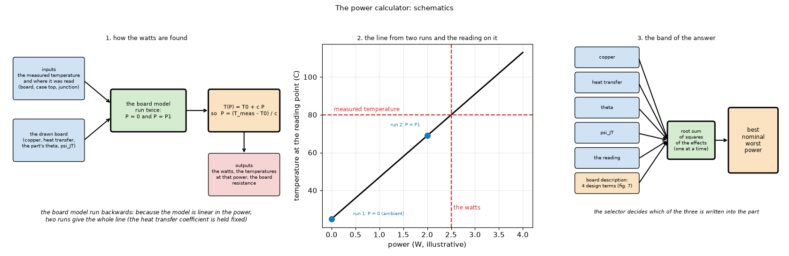
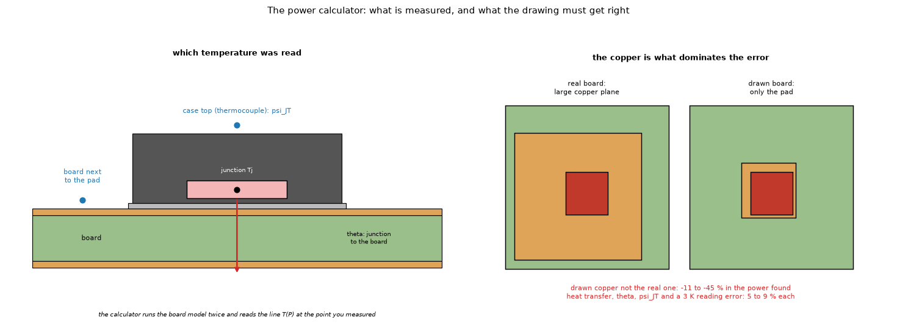
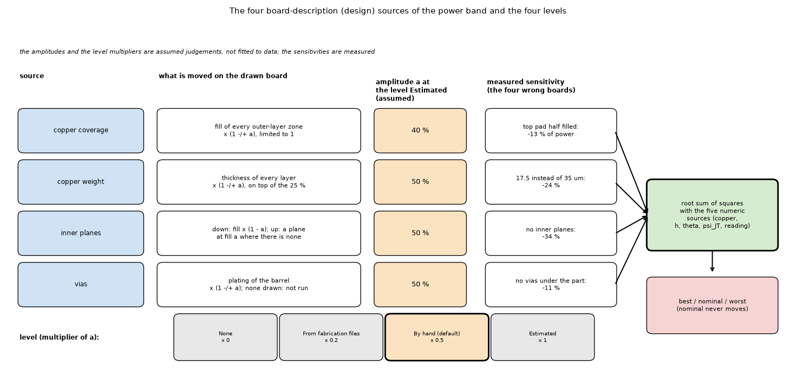
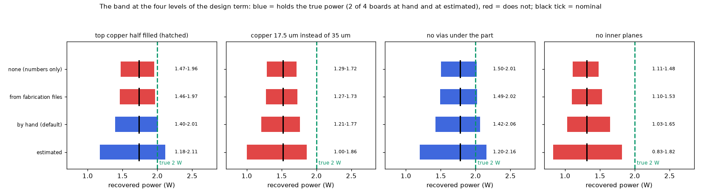

# The power calculator: the watts of a part from a measured temperature

Status: **implemented** in the program (see the program's `docs/versions.md` and `docs/validation.md`). The manual of the calculator (formulas, routes, the band) stays in `docs/calculators.md`; this folder holds the studies behind it. Studies: `calculator_validation.py`, `power_from_top_study.py`, `calculator_calibration_study.py`, `study_power_band.py`, `study_design_term_coverage.py`; figures: `make_figures.py`.

## 1. The questions

1. Run backwards (the board model asked "how many watts give this temperature?"), does the calculator return the datasheet's own thermal resistance on the datasheet's own board?
2. How wrong can the answer be when the drawn board is not the real one, and which input dominates?
3. How can the error be reduced?

### 1.1 Diagrams and illustrations



*Figure 4 (`figures/fig_04_calculator_schematic.png`): The power calculator as schematics: 1, how the watts are found (the board model run twice, the line T(P) = T0 + c P, the watts from the reading); 2, that line and the reading on it; 3, the band of the answer from the one-at-a-time effects of the uncertain inputs combined by root sum of squares. The two-run line is exact for fixed heat transfer coefficients; with computed convection a third run finds the deviation and a secant iteration finishes the answer (section 4.6).*



*Figure 5 (`figures/fig_05_reading_points_and_copper.png`): left, the section of a package with the three places a temperature can be read (junction, case top, board); right, the real copper against the drawn copper, which dominates the error (-11 to -45 %).*



*Figure 7 (`figures/fig_07_design_sources.png`): the four board-description (design) sources of the band (`docs/calculators.md` 1.1c): what each one moves on the drawn board, its amplitude at the level Estimated (coverage 40 %, weight, planes and vias 50 %: assumed, not fitted), the measured sensitivity of the four wrongly drawn boards, the root-sum-of-squares combination with the five numeric sources, and the multipliers of the four levels (0, 0.2, 0.5 default, 1). Figure 4 panel 3 lists the sources of the band, now including the design terms.*

## 2. Findings in short

* On the datasheet's own board the calculator is within 2 to 3 %: CSD17308Q3 46.8 against 46 K/W (−1.7 %), a JEDEC 2s2p exposed-pad QFN with 9 vias 31.6 against 32.5 K/W (+3 %, via array assumed), at 0.5 mm cells. With finer cells the two rows move to −2.3 % and +1.3 % (section 4.5). Part of the CSD17308Q3 agreement is a model error: on that board the FVM's board resistance is 2.4 % below an independent 3D solver (the program's 3D solid is within 0.1 %), so a converged 3D answer would be about 4 % off the datasheet (section 4.6). The JEDEC row depends on how the bottom layer of the test board is read: a 70 µm plane there instead of traces gives +23 % (section 4.5).
* **The copper dominates the error** when the drawn board is not the real one (−11 to −45 %); heat transfer, θ, ψJT and a 3 K reading error each move the result 5 to 9 %.
* A datasheet shortcut `P = (T_top − T_amb)/(θJA − ψJT)` is the worst of the routes (+50 / −25 % for θJA 30 % off) and is not offered.
* A known-power reference removes the copper error but only fits parts whose dissipation can be fixed (not implemented); a two-point fit is badly conditioned (±1 K moves the copper multiplier from 1.05 to 3.9); an uncertainty band (best, nominal, worst) is implemented; with the board-description (design) term of the program (default level *Drawn by hand*) it is wider than the numbers-only band quoted in sections 4.4 and 4.7, and it brings 2 of the 4 badly drawn boards inside (section 4.7).

## 3. Folder layout

| File | What it is |
| :-- | :-- |
| `scripts/calculator_validation.py` | The calculator against two datasheet boards, plus the JEDEC board without vias (about 7 minutes). |
| `scripts/power_from_top_study.py` | Sensitivity of the power recovered from the top temperature to the board and the data (about 10 seconds). |
| `scripts/calculator_calibration_study.py` | Known-power reference, two-point fit and the band, on the example board (about 5 minutes; a study, not part of the program). |
| `scripts/study_power_band.py [level]` | The band of the program (`inverse.power_band`) on the example of `docs/calculators.md` 1.1b, and whether it holds the true power when the drawn board differs (about 2 minutes per level; default level `none`, the numbers-only band; `hand` is the default of the program). |
| `scripts/study_design_term_coverage.py [levels]` | The coverage table of `docs/calculators.md` 1.1c: the four badly drawn boards at the design levels none, cad, hand and estimated, and the example band at every level (about 6 minutes). |
| `scripts/study_cell_size.py` | The datasheet rows at 1 to 0.25 mm cells, and the JEDEC row with a bottom plane (about 30 minutes). |
| `scripts/study_independent_datasheet_board.py` | The board resistance of the CSD17308Q3 board in the FVM, the 3D solid and the independent solver of `solid3d-verification/lib/layered3d.py`; the affine-in-power check (about 2 minutes). |
| `scripts/make_figures.py [design]` | Draws figures 1 to 3 (runs the first three studies; about 15 minutes) and figure 6 (from the table of 4.7, no run); `make_figures.py design` draws only figure 6. |
| `scripts/make_diagrams.py` | Draws the schematic diagrams and the illustration (figures 4, 5 and 7; no data, no program; uses `research/diagram_kit.py`). |
| `figures/` | `fig_01` to `fig_07`; figures 4, 5 and 7 are diagrams and the illustration (`make_diagrams.py`), figure 6 is drawn from the table of 4.7. |

```sh
.venv/bin/python research/power-calculator/scripts/calculator_validation.py
.venv/bin/python research/power-calculator/scripts/power_from_top_study.py
.venv/bin/python research/power-calculator/scripts/calculator_calibration_study.py
.venv/bin/python research/power-calculator/scripts/study_power_band.py
.venv/bin/python research/power-calculator/scripts/study_cell_size.py
.venv/bin/python research/power-calculator/scripts/study_independent_datasheet_board.py
.venv/bin/python research/power-calculator/scripts/make_figures.py
.venv/bin/python -m pytest -q tests/test_calculator_validation.py tests/test_inverse.py
```

## 4. Validation: three routes, three tables

### 4.1 Against datasheets (`research/power-calculator/scripts/calculator_validation.py`, `tests/test_calculator_validation.py`)

A datasheet gives RθJA for a *stated* board. Built in the program, that board must return the datasheet's thermal resistance: the calculator must give 1 W when the junction is `RθJA` above ambient. Computed natural convection and radiation, horizontal board, still air.

| Case | datasheet RθJA (K/W) | model RθJA (K/W) | power returned for 1 W | error |
| :-- | --: | --: | --: | --: |
| TI CSD17308Q3 on its datasheet board (38.1 × 38.1 mm, 1.52 mm FR-4, 71 µm copper, 1 in² pad), RθJA typical | 46 | 46.8 | 0.983 W | −1.7 % |
| JESD51-7 2s2p board, exposed-pad QFN with 9 thermal vias (TPS7A47, **via array assumed**) | 32.5 | 31.6 | 1.030 W | +3.0 % |
| the same, measured on the top with ψJT 0.3 K/W | 32.5 | 31.5 | 1.030 W | +3.0 % |
| the same JEDEC board **without** the thermal vias | - | 68.1 | (0.48 W) | the exposed pad needs the vias (JESD51-5); 84 to 73 K/W at other cell sizes (section 4.5) |

* The CSD17308Q3 datasheet also gives 58 K/W as a *maximum* and 165 K/W for the minimum pad (also a maximum). A maximum covers the spread of parts and boards, not this board, so it is not a target (the model gives 45.7 K/W when the junction is 58 K above ambient because the computed convection improves with temperature). The pad of the minimum-pad case is not stated, so that case cannot be built.
* The JEDEC 2s2p board follows ROHM application note 64AN113E (JESD51-3/5/7/9/10): 114.3 × 76.2 × 1.6 mm, 70 µm top and bottom traces, two 74.2 × 74.2 mm planes of 35 µm, thermal vias Ø0.30 mm at 1.2 mm pitch. The traces are not drawn. The TPS7A47 values used (RθJA 32.5, θJC(bot) 1.7, ψJT 0.3 K/W) are from its datasheet (SBVS204G, read); the 5 × 5 mm body and the 3.15 mm exposed pad are from its package drawing RGW0020A (read; an earlier version of this README called them assumptions). The 3 × 3 via array at 1.2 mm is the assumption (the datasheet's example land pattern shows Ø0.2 mm vias, the JEDEC board's are not stated there), so this row is an indication (+3 %), not a proof.
* ROHM 64AN113E table 2, as its text extracts (rev. 003, read with a PDF text extractor whose merged table cells cannot be read for sure), gives the 2s2p backside copper as 74.2 × 74.2 mm of 70 µm, and its thermal vias connect layers 1, 2 and 4. The study draws the backside as traces (not drawn), which is how JESD51-7 is usually described (from memory; the standard was not read). With a 70 µm bottom plane the model RθJA drops from 31.6 to 26.4 K/W (`study_cell_size.py`), so the JEDEC agreement holds only for the traces reading.
* The ψJT row only checks that the top-of-package point is consistent with the junction point; the model has no top path in the JEDEC case, so ψJT cannot be predicted (that needs the junction node of `docs/versions.md` "Planned").
* Tests: the three rows above with tolerances of 3 % (CSD17308Q3) and 5 % (JEDEC), and the factor of about two for the missing vias.

### 4.2 Sensitivity to the board and to the data (`research/power-calculator/scripts/power_from_top_study.py`, `docs/validation.md` section 19)

Part of 2 W, θ = 6 K/W, ψJT = 2 K/W on the example board; the top reading is made on the real board and the power is recovered on a drawn board that differs:

| What differs between the drawn board and the real one | recovered power (W) | error |
| :-- | --: | --: |
| nothing | 2.000 | 0.0 % |
| top copper half filled (hatched) | 1.735 | −13.2 % |
| copper 17.5 µm instead of 35 µm | 1.519 | −24.1 % |
| no inner planes | 1.312 | −34.4 % |
| no top copper pad | 1.100 | −45.0 % |
| no vias under the part | 1.780 | −11.0 % |
| heat transfer coefficients +30 % / −30 % | 2.126 / 1.818 | +6.3 % / −9.1 % |
| θ +20 % / −20 % | 1.873 / 2.145 | −6.3 % / +7.3 % |
| ψJT 1 / 3 K/W instead of 2 | 1.893 / 2.119 | −5.3 % / +6.0 % |
| measured top temperature 3 K low / high | 1.831 / 2.169 | −8.5 % / +8.5 % |
| datasheet shortcut with θJA 30 % below / above the board's (19.7 K/W) | 3.002 / 1.499 | +50.1 % / −25.0 % |

**Reading it.** On the datasheet's own board the calculator is within 2 to 3 % (section 4.1); the large deltas appear only when the drawn board is not the real one. The copper dominates (11 to 45 % for a wrong copper, planes or vias), the heat transfer, θ, ψJT and a 3 K measurement error each move the answer by 5 to 9 %.

### 4.3 Self-consistency (`tests/test_inverse.py`)

On a known board the model's own temperature at every point (max, mean, ring, junction, top) gives back the power within 0.1 %, with constant and with computed heat transfer coefficients; a part without θ is refused for the junction and the top; a board with less copper gives a lower power for the same top temperature; a larger ψJT gives a larger power.

### 4.4 How to reduce the error (`research/power-calculator/scripts/calculator_calibration_study.py`)

The large deltas of section 4.2 come from one thing: the board resistance `R` (kelvin per watt at the measured point) of the *drawn* board is not that of the *real* board, mostly because of the copper. Three ways to cope were tried on the same example (U1 at 2 W; the drawn board has half or a quarter of the real copper; thermocouples at 1 mm and 10 mm from the part; the study is not part of the program yet):

| Drawn board | plain calculator (1 mm point) | **A.** known-power reference (1 W) | **B.** two points (1 and 10 mm): P and a copper multiplier fitted together |
| :-- | --: | --: | --: |
| copper 0.5 × the real | −22.9 % | 0.0 % | 0.0 % (finds copper ×2.00) |
| copper 0.25 × the real | −42.0 % | 0.0 % | 0.0 % (finds ×4.00) |
| 0.5 × copper, readings ±1 K off | −19 to −27 % | **−4.7 to +5.7 %** | −17 to +17 % (the copper multiplier comes out between 1.05 and 3.9) |

* **A. A known-power reference** (best): read the same thermocouple once with the part at a power you know (a dummy load, or the part in a state whose dissipation is known) and scale the model so that it reproduces that reading before looking for the unknown power. It does not need the copper at all, only that the board answers linearly (constant heat transfer; with computed convection a few percent of non-linearity remain, which the model can correct). It survives ±1 K of reading error with ±5 %. This is what the literature does: a heater of known input is used to calibrate the board before the unknown source is estimated (Chen-type inverse heat-transfer methods, ~10 % in the studies found) and resistors of known power calibrate thermal-imaging power estimates (mean error 10 % with consumer cameras above 300 mW).
* **B. Two measurement points**: two board temperatures at different distances give the power and the copper at once (the fall with distance tells how well the board spreads the heat, the level tells the power). With perfect readings it is exact, but it is **badly conditioned**: ±1 K moves the fitted copper multiplier from 1.05 to 3.9 and the power by ±17 %, because a copper change and a power change look alike at two close points. It is worth it only with good thermocouples and points far enough apart; it is not a substitute for A.
* **C. An uncertainty band**: run the calculator with the copper and the heat transfer at the ends of their uncertainty and report the range, instead of one number. On the example: copper ×0.75 / ×1.25 gives 1.80 / 2.16 W (−9.8 % / +7.8 %), heat transfer −30 % / +30 % gives 1.69 / 2.24 W (−15 % / +12 %). It does not remove the error but says how big it can be. (These two lines are the copper and the heat transfer terms alone; the band of the program also has θ, ψJT, the reading and, by default, the design terms of section 4.7. This study was re-run on the current program and prints the same numbers.)
* **D. Measure the right thing**: an electrical temperature-sensitive parameter of the junction (the diode forward voltage at a low sensing current, calibrated with the K-factor of JESD51-1) gives Tj without θ and ψ; a black paint of known emissivity on the case makes an infrared reading usable; a thermocouple touching the board disturbs the field, so its contact resistance matters. These remove errors of the *measurement*, not of the board.
* **E. Know the board better**: weigh or measure the copper (area and thickness of every layer), count the vias, take the stack-up from the fabricator, and measure `h` with a part of known power (that is A again).

**Decisions (maintainer):** the uncertainty band (C) with the best / nominal / worst selector is implemented (`docs/calculators.md` section 1.1b; section 4.7 here). The two-point fit (B) stays a study and is not offered in the program. The known-power reference (A) is not implemented: it fits only parts whose dissipation can be fixed (resistors, LEDs, diodes, LDOs, MOSFETs at a known current, or a test resistor soldered in their place), not a CPU or a module, and its main benefit, correcting a copper that was drawn wrongly, disappears when the copper comes from Gerber or KiCad files; it remains useful against errors in the air flow, so it is kept as a possible later option.


*Figure 1: `figures/fig_01_calculator_vs_datasheets.png` (the four rows printed by `calculator_validation.py`, which includes the datasheet maximum of 58 K/W as a row that is not a target).*


*Figure 2: `figures/fig_02_error_when_the_board_differs.png`.*


*Figure 3: `figures/fig_03_ways_to_reduce_the_error.png`.*

### 4.5 Cell size and the reading of the JEDEC board (`scripts/study_cell_size.py`, in the review)

The rows of 4.1 are computed at 0.5 mm. Model RθJA in K/W, computed convection and radiation:

| Board | datasheet | 1 mm | 0.5 mm | 0.35 mm | 0.25 mm |
| :-- | --: | --: | --: | --: | --: |
| CSD17308Q3, 1 in² pad | 46 | 46.4 | 46.8 | 47.2 | 47.1 |
| JEDEC 2s2p, 9 thermal vias | 32.5 | 32.2 | 31.6 | 32.0 | 32.1 |
| JEDEC 2s2p, no thermal vias | - | 83.6 | 68.1 | 72.9 | 74.5 |

* The two datasheet rows settle at −2.3 % (CSD17308Q3) and +1.3 % (JEDEC) of power error: still within 2 to 3 %, but the 0.5 mm values are not converged (0.5 mm is the lowest point of a non-monotonic sequence for the JEDEC board).
* The board without vias is strongly grid-dependent (84 to 68 K/W): its heat leaves through a 3.15 mm source on a 4.15 mm land, a few cells wide, and the cell cover of the land changes with the grid. The 67.4 K/W quoted before this review is reproduced by no script (the test runs at 1 mm, 83.6 K/W). The conclusion (the exposed pad needs the vias, a factor 2 or more) holds at every cell size.
* The bottom layer of the JEDEC board read as a 74.2 mm plane of 70 µm (ROHM's table, see 4.1) gives 26.4 K/W at 0.5 mm (+22.9 % of power error): the agreement of the JEDEC row depends on the traces reading.

### 4.6 The board resistance against an independent solver (`scripts/study_independent_datasheet_board.py`, in the review)

The calculator returns P = rise / (R + θ): its error on the datasheet board is the error of the board resistance R. The CSD17308Q3 board with the face coefficients fixed at the values the computed convection converges to at 1 W (16.14 top, 11.05 bottom W/m²K), cell 0.3 mm, FR-4 isotropic at 0.3 W/mK so that the independent solver (`research/solid3d-verification/lib/layered3d.py`, which shares no code with the program) represents the same board:

| Solver | R board (K/W) | RθJA = R + 4.5 (K/W) | against the independent solver |
| :-- | --: | --: | --: |
| independent 3D solver | 48.89 | 53.4 | reference |
| FVM, two layers, bottom bare (as `calculator_validation.py` draws it) | 47.74 | 52.2 | −2.4 % |
| FVM, the same board drawn as a one-layer board (laminate nodes) | 48.23 | 52.7 | −1.4 % |
| 3D solid | 48.95 | 53.5 | +0.1 % |

With the program's FR-4 (0.3 through, 0.9 in-plane) the FVM gives 47.2 K/W and the 3D solid 48.3 K/W of RθJA. So the −1.7 % of 4.1 is the sum of a model error (the FVM's board is about 2.4 % too good per watt here) and of the real difference to the datasheet: with the 3D solid the calculator would return about 0.96 W (−4 %; estimated, not printed: 46.8 × 48.3 / 47.2 = 47.9 K/W, 46 / 47.9 = 0.96). A two-layer board whose bottom layer has no copper does not get the laminate nodes of a one-layer board (`pcbthermal/laminate.py`); drawn as one layer the FVM is 1 % closer. The datasheet does not say whether its board has copper on the bottom.

**The affine assumption** (`inverse.py`: two runs give the line T(P) = T(0) + R P). With fixed coefficients the junction temperature at 0.5, 2 and 3 W is on the line through 0 and 1 W to 0.00 K. With computed convection and radiation it is not (+1.4 K at 0.5 W, −6.0 K at 2 W, −14.4 K at 3 W on this board): the third run detects it and the secant iteration of `power_from_temperature` finishes the answer (`tests/test_inverse.py` checks the convergence to 2e-3). The two-run line of figure 4 is exact only for fixed coefficients.

### 4.7 The band of the program and whether it holds the true power (`scripts/study_power_band.py`, in the review)

The example table of `docs/calculators.md` 1.1b (U1 at 2 W, θ 6, ψJT 2, default uncertainties: copper 25 %, heat transfer 30 %, θ 20 %, ψJT 30 %, reading 1 K) is printed by this script (`study_power_band.py none`, the band without the design term) and reproduced to the last digit: board ring 2.00 / 1.62 / 2.31 W, top of the package 2.00 / 1.69 / 2.27 W (nominal / best / worst). The numbers of this subsection up to the next paragraph are **without** the design term (level `none`); re-run on the current program (with the edge, 3D limit and inner-copper changes) level `none` prints exactly the same digits as quoted here, for both parts. Computed on a drawn board that differs from the real one (top of the package):

| Drawn board | nominal (W) | best (W) | worst (W) | true 2 W inside |
| :-- | --: | --: | --: | :-- |
| top copper half filled (hatched) | 1.735 | 1.474 | 1.956 | no |
| copper 17.5 µm instead of 35 µm | 1.519 | 1.288 | 1.715 | no |
| no vias under the part | 1.780 | 1.505 | 2.014 | yes |
| no inner planes | 1.312 | 1.109 | 1.484 | no |

The band covers the uncertainty of numbers (copper thickness ±25 %, h ±30 %, θ, ψJT, reading); it does not cover a drawing error (a plane or a pad that is missing, copper half the real thickness): in three of four cases the true power is above the worst case. `docs/calculators.md` 1.1b says "use the worst case for margins"; that holds only when the board is drawn right.

**With the design term** (`inverse.power_band`, `docs/calculators.md` 1.1c; `study_design_term_coverage.py`, 1 mm cells, true 2 W, power recovered at the top of the package; best to worst case in W):

| Drawn board | nominal | none (numbers only) | cad (fabrication files) | hand (program default) | estimated |
| :-- | --: | :-- | :-- | :-- | :-- |
| top copper half filled (hatched) | 1.735 | 1.474–1.956 out | 1.462–1.967 out | 1.396–2.012 **in** (0.012 W from the edge) | 1.177–2.113 **in** |
| copper 17.5 µm instead of 35 µm | 1.519 | 1.288–1.715 out | 1.275–1.725 out | 1.207–1.766 out | 0.999–1.858 out |
| no vias under the part | 1.780 | 1.505–2.014 in | 1.492–2.024 in | 1.422–2.064 in | 1.196–2.157 in |
| no inner planes | 1.312 | 1.109–1.484 out | 1.096–1.531 out | 1.029–1.646 out | 0.831–1.818 out |
| **cases inside** | | 1 of 4 | 1 of 4 | 2 of 4 | 2 of 4 |



*Figure 6 (`figures/fig_06_design_term_coverage.png`): the same table as bars, one panel per badly drawn board; the true 2 W (dashed) is inside the band when the bar is blue and outside when it is red, the black tick is the nominal power. Data: the table above, which is the output of `study_design_term_coverage.py` copied into `make_figures.py` (`DESIGN_COVERAGE`); the script was not run again for this figure (it takes 6 to 10 minutes), so a change of the program that moves a band would not move the figure until the table and the data are updated.*

The example band (drawn board = real board, nominal / best / worst in W) at every level:

| Measured at | none | cad | hand (default) | estimated |
| :-- | :-- | :-- | :-- | :-- |
| board ring | 2.00 / 1.62 / 2.31 | 2.00 / 1.61 / 2.32 | 2.00 / 1.56 / 2.34 | 2.00 / 1.37 / 2.41 |
| top of the package | 2.00 / 1.69 / 2.27 | 2.00 / 1.67 / 2.28 | 2.00 / 1.60 / 2.31 | 2.00 / 1.36 / 2.40 |

* The default level changes every band quoted before: the ring band 1.62–2.31 W becomes 1.56–2.34 W and the top band 1.69–2.27 W becomes 1.60–2.31 W (the values printed by the program review are reproduced: ring 2.00 / 1.56 / 2.34, top 2.00 / 1.60 / 2.31). The best case falls by 0.06 to 0.09 W, the worst case rises by 0.03 to 0.04 W; the nominal never moves. At `hand` the design terms at the top add: coverage 1.90–2.00, copper weight 1.79–2.16, inner planes 1.94–2.00, vias 1.97–2.02 W (this equals `docs/calculators.md` 1.1b).
* The design term brings the hatched pad inside the band at `hand` (by 0.012 W) and `estimated`, not at `cad`; the missing vias are inside at every level (the band without the term was already wide enough, and no via is drawn, so the vias term is not run); the half-weight copper and the missing planes stay outside even at `estimated` (worst case 1.86 and 1.82 W against 2 W). The coverage table of `docs/calculators.md` 1.1c is reproduced to the last digit in the columns none, hand and estimated; the column cad is new here.
* The two out-of-band cases are errors of +100 % of copper or a full plane, larger than the amplitudes of the levels (50 % at `estimated`, assumed, not fitted); the result is a statement about those amplitudes, not a measurement of how often designers draw this wrong.

## 5. Limits

* It is only as good as the drawn board (copper, vias, stack-up, air) and the measurement: a thermocouple that touches the board cools it a little and an infrared spot is too large for a small part; the emissivity of a package top is about 0.9 and of bare copper 0.05 to 0.1.
* The board is solved in steady state with constant power; a time-varying part is not covered.
* The top of the package is taken as `Tj − ψJT·P`; the program has no top path model in this calculator (the heat is assumed to go into the board), so with a heatsink on the package use the part's θSA fields and the simulation, not this route.
* ψJT, ψJB and θ come from the datasheet's board and are estimates on yours (ψJB within about 15 % of θJB).

## 6. Sources

1. Texas Instruments, *Semiconductor and IC Package Thermal Metrics*, SPRA953B, https://e2e.ti.com/cfs-file/__key/communityserver-discussions-components-files/171/4745.TI_5F00_PackageThermalMetrics_5F00_spra953b.pdf (definitions of θJC, θJB, ψJT, ψJB; ψJT to get Tj from a measured case temperature).
2. Renesas, *Thermal Characterization of Packaged Semiconductor Devices*, https://www.renesas.com/en/document/whp/thermal-characterization-packaged-semiconductor-devices; Richtek, AN061, https://www.richtek.com/Design%20Support/Technical%20Document/AN061?sc_lang=en (the ψJB and ψJT estimates and their measured check).
3. ROHM, *Thermal resistance and thermal characterization parameter*, 64AN113E, https://fscdn.rohm.com/en/products/databook/applinote/ic/power/switching_regulator/thermal_resistance_appli-e.pdf (JEDEC test boards: 114.3 × 76.2 mm, 70 µm traces, 74.2 mm planes of 35 µm, thermal vias Ø0.30 mm at 1.2 mm pitch); ROHM, *θJA and ψJT*, 65AN114E, https://fscdn.rohm.com/en/products/databook/applinote/common/theta_ja_and_psi_jt_an-e.pdf (why θJA and ψJT change in other applications).
4. Texas Instruments, CSD17308Q3 datasheet (SLPS262C), https://www.ti.com/lit/ds/symlink/csd17308q3.pdf (RθJC 4.5, RθJA 46 typical and 58 maximum on 1 in² of 2 oz copper); TPS7A47 datasheet, https://www.ti.com/lit/ds/symlink/tps7a47.pdf (RθJA 32.5, θJC(bot) 1.7, ψJT 0.3, ψJB 11.9 K/W).
5. JEDEC JESD51 family (JESD51-2A still air, -3 low-k board, -5 thermal vias, -7 high-k 2s2p board, -9, -10, -12): as summarised in Electronics Cooling, *JEDEC Thermal Standards: Developing a Common Understanding* (2019), https://www.electronics-cooling.com/2019/11/jedec-thermal-standards-developing-a-common-understanding/ (the standards themselves were not read).
6. Microchip, *Thermal parameters of an IC*, https://support.microchip.com/s/article/Thermal-parameters-of-an-IC; Texas Instruments, SLRR012 one-page thermal reference, http://www.ti.com/lit/pdf/SLRR012.
7. *A method to measure heat dissipation from component on PCB*, https://www.researchgate.net/publication/241629467_A_method_to_measure_heat_dissipation_from_component_on_PCB (inverse heat-transfer estimate of the power of a component; calibration with a heater of known input; about 10 % error; multi-layer boards need an adjustment for the board conductance).
8. *Component-wise Power Estimation of Electrical Devices Using Thermal Imaging*, https://arxiv.org/html/2307.08354v2 (resistors of known power; mean error of 10 % with consumer infrared cameras above 300 mW).
9. *Theoretical and experimental characterization of heat dissipation in a board-level microelectronic component*, https://www.osti.gov/etdeweb/biblio/21026063 (black paint for a usable infrared reading; validation against finite elements and a thermal test die).
10. JEDEC JESD51-1 (electrical test method, K-factor of a temperature-sensitive parameter), index pages https://www.jedec.org/node/3931 and https://www.vektrex.com/news-articles/measuring-led-junction-temperature-tj/ (K-factor definition, low sensing current; the standard itself is behind a login and was not read).
11. Estimation of conductivity and heat transfer from board temperatures: IIT Palakkad, *Studies on influence of anisotropic thermal conductivity* (inverse estimation of in-plane conductivity of PCBs with different copper layouts), https://publications.iitpkd.ac.in/publication/studies-on-influence-of-anisotropic-thermal-conductivity-1; Pohanka and Raudensky, thermocouple disturbance of the field in inverse problems, https://engmechx.it.cas.cz/improc/2002/Pohanka.pdf; a Missouri S&T poster notes that fitting k and h together is weakly identifiable for a good conductor.

## What was read and what was not verified

* Opened and read in this review (text extracted with pypdf): the TI CSD17308Q3 datasheet SLPS262C (December 2019): RθJA typical 46 °C/W on 1 in² of 2 oz copper on a 1.52 mm FR-4 board of 1.5 × 1.5 in, 58 °C/W maximum, 165 °C/W maximum on the minimum pad, RθJC 4.5 °C/W (a maximum); the TI TPS7A47 datasheet SBVS204G (revised May 2026): RθJA 32.5, RθJC(top) 27, RθJB 11.9, ψJT 0.3, ψJB 11.9, RθJC(bot) 1.7 °C/W, package RGW0020A 5 × 5 mm with a 3.15 mm exposed pad; ROHM 64AN113E rev. 003 table 2 (board 114.3 × 76.2 × 1.6 mm, vias Ø0.30 at 1.20 mm, planes 74.2 × 74.2 mm of 35 µm; the backside column reads 74.2 × 74.2 mm of 70 µm, see 4.1).
* Not re-opened in this review (from the earlier work): TI SPRA953B, Renesas, Richtek AN061, ROHM 65AN114E, Microchip, TI SLRR012, Electronics Cooling, the papers of sources 7 to 11. JESD51-5 and JESD51-7 were not read (behind a login).
* Assumed, not from a datasheet: the 3 × 3 thermal vias at 1.2 mm under the TPS7A47 pad. θ = 4.5 K/W of the CSD17308Q3 is the datasheet's maximum RθJC; a typical value would lower the model's RθJA.
* **Re-run in the long-run plan:** `study_cell_size.py` (about 8 minutes from the log times, not 30, in parallel with two other studies): the table of 4.5 prints the same digits (CSD17308Q3 46.4 / 46.8 / 47.2 / 47.1; JEDEC with vias 32.2 / 31.6 / 32.0 / 32.1; without vias 83.6 / 68.1 / 72.9 / 74.5; with the 70 µm bottom plane 26.4 K/W, +22.9 %); `study_design_term_coverage.py` (about 6 minutes, in the same parallel step): the bands of 4.7 and the example block print the same digits, and `DESIGN_COVERAGE` of `make_figures.py` (typed by hand from an earlier print) matches the new print to the third decimal in all 16 bands, so figure 6 is current. Run on a machine just restarted with nothing else running (macOS arm64, 10 cores, 16 GB, Python 3.13.5), program at `6eb9adf`.
* No measurement of a physical board.
* `calculator_validation.py` prints a fourth row (the 58 K/W datasheet maximum, +26.9 %, not a target) and, since this review, the "JEDEC board without vias" row (68.1 K/W at 0.5 mm); the 67.4 K/W quoted before is not reproduced by any script (section 4.5).
* Not implemented: the known-power reference (fits only parts with a controllable dissipation; the copper error it removes also goes away with Gerber or KiCad import), the two-point fit (a study only), the datasheet shortcut θJA − ψJT.
* Text for the project documents (`docs/calculators.md`, `docs/validation.md`) that this review found stale: `docs/for-the-project-documents.md`.
