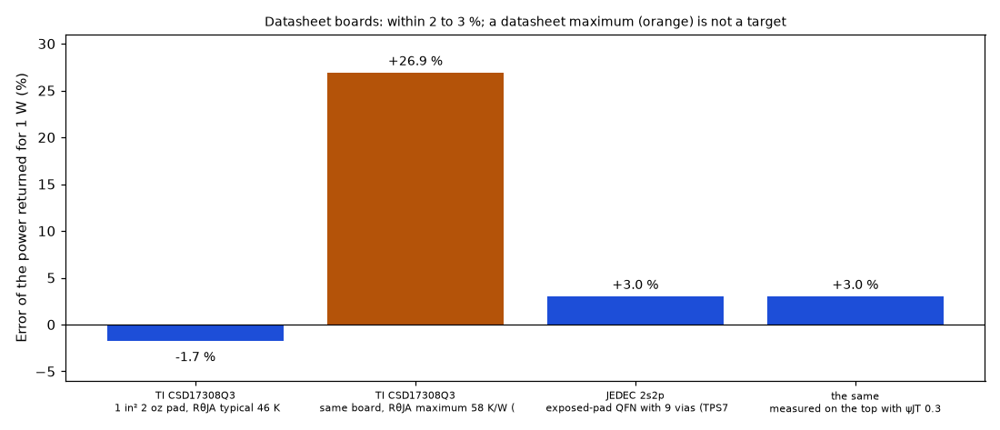
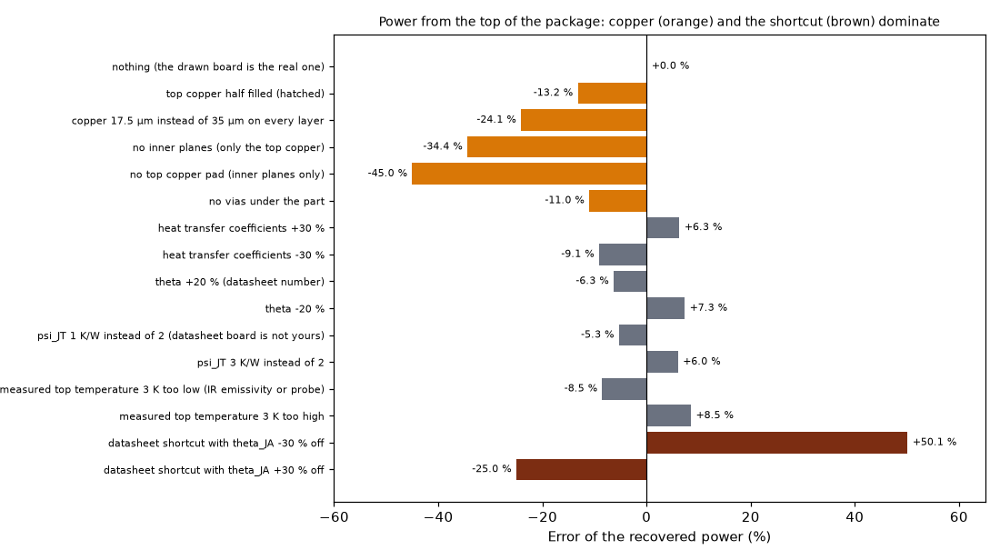
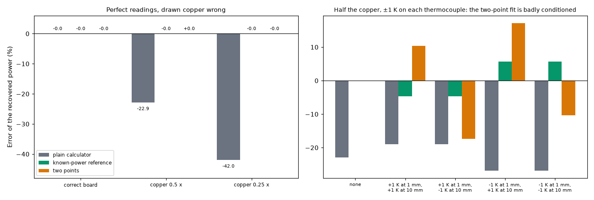

# The power calculator: the watts of a part from a measured temperature

Status: **implemented** in the program (see `IMPLEMENTED.md`). Investigated on 2026-10-22; moved to this folder on 2026-10-23. The manual of the calculator (formulas, routes, the band) stays in `docs/calculators.md`; this folder holds the studies behind it. Studies: `calculator_validation.py`, `power_from_top_study.py`, `calculator_calibration_study.py`; figures: `make_figures.py`.

## 1. The questions

1. Run backwards (the board model asked "how many watts give this temperature?"), does the calculator return the datasheet's own thermal resistance on the datasheet's own board?
2. How wrong can the answer be when the drawn board is not the real one, and which input dominates?
3. How can the error be reduced?

## 2. Findings in short

* On the datasheet's own board the calculator is within 2 to 3 %: CSD17308Q3 46.8 against 46 K/W (−1.7 %), a JEDEC 2s2p exposed-pad QFN with 9 vias 31.6 against 32.5 K/W (+3 %, package data assumed).
* **The copper dominates the error** when the drawn board is not the real one (−11 to −45 %); heat transfer, θ, ψJT and a 3 K reading error each move the result 5 to 9 %.
* A datasheet shortcut `P = (T_top − T_amb)/(θJA − ψJT)` is the worst of the routes (+50 / −25 % for θJA 30 % off) and is not offered.
* A known-power reference removes the copper error but only fits parts whose dissipation can be fixed (not implemented); a two-point fit is badly conditioned (±1 K moves the copper multiplier from 1.05 to 3.9); an uncertainty band (best, nominal, worst) is implemented.

## 3. Folder layout

| File | What it is |
| :-- | :-- |
| `scripts/calculator_validation.py` | The calculator against two datasheet boards (about 40 seconds). |
| `scripts/power_from_top_study.py` | Sensitivity of the power recovered from the top temperature to the board and the data (about 10 seconds). |
| `scripts/calculator_calibration_study.py` | Known-power reference, two-point fit and the band, on the example board (about 2.5 minutes; a study, not part of the program). |
| `scripts/make_figures.py` | Draws the three figures (runs the three studies; about 3 minutes). |
| `figures/` | `fig_01` to `fig_03`. |
| `IMPLEMENTED.md`, `LOG.md` | Where it lives in the program; what was read and how. |

```sh
.venv/bin/python research/power-calculator/scripts/calculator_validation.py
.venv/bin/python research/power-calculator/scripts/power_from_top_study.py
.venv/bin/python research/power-calculator/scripts/calculator_calibration_study.py
.venv/bin/python research/power-calculator/scripts/make_figures.py
.venv/bin/python -m pytest -q tests/test_calculator_validation.py tests/test_inverse.py
```

## 4. Validation: three routes, three tables

### 4.1 Against datasheets (`research/power-calculator/scripts/calculator_validation.py`, `tests/test_calculator_validation.py`)

A datasheet gives RθJA for a *stated* board. Built in the program, that board must return the datasheet's thermal resistance: the calculator must give 1 W when the junction is `RθJA` above ambient. Computed natural convection and radiation, horizontal board, still air.

| Case | datasheet RθJA (K/W) | model RθJA (K/W) | power returned for 1 W | error |
| :-- | --: | --: | --: | --: |
| TI CSD17308Q3 on its datasheet board (38.1 × 38.1 mm, 1.52 mm FR-4, 71 µm copper, 1 in² pad), RθJA typical | 46 | 46.8 | 0.983 W | −1.7 % |
| JESD51-7 2s2p board, exposed-pad QFN with 9 thermal vias (TPS7A47-like, **package data assumed**) | 32.5 | 31.6 | 1.030 W | +3.0 % |
| the same, measured on the top with ψJT 0.3 K/W | 32.5 | 31.5 | 1.030 W | +3.0 % |
| the same JEDEC board **without** the thermal vias | - | 67.4 | (0.48 W) | the exposed pad needs the vias (JESD51-5) |

* The CSD17308Q3 datasheet also gives 58 K/W as a *maximum* and 165 K/W for the minimum pad (also a maximum). A maximum covers the spread of parts and boards, not this board, so it is not a target (the model gives 45.7 K/W when the junction is 58 K above ambient because the computed convection improves with temperature). The pad of the minimum-pad case is not stated, so that case cannot be built.
* The JEDEC 2s2p board follows ROHM application note 64AN113E (JESD51-3/5/7/9/10): 114.3 × 76.2 × 1.6 mm, 70 µm top and bottom traces, two 74.2 × 74.2 mm planes of 35 µm, thermal vias Ø0.30 mm at 1.2 mm pitch. The traces are not drawn. The TPS7A47 values used (RθJA 32.5, θJC(bot) 1.7, ψJT 0.3 K/W) are from its datasheet; the 5 × 5 mm body, the 3.15 mm pad and the 3 × 3 via array are assumptions, so this row is an indication (−3 %), not a proof.
* The ψJT row only checks that the top-of-package point is consistent with the junction point; the model has no top path in the JEDEC case, so ψJT cannot be predicted (that needs the junction node of the roadmap).
* Tests: the three rows above with tolerances of 3 % (CSD17308Q3) and 5 % (JEDEC), and the factor of about two for the missing vias.

### 4.2 Sensitivity to the board and to the data (`research/power-calculator/scripts/power_from_top_study.py`, `docs/validation.md` section 19)

Part of 2 W, θ = 6 K/W, ψJT = 2 K/W on the example board; the top reading is made on the real board and the power is recovered on a drawn board that differs:

| What differs between the drawn board and the real one | recovered power (W) | error |
| :-- | --: | --: |
| nothing | 2.000 | 0.0 % |
| top copper half filled (hatched) | 1.735 | −13.2 % |
| copper 17.5 µm instead of 35 µm | 1.519 | −24.1 % |
| no inner planes | 1.312 | −34.4 % |
| no top copper pad | 1.100 | −45.0 % |
| no vias under the part | 1.780 | −11.0 % |
| heat transfer coefficients +30 % / −30 % | 2.126 / 1.818 | +6.3 % / −9.1 % |
| θ +20 % / −20 % | 1.873 / 2.145 | −6.3 % / +7.3 % |
| ψJT 1 / 3 K/W instead of 2 | 1.893 / 2.119 | −5.3 % / +6.0 % |
| measured top temperature 3 K low / high | 1.831 / 2.169 | −8.5 % / +8.5 % |
| datasheet shortcut with θJA 30 % below / above the board's (19.7 K/W) | 3.002 / 1.499 | +50.1 % / −25.0 % |

**Reading it.** On the datasheet's own board the calculator is within 2 to 3 % (table 2.1); the large deltas appear only when the drawn board is not the real one. The copper dominates (11 to 45 % for a wrong copper, planes or vias), the heat transfer, θ, ψJT and a 3 K measurement error each move the answer by 5 to 9 %.

### 4.3 Self-consistency (`tests/test_inverse.py`)

On a known board the model's own temperature at every point (max, mean, ring, junction, top) gives back the power within 0.1 %, with constant and with computed heat transfer coefficients; a part without θ is refused for the junction and the top; a board with less copper gives a lower power for the same top temperature; a larger ψJT gives a larger power.

### 4.4 How to reduce the error (`research/power-calculator/scripts/calculator_calibration_study.py`)

The large deltas of table 2.2 come from one thing: the board resistance `R` (kelvin per watt at the measured point) of the *drawn* board is not that of the *real* board, mostly because of the copper. Three ways to cope were tried on the same example (U1 at 2 W; the drawn board has half or a quarter of the real copper; thermocouples at 1 mm and 10 mm from the part; the study is not part of the program yet):

| Drawn board | plain calculator (1 mm point) | **A.** known-power reference (1 W) | **B.** two points (1 and 10 mm): P and a copper multiplier fitted together |
| :-- | --: | --: | --: |
| copper 0.5 × the real | −22.9 % | 0.0 % | 0.0 % (finds copper ×2.00) |
| copper 0.25 × the real | −42.0 % | 0.0 % | 0.0 % (finds ×4.00) |
| 0.5 × copper, readings ±1 K off | −19 to −27 % | **−4.7 to +5.7 %** | −17 to +17 % (the copper multiplier comes out between 1.05 and 3.9) |

* **A. A known-power reference** (best): read the same thermocouple once with the part at a power you know (a dummy load, or the part in a state whose dissipation is known) and scale the model so that it reproduces that reading before looking for the unknown power. It does not need the copper at all, only that the board answers linearly (constant heat transfer; with computed convection a few percent of non-linearity remain, which the model can correct). It survives ±1 K of reading error with ±5 %. This is what the literature does: a heater of known input is used to calibrate the board before the unknown source is estimated (Chen-type inverse heat-transfer methods, ~10 % in the studies found) and resistors of known power calibrate thermal-imaging power estimates (mean error 10 % with consumer cameras above 300 mW).
* **B. Two measurement points**: two board temperatures at different distances give the power and the copper at once (the fall with distance tells how well the board spreads the heat, the level tells the power). With perfect readings it is exact, but it is **badly conditioned**: ±1 K moves the fitted copper multiplier from 1.05 to 3.9 and the power by ±17 %, because a copper change and a power change look alike at two close points. It is worth it only with good thermocouples and points far enough apart; it is not a substitute for A.
* **C. An uncertainty band**: run the calculator with the copper and the heat transfer at the ends of their uncertainty and report the range, instead of one number. On the example: copper ×0.75 / ×1.25 gives 1.80 / 2.16 W (−9.8 % / +7.8 %), heat transfer −30 % / +30 % gives 1.69 / 2.24 W (−15 % / +12 %). It does not remove the error but says how big it can be.
* **D. Measure the right thing**: an electrical temperature-sensitive parameter of the junction (the diode forward voltage at a low sensing current, calibrated with the K-factor of JESD51-1) gives Tj without θ and ψ; a black paint of known emissivity on the case makes an infrared reading usable; a thermocouple touching the board disturbs the field, so its contact resistance matters. These remove errors of the *measurement*, not of the board.
* **E. Know the board better**: weigh or measure the copper (area and thickness of every layer), count the vias, take the stack-up from the fabricator, and measure `h` with a part of known power (that is A again).

**Decisions (2026-10-22, maintainer):** the uncertainty band (C) with the best / nominal / worst selector is implemented (section 1.1b). The two-point fit (B) stays a study and is not offered in the program. The known-power reference (A) is not implemented: it fits only parts whose dissipation can be fixed (resistors, LEDs, diodes, LDOs, MOSFETs at a known current, or a test resistor soldered in their place), not a CPU or a module, and its main benefit, correcting a copper that was drawn wrongly, disappears when the copper comes from Gerber or KiCad files; it remains useful against errors in the air flow, so it is kept as a possible later option.



*Figure 1: `figures/fig_01_calculator_vs_datasheets.png` (the four rows printed by `calculator_validation.py`, which includes the datasheet maximum of 58 K/W as a row that is not a target).*



*Figure 2: `figures/fig_02_error_when_the_board_differs.png`.*



*Figure 3: `figures/fig_03_ways_to_reduce_the_error.png`.*

## 5. Limits

* It is only as good as the drawn board (copper, vias, stack-up, air) and the measurement: a thermocouple that touches the board cools it a little and an infrared spot is too large for a small part; the emissivity of a package top is about 0.9 and of bare copper 0.05 to 0.1.
* The board is solved in steady state with constant power; a time-varying part is not covered.
* The top of the package is taken as `Tj − ψJT·P`; the program has no top path model in this calculator (the heat is assumed to go into the board), so with a heatsink on the package use the part's θSA fields and the simulation, not this route.
* ψJT, ψJB and θ come from the datasheet's board and are estimates on yours (ψJB within about 15 % of θJB).

## 6. Sources

1. Texas Instruments, *Semiconductor and IC Package Thermal Metrics*, SPRA953B, https://e2e.ti.com/cfs-file/__key/communityserver-discussions-components-files/171/4745.TI_5F00_PackageThermalMetrics_5F00_spra953b.pdf (definitions of θJC, θJB, ψJT, ψJB; ψJT to get Tj from a measured case temperature).
2. Renesas, *Thermal Characterization of Packaged Semiconductor Devices*, https://www.renesas.com/en/document/whp/thermal-characterization-packaged-semiconductor-devices; Richtek, AN061, https://www.richtek.com/Design%20Support/Technical%20Document/AN061?sc_lang=en (the ψJB and ψJT estimates and their measured check).
3. ROHM, *Thermal resistance and thermal characterization parameter*, 64AN113E, https://fscdn.rohm.com/en/products/databook/applinote/ic/power/switching_regulator/thermal_resistance_appli-e.pdf (JEDEC test boards: 114.3 × 76.2 mm, 70 µm traces, 74.2 mm planes of 35 µm, thermal vias Ø0.30 mm at 1.2 mm pitch); ROHM, *θJA and ψJT*, 65AN114E, https://fscdn.rohm.com/en/products/databook/applinote/common/theta_ja_and_psi_jt_an-e.pdf (why θJA and ψJT change in other applications).
4. Texas Instruments, CSD17308Q3 datasheet (SLPS262C), https://www.ti.com/lit/ds/symlink/csd17308q3.pdf (RθJC 4.5, RθJA 46 typical and 58 maximum on 1 in² of 2 oz copper); TPS7A47 datasheet, https://www.ti.com/lit/ds/symlink/tps7a47.pdf (RθJA 32.5, θJC(bot) 1.7, ψJT 0.3, ψJB 11.9 K/W).
5. JEDEC JESD51 family (JESD51-2A still air, -3 low-k board, -5 thermal vias, -7 high-k 2s2p board, -9, -10, -12): as summarised in Electronics Cooling, *JEDEC Thermal Standards: Developing a Common Understanding* (2019), https://www.electronics-cooling.com/2019/11/jedec-thermal-standards-developing-a-common-understanding/ (the standards themselves were not read).
6. Microchip, *Thermal parameters of an IC*, https://support.microchip.com/s/article/Thermal-parameters-of-an-IC; Texas Instruments, SLRR012 one-page thermal reference, http://www.ti.com/lit/pdf/SLRR012.
7. *A method to measure heat dissipation from component on PCB*, https://www.researchgate.net/publication/241629467_A_method_to_measure_heat_dissipation_from_component_on_PCB (inverse heat-transfer estimate of the power of a component; calibration with a heater of known input; about 10 % error; multi-layer boards need an adjustment for the board conductance).
8. *Component-wise Power Estimation of Electrical Devices Using Thermal Imaging*, https://arxiv.org/html/2307.08354v2 (resistors of known power; mean error of 10 % with consumer infrared cameras above 300 mW).
9. *Theoretical and experimental characterization of heat dissipation in a board-level microelectronic component*, https://www.osti.gov/etdeweb/biblio/21026063 (black paint for a usable infrared reading; validation against finite elements and a thermal test die).
10. JEDEC JESD51-1 (electrical test method, K-factor of a temperature-sensitive parameter), index pages https://www.jedec.org/node/3931 and https://www.vektrex.com/news-articles/measuring-led-junction-temperature-tj/ (K-factor definition, low sensing current; the standard itself is behind a login and was not read).
11. Estimation of conductivity and heat transfer from board temperatures: IIT Palakkad, *Studies on influence of anisotropic thermal conductivity* (inverse estimation of in-plane conductivity of PCBs with different copper layouts), https://publications.iitpkd.ac.in/publication/studies-on-influence-of-anisotropic-thermal-conductivity-1; Pohanka and Raudensky, thermocouple disturbance of the field in inverse problems, https://engmechx.it.cas.cz/improc/2002/Pohanka.pdf; a Missouri S&T poster notes that fitting k and h together is weakly identifiable for a good conductor.
