# Published cases, follow-up: the five items the code-against-papers audit left unverified

Status: reviewed (section 10; go for the merge). **Audit 2.7.0**: two of the proposals are in the program since 2.6.0 (the Lumped near-edge warning, and the via barrel over `d + 0.5 t_cu`, which takes the FVM via deficit of section 6.4 from -7.46 % to -0.30 % per the folder test); the 3D solid now uses slabs by thickness, so its columns of sections 3 and 6 (four slabs per gap) are the program before 2.6.0; `INTEGRATION.md` has the status of each proposal. Branch `research/published-cases-followup`, program `develop` at `fc91174a` (2.5.2 assembly). The program was not edited: every program model was run on a copy of the cases through the public API (`git diff fc91174a --stat -- pcbthermal tests examples ico` is empty). The review re-ran every study, re-read the key pages of the sources as images, tested the two explanations the first version left open (the face term, section 4; the via deficit, section 6.4) and measured the Lumped near an edge on a PCB-like board (section 7.1); what it changed is listed in section 10.

The audit of the code against its sources (reviewer, read-only) listed what it could not check: Table 2 of Yovanovich, Muzychka and Culham (1999), the coupon of Culham and Yovanovich (1998), Lemczyk and others (1992), the vias of Shen and others, and the near-edge deficit of the Lumped model. For each one this folder (a) opens the source and writes down the formulas, the cases and the printed numbers, (b) reproduces the printed numbers with an **independent** solver (`lib/`), (c) runs the five models of the program on the same case or on its closest representable version, and (d) records the agreement, the limits and what the publication prints that does not add up. Models: `fvm`, `fdm`, `solid3d`, `lumped`, `analytic`.

## 1. Summary

| item | source | reproduced by an independent solver | the program |
| :-- | :-- | :-- | :-- |
| 1. strip on a flux channel | Yovanovich, Muzychka, Culham (1999), Tables 2 and 3 | **yes**: 33 of 36 cells of Table 2 within one unit of the last digit; the 3 cells of the equation 26 row at eps <= 0.06 are 2 to 4 units off (a truncated sum); the independent 2D finite-volume solve is within +0.07 to +0.20 % of equations 23, 24, 27 | thin slab (t/c = 0.1, Bi 2): fvm, fdm, solid3d within 3 % of psi (within 5 % on an isothermal base), analytic -4 to -5 % (-13 to -22 % on an isothermal base), lumped -28 to -42 %. Thick slab (t/c = 3, the semi-infinite case of the table): fvm/fdm -36 to -44 %, solid3d (4 slabs) +66 to +96 %, analytic -84 %, lumped -88 to -96 %. Out of the range of the layered models, as documented |
| 2. coupon | Culham, Yovanovich (1998) | yes, as before (7.81 against the printed 8.28 W/mK: the solver is 5.7 % below the paper) | the paper's **base stack is representable** (outer FR-4 as undrawn slots): fvm +0.1 %, fdm +0.0 %, solid3d -1.6 %, analytic -3.7 %, lumped -4.3 % of R_solid at epsilon 0.25; k_e of the fvm 7.79 W/mK against 8.28 printed (-5.9 %, the solver's own offset). The +2.3 % of the fvm and fdm at epsilon 1 is the face term of the report charged on all the heat while half of it leaves through the film under the source (**tested by the review**: scaled by the share that goes down, +0.02 %) |
| 3. Lemczyk | Lemczyk, Mack, Culham, Yovanovich (1992), Tables 1 to 4 | yes: Table 1 Q_a, Q_b, Q_d within 1.1, 1.2, 2.4 %; Tables 2 and 3 mean difference 0.8 to 1.0 % (largest 9 % at w/L1 = 0.1). **Three things in the paper do not add up** (case (c) was computed with Bi1 = 0.001 and not h1 = 0; the R of Table 4 is the mean of the top face, not of the heat source; a duplicated row); the review confirmed the first two on the paper's own figures (Fig. 5 and Fig. 11, read as images) | trace cells: fvm within 1 to 5 % on thin slabs (-11 to -13 % for case (d) at Bi 100), -10 to -16 % on a 20 mm slab; 3-layer board of Table 4: fvm -1.7 to 0.0 %, fdm -0.8 %, solid3d -0.3 %, lumped -7.2 to -0.1 %, analytic -3.5 to -0.1 % |
| 4. vias | Shen and others (2020), section II and IV | formulas: optimal diameters 0.250 and 0.788 mm (printed about 0.25 and 0.8), +43.4 and +22.4 % (printed +44, +23), the reductions 47 / 89.5 / 46.4 / 62 % reproduced to 0.3 to 1 point **with Pattern II**; the CFD without vias (120.3 K/W) needs k_FR4 = 0.35, not the 0.29 of the paper's own Table I; the square unit cell (Cartesian 3D) agrees with the axisymmetric reference within 0.5 % | on via arrays under a uniform flux, against the unit cell of the layered idealisation: **fvm -2 to -8 % (air -6 to -8 %, grid-converged), fdm -4 to -9 %, solid3d -1 to -7 %, lumped +3.5 to -7 %, analytic +7 to -6 %** of the array resistance (mostly the non-conservative side: an array reads better than it is); Shen's parallel-path formula is +10 to +13 % above the same reference. **Review**: not an array effect (one via reads the same per via as 8 x 8); the barrel of the program spans the dielectric gaps only, so the copper thickness (4 x 70 um of 1.6 mm here) is crossed at no resistance: a barrel lengthened by half a copper thickness per gap brings the fvm to -0.3 / -0.5 % (section 6.4) |
| 5. source near an edge | Seri Lee (1998) plate (Rc 0.66 / 1.29 / 2.38 K/W), exact cosine series, 3D solver | yes: the exact thin plate gives 0.664 / 1.280 / 2.270 K/W (the printed correlation is +0.6, -0.8, -4.6 % from it), the 3D solver 0.668 / 1.284 / 2.274 | **fvm, fdm, solid3d and analytic within 0.5 % of the exact plate for every gap, edge and corner (fdm 1.6 % on the footprint mean); lumped -25 to -39 % on the hottest point and -5 % (centre) growing to -18 % (edge) and -22 % (corner) on the footprint mean**; on a PCB-like board (review, 5 mm part) the Lumped reads the mean -2.3 % at the centre, -9 to -10 % at an edge, -12 to -14 % at a corner; the capped first ring of `fix/lumped-first-ring` changes nothing on the plate and takes the PCB edge to -7 %, the corner to -10 to -12 % |

Proposals for the program (nothing is edited here; `INTEGRATION.md`): a warning (later a correction) for the Lumped near an edge or a corner; the barrel of a via counted over part of the copper thickness in the FVM and FDM (a model change, measured here on one case only); the face term of a part scaled by the heat that does go down (small for real parts, section 4); a regression test from the coupon base stack; documentation corrections listed in section 8.

## 2. What existed before and what is new

`research/effective-conductivity` reproduced the coupon with the independent solver and ran the program on case 2 (Cu / FR-4 / Cu); `research/theory-sources` reproduced Table 2 of the strip paper by a direct sum of the series; `research/paper-case-studies` and `research/lumped-zones-adoption` hold the Shen unit cell and Shen's measured Table II (report only). The audit did not see these records for the five items. What this folder adds:

* a **numerical** (finite-volume) solve of the strip cells, not only the series, and the program's models on them (3);
* the coupon **base stack** in the program (4): the paper's outer FR-4 layers are represented by two undrawn 36 um "copper" slots, which the earlier study thought impossible;
* the whole of Lemczyk and others' Tables 1 to 4 against an independent solver, which turned up the three inconsistencies of section 5;
* the closed-form claims of Shen's section II and IV, a Cartesian square-cell reference for the via unit, and the program's models on arrays (6);
* the exact thin-plate series for a source near an edge or corner and a sweep of the gap against all five models (7).

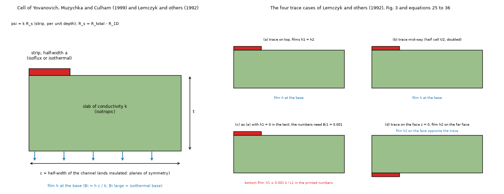

*Figure 1 (`figures/fig_01_strip_cell_and_trace_cases.png`): the half cell of the strip papers (left) and the four trace cases of Lemczyk and others (right); case (c) is the one whose printed numbers need Bi1 = 0.001.*

## 3. Item 1: the strip on a flux channel (Yovanovich, Muzychka and Culham 1999)

Source: *Spreading resistance of isoflux rectangles and strips on compound flux channels*, J. Thermophysics and Heat Transfer 13(4) (1999) 495-500, Waterloo archive copy (`papers/pdf/YovanovichMuzychkaCulham1999.pdf`; text in `papers/md-final`, printed pages 497 to 500 read, page 500 re-read as an image here). The strip (2D) solutions: equation 23 (finite isotropic channel with a film at the base, `eps = a/c`, `tau = t/c`, `Bi = h c / k`), 24 (isoflux, semi-infinite, valid for `tau > 2.65 / pi`), 26 (equivalent isothermal flux), 27 (true isothermal, `(1/pi) ln(1 / sin(pi eps / 2))`), 28 (parabolic), 29 (abrupt change of width, closed form of Smythe). `psi = k R_s` is per unit depth of the full channel; `R_s = R_total - R_1D`.

### 3.1 The tables from the equations (`scripts/study_table2_strip.py`, part A)

The sums to 200 000 terms. Largest difference from the printed Table 2, in units of the last printed digit (1e-4): equation 24 0.40, equation 28 0.75, equation 27 0.48, equation 26 4.36. The equation 26 row differs only at `eps` <= 0.06 (printed 1.1011 / 0.8808 / 0.7518, converged 1.10154 / 0.88103 / 0.75219); the sum converges as `n^-2.5` and a sum cut at a few hundred terms gives the printed digits, so the printed row is a truncated sum (an inference; the paper does not say). (Review: re-summed independently, 200 / 300 / 500 terms give 1.10011 / 1.10077 / 1.10119 at `eps` 0.02, 0.88054 / 0.88077 / 0.88091 at 0.04, 0.75192 / 0.75204 / 0.75212 at 0.06; the printed 0.7518 needs a little fewer than 200 terms; the converged values equal equation 27 to 1e-4, as they should for a small strip. The printed Table 2 row was read from the text layer of the born-digital page 499.) Equation 29 as printed on page 500 (read as an image: `(1/2 pi)[(eps + 1/eps) ln((1+eps)/(1-eps)) + 2 ln((1-eps^2)/(4 eps))]`) gives 1.1223, 0.3936, 0.1860, 0.0794, 0.0214 for the first row of Table 3 (printed 1.122, 0.3936, 0.1860, 0.0794, 0.0214).

**A printed number that does not add up.** The second row of Table 3 is headed "[Eq. (24) + Eq. (26)] / 2" and the text says the same. It is the mean of equations (24) and **(27)**: 1.1196 / 0.3910 / 0.1838 / 0.0778 / 0.0207 against the printed 1.120 / 0.3911 / 0.1838 / 0.0779 / 0.0208 (within one unit of the last digit); the mean with equation 26 is 1.1196 / 0.3906 / 0.1821 / 0.0744 / 0.0161, which agrees only for `eps` <= 0.2. The percentage row (0.24 ... 3.04 %) follows the same mistake.

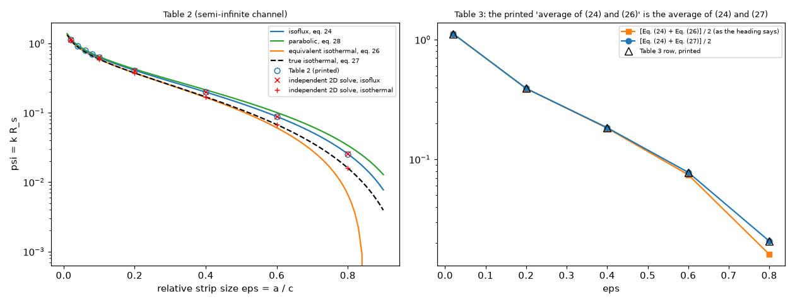

*Figure 5 (`figures/fig_05_table2_strip.png`): left, the four curves of Table 2 with the printed points and the independent solve; right, the Table 3 row against the two possible means.*

### 3.2 An independent numerical solve (part B)

`lib/strip2d.py`: cell-centred finite volumes, graded grid (ratio 1.12) refined at the strip edge and the heated face, three meshes and a Richardson step (observed order 1.0 to 1.6, limited by the edge singularity). Tested against the series (`tests/test_libraries.py`) and an energy balance. `tau = 3` stands for the semi-infinite channel (`tanh(3 pi) = 1` to 1e-12).

| eps | isoflux solve | eq. 24 | difference | isothermal solve | eq. 27 | difference |
| --: | --: | --: | --: | --: | --: | --: |
| 0.02 | 1.1394 | 1.1377 | +0.15 % | 1.1032 | 1.1015 | +0.15 % |
| 0.20 | 0.4089 | 0.4083 | +0.16 % | 0.3744 | 0.3738 | +0.15 % |
| 0.60 | 0.0883 | 0.0882 | +0.19 % | 0.0676 | 0.0675 | +0.20 % |
| 0.80 | 0.0256 | 0.0255 | +0.17 % | 0.0160 | 0.0160 | +0.19 % |

Equation 23 against the solve for five (eps, tau, Bi): +0.07 to +0.14 %. The solver is a hair high at every size, a mesh effect (the finest meshes still fall); not a model difference.

### 3.3 The program on the closest representable version (part C)

Equation 23, the finite channel with a film at the base, is representable as a **narrow board** (`lib/prog_strip.py`): `L1` = 10 mm by 2 mm deep with insulated edges, two layers of 35 um with nothing drawn (the slab is the laminate between the copper nodes), isotropic laminate `k` = 0.4 W/mK of total thickness `t`, the strip a heater over the whole depth, a film on the bottom. `psi` is read as `k (R_total - t/(k c) - 1/(h c)) / 2` per unit depth, with `R_total` the mean temperature of the heater footprint as the program reports it. Errors are given as a percentage of `psi` and, in brackets, of the total `k R_total / 2` (what a temperature would see). Bi = 2 in the table. **Correction by the review**: the first version said that the Bi = 25 000 rows (an isothermal base) are the same within 1 point; they are for t/c = 3 (semi-infinite, the base does not matter) and within 1 to 4 points for t/c = 0.5, but not for the thin slab: at t/c = 0.1 the fvm at 0.5 mm reads -1.2 / -4.0 % (eps 0.2 / 0.6), the fvm at 0.25 mm -2.4 / -4.8 %, the fdm +0.7 / -2.6 %, the solid3d -0.5 / -3.6 %, the Lumped -30.5 / -34.6 % and the Analytic -13.4 / -21.5 % (printed by `study_table2_strip.py`, part C). So "thin slab within 3 %" holds for the fvm, fdm and solid3d at Bi = 2 only; on an isothermal base they are within 5 %.

| eps | tau | eq. 23 | fvm 0.5 mm | fvm 0.25 mm | fvm 0.25, 16 sub-gaps | fdm 0.25 | solid3d 4 slabs | solid3d 16 slabs | lumped | analytic |
| --: | --: | --: | --: | --: | --: | --: | --: | --: | --: | --: |
| 0.2 | 0.1 | 0.5212 | +0.4 (+0.25) | -0.4 (-0.25) | -0.7 (-0.46) | +2.3 (+1.49) | +0.4 (+0.28) | +0.3 (+0.17) | -28.4 (-18.0) | -3.7 (-2.4) |
| 0.6 | 0.1 | 0.1117 | -0.5 (-0.15) | -1.0 (-0.27) | -1.2 (-0.32) | +2.6 (+0.70) | -0.6 (-0.16) | -0.7 (-0.19) | -42.2 (-11.5) | -5.3 (-1.4) |
| 0.2 | 0.5 | 0.4138 | -4.0 (-1.80) | -4.7 (-2.13) | -1.0 (-0.48) | -2.1 (-0.96) | +5.5 (+2.49) | +0.5 (+0.22) | -48.1 (-21.8) | -30.9 (-14.0) |
| 0.6 | 0.5 | 0.0898 | -3.3 (-0.50) | -3.7 (-0.57) | -1.5 (-0.22) | -0.1 (-0.01) | +2.3 (+0.34) | -0.7 (-0.11) | -67.7 (-10.3) | -26.9 (-4.1) |
| 0.2 | 3.0 | 0.4083 | -44.1 (-8.35) | -44.5 (-8.41) | -9.1 (-1.71) | -43.3 (-8.18) | +96.3 (+18.2) | +11.4 (+2.16) | -87.7 (-16.6) | -83.7 (-15.8) |
| 0.6 | 3.0 | 0.0882 | -38.4 (-1.84) | -38.6 (-1.85) | -6.7 (-0.32) | -36.0 (-1.73) | +66.3 (+3.18) | +5.9 (+0.28) | -96.2 (-4.6) | -84.2 (-4.0) |

What it says. The layered models have one node through the thickness of a copper layer and, between the layers, at most four sub-gaps of 0.4 mm (`laminate.py`); the 3D solid has four slabs per gap. For a thin slab (t/c = 0.1, 1 mm of laminate under a 4 mm strip) fvm, fdm and solid3d are within 3 % of `psi` and 1.5 % of the total. As the slab gets thicker than the strip the through-thickness spreading that equation 23 holds (and Table 2 is about) is not in the layered models: -4 % at t/c = 0.5, **-36 to -44 % at t/c = 3**; sixteen sub-gaps bring the fvm to -7 to -9 %, sixteen slabs bring the solid3d to +6 to +11 %, and the solid3d at its default four slabs is +66 to +96 % too high (the existing small-part warning of `checks.py` covers a part under 6.7 sub-gap thicknesses; the strip here is a line source across the whole depth, which that rule does not test). Lumped and Analytic have no through-thickness conduction in the laminate and are out of range on bare laminate (a copper-less strip). The totals are much better than `psi`: `psi` is a small difference of large numbers on a thick slab. Whether the program warns on each of these runs was not checked here.

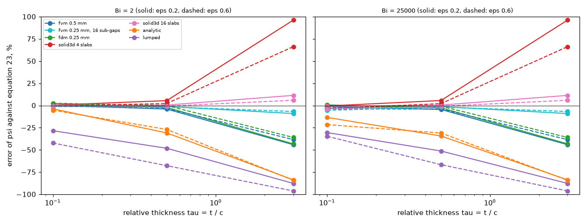

*Figure 6 (`figures/fig_06_program_on_the_strip_cell.png`): the error of psi of each model against equation 23 as the relative thickness grows (solid eps 0.2, dashed eps 0.6; left Bi 2, right an isothermal base).*

## 4. Item 2: the coupon of Culham and Yovanovich (1998)

Source: *Factors affecting the calculation of effective conductivity in printed circuit boards*, ITherm'98 pp. 460-467 (`papers/pdf/CulhamYovanovich1998.pdf`; pages 4 to 8 of `papers/md-final` read; page 6 and Table 2 verified by image by earlier readers). Coupon 50 x 50 mm, FR-4 0.5263 mm (k 0.4) and copper 0.0356 mm (k 400), a concentric source, h = 5 W/m2K on both faces, insulated sides and source area. Published: base stack k_e = 8.28 W/mK (text), case 2 about 11.6 (plot), cross-plane 0.42 at epsilon = 1 (text).

**The base stack is representable** (`scripts/study_coupon_program.py`): FR-4 / Cu / FR-4 / Cu / FR-4 becomes a 4-layer board whose two outer "copper" layers are left undrawn (36 um of laminate) with an advanced stack-up whose outer gaps are 0.4903 mm, so that the top face to the first plane is 0.5441 mm as in the paper. The source is a heater on layer 1 (the face value is what `heater_stats` reports). The program applies the film under the source (the paper insulates it), so the independent solver is run in both conditions: its paper condition is compared with the publication, its program condition with the program. R_solid = (mean source - mean wall)/Q with the wall the film-cooled faces; k_e is the conductivity of the single layer of the same thickness, films and source with the same R_solid (bisection, the paper's definition).

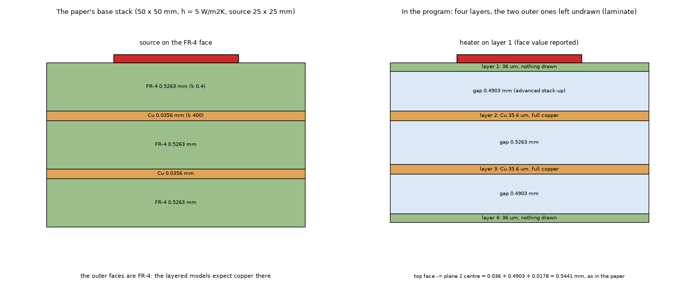

*Figure 2 (`figures/fig_02_coupon_stack_in_the_program.png`): the paper's base stack (left) and its representation in the program (right).*

Independent solver against the publication (paper condition): base stack at epsilon 0.25 k_e 7.81 against 8.28 (-5.7 %), case 2 11.31 against about 11.6 (-2.5 %, plot), epsilon 1 0.42 against 0.42. The solver is steadily below the paper (see `effective-conductivity` 4.2); the paper's own offset is carried by every row below.

R_solid of the models, difference from the solver in the program's condition, %, and k_e in W/mK (cells 1 mm, 0.5 mm for the 25 mm source):

| stack | side mm | eps | solver K/W | solver k_e | fvm | fdm | solid3d | lumped | analytic |
| :-- | --: | --: | --: | --: | --: | --: | --: | --: | --: |
| base | 6 | 0.014 | 45.868 | 3.60 | -0.56 (3.62) | -11.58 (4.10) | -2.68 (3.71) | -5.03 (3.80) | -8.29 (3.94) |
| base | 16 | 0.102 | 9.216 | 7.16 | -0.04 (7.16) | -2.67 (7.36) | -1.77 (7.29) | -2.71 (7.37) | -4.43 (7.50) |
| base | 25 | 0.250 | 3.861 | 7.80 | +0.12 (7.79) | +0.03 (7.80) | -1.59 (7.93) | -4.27 (8.17) | -3.66 (8.11) |
| base | 36 | 0.518 | 1.414 | 5.98 | +0.57 (5.94) | +1.17 (5.90) | -1.78 (6.09) | -2.28 (6.12) | -4.10 (6.25) |
| base | 50 | 1.000 | 0.391 | 0.42 | +2.34 (0.41) | +2.34 (0.41) | -2.26 (0.43) | -4.52 (0.44) | -4.52 (0.44) |
| case 2 | 6 | 0.014 | 14.296 | 11.95 | -0.36 (12.00) | -2.92 (12.32) | +0.00 (11.95) | +5.35 (11.34) | -1.57 (12.14) |
| case 2 | 16 | 0.102 | 5.597 | 11.98 | -0.18 (12.00) | -0.14 (12.00) | +0.00 (11.98) | +1.90 (11.75) | -0.52 (12.04) |
| case 2 | 25 | 0.250 | 2.700 | 11.30 | -0.13 (11.32) | +0.50 (11.25) | +0.00 (11.30) | -1.40 (11.47) | -0.19 (11.33) |
| case 2 | 36 | 0.518 | 1.041 | 8.23 | -0.11 (8.24) | +1.97 (8.07) | +0.00 (8.23) | +3.05 (7.98) | -0.31 (8.26) |
| case 2 | 50 | 1.000 | 0.391 | 0.42 | -0.00 | -0.00 | -0.00 | -0.00 | -0.00 |

Reading. On the paper's own stack the fvm and fdm reproduce the independent solver to 0.6 % for sources of 10 to 52 % of the board, the solid3d to 2 %, the Lumped and Analytic to 4 to 5 % (the Lumped and Analytic being the models with the least through-thickness detail); small sources (6 mm) are the weak spot of the fdm (-11.6 %) and the Analytic (-8.3 %). k_e of the fvm at epsilon 0.25 is 7.79 W/mK against the printed 8.28 (-5.9 %): the program carries the solver's offset from the paper, nothing more. The +2.3 % of the fvm and fdm at epsilon 1 on the base stack is the face term of `heater_stats` (`laminate.face_terms`): it adds `q'' t / (2 k)` of the 36 um slot with `q''` = P/A, but with the film acting under the full-board source about half of the heat leaves through that film and never crosses the half slot. **Tested by the review** (`study_coupon_program.py --face-term`, 1 mm cells, R_solid against the solver with the film under the source):

| side mm | model | with the face term | node only | face term x share going down | share going down |
| --: | :-- | --: | --: | --: | --: |
| 50 | fvm | +2.34 % | -2.26 % | +0.02 % | 0.495 |
| 50 | fdm | +2.34 % | -2.26 % | +0.02 % | 0.495 |
| 36 | fvm | +0.57 % | -1.88 % | -0.08 % | 0.732 |
| 36 | fdm | +1.17 % | -1.21 % | +0.53 % | 0.732 |
| 16 | fvm | -0.04 % | -1.94 % | -0.16 % | 0.937 |
| 16 | fdm | -2.67 % | -4.46 % | -2.78 % | 0.938 |

The share is `1 - h A_src T_node / P` (the heat the film takes directly under the source). The explanation holds: charged on the heat that goes down, the face term closes the epsilon 1 row to +0.02 %. For a real part the film under it takes a small share (a 5 x 5 mm part at 50 K and 10 W/m2K: 0.0125 W of 1 W), so the over-count is a few per cent of a term that is itself small; it matters only for a source that covers a large part of a bare-faced board. The fdm at 16 mm (-2.7 %) is its node-centred footprint, not the face term. Cases 1, 4 and 5 of the paper have two copper layers adjacent (no gap) and stay unrepresentable.

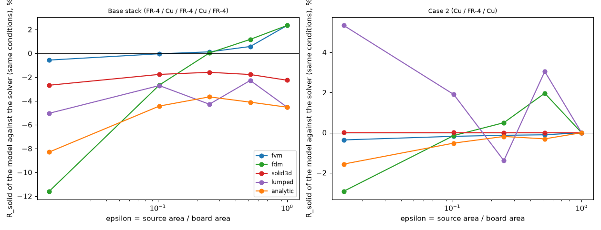

*Figure 8 (`figures/fig_08_coupon_program.png`): the difference of R_solid of each model from the independent solver against epsilon, base stack (left) and case 2 (right).*

## 5. Item 3: Lemczyk, Mack, Culham and Yovanovich (1992)

Source: *PCB trace thermal analysis and effective conductivity*, ASME J. Electronic Packaging 114(4) (1992) 413-419 (`papers/pdf/Lemczyk1992.pdf`; text in `papers/md-final`, scan pages 1 to 6 flagged "verified (image)" by the OCR pipeline; read here from that text; **the review rendered scan pages 4 to 7 (journal 416 to 419) at 150 dpi and compared Tables 1 to 4 digit by digit with `lib/lemczyk.py`: no difference**). Two-dimensional trace cell: a homogeneous medium of conductivity k, thickness t, width L1, a trace of width w held at T_c, four cases (Fig. 3, equations 25 to 36): (a) trace on the top face, films h1 = h2; (b) trace mid-way, solved as the half cell and doubled; (c) as (a) with h1 = 0; (d) trace on the bottom face with h1 = 0 and the film on the far face. `Psi = k L2 R`, `R = T_c / Q` (equation 36). Table 1 gives Q in W for `T_c` = 90 K, h = 10 W/m2K, L2 = 1 m, in micrometres; Tables 2 and 3 Psi for Bi2 = 0.001 to 100; Table 4 the 3-layer board (FR-4 0.778 mm, Cu 36 um k 386, FR-4 0.778 mm, h = 10, L1 = 10 mm, L2 = 20 mm, 0.4 W in the full cell). `scripts/study_lemczyk.py`, `lib/lemczyk.py` (the cases with the solver of 3.2).

### 5.1 Table 1 and Tables 2 and 3 against the independent solver

Table 1 (16 rows x 4 cases): the largest difference from the printed Q is 1.1 % for Q_a, 1.2 % for Q_b, 2.4 % for Q_d (three printed digits). **Case (c) is 50 % off with h1 = 0 as the text says, and 0.4 % off with Bi1 = 0.001** (a bottom film of h1 = 0.001 k / L1: 10 W/m2K for the polyamide cell of L1 = 20 um, which is why Q_c = Q_a in the first rows). The same holds in Tables 2 and 3: mean difference over the 36 rows (the power of ten of each printed mantissa is inferred, as the blocks of the printed table mix their scales; the decade is the one within a factor 3 of the solver):

| case | mean | mean abs | largest abs | rows beyond 2 % | beyond 5 % |
| :-- | --: | --: | --: | --: | --: |
| (a) | -0.84 % | 0.89 % | 4.24 % | 10 | 0 |
| (b) | -1.00 % | 1.00 % | 9.26 % | 6 | 2 |
| (c), h1 = 0 | +17.43 % | 18.76 % | 100 % | 19 | 12 |
| (c), Bi1 = 0.001 | -0.78 % | 0.78 % | 3.67 % | 7 | 0 |
| (d) | -0.80 % | 0.80 % | 8.42 % | 3 | 2 |

The printed values sit 1 to 4 % above the converged solver at w/L1 = 0.1 (the largest 9 % at Bi 100, t/L1 = 0.01), a mesh-converged result here (the thin-slab row (1.0, 0.01, 0.1) reads 3.0225 on the finest of five meshes, 3.021 extrapolated, against 3.155 printed): the paper's Fourier-series minimisation with a finite number of terms is the likely cause (inference). In Table 1 the row (k 0.4, w 250, t 2000, L1 500) repeats the values of the row above it (0.884, 0.886, 0.484, 0.438); the solver gives 0.874, 0.876, 0.484, 0.427 for the t = 2000 um row, so the printed row is probably a copy (its R columns differ in the last digit of R_d only, 2.07 against 2.06, which is no evidence either way).

**Independent checks of the review, on the paper's own figures** (scan page 5, journal 417, read as an image): Fig. 5 draws Psi_c at Bi2 = 0.01 levelling at about 90 for w/L1 -> 1, where the one-dimensional limit is 1 / (Bi1 + Bi2) = 90.9 with Bi1 = 0.001 and 100 with h1 = 0; at Bi2 = 0.1 about 10, against 9.90 and 10. So the figure, drawn from the same computation as the tables, also has the bottom film Bi1 = 0.001. The decades of Tables 2 and 3 are indeed mixed inside a block (for example Psi_d = 1.010 at Bi2 = 1, t/L1 = 0.01, w/L1 = 1 under a "x 10^1" header, whose one-dimensional value is 1/Bi2 + t/L1 = 1.01): the decade cannot be read from the header, and the inference within a factor 3 of the solver is the only possible reading; a printed value wrong by exactly a decade would not be seen.

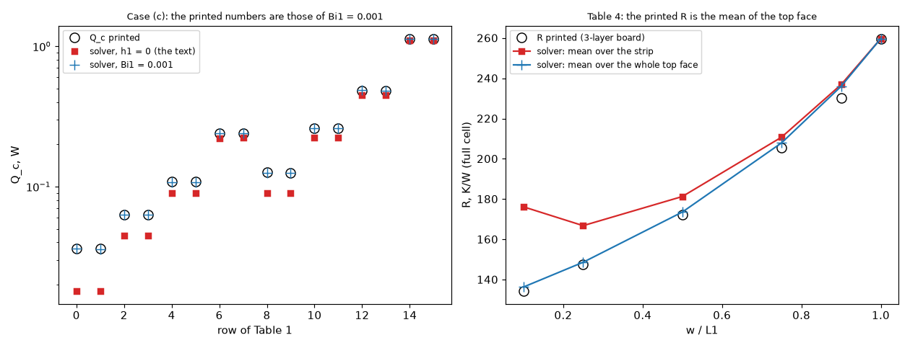

*Figure 7 (`figures/fig_07_lemczyk_tables.png`): left, Q_c of Table 1 with h1 = 0 (red) and Bi1 = 0.001 (blue plus) against the printed values; right, the R of Table 4 against the solver read as the strip mean and as the whole-face mean.*

### 5.2 Table 4: what the printed R is

The independent layered solver (`layered3d`, one cell across the depth, the paper's conditions: the top film only outside the strip, h = 10 on both faces) gives for the 3-layer board R (K/W of the full cell):

| w/L1 | printed | mean over the strip | difference | mean over the whole top face | difference |
| --: | --: | --: | --: | --: | --: |
| 0.10 | 134.3 | 176.2 | +31.2 % | 136.4 | +1.5 % |
| 0.25 | 147.4 | 166.8 | +13.2 % | 148.6 | +0.8 % |
| 0.50 | 172.3 | 181.3 | +5.2 % | 173.6 | +0.7 % |
| 0.75 | 205.6 | 210.8 | +2.5 % | 207.9 | +1.1 % |
| 0.90 | 230.4 | 236.9 | +2.8 % | 236.0 | +2.4 % |
| 1.00 | 259.7 | 259.7 | 0 | 259.7 | 0 |

The printed R is the **mean temperature of the whole top face** (the n = 0 term of the cosine series), not the mean temperature of the heat source that the text says; the three single-medium columns follow the same reading (R_S 139.0 / 156.7 / 183.5 / 212.2 / 233.5 printed against 140.5 / 157.6 / 184.5 / 213.8 / 237.5, R_P and R_H likewise within 0.7 to 2.4 %). With that reading the paper's claim that `k_H` gives the resistance of the board to better than 2 % holds (solver: +0.0, +1.5, +1.7, -0.2, -1.4, -1.8 % at w/L1 = 0.1 ... 1); read as the heat-source mean, as the text says, `k_H` is **+14.3, +17.1, +9.6, +1.7, -1.2 %** off for w/L1 = 0.1 ... 0.9. The wording "twice the actual resistance" of the text is also off: the numbers are half the resistance of the half cell (the full cell of twice the area, trace width 2w), 259.7 = (19.45 + 500)/2 at w/L1 = 1. The paper says to the reader that mean source temperature is approximated to 2 %; that is true for the face mean only. **Review**: Fig. 11 of the paper (journal 418, w/L1 = 0.1, read as an image) draws the 3-layer top-face temperature at about 92 C over the strip and 72 to 73 C over the rest of the face, with T_f = 20 C and 0.4 W: the face mean, about 73 to 74 C (plot reading), gives (73.5 - 20) / 0.4 = 134 K/W, the printed 134.3, while the strip, about 90 C, would give about 175 K/W (solver: 176.2). The figure confirms the face-mean reading.

### 5.3 The program

Trace cells (a), (c) h1 = 0, (d) on a 20 mm cell (`k` = 0.4, 2 mm deep, a copper strip of `k` = 1e5 W/mK under the heater as the isothermal trace; error against the independent solver in %); t/L1 = 0.01 is 0.2 mm, 1.0 is 20 mm:

| case | Bi2 | t/L1 | w/L1 | psi solver | fvm 0.5 | fvm 0.25 | fdm 0.25 | solid3d | solid3d 16 slabs | lumped | analytic |
| :-- | --: | --: | --: | --: | --: | --: | --: | --: | --: | --: | --: |
| (a) | 0.01 | 1.0 | 0.1 | 51.43 | -0.6 | -0.6 | -0.7 | +0.9 | +0.1 | -1.3 | -2.3 |
| (a) | 1.0 | 0.01 | 0.1 | 3.021 | +0.4 | -1.0 | -8.9 | +2.9 | +2.9 | +10.5 | -83.3 |
| (a) | 1.0 | 1.0 | 0.1 | 1.646 | -15.9 | -16.0 | -18.4 | +21.6 | +3.9 | -33.1 | -59.3 |
| (a) | 100 | 0.01 | 0.1 | 0.06397 | -3.3 | -4.8 | -18.0 | -1.0 | -1.0 | -4.1 | -87.5 |
| (a) | 100 | 1.0 | 0.1 | 0.08699 | -15.8 | -16.8 | -24.3 | +8.0 | +4.2 | -24.4 | -86.1 |
| (d) | 1.0 | 1.0 | 0.1 | 3.184 | -10.0 | -10.0 | -11.4 | +13.9 | +2.2 | -21.8 | -37.2 |
| (d) | 100 | 0.01 | 0.1 | 0.1844 | -11.3 | -13.1 | -23.8 | -5.8 | -5.8 | -13.7 | -89.9 |

(Rows with w/L1 = 1 are one-dimensional and agree to 0.1 %.) Same pattern as item 1: the layered models are good for thin slabs and lose the through-thickness spreading for t/L1 = 1; the 3D solid needs its slabs; the Lumped and Analytic are out of range for a bare-laminate trace (the Analytic -83 to -90 % at t/L1 = 0.01 and Bi 1 to 100 is the largest; reported, not explained here).

The 3-layer board of Table 4, which the program **can** represent (three layers, the two outer ones undrawn, copper plane on layer 2, the heater on layer 1), with the film acting under the heater as in the program; difference from the independent solver in the same condition (R of the strip mean):

| w/L1 | fvm 0.25 | fdm 0.25 | solid3d 0.25 | solid3d 16 slabs | lumped | analytic |
| --: | --: | --: | --: | --: | --: | --: |
| 0.10 | -1.7 | -0.8 | -0.3 | -0.4 | -7.2 | -3.5 |
| 0.25 | -0.3 | -0.0 | -0.2 | -0.2 | -2.5 | -1.0 |
| 0.50 | -0.1 | +0.0 | -0.1 | -0.1 | -1.1 | -0.4 |
| 0.75 | -0.0 | +0.0 | -0.0 | -0.0 | -0.6 | -0.2 |
| 1.00 | +0.0 | +0.0 | +0.0 | +0.0 | -0.1 | -0.1 |

(The film under the source changes R by -6.6 to -51 % from the paper's condition at w/L1 = 0.1 to 1, so these are not comparable with the printed Table 4; they say the program is right on this board.)

## 6. Item 4: the vias of Shen and others (2020)

Source: Y. Shen, H. Wang, F. Blaabjerg, H. Zhao, T. Long, *Thermal modeling and design optimization of PCB vias and pads*, IEEE Trans. Power Electron. 35(1) (2020) 882-900 (accepted manuscript, Aalborg; `papers/pdf/ShenWang2019Vias.pdf`, text in `papers/md-final`; sections II to IV read here from the text, the eight pages verified by image by earlier readers). Via unit: three vertical paths in parallel (filler, plated barrel, copper and FR-4 layers), equations 2 to 5 (Pattern I square `(phi + s)^2`, Pattern II `sqrt(3)(phi + s)^2 / 2`), the simplification 6 (the layers dropped), the optimal diameter 7. Table I: copper 393, FR-4 0.29 through and 0.81 in plane, air 0.026, solder 57.3 W/mK; plating 25 um, s = 0.2 mm. `scripts/study_shen_vias.py`.

### 6.1 The closed-form numbers of the paper (part A)

| printed (page 7 and 14, manuscript) | reproduced |
| :-- | :-- |
| optimal diameter about 0.25 mm (air), about 0.8 mm (solder) | equation 7: 0.250 and 0.788 mm; the minimum of equations 5 and 6: 0.249 / 0.250 and 0.778 / 0.788 mm |
| air, phi = 0.8 mm: +44 %; solder, phi = 0.2 mm: +23 % | +43.4 % and +22.4 % (equation 5), +43.3 and +22.8 % (equation 6) |
| optimal design against refs [15], [17], [18]: 47, 89.5, 46.4 % | **Pattern II**: 47.3, 89.7, 46.7 % (Pattern I would give 39.2, 88.2, 38.5 %: the printed numbers are Pattern II's, which the text does not say) |
| "up to 62 %", 2.63 to 0.98 K/W (Pattern II, phi 0.8, solder, against [15]) | 63.1 % |
| Pattern II is sqrt(3)/2 = 86.6 % of Pattern I | 0.8660 |
| CFD of the 5.6 x 5.6 mm board: 120.3 K/W without vias, 1.86 K/W with 12 x 12 vias of 0.25 mm | 120.3 needs k_FR4(through) = **0.350 W/mK**, not the 0.29 of the paper's Table I (with 0.29 the 1D resistance is 145.2 K/W); equations 2 to 4 give 1.587 K/W (1.585 with 0.35); the plot value 1.82 'analytical' would need 126 units (11 x 11 gives 1.889, 11 x 12 gives 1.732; the pad size of Fig. 17 is not stated in the text read) |

An earlier version of this study printed the reductions with Pattern I and found 8 points off for [15] and [18]; that was my error (the printed numbers are Pattern II's) and is corrected here.

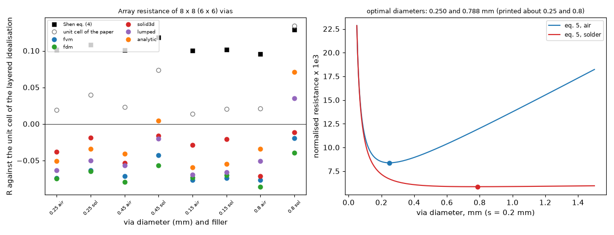

*Figure 9 (`figures/fig_09_shen_via_arrays.png`): right, equation 5 against the diameter with the optima; left, the array resistance of each model and of Shen's formula against the unit cell of the layered idealisation.*

### 6.2 The independent unit cell (part B)

The axisymmetric unit cell (`research/lumped-zones-adoption/lib/shen_case.py`: equal-area disc, graded finite volumes, imports nothing of the program) against equation 3, per via unit (K/W):

| phi mm | filler | eq. 3 | unit cell | eq / cell | cell, planes continuous over the drill | cell, plus heat over the whole top |
| --: | :-- | --: | --: | --: | --: | --: |
| 0.15 | air | 410.75 | 378.28 | +8.58 % | 373.56 | 373.22 |
| 0.25 | air | 228.58 | 211.57 | +8.04 % | 208.05 | 207.52 |
| 0.45 | air | 121.08 | 112.50 | +7.63 % | 110.48 | 109.98 |
| 0.80 | air | 66.37 | 61.85 | +7.31 % | 60.84 | 60.57 |
| 0.25 | solder | 181.84 | 170.62 | +6.57 % | 164.75 | 164.10 |
| 0.45 | solder | 78.39 | 75.27 | +4.14 % | 70.94 | 70.09 |
| 0.80 | solder | 32.38 | 32.54 | -0.49 % | 29.62 | 28.68 |

The parallel-path formula reads 4 to 9 % above the unit cell (it has no lateral conduction in the planes into the barrel). The two last columns are the cell with the idealisation of the layered models (copper planes continuous across the drill, the heat over the whole top, as a heater does): `lib/via_cell.py` (identical to the original without the switches; test). **The equal-area disc is itself checked**: a Cartesian 3D square cell (`lib/cart_cell.py`, anisotropic FR-4, partial volumes of the barrel, cell = pitch/36) gives 211.34 against 211.57 (-0.10 %) and 206.62 against 207.52 (-0.43 %) for phi 0.25 air, and 74.97 against 75.27 (-0.41 %) and 69.77 against 70.09 (-0.46 %) for phi 0.45 solder; the reference is good to better than 0.5 %.

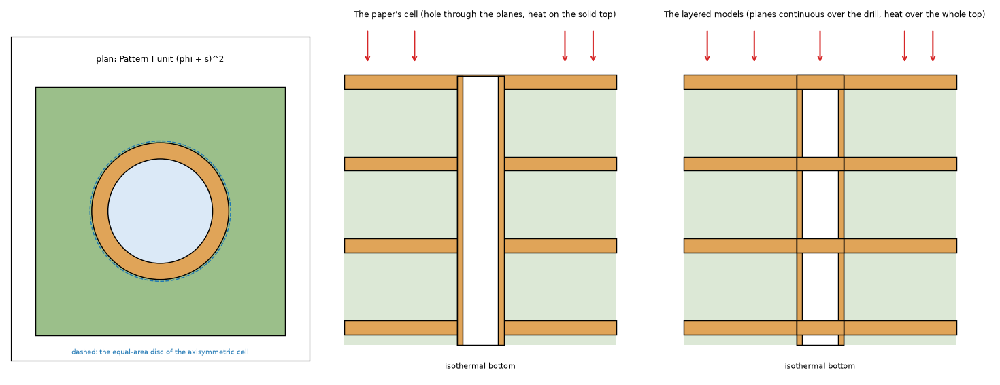

*Figure 3 (`figures/fig_03_via_unit_idealisations.png`): the plan and the sections of the via unit as the paper draws it (the hole through the planes) and as the layered models see it (planes continuous over the drill).*

### 6.3 The program on via arrays (part C)

`n x n` vias on the pitch phi + 0.2 mm, the board exactly n pitches wide with insulated edges, four full copper layers of 70 um, a uniform flux over the whole top, the bottom film 1e7 W/m2K; R = mean top temperature / 1 W, K/W. The reference is the cell with the idealisation of the program (planes continuous, heat over the whole top) divided by `n x n`; error in %:

| n | phi mm | filler | reference | eq. 4 | fvm p/3 | fvm p/2 | fdm p/3 | solid3d p/3 | lumped | analytic |
| --: | --: | :-- | --: | --: | --: | --: | --: | --: | --: | --: |
| 8 | 0.25 | air | 3.2425 | 3.5716 | -7.4 | -6.2 | -7.5 | -3.8 | -6.3 | -5.1 |
| 8 | 0.25 | solder | 2.5641 | 2.8413 | -6.4 | -4.9 | -6.5 | -1.9 | -5.0 | -3.4 |
| 8 | 0.45 | air | 1.7184 | 1.8919 | -7.1 | -6.3 | -8.0 | -5.3 | -5.7 | -4.1 |
| 8 | 0.45 | solder | 1.0952 | 1.2248 | -4.3 | -2.9 | -5.6 | -1.6 | -2.0 | +0.5 |
| 8 | 0.15 | air | 5.8316 | 6.4180 | -7.7 | -6.7 | -7.3 | -2.9 | -7.0 | -6.0 |
| 8 | 0.15 | solder | 5.2221 | 5.7535 | -7.4 | -6.3 | -7.0 | -2.1 | -6.6 | -5.5 |
| 6 | 0.80 | air | 1.6826 | 1.8436 | -7.6 | -7.3 | -8.6 | -7.2 | -5.1 | -3.4 |
| 6 | 0.80 | solder | 0.7967 | 0.8995 | -2.0 | -1.2 | -3.9 | -1.2 | +3.5 | +7.1 |

The fvm is converged in the cell (phi 0.25 air, 8 x 8: p/2 -6.2 %, p/3 -7.4, p/4 -7.7, p/6 -7.6, p/9 -7.7 %; printed by the script) and the board without vias is exact (-0.013 %). So the program reads the array resistance **6 to 8 % low (air) and 2 to 7 % low (solder)** in the fvm and fdm against an independent reference of its own idealisation, 1 to 7 % low in the solid3d, 7 % low to 3.5 % high in the Lumped and 6 % low to 7 % high in the Analytic; the sign of the fvm is the non-conservative one (an array reads better than it is), and Shen's formula is on the conservative side by 10 to 13 % against the same reference (4 to 9 % against the paper's own cell, where it is -0.5 % only for phi 0.8 solder). The first version of this section said that the program's via (a mean-potential footprint with a Peaceman well, calibrated against a single-via axisymmetric barrel at -2.1 to +3.9 %, `docs/theory.md` 2.6) "was not designed for a dense array" and left the cause open; **the review found that it is not an array effect** (6.4).

### 6.4 Review: where the deficit comes from (`study_shen_vias.py`, part D)

0.25 mm air vias, one via unit, against the reference cell of the layered idealisation (207.52 K/W):

| case | K/W | against the reference |
| :-- | --: | --: |
| fvm, 1 x 1 via, cell pitch/3 / pitch/9 | 192.05 / 191.60 | -7.46 / -7.67 % |
| fvm, 8 x 8 vias, per via, pitch/3 / pitch/9 | 192.17 / 191.61 | -7.40 / -7.67 % |
| reference with radially isothermal copper planes (`lib/via_cell.py`, `plane_kr_scale` 1e4) | 202.61 | -2.37 % |
| fvm, 1 x 1, barrel conductance scaled by d / (d + t_cu / 2), pitch/3 / pitch/9 | 206.90 / 206.45 | -0.30 / -0.52 % |
| fvm, 1 x 1, barrel conductance scaled by d / (d + t_cu), pitch/3 / pitch/9 | 221.73 / 221.29 | +6.84 / +6.63 % |

What it says. (1) A single via reads the same per via as the 8 x 8 array: the deficit is per via, not the footprint of a dense array nor the log kernel at a small pitch. (2) The convergence of the heat in the planes onto the barrel is only 2.4 % of the reference, so a perfect in-plane coupling (what the mean-potential footprint approximates) cannot explain 7.5 %. (3) The barrel conductance of the program is `k_cu A_barrel / d` with `d` the **dielectric gap** (`viawell.build`, `gv = k_cu * v.thermal_area(...) / d`), and the copper layers are nodes with no resistance through their thickness; the real barrel also crosses the copper (here 4 x 70 um of the 1.6 mm), where the plane shunts it only near the barrel. Counting the barrel over the gap plus half a copper thickness (patched in memory, nothing of the program edited) brings the fvm to -0.3 / -0.5 %, over the gap plus the whole thickness to +6.6 / +6.8 %: the copper thickness is the larger part of the deficit. The half thickness is a measured knob on this one stack (70 um copper, 0.44 mm gaps, air vias), not a derived correction; it may also absorb the 2.4 % of the planes. The 3D solid (-1 to -7 %) has the same tendency, its via cells being copper inside the copper slabs. The size scales with `t_cu / d`: a 1.6 mm two-layer board of 35 um copper has a barrel term of about 1 %, a multilayer board with 0.2 mm prepregs and 35 um copper about 8 % (estimates from the ratio, not run).

## 7. Item 5: a source near an edge or a corner

The published case: Seri Lee, Electronics Cooling (January 1998) (as quoted in `research/effective-conductivity` 4.4; the article itself was not re-opened here): an aluminium base 100 x 100 x 1.3 mm (k = 200 W/mK), a 25 x 25 mm source, 1.0 K/W on the fin side (a film on the bottom, h = 100 W/m2K), the top outside the source insulated; Rc = (maximum source temperature - mean film-face temperature) per watt: 0.66 (centre), 1.29 (edge midpoint), 2.38 K/W (corner). Independent references (`lib/plate_series.py`, new here): the **exact cosine double series** of the thin plate with insulated edges (`g laplacian(theta) - h theta = -q`, eigenfunctions `cos(m pi x / L) cos(n pi y / L)`, the method of images in eigenfunction form; the mean plate temperature is `P/(h L^2)`), and the 3D solver `layered3d` of `effective-conductivity`. `scripts/study_near_edge.py`; the program is run as a 2-layer aluminium board (two layers of 0.65 mm joined by a 1 um laminate gap, 0.1 % of Rc), 1 mm cells (and 0.5 mm for the fvm).

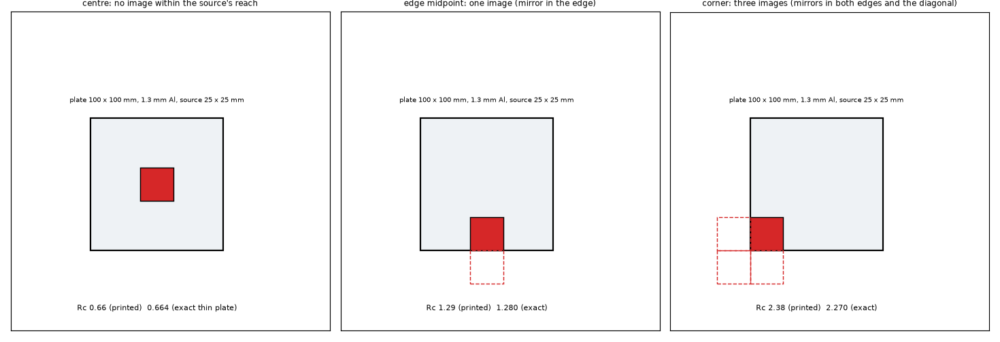

*Figure 4 (`figures/fig_04_plate_source_images.png`): the three published positions and the images of an insulated edge and corner; the Rc written under each is the printed value and the exact thin plate.*

| position | printed | exact series | difference | 3D solver | difference |
| :-- | --: | --: | --: | --: | --: |
| centre | 0.66 | 0.6637 | +0.6 % | 0.6679 | +1.2 % |
| edge midpoint | 1.29 | 1.2799 | -0.8 % | 1.2842 | -0.4 % |
| corner | 2.38 | 2.2700 | -4.6 % | 2.2745 | -4.4 % |

The series equals the finite-volume thin plate of the earlier folder to 3 digits (0.664 / 1.280 / 2.270). The printed corner is 4.6 % above the exact plate (the article's correlation is "accurate to about 5 %"); the 3D solver's +1.2 / -0.4 / -4.4 % is the through-thickness gradient of the real plate. The program, difference from the exact series in % (on the hottest point of the footprint / on the footprint mean):

| position | fvm | fdm | solid3d | lumped | analytic | fvm 0.5 mm |
| :-- | --: | --: | --: | --: | --: | --: |
| centre | +0.1 / +0.2 | +0.5 / +0.7 | +0.4 / +0.5 | -25.3 / -5.3 | +0.2 / +0.2 | +0.2 / +0.4 |
| edge midpoint | +0.1 / +0.2 | +0.1 / +1.2 | +0.2 / +0.3 | -34.7 / -17.9 | +0.1 / +0.1 | +0.1 / +0.2 |
| corner | +0.1 / +0.1 | -0.0 / +1.6 | +0.2 / +0.3 | -39.0 / -21.6 | +0.1 / +0.1 | +0.1 / +0.1 |

Sweep of the gap between the 25 mm source and one edge (centred along the edge) and of the diagonal gap to the corner (exact Rc max / mean in K/W; the models on the hottest point / the footprint mean, %):

| gap mm | edge: exact | fvm | fdm | solid3d | analytic | lumped | corner: exact | lumped |
| --: | --: | --: | --: | --: | --: | --: | --: | --: |
| 0 | 1.280 / 1.018 | +0.1 / +0.2 | +0.1 / +1.2 | +0.2 / +0.3 | +0.1 / +0.1 | -34.7 / -17.9 | 2.270 / 1.767 | -39.0 / -21.6 |
| 2 | 1.153 / 0.943 | +0.1 / +0.2 | +0.2 / +1.1 | +0.3 / +0.4 | +0.1 / +0.2 | -33.9 / -19.2 | 1.931 / 1.555 | -37.4 / -22.3 |
| 6 | 0.995 / 0.824 | +0.2 / +0.2 | +0.2 / +1.0 | +0.3 / +0.4 | +0.1 / +0.2 | -34.0 / -20.3 | 1.482 / 1.236 | -36.3 / -23.7 |
| 12 | 0.853 / 0.702 | +0.2 / +0.3 | +0.3 / +1.0 | +0.4 / +0.5 | +0.2 / +0.2 | -28.6 / -13.1 | 1.099 / 0.924 | -35.1 / -22.7 |
| 24 | 0.710 / 0.568 | +0.2 / +0.3 | +0.5 / +0.9 | +0.4 / +0.6 | +0.2 / +0.3 | -27.1 / -8.9 | 0.760 / 0.615 | -26.8 / -9.6 |
| 37.5 (centre) | 0.664 / 0.523 | +0.1 / +0.2 | +0.5 / +0.7 | +0.4 / +0.5 | +0.2 / +0.2 | -25.3 / -5.3 | 0.664 / 0.523 | -25.3 / -5.3 |

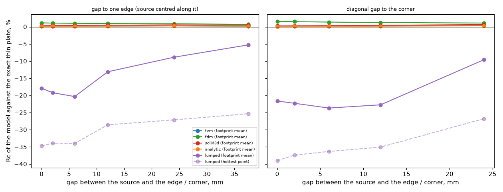

*Figure 10 (`figures/fig_10_near_edge_sweeps.png`): the error of each model against the exact thin plate as the source approaches an edge (left) or a corner (right).*

The fvm, fdm, solid3d and Analytic follow the exact images to 0.5 % (the fdm 1.6 % on the footprint mean, from its node-centred mean) at every distance; the Analytic is the cosine series, so it carries the images by construction. The **Lumped** does not: its footprint is one temperature, so it is compared on the footprint mean, where it reads -5 % at the centre (the ring network at this plate: a conductive plate, a big source) and **-18 % at the edge and -22 % at the corner**, the extra -13 and -17 points being the missing image of the edge, and it recovers only when the gap exceeds about one source side (24 mm: -9 %). The Lumped's maximum is not a hottest point (its -25 to -39 % on that column is the footprint-mean definition: it has no peak across the source). This plate is a conductive aluminium base, not a copper-and-laminate PCB; the 4 to 15 % cool quoted for the Lumped near an edge in the task (an earlier study of the ring network, not in this tree) was not compared. That the extra deficit near an edge is "the missing image" is a reading of the numbers, not a test of the ring construction.

### 7.1 Review: a PCB-like board and the capped first ring

`study_near_edge.py` section 4: 100 x 100 mm, two layers of 35 um full copper, 1.6 mm, h = 10 W/m2K on both faces, insulated edges, a 5 x 5 mm part of 1 W on layer 1; the fvm at 0.25 mm is the reference (the Analytic agrees with it to +0.01 % at every position). Lumped, % of the fvm, footprint mean / hottest point:

| position | fvm mean, max K | Lumped (`develop`) | Lumped (`fix/lumped-first-ring`, `b8dd7f8`) |
| :-- | --: | --: | --: |
| centre | 24.91, 27.52 | -2.3 / -11.6 | -2.3 / -11.6 |
| edge, gap 0 | 39.81, 44.56 | -8.8 / -18.5 | -6.9 / -16.8 |
| edge, gap 5 mm | 31.27, 33.94 | -9.8 / -16.9 | -7.2 / -14.5 |
| corner, gap 0 | 66.03, 75.31 | -11.5 / -22.4 | -10.4 / -21.5 |
| corner, gap 5 mm | 41.60, 44.44 | -14.0 / -19.5 | -11.5 / -17.2 |

The near-edge deficit exists on a PCB-like board too, smaller than on the plate (the mean -9 to -10 % at an edge and -12 to -14 % at a corner, against -2.3 % at the centre). The capped first ring of `fix/lumped-first-ring` (run from its worktree with `PYTHONPATH`, read only) does not touch the plate (the 25 mm source's equivalent radius, 14 mm, is above the first ring the rule gives, so the cap never acts: every number of the table above is identical) and recovers 1 to 2.6 points on the PCB board near an edge or a corner, not the centre. One board, one part size: a sample, not a bound.

## 8. Text for the project documents (`docs/for-the-project-documents.md`)

* `docs/validation.md` and `docs/theory.md` 7.5, 11: the strip tables are reproduced by two solvers (series, finite volumes); the layered models are out of range for t/c > 0.5 on bare laminate (numbers of 3.3); the coupon base stack is representable with undrawn outer slots and agrees to 0.6 % (fvm, fdm).
* `docs/theory.md` 2.6 and the face term of a part: the via barrel is counted over the dielectric gaps only (6.4); the face term charges all the heat of the part through the half outer layer (4).
* Sources with an inconsistency (to be flagged in `research/theory/BIBLIOGRAPHY.md` and wherever the numbers are quoted): Yovanovich, Muzychka and Culham Table 3 (the printed mean is of equations 24 and 27, not 26); Lemczyk and others case (c) of Table 1 to 3 (Bi1 = 0.001, not 0), Table 4 R (the mean of the top face), the repeated row of Table 1; Shen and others: the CFD without vias needs k_FR4 = 0.35 and the optimal-design reductions are Pattern II's.
* The Seri Lee corner value (2.38) is 4.6 % above the exact plate; any statement that uses it as a reference should say so.

## 9. Scripts, tests and reproduction

Every script is run from the repository root with `.venv/bin/python research/published-cases-followup/scripts/<script>.py` (private `PCBTHERMAL_CONFIG`, `QT_QPA_PLATFORM=offscreen`, one process at a time; peaks measured by `ps` while running).

| script | what | time, peak |
| :-- | :-- | :-- |
| `study_table2_strip.py [--no-program]` | 3.1 to 3.3 | 2 s, under 0.5 GB |
| `study_coupon_program.py [--face-term]` | section 4 (5 sources x 2 stacks, bisections); `--face-term` the review's table of section 4 | 5.4 min, 2.3 GB resident while the 0.5 mm solid3d runs (the review measured 2.7 GB for the 0.5 mm bisections of the 25 mm row alone); `--face-term` 10 s |
| `study_lemczyk.py [--no-program]` | section 5 | 6 s, under 0.5 GB |
| `study_shen_vias.py [--no-program]` | section 6, part D the review's 6.4 (the Cartesian cells 15 s each) | about 1 min, under 1 GB |
| `study_near_edge.py` | section 7, section 4 of the script the review's 7.1 | about 1 min, under 1 GB |
| `make_diagrams.py`, `make_figures.py` | figures 1 to 4 and 11, and 5 to 10 (`make_figures.py` reads `out/*.json`) | seconds |

`lib/`: `strip2d.py`, `series.py`, `lemczyk.py`, `prog_strip.py`, `plate_series.py`, `via_cell.py`, `cart_cell.py`. `tests/` (19 tests, 5 s; the last two are the review's: the face term scaled by the share going down, and the via deficit per via): the tables of the paper from the equations, the Table 3 mislabel, the strip solver against equations 24 and 23 and an energy balance, the one-dimensional limits of the four trace cases, case (c) with Bi1 = 0.001, the plate series against the finite-volume plate and its symmetry, the unit-cell variant identical to the original, the closed-form numbers of Shen, the Cartesian cell against the axisymmetric one, the program on the strip cell, on the coupon and on the plate. `out/` (git-ignored) holds the printed tables (`*.txt`) and the data of the figures (`*.json`).

## 10. Review

Independent review of the whole folder against the sources and the program (`develop` `fc91174a`; the program untouched, `git diff fc91174a --stat -- pcbthermal tests examples ico` empty).

* **Re-run**: `study_table2_strip.py`, `study_lemczyk.py`, `study_shen_vias.py`, `study_near_edge.py` in full, and of `study_coupon_program.py` the 25 mm base row (solver 7.812 / 7.803 W/mK, fvm +0.12 %, Lumped -4.27 %, Analytic -3.66 %) and the 16, 36, 50 mm base rows of the fvm and fdm: every number of sections 3 to 7 reproduced to the printed digit. The 19 tests pass. The full coupon table was not re-run (its 0.5 mm bisections use 2.7 GB; the machine was shared).
* **Sources**: Yovanovich, Muzychka and Culham page 500 (Table 3) rendered and read, Table 2 from the text layer of page 499; Lemczyk and others scan pages 4 to 7 rendered and read (Tables 1 to 4, Figs. 4 to 14, the text of the 3-layer case on page 419). Shen and others and Culham and Yovanovich were not re-opened (their numbers rest on the earlier readers and on the reproduction).
* **Independent references used by the review**: the equation 26 sum re-computed by hand with 200 / 300 / 500 / 2 000 000 terms; the paper's Fig. 5 (one-dimensional limit 1/(Bi1 + Bi2)) and Fig. 11 (temperatures on the face) against the two inconsistencies; the reference via cell with radially isothermal planes; the via barrel lengthened in memory; the share of the heat that leaves through the film under the source.
* **Corrected**: the Bi = 25 000 claim of 3.3 (wrong for the thin slab); the face-term inference of section 4 (now a measured explanation); the via section 6.3 (not an array effect; cause located, 6.4); the summary rows; the bibliography key of Seri Lee's article (`[EC1998Spreading]`, opened by an earlier folder, not 'not opened') and the status of [Muzychka2006EdgeCooling] in `docs/literature.md` (read in part elsewhere, not 'cover pages only').
* **Added**: section 7.1 (a PCB-like board, `develop` and `fix/lumped-first-ring`), figure 11 (the two sections of the findings), `plane_kr_scale` in `lib/via_cell.py` (default 1: identical), two tests.
* **Not verified**: the Lumped near-edge deficit on more than one PCB board and one part size; the via barrel rule on other stacks (35 um copper, thin prepregs, solder-filled vias) and on the FDM; whether the program's warnings fire on the strip and trace runs; Shen's Fig. 17 and 18 as plots.
* **Verdict**: go for the merge of the folder. The proposals of `INTEGRATION.md` are for the maintainer.

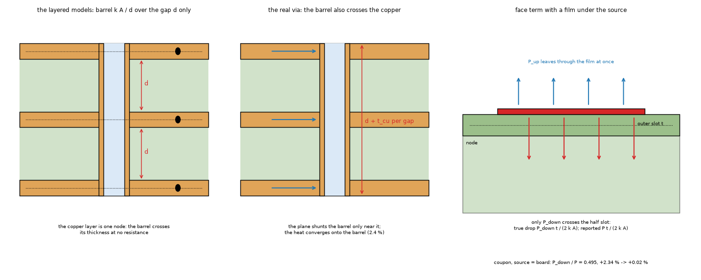

*Figure 11 (`figures/fig_11_via_barrel_and_face_term.png`): left, the barrel as the layered models count it (across the dielectric gaps only, the copper layer one node) and as it is (it crosses the copper too); right, a source on an outer layer with a film under it: part of the heat leaves through the film at once and never crosses the half layer that the face term charges.*

## 11. What was read and what was not verified

* **Read in full (R)** for the parts that matter here: Yovanovich, Muzychka, Culham (1999) pages 495 to 500 (the text of pages 1 to 6 of the file; page 6 rendered and read as an image here; the Table 2 and 3 digits, equations 17 to 29 compared with the code). Lemczyk and others (1992), the whole text of the file (Tables 1 to 4, equations 1 to 39) from the OCR text whose pages are flagged as verified against the images by the pipeline; not re-rendered by the researcher; **the review rendered scan pages 4 to 7 and compared Tables 1 to 4 with the data of `lib/lemczyk.py`: identical** (the decades of Tables 2 and 3 stay inferred: the blocks mix them, section 5.1). Shen and others (2020) sections I to IV (equations 1 to 9 and the text of section IV-A) from the OCR text, Table I, the numbers 120.3 / 1.86 / 2.63 / 0.98 / 47 / 89.5 / 46.4 / 62 / 44 / 23 % as printed; **Fig. 17 (b) and Fig. 18 as plots were not read** (the 1.82 K/W "analytical" is from an earlier reader's plot read, `lumped-zones-adoption`, marked plot). Culham and Yovanovich (1998) pages 4 to 8 text (Table 2, the five layer orders) read; the numbers 8.28 (text), 11.6 (plot, from `effective-conductivity` 4.2) are from that folder's readings.
* **From a summary or from earlier folders (S)**: Seri Lee (1998), `[EC1998Spreading]` in the bibliography: the article was opened by an earlier folder through a page converter (the worked example's numbers and the source positions read, its formulas images that did not come through: status S, numbers R, formulas N); not re-opened here. The corner correlation's own formulas were not read.
* **From memory (M)**: none used as a source; the closed forms were all read from the pages above.
* **Not obtained**: Seri Lee (1998) in its original form; the Fig. 17 pad geometry of Shen and others; the CFD files of that paper.
* **Reproduced**: all the printed numbers of sections 3.1, 5.1, 5.2 and 6.1 by the equations or by an independent solver, with the exceptions stated (the equation 26 row of Table 2, three digits; the plot value 1.82 K/W; Lemczyk's w/L1 = 0.1 rows are 1 to 9 % below the printed, the duplicated Table 1 row). **Not reproduced**: Shen's Fig. 18 curves and Table II (measured; reported in `lumped-zones-adoption` and `paper-case-studies`), Lemczyk's Figs. 4 to 14.
* **Limits of the program runs**: one cell size per row (the grid dependence was checked only for the via arrays), the program's own warnings were not recorded, the Lumped and the Analytic were run on boards outside their intended range for sections 3 and 5.3 (bare laminate), the aluminium plate of section 7 is not a copper PCB, and the via arrays are idealised (full copper, uniform flux, isothermal bottom). The cause of the Lumped near-edge deficit was not isolated (one PCB-like board measured by the review, 7.1); the cause of the fvm via deficit was located by the review (6.4) on one stack only.
* **Own doubts for the reviewer, and the answers**: (i) the face term at epsilon 1: tested, confirmed (section 4); (ii) the decades of Lemczyk's Tables 2 and 3: the tables were read as images, the blocks do mix decades, the Bi1 = 0.001 and face-mean readings are confirmed on Fig. 5 and Fig. 11 (section 5); (iii) the Table 3 mean row: equation 27 within one unit of the last digit at all five sizes, equation 26 off by up to 23 % of the value at eps 0.8 (0.0161 against 0.0208): the attribution stands (page 500 read as an image by the review); (iv) the via arrays: located (section 6.4).
