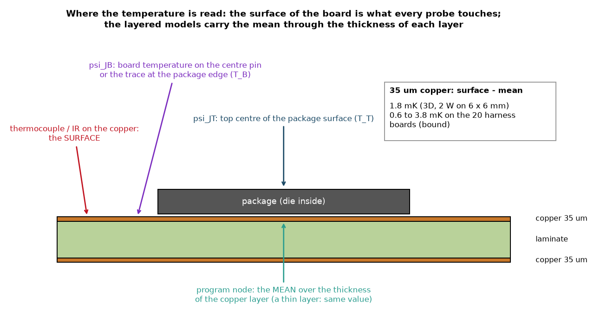
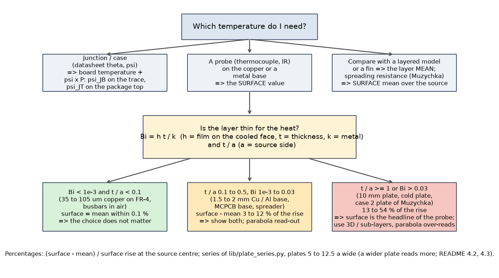
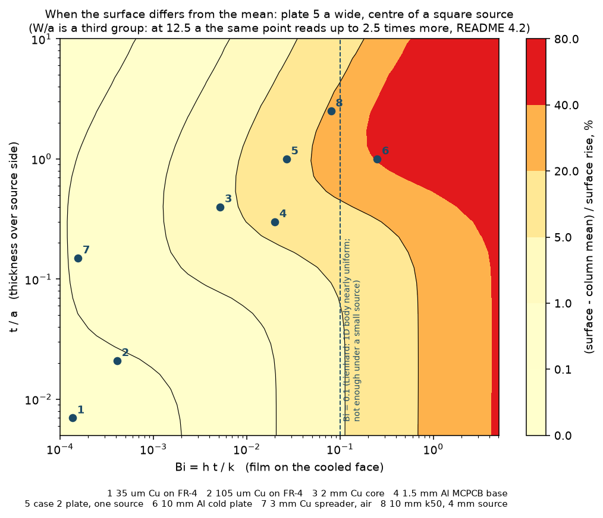
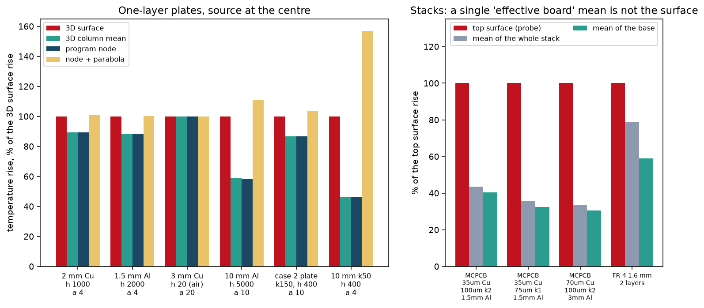

# Which temperature is reported: the surface or the mean through the thickness, and whether the program needs a selector

## 1. The question and the short answer

The layered models keep one temperature per copper layer, the mean through the thickness. Probes, datasheet parameters and published spreading solutions mostly speak of a SURFACE temperature. The maintainer asked whether a selector between the two makes sense, and, if so, to show it with studies, in the theory and in the program.

**Answer: yes, as a secondary, conditional choice; no as a global switch.** (1) Every instrument and every datasheet convention reads a surface (the top of the package, a trace beside the package, the copper under a probe); every layered model computes a mean; (2) on thin copper (35 to 105 um on FR-4) the two differ by milli-kelvins: the bound `q'' t / 2k` is 0.57 to 3.79 mK on the 20 harness boards (0.0009 to 0.005 % of the rise; the independent 3D gives 0.72 to 0.74 of the bound, section 7) and the top copper of the copper-core and MCPCB stacks reads 8.6 to 17 mK (0.07 to 0.14 %), so a selector changes nothing there and the default stays the layer mean (like for like with all five models); (3) on thick metal under a source (copper core, aluminium MCPCB base, spreader, cold plate) the surface is 3.5 to 54 % of the surface rise hotter than the mean, and the share depends on the plate width as well as on Bi and t/a (the same 2 mm copper plate reads 3.5 % five source sides wide and 10.7 % 50 mm wide; review, section 7), and the surface is what a probe on that metal reads and what the published case 2 reports; there a 'Surface' read-out beside the mean is worth having; (4) the parabolic read-out of `research/through-thickness-readout` is within 7 % of the true difference up to t/a = 0.5 and over-reads beyond, so the selector must say 'estimate' there. The form proposed after the review (`INTEGRATION.md`, one design with `releases/2.8.0/fem-model/READOUT_SELECTOR.md`): the surface is a VIEW, never a mode: the layer mean stays the number of every table, of Tj, the margin, the top path and the Power Calculator; the surface is computed beside it where the outer copper is thick and shown as Layer-box entries 'Surface (top)' / 'Surface (bottom)', labelled 'estimate', with a Results-summary line; the Biot map and the decision picture go into the theory and the user guide. The first proposal of this folder (a 'Read temperature as' combo in the Display popover that also switched Tj and the margin, and a `--read` option) is withdrawn: it would make the top-path split and the power coefficient loop follow a display choice.

*Figure 1 (`figures/fig_01_where_read.png`): the section of a board with a part and where each convention reads the temperature.*

*Figure 2 (`figures/fig_02_decision.png`): which temperature does my source report, and when the choice matters.*

Scripts (repository root, `.venv`): `scripts/study_biot_map.py` (about 5 s), `scripts/study_thick_cases.py` (about 1 min, 1.5 GB), `scripts/study_thin_copper_check.py` (review, about 10 s), `scripts/make_diagrams.py`, `scripts/make_figures.py`; library `lib/plate_series.py` (closed-form cosine series, independent of the program); tests `tests/test_plate_series.py` (5 passed). Earlier work reused, not repeated: `research/through-thickness-readout` (parabolic read-out, sub-layers, case 2, the 20 harness boards).

## 2. What each source reports (own words; page = PDF page unless 'journal')

Status: R(i) = read on the page image (checked by the reviewer of this folder, section 7); R(t) = read in the PDF text layer only; R(p) = read on the page image in an earlier folder; S = web snippet or page summary; M = memory. Support: A = column-mean headline with the surface beside it; B = surface headline; C = user-selectable view.

| source | temperature it reports and how it is defined | where | status | supports |
| :-- | :-- | :-- | :-- | :-- |
| ROHM 64AN113E | T_T is the top-centre temperature of the package surface; psi_JT = (T_J - T_T)/P, which depends on the heat leaving other faces; theta_JA with JESD51-2A still-air test; the thermocouple is fixed to the top centre of the package (Table 1, note 1) | sec 3.3 to 3.5, Fig 1 (PDF 1), sec 4 and Table 1 (PDF 2) | R(i) | B (package surface) |
| ROHM 65AN114E | psi_JT quoted from JESD51-2A; measured with a thermocouple fixed with conductive epoxy at the centre of the package surface (Fig 7); T_J = T_T + psi_JT P | PDF 3 to 4 | R(i) (PDF 3) | B |
| TI SPRA953B (rev D 2024) | case temperature = the hottest point of the top of the device, usually the centre; psi_JT: fine-gauge thermocouple on the package top centre (+/- 1 mm, bead of epoxy at most 2 x 2 mm), 5 to 50 % error with a heavy wire (sec 3.1, PDF 9); R_theta(JB) 'implies that the board temperature under the device is uniform (single node), which is erroneous' (PDF 10: an IN-PLANE statement, not about the thickness); R_theta(JB) is measured on the pin closest to the die (sec 4.1, PDF 11); psi_JB is the junction minus the CENTRE PACKAGE PIN temperature, measured with a fine thermocouple, an IR camera or a fibre-optic probe (sec 5, eq 9, PDF 11); the board takes 75 to 95 % of the heat | PDF 9 to 11, eq 9 (PDF 11) | R(i) | B |
| Guenin, Electronics Cooling 2013 | psi_JB board temperature is measured on a surface trace within 1 mm of the package edge, touching the package at mid-side; psi_JT at the top centre | page fetched | S | B |
| JESD51-2A, -8, -12 (via the notes above) | the standards behind the two rows above; not opened | | S | B |
| Muzychka, Culham, Yovanovich 2003 | the solution gives the SURFACE temperature field of the plate (Fig 9, T(x,y,0)); the spreading resistance uses the AREA-mean of the source on the surface (eq 3, 4: R = (T_s mean - T_f)/Q); Krane's solution used the maximum or centroid temperature (PDF 3, text layer); case 2 (50 mm, four 10 mm sources of 10 / 25 / 20 / 15 W) tables the centroid and the mean source temperature on the surface (Tables 3 and 4) | PDF 1 (eq 3, 4), 3, 7 (Tables 3, 4, Fig 9, journal p 184) | R(i) PDF 1 and 7; PDF 3 R(t) | B and C (it gives both a centroid and a mean) |
| Yovanovich, Muzychka, Culham 1999 (multilayer) | total resistance through the mean source temperature and the mean sink temperature | PDF 1 | R(t) | in-plane mean over the source, orthogonal to the choice here |
| Razavi 2016 thesis | the spreading resistance 'should' use the mean source temperature; printed: a maximum-based resistance of a circular uniform-flux source on a half space is '-21.4 % less', and 17.9 % greater for parabolic flux. **As printed, contradicted by the closed form**: for a uniform-flux disc on a half space the centre is 3 pi / 8 = 1.178 times the mean, so a maximum-based resistance is 17.8 % LARGER; the figures look swapped or garbled; not used for any conclusion | sec 1.1.2.4, PDF 31 (thesis p 8) | R(i) | in-plane mean vs peak: a second, separate convention |
| Lienhard (2024) | a body is nearly uniform when Bi = h L / k << 1 (Fig 1.10); the lumped-capacity solution is accurate within about 3 % for Bi <= 0.1 (a TRANSIENT statement); inside a cylinder wall Bi < 0.1 means a constant temperature within about +/-3 % (eq 2.24); a fin is one-dimensional when Bi_fin = h (A/P) / k << 1 (eq 4.27) | PDF 37 to 38 (book p 23 to 24), 82 (book p 68), 177 (book p 163; the first text said 178) | R(i) | the criterion of A for a uniform flux; under a small source it is not sufficient (section 7, figure 3) |
| Shen and Wang 2019 (thermal vias) | the PCB surface temperature T_x enters their film coefficient (eq 10, mask emissivity about 0.9; a model quantity, not a measurement); what they MEASURE is the top-case temperature of the diode with an infrared camera (PDF 15 and 16, Fig 23, Table II) | PDF 9 (eq 10), 15, 16 | R(i) PDF 9 (text) and 15 (image) | B (the measured value is a package surface) |
| TI SLRR012, Infineon AN2012-03, NISTIR 7648 | listed in the library; they define theta/psi and the STEP thermal-network nodes; not found to say more about the board temperature than the rows above | | S (searched, nothing added) | |
| Culham and Yovanovich, effective conductivity (read in `research/effective-conductivity`) | the board as ONE mean conductor with an effective k; one node through the thickness is the mean of the layer | folder README | R(p) there | A |
| IPC-2152 (via Signal Integrity Journal, Cadence blog, iconnect007) | conductor temperature rise: internal traces run cooler than external ones, conclusion drawn from thermocouple data; the standard itself not opened | web | S | B (a measured rise at a surface), not a through-thickness statement |
| LED vendors (OSRAM solder-point note, Luminus) | the reference is the solder-point temperature T_s on the copper beside the LED (thermocouple), with Rth(j-s) from the datasheet; a reading on the aluminium base is not a substitute | web | S | B on an MCPCB: the copper surface at a defined point |
| Ansys, Simcenter, Cadence tool manuals | not obtained: the searches returned general effective-conductivity pages (a homogeneous board with a volume-weighted k) and a forum reply, none that states a surface or mean read-out | web | N | none |

Counting what these say: of the conventions that name a board or package temperature (the five datasheet and notes rows, the LED notes, the measured-IR rows), all are SURFACE readings at a stated point (on the page image for ROHM, TI and Shen and Wang; from summaries for Guenin, JESD51, IPC-2152 and the LED notes); the only column-mean convention is the homogeneous effective-board model of the tool and paper literature, and the thin-layer criterion of the textbooks (Bi) is what says when the two are the same. No source found says a tool offers both; that is the program's own design choice. Hence (A) is supported as the default of a layered model, (B) is what every measurement is, and (C) is consistent with both and with case 2, which tables a centroid and a mean on the surface.

## 3. Method

Independent 3D solver `tests/helpers/layered3d.py` (imports nothing from the program; 8 slabs through metal; reproduces Table 4 of the paper to 0.03 K, `research/muzychka-case2-analytic`); a closed-form separation-of-variables series (`lib/plate_series.py`, plate W x W x t, side walls adiabatic, top adiabatic outside a centred square source, film h under the base) checked against the 3D solver in `tests/test_plate_series.py` (surface within 1 %, surface minus mean within 5 % on a 5 mm plate of k 150 at 400 W/m2K under a 10 mm source; the first text said a 10 mm plate under a 5 mm source); the program's FVM one-layer plate and a two-layer copper-core board; the closed parabola of `research/through-thickness-readout` section 3. All rises are above the film's ambient; the fraction used is (surface - mean) / surface rise at the source centre.

## 4. Results

### 4.1 Thin copper boards: the choice does not matter (`research/through-thickness-readout/scripts/study_frozen_impact.py`, re-run here)

The 20 harness boards that have a heater (every one 35 um copper): the largest bound `q'' t / 2k` over the heaters is 0.57 to 3.79 mK, 0.0009 to 0.0049 % of the FVM rise at 2 mm (example board 1.89 mK of 60.29 K, 0.0031 %; plate_pad 3.55 mK of 337.6 K; part_top_path 3.79 mK of 143.7 K). The independent 3D of the 35 um / 1.53 mm / 35 um board gave 1.76 mK (that folder, 4.3); this study's 3D of the same stack at 5 mm / 5 W gives 7.0 mK of 201.2 K (0.0035 %). A reading of the whole stack as one mean (an 'effective board' node, Culham and Yovanovich) is another matter: on that FR-4 board it reads 158.6 K against the 201.2 K surface (21 % cool), which is why the program keeps a node per copper layer.

### 4.2 The Biot map (`study_biot_map.py`, series, plate 5 a wide)

(surface - column mean) / surface rise, in %, rows t/a, columns Bi = h t / k:

| t/a \ Bi | 1.0e-4 | 6.1e-4 | 3.7e-3 | 2.2e-2 | 1.4e-1 | 8.3e-1 | 5.0 |
| :-- | --: | --: | --: | --: | --: | --: | --: |
| 0.005 | 0.009 | 0.033 | 0.18 | 1.08 | 5.9 | 22.5 | 41.6 |
| 0.070 | 0.076 | 0.31 | 0.77 | 1.9 | 6.5 | 22.6 | 41.6 |
| 0.402 | 0.083 | 0.49 | 2.65 | 9.8 | 20.1 | 33.7 | 47.0 |
| 0.965 | 0.067 | 0.41 | 2.37 | 11.7 | 33.5 | 50.8 | 59.3 |
| 2.319 | 0.042 | 0.26 | 1.52 | 8.3 | 32.2 | 60.8 | 71.6 |
| 5.574 | 0.023 | 0.14 | 0.83 | 4.8 | 22.2 | 54.8 | 72.3 |

(The full 27 x 25 grid is in `out/biot_map.npz`, git-ignored.) For a thin plate the 1D limit is Bi / (2 (1 + Bi)), 41.7 % at Bi = 5, which the first row approaches. **Sensitivity (corrected by the review)**: a plate 3 a or 10 a wide instead of 5 a moves the fraction by up to 18 and 28 percentage points (the first text said 0.18 and 0.28 points: the script printed the raw fraction), and the source mean instead of the centre by up to 4.1 points (not 0.04). The plate width W/a is a THIRD group of the map: the film rise of the whole plate (`q0 / h`) is in the denominator, so a wider plate reads a larger share. The typical cases at W/a = 3 / 5 / 10 / 12.5 (centre, %): 2 mm Cu core 1.5 / 3.5 / 7.8 / 8.8; 1.5 mm Al base 4.7 / 7.5 / 8.9 / 8.9; case 2 plate 6.0 / 13.3 / 27.3 / 30.6; 10 mm Al cold plate 30.5 / 41.1 / 45.5 / 45.6; 3 mm Cu in air 0.05 / 0.13 / 0.43 / 0.58; 10 mm k 50 10.7 / 22.4 / 46.1 / 52.4; the thin copper rows do not move (0.01 and 0.08). The map is therefore drawn for 5 a and says so.

*Figure 3 (`figures/fig_03_biot_map.png`): the fraction over Bi and t/a for a plate 5 a wide, with the eight typical cases of the next table marked and Lienhard's Bi = 0.1 drawn as a line (a necessary, not a sufficient, condition under a small source).*

| case | Bi | t/a | centre, % of rise | source mean, % |
| :-- | --: | --: | --: | --: |
| 1 35 um Cu on FR-4 (0.3 W/mK, 0.2 mm gap), 5 mm part | 1.4e-4 | 0.007 | 0.014 | 0.018 |
| 2 105 um Cu on FR-4, 5 mm part | 4.1e-4 | 0.021 | 0.077 | 0.089 |
| 3 2 mm Cu core, 1000 W/m2K, 5 mm part | 5.2e-3 | 0.40 | 3.5 | 3.1 |
| 4 1.5 mm Al MCPCB base, 2000 W/m2K, 5 mm part | 2.0e-2 | 0.30 | 7.5 | 7.3 |
| 5 case 2 plate (10 mm, k 150, h 400), one centred 10 mm source (the paper's case has four) | 2.7e-2 | 1.0 | 13.3 | 11.3 |
| 6 10 mm Al cold plate, 5000 W/m2K, 10 mm source | 0.25 | 1.0 | 41.1 | 38.6 |
| 7 3 mm Cu spreader in air (h 20), 20 mm source | 1.6e-4 | 0.15 | 0.13 | 0.12 |
| 8 10 mm k 50, h 400, 4 mm source | 8.0e-2 | 2.5 | 22.4 | 19.3 |

The h of cases 1 and 2 is the film k/d through one laminate gap, a lower bound of the rise denominator: the board rise is larger, so the true fractions are smaller still (4.1). **Joule-heated bar** (busbar, trace of IPC-2152 type), generation uniform, film h on both faces: the centre is Bi/4 and the mean is Bi/6 ABOVE the surface, as a share of the surface rise (closed form, tested): 3 mm Cu in air (h 15) 0.002 %; 2 mm Cu at h 100 0.009 %; 10 mm Al at h 15 0.013 %; a 35 um trace 0.00002 %. For a busbar the surface-versus-mean question is moot; the criterion is Bi < 0.1 of Lienhard.

### 4.3 Thick plates and blocks against the independent solver and the program (`study_thick_cases.py` part 1)

One-layer plates, 50 x 50 mm, top adiabatic, program FVM at 1 mm; K above the ambient:

| case | 3D surface | 3D mean | program node | node + parabola | surface - mean | % of rise | bound q''t/2k | parabola error |
| :-- | --: | --: | --: | --: | --: | --: | --: | --: |
| 2 mm Cu, h 1000, 4 mm source | 9.581 | 8.554 | 8.553 | 9.643 | 1.027 | 10.7 | 1.623 | +0.062 |
| 1.5 mm Al, h 2000, 4 mm | 17.589 | 15.508 | 15.476 | 17.611 | 2.081 | 11.8 | 3.125 | +0.053 |
| 3 mm Cu, h 20, 20 mm source | 40.212 | 40.198 | 40.199 | 40.213 | 0.014 | 0.04 | 0.019 | -0.000 |
| 10 mm Al, h 5000, 10 mm | 16.457 | 9.645 | 9.606 | 18.295 | 6.812 | 41.4 | 12.500 | +1.877 |
| case 2 plate, 10 mm source, 25 W | 33.434 | 28.939 | 28.962 | 34.645 | 4.495 | 13.4 | 8.333 | +1.188 |
| 10 mm k 50, h 400, 4 mm | 37.831 | 17.525 | 17.495 | 59.385 | 20.307 | 53.7 | 62.500 | +21.584 |

The program's node equals the 3D column mean within 0.03 to 0.04 K (0.3 to 0.4 % of the surface rise at worst: 10 mm Al) in all six, so the mean is delivered correctly and the whole difference is the convention. The parabola is good to 0.05 to 0.06 K where t/a <= 0.5 (6 % and 2.5 % of the difference) and over-reads where the source is small against the thickness (t/a 1: +1.2 K of 4.5; 10 mm Al +1.9 of 6.8; t/a 2.5: +21.6 K of 20.3, the bound being no better). The surface-minus-mean percentages differ from the series values of 4.2 by the plate width (50 mm is 12.5 a for a 4 mm source and 5 a for a 10 mm source; case 2 plate 13.4 against 13.3). **The review ran the series at the geometry of these plates** (W = 50 mm): 10.76 / 11.82 / 0.03 / 41.1 / 13.31 / 52.4 % against the 3D 10.72 / 11.83 / 0.04 / 41.39 / 13.44 / 53.68 %, so the series and the independent solver agree and the difference with the map is the width.

### 4.4 A copper-core board in the program, and MCPCB-like stacks (`study_thick_cases.py` parts 2 and 3)

Copper-core board, 35 um Cu / 0.1 mm dielectric (k 2) / 1.5 mm Cu, 5 W on 5 x 5 mm, film 2000 W/m2K under the base, top film 10, a two-layer `Problem` of the program: program FVM top node 11.911 / 12.236 / 12.268 K and base node 3.299 / 3.339 / 3.340 K at 1 / 0.5 / 0.25 mm; independent 3D: top surface 12.457, top copper mean 12.448, base mean 3.339. So the base node equals the 3D base mean to 0.001 K at the fine cell; the top node is 1.5 % low at 0.25 mm (the 5 mm source on the grid, not the convention); the top copper surface minus mean is 8.8 mK (0.07 %); the first sub-slab of the base (its centre 0.09 mm below the base's top face) is 0.19 K above the base mean (5.6 % of the base rise; the face itself is a little hotter still; the first text placed that sub-slab centre 0.19 mm below the face).

MCPCB-like stacks in the 3D solver only (the program has one copper conductivity, so aluminium cannot be drawn next to copper):

| stack | surface | Cu mean | base mean | base bottom | whole-stack mean | surface - Cu mean (mK) |
| :-- | --: | --: | --: | --: | --: | --: |
| 35 um Cu / 100 um k2 / 1.5 mm Al | 15.41 | 15.40 | 6.23 | 5.93 | 6.72 | 8.8 |
| 35 um Cu / 75 um k1 / 1.5 mm Al | 18.68 | 18.67 | 6.05 | 5.77 | 6.64 | 8.6 |
| 70 um Cu / 100 um k2 / 3 mm Al | 12.00 | 11.99 | 3.67 | 3.26 | 4.00 | 17.0 |
| 2-layer FR-4 1.6 mm | 201.16 | 201.15 | 118.80 | 118.80 | 158.60 | 7.0 |

*Figure 4 (`figures/fig_04_plates_stacks.png`): left, the four read-outs of the plates in % of the 3D surface; right, the surface against the whole-stack mean and the base mean of the stacks (for the FR-4 board the 'base' is the bottom copper layer).*

On an MCPCB the copper under the LED is thin: surface and layer mean agree to 9 to 17 mK; the probe-versus-model question there is the SURFACE copper beside the part (the solder-point convention of the LED notes) against the node of the copper layer, which differ by mK; what is large is the drop through the dielectric (15.4 against 6.2 K) and a mean over the whole stack (6.7 K) which is nowhere near the surface. A selector between 'surface' and 'mean of the layer' therefore does nothing for an MCPCB top layer, and a read-out of the aluminium base surface under the source is the one that would show a number (about 0.2 K, 6 % of the base rise in the copper-core board).

## 5. What the studies say about the selector

1. **Where it does nothing**: the 20 harness boards, every 35 to 105 um copper layer, the MCPCB top copper, busbars: 0.0009 to 0.14 % of the rise, 0.6 to 17 mK (the 70 um MCPCB copper: 17.0 mK of 12.00 K, 0.14 %; the first text said 0.08 %). Default 'Layer mean' stays; a switch there would move the heater rows by milli-kelvins and the frozen numbers (20 of 20 boards) for no gain.
2. **Where it matters**: a source on a block or plate of 1.5 mm or more of metal that is cooled through a film (copper core and aluminium base; spreader on a package; cold plate; the plate of the paper's case 2): 3.5 to 54 % of the surface rise, larger on a wider plate (4.2 and 4.3), and the quantity a probe on that metal reads is the surface.
3. **Accuracy of the surface read-out offered**: the parabola is within 7 % of the true difference up to t/a = 0.5 and over-reads beyond (4.3; `research/through-thickness-readout` 4.2); sub-layers converge as 1/N and need new code. The selector should show the surface as 'estimate' and carry the flag `t/a`.
4. **A second convention, not the subject here but easily confused with it**: the in-plane mean over the source (Muzychka and Yovanovich spreading resistance) against the peak. The program's heater rows already give peak and mean in the plane; for a uniform-flux disc on a half space the maximum is 3 pi / 8 = 1.18 times the mean (Razavi prints the size of this error with a doubtful sign, section 2). The Display text should name both axes.
5. **Not supported by any source found**: a through-thickness mean of the whole board as THE board temperature (it reads 158.6 K for a 201.2 K surface on the FR-4 board); the sources that name a board temperature all read a surface point.

## 6. Limits

The map is for one plate 5 a wide with a square source in the centre, adiabatic top, film below, no laminate below the plate; the share grows with the plate width (up to 2.5 times at 12.5 a, 4.2); the real board has several layers and a laminate gap as the film (the h of cases 1 and 2), so those two fractions are upper estimates. A rectangular or off-centre source, several sources, an edge film and an MCPCB with aluminium in the program (one copper conductivity) were not run in the program. The 3D solver puts the first slab value at the slab centre; its surface is extrapolated by a half slab. The IPC-2152 and the commercial tool rows are summaries or not obtained.

## 7. Review

Independent review of the folder (re-run on `development` 22593efd plus this branch; every number below printed by a script of the folder).

**Sources, on the page image** (rendered from the library copies): ROHM 64AN113E (sec 3.3, 3.5, Fig 1, Table 1 note 1), ROHM 65AN114E (PDF 3, Fig 7), TI SPRA953B (sec 3.1, 4, 4.1, 5, eq 9), Lienhard (Fig 1.10, p 24, p 68 eq 2.24, eq 4.27), Muzychka 2003 (eq 3, 4, Tables 3 and 4, Fig 9), Shen and Wang (PDF 15), Razavi (PDF 31). Every one names a surface (package top, centre pin, trace, the IR top case, the surface field of the plate) or the textbook criterion; the claim 'all sources that name a board or package temperature read a surface' holds for those read; Guenin, JESD51, IPC-2152 and the LED notes stay S. **Corrected**: the statuses R(t) became R(i) where the image was checked; TI's 'single node, which is erroneous' is about the IN-PLANE uniformity under the device, not the thickness, and is no longer quoted as a warning against a column node; psi_JB is read on the centre package pin (the pin closest to the die is the R_theta(JB) method); Shen and Wang MEASURE the top-case temperature (their PCB surface temperature is a model quantity of eq 10); Lienhard's eq 4.27 is on PDF 177, and his 3 % is a transient lumped-capacity statement; Razavi's printed '-21.4 % less' contradicts the closed form (centre / mean = 3 pi / 8 for a uniform-flux disc), recorded as printed and not used; 'case 2' in the tables is the plate of case 2 with one centred source (the paper has four).

**Numbers**: `study_biot_map.py`, `study_thick_cases.py` (1.5 GB) and the folder tests reproduce every printed number of 4.2 to 4.4. **Found**: (1) the map sensitivity was misread: the script printed the raw fraction, so 'at most 0.18 and 0.28 percentage points' for a plate 3 a or 10 a wide were 18 and 28 points, and 'source mean 0.04 points' was 4.1 points; the plate width W/a is a third group of the map (a wider plate reads more, because the film rise of the whole plate is in the denominator). The same 2 mm copper plate reads 3.5 % at 5 a and 10.7 % at 12.5 a, which is why 4.2 and 4.3 differed; the series run at the geometry of the 4.3 plates reproduces the independent 3D (10.76 / 11.82 / 0.03 / 41.1 / 13.31 / 52.4 % against 10.72 / 11.83 / 0.04 / 41.39 / 13.44 / 53.68 %). The headline range is now 3.5 to 54 %, the map title and the decision picture say the width, and a test holds it (`test_plate_width_is_a_third_group`). (2) The 'thin copper' row of 5.1 quoted 0.08 % at most; the 70 um MCPCB copper is 0.14 %. (3) The base sub-slab of the copper-core board is 0.09 mm below the face, not 0.19. (4) The method sentence named the wrong test plate (5 mm thick under a 10 mm source). **Thin copper against the independent solver** (`study_thin_copper_check.py`, new): three stacks with the heater flux of example_board, plate_pad and part_top_path give 1.37 / 2.62 / 2.74 mK, 0.72 to 0.74 of the bound `q'' t / 2k` (1.89 / 3.55 / 3.79 mK) and inside the parabola's range `q'' t / 3k` to `q'' t / 2k`; the harness re-run gives the bounds of 4.1 to the digit. **The parabola** over-reads beyond t/a = 0.5 (+21.6 K on 20.3 K at t/a 2.5, ratio 2.06), consistent with `research/through-thickness-readout` 4.2 (1.8 to 2.1 at t/a 2 to 2.5).

**The questions of the study**: (a) *h of the thin copper cases in the map*: k/d of one laminate gap is an upper bound of the film a copper layer sees, so it places those cases at a Bi too high and their share is an upper estimate; the right number for them is the bound over the rise, which the harness gives directly (0.0009 to 0.005 %), and neither changes the conclusion (orders of magnitude below 1 %). Kept, labelled. (b) *Lienhard's 3 % on the map*: drawn as the line Bi = 0.1 with the note that it is necessary, not sufficient, under a source narrower than the plate (at Bi 0.1 and t/a 1 the map reads about 30 %); not drawn as an accuracy band. (c) *1 % of the rise for the summary line*: recommended (INTEGRATION 2.1): below it the difference is smaller than the error of the node itself (the copper-core top node 1.5 % low at 0.25 mm) and than the parabola error on case 2.

**The display proposal** was not consistent with the implementation in progress (`fix/thick-plate-surface-estimate`, after `releases/2.8.0/fem-model/READOUT_SELECTOR.md`): this folder proposed a Display-popover combo that also switched Tj and the margin and a `--read` option; that would make the top-path split and the power coefficient loop follow a display choice. `INTEGRATION.md` now holds one reconciled design (a view: Layer-box entries, no mode, no CLI switch, Tj on the column) and the six instructions for that branch (summary-line threshold, the word 'estimate', the `check_thick_plates` text, the validation reference 56.1 -> 55.6 and the order of 55.5 / 55.6, the tooltip). The proposed texts (`docs/theory-text.md`, `docs/validation-text.md` as 55.7, the guide, the tooltip and the README line in `INTEGRATION.md` 5) were rewritten with the corrected numbers. Figures: 2 (the spreading-resistance box said 'layer mean'; Muzychka uses the source mean of the SURFACE), 3 (title, width note, Lienhard line) and 4 (overlapping labels) redrawn; figure 1 now says the centre pin for psi_JB.

**Not verified**: Guenin, JESD51 and IPC-2152 texts (no copies); the program's surface read-out itself (its branch is reviewed separately); the map for a board with several layers and a laminate as the film, an off-centre source, an edge film.

**Verdict: GO** for the merge, with the corrections above; the decisions are listed in `INTEGRATION.md` 8.

## 8. What was read and what was not verified

* Read on the page image by the reviewer (section 7): ROHM 64AN113E PDF 1 and 2, ROHM 65AN114E PDF 3, TI SPRA953B PDF 9 to 11, Lienhard PDF 37, 38, 82 and 177, Muzychka 2003 PDF 1 and 7, Shen and Wang 2019 PDF 15, Razavi PDF 31. Text layer only: Muzychka 2003 PDF 3 (Krane), Shen and Wang PDF 9 and 16, Yovanovich, Muzychka and Culham 1999 (first page), ROHM 65AN114E PDF 4, TI PDF 8.
* Summaries only: JESD51-2A, -6, -8, -12, -14 (through the notes; TI names JESD51-6 for psi_JB and JESD51-8 for R_theta(JB)), Guenin (Electronics Cooling; no copy in the library, the review's fetch of the page failed), IPC-2152, the LED vendor notes, the tool manuals (not obtained: Ansys, Simcenter, Cadence).
* Reproduced: the 3D solver against the series (1 % and 5 %), the program node against the 3D mean (six plates, the copper-core board); the harness bounds were re-run. Not done: a measurement (none exists); the program's Lumped and Analytic on these plates (the earlier folder has them for case 2); the JESD51-8/12 text itself.
* The doubts left for the reviewer are answered in section 7.
