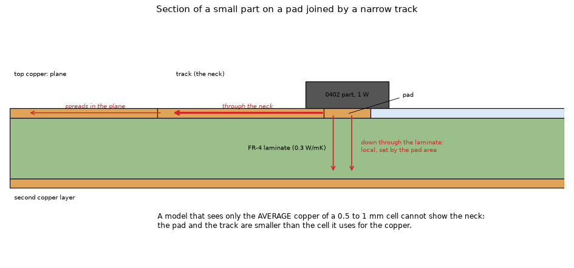
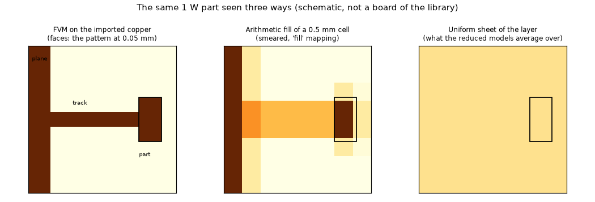
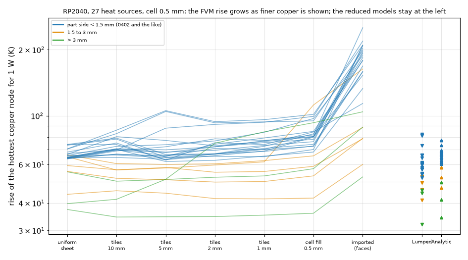
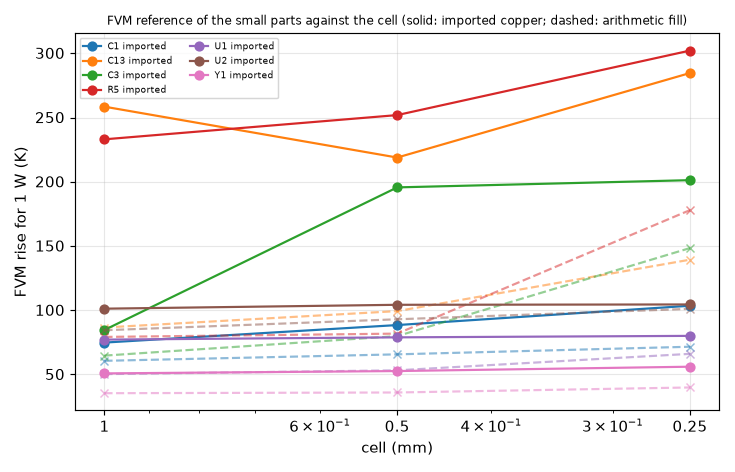
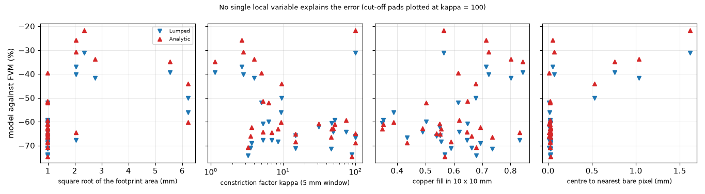
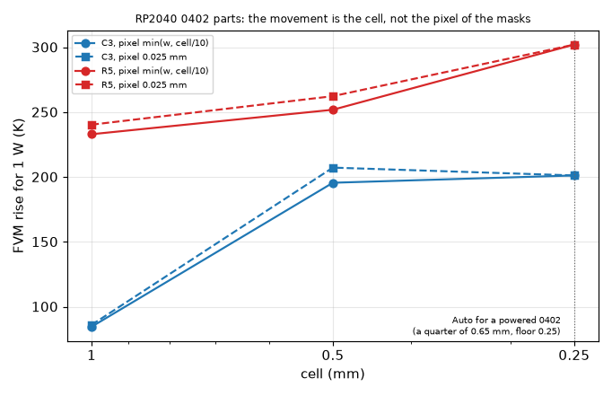

# Why the Lumped and Analytic models read too cold on the small parts of an imported board

Question: on imported boards the Lumped and Analytic models read 17 to 82 % below the FVM that reads the imported copper (`docs/validation.md` 27.7: RP2040 U1 -42 / -35 %, U3 -27 / -17 %, small passives up to -75 %; CO60 about -55 %). Which physical or modelling cause explains it, does an easy rule protect the user, and what should the program do? Studies only; nothing in `pcbthermal/` was changed. Recommendation and cost: `INTEGRATION.md`.

Every number below was printed by a script of `scripts/` (run from the repository root with the library of boards linked, `eval "$(pcb-library/scripts/link_env.sh)"`); the CSV files are in `out/` (git-ignored). Percentages are "model rise / FVM rise - 1"; the rise is the hottest copper node minus the ambient, 1 W in one part at a time, typical stack-up, default convection, cell 0.5 mm unless said. The FVM is the program's own, on the flow-based faces of the imported copper (the reference of the validation); it was not compared with a physical board.

## 1. The situation

*Figure 1 (`fig_01_pad_neck_section.png`): section of a 0402-size part on its pad. The heat leaves the pad down through the laminate (set by the pad area) and sideways through the narrow track (the neck) into the plane. Pad and track are 0.1 to 0.5 mm wide, smaller than the 0.5 to 1 mm cell in which the reduced models read the copper.*

*Figure 2 (`fig_02_three_views.png`): schematic (not a board of the library) of what each treatment sees: the pattern at its pixel (FVM faces), the arithmetic fill of a cell (smeared), one uniform sheet (the average of the layer).*

How the models read the copper (`pcbthermal/copper.py`, `lumped.py`, `analytic.py`): the FVM takes the face conductances from the pixel pattern (0.05 mm here); the Lumped and Analytic models take only the arithmetic copper fraction of a cell (`copper.problem_fill`, at their 0.5 to 1 mm raster) and then average it in rings (Lumped) or in a cosine series (Analytic). So they are, in effect, models of a sheet with a smoothly varying fill.

## 2. Method

`lib/variants.py` builds, from one imported problem, copies that keep the vias, the parts and the stack-up and swap only the copper:

| Variant | What the copper is | Who sees it |
| :-- | :-- | :-- |
| imported | masks, flow-based faces | FVM (the reference), Lumped and Analytic as the program runs them |
| fill | the same masks, arithmetic cell fill (the program's old path) | FVM |
| tiles T | one zone per square of T mm (1, 2, 5, 10) with the mask average of the tile | FVM; Lumped and Analytic at 5 mm |
| uniform | one zone per layer at the layer-average fill | FVM, Lumped, Analytic |
| no vias | imported, vias removed | FVM, Lumped, Analytic |

`scripts/study_error_decomposition.py` runs these for every heat source of RP2040 (27 parts, two layers, 52 x 51 mm), and for subsets of oswlight (10 parts, four layers, 36 x 36 mm) and CO60 (5 parts, two layers, 285 x 95 mm), and writes with each part the local copper measures (fill in squares of 2, 5, 10 mm, distance to the nearest bare pixel, copper under the footprint, side of the footprint). The chain of the rise through the variants is the decomposition of the gap: the ratio of two neighbouring steps is the effect of one change.

## 3. Results

### 3.1 The reduced models agree with the FVM on a uniform sheet; the gap is the copper structure (RP2040, 27 parts)

Geometric mean of the ratio of the rises (range in brackets), by size of the footprint (`study_summary.py`):

| Step | side < 1.5 mm (19) | 1.5 to 3 mm (5) | > 3 mm (3) |
| :-- | :-- | :-- | :-- |
| FVM tiles 10 mm / uniform sheet | 1.08 (1.00 to 1.22) | 0.94 | 0.96 |
| FVM tiles 5 mm / tiles 10 mm | 0.98 | 1.00 | 1.08 |
| FVM tiles 2 mm / tiles 5 mm | 1.03 | 0.98 | 1.14 |
| FVM tiles 1 mm / tiles 2 mm | 1.04 | 1.02 | 1.05 |
| FVM cell fill (0.5 mm) / tiles 1 mm | 1.07 | 1.17 | 1.07 |
| **FVM imported / cell fill** | **2.23 (1.35 to 3.08)** | **1.41** | **1.36** |
| FVM imported / uniform sheet (all structure) | 2.71 (1.67 to 3.74) | 1.54 | 1.81 |
| Lumped on a uniform sheet / FVM on it | 0.88 (0.84 to 0.95) | 0.92 | 0.92 |
| Analytic on a uniform sheet / FVM on it | 0.98 | 1.00 | 0.99 |
| Lumped imported / Lumped uniform | 1.04 (0.88 to 1.32) | 0.91 | 1.00 |
| Analytic imported / Analytic uniform | 1.03 | 0.97 | 0.96 |
| **Lumped / FVM on the imported copper** | **0.34 (0.26 to 0.48)** | 0.55 (0.32 to 0.69) | 0.51 (0.44 to 0.61) |
| Analytic / FVM on the imported copper | 0.37 (0.26 to 0.61) | 0.63 (0.36 to 0.78) | 0.53 (0.40 to 0.65) |

*Figure 3 (`fig_03_ladder.png`) draws the ladder per part:*

What this says, in order:

1. **The averaging of the copper over regions of 1 to 10 mm is not the cause** (hypothesis a). The FVM changes by 0 to 8 % between the layer-average sheet, tiles of 10, 5, 2 and 1 mm: the local fill around the part matters little. The Analytic model on a uniform sheet is within 2 % of the FVM on it, the Lumped within 2 to 16 % cool.
2. **The cause is the structure of the copper below about 1 mm**: the pad, the track that feeds it, the clearances (the FVM step "imported / cell fill" is 1.4 to 3.1 times; the whole structure 1.5 to 3.7 times, up to 4.3 on CO60). The reduced models read the copper as a cell average, so they cannot see it, and the numbers confirm that they do not: Lumped and Analytic on the imported board differ far less from themselves on the uniform sheet than the FVM does (rows "imported / uniform": Lumped -12 to +32 %, Analytic -9 to +14 % on RP2040, 0 to +15 % on the other two boards, against 1.2 to 4.5 times for the FVM; the first version said "0 to 10 %", corrected by the review, chapter 6). **They are, for a part, close to uniform-sheet models.**
3. **The Lumped has its own deficit of 2 to 16 % on a uniform sheet** (RP2040; 7 to 13 % on oswlight; 9 to 30 % on CO60, the largest on the smallest parts: C1 -30 %, R1 -26 %) that the Analytic has much less of (-4 to +5 % on RP2040, -8 to -2 % on oswlight, -4 to -2 % on CO60; the first version quoted -4 to +5 % for all three, corrected by the review). It is not the outline or the board size alone (3.5) and was not isolated (the ring construction for a source smaller than the cell is the candidate, hypothesis c).
4. **Vias are not the cause** (hypothesis d): removing them raises the FVM by 17 to 20 % and the Lumped by 7 to 15 %, so the vias are seen by both models; the difference between the two ratios (a few points) is the via share of the gap.
5. **The shape of the heat source is not the cause** (hypothesis e) for the passives, which have one opening and no exposed pad; U1 and U3 use the pad as proposed, and the gap there (-31 to -42 %) is among the smallest of the board because the pad is large and sits on solid copper.
6. **Thin copper conductivity** (hypothesis f) is in every variant (the same 35 um sheet), so it cannot explain a difference between them.

### 3.2 The FVM reference itself has not converged for the 1 mm parts

Rise in K for 1 W (`study_cell_convergence.py`, peak 1.82 GB):

| Part | cell 1 mm imported / fill | 0.5 mm | 0.25 mm |
| :-- | :-- | :-- | :-- |
| C3 (0402) | 84.6 / 64.6 | 195.6 / 79.8 | 201.2 / 148.4 |
| C13 (0402) | 258.4 / 86.5 | 218.8 / 99.3 | 284.6 / 139.3 |
| R5 (0402) | 233.0 / 79.2 | 251.9 / 81.8 | 302.1 / 177.9 |
| C1 (0603) | 74.8 / 60.6 | 88.4 / 65.6 | 103.5 / 71.6 |
| U1 | 77.1 / 50.2 | 78.9 / 53.2 | 80.0 / 66.0 |
| U2 | 101.2 / 84.4 | 104.2 / 92.9 | 104.5 / 101.1 |
| Y1 | 50.8 / 35.4 | 52.6 / 35.9 | 56.0 / 39.8 |

*Figure 4 (`fig_04_cell_convergence.png`):*

Two consequences. (i) The arithmetic fill climbs towards the imported value as the cell approaches the pad size (C3 80 to 148 K): the "fill" mapping fails exactly because of the sub-cell structure, which supports section 3.1. (ii) The imported value is not converged at 0.25 mm for the 1 mm parts (C3 +3 %, R5 +20 %, C13 +30 % from 0.5 to 0.25; C13 at 1 mm, 258 K, is above its 0.5 mm value: not monotone); the percentages of the tables above are therefore **lower bounds on the error against a converged reference, and a finer cell would make them larger, not smaller**. The two reduced models hardly move with the cell (3.5), so the agreement of Lumped with the FVM of C3 at 1 mm (-31 %) is an accident of the reference. **Review (6.2):** the masks of this table change with the cell (automatic pixel `min(w, cell / 10)`: 0.1, 0.05, 0.025 mm); with the pixel fixed at 0.025 mm the movement stays (C3 86.1, 207.3, 201.2 K; R5 240.4, 262.4, 302.1 K), so it is the cell, not the masks; and the program's Auto already chooses 0.25 mm for a powered 0402, not 1 mm (figure 6).

### 3.3 No local variable separates the good from the bad cases

`study_constriction_factor.py` adds, for RP2040, the in-plane constriction factor kappa of the top layer (`lib/constriction.py`: the resistance of the real pattern between the pad and the frame of a window of 2 or 5 mm half side, divided by that of full copper). Spearman rank correlations with the ratios (27 parts, p in brackets):

| Ratio | kappa 5 mm | fill 5 mm | distance to bare laminate | side of part |
| :-- | :-- | :-- | :-- | :-- |
| FVM imported / fill | +0.40 (0.054) | -0.11 (0.58) | -0.25 (0.22) | -0.69 (0.000) |
| Lumped / FVM | -0.32 (0.13) | 0.00 (1.0) | +0.41 (0.034) | +0.70 (0.000) |
| Analytic / FVM | -0.42 (0.042) | +0.22 (0.27) | +0.40 (0.037) | +0.61 (0.001) |

(kappa is infinite for three parts whose pad is connected only through the second layer: C12, C13, U3; the correlations above leave them out, n = 24. Ranked as the largest values instead, n = 27, they become +0.28 (0.16), -0.17 (0.40), -0.33 (0.09): weaker still. The column "distance to bare laminate" is the distance from the centre of the footprint to the nearest pixel below half coverage, which for a two-pad part is the gap between its own pads: 0.00 to 0.07 mm on 30 of the 42 parts; it measures nothing about the copper around the part, review 6.3.) `study_rule_search.py` pools the 42 parts of the three boards and asks which variable could warn before the run that the error exceeds 50 % (30 of 42 Lumped cases, 28 of 42 Analytic):

| Variable | Spearman with Lumped error | AUC for "below -50 %" |
| :-- | :-- | :-- |
| side (or area) of the footprint | +0.68 | 0.87 |
| copper under the footprint | +0.36 | 0.83 |
| fill in 2 mm / 5 mm / 10 mm | +0.26 / +0.29 / +0.07 | 0.76 / 0.78 / 0.65 |
| distance to bare laminate | +0.31 | 0.77 |
| copper of the other layer within 5 mm | -0.19 | 0.57 |

The size of the part is the best variable, and it is not a rule: by size class (`study_summary.py`, 42 parts)

| Side | n | Lumped | Analytic |
| :-- | :-- | :-- | :-- |
| < 1.5 mm | 20 | -81 to -52 % (mean -66) | -77 to -39 % (mean -63) |
| 1.5 to 3 mm | 15 | -82 to -25 % (mean -48) | -76 to -22 % (mean -43) |
| > 3 mm | 7 | -56 to -25 % (mean -44) | -60 to -17 % (mean -40) |

*Figure 5 (`fig_05_error_vs_variables.png`), RP2040:*

The best case of the pool is -17 % (Analytic) and -25 % (Lumped); big parts on CO60 (RGB1 5.2 mm, U1 9.5 mm) are -50 to -56 %. There is no threshold under which the models are safe, and the "part on a copper edge or bare laminate" test of the program does not predict the error either (distance to bare laminate: AUC 0.77).

### 3.4 Independent check: a pixel-resolved fin network of the top layer

`study_fin_check.py` predicts the structure factor FVM-imported / FVM-uniform with a separate, much simpler calculation that shares no code with the program: the top mask at its own pixel as a resistor network, every pixel leaking to the ambient with a fin length lambda, the part's copper as one node. The solver is tested (`tests/test_constriction.py`) against the strip (R = L/W, exact), the disc pad in a disc window (ln(b/a)/2 pi, 3 %) and the fin solution K0(x)/(x K1(x))/2 pi of an infinite leaking sheet (4 %; the form is equation (19) of [Shen2019], PDF page 10, read on the page image by the review: status R, chapter 6.4; the first version cited Carslaw and Jaeger from memory). Result with lambda chosen as a free parameter:

| Board | lambda (mm) | predicted structure factor (geometric mean) | FVM | Spearman | Lumped times the factor: mean absolute error (as run) |
| :-- | :-- | :-- | :-- | :-- | :-- |
| RP2040 | 0.5 / 0.75 / 1 / 2 | 1.98 / 2.34 / 2.63 / 3.59 | 2.33 | 0.63 / 0.68 / 0.68 / 0.57 | 22 / 21 / 28 / 75 % (60 %) |
| oswlight | 0.5 / 0.75 / 1 / 2 | 1.56 / 1.73 / 1.88 / 2.40 | 1.64 | 0.90 / 0.85 / 0.87 / 0.54 | 13 / 12 / 16 / 43 % (41 %) |
| **CO60** | 0.5 / 0.75 / 1 / 2 | 1.11 / 1.13 / 1.15 / 1.25 | **2.90** | **-0.20** | 62 / 61 / 60 / 57 % (66 %) |

On the two boards where the heat leaves the pad through the top layer the independent network reproduces the size of the effect (lambda 0.5 to 1 mm), so the cause of section 3.1 does not rest on the face construction of the FVM alone. **On CO60 it fails** (predicts 1.1, the FVM gives 2.9): there the pads are tied to the rest through vias and the second layer, which this top-layer network does not contain. A correction built on it would not transfer, which is why it is not recommended (`INTEGRATION.md` 1.4). The lambda was swept, not derived (the vertical path of a real board would give a longer fin length; the value that works is empirical).

### 3.5 Cell of the reduced models and the outline (RP2040, `study_cell_and_outline.py`)

At cell 1 mm the Lumped and Analytic rises of the seven parts tried change by at most 10 K (C3 56.9 to 58.2 K Lumped, 66.7 to 61.5 K Analytic; C13 73.2 to 64.1 K; R5 66.3 to 74.0 K), against the FVM moving from 195.6 to 84.6 K for C3: the reduced models do not react to the cell. The same script runs the uniform sheet with and without the board outline: identical (outline of the RP2040 is its box), so **hypothesis c, the equivalent rectangle, was not tested on a board whose outline differs from its box**; on CO60 (outline, 285 x 95 mm) the Lumped is 9 to 30 % cool on a uniform sheet (section 3.1 point 3) and the Analytic -2 to -4 %, both with the equivalent rectangle, which argues against the rectangle itself and for the Lumped ring construction.

### 3.6 Memory and time

RP2040 decomposition: 14 s per part, peak 0.67 GB; oswlight 23 s, 0.56 GB; **CO60 240 s per part and a peak of 3.87 GB** (the memory guard of the program said 8.1 to 8.3 GB estimated, above the 8.1 GB then available; it only warns). The CO60 peak is above the 2.5 GB set for this investigation; it was found after the run, and CO60 was reduced to five parts. Cell convergence peak 1.82 GB.

## 4. What the study does and does not say

* **Cause found**: the reduced models read the copper as a cell average; the part's pad and the tracks that feed it are smaller than the cell and are invisible to them. They behave nearly as uniform-sheet models (they change by -12 to +32 % between the imported board and a uniform sheet, the FVM by 1.2 to 4.5 times), while the FVM that resolves the pattern reads 1.4 to 3.7 times hotter for 1 W in a small part. This accounts for essentially the whole gap; the remaining part is the Lumped's own deficit on a uniform sheet (2 to 16 %, up to 30 % on CO60) and the via and cell effects of a few points.
* **Not the cause**: the average fill around the part (1 to 10 mm), the shape of the source (for passives), the vias, the copper conductivity. The distance to a copper edge was **not tested** in a meaningful way: the measure used is degenerate for a two-pad part (chapter 6.3).
* **Easy rule**: none found. Every one of the 42 parts measured is 17 % or more too cold (a sample, not a bound), and no variable computable from the masks separates them (best: part size, AUC 0.87, with the classes overlapping from -25 % to -82 %).
* **A model change**: a pad-scale correction from the top-layer mask works on two boards (12 to 22 % mean absolute error against 41 to 60 %) and fails on the third (62 %); not transferable as it stands.

## 5. Limits and what is not verified

* Three boards, 42 parts (RP2040 27, oswlight 10, CO60 5), 1 W each, one at a time, two- and four-layer 35 um copper, typical stack-up, default convection. Other boards (planes under the parts, thick copper) were not tried.
* The FVM reference is not converged at 0.25 mm for the 1 mm parts (3.2); nothing was compared with a measurement of a physical board.
* The reduced models were run at 0.5 mm; the 1 mm check is seven parts. (The program's Auto does not give 1 mm for a powered small part: it gives a quarter of the narrow side, at least 0.25 mm, and the 1 mm cap is only a ceiling; review 6.2.)
* Hypothesis c (equivalent rectangle) not separated from the ring construction; the Lumped's deficit on a uniform sheet is a finding without a cause.
* CO60 has 5 parts only (memory and time), the pool of 42 mixes the boards.
* The fin network of 3.4 is a check of the order of magnitude, with a free parameter and without the second layer or the vias.

## 6. Review

Independent review of the investigation (merged `develop` `26616eb` into the branch; `git diff develop -- pcbthermal tests examples ico` empty). One solve at a time, peak 1.5 GB; the CO60 solves were not repeated (their stored CSV was used).

### 6.1 Re-run of a subset (RP2040 U1, U3, C3, R5, C13, C1; oswlight U2, C11, J1, D1; 0.5 mm)

The FVM on the imported copper, the Lumped and the Analytic print the digits of the CSV and of the tables to the last one (for example C3 195.6 / 56.9 / 66.7 K, R5 251.9 / 66.3 / 64.3 K, U1 78.9 / 46.1 / 52.3 K, oswlight U2 165.7 / 65.0 / 68.0 K). The uniform sheet was rebuilt independently of `lib/variants.py` (the mean of each mask over the board box): on RP2040, whose outline is its box, it gives the same FVM rise within 0.1 K; on oswlight, which has an outline, the box average counts the bare space off the board and reads 9 to 12 % hotter than the library's on-board average, so the library's construction is the right one. `study_rule_search.py` and `study_summary.py` reprint every number of 3.1 and 3.3 from the stored tables (Spearman +0.68, AUC 0.87 for the side; fill 0.07 to 0.29, distance 0.31; the size classes -81 to -52, -82 to -25, -56 to -25 % Lumped and -77 to -39, -76 to -22, -60 to -17 % Analytic). Corrected in the text: the reduced models on the imported board against themselves on the uniform sheet are -12 to +32 % (Lumped) and -9 to +14 % (Analytic) on RP2040, not "0 to 10 %"; the Analytic on a uniform sheet is -8 to -2 % on oswlight, not within -4 to +5 % everywhere. Neither changes the conclusion (the FVM moves 1.2 to 4.5 times).

### 6.2 The FVM reference and the cell; what Auto does

*Figure 6 (`fig_06_review_cell_and_pixel.png`): FVM rise of C3 and R5 (RP2040, 1 W) against the cell, with the automatic pixel of the masks and with the pixel fixed at 0.025 mm; the dotted line is the cell that Auto chooses for a powered 0402.*

`scripts/study_review_auto_cell.py` (peak 1.5 GB):

| Part | 1 mm | 0.5 mm | 0.25 mm |
| :-- | :-- | :-- | :-- |
| C3, automatic pixel (0.1 / 0.05 / 0.025 mm) | 84.6 | 195.6 | 201.2 |
| C3, pixel 0.025 mm | 86.1 | 207.3 | 201.2 |
| R5, automatic pixel | 233.0 | 251.9 | 302.1 |
| R5, pixel 0.025 mm | 240.4 | 262.4 | 302.1 |

The convergence numbers of 3.2 are confirmed, and the movement is the cell, not the change of the masks with the cell (the pixel moves the rise by 2 to 6 %). C3 is not monotone with a fixed pixel either (207 then 201 K) and R5 still moves 15 % from 0.5 to 0.25 mm: the reference for an 0402 is uncertain by 15 to 30 % at 0.25 mm. A 0.125 mm cell was not run: the guard estimates 7.05 GB for RP2040 (4.47 GB oswlight), above this review's 2.5 GB limit.

**The premise "a user following Auto reads C3 at 84.6 K" is false.** Auto (`api.suggest_cell_mm`, also the import window's `auto_cell`) takes a quarter of the narrow side of the smallest powered part, clipped to 0.25..2 mm, and only then caps imported copper at 1 mm; the cap is a ceiling, not a floor. With one powered part:

| Board, part (narrow side) | Auto | FVM peak estimated |
| :-- | :-- | :-- |
| RP2040 C3, R5, C13 (0.65 mm) | 0.25 mm | 1.62 GB |
| RP2040 C1 (1.45) / U1 (2.0) / U3 (2.35) | 0.363 / 0.50 / 0.588 mm | 0.92 / 0.66 / 0.59 GB |
| oswlight C1, C11 (0.95) / U2 (1.9) / J1 (3.4) | 0.25 / 0.475 / 0.85 mm | 1.27 / 0.71 / 0.59 GB |
| CO60 R1, C1 (0.9, 0.95) / U1 (10) | 0.40 / 0.40 / 1.0 mm | 7.9 / 7.9 / 1.7 GB |

So the user who follows Auto gets the 0.25 mm answer (201 K for C3). Only a typed coarse cell gives the 1 mm one, and then the existing heater check ("the smallest side is only 0.65 cells wide; use a cell size of 0.16 mm or less") fires; it also fires at Auto's 0.25 mm (2.6 cells across), recommending 0.16 mm, which Auto cannot give (its floor is 0.25 mm). CO60 at 0.40 mm is accepted by the guard (estimate 7.9 GB against the 0.60 fraction of 16 GB) but is a heavy run (this investigation measured 3.87 GB at 0.5 mm).

### 6.3 The local variables

The Spearman and AUC numbers are reproduced (6.1). Two corrections of the reading. (i) The constriction factor correlations of 3.3 leave out the three infinite values (n = 24); ranked as the largest, they are weaker (+0.28, -0.17, -0.33). (ii) The "distance to bare laminate" is degenerate for passives: it is measured from the centre of the footprint, which for a two-pad part lies in the gap between its own pads (0.00 to 0.07 mm on 30 of 42 parts). The hypothesis "distance to a copper edge" is therefore **not tested**, not rejected. The AUC 0.87 of the part size is a fair classifier of "worse than 50 %", but since every measured part is at least 17 % cool no threshold makes the models safe, so the conclusion "no easy rule that protects the user" stands.

### 6.4 The independent check and its source

The fin form of `lib/constriction.py` is printed as equation (19) of [Shen2019] (PDF page 10, read by the reviewer on the rendered page image: `dT = a I0(z) + b K0(z)`, `P = -2 pi k t z [a I1(z) + b K1(z)]`, `z = r sqrt(h/(kt))`); with `a = 0` it gives `K0(z) / (2 pi k t z K1(z))`, the form the test uses. Status R; the Carslaw and Jaeger attribution (M) is withdrawn. Lienhard's fin chapter treats straight and circular fins, not this sheet, and was not needed. The tests of the folder pass (`tests/`, with the documentation and licence gates: 585 passed). The pixel network shares no code with the program and reproduces the size of the effect on two boards with a swept fin length; on CO60 it fails, as the README says. It is an order-of-magnitude check, not a reference.

### 6.5 Figures

Figure 1 (section of the pad, the neck and the plane with the heat paths) and figure 2 (plan of pad, track and plane as the three treatments see them) are the drawings of the situation; the review moved the "pad" label off the part in figure 1, renamed the axes of figure 5 to what is measured (square root of the footprint area, centre to the nearest bare pixel) and added figure 6.

### 6.6 Verdict

**GO for closing the investigation** with the corrections above: the cause (the reduced models cannot see the pad and the track below the cell) is supported by the decomposition, re-run on ten parts, and by an independent network on two boards. The size-class numbers of the warning text refer to the square root of the paste-hull area, which a user does not know; the proposed text was rewritten (`docs/warning-text.md`). Recommendations per decision: `INTEGRATION.md` 1.

## 7. What was read and what was not verified

* **No new source was opened for this study.** The closed forms used by the tests of `lib/constriction.py` are the strip, the disc of a Dirichlet window (`R = ln(b/a)/(2 pi S)`) and the fin of an infinite leaking sheet (`K0(x)/(x K1(x))`): the review found it printed as equation (19) of [Shen2019] (`research/theory/BIBLIOGRAPHY.md`; PDF page 10, the general solution `dT = a I0(z) + b K0(z)`, `P = -2 pi k t z [a I1(z) + b K1(z)]`, `z = r sqrt(h/(kt))`; with `a = 0` the resistance of the sheet seen from a disc of radius r is `K0(z)/(2 pi k t z K1(z))`), read on the rendered page image: status R. The strip and the disc are elementary. The Carslaw and Jaeger attribution of the first version was from memory and is withdrawn. The spreading-resistance papers of Muzychka, Culham and Yovanovich of `research/theory/BIBLIOGRAPHY.md` (read in earlier investigations) were not reopened; a published case with a track and a pad below the cell does not exist among them, so no published numerical case was reproduced here: the independent check is the pixel network of 3.4 and the pixel-resolved comparison of `research/gerber-real-boards` (README 4.1), which was not repeated.
* Reproduced here: the numbers of `docs/validation.md` 27.7 for the RP2040 at 0.5 mm (U1 -41.6 / -33.6 %, U3 -31.2 / -21.6 %, the 27 parts -31 to -74 % / -22 to -75 %: the same values printed by `study_error_decomposition.py` and `study_cell_and_outline.py`).
* Not verified: a physical measurement; boards beyond the three; the cause of the Lumped's uniform-sheet deficit; the effect of the second copper layer on the neck (CO60 shows it matters).
* The renders of third-party boards are not committed (the figures are schematic or made from numbers); the boards stay in the local `pcb-library/`.
