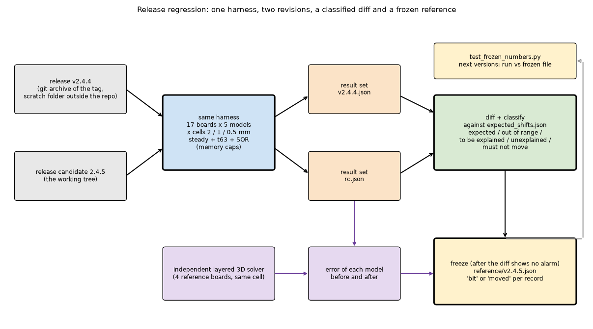

# Release regression 2.4.5: the reference numbers

Status: **prepared, not run**. The harness, the table of expected shifts, the independent references, the frozen-file generator and the permanent test are written and compile; nothing has been run on the program (the tester agent runs it after the 2.4.5 release candidate is final). No number in this folder comes from a run of this harness: the numbers quoted in `reference/expected_shifts.json` are copied, with their source, from `CHANGELOG.md` (Unreleased), `docs/validation.md` (sections 18.1, 21.2, 23) and `docs/versions.md` (2.4.5).

## 1. Purpose

2.4.5 changes the answers of the models on several kinds of board (laminate nodes, the point via, the constriction of the heat on a via, the part across the outline, the board cover) and leaves others untouched. This folder answers two questions with numbers instead of with the test counts:

1. **What moved between v2.4.4 and the release candidate, and is every shift explained by an item of the release?** The same harness runs both revisions; every shifted number is classified against a table written from the documents of the release.
2. **How far is each model from an independent reference, before and after?** On the boards that an independent layered 3D solver can represent.

The final numbers of the release are then **frozen** in a small committed file, which a pytest module compares with a run of the program in every later version (`INTEGRATION.md`).



*Figure 1 (`figures/fig_01_regression_flow.png`): one harness runs both trees; the diff is classified against the table; the reference solver gives the error of each model; the numbers are frozen once the diff has no alarm.*

### 1.1 The boards

The three example files of the program, one derived example and thirteen small canonical boards (`lib/regress_boards.py`, built with the public builder API that exists in v2.4.4 and in the candidate). The four marked R have an independent reference (square source on cell edges at 2, 1 and 0.5 mm, laminate of one conductivity, insulated sides).

| Board | What it exercises | R |
| :-- | :-- | :-- |
| `example_board` | 4 layers, partial top copper, 9 vias, two parts, a bottom heatsink | |
| `profile_board` | the example with a square-wave profile (steady state at the average power; the harness strips the profile so that no time simulation starts) | |
| `reference_board` | 2 layers full copper, one 20 mm part: nothing in 2.4.5 may move it | |
| `example_cut_to_T` | the example board cut to an inverted T (outline, parts and vias on the board) | |
| `plate_uniform` | 60 x 60 mm, 2 layers full copper, 8 mm source | R |
| `plate_pad` | the same with a 20 mm copper window on both layers, bare laminate around | R |
| `plate_vias` | `plate_uniform` with a 4 x 4 array of 0.3 mm vias | |
| `plate_lone_via` | `plate_uniform` with one 0.3 mm via (the point via) | |
| `round_outline` | round board of 56 mm in a 60 mm box | |
| `t_outline` | 80 x 60 mm T, a part in the stem | |
| `two_layer_partial` | 80 x 60 mm, top copper window, bottom at 70 % fill | |
| `one_layer_full`, `one_layer_pad` | 60 x 60 mm, one layer, full copper or a 20 mm pad | R, R |
| `finned_block` | 3 mm aluminium block with plate fins on the bottom face under a part | |
| `part_top_path` | a component with theta, theta_jc_top and a heatsink on the package, on a 14 mm pad | |
| `hatched_copper` | both layers hatched (fill 0.5 and 0.7) | |
| `part_across_outline` | outline edge at x = 37.3 mm (between cell edges at 2, 1, 0.5 mm), a part across it | |

Sources and pads of the R boards lie on multiples of 2 mm so that the heated area is the same at every cell size (a source edge between cell edges changes the heated area; `round()` rounds halves to even). The example files are read from the current tree for both revisions, so both see the same input (`git diff v2.4.4 develop --stat -- examples` is empty).

### 1.2 What a result set holds

For every board, model (`fvm`, `fdm`, `lumped`, `analytic`, `solid3d`) and cell (2, 1, 0.5 mm), direct solver: the unknowns as the program counts them, `t_max`, `t_mean`, `t_min`, the mean temperature of every layer, a checksum of the whole field (sum and sum of squares, so a change anywhere is seen), the hottest point, mean and junction temperature under every part, the metal-block temperatures, the power in, the heat balance, the warnings, and the solve time (information only, never compared). Also, per board and model, the time to 63 % of the steady resistance of every part (the unit-step response of `api.step_response`; the FVM and FDM use at least 2 mm there), and the FVM with the SOR solver at 2 mm on five boards (sweeps, omega, temperature).

Memory is kept light: FVM and FDM above 400 000 unknowns and the 3D solid above 150 000 are recorded as *skipped* with the reason (`--max-unknowns`, `--solid-cap`). The Lumped and Analytic cell is clamped to 0.5 to 1 mm by the API in v2.4.4 as well, so their 2 mm and 1 mm runs are the same run (a check in the diff).

### 1.3 The classes

| Class | Meaning |
| :-- | :-- |
| identical | every number equal as floats (bit for bit) |
| `expected` | a rule of the table covers the board, model, cell and metric, and the direction and size are inside the bounds |
| `expected_out_of_range` | a rule covers it but the shift is outside the range the study gave: the cause is the item, the size needs a look |
| `to_be_explained` | the item is a plausible cause and no study gives the size (left so on purpose) |
| `unexplained` | no rule covers it: an alarm |
| `must_not_move` | the board and model that no item of the release may change moved: an alarm that wins over every rule |
| warnings only | the texts changed, no number: listed, not a shift |

`reference/expected_shifts.json` holds nine items (I1 part across the outline, I2 board cover 8 x 8, I3 laminate nodes, I4 point via and block SOR, I5 via constriction in Lumped and Analytic, I6 Young omega (sweeps only), I7 warnings only, I8 documents and theory, I9 the Power Calculator row), 22 rules, 6 must-not-move entries, the rules for the times to 63 %, and a matrix of what each board should show (printed at the end of the diff). Each rule says whether its bound is *quantified* (a number printed by a study), *derived* (worked out from a printed number or an engineering margin) or *to be explained*. Examples: a 2-layer board with a copper window and the laminate rule: the FVM rise goes up by at most 45 % of the rise (the largest in the studies, +38 %, a 6 mm window over 3.2 mm laminate); the example board cut to a T: the hottest point of the FVM goes down by at most 20 K (4 K on the example, 16 K in the edge sweep of a small T); Lumped and Analytic on any board without vias: no shift at all.

## 2. How to run (in this order)

All from the repository root, with `.venv/bin/python`. The runs are long and use memory (the 0.5 mm cells on the example board); run them when the machine is free, and use `--quick` (2 mm only) for a first look. Times and memory of a full run have **not** been measured.

```sh
R=research/release-regression-245/scripts
# 1. the baseline: v2.4.4 extracted with git archive into a scratch folder outside the repository, run in a separate process
.venv/bin/python $R/study_baseline_release.py --tag v2.4.4          # -> out/v2.4.4.json   (--dest DIR to choose the scratch folder)
# 2. the same harness on the release candidate (the tree you are in)
.venv/bin/python $R/study_run_suite.py --label rc                    # -> out/rc.json
# 3. the independent references (once; they do not depend on the revision)
.venv/bin/python $R/study_references.py --cells 2 1                  # -> out/references.json   (0.5 is slow)
# 4. diff and classify
.venv/bin/python $R/study_diff.py out/v2.4.4.json out/rc.json        # -> out/diff_v2.4.4_vs_rc.{json,md}; --strict exits 1 on an alarm
# 5. the error of each model against the independent solver, before and after
.venv/bin/python $R/study_error_vs_reference.py out/v2.4.4.json out/rc.json
# 6. when the candidate is final, with the version bumped in the tree: freeze
.venv/bin/python $R/study_run_suite.py --label final                 # the numbers that are frozen
.venv/bin/python $R/study_freeze_reference.py out/v2.4.4.json out/final.json --version 2.4.5   # -> reference/v2.4.5.json (committed)
# 7. figures (optional)
.venv/bin/python $R/make_figures.py out/v2.4.4.json out/final.json
```

(`out/` is git-ignored. The freeze refuses while the diff has an alarm, when the program version of the run is not the one asked for, and when the file exists.) The tests of the folder: `tests/test_classify_logic.py` (pure logic, no program) and `tests/test_frozen_numbers.py` (skipped until `reference/v2.4.5.json` exists):

```sh
QT_QPA_PLATFORM=offscreen .venv/bin/python -m pytest -q research/release-regression-245/tests
PCBT_FROZEN_CELLS=2,1 .venv/bin/python -m pytest -q research/release-regression-245/tests/test_frozen_numbers.py     # more of the frozen file
```

## 3. What is left

* Run everything (nothing was run), read the diff, and turn every `unexplained` and `expected_out_of_range` into an explanation or a defect report; decide the `to_be_explained` rows that need a number (the table lists them with their item).
* The table was written from the documents and **is a hypothesis until the first diff**: a rule that is wrong (a direction, a bound) shows as an alarm and is corrected in the table, with a note.
* The must-not-move entries (for example "Lumped and Analytic bit-identical on every board without vias", "FDM hottest point bit-identical on a full-copper outline board") rest on the sentences of `CHANGELOG.md` and `docs/validation.md`; if the first diff contradicts one, either the program or the sentence is wrong.
* The reference solver is isolated from the program but is the same one the tests use (`layered3d.py`); a second independent reference for the boards with vias and outlines does not exist in this folder (the 3D solid of the program is a comparison model, not independent).
* The solve times are stored for information; no time limit or performance claim is made.

## 4. Files

| Path | Content |
| :-- | :-- |
| `lib/regress_boards.py` | the boards and the specifications of the four reference boards |
| `lib/regress_harness.py` | runs one revision: `use_program`, `run_one`, `t63`, `run_suite` |
| `lib/regress_classify.py` | diff, classification, internal checks, Markdown |
| `lib/regress_refsolve.py` | the independent references and the error tables |
| `lib/regress_frozen.py` | the format of the frozen file, `build`, `compare` |
| `reference/expected_shifts.json` | the table of expected shifts |
| `reference/v2.4.5.json` | the frozen numbers (generated by the tester; absent now) |
| `scripts/study_*.py`, `make_diagrams.py`, `make_figures.py` | what to run (section 2) |
| `tests/` | `test_classify_logic.py`, `test_frozen_numbers.py` |

## 5. What was read and what was not verified

* **Read in full**: `CHANGELOG.md` (Unreleased and 2.4.4 to 2.4.2), `docs/versions.md` 2.4.5 and its Planned chapter, `docs/validation.md` 18.1, 21.2 and 23, the public builder API of `pcbthermal/model.py`, `pcbthermal/api.py` (`simulate`, `step_response`, options), `pcbthermal/results.py`, `analysis.heater_stats`, `tests/test_layered_vs_3d.py` and the header of `tests/helpers/layered3d.py`.
* **From a summary or a search, not read**: the research folders' READMEs beyond what `research/README.md` and `REVIEW.md` say about them (the quantities in the table come from the project documents, not from re-reading the studies).
* **Written but never run**: every file of the harness except the pure-logic functions of `regress_classify.py` and `regress_frozen.py`, which were exercised by hand on synthetic records (the seven functions of `tests/test_classify_logic.py` pass when called directly; pytest was not run). `make_diagrams.py` was run once to draw figure 1 (matplotlib only). The harness has never imported the program, so a wrong attribute name or a signature that differs between v2.4.4 and the candidate (`fvm.unknowns`, `solid3d.unknowns`, `analysis.block_stats`, `api.step_response`, `Problem.add_heater(role=...)`) will show on the first run; the calls were checked against the v2.4.4 source with `git show` only for `step_response`, `simulate`, `SolverOptions` and `fvm.unknowns` and `solid3d.unknowns` (`fdm.unknowns` and `analysis.block_stats` in v2.4.4 were not looked at; the harness wraps both in try/except).
* **Not verified**: that the boards build and validate without a warning that stops them (an outline with the heatsink of the example, a block on the bottom face, the component on a 14 mm pad); that the 3D solid fits under 150 000 unknowns on the small boards at 0.5 mm; that exact equality of floats ("bit") survives a second machine (it is expected to on the same machine; `PCBT_FROZEN_BIT_TOL` relaxes it); how long the full suite takes.
