# The rotated square in the 3D solid (A3)

**Status (audit 2.6.1).** What this folder proposed is now in the program, so every "the program" column below is the program **before 2.6.0** and is not what a run of the current tree prints: the exact board cover (`fix/exact-board-cover`, `geometry.exact_coverage`, 2.6.0), the cut-cell links of the layered FVM (`fix/cut-cell-aperture-film`, 2.6.0; the scheme adopted is `aperture+film` of `research/cut-cell-links`, not the `links` of section 10 and 11 of this folder) and the cut cells of the 3D solid (`fix/solid3d-sliver-cells`, 2.6.0: the aperture of the shared face and the film in series with the conduction to the closest outline point; together with the 3D solid slabs by thickness). The power of a part across the outline and the 8 x 8 part footprint of 9.3 and 9.4 were adopted in 2.4.5 (9.4a). The prototypes of `lib/` were rebased on the 2.5.x program (`fvm_cutcell.plain_program`: `cut_cells=False`, no laminate edge band; 3D variants read from the tag v2.5.1) so that the folder tests (34 passed) still compare the schemes with the program they were measured against. The numbers of the current program are in `docs/validation.md` 23.1 (exact cover), 32 (FVM cut cells) and 33 (3D solid cut cells). The decision asked of the maintainer below is taken.

**Question.** A square board turned against the grid comes out hotter in the 3D solid than the same square on the grid when the edge coefficient is high (+1.15 K in the reviews of `solid3d-verification` and `outline`). Does it still happen on the current program, where does it come from, is it only the 3D solid, and is there a correction that can be measured on a copy?

**Answer in short** (details, tables and limits below):

* It still happens, and it is larger than +1.15 K at high edge coefficients: 40 mm square, 1 mm cells, 2 W part: +0.8 to +1.8 K at `h_side` 100 W/m2K, +2.5 to +3.1 K at 1000 W/m2K, within 0.3 K at the default 10 (section 2). It falls only slowly with the cell: at 160 cells per side the error is still +2.0 to +2.3 K (section 4.1; against the continuum value of an independent solver +2.1 to +2.4 K, section 9.2).
* It is not about turning: a **straight edge shifted by half a cell** gives +12 K at 20 cells per side and +2.0 K at 160 (section 4). It is the treatment of the cells that the outline cuts: the conducting cross-section is scaled by the cover of the cell in **all** directions, and the conduction to the edge is a fixed half cell (`0.25 (dx + dy)`) through that scaled conductivity (`pcbthermal/solid3d.py`, the lines that scale `kx` and the edge term). The edge of the turned square then conducts 27 to 38 % less than the aligned one at the same perimeter (section 3).
* Against an independent axisymmetric reference (rings times the same slabs, no square grid) on a **round** board, where every edge cell is cut, the program's 3D solid is +6.6 % high at 1 mm and `h_side` 1000 and still +3.2 % at 0.25 mm; a **cut-cell copy** made in memory from the program's own source (links through the face aperture between the centroids of the board parts, edge conduction over half the depth of the board strip, conductivity not scaled) is within +0.6 % at 1 mm and +0.2 % at 0.25 mm (section 5).
* On the shifted and turned squares the copy removes the dependence: 0.0 to 0.3 K at 40, 80 and 160 cells per side (the 45 degree turn: +0.7 and +0.5 K at 40 and 80), against 5.6 to 5.8, 3.6 to 3.7 and 2.0 to 2.3 K for the program (section 4). Where the program was right (a rectangle, the example board with the five outline presets at the default coefficient) the copy gives the same answer within 0.2 K, at 100 W/m2K within 0.4 K (section 6).
* The FVM and the FDM show the same effect in a much milder form (FVM +4.6 K at 20 cells per side for a half-cell shift, +0.22 K at 80; FDM within 1.2 K) and agree with their own axisymmetric reference on a round board within 0.6 % at 1 mm (section 7). No change is proposed for them.
* The review (section 9) confirmed the cut-cell copy against the continuum value of an independent solver on the shifted and turned squares (within 0.2 K at 40 cells per side and better, except the 45 degree turn), corrected the explanation of the 45 degree residual and of the T board (a part that crosses the outline: a separate defect of the FVM, the FDM and the 3D solid, +2.2 K on the example board cut to a T at the default coefficient), and recommends documenting the edge effect as a limit (P2) and fixing the part across the outline.
* The decision (a correction of `solid3d.py` as measured here, or a documented limit) is the maintainer's: `INTEGRATION.md`.
* **Section 10 (added later): the same idea in the layered FVM** (option P1 of `docs/versions.md` 'Planned'). The program's FVM links are a factor c (the cover) too small across a cut; cut-cell links (aperture over centroid distances) cut the shift and turn dependence of a 20 mm square by 4 to 5 times and the round-board peak error at 1 mm and `h_side` 1000 from +0.69 % to +0.22 % of the rise, halve the scatter of the example board cut to a T (0.48 to 0.22 K) but leave about 1 K of the small T at 1 mm. Light cases only; go for 2.6.0 as a low-priority item, no-go for 2.5.0 (10.7).

* **Section 11 (added later): the cut cells of the layered FVM re-measured on the current program, with an exact cover.** The links cut the dependence on the position of the outline 7 to 9 times at `h_side` 100 and 2000 W/m2K, an exact cover is what helps at the default 10, and both are small (below 1 % of the rise at the defaults); patterned copper and vias on a cut edge have no clean verdict. Technically it fits 2.5.0, the recommendation is **2.6.0** (11.6; `INTEGRATION.md` has the code and the acceptance numbers).

* **Review of sections 10 and 11** (11.8): the tables of section 11 were re-run and printed the same digits; an independent reference for the turned squares (the board solved in its own frame, no cut cell) confirms the ranking of the schemes within 0.1 K. Corrected: the 8 x 8 cover misses the area of an edge at 45 degrees by 0.64 % at 1 mm (not 3.6e-4), and edges of other small-integer slopes too (slope 1/3: -0.38 %), which the 5 degree sweep did not visit; the published case of Johansen and Colella **was** reproduced (`docs/literature.md`), contrary to 10.4; on the closed form of a sheet with a film on its rim the `aperture` scheme is twice as accurate as `links` and the film of Bochkov and Gibou ten times, so the choice of `links` is not settled; on the harness board that moves most (`part_across_outline`) `links` is not nearer the fine-cell value at 2 and 0.5 mm. One script crashed (fixed). **Go for closing the investigation; for 2.6.0: first the exact cover (a `fix/` item), then the links only after the scheme is chosen and the fill at a cut edge is studied.**

## 1. The question, and what would answer it

The continuum problem does not know the grid: moving the board by a fraction of a cell, or turning it together with its part, cannot change the temperature. Any difference is a discretisation artefact. So the reference for every comparison is the **invariance itself** (aligned against shifted against turned, same model, same cell) and, for the absolute value, an **independent axisymmetric solution** of the round board (section 5), which no square grid enters.

The program's models are given the same boards: a square board of side `S` in a box, two copper planes (full copper), a square part at the centre, `h_side` from 10 to 5000 W/m2K, cells from 1 mm down to 0.125 mm. `S = 40 mm` in a 60 mm box with a 6 mm part (sections 2, 3), `S = 20 mm` in a 30 mm box with a 3 mm part and `h_side = 2000` (the same edge Biot number as 40 mm at 1000; sections 4, 5) so that the cell ladder reaches 160 cells per side under the size limit of the 3D solid (lifted on the copy and on the program alike, `lib/runs.py`).

### 1.1 What the pictures show

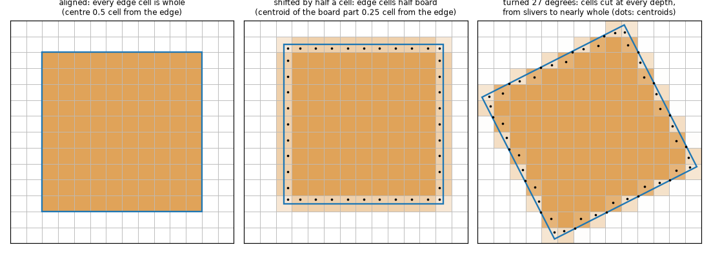

*Figure 1 (`figures/fig_01_cut_cells.png`): a 10 mm square on a 1 mm grid, aligned (every edge cell whole), shifted by half a cell (every edge cell half board) and turned by 27 degrees (cells cut at every depth). Shading is the board fraction of the cell, the dots are the centroids of the board parts of the cut cells, the blue line is the outline.*

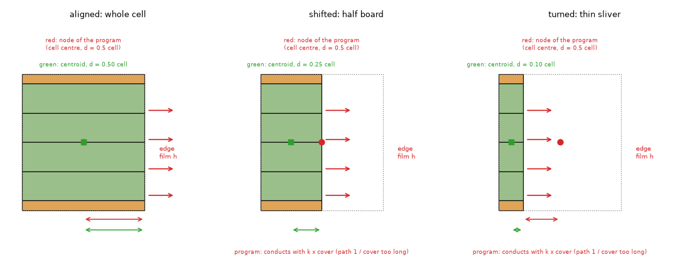

*Figure 2 (`figures/fig_02_section_of_an_edge_cell.png`): section through one edge cell (two copper layers, four dielectric slabs) when the outline leaves the whole cell, half of it and a sliver. The red dot is the node of the program (cell centre) and the distance it assumes to the edge (half a cell, whatever the cut); the green square is the centroid of the board part and the distance of the copy (half the depth of the strip). Red arrows: the edge film on every slab; the heat has to come down through the FR-4 (kz = 0.3) to the edge slabs, which is why the distance to the edge matters at high `h_side`.*

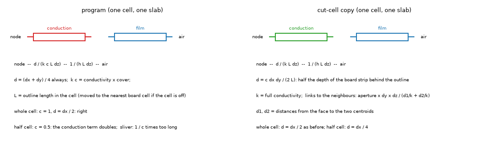

*Figure 3 (`figures/fig_03_edge_resistances.png`): the edge element of one cell and one slab: film `1/(h L dz)` in series with the conduction `d/(k L dz)`; what `d` and `k` are in the program and in the cut-cell copy.*

## 2. Re-measure on the current program

`scripts/study_remeasure.py`. 40 mm square, 60 mm box, two full copper layers, 2 W in a 6 mm square part at the centre, 1 mm cells. "both" turns the board and the part (the continuum problem is the same as the aligned one); "board only" turns the square and leaves the part on the grid; "part only" turns the part and leaves the board aligned. Maximum temperature in °C, in brackets the difference to the aligned square of the same model (K).

**h_side = 10 W/m2K** (the program's default; the 3D solid moves by at most 0.29 K)

| case | FVM | FDM | 3D solid (program) | 3D cut-cell copy |
| :-- | --: | --: | --: | --: |
| aligned | 105.20 | 105.20 | 105.59 | 105.59 |
| both 20 | 104.94 (-0.26) | 104.93 (-0.27) | 105.43 (-0.16) | 105.37 (-0.22) |
| both 45 | 104.97 (-0.23) | 105.14 (-0.06) | 105.76 (+0.17) | 105.95 (+0.36) |
| board only 20 | 105.21 (+0.01) | 105.20 (+0.00) | 105.65 (+0.06) | 105.59 (-0.00) |
| board only 45 | 104.95 (-0.25) | 105.12 (-0.08) | 105.40 (-0.19) | 105.59 (+0.00) |
| part only 20 | 104.92 (-0.27) | 104.93 (-0.27) | 105.37 (-0.22) | 105.37 (-0.22) |

**h_side = 100 W/m2K**

| case | FVM | FDM | 3D solid (program) | 3D cut-cell copy |
| :-- | --: | --: | --: | --: |
| aligned | 90.60 | 90.65 | 91.92 | 91.91 |
| both 10 | 90.41 (-0.19) | 90.38 (-0.27) | 92.73 (+0.81) | 91.53 (-0.38) |
| both 20 | 90.41 (-0.19) | 90.38 (-0.28) | 92.98 (+1.06) | 91.65 (-0.26) |
| both 45 | 90.58 (-0.02) | 90.63 (-0.02) | 93.67 (+1.75) | 92.27 (+0.36) |
| board only 20 | 90.68 (+0.08) | 90.65 (-0.00) | 93.19 (+1.28) | 91.87 (-0.04) |
| board only 45 | 90.56 (-0.04) | 90.61 (-0.05) | 93.31 (+1.40) | 91.91 (+0.01) |
| part only 20 | 90.32 (-0.28) | 90.38 (-0.28) | 91.70 (-0.22) | 91.69 (-0.22) |

**h_side = 1000 W/m2K**

| case | FVM | FDM | 3D solid (program) | 3D cut-cell copy |
| :-- | --: | --: | --: | --: |
| aligned | 70.28 | 70.52 | 74.74 | 74.71 |
| both 20 | 70.33 (+0.05) | 70.23 (-0.29) | 77.64 (+2.90) | 74.31 (-0.40) |
| both 30 | 70.30 (+0.02) | 70.23 (-0.29) | 77.50 (+2.77) | 74.32 (-0.40) |
| both 45 | 70.55 (+0.27) | 70.48 (-0.04) | 77.60 (+2.86) | 75.07 (+0.36) |
| board only 20 | 70.60 (+0.33) | 70.51 (-0.01) | 77.86 (+3.12) | 74.53 (-0.18) |
| board only 45 | 70.53 (+0.25) | 70.46 (-0.06) | 77.25 (+2.51) | 74.72 (+0.00) |
| part only 20 | 70.00 (-0.28) | 70.24 (-0.28) | 74.52 (-0.22) | 74.49 (-0.22) |

*(The rows "both 10" and "both 30" at the other coefficients are in `out/remeasure.json`, regenerated by the script.)*

Reading: the +1.15 K of the reviews is in the program today (+1.06 and +1.28 K at 100 W/m2K, the coefficient where it sits); it comes from the **board** being turned, not from the part (turning only the part moves every model by -0.22 to -0.28 K, the same in all of them: that is the discretisation of a turned source, not the edge). At the default 10 W/m2K the 3D solid moves by at most 0.3 K, which is why the effect passed unseen. The FVM and the FDM move by 0.3 K or less at every coefficient, the part-only row included. The reviews' exact setup was not reproduced; this one has the same dependence on the coefficient and reproduces the sign and the size.

## 3. Where it comes from: the edge element of a cut cell

`scripts/study_edge_conductance.py`. In `pcbthermal/solid3d.py` the in-plane conductivity of a board slab is multiplied by the cover of the cell (`slabs[-1]["kx"] * bcov`) and the edge of a non-rectangular board is `1 / (1 / (h L dz) + 0.25 (dx + dy) / (kx L dz))` per cell and slab, with `L` the outline length in the cell and `kx` that scaled conductivity. For a whole edge cell (aligned) `d = dx/2` and `kx` is the full conductivity: the exact half-cell series. For a cell the outline cuts, `d` stays a half cell although the board part is thinner, and the conductivity is divided by the cover: the path to the edge is made 1 / cover too resistive, for the slivers of a turned square as well as for the half cells of a shifted edge. The 3D solid is the one that shows it because only its edge term has a conduction part: the FVM and the FDM attach the film `h t L` to the node directly (the total is exactly `h t P` at every angle, below).

Total side conductance of the network (sum over cells and slabs), 40 mm square, perimeter 160 mm at every angle, 1 mm cells, ratio to the aligned square of the same model:

| h_side | angle | FVM G / (h t P) | 3D program: G (mW/K), ratio | 3D cut-cell copy: G (mW/K), ratio |
| --: | --: | --: | --: | --: |
| 10 | 0 | 1.000 | 2.55, 1.000 | 2.55, 1.000 |
| 10 | 20 | 1.000 | 2.51, 0.987 | 2.55, 1.003 |
| 100 | 0 | 1.000 | 24.31, 1.000 | 24.34, 1.000 |
| 100 | 20 | 1.000 | 22.08, 0.908 | 24.96, 1.025 |
| 100 | 45 | 1.000 | 21.14, 0.870 | 24.88, 1.022 |
| 1000 | 0 | 1.000 | 168.56, 1.000 | 170.27, 1.000 |
| 1000 | 20 | 1.000 | 117.79, 0.699 | 207.03, 1.216 |
| 1000 | 45 | 1.000 | 121.47, 0.721 | 202.12, 1.187 |
| 5000 | 0 | 1.000 | 379.64, 1.000 | 389.07, 1.000 |
| 5000 | 20 | 1.000 | 235.24, 0.620 | 646.18, 1.661 |

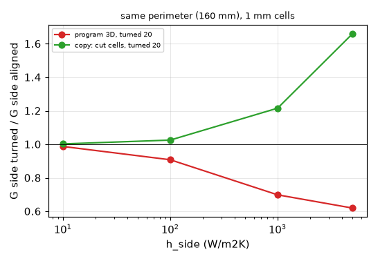

*Figure 7 (`figures/fig_07_edge_conductance_ratio.png`): total side conductance of the 3D network of the square turned 20 degrees, ratio to the aligned one, against `h_side`.*

The ratio is not an invariant of the problem: the node of a cell is closer to the edge in the copy (centroid of the board part) than in the aligned square (cell centre), so the conductance from the node to the air is larger by construction; what has to agree is the temperature, and the program's turned edge conducts 27 to 38 % less than the aligned one at 1000 to 5000 W/m2K for the same perimeter, with the temperature 3 K high; the copy's conductance is higher and its temperature is on the aligned one (section 4). The first column (FVM) shows that the length of the edge is not the problem: the perimeter is counted exactly (`edge_length_on_board`, `outline` 4.6).

## 4. Shift and turn against the cell

`scripts/study_cut_cells.py`. 20 mm square board in a 30 mm box, 2 W in a 3 mm part, `h_side` 2000 W/m2K, the board and the part moved together. Maximum temperature in °C (difference to the aligned board of the same model and cell, K). Columns: FVM, FDM, the program's 3D solid, and four copies of the 3D solid made in memory from the source (`lib/rotsq.py`): `kx_physical` (edge term with the unscaled conductivity), `strip` (plus the distance `c dx dy / (2 L)`), `cutcell_floor` and `cutcell` (plus links through the aperture between the centroids; `_floor` limits each half distance to a quarter cell).

**1 mm cells (20 per side)**

| layout | FVM | FDM | 3D program | kx_physical | strip | cutcell_floor | cutcell |
| :-- | --: | --: | --: | --: | --: | --: | --: |
| aligned | 77.74 | 78.49 | 91.02 | 91.02 | 90.86 | 90.86 | 90.86 |
| shift 1/4 cell | 80.71 (+2.97) | 78.64 (+0.15) | 102.77 (+11.75) | 97.55 (+6.53) | 95.13 (+4.27) | 92.27 (+1.40) | 91.94 (+1.08) |
| shift 1/2 cell | 82.31 (+4.57) | 77.90 (-0.60) | 103.31 (+12.28) | 98.31 (+7.29) | 95.51 (+4.65) | 93.61 (+2.75) | 93.61 (+2.75) |
| turned 20 | 79.28 (+1.55) | 79.04 (+0.54) | 100.06 (+9.04) | 95.60 (+4.58) | 93.26 (+2.39) | 91.15 (+0.29) | 90.89 (+0.03) |
| turned 45 | 79.54 (+1.80) | 79.59 (+1.09) | 97.77 (+6.75) | 94.74 (+3.71) | 91.59 (+0.72) | 91.30 (+0.44) | 91.19 (+0.33) |

**0.5 mm cells (40 per side)**

| layout | FVM | FDM | 3D program | kx_physical | strip | cutcell_floor | cutcell |
| :-- | --: | --: | --: | --: | --: | --: | --: |
| aligned | 80.08 | 80.45 | 91.82 | 91.82 | 91.79 | 91.79 | 91.79 |
| shift 1/4 cell | 80.67 (+0.58) | 80.04 (-0.42) | 98.92 (+7.10) | 95.85 (+4.03) | 94.62 (+2.83) | 91.87 (+0.08) | 91.63 (-0.17) |
| shift 1/2 cell | 80.53 (+0.45) | 79.22 (-1.24) | 97.60 (+5.78) | 94.90 (+3.08) | 93.46 (+1.67) | 91.56 (-0.23) | 91.56 (-0.23) |
| turned 20 | 80.28 (+0.20) | 80.13 (-0.32) | 97.42 (+5.59) | 94.85 (+3.03) | 93.70 (+1.90) | 91.71 (-0.08) | 91.53 (-0.27) |
| turned 45 | 80.48 (+0.40) | 80.38 (-0.08) | 96.63 (+4.81) | 94.45 (+2.63) | 93.64 (+1.84) | 92.62 (+0.83) | 92.49 (+0.69) |

**0.25 mm cells (80 per side)**

| layout | FVM | FDM | 3D program | kx_physical | strip | cutcell_floor | cutcell |
| :-- | --: | --: | --: | --: | --: | --: | --: |
| aligned | 80.27 | 80.45 | 91.48 | 91.48 | 91.47 | 91.47 | 91.47 |
| shift 1/4 cell | 80.56 (+0.29) | 80.36 (-0.09) | 96.12 (+4.64) | 94.31 (+2.83) | 93.66 (+2.19) | 91.60 (+0.13) | 91.45 (-0.03) |
| shift 1/2 cell | 80.49 (+0.22) | 80.07 (-0.38) | 95.06 (+3.58) | 93.64 (+2.16) | 92.90 (+1.43) | 91.43 (-0.04) | 91.43 (-0.04) |
| turned 20 | 80.45 (+0.18) | 80.37 (-0.09) | 95.19 (+3.72) | 93.68 (+2.20) | 93.09 (+1.62) | 91.58 (+0.11) | 91.47 (-0.00) |
| turned 45 | 80.52 (+0.25) | 80.47 (+0.02) | 95.26 (+3.78) | 93.37 (+1.89) | 92.90 (+1.43) | 92.01 (+0.54) | 91.96 (+0.49) |

**0.125 mm cells (160 per side, program and cut-cell copy only; run with `--fine`)**

| layout | 3D program | cutcell |
| :-- | --: | --: |
| aligned | 91.38 | 91.38 |
| shift 1/2 cell | 93.42 (+2.03) | 91.37 (-0.01) |
| turned 20 | 93.70 (+2.32) | 91.41 (+0.03) |

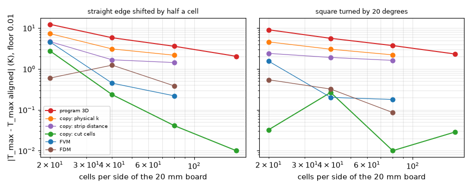

*Figure 4 (`figures/fig_04_shift_and_turn_vs_cells.png`): the absolute difference of the maximum temperature to the aligned board against the number of cells per side, for a half-cell shift (left) and a 20 degree turn (right), floor 0.01 K for the log axis.*

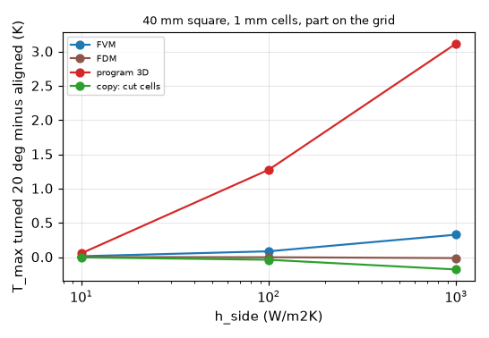

*Figure 5 (`figures/fig_05_turned_square_vs_h_side.png`): the square turned 20 degrees (part on the grid) minus the aligned one, 40 mm board, 1 mm cells, against `h_side`, four models (the data of section 2).*

4.1 The program's error does not go away at the cell sizes in use: it falls more slowly than first order (12.3, 5.8, 3.6, 2.0 K for the half-cell shift at 20, 40, 80, 160 cells per side: ratios 0.47, 0.62, 0.57 per halving).

4.2 Every ingredient of the copy matters: at 40 cells per side and the half-cell shift (5.78 K) the physical conductivity in the edge term removes about half of the error (3.08 K), the distance of the strip about a quarter more (1.67 K), and the links through the aperture between the centroids the rest (-0.23 K); the copy is within 0.3 K at 40, 80 and 160 cells per side for every layout but the 45 degree turn (+0.7 and +0.5 K at 40 and 80).

4.3 The aligned board is itself not converged at 20 cells per side (90.86, 91.79, 91.47, 91.38 for the copy at 1, 0.5, 0.25, 0.125 mm): the comparison is to the aligned board **of the same cell**, which is the invariance test; the absolute error of the aligned board is the first column of section 5.

4.4 The residual of the copy at 45 degrees (+0.3 to +0.8 K) was split: board turned 45 with the part on the grid +0.26 K and part turned 45 on the aligned board +0.23 to +0.37 K at 0.5 and 0.25 mm. Not removed here. *Corrected by the review (section 9.3)*: the second share is not the discretisation of a turned source (the continuum effect of turning the part is -0.01 K, and an exact footprint on the same cells gives -0.03 K) but the 3D solid's sampling of the footprint on 4 x 4 points per cell, which keeps 97.4 % of the area of the turned part at 0.25 mm and puts the lost edge power in the centre; with 8 x 8 points (as the FVM samples it) the turned part reads +0.02 / +0.06 K instead of +0.37 / +0.23 K at 0.5 / 0.25 mm.

4.5 The program's FVM and FDM also depend on the position of the edge at 20 cells per side (FVM +4.6 K for the half-cell shift, FDM -0.6 K) and not at 80 (+0.22 K, -0.38 K): section 7.

## 5. The independent reference: a round board

A round board with a round part at its centre is axisymmetric, and every edge cell of a Cartesian grid is cut. `lib/axisym3d.py` solves it with its own finite volumes, rings times the **same slabs** the 3D solid builds (copper slab, four dielectric slabs with the program's in-plane and through conductivities, copper slab), the film on both faces everywhere and the film on the rim over every slab (half a ring of conduction in series). It imports nothing from the program's grids. Its tests (`tests/test_rotated_square.py`) compare it with the modified Bessel solution of a thin plate with a disc source (inside and outside the source), with the energy balance (heat to both faces and the rim = power, residual 1e-9) and with the series circuit of a whole-face source; the two ring counts (4000 and 2000) agree to the digit printed.

`scripts/study_disc.py`. 40 mm disc (a 128-sided polygon of the same area, in a 42 mm box), 2 W in a part of 3 mm radius, rise of the top copper at the centre in K (error against the reference):

| h_side | reference | program 1 mm | copy 1 mm | program 0.5 mm | copy 0.5 mm | program 0.25 mm | copy 0.25 mm |
| --: | --: | --: | --: | --: | --: | --: | --: |
| 10 | 95.16 | 94.89 (-0.3 %) | 94.85 (-0.3 %) | 95.10 (-0.1 %) | 95.09 (-0.1 %) | 95.15 (-0.0 %) | 95.14 (-0.0 %) |
| 100 | 76.96 | 78.11 (+1.5 %) | 76.79 (-0.2 %) | 77.88 (+1.2 %) | 76.95 (-0.0 %) | 77.52 (+0.7 %) | 76.96 (+0.0 %) |
| 1000 | 53.64 | 57.16 (+6.6 %) | 53.91 (+0.5 %) | 56.16 (+4.7 %) | 53.83 (+0.3 %) | 55.34 (+3.2 %) | 53.72 (+0.1 %) |
| 5000 | 48.14 | 50.95 (+5.9 %) | 48.42 (+0.6 %) | 50.06 (+4.0 %) | 48.33 (+0.4 %) | 49.42 (+2.7 %) | 48.22 (+0.2 %) |

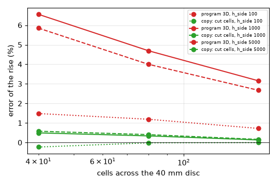

*Figure 6 (`figures/fig_06_disc_against_axisymmetric.png`): error of the rise against the axisymmetric reference, program and copy, for three edge coefficients, against the cells across the disc.*

This is the check that the copy is **right** and not merely invariant: its absolute error is at most 0.6 % at the coarsest cell and falls with it, and the program's is 6 % high at 1000 W/m2K and falls slowly. At 10 W/m2K (the default) both are within 0.3 %.

## 6. Where the program was already right

`scripts/study_regression.py`, 1 mm cells.

| board | program | copy | difference (K) |
| :-- | --: | --: | --: |
| rectangle, no outline | 91.9190 | 91.9190 | +0.0000 (bit-identical: the copy changes only the outline branches) |
| rectangle given as an outline (grid lines) | 91.9190 | 91.9088 | -0.0102 |

The example board (100 x 80 mm, 22 W, vias, heatsink) cut to the five presets of the Board panel; the last column is the heat to the air over the power in the copy (energy balance).

| outline | h_side | FVM | 3D program | 3D copy | copy minus program (K) | heat / power, copy |
| :-- | --: | --: | --: | --: | --: | --: |
| ellipse | 10 | 90.75 | 90.91 | 90.90 | -0.01 | 1.0000 |
| ellipse | 100 | 86.10 | 86.73 | 86.35 | -0.38 | 1.0000 |
| L | 10 | 109.76 | 110.19 | 110.19 | -0.00 | 1.0000 |
| L | 100 | 101.39 | 102.43 | 102.43 | -0.00 | 1.0000 |
| T | 10 | 109.06 | 109.31 | 109.52 | +0.20 | 1.0000 |
| T | 100 | 99.70 | 100.57 | 100.68 | +0.11 | 1.0000 |
| chamfer | 10 | 86.44 | 86.60 | 86.60 | -0.00 | 1.0000 |
| chamfer | 100 | 82.95 | 83.29 | 83.24 | -0.05 | 1.0000 |
| rounded | 10 | 86.09 | 86.25 | 86.25 | -0.00 | 1.0000 |
| rounded | 100 | 82.69 | 83.03 | 82.98 | -0.05 | 1.0000 |

The only change above 0.2 K is the ellipse at 100 W/m2K (-0.38 K), where the copy moves towards the FVM. The T is +0.2 K at the default coefficient. The first explanation (cells with two edges at the re-entrant corners) was wrong, *review section 9.4*: the difference is the same with no edge loss at all; the part U1 hangs over the cut-away corner of the T, and the program and the copy give a cut cell the power of the part's cover of the whole cell, so the board part of the cell gets 1 / cover of the power density. Both are +2.2 to +2.4 K above the value at 2/3 mm, where the T falls on grid lines; the copy differs from the program there only because its centroid links react differently to that misplaced power (the L, the chamfer and the rounded board are on the program within 0.05 K). Energy is conserved in the copy (a first version leaked 22 % of the power into the cells taken as off the board through links of a sliver; fixed with a regression test, `test_cutcell_copy_closes_the_energy_balance_on_a_turned_square`).

## 7. The layered models

On the same boards the FVM and the FDM depend on the position of the edge much less than the 3D solid at the cells in use, and converge faster (section 4: FVM +4.6, +0.45, +0.22 K for the half-cell shift at 20, 40 and 80 cells per side; FDM -0.60, -1.24, -0.38 K). On the round board against the axisymmetric reduction of the layered model itself (`axisym3d.solve_layered_disc`, two nodes and the sheet conductance of each layer, as in `docs/theory.md`) both are within 0.6 % at 1 mm for 10 to 5000 W/m2K and within 0.1 % at 0.5 mm:

| h_side | layered reference | FVM 1 mm | FDM 1 mm | FVM 0.5 mm | FDM 0.5 mm | FVM 0.25 mm | FDM 0.25 mm |
| --: | --: | --: | --: | --: | --: | --: | --: |
| 10 | 94.71 | 94.33 (-0.4 %) | 94.32 (-0.4 %) | 94.59 (-0.1 %) | 94.61 (-0.1 %) | 94.67 (-0.0 %) | 94.67 (-0.0 %) |
| 100 | 75.52 | 75.18 (-0.5 %) | 75.18 (-0.5 %) | 75.43 (-0.1 %) | 75.44 (-0.1 %) | 75.50 (-0.0 %) | 75.49 (-0.0 %) |
| 1000 | 48.88 | 48.63 (-0.5 %) | 48.64 (-0.5 %) | 48.86 (-0.0 %) | 48.84 (-0.1 %) | 48.89 (+0.0 %) | 48.87 (-0.0 %) |
| 5000 | 43.11 | 42.85 (-0.6 %) | 42.89 (-0.5 %) | 43.09 (-0.0 %) | 43.08 (-0.1 %) | 43.13 (+0.0 %) | 43.11 (+0.0 %) |

The layered models and the 3D solid solve different idealisations (one node through the thickness against slabs with the FR-4 between the copper layers): at 1000 W/m2K the layered reference is 48.9 K and the 3D reference 53.6 K on the same round board. That difference (the heat has to cross the FR-4 to reach the edge slabs) is not a grid error and is not part of this question; it is why the table of this section is against the layered reference. Nothing is proposed for the FVM or the FDM.

## 8. Limits of the study

* Full copper on two layers, uniform conductivity per slab. Boards with patterned copper (zones with a fill per cell), vias and metal blocks were run only in the regression of section 6 (the example board: energy conserved, within 0.4 K of the program); the copy's links use the per-cell `kx` as the program does, but no patterned-copper board has an independent reference here.
* Steady state; the 3D solid has no time simulation. Boards with a block or a heatsink on the outline edge were not tried.
* The copy is a measurement tool (a text replacement of four expressions of `solid3d.py` executed in memory, `lib/rotsq.py`, which refuses to build if the source changed), not a proposed implementation; the cost of the 16 x 16 sampling per cell, and the way to write it vectorised in the program, are not measured (no timings are quoted).
* Single outline shape (squares, a round board, five presets of the example board); L-shaped and T-shaped boards were only run for the regression, with no reference.
* The independent reference of the study covered a round board only; for the shifted and turned squares the review added the continuum value of an independent quarter-board solver (section 9.2).
* The `+1.15 K` of the reviews was not re-run in its original setup (the board is not recorded there); section 2 reproduces its sign, size and dependence on the coefficient.

## 9. Review

Status: **reviewed**. Every table of sections 2 to 7 was re-run (`study_remeasure.py`, `study_edge_conductance.py`, `study_cut_cells.py --fine`, `study_disc.py`, `study_regression.py`) and printed the same numbers to the digit quoted. The code of the copies (`lib/rotsq.py`, `lib/cutcell.py`) was read against `pcbthermal/solid3d.py`: the four replaced expressions are the ones the text names, the copy is refused when the source changes, and it changes only the outline branches (the rectangle stays bit-identical). The independent reference `lib/axisym3d.py` was read (the same slabs, films on both faces and on the rim over every slab, no grid of the program); its docstring named a test file and a fin check that do not exist and was corrected.

### 9.1 What the review found

| # | finding | kind | where |
| :-- | :-- | :-- | :-- |
| R1 | The shifted and turned squares had no independent reference (only the invariance). Added: `lib/square3d.py` and `scripts/study_square_reference.py`; the copy is confirmed, the program's error against the continuum is slightly larger than its difference to the aligned board. | study, completed | 9.2 |
| R2 | The 45 degree residual was explained as the discretisation of a turned source. Wrong: it is the 3D solid's 4 x 4 sampling of the part's footprint (the FVM samples 8 x 8). | wrong explanation, corrected (4.4) | 9.3 |
| R3 | The +0.2 K of the T board was explained by cells with two edges. Wrong: a part that crosses the outline puts the power of a whole cell on the board part of a cut cell, in the FVM, the FDM and the 3D solid. A program defect, separate from A3, at the default coefficient. | program defect (finding, not edited) and wrong explanation, corrected (6) | 9.4 |
| R4 | "It does not go away with the cell" overstated: it falls by 0.5 to 0.6 per halving of the cell (4.1). | wording, corrected | answer |
| R5 | `research/REVIEW.md` had the row of this folder after the decision list, outside the table. | register, corrected | |
| R6 | The x ticks of figure 4 overlapped. | figure, corrected | |
| R7 | `lib/axisym3d.py` named a test file (`tests/test_axisym3d.py`) and a fin check that do not exist. | docstring, corrected | |

Checked and right: the claims of the question (1) to (4) as worded in the answer; the edge conductance ratios (0.70 to 0.73 at 1000, 0.62 to 0.68 at 5000 with the 10 degree rows of `out/edge_conductance.json`); the FVM edge term `h t L` equal to `h t P` at every angle; the energy balance of the copy (1e-9, test); the axisymmetric reference (Bessel to 0.2 %, series circuit to 1e-6, balance to 1e-9, 4000 and 2000 rings equal); the regression of section 6; the share of the cheaper variant P1a (5.78 -> 1.67 K at 40 cells per side, 71 %; 3.58 -> 1.43 K at 80, 60 %). Licence headers and Doxygen documentation pass `tests/test_license_header.py` and `tests/test_docs.py`; the documents carry no dates; no source is cited that was not opened (the cut-cell idea is attributed to no paper, as section 10 says).

### 9.2 An independent continuum value for the shifted and turned squares

A board and its part moved or turned together are the same continuum problem as the aligned board, so the continuum value of the aligned board is the answer of all of them. `lib/square3d.py` (imports nothing of the program) solves the aligned square on its quarter, with the same slabs and films, on cells the edge never cuts; on a 20 mm board at 1 mm cells it equals the program's rectangular branch to 1e-14 (test `test_square_reference_is_the_program_rectangle_on_cells_the_edge_does_not_cut`), it is the series circuit with insulated sides and converges as the square of the cell (test). The ladder (`scripts/study_square_reference.py`) to 1/32 mm and a Richardson step give:

| board | part | 0.5 mm | 0.25 mm | 0.125 mm | 0.0625 mm | 0.03125 mm | continuum |
| :-- | :-- | --: | --: | --: | --: | --: | --: |
| 20 mm, `h_side` 2000 | aligned | 91.822 | 91.477 | 91.382 | 91.357 | 91.351 | 91.349 |
| 20 mm, `h_side` 2000 | turned 45 (diamond) | 91.670 | 91.452 | 91.367 | 91.335 | 91.342 | 91.344 |
| 40 mm, `h_side` 100 | aligned | 91.919 (1 mm) | 91.898 | 91.889 | 91.886 | | 91.886 |
| 40 mm, `h_side` 1000 | aligned | 74.738 (1 mm) | 74.379 | 74.267 | 74.236 | | 74.226 |

(the 40 mm rows are at 1, 0.5, 0.25, 0.125 mm; energy balance 1.000000 everywhere). Against that value (K above it):

| cell | layout | program 3D | cut-cell copy | copy, part sampled 8 x 8 |
| --: | :-- | --: | --: | --: |
| 0.5 | aligned | +0.47 | +0.44 | +0.44 |
| 0.5 | shift 1/2 cell | +6.25 | +0.21 | +0.21 |
| 0.5 | turned 20 | +6.07 | +0.18 | +0.11 |
| 0.5 | turned 45 | +5.28 | +1.14 | +0.79 |
| 0.25 | aligned | +0.13 | +0.12 | +0.12 |
| 0.25 | shift 1/2 cell | +3.71 | +0.08 | +0.08 |
| 0.25 | turned 20 | +3.85 | +0.12 | +0.11 |
| 0.25 | turned 45 | +3.91 | +0.61 | +0.44 |
| 0.125 | aligned | +0.03 | +0.03 | +0.03 |
| 0.125 | shift 1/2 cell | +2.07 | +0.03 | +0.03 |
| 0.125 | turned 20 | +2.35 | +0.06 | +0.06 |
| 0.125 | turned 45 | +1.45 | +0.26 | +0.18 |

40 mm board of section 2 at 1 mm cells, against its continuum value (91.89 degC at `h_side` 100, 74.23 at 1000): program aligned +0.03 / +0.51 K, turned 20 (board and part) +1.09 / +3.41 K, board only turned 20 +1.31 / +3.63 K, turned 45 +1.78 / +3.37 K; the copy -0.29 to +0.38 K at 100 and +0.03 to +0.85 K at 1000 (+0.51 K with the 8 x 8 footprint at 45 degrees). The rise is about 67 K at 100 and 49 K at 1000, so the program's error on the turned square at 1 mm is 1.6 to 2.7 % at `h_side` 100 and about 7 % at 1000, the same size as the round board of section 5 (+1.5 % and +6.6 %).

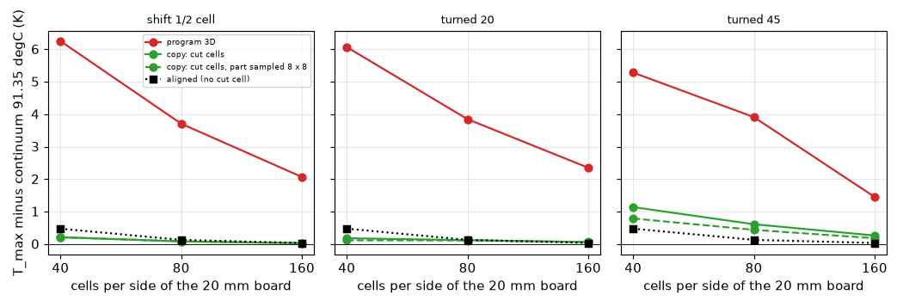

*Figure 8 (`figures/fig_08_square_against_continuum.png`): the maximum temperature minus the continuum value of the independent solver, 20 mm board at `h_side` 2000, for the half-cell shift and the turns of 20 and 45 degrees, against the cells per side; program, cut-cell copy, the copy with the footprint sampled 8 x 8, and the aligned board (no cut cell) for scale.*

Reading: the copy reaches the continuum value from 40 cells per side for a shifted or turned straight edge (within 0.21 K), so section 4's invariance test was not hiding an offset; the program is 2 to 6 K above it at 40 to 160 cells per side. The 45 degree turn of the board keeps a residual in the copy (+0.44 / +0.18 K at 80 / 160 cells per side with the 8 x 8 footprint), first order in the cell: P1 does not remove everything.

### 9.3 The 45 degree residual (corrects 4.4)

`scripts/study_turned_part.py`. On a 20 mm rectangle (no outline, no cut cell) at `h_side` 2000 the 3D solid reads, part turned 45 minus part aligned: +0.37 / +0.23 / +0.11 K at 0.5 / 0.25 / 0.125 mm; the same with the footprint sampled on 8 x 8 points (variant `program_src8` of `lib/rotsq.py`): +0.02 / +0.06 / +0.03 K; the independent solver with a 16 x 16 footprint: -0.15 / -0.03 / -0.02 K; the continuum: -0.005 K. The 4 x 4 lattice keeps 94.4 / 97.4 / 98.9 % of the area of the turned 3 mm part at the three cells (8 x 8: 97.4 / 98.9 / 99.6 %; test `test_footprint_of_a_part_turned_45_degrees_is_short_on_4_by_4_samples`) (test `test_footprint_of_a_part_turned_45_degrees_is_short_on_4_by_4_samples`), and the power normalised over the shorter footprint lands nearer the centre. A program finding (3D solid only; small, and only on a turned part), recorded, not edited: `coverage_fraction(h.polygon, 4)` in `solid3d.py` where the FVM uses 8.

### 9.4 A part that crosses the outline (corrects 6; a program defect)

`scripts/study_part_across_outline.py`. The FVM (`fvm.py`, `cov = coverage_fraction(h.polygon, ...) * self.active`), the FDM and the 3D solid (`w = cover(h.polygon, 4) * self.active`) weight a board cell by the part's cover of the **whole** cell. Where the part crosses the outline, a cut cell gets the power of its whole area on its board part: the power density there is 1 / cover too high. The warning "x % of the footprint is outside the board; its full power is applied to the part that is inside" describes the intent, which is right in total but not in place. At the default `h_side` 10 W/m2K, maximum temperature in degC:

| board | cell (mm) | outline on grid lines | FVM | FVM, power on the board part | 3D solid | 3D, power on the board part |
| :-- | --: | :-- | --: | --: | --: | --: |
| small T (part over the re-entrant corner) | 1 | no | 233.08 | 230.84 | 234.27 | 231.96 |
| | 0.5 | no | 237.65 | 230.63 | 239.16 | 231.83 |
| | 1/3 | yes | 230.06 | 230.06 | 231.13 | 231.13 |
| | 0.25 | no | 230.46 | 229.82 | 231.56 | 230.90 |
| | 1/6 | yes | 229.96 | 229.96 | 231.03 | 231.03 |
| | 0.125 | no | 231.16 | 229.96 | 232.34 | 231.08 |
| | 1/12 | yes | 229.91 | 229.91 | | |
| example board cut to the T (U1 over the corner) | 1 | no | 109.06 | 107.56 | 109.31 | 107.79 |
| | 2/3 | yes | 106.85 | 106.85 | 107.08 | 107.08 |

Where the outline is on the grid lines no cell is cut and every rule agrees; where it cuts cells the program is +0.5 to +7.7 K above that value and does not converge monotonically, and the weight "part cover times board cover" (a one-line change per model, measured on copies: `rotsq.fvm_part_on_board`, variant `program_part_on_board`) brings it within 0.1 to 0.9 K. The example board cut to a T is +2.2 K in the FVM at 1 mm for this reason, so the FVM reference of `docs/validation.md` 13 (row "T, example", 109.1 degC) is about 2.2 K (2.6 % of the rise) high and the Lumped and Analytic errors of that row are measured against it. This is not part of A3 (it is not the edge term, and it is in the reference model at the default coefficient); the product of the two covers is exact only when one of the two covers the cell, a sample-wise intersection is the clean form. The copy's +0.2 K on the T is this power reacting to the centroid links, not a defect of the edge term.

### 9.4a The program has moved since (2.4.5)

The two findings of 9.3 and 9.4 were adopted: `fix/board-cover-8x8` samples the footprint of a part 8 x 8 in the 3D solid and `fix/part-across-outline` weights a cell by the part-and-board intersection scaled to the board cover (`geometry.part_weights`). The in-memory copies of this folder that patched the old line of `solid3d.py` and `fvm.py` therefore no longer apply: the variants `program_src8` and `program_part_on_board` and the FVM copy `rotsq.fvm_part_on_board` now ARE the program (no edit), and `cutcell_src8` equals `cutcell`. Consequence for the numbers: the columns "FVM" and "3D solid" of 9.3 and 9.4 and of `study_turned_part.py` / `study_part_across_outline.py` rerun on the current tree are the columns that were "power on the board part" / "8 x 8"; the numbers printed above for the program columns are those of the program before 2.4.5 and are not reproduced by a rerun (the corrected-copy columns are, within the move of the 8 x 8 board cover).

### 9.5 Recommendation on A3 (asked by the maintainer)

* **How often**: the edge coefficient is typed (the computed coefficients leave it alone) and its default is 10 W/m2K; the effect needs an outline that is not on the grid lines **and** `h_side` of about 100 W/m2K or more (a board edge clamped to a chassis or a card guide). At 10 W/m2K the 3D solid moves by 0.3 K or less on every board measured (40 mm square, round board -0.3 %, five outline presets).
* **Size at the cells in use** (1 mm, 40 mm board): +1.1 to +1.8 K (1.6 to 2.7 % of the rise) at 100 W/m2K, +3.4 to +3.6 K (about 7 %) at 1000; round board +6.6 % at 1000, +3.2 % at 0.25 mm. Larger numbers (up to 12 K) need a small board (20 cells per side) at 2000 W/m2K.
* **The FVM is the reference and is adequate here**: on the same round board it is within 0.6 % of its own axisymmetric reference at 1 mm from 10 to 5000 W/m2K, and its edge term is exact in length. At high edge coefficients the 3D solid and the layered models differ by physics (48.9 against 53.6 K on the round board at 1000), so a user who needs the edge-clamped case reads the FVM and uses the 3D solid as the comparison it is.
* **Cost and risk of P1**: four rewritten expressions of `solid3d.py` (cover, links, edge term, conductivity), a sampling pass whose cost was not measured, every 3D number of an outline case and the tests that compare it move; a residual of 0.2 to 0.5 K stays at 45 degrees; patterned copper, vias and blocks on a cut edge have no independent reference. The gain is 1 to 4 K at 1 mm in a case the default does not reach, in a comparison model.
* **Recommendation: P2** (document the limit; no change of `solid3d.py`), with P1 kept in `docs/versions.md` ('Planned') as an option if a user case with edge cooling appears. Separately, and more worth doing than P1: **fix the power of a part that crosses the outline** (9.4) in the FVM, FDM and 3D solid on a `fix/` branch, because it reaches the reference model at the default coefficient (+2.2 K on the example board cut to a T) and is a one-line change per model; and, smaller, sample the footprint of a part 8 x 8 in the 3D solid as the FVM does (9.3). Text of the limit: `docs/for-the-project-documents.md`.

### 9.6 What the review did not verify

The 1/32 mm step of the diamond reference is not monotone (91.335 then 91.342: the 16 x 16 sampling of its footprint), so its continuum is good to about 0.01 K; patterned copper, vias and blocks on a cut edge against a reference; the FDM with the corrected part weight (only the FVM and the 3D solid were run); the cost of P1's sampling; the original +1.15 K setup.

## 10. Option P1 in the layered FVM: cut cells by their real shape (prototype and light measurements)

**Question.** `docs/validation.md` 23 and the chapter 'Planned' say that a cell cut by the outline conducts with its cover, so a part over a cut edge reads 0.5 to 0.7 K (about 1 % of the rise) hotter at 1 to 0.5 mm than with the edge on the grid lines, and that a cut-cell scheme is the remedy. The maintainer asked whether it is worth doing in the layered FVM (and what it means for the FDM and the 3D solid), and in which version. Everything below is a prototype on a copy (`lib/fvm_cutcell.py`, a subclass of `fvm.Network`; `pcbthermal/` is untouched) and **light cases only** (tier `light` of `scripts/study_cut_cells_fvm.py`, every case below 0.6 GB and a few seconds); the heavy sweeps are listed in 10.8 and were not run.

**Answer in short.**

* The program's FVM joins two cells with the harmonic mean of the cover-scaled sheet conductances over one cell width (`fvm.py`, `S * cover`, then `gx = harmonic(S1, S2) dy/dx`). Into an edge cell of cover c (board on the side of the neighbour) that is `2c/(1+c)` of a link, against the exact `2/(1+c)` of a straight edge: **the program is a factor c too small across the cut** (Figure 9, Figure 10). Along the edge it is right (aperture = cover).
* The cut-cell links (aperture of the face over the distance between the centroids of the two board parts, nodes at the centroids; `links`) remove the dependence on the cut where the geometry is simple: a 20 mm square at `h_side` 2000 shifted by half a cell or turned 20 and 45 degrees moves the maximum by +0.45 / +0.56 / +0.47 K (program, 0.5 mm) and by +0.11 / +0.12 / +0.13 K (links), against the aligned board of the same scheme (10.3). On a round board against the axisymmetric reduction the error of the peak at 1 mm and `h_side` 1000 falls from +0.69 % to +0.22 % of the rise (+0.28 to 0.00 % at 0.5 mm) and the rim loss from -0.27 % to +0.17 %.
* **The gain on the case that motivated it is modest.** The example board cut to a T: the hottest point over five cells (1 to 0.25 mm) spreads over 0.48 K in the program and 0.22 K with the links (0.6 % and 0.3 % of the 81 K rise; the aligned references are 106.56 and 106.53). The small T (2 W over the re-entrant corner) at 1 mm: scatter of the error over the neck positions 1.26 K (program) against 1.01 K (links) and 0.63 against 0.40 K at 0.5 mm; the residual is not removed (10.4), and it is not the sampling of the geometry (`sens`: the scatter of `links` is 1.5 / 1.0 / 1.1 K with 8 / 16 / 64 samples per cell side, single points move by up to 0.3 K).
* **Where the program is already right**: an insulated rectangle with the edge moved over a cell (closed form, 10.2): every variant within 0.03 K of each other (the cut cell is a dead end for the heat); `h_side` 10 on the disc (all variants +0.19 % at 1 mm: the cell-centred read-out, not the edge).
* **Cost**: the geometry (cover, centroid, apertures) is sampled only at the cells the outline crosses and costs 0.07 s at 800 000 cells (T board) and 0.2 s at 176 000 cells (disc with 128 sides); network build time and the matrix are the same size; the sparse matrix stays symmetric positive definite; no singular link (largest x link 1.2 to 1.6 of a whole pair; 28 to 56 cells with a cover under 0.1 on a turned 40 mm square); the implicit transient runs (time to 63 %: 33.78 s against 33.87 s). What it moves: every number of a board whose outline cuts cells (frozen records, `docs/validation.md` 13 and 23, the tests that fix those numbers).
* **Go / no-go** (10.7): **no-go for 2.5.0, go as a low-priority item for 2.6.0** for the variant `links` in the FVM only (about 60 lines); not for the Lumped and Analytic (they run on the equivalent rectangle); the FDM and the 3D solid need their own design (INTEGRATION.md).

### 10.1 What is in the prototype (and Figures 9 to 11)

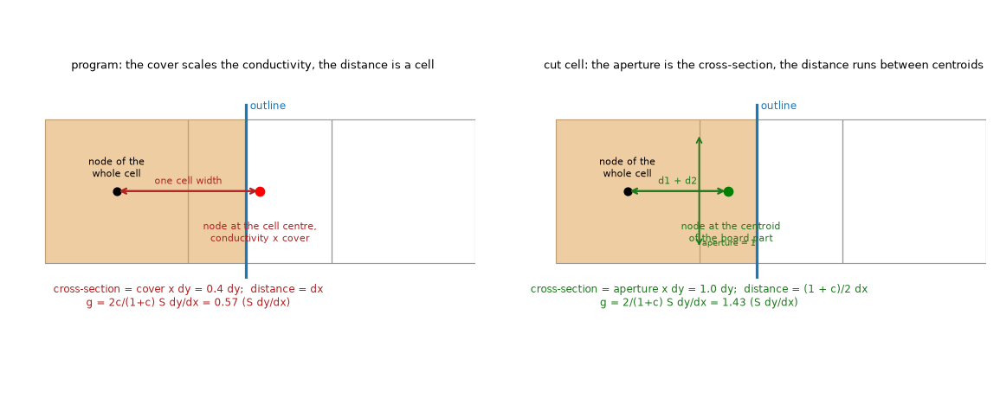

*Figure 9 (`figures/fig_09_cut_cell_link.png`): a whole cell and a cell cut at c = 0.4 (board towards the whole cell). Left, the program: node at the cell centre, conductivity times the cover, distance one cell width. Right, the cut-cell link: node at the centroid of the board part, cross-section the aperture of the shared face, distance d1 + d2 between the centroids measured along the normal.*

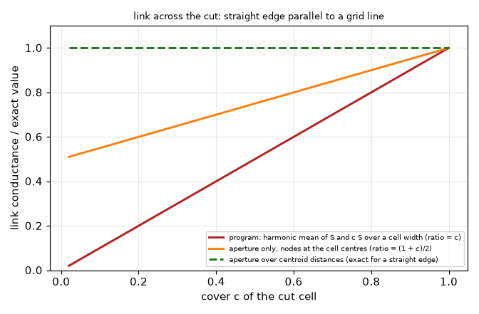

*Figure 10 (`figures/fig_10_link_ratio.png`): link conductance into a cut edge cell divided by the exact straight-edge value, against the cover (closed forms: program c, aperture only (1 + c)/2, cut-cell links 1).*

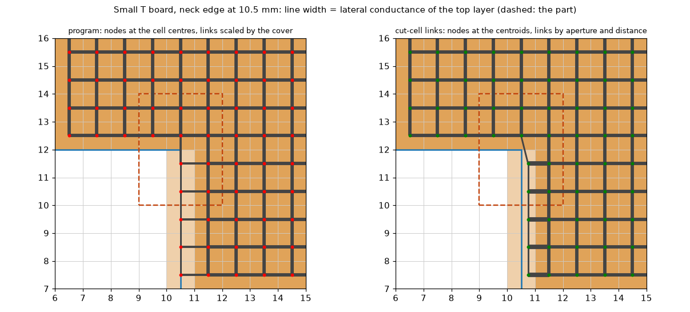

*Figure 11 (`figures/fig_11_tee_links.png`): the small T board with the neck edge at 10.5 mm, 1 mm cells; line width proportional to the lateral conductance of the top layer in the program (left, nodes at the cell centres) and in the prototype (right, nodes at the centroids; the link from the whole cell above the corner into the half-board cell below is a half-width diagonal). Dashed: the part. No solve.*

Variants of `lib/fvm_cutcell.py` (`scheme`): `program` (the unmodified FVM); `aperture` (nodes stay at the cell centres, only the cross-section of the link becomes the aperture; the form of Johansen and Colella's partial-face flux, eq. 15 and 16 of the report); `links` (nodes at the centroids of the board parts; conductance `a dy / (d1/Sp1 + d2/Sp2)`, with `Sp` the physical sheet conductance `S / cover`); `links+strip` (`links` plus the conduction from the centroid to the outline, half the depth of the board strip, in series with the edge film). Everything else of the network (cover, capacities, vertical links, films, laminate nodes, vias) is the program's; a board with a metal block is refused. For a board without an outline the matrix is the program's (test). The geometry is `lib/cutcell.py` (`cut_geometry_fast`, 16 x 16 samples in the cut cells, equal to the full sampling in a test).

### 10.2 The independent references

* **Insulated rectangle: closed form** (`lib/sheetmodes.py`): the layered idealisation of a two-layer full-copper board with insulated edges is diagonal in the cosine modes (each mode a 2 x 2 system); the point value at the centre of the hot cell is summed to 300 modes (the series is converged to 1e-8 relative between 200 and 800 modes). Its own tests: the power is conserved (mean rise times the film conductances, 1e-9), and the program's FVM without cut cells approaches it as the cell squared (+0.8 K at 1 mm, +0.2 K at 0.5 mm for a 237 K peak).
* **Round board: axisymmetric reduction of the same layered model** (`lib/layered_disc.py`, 4000 rings; the rim loss and the whole radial field, which `axisym3d.solve_layered_disc` did not return). The cell-centred unknown is a **point value** at the cell centre, so the peak of the FVM is compared with the field at `dx/sqrt(2)` from the centre (the hot cells touch the disc centre), not with the centre value nor with the mean over the cell: the first run of this study compared with the centre value of the reference and made the cut cells look worse than the program (a read-out offset of 0.4 % at 1 mm hid the effect); the table below is the corrected one.
* **The program at 1/12 mm cells** for the small T (the neck edge sits on grid lines there for every position used, `a = 10 + k/12` mm); it is a proxy of the continuum, good to the discretisation error of that cell (about 1/144 of the 1 mm error).

### 10.3 Results

`scripts/study_cut_cells_fvm.py disc`. 40 mm round board (128-sided polygon), two copper planes, 2 W in a 3 mm radius part; peak of the hottest cell and heat leaving by the rim, both against the axisymmetric reduction; per cent of the rise (peak) and of the rim loss (rim). Each cell shows peak / rim.

| h_side | rise at the hot cell centre (K) | cell (mm) | program | aperture | links | links+strip |
| --: | --: | --: | --: | --: | --: | --: |
| 10 | 94.144 | 1 | +0.19 / -0.06 | +0.19 / -0.02 | +0.19 / -0.01 | +0.19 / -0.02 |
| 100 | 74.958 | 1 | +0.30 / -0.16 | +0.24 / +0.01 | +0.22 / +0.07 | +0.25 / -0.03 |
| 100 | 75.380 | 0.5 | +0.08 / -0.09 | +0.05 / +0.01 | +0.04 / +0.04 | +0.06 / -0.01 |
| 1000 | 48.309 | 1 | +0.69 / -0.27 | +0.33 / +0.06 | +0.22 / +0.17 | +0.44 / -0.04 |
| 1000 | 48.734 | 0.5 | +0.28 / -0.19 | +0.07 / +0.02 | +0.00 / +0.08 | +0.11 / -0.02 |
| 1000 | 48.840 | 0.25 | +0.12 / -0.11 | -0.00 / +0.01 | -0.04 / +0.04 | +0.01 / -0.01 |
| 5000 | 42.539 | 1 | +0.75 / -0.21 | +0.35 / +0.09 | +0.19 / +0.20 | +0.51 / -0.05 |
| 5000 | 42.965 | 0.5 | +0.33 / -0.17 | +0.06 / +0.03 | -0.02 / +0.09 | +0.13 / -0.03 |

(The whole table, with 10 W/m2K at 0.5 and 0.25 mm, 100 at 0.25 and 5000 at 0.25, is printed by the script; `out/cutfvm_disc_light.json`.) Reading: the program is 0.3 to 0.75 % of the rise high at 1 mm when the edge is cooled hard; `links` is 0.2 % high and reaches the reference from 0.5 mm; `links+strip` sits between (the half-cell conduction toward the rim lowers the edge-cell values but also moves the aligned convention, see below). At the program's default (`h_side` 10) there is nothing to gain: 0.19 % for every variant at 1 mm is the cell-centred read-out.

`scripts/study_cut_cells_fvm.py square`. 20 mm square, 3 mm part, `h_side` 2000, board and part moved together; maximum temperature in degC (difference to the aligned board of the same scheme and cell, K):

| cell (mm) | layout | program | aperture | links | links+strip |
| --: | :-- | --: | --: | --: | --: |
| 0.5 | aligned | 80.08 (+0.00) | 80.08 (+0.00) | 80.08 (+0.00) | 80.30 (+0.00) |
| 0.5 | shift 1/2 cell | 80.53 (+0.45) | 80.30 (+0.22) | 80.19 (+0.11) | 80.30 (+0.00) |
| 0.5 | turned 20 | 80.64 (+0.56) | 80.30 (+0.22) | 80.20 (+0.12) | 80.31 (+0.01) |
| 0.5 | turned 45 | 80.55 (+0.47) | 80.29 (+0.20) | 80.21 (+0.13) | 80.34 (+0.04) |
| 0.25 | aligned | 80.27 (+0.00) | 80.27 (+0.00) | 80.27 (+0.00) | 80.38 (+0.00) |
| 0.25 | shift 1/2 cell | 80.49 (+0.22) | 80.38 (+0.11) | 80.32 (+0.05) | 80.38 (+0.00) |
| 0.25 | turned 20 | 80.56 (+0.29) | 80.38 (+0.11) | 80.33 (+0.06) | 80.38 (+0.01) |
| 0.25 | turned 45 | 80.50 (+0.23) | 80.38 (+0.11) | 80.34 (+0.07) | 80.40 (+0.02) |

Reading: the FVM shows the effect in a much milder form than the 3D solid (section 4: +5.6 K at 40 cells per side), and the cut-cell variants reduce it by 2 (aperture), 4 to 5 (links) and 20 to 50 (links+strip) times. **The aligned values differ:** `links+strip` adds the half-cell conduction to the rim also on whole edge cells, so its aligned board reads +0.22 / +0.11 K above the program's at 0.5 / 0.25 mm; whether that is nearer to the continuum was **not established** (it needs a finer reference: 10.8). `aperture` and `links` leave the aligned values (and every board whose outline lies on grid lines) bit-identical to the program, which is why they are the candidates for an adoption that moves few numbers.

`scripts/study_cut_cells_fvm.py tee`. (a) The example board cut to the T preset (100 x 80 mm), hottest point in degC; at 2/3 and 1/3 mm no cell is cut (references):

| h_side | cell (mm) | program | aperture | links | links+strip |
| --: | --: | --: | --: | --: | --: |
| 10 | 0.667 (ref) | 106.562 | 106.562 | 106.562 | 106.563 |
| 10 | 0.333 (ref) | 106.529 | 106.529 | 106.529 | 106.530 |
| 10 | 1.0 | 106.809 | 106.567 | 106.507 | 106.508 |
| 10 | 0.8 | 106.327 | 106.575 | 106.518 | 106.519 |
| 10 | 0.5 | 106.498 | 106.639 | 106.615 | 106.615 |
| 10 | 0.4 | 106.481 | 106.403 | 106.396 | 106.396 |
| 10 | 0.25 | 106.512 | 106.465 | 106.462 | 106.463 |
| 100 | 0.667 (ref) / 0.333 (ref) | 97.242 / 97.225 | | | |
| 100 | 1.0 / 0.8 / 0.5 / 0.4 / 0.25 | 97.432 / 97.016 / 97.206 / 97.150 / 97.214 | 97.217 / 97.234 / 97.322 / 97.099 / 97.176 | 97.175 / 97.215 / 97.318 / 97.097 / 97.174 | 97.240 / 97.265 / 97.349 / 97.123 / 97.190 |

Range over the five cut cells (max minus min): 0.48 K (program), 0.24 (aperture), 0.22 (links) at `h_side` 10; 0.42 (program), 0.22 (links) at 100. (b) The small T, error of the hottest point against the program at 1/12 mm, scatter over the six positions of the neck edge (`a` from 10 to 10.83 mm, step 1/6):

| cell (mm) | program | aperture | links | links+strip |
| --: | --: | --: | --: | --: |
| 1 | 1.26 | 0.93 | 1.01 | 1.01 |
| 0.5 | 0.63 | 0.47 | 0.40 | 0.40 |

The per-position errors are in `out/cutfvm_tee_light.json` and Figure 12.

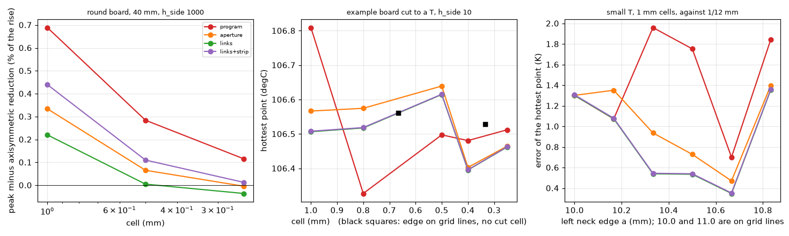

*Figure 12 (`figures/fig_12_fvm_cut_cells.png`): left, peak error of the round board against the axisymmetric reduction at `h_side` 1000; middle, the hottest point of the example board cut to a T against the cell (black squares: no cell cut); right, the small T, error at 1 mm against the position of the neck edge.*

`scripts/study_cut_cells_fvm.py rect`. Insulated rectangle (right edge moved over one cell, 4 x 4 mm part 2 mm from it), peak of the hot cell minus the closed form at the cell centre: 1 mm, +0.797 (edge on the grid line) to +0.812 (program, half cell) and +0.784 (links); 0.5 mm, +0.203 to +0.205 (program) and +0.197 to +0.203 (links). Every variant within 0.03 K: the cut cell is a dead end here, which is why this test does not discriminate (it checks the closed form and the assembly, not the benefit).

### 10.4 Where it does not help, and what stays unexplained

* **The small T keeps a scatter of 1.0 K at 1 mm and 0.4 K at 0.5 mm** with the best variant, and the cut-cell value at some positions falls **below** the on-grid error (error +1.30 K on the grid line, +0.35 to +0.54 K at a = 10.33 to 10.67 mm), while the program goes above it (+1.75 to +1.96 K). So the invariance is not restored there: the two schemes err in opposite directions. The geometry sampling is not the cause (`sens`: samples 8 / 16 / 64 give scatters of 1.5 / 1.0 / 1.1 K, a limit of the face-to-centroid distance of a quarter cell or a cut of the apertures under 0.1 change nothing to 0.04 K; 8 samples are visibly worse, 16 is enough), and neither is the power of the part (weights are the intersection, grid-aligned part edges). The candidate cause, **not tested**, is the re-entrant corner: the cell holding the corner has an L-shaped board part, which a two-point flux through apertures treats like a straight cut, and the heat converges there (a corner singularity); the proper cure would be a second-order reconstruction of the flux (Johansen and Colella's interpolated gradient of eq. 16), which makes the matrix non-symmetric.
* **The mean temperature under the part is no better:** on the small T the mean over the footprint at 1 mm errs by +1.65 to +2.88 K (program) and +1.75 to +2.59 K (links) over the six positions (`study_cut_cells_fvm.py sens`, last two columns; the maxima of the error differ from the hottest-point ones because a mean over the footprint is read, the scatter is 1.2 K and 0.8 K).
* **The edge film at the node.** `links` keeps the program's convention (film on the node, no conduction from the node to the outline). That is why it leaves aligned and rectangular boards untouched; `links+strip` is the physically fuller form but moves them (+0.1 to +0.2 K at `h_side` 2000). Which is nearer the continuum needs the heavy reference of 10.8.
* ~~No published case reproduced.~~ *Corrected by the review (11.8)*: the literature check of this folder (`docs/literature.md` 3) reproduces Problem 1 of Johansen and Colella (a Dirichlet problem on a flower-shaped domain, not a circle or an annulus) to three digits in the maximum error with an independent solver (`lib/jc_poisson.py`, Figure 13), and tests five schemes against the closed form of a sheet with a film on its rim (`lib/sheet_robin.py`, Figure 14). The program's film boundary is not the paper's, so the references of this section stay the closed form and the axisymmetric reduction.

### 10.5 Consequences for the other models

* **FDM** (node-centred): the unknowns sit on grid points; the 'cut cell' is the dual cell around a node, and the program's FDM already scales node conductances by a node cover. The same two ingredients (aperture of the dual-cell faces, distance between the centroids of the cut dual cells) apply; its edge-shift scatter on the small T is 2.02 K at 1 mm (`docs/validation.md` 23), larger than the FVM's, so the benefit may be larger but **was not measured** (no prototype written).
* **3D solid**: already measured on a copy (sections 4 to 6): the same scheme removes the 2 to 12 K dependence at high `h_side`; the layered prototype of this section is the same idea for the layered models.
* **Lumped and Analytic**: unaffected (they run on the equivalent rectangle of the same area; there is no cut cell).
* **Vias, laminate nodes, metal blocks on a cut edge**: vias and laminate nodes read `S`, `cover` and the footprint of cells; the prototype replaces only the lateral links and keeps the rest, and its tests ran only boards without vias on a cut edge; **blocks are refused**. A full implementation must decide whether the Kron-reduced via footprint and the laminate sub-gap nodes use the centroids too (INTEGRATION.md).
* **Transient**: capacities are unchanged (cover times area); the implicit step has no small-cell limit (Berger and Helzel's small-cell problem is the explicit time step: `BIBLIOGRAPHY.md`); the prototype's step response has a time to 63 % within 0.3 % of the program's.

### 10.6 Cost

The prototype's lateral links are vectorised numpy on the cut cells; the geometry costs 0.07 s at 800 000 cells (T board) and 0.2 s at 176 000 cells (128-sided disc), the build of the network 0.02 to 0.06 s more or less than the program's at 8 000 to 32 000 cells; matrix size, symmetry and the direct solve are unchanged. The size of the change in `fvm.py`: one function for the geometry (about 40 lines, sampling only the cut cells), the lateral links of `_assemble` (about 20 lines) and the removal of nothing else. What is not cheap is the consequence: every frozen record of a board with a cut outline moves (the harness boards with an outline were not counted here), `docs/validation.md` 13 and 23 and `docs/theory.md` 1.3 are rewritten, and `tests/test_part_across_outline.py`, `tests/test_outline.py` and the tests that fix an outline temperature are re-measured.

### 10.7 Go / no-go (for the maintainer; reviewed in 11.8)

* **Benefit**, in the cases measured: 0.2 to 0.5 K (0.3 to 0.5 % of the rise) at the cells in use on boards with an outline off the grid lines, 0.5 to 0.7 % of the rise on a round board with an edge clamped to a chassis (`h_side` 1000 or more, 1 mm); about 0.2 to 0.25 K (0.3 % of the rise) less scatter on the example board cut to a T; nothing at the default `h_side` 10 on a disc and nothing for an insulated edge. It does **not** flatten the small T (a residual of 1.0 K at 1 mm remains).
* **Cost**: about 60 lines in `fvm.py` plus the FDM variant (not designed in detail) and the 3D solid (a separate item), all numbers of cut outlines move, theory and validation text rewritten, tests re-measured, whole battery and a frozen-numbers refreeze, one new risk (the via footprint and laminate nodes on a cut edge, no reference).
* **No-go for 2.5.0.** The effect is below 1 % of the rise in the cases that matter, the gain is partial, and the release is already carrying the Gerber import (real boards have outlines that are rarely on the grid, which is an argument for the item, but the measured residual of the program there is 0.3 to 0.6 % of the rise, smaller than the model-form differences of the models, 5 to 10 %).
* **Go for 2.6.0 as a low-priority item**, only the `links` variant in the FVM (nothing else of the program changes, boards on grid lines and rectangles bit-identical), after the heavy runs of 10.8 confirm that it is not worse anywhere (turned and shifted squares against a finer reference, patterned copper on a cut edge, vias near an outline) and the reviewer has re-run the studies. If the maintainer prefers a documented limit instead (P2), the text is `docs/for-the-project-documents.md`.

### 10.8 What is ready to run (heavy; not run in this phase)

All in `scripts/study_cut_cells_fvm.py --tier heavy` (reference cells down to 1/24 mm). Declared peaks: the small-T reference at 1/24 mm is 720 x 576 cells x 2 layers = 830 000 unknowns, **about 2.5 to 3 GB resident** and 15 to 30 s per solve (the 1/12 mm reference of the light tier peaked at 0.55 GB); the 16-step sweep with two cells and four schemes plus a reference per position is about 16 x 9 solves, **about 10 minutes, one process at a time**. The disc at 0.125 mm is 336 x 336 cells (0.3 GB); the 20 mm square at 0.125 mm is 240 x 240 (0.2 GB); `study_square` at 1/16 mm for a finer continuum proxy of the aligned board is 480 x 480 x 2 (about 0.8 GB). Not written yet and worth running with them: (1) a Dirichlet circle (the Johansen and Colella test problem) to reproduce a convergence rate of the aperture links; (2) a sweep over the 17 boards of the frozen-number harness with `links` against the program to count which records move and by how much; (3) vias at 1 to 3 cells from a cut edge, and patterned copper (a copper edge crossing a cut cell), each against a refined reference; (4) a test of the re-entrant corner with a flux reconstruction.

## 11. Cut cells in the layered FVM on the current program: re-measurement, exact geometry, and whether it fits 2.5.0

**Question (maintainer).** Can the cut-cell treatment (P1) enter 2.5.0 without delaying it? Measured on the tree of `develop` after 2.4.5 (`2f3bd73`: laminate rule, point via, part across the outline, imported-copper faces, block SOR), simple boards first, against fine-cell references; `pcbthermal/` untouched. Light jobs only (cells of 0.5 mm and finer on a 30 mm box, below 1 GB). Everything below is printed by `scripts/study_cutcell_sweep.py` (new) and `scripts/study_cut_cells_fvm.py` (section 10, rerun with two more schemes); outputs in `out/` (git-ignored).

**Answer in short.**

* **The section-10 numbers are reproduced on the current program** (`study_cut_cells_fvm.py rect | square | disc`, to the digit: the T of section 10.3 too except for the new columns). The prototype had to be rebuilt: `develop` moved `_assemble` (imported faces) and gave `solve_sor` its own copy of the lateral links, so the old prototype (a copy of `_assemble`) would have run the point SOR on the program's links. `lib/fvm_cutcell.py` now adds the difference between the cut-cell links and the program's links to the program's own matrix and patches the SOR (11.1).
* **What the problem is, in numbers** (11.2). Outline moved over one cell or turned, the part left on the grid (so that only the cut cell changes), error against the same board at a cell 8 times finer; 20 mm square (rise 223 / 135 / 56 K at `h_side` 10 / 100 / 2000 W/m2K). Program, spread over the positions: **0.09 K / 0.80 K / 2.8 K** (shift, mean over three boards, 1 mm) and 1.5 / 0.85 / 1.7 K (turn); at 0.5 mm 0.03 / 0.36 / 1.3 K and 0.6 / 0.46 / 0.75 K. The error is largest right after the edge leaves the grid line, when the edge cell holds a sliver of cover 1/8 (Figure 16): the program conducts into a sliver a factor `c` too weakly (10.1, Figure 10).
* **At `h_side` 100 and 2000 the cut-cell links reduce the shift spread 7 to 9 times and the turn spread 2 to 7 times** (`links`: 0.06 / 0.11 / 0.34 K shift and 1.1 / 0.52 / 0.29 K turn at 1 mm for `h_side` 10 / 100 / 2000; 0.016 / 0.055 / 0.15 K and 0.35 / 0.22 / 0.11 K at 0.5 mm); at 10 W/m2K they change little (1.5 times). With the conduction of the strip in series with the edge film (`links+strip`) the shift spread is 0.061 / 0.062 / 0.027 K at 1 mm (13 times at 100 and 100 times at 2000). In percent of the rise: 2.8 K of 56 K (5 %) becomes 0.34 K (0.6 %) at `h_side` 2000, and 0.8 K of 135 K (0.6 %) becomes 0.11 K (0.08 %) at 100. **At the default `h_side` 10 the whole effect is the area and volume of the cut cells (0.7 % of the rise at worst, 1.5 K of 223 K at 1 mm) and the links do not change it; an exact cover does** (11.3).
* **Not safe everywhere**: with the top copper held 1.2 mm inside the outline (laminate nodes in the cut cells) every scheme spreads 3 to 9 K and the cut-cell links sit 0.9 to 3.7 K cool of the fine-cell value at 1 mm (11.5): the copper edge also moves against the grid there, the fine references disagree by 0.6 to 1.0 K, and the study cannot separate the two cut-cell problems. Open, and one reason for 2.6.0.
* **Conservation, conditioning, SOR, cost** (11.4): heat balance closes to 1e-13, the edge length is `h P` exactly, the matrix stays symmetric positive definite, the largest link is at most 1.8 times a whole pair (no small-cell stabilisation or merging is needed; flooring the distance to a quarter cell only adds 0.1 K), condition number and SOR sweeps are equal or smaller than the program's (SOR 127 to 128 against 137 to 148 sweeps on a turned 11 mm square), CG iterations 0 to 15 % more, the geometry costs 0.01 to 0.07 s (the exact clipping is a Python loop over the cut cells, 15 ms for 100 cut cells: to be vectorised for boards with tens of thousands).
* **Decision: it fits 2.5.0 technically (about 60 lines in `fvm.py`, bit-identical off the cut cells) but I recommend 2.6.0** (11.6): the gain at the defaults is below 1 % of the rise, it moves the frozen records of 3 of the 17 harness boards (the largest, `part_across_outline`, by -1.4 K = 0.7 % at 2 mm), it leaves the FDM and the 3D solid with another treatment of the same edge, and the case that matters for real Gerber outlines (patterned copper and vias on a cut edge) has no clean verdict yet. `INTEGRATION.md` has the exact code changes and the acceptance numbers if the maintainer decides otherwise.

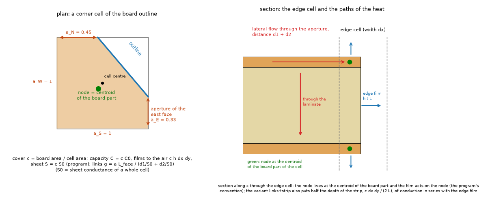

*Figure 15 (`figures/fig_15_cut_cell_ingredients.png`): left, a corner cell of an outline with its cover, centroid and the apertures of the four faces; right, the section of an edge cell with the paths of the heat (lateral flow through the aperture, through the laminate, films on both faces and on the end face).*

### 11.1 The prototype on the current program

`lib/fvm_cutcell.py` (rebuilt): `CutCellNetwork(fvm.Network)` builds the program's network, then `_assemble` returns the program's matrix plus the symmetric couplings `g_cut - g_program` of the lateral links (so the vertical links, vias, laminate nodes, films and imported faces are the program's; imported layers keep the program's faces), and the program's point SOR is rebuilt from its own source with the link block replaced by `_links_for_solvers()` (refused when the source changes). New `lib/cutcell_exact.py`: the cover, centroid and apertures of the cut cells by exact clipping (`geometry.clip_polygon` against the cell box; apertures from the crossings of the outline with the face line), with the keys of the sampled version, plus `using_exact_cover()` which replaces `Board.cover` for a block. Scheme names: `program`, `links`, `links+strip`, `aperture` (section 10) and the suffix `@exact` for the exact cover and geometry (`program@exact` is the program's links with only the cover exact). Tests (`tests/test_fvm_cutcell.py`, 14): the old 11 and three new ones: exact area equals the polygon area to 1e-12 and the sampled geometry agrees to its resolution; the point SOR equals the direct solve on the cut-cell links (and differs from the program's field, so it did use them); symmetry, positive diagonal and the heat balance of the exact geometry on a turned square and a disc.

### 11.2 Sweeps of the position of the outline

`study_cutcell_sweep.py square`. 20 mm square and 24 x 12 mm rectangle in a 30 mm box, two full copper planes, 2 W in a 3 mm part (centred, 3.5 mm off centre, 5 mm off centre in the rectangle). **The part stays where it is on the grid and is centred on a cell centre**; the outline moves by k/8 of a cell on both axes (8 positions) and turns 0 to 45 degrees in 5 degree steps (10); the value of every position is compared with the same board at a cell 8 times finer (1/8 mm for 1 mm cells, 1/4 of the cell for 0.5 mm: the mean of the program and `links`, their difference printed as the uncertainty, 0.01 to 0.26 K). An earlier version of the study moved the part with the board and found 3 K differences: they were the read-out of the cell-centred peak (a 3 mm part centred on a cell corner reads 3 K below the fine value on a 1 mm grid), common to all schemes and not the edge; the sweep now holds the part fixed on a cell centre so that this bias is the same at every position. Spread (maximum minus minimum over the positions, K), mean over the three boards (the maximum in brackets):

| `h_side` | cell | program: shift / turn | `links`: shift / turn | `links@exact`: shift / turn | `links+strip`: shift / turn |
| --: | --: | --: | --: | --: | --: |
| 10 | 1 | 0.094 (0.13) / 1.48 (2.66) | 0.062 (0.12) / 1.08 (1.32) | 0.062 / 0.57 (1.45) | 0.061 / 1.08 |
| 10 | 0.5 | 0.031 (0.05) / 0.60 (1.45) | 0.016 (0.03) / 0.35 (0.65) | 0.016 / 0.23 (0.42) | 0.015 / 0.35 |
| 100 | 1 | 0.80 (1.03) / 0.85 (1.58) | 0.11 (0.15) / 0.52 (1.03) | 0.11 / 0.51 (1.36) | 0.062 (0.11) / 0.56 |
| 100 | 0.5 | 0.36 (0.46) / 0.46 (0.93) | 0.055 (0.07) / 0.22 (0.52) | 0.055 / 0.20 (0.51) | 0.039 / 0.25 |
| 2000 | 1 | 2.8 (3.6) / 1.7 (2.4) | 0.34 (0.43) / 0.29 (0.41) | 0.34 / 0.27 (0.37) | 0.027 (0.04) / 0.20 (0.40) |
| 2000 | 0.5 | 1.3 (1.7) / 0.75 (0.93) | 0.15 (0.19) / 0.11 (0.20) | 0.15 / 0.10 (0.16) | 0.094 (0.11) / 0.20 (0.36) |

`aperture` (nodes at the cell centres) sits between the program and `links` (shift spread 0.67 K at 2000 and 1 mm). Rise of the boards at 1 mm: 223 / 135 / 56 K (square) and 296 / 163 / 56 K (rectangle) at 10 / 100 / 2000. The mean errors (the bias against the fine value, which includes the read-out bias of the peak) are in `out/square.txt`: at 2000 W/m2K and 1 mm program +2.2, `links` +1.2, `links+strip` +1.5 K; at 0.5 mm +0.27, -0.20 and -0.08 K: `links` leans cool of the fine value at 0.5 mm, `links+strip` is nearest to it.

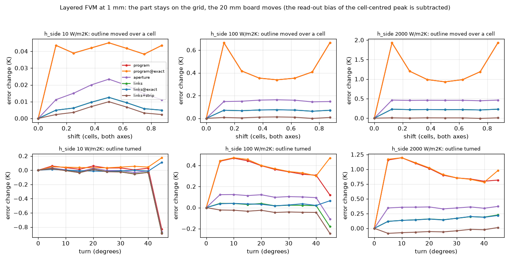

*Figure 16 (`figures/fig_16_cut_cell_sweep.png`): the 20 mm square at 1 mm, error minus its value at the first position against the shift (top) and the turn (bottom) at `h_side` 10, 100, 2000 W/m2K; the jump at the first step is the sliver of cover 1/8. The 45 degree point at 10 W/m2K is -0.85 K in the schemes that use the program's 8 x 8 cover and not in the `@exact` ones (11.3). The legend of the first panel names the six schemes.*

### 11.3 The cover itself, and the 45 degree artefact

The program samples the cover of a cut cell 8 x 8 (`geometry.BOARD_SAMPLES`): a straight edge gives covers that are multiples of 1/8, the area of a turned square is off by up to 3.6e-4 at the angles of the 5 degree sweep below 45 degrees (*corrected by the review, 11.8: at exactly 45 degrees the 8 x 8 cover overstates the area of the 20 mm square by 0.64 % at 1 mm and 0.20 % at 0.5 mm, and an edge of slope 1/3 understates it by 0.38 %*; capacity, `cutcell_exact` against the polygon at 0.5 mm; the slowest time constant of the 20 mm disc, 99.03 s, is the same to 7e-5 in every scheme at 1, 0.5 and 0.25 mm, so the capacities need no change), and at exactly 45 degrees the pattern of the samples makes the area wrong in a way that moves the hottest point by -0.85 K of 223 K (0.4 %) at the default `h_side` 10 on the 20 mm square at 1 mm. An exact cover (clipping, 15 ms for a 30 x 30 grid) removes it: the turn spread at `h_side` 10 falls from 1.5 to 0.35 K at 1 mm (program to program@exact, mean over three boards; the rectangle's 2.7 K to 0.59 K) and from 0.60 to 0.42 K at 0.5 mm. At `h_side` 100 and 2000 the cover is not the main error (turn spread 0.65 against 0.85 K and 1.55 against 1.7 K). **This is the part of P1 that matters at the default coefficient, and it is independent of the links.** On the small T the exact cover alone halves the scatter at 1 mm (1.26 K to 0.65 K; 0.63 to 0.46 K at 0.5 mm, `out/tee.txt`), but it does not help the example board cut to a T (range over five cells 0.49 K against 0.49 K).

### 11.4 Conservation, conditioning, SOR, cost

`study_cutcell_sweep.py balance | smallcell | harness`, `study_cut_cells_fvm.py cost`.

| check | program | `links` / `links+strip` |
| :-- | --: | --: |
| heat to the air over the power - 1, turned and shifted squares, rectangle, disc, 1 and 0.5 mm | -6e-15 to +8e-14 | -2e-14 to +4e-14 |
| edge conductance, `sum g_side / (h P)` (mm; the sum of the layer thicknesses is 1.6) | 1.60000 | 1.60000 / 1.55 to 1.58 (the strip lowers it by design) |
| sum of the covers over the polygon area - 1 (8 x 8 cover) | -2e-4 to +3e-4 | same (the cover is the program's) |
| symmetry of K, positive diagonal | yes | yes (test) |
| largest x link / link of two whole cells, straight edge at cover 1/2, 1/4, 1/8 | 1.00 | 1.33, 1.60, 1.78 (floor at a quarter cell: 1.33) |
| same, 11 mm square turned 0, 5, 10, 20, 30, 45 degrees (cover down to 1/64) | 1.00 | 1.33, 1.79, 1.72, 1.58, 1.41, 1.44 |
| smallest diagonal / largest diagonal | 1.5e-3 to 3.2e-2 | 1.1e-2 to 3.2e-2 (better) |
| condition number estimate, 512 unknowns | 2.4e3 to 2.8e3 | 2.4e3 to 2.7e3 |
| SOR sweeps (point SOR, omega estimate), 11 mm square and straight edges, 1 mm | 130 to 148 | 127 to 130 |
| CG iterations (Jacobi), same boards | 65 to 88 | 70 to 91 (0 to +15 %) |
| network build, T example 0.5 mm (32 000 cells) / turned 40 mm square 0.5 mm | 0.04 / 0.01 s | 0.05 / 0.01 s |

The smallest cover the program holds on a straight edge is 1/8 and on a corner 1/64: a sliver thinner than that is lost (the 8 x 8 sampling), which is why no cover of 0.002 appears. A link between two slivers that straddle a face can only be large when both distances are small; they are floored at 1/1000 of a cell in the prototype and the floor at a quarter cell gave a different answer by 0.1 K, so **no small-cell stabilisation or merging is needed** for the steady state and the implicit transient (the capacities are the program's, and the slowest time constants agree to 7e-5). Berger and Helzel's problem is the explicit time step, which the program does not use.

### 11.5 Patterned copper, vias, and the other schemes of the small boards

`study_cutcell_sweep.py patterned`: the same sweep with a 3 x 3 via array under the part (0.3 mm drills, 1 mm pitch), with the top copper held 1.2 mm inside the outline, and both; part 3.5 mm off centre; four shifts and five turns; 1 and 0.5 mm.

* **Vias on a cut edge** (part 3.5 mm from the edge): the links help as on the plain board. `h_side` 100 at 1 mm: shift spread 0.42 K (program), 0.058 K (`links`), 0.024 K (`links+strip`); `h_side` 2000: 1.5 K, 0.26 K, 0.011 K; at 0.5 mm 0.20 / 0.031 K and 0.75 / 0.13 K. The mean error of `links` is +0.07 to +0.33 K at 1 mm and -0.26 to -0.42 K at 0.5 mm (`out/patterned.txt`).
* **Copper held inside the outline**: the spreads are 3 to 9 K for every scheme (program 4.8 K at `h_side` 100 and 9.1 K at 2000, 1 mm), the fine references disagree by 0.6 to 1.0 K, and `links` is 0.9 to 3.7 K cool of the fine value at 1 mm and 0.5 to 1.1 K at 0.5 mm; `links+strip` is the closest (within 0.5 K at 1 mm). The cause was not isolated: the copper edge (the fill of the cut cell is sampled over the cell, not over the board part) moves against the grid together with the outline, and the program's laminate rule puts sub-gap nodes in exactly those cells. **No verdict**; it is the case that decides whether the links are safe on a real board and it needs its own study (cut cells of the fill) before an adoption.
* The small T and the example board cut to a T, with the exact variants (`out/tee.txt`; scatter over the six neck positions, K): small T at 1 mm 1.26 (program), 0.65 (`program@exact`), 1.01 (`links`), 0.77 (`links@exact`); at 0.5 mm 0.63, 0.46, 0.40, 0.39; so **the residual of the small T (a re-entrant corner) is not removed by either**, as section 10.4 said. The example T over five cut cells: 0.49 / 0.49 K (program, exact cover), 0.22 K (`links`), 0.34 K (`links@exact`).
* The round board against the axisymmetric reduction (`study_cut_cells_fvm.py disc`): the numbers of 10.3 are reproduced; the exact cover changes none of them (at most 0.02 point); `links` leaves +0.22 % of the rise at 1 mm and `h_side` 1000 against +0.69 % for the program, and `links+strip` +0.44 % with the rim loss nearest the reference (-0.04 % against +0.17 % for `links`, -0.27 % for the program).

### 11.6 Can it enter 2.5.0 without delaying it

Fits: the change is local (a new `geometry` function of about 70 lines, a method `_lateral_links()` of about 25 lines in `fvm.py` used by `_assemble` and `solve_sor`, which removes the duplicated block), it is bit-identical off the cut cells (the rectangle and an outline on the grid lines, tests), symmetric positive definite, conservative to 1e-13, SOR and CG unchanged in cost, and light in memory and time. What counts against 2.5.0:

1. **The gain at the defaults is small.** At `h_side` 10 the effect is 0.1 to 0.7 % of the rise and the links do not change it (the exact cover does, 11.3); it reaches 0.6 % of the rise at 100 and 5 % at 2000 W/m2K, a typed coefficient for a board clamped to a chassis. The program's other model-form differences are 5 to 10 %.
2. **Numbers that move.** Of the four harness boards that have an outline (`out/harness.txt`, hottest temperature, `links` minus program): `round_outline` -0.009 / -0.003 / -0.001 K at 2 / 1 / 0.5 mm, `example_cut_to_T` -0.028 K at 2 mm (0.0 at 1 and 0.5), `t_outline` 0.000 (its edges lie on grid lines), **`part_across_outline` -1.43 / -1.17 / -0.08 K (0.7 % of the rise at 2 mm)**: the FVM records of three boards move (their fields and checksums, all of them, not only the maximum), plus `docs/validation.md` 13 and 23, `docs/theory.md` 1.3 and the FVM section, the outline tests; a refreeze in a release that also lands the Gerber import.
3. **Two models, two edges.** The FDM and the 3D solid keep the cover-scaled links (the 3D solid's `solid3d.py` case of sections 2 to 6 is far larger: 2 to 12 K), so after the change the FVM and FDM differ at a cut edge by a different amount than `docs/validation.md` says; the FDM variant (dual cells) was not prototyped.
4. **No clean verdict on patterned copper and vias on a cut edge** (11.5), nor for metal blocks (refused by the prototype: an adoption keeps the program's links on a board with a block) and for the imported layers (kept as they are).
5. **The unsettled item the maintainer may care about most**: `links+strip` is the better invariant (shift spread 0.015 to 0.1 K against 0.06 to 0.34 K) and the nearest to the fine value at 0.5 mm, but it adds the half-cell conduction to the edge (+0.1 to +0.2 K on an aligned outline at 2000 W/m2K) and so differs from the rectangle without an outline, which keeps the film on the node. Doing it right means giving the rectangle the same strip (every record with a typed `h_side` moves), a bigger decision than P1.

**Recommendation: 2.6.0, `links` only, after a study of the fill at a cut edge; the exact cover is the small part worth doing first (it is the only thing that helps the default coefficient) and it is also a 2.6.0 item because it moves the same records.** If the maintainer decides for 2.5.0, the acceptance tests are in `INTEGRATION.md`.

### 11.7 What was not verified in this round

* The fine-cell references carry the cut-cell error of the fine cell (1/8 and 1/4 of the cell: 0.01 to 0.26 K, printed as the uncertainty of every row); the rectangle's turn rows at 1 mm (uncertainty 0.23 K) are within it. No cell finer than 1/16 mm and no 3D reference were used here (the 3D solid has its own reference in sections 5 and 9.2; the layered FVM has the axisymmetric reduction of the disc only).
* The 45 degree point of the sweeps is explained by the sampled cover only for `h_side` 10 (the exact variants do not show it); at 100 and 2000 W/m2K the schemes differ there by 0.1 to 0.4 K (Figure 16) and it was not explained.
* The patterned-copper boards (11.5), the FDM, the 3D solid, metal blocks, the imported layers and a published numerical case.
* Figure 12 is from the section-10 run (four schemes); the scripts now print six and a regeneration of that figure would need the old column list.
* The reviewer has since reviewed this section: 11.8.

### 11.8 Review of sections 10 and 11

Status: **reviewed**. What was re-run on the tree of `develop` merged into this branch (`pcbthermal/` untouched): `study_cutcell_sweep.py square` (the 108 rows of `out/square.txt` printed the same digits; 144 s, 0.6 GB), `harness` (the same shifts; the program's value of `example_cut_to_T` at 2 mm is now 94.444 degC instead of 94.454 because `develop` moved, the shift by `links` is the same -0.028 K), `balance` (after the fix below: the numbers of 11.4), `study_cutcell_sources.py jc` and `sheet` (the tables of `docs/literature.md` 3 and 4 to the printed rounding; Figures 13 and 14 below) and the 34 tests of the folder. Not re-run: `patterned`, `smallcell`, `study_cut_cells_fvm.py` (section 10 and the T boards), `study_cutcell_capacity.py`. The code of `lib/fvm_cutcell.py`, `lib/cutcell.py` and `lib/cutcell_exact.py` was read against `pcbthermal/fvm.py` (`Network.__init__`, `_assemble`, `solve_sor`): the program's lateral link is `harmonic(S c1, S c2) dy / dx`, so into an edge cell of cover c next to a whole cell it is `2 c S / (1 + c)` against `2 S / (1 + c)` for the two-point flux between the cell centre and the centroid at `c dx / 2` from the face: the factor c of 10.1 is right; the prototype adds `g_cut - g_program` to the program's own matrix, so every other term (vertical links, vias, laminate nodes, films, imported faces) is the program's, and `_program_links` repeats the parent's expression exactly.

| # | finding | kind | corrected |
| :-- | :-- | :-- | :-- |
| R8 | `study_cutcell_sweep.py balance` called `edge_board(shift=0.3)`, an argument the function does not have: the study crashed after its first board, so the table of 11.4 came from an earlier version of the script. Fixed to `sx = sy = 0.3`; the re-run prints the numbers of 11.4. | defect in a study | script |
| R9 | 11.3 said the 8 x 8 cover misses the area of a turned square by at most 3.6e-4. Measured directly (`Board.cover` summed against the polygon, the 20 mm square of 11.2): 45 degrees +0.64 % at 1 mm, +0.20 % at 0.5 mm, -0.02 % at 0.25 mm; slope 1/2 (26.6 degrees) +0.13 %; slope 1/3 (18.4 degrees) -0.38 % at 1 mm; 30 and 40 degrees below 1e-15. An edge whose slope is a ratio of small integers runs along a direction of the sample lattice, so the error does not average out along it. The explanation of the 45 degree point (the cover, not the links) is confirmed, and its size is consistent (0.64 % more area at `h_side` 10, where the faces carry most of the heat, against -0.85 to -1.0 K of a 223 K rise); the sweep in steps of 5 degrees visited only one of these slopes. | wrong number, corrected (11.3) | README |
| R10 | 10.4 said no published case was reproduced; the literature check of the folder (`docs/literature.md`, committed on this branch) reproduces Problem 1 of Johansen and Colella and was never folded into the README (Figures 13 and 14 were not linked). | stale document | 10.4, this section |
| R11 | On the closed form of a round sheet with a film on its rim (`docs/literature.md` 4, re-run), the worst error in the whole cells at `H` 5 W/mK and 10 to 40 cells per radius is 7.5 to 2.1 % (program), 0.96 to 0.14 % (`aperture`), 1.7 to 0.41 % (`links`), 0.62 to 0.14 % (`links+strip`) and 0.07 % or less (`aperture` with the film of Bochkov and Gibou). On the layered boards of 11.2 `links` beats `aperture` (shift spread 0.34 against 0.67 K at 2000 W/m2K, 1 mm). The scheme to implement is therefore not settled by the evidence: `links` was chosen on the program's own boards against the program at a finer cell, the closed form prefers the face aperture with the film moved to the boundary. | unexplained result, open | INTEGRATION |
| R12 | `part_across_outline`, the harness record that moves most (-1.43 / -1.17 / -0.08 K at 2 / 1 / 0.5 mm): against the same board at 0.125 mm (229.25 degC; 229.10 to 229.28 at 0.25 mm for the four schemes) the program errs by +0.70 / +0.79 / -0.08 K and `links` by -0.73 / -0.38 / -0.16 K. The move is not a move towards the fine value at 2 and 0.5 mm. The exact cover alone moves it by -0.55 / -0.45 / +0.12 K. | limit, recorded | INTEGRATION |
| R13 | Docstrings: `study_cutcell_sweep.py` described a Richardson reference from the aligned board that the code no longer uses (each position has its own reference at a finer cell); `lib/layered_disc.py` said the FVM cell is a mean over the cell, which 10.2 corrected (a point value at the cell centre). | stale docstring | scripts, lib |
| R14 | `research/theory/BIBLIOGRAPHY.md`: `[JohansenColella1998]` still had status R for pages 1 to 11 although the folder read and reproduced pages up to 18; `[SchwartzEtAl2006]` was listed twice, once N and once R; Ingram, Causon and Mingham twice (S and N). | bibliography | statuses aligned |

**Independent check of the references of the turn sweep.** The reference of every position in 11.2 is the program's FVM (and `links`) at a cell 8 times finer, where the turned edge still cuts cells. The same board was solved in its own frame instead: the 20 mm square aligned with the grid (a rectangle, no cut cell at all) and the part turned by the opposite angle about the board centre, the program's FVM at 1/8 and 1/16 mm and a Richardson step (`scripts/study_turn_frame_reference.py`, added by the review; 70 s, 0.8 GB; `out/turn_frame_reference.json`). Square, part centred and 3.5 mm off centre, turns 0 to 45 degrees in 5 degree steps, 1 mm cells, spread of the error over the ten turns (K):

| part | `h_side` | program | program@exact | links | links@exact | links+strip |
| :-- | --: | --: | --: | --: | --: | --: |
| centred | 10 | 1.00 (0.89) | 0.08 (0.18) | 1.02 (0.91) | 0.03 (0.13) | 1.02 (0.91) |
| centred | 100 | 0.50 (0.47) | 0.51 (0.47) | 0.23 (0.22) | 0.09 (0.07) | 0.23 (0.24) |
| centred | 2000 | 1.29 (1.20) | 1.29 (1.20) | 0.34 (0.23) | 0.33 (0.22) | 0.13 (0.10) |
| 3.5 mm off | 10 | 1.01 (0.89) | 0.16 (0.27) | 1.13 (1.01) | 0.12 (0.13) | 1.13 (1.01) |
| 3.5 mm off | 100 | 0.54 (0.50) | 0.57 (0.55) | 0.34 (0.32) | 0.12 (0.11) | 0.34 (0.34) |
| 3.5 mm off | 2000 | 1.54 (1.42) | 1.53 (1.42) | 0.36 (0.24) | 0.34 (0.23) | 0.10 (0.09) |

(in brackets the spread against the references of the sweep, `out/square.txt`). The sweep's references agree with the independent ones within 0.012 K at every turn but 45 degrees, where they are 0.07 to 0.11 K off (the 8 x 8 cover of R9 at the fine cell). The conclusions of 11.2 and 11.3 stand against this reference: at `h_side` 10 only the exact cover removes the turn dependence (1.0 to 0.1 K), at 100 and 2000 the links cut it 2 to 4 times, and `links+strip` is the best invariant at 2000.

**What the review did not verify**: the patterned-copper and via sweeps (11.5), the conditioning and SOR table (11.4, `smallcell`), the small T and the example T (10.3, 11.5), the capacities (`study_cutcell_capacity.py`), the FDM and the 3D solid, a cut cell with a metal block, the cost of the exact clipping on a Gerber outline with tens of thousands of cut cells, and whether a two-point flux between centroids (not in any source read, `docs/literature.md` 6) keeps its accuracy on a polygon with re-entrant corners.

**Go / no-go.** Go for closing the investigation (the claims hold or are corrected above). For the program, no-go for 2.5.0 (the author's recommendation stands: below 1 % of the rise at the defaults, frozen numbers move, the fill at a cut edge has no verdict). For 2.6.0, in this order, each with the measured impact:

1. **The exact cover first** (`fix/` branch; `Board.cover` by clipping, `cutcell_exact.exact_cover`): it is the only part that helps the default `h_side` 10 (turn spread 1.0 to 0.1 K against the independent reference), it corrects the area of edges along a lattice direction (+0.64 % at 45 degrees on a 20 mm board at 1 mm, chamfers and diamond outlines are common), and it is cheap. It also enters the 3D solid (which reads `Board.cover`) and changes the exactness of `part_weights` (the share `n_pb / 64` is exact only with the sampled cover): both to be measured. Frozen numbers that move (FVM, measured): `part_across_outline` -0.55 / -0.45 / +0.12 K at 2 / 1 / 0.5 mm, `round_outline` +0.005 / +0.010 / +0.004 K; `t_outline` and `example_cut_to_T` unchanged; the 3D solid records of the outline boards not measured. Acceptance test: the 20 mm square of 11.2 at `h_side` 10 and 1 mm, turn spread at most 0.3 K against the frame reference above (program 1.0 K); area of the cover equal to the polygon to 1e-9 at 45 degrees.
2. **The lateral links after a choice of scheme**: before writing them, compare `links`, `aperture` and `aperture` with the boundary film (the form of the literature) on the layered boards of 11.2 against the frame reference above, and on the fill at a cut edge (11.5). Frozen numbers that move with `links` (measured): `part_across_outline` -1.43 / -1.17 / -0.08 K, `example_cut_to_T` -0.028 K at 2 mm, `round_outline` -0.009 / -0.003 / -0.001 K; their fields and checksums too. Acceptance tests: INTEGRATION, with the reference of the turned square replaced by the frame reference.
3. **Not now**: the strip conduction (`links+strip`, a decision about the edge of every board), the FDM (not prototyped) and the 3D solid (P2 stays the review's recommendation, 9.5).

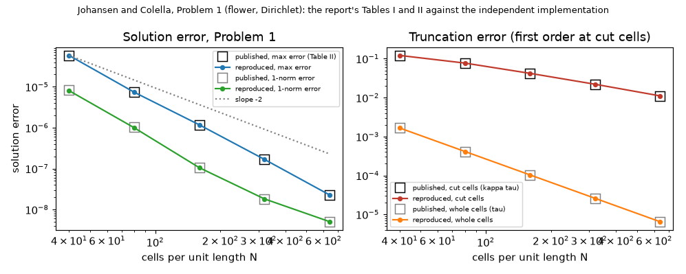

*Figure 13 (`figures/fig_13_jc_published_vs_reproduced.png`): Problem 1 of Johansen and Colella, the published errors (squares) and those of the independent implementation `lib/jc_poisson.py` against the cells per unit length (`docs/literature.md` 3).*

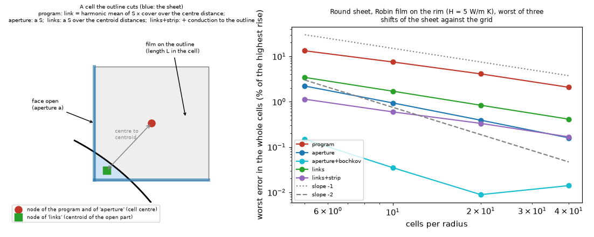

*Figure 14 (`figures/fig_14_cut_cell_schemes_film_boundary.png`): a cut cell with the nodes of the five schemes, and their error in the whole cells against the closed form of a round sheet with a film on its rim (`H` 5 W/mK) against the cells per radius (`docs/literature.md` 4).*

## 12. What was read and what was not verified

* **The review of sections 10 and 11 (11.8)**: re-run `study_cutcell_sweep.py square | harness | balance`, `study_cutcell_sources.py jc | sheet`, the new `study_turn_frame_reference.py` and the 34 tests of the folder; read `lib/fvm_cutcell.py`, `lib/cutcell.py`, `lib/cutcell_exact.py`, `lib/layered_disc.py`, `lib/sheet_robin.py` (the schemes) and `pcbthermal/fvm.py` (`Network.__init__`, `_harmonic`, `_assemble`, `solve_sor`); measured the area of the 8 x 8 cover at 18 to 45 degrees. The literature of `docs/literature.md` was not re-opened by the review; its reproduction of Johansen and Colella was re-run, not re-read against the page images. Not re-run: see 11.8.
* **Section 11, what was read and run**: no new source was opened (the cut-cell reading of section 10 and `research/theory/BIBLIOGRAPHY.md` stands). Run: `scripts/study_cutcell_sweep.py square | patterned | smallcell | balance | harness` and `study_cutcell_capacity.py` (new) and `scripts/study_cut_cells_fvm.py rect | square | disc | tee | cost` (rerun; the schemes `program@exact`, `links@exact`, `links+strip@exact` added), outputs in `out/` (`square.txt`, `patterned.txt`, `harness.txt`, `tee.txt`, `disc.txt`); `scripts/study_cutcell_capacity.py` (the capacities and the slowest time constant of 11.3). Tests: `tests/test_fvm_cutcell.py` now 14 (the study folder's 34 pass). **Defects in the investigation's own code found and fixed in this round**: the section-10 prototype was a copy of `_assemble` as it was when section 10 was written and ran the point SOR on the program's links after `develop` moved (rebuilt, with a test that the SOR sees the cut-cell links); the first sweep moved the part with the board and read the cell-centred read-out of the peak (3 K) as an edge effect (the part is now fixed on a cell centre); the first reference for the turned small boards used the aligned board and ranked the schemes wrongly (each turn now has its own fine-cell value). **Not verified**: see 11.7.
* **Sections 2 to 9: no external source was opened** (the literature check of the cut cells came later: `docs/literature.md`, statuses in `research/theory/BIBLIOGRAPHY.md`). The question is internal to the program's grid: the reference is the invariance of the continuum problem under a translation and a rotation, the modified Bessel solution of a thin plate with a disc source (used only to check `lib/axisym3d.py`; the formulas are the standard `I0, K0, I1, K1` solution, written from memory and checked numerically by the test to 0.2 %), and the series circuit. Nothing was added to `research/theory/BIBLIOGRAPHY.md`.
* **Read in full in the repository**: `pcbthermal/solid3d.py` (slab construction, links, edge term), `pcbthermal/geometry.py` (`edge_length_per_cell`, `edge_length_on_board`, `coverage_fraction`), `research/outline/README.md` (4.6), `research/outline/scripts/study_disc_reference.py` (the layered radial reduction, which `solve_layered_disc` repeats with its own constants), `docs/theory.md` as quoted in `CLAUDE.md`. The cut-cell finite-volume scheme (face apertures, centroid distances) is the standard idea of cut-cell methods; no paper was opened for it and none is cited.
* **Reproduced**: every table above by the script named in its section (outputs in `out/`, git-ignored); tests `tests/test_rotated_square.py` (12 tests: 9 of the study, 3 added by the review).
* **Not verified**: the original +1.15 K setup; patterned copper, vias and blocks against any reference; the 45 degree residual of the board turn (+0.2 to +0.4 K left with an 8 x 8 footprint, not removed); (the independent square, the T board and the turned part were checked by the review, section 9); whether the 16 x 16 sampling is the right resolution (the cover itself converges as 1/256; the sensitivity to `m` was not swept); the program's FVM and FDM at cells finer than 0.125 mm.
* **Section 10 (cut cells in the layered FVM), what was read**: Johansen and Colella, LBNL-39908 (the report version of the 1998 paper), pages 1 to 11 in full (R): the partial-face flux with the aperture (eq. 15, 16), the divergence over the volume fraction (eq. 14), the error analysis of a partial cell and the conditioning argument (Figure 2); the multigrid, adaptive refinement and numerical tests (pages 12 to 28) **not read**. Berger and Helzel (2012), the abstract and introduction only (R, hyperbolic explicit schemes: used for the small-cell remark only). Ingram, Causon and Mingham (2003): abstract only (S; the authors are Ingram, Causon and Mingham, not Zhang). Schwartz and others (2006, heat equation in 3D) and Crockett, Colella and Graves (2011): not obtained (N / M). All in `research/theory/BIBLIOGRAPHY.md`. **No published numerical case was reproduced in section 10** (*the later literature check reproduced Problem 1 of Johansen and Colella, `docs/literature.md` 3, review 11.8*): the references are an own closed form (cosine series, `lib/sheetmodes.py`), an own axisymmetric reduction (`lib/layered_disc.py`) and the program at a finer cell.
* **Section 10, reproduced and tested**: every table of section 10 by `scripts/study_cut_cells_fvm.py` (tier light: `rect`, `disc`, `tee`, `square`, `cost`, `sens`; outputs in `out/cutfvm_*_light.json`), measured peak 0.55 GB (the 1/12 mm reference of the small T); figures 9 to 11 by `scripts/make_diagrams.py` and figure 12 by `scripts/make_figures.py`; 11 new tests in `tests/test_fvm_cutcell.py` (fast geometry equals the full sampling, the half-cell edge has centroid a quarter cell inside and aperture one, rectangle matrix equals the program's, an outline on grid lines gives the program's temperatures, energy balance of every variant, shift dependence removed, the closed form against the FVM and its power conservation, the disc, blocks refused, the transient). **Not verified**: heavy references (10.8), the FDM variant, vias, patterned copper and blocks on a cut edge, the re-entrant corner cause, the 17 boards of the frozen-number harness, whether the half-cell conduction of `links+strip` is nearer the continuum; the prototype was not reviewed.
* **Defect in the investigation's own code (section 10), found and fixed**: the first comparison with the axisymmetric reduction used the centre value and ranked the variants wrongly (see 10.2); the sampling of the geometry over the whole grid was 100 times slower than needed and was replaced by the cut-cell sampling (`cut_geometry_fast`, equal to the full one in a test).
* **Defect in the investigation's own code, found and fixed**: the first cut-cell copy conducted heat into the cells taken as off the board (cover below 0.01) through the apertures of their faces: it lost 22 % of the power and read 4 K cool on a turned square at the finest cell; the apertures of cells off the board are now zero and a test checks the energy balance.
