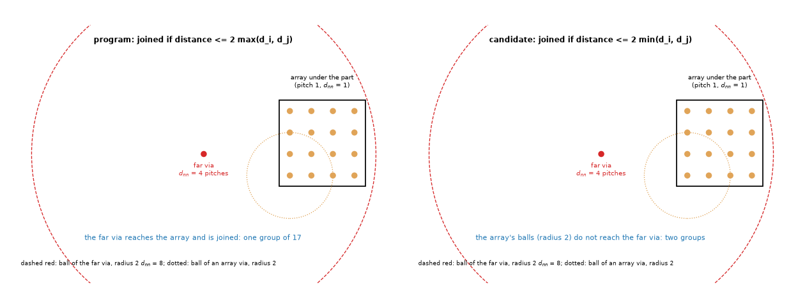
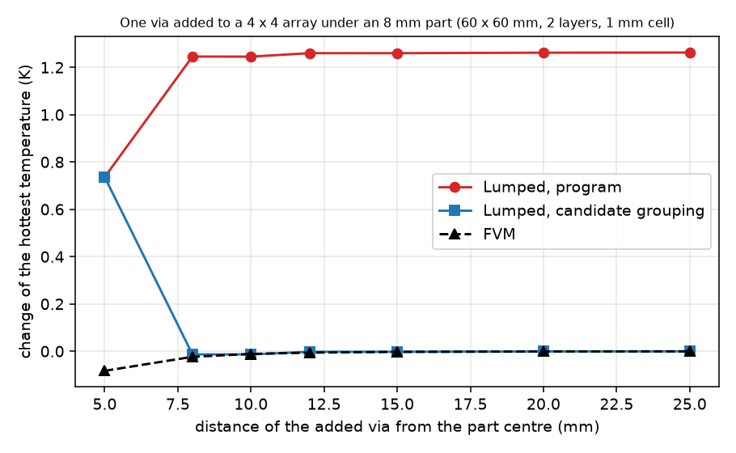
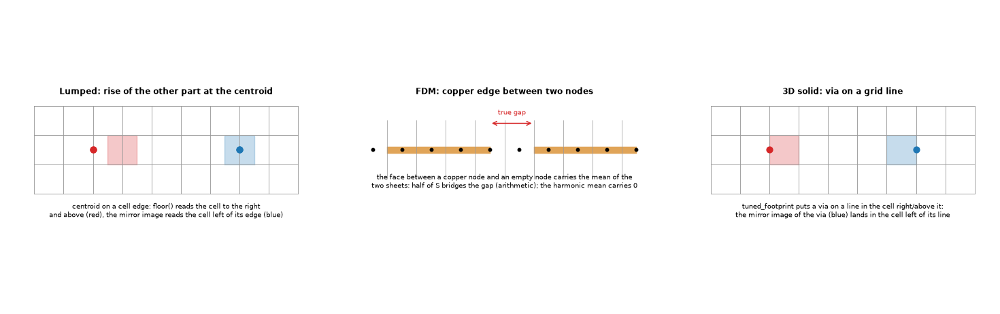
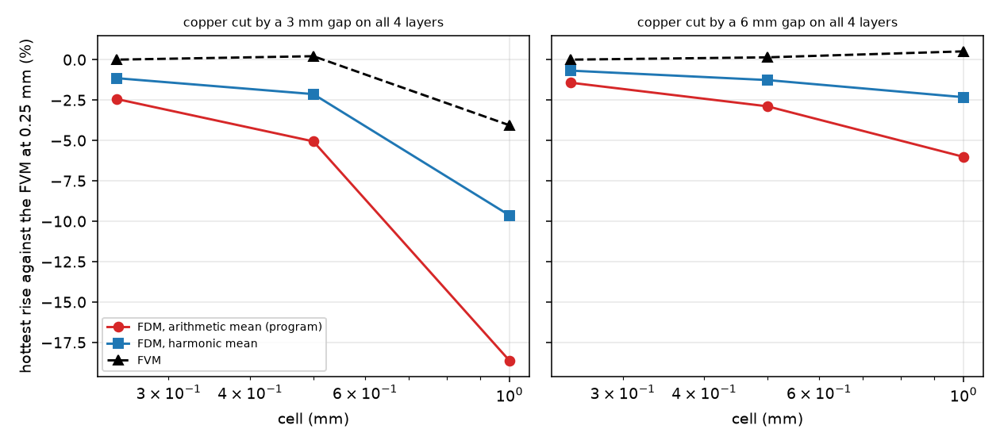
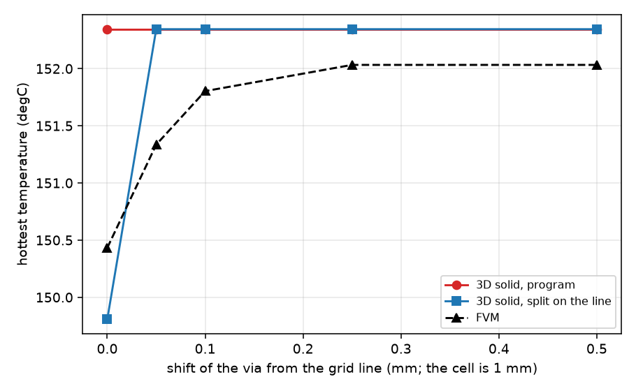

# Three small model defects: a far via in the Lumped model, the mirror symmetry and the FDM on separate zones, a via on a grid line in the 3D solid

Three suspected defects listed in `docs/versions.md` ('Fixes waiting for a study'). The program is not touched: every candidate is a wrapper of `lib/` applied to a copy in
memory (or an option the program already has). Numbers are those printed by the scripts of `scripts/`; the tests are in `tests/test_small_defects.py` (9 tests, about 2 s).
Every board is made by the program's own builder; the independent references are the FVM at a finer cell (the 3 mm and 6 mm gap boards are converged to 1 to 2 % at 0.25 mm,
section 3.2), the mirror image of the same board (exact for a symmetric method), and the FVM change of the hottest temperature when a far via is added (zero to 0.01 K).
No literature was needed: the three items are questions about the code.

**Status of the items** (review, section 4): item 1 (far via in the Lumped) is **implemented** (`fix/lumped-via-groups-lone-via`, reviewed, merged into `develop`); item 2b (FDM harmonic
face mean) is **implemented** (`fix/fdm-harmonic-face-mean`, reviewed, merged); item 2a (Lumped mirror asymmetry, 0.09 K) is **optional, not adopted** (a symmetry fix that moves the example board 0.065 K
away from the FVM); item 3 (3D solid, via on a grid line) **stays a limit** with the sentence of section 4.3. The 'program' columns of sections 1 and 2.2 are the program before those two fixes.

## 1. The Lumped model heats when a via is added far from the heater

*Figure 1 (`fig_01_grouping_rule.png`): the grouping rule of `viaconstriction.via_groups` on a 4 x 4 array and a via 4 pitches away. Left, the program: joined when the distance is at most
twice the larger of the two nearest-neighbour distances; right, the candidate, the smaller.*

### 1.1 Reproduction (not at the first attempt)

The case of the list was not reproducible on the boards tried first: a part alone on a board, a lone via under it, the three example boards, 40 random boards with partial copper
and a via at a random place (0 to 0.16 K cooler, as the FVM). It appears **only when two or more vias are already under the part** (`study_far_via.py`, 60 x 60 mm, 2 layers, 8 mm
part, 1 mm cell, one via 25 mm from the part centre):

| vias under the part | FVM (K) | Lumped (K) | Analytic (K) | group of the far via |
| :-- | --: | --: | --: | :-- |
| 0 | -0.001 | -0.001 | -0.001 | alone (d_nn infinite) |
| 1 | -0.001 | -0.001 | -0.001 | 2 of 2 (the pair is a group, no zone) |
| 2 | -0.001 | **+0.646** | -0.001 | 3 of 3 |
| 4 | -0.001 | **+1.032** | -0.001 | 5 of 5 |
| 16 | -0.000 | **+1.263** | -0.000 | 17 of 17 |

A 4-layer board shows nothing (-0.002 K for 16 vias; not explained, the effect is zero there). The same size as the list (0.80 to 0.89 K) is in the range; the exact board of the list is not known.

### 1.2 Cause

`via_groups` joins two vias when their distance is at most `2 max(d_i, d_j)` (`d` the nearest-neighbour distance). A via far from everything has a large `d`, its ball of radius
`2 d` reaches the array and the far via becomes a member of the group of the array (17 of 17 above, at any distance from 8 to 25 mm). `ring_couplings` then takes the group's
`r_cell_g` from the mean of the `d_nn` of its members, `n_g` from its count and the macro disc from `sqrt(n_g)`: the 16 vias that conduct are diluted by a member that conducts
nothing under the part, and the cluster term weakens (the Lumped via effect falls and the result heats). Controlled experiments (`study_far_via.py`): the heating is the same, +1.245 to +1.263 K,
from 8 to 25 mm; it vanishes when the far via is replaced by two (a pair beyond the array stays out of its group, +0.00), as the groups then differ; the Analytic, which reads the same groups
only for its tiles, does not move.

*Figure 2 (`fig_02_far_via_distance.png`): the change of the hottest temperature against the distance of the added via. Red, the program; blue, the candidate; black, the FVM.*

### 1.3 Candidate (smallest fix)

Join two vias only when the distance is at most twice the **smaller** of the two distances (both balls must reach each other), and set the nearest-neighbour distance of a via that stays
alone to infinity (as for a board with one via, the documented convention of `nearest_neighbour`), so that a lone via does not depend on the others. About 10 lines in
`viaconstriction.ViaSet.__init__` and `via_groups` (`lib/grouping.py`).

| check | program | candidate |
| :-- | --: | --: |
| 16 vias + one far via, 1 mm, 2 layers | +1.263 K | -0.000 K |
| 40 random boards (cluster under the part + 1 to 6 vias elsewhere, 0.5 mm): Lumped error of the change against the FVM, mean abs | 1.027 K | 0.001 K |
| the same, worst | 4.776 K | 0.006 K |
| the same, boards where the candidate is worse by more than 0.05 K | | 0 of 40 |
| regression-harness boards (17 boards, 2, 1, 0.5 mm; Lumped and Analytic) | | **0 of 25** runs move |

*Limit that stays:* a via just outside the cluster (1 pitch from its edge, 5 mm from the part centre) is a member of the group by any rule and the Lumped reads +0.74 K
against the FVM -0.08 K (figure 2, first point); it is the same dilution, smaller, and the real group-membership question (a via of the group that is not under the footprint).

## 2. Mirror symmetry of the Lumped and the FDM below the FVM on separate zones

### 2.1 Lumped mirror asymmetry

`study_separate_zones.py`: 4 layers, 80 x 50 mm, two separate top zones with a part each (2 W and 1 W), inner planes and bottom plane; the board and its mirror image (x to W - x).

| | FVM | FDM | Lumped | Analytic |
| :-- | --: | --: | --: | --: |
| mirror difference, 1 mm cell (K) | 0.000 | 0.000 | **-0.090** | 0.000 |
| 0.5 mm | 0.000 | 0.000 | **-0.044** | 0.000 |
| one part only (1 mm) | 0.000 | 0.000 | 0.000 | 0.000 |

The size scales with the cell (0.09 K at 1 mm, 0.04 K at 0.5 mm), the sign changes with the gap (+0.084 at a gap of 2 mm), it is zero with one part and zero when the zones are far apart.
The 0.4 K of the list was not reproduced; it is probably the same effect with larger parts or cells.

**Cause.** `lumped.solve_steady` adds the rise of the other heaters at the centroid of heater `j` as `_radial(ri, ri["dist"][ij])` with `ij` the cell `floor(c / d)` that holds the centroid. A centroid
on a cell edge (22.0 mm at a 1 mm cell) is read in the cell to its right and above, whose centre is half a cell away; the mirror image reads the other side. Controlled experiment: shifting both
parts by 0.25, 0.5, 0.75 mm (the centroid inside a cell) makes the mirror difference exactly 0.0 (`test_lumped_mirror_is_exact_when_the_centroids_are_inside_cells`); with the bilinear interpolation of the distance raster at the centroid
(`lib/centroid_patch.py`) it is 0.000 K for gaps of 0, 2 and 6 mm at 1 and 0.5 mm.

*Figure 4 (`fig_04_causes_on_the_grid.png`): left, the centroid on a cell edge and its mirror image; middle, a copper edge between two FDM nodes; right, a via on a grid line in the 3D solid.*

**Effect of the candidate:** 9 of 51 Lumped records of the regression harness move, all in `example_board` / `profile_board` (+0.065 K at 2 and 1 mm, +0.032 K at 0.5 mm) and `example_cut_to_T`
(-0.065 / -0.024 K); the example board moves away from the FVM by 0.065 K (86.79 against 85.38 K), so the fix is for symmetry and not for accuracy. Value: low.
**Seen on the way (not a defect of this item):** a single part on a 1 mm raster reads 75.72 K with its edges on cell lines and 74.92 K with them 0.25 mm off (the FVM changes 0.13 K): 1 % of
the rise of sub-cell sensitivity of the footprint, recorded as a limit.

### 2.2 The FDM below the FVM across copper that is cut

In the family of 2.1 the FDM is within 0.2 to 0.7 % of the FVM. It is far below it only when the **copper is cut across the board** (a gap on every layer, so the heat crosses laminate only):
`study_fdm_gap.py` part A, 50 x 24 mm, 4 layers, a 6 mm 2 W part at distance d from the gap edge, error against the FVM at 0.25 mm (converged within 1 to 2 %):

| gap | cell | FVM (K rise) | FDM, arithmetic (program) | FDM, harmonic |
| :-- | --: | --: | --: | --: |
| 3 mm, d 1 | 1 | 114.90 | 97.44 (**-18.6 %**) | 108.22 (-9.6 %) |
| | 0.5 | 120.02 | 113.71 (-5.1 %) | 117.21 (-2.1 %) |
| | 0.25 | 119.77 | 116.84 (-2.4 %) | 118.39 (-1.1 %) |
| 6 mm, d 1 | 1 | 131.89 | 123.33 (-6.0 %) | 128.17 (-2.3 %) |
| | 0.5 | 131.41 | 127.43 (-2.9 %) | 129.56 (-1.3 %) |
| | 0.25 | 131.22 | 129.35 (-1.4 %) | 130.33 (-0.7 %) |
| no gap | 1 / 0.5 | 90.78 / 90.83 | 90.72 / 90.80 | same |

The FVM at 1 mm itself fails for a 1 mm gap (92.4 K against 106.6 K at 0.25 mm: the gap is one cell); that is the known cell limit, warned.

*Figure 3 (`fig_03_fdm_gap.png`): the error of the FDM (arithmetic and harmonic mean) and of the FVM against the converged FVM, against the cell.*

**Cause.** The FDM takes the face between two nodes as the **arithmetic** mean of the two nodal sheet conductances (`fdm._mean`). Between a copper node and an empty node that is half of `S`:
the copper edge leaks half of its conductance into the empty node, the gap acts about one cell narrower (first order in the cell: the error halves with the cell, 18.6 / 5.1 / 2.4 %). The FVM
uses the harmonic mean (0 between copper and nothing). **Controlled experiment:** the FDM already has the option `mean="harmonic"`; with it the error is about half (9.6 / 2.1 / 1.1 %), and
equal to the arithmetic one where nothing changes (no gap; full copper; hatched copper to 1e-9 K).
On the harness boards with partial copper (`study_fdm_gap.py` part B, direct FDM against the FVM at 0.5 mm, errors of the rise over a 25 degC ambient): `plate_pad` -10.6 % at 1 mm and -6.0 % at 0.5 mm become
-4.2 % and -2.7 %; `one_layer_pad` -10.3 / -5.8 % become -4.0 / -2.6 %; `two_layer_partial` -1.4 / -0.8 % become -0.6 / -0.4 %: the 10 % at 1 mm and 5 % at 0.5 mm of the list are the `plate_pad` and
`one_layer_pad` numbers, so one of those is the most likely board (not proven). The residual -2 to -5 % is the first-order error of a node-centred scheme with the copper edge between nodes
(`docs/versions.md` 'Cut cells' (a): A32).

**Effect:** the FDM records of the harness move on 28 of 34 (board, cell) pairs (the 2 and 1 mm runs): `plate_pad` +36.8 K at 2 mm and +20.7 K at 1 mm, `one_layer_pad` +7.5 / +4.3 K, `two_layer_partial`
+1.6 / +1.1 K, `part_across_outline` +0.64 / +0.40 K, the outline and example boards +0.00 to +0.07 K, plate and via boards 0.0000 K. (`part_top_path` +8.1 / +5.1 K in the direct FDM call, which has
no top path; it must be re-measured through `api`.)

## 3. The 3D solid with a via on a grid line

### 3.1 Reproduction and cause

`study_solid3d_gridline.py`: 40 x 30 mm, 2 layers, a part, one via (or a pair, or 2 x 2) at x; mirror image of the whole board; 1 mm cell. The FVM and FDM differences are 0.000 K at every position.

| vias | via x (mm) | mirror difference of the 3D solid (K) |
| :-- | :-- | --: |
| 1 | 12.0 (on a line) | **+0.882** |
| 1 | 12.25, 12.5, 12.75 | 0.000 |
| 1 | 13.0 (on a line) | **-0.533** |
| 2 | 12.0 / 13.0 | +0.910 / -1.451 |
| 4 | 12.0 / 13.0 | +1.102 / -1.646 |
| 1, cell 0.5 mm | 12.0 / 12.5 | +0.612 / +0.644 |

The difference is 0.4 to 1.2 % of the rise (142 K) and needs the via **exactly** on a line: 1e-9 of a cell away it is zero. `viawell.tuned_footprint` returns, for a via that is smaller than a point sink
of the grid (a cell coarser than about 1.5 drill diameters), the cell `floor((x - origin) / dx)`: for a via on a line that is the cell above and to the right; the mirror image of the board puts
it in the cell left of the mirrored line. For every other position `floor` commutes with the mirror (the table). The line is also the one of **y** (the same board has the via at y = 15.0, on a line:
this is why the 12.5 mm via changes by 0.66 K under the candidate, 167.29 to 166.63 K).

### 3.2 Candidate and its price

Split the point footprint equally over the 2 (or 4) cells that share the line (`lib/solid_gridline.py`, only for `abs(x/dx - round(x/dx)) < 1e-9`): mirror difference **0.000 K** in all rows above.
But it makes an on-line via a different representation from an off-line one (`study_solid3d_scatter.py`, `plate_lone_via`, 1 mm): the 3D solid is **constant** for a via inside a cell (152.345 K for a shift of
0.1, 0.25, 0.5 mm) and the split on the line reads 149.807 K, **2.5 K** lower; at 2 mm 153.354 against 151.003 K (2.35 K). The FVM, whose footprint is not a floor cell, jumps in the same way
(150.43 K on the line, 151.80 and 152.03 K at 0.1 and 0.25 mm): the 3D solid with the split on the line is nearer the FVM there (149.8 against 150.4), the program nearer off the line (152.3 against 152.0).
So the program trades a mirror asymmetry (0.5 to 1.6 K at 1 mm) for a jump that it does not have; the split trades it back. **Neither is a clear win**: a position-smooth footprint (cloud in cell over
the four nearest cells for every via) would remove both but changes every via record of the 3D solid.
**Frozen records moved by the split:** 8 of 34 3D-solid records of the harness (2 and 1 mm): `example_board` and `profile_board` -1.39 / -1.65 K, `example_cut_to_T` -0.71 / -1.27 K,
`plate_lone_via` -2.35 / -2.54 K.

*Figure 5 (`fig_05_solid3d_via_shift.png`): the hottest temperature of the 3D solid for a lone via moved by a fraction of a 1 mm cell, with and without the split, and the FVM.*

## 4. Review

Independent review (re-run on the research branch with `develop` merged in, which now holds the fixes of items 1 and 2b; the program is not edited: `git diff develop...HEAD -- pcbthermal tests
examples ico` is empty).

### 4.1 Items already implemented

* **Item 1** was reviewed on its `fix/` branch. Here: with the fixed program the far via no longer heats the Lumped model (16 vias + one at 25 mm, 2 mm cell: -0.0004 K), and
  `viaconstriction.via_groups` gives the far via its own group, as the candidate of `lib/grouping.py`. The two tests of the folder that held the old behaviour (the far via joined to the cluster,
  +1 K) failed after the merge, as they should; they now hold the fixed behaviour (`tests/test_small_defects.py`, 9 passed). The 4-layer silence of 1.1 is not explained (not studied).
* **Item 2b** was reviewed on its `fix/` branch, with the FDM numbers of the documents re-measured there. Here: `study_separate_zones.py` now prints the FDM with the harmonic mean, the FDM
  column moves up by 0.03 to 0.92 K (the ratio FDM/FVM goes from 0.978 to 0.990 on the board without inner planes and bottom copper, and to 0.998 or 0.999 elsewhere); the mirror columns are unchanged. Section 2.2 is
  kept as the record of the arithmetic mean.

### 4.2 Items reviewed here

* **2a, Lumped mirror asymmetry.** Re-run `study_separate_zones.py`: every Lumped mirror difference reproduced (-0.090 / -0.044 K at 1 / 0.5 mm, +0.084 at a gap of 2 mm, 0.000 with one part,
  0.000 with an offset of 4 mm). Code read: `lumped.solve_steady` reads `ri["dist"]` in the floor cell of the centroid; a centroid on a cell edge is read half a cell away, so the claimed cause holds.
  `study_frozen_impact.py` re-run: byte-identical to `out/frozen_out.txt` (9 of 51 Lumped records move with the interpolated read, +0.065 K on the example board, which then reads 86.85 against the
  FVM's 85.38 K). Recommendation unchanged: optional, low value; the transient cross terms read the same floor cell and would need the same change.
* **3, the 3D solid with a via on a grid line.** Re-run `study_solid3d_gridline.py` and `study_solid3d_scatter.py`: the mirror differences (+0.882, -0.533, +0.910 / -1.451, +1.102 / -1.646 K at
  1 mm, +0.612 / +0.644 at 0.5 mm) and the jump of the split (2.54 K at 1 mm, 2.35 K at 2 mm) reproduced to the digit; the 8 3D-solid harness records of the split reproduced. The FVM also jumps
  by 1.37 K when the lone via moves 0.1 mm off the line at 1 mm (150.43 to 151.80 K, about 1 % of the rise): its footprint is not a floor cell but it is not position-smooth either; recorded,
  not studied. Which representation is nearer a resolved barrel was **not** measured (no independent 3D reference was run on these boards), so 'neither is a clear win' stays a reading of the
  program against itself; a limit, not a fix, is the right call for a 0.4 to 1.2 % effect that needs the via exactly on a line.

### 4.3 The sentence for the documents (item 3)

For `docs/theory.md` (the 3D solid, via footprint) and `docs/validation.md` (the 3D solid limits):

"When the drill of a via is smaller than the point sink of the grid (a cell coarser than about 1.5 drill diameters) the 3D solid puts the barrel in the one cell `floor((x - x0)/dx)`,
`floor((y - y0)/dy)`; a via exactly on a cell line is therefore placed in the cell above and to the right, and the mirror image of the board reads differently: 0.5 to 1.6 K at a 1 mm cell
(0.4 to 1.2 % of the rise) on a two-layer test board, 0.6 K at 0.5 mm. A via off the line by any fraction of a cell is not affected; to compare a board with its mirror image, move such a via by a
fraction of a cell (`research/small-model-defects` 3)."

### 4.4 Verdict

**GO** for closing the investigation: items 1 and 2b are in the program, 2a is left optional (the maintainer's decision, measured impact above), 3 is a limit with the sentence of 4.3 to be
written into `docs/theory.md` and `docs/validation.md` on a `docs/` or `fix/` branch.

## 5. What was read and what was not verified

* **Read:** the code of `viaconstriction.py` (`ViaSet`, `via_groups`, `ring_couplings`), `lumped.solve_steady`, `fdm._mean` and `Network`, `solid3d.Solid` and `viawell.tuned_footprint`, and the three
  items of `docs/versions.md`. No literature (none was needed); nothing of a third party is stored.
* **Reproduced:** item 1 on the boards of 1.1 (the board of the list is not known; the size 0.65 to 1.26 K matches); the Lumped mirror asymmetry (0.09 K, the list says 0.4 K); the FDM deficit (matches
  `plate_pad`-like boards); the 3D-solid asymmetry (0.4 to 1.6 K against the list's 0.36 K).
* **Not verified:** the converged FVM at 0.25 mm is the reference of the gap (a 1 to 2 % limit: its own 0.5 to 0.25 mm change); no independent 3D layered reference was run for the FDM and 3D-solid items
  (`tests/helpers/layered3d.py` exists and would settle 3.2 and the residual of 2.2); the 4-layer silence of item 1; the through-`api` effect of the harmonic mean on `part_top_path`; the transient and
  animation FDM with the harmonic mean; the boards with imported copper and the harmonic mean.
* **Limits:** all boards are rectangles with a single heater layer; item 1 is for the Lumped steady solve (the transient reads the same `ViaSet`: not run).
