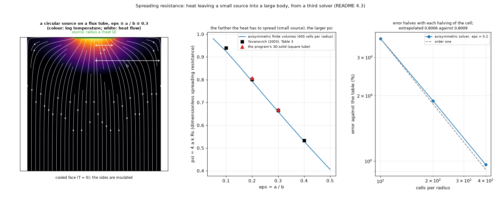
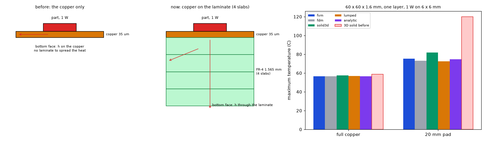

# The 3D solid and the layered models: verification against exact and independent references

Status: **implemented** in the program (see the program's `docs/versions.md` and `docs/validation.md`). Studies: `solid3d_verification.py`, `fem3d_validation.py`, `copper_dissipation.py`, `study_block_against_fem.py`, `study_small_pad_convergence.py`, `study_spreading_axisymmetric.py`, `study_one_layer_board.py`; figures: `make_figures.py` (data) and `make_diagrams.py` (schematics). Reviewed by the reviewer agent on 2026-10-24 on the program of `develop` at `0ea5f07` (section 7).

## 1. The questions

1. Does the program's own 3D solid (`pcbthermal/solid3d.py`) reproduce an exact solution and converge with the mesh?
2. How far are the layered models (FVM, FDM, Lumped, Analytic: one node per copper layer) from a real 3D solution, for uniform boards, small copper pads, vias, heatsinks and metal blocks?
3. Does the outer copper dissipate and spread heat like a heatsink, and where do the models fail?

### 1.1 Diagrams and illustrations


*Figure 4 (`figures/fig_04_layered_vs_3d_schematic.png`): The layered models against the 3D solid: 1, one node per copper layer with the sheet conductance in the plane and a conductance between nodes; 2, the 3D solid with real slabs, several laminate slabs per gap and a via as a copper rod; 3, the verification ladder from exact solutions to an independent finite-element solution.*


*Figure 8 (`figures/fig_08_heat_spreading_layered_and_3d.png`): heat spreading under a small heater: one node per copper layer in the layered models, a fan inside the laminate in the 3D solid, and a one-sided copper pad that dissipates by itself.*

## 2. Findings in short

* The 3D solid reproduces Yovanovich's (2003) spreading resistance of a circular isoflux source within 0.7 to 0.8 % (ε = 0.2, 0.3; 2 % at ε = 0.1, where the source has three cells) and converges at about second order (observed 1.68, GCI of the fine mesh 1.14 %). The table itself is reproduced to its four digits by the exact Bessel series, and the exact series of the square tube that the 3D solid actually solves is 0.2 to 0.4 % above the table: the square tube is about a third to a half of the gap, the mesh the rest (4.1).
* On a uniform board the four layered models land on the 3D answer within 0.7 %; with vias and a heatsink (the example board) within 1.5 %; the FVM follows an independent 3D finite-element solid within 2.5 % for any pad of 20 mm or more (2.2 % with solid bottom copper, 2.5 % on a one-sided pad); a metal block is within 1.8 % (FVM, FDM) and 0.2 % (3D solid).
* On a one-sided pad hardly larger than its heater the two 3D models bracket the converged value (finite volumes high, finite elements low; both extrapolate to about 508 °C), and the program's 3D solid agrees with the independent finite-volume solver of `lib/` to 0.1 °C (4.2.1).
* The **Lumped and Analytic models are unreliable for a one-sided copper pad without vias** (Lumped up to +107 %, Analytic up to −63 %); the input checks warn.
* The outer copper dissipates and spreads by itself; a heatsink works through the copper under it.
* **A defect found in a later review, now corrected in the program** (4.4): on a one-layer board the 3D solid had no laminate (only the copper), so a 20 mm pad read 120 °C against about 74 °C; with the laminate it reads 81.9 °C, and an independent 3D solver with patterned copper puts the corrected 3D solid within 0.2 % on a 20 mm pad (the old one +40 %).

## 3. Folder layout

| File | What it is |
| :-- | :-- |
| `scripts/solid3d_verification.py` | The analytical benchmark (Yovanovich) and the grid-convergence study of the 3D solid. |
| `scripts/fem3d_validation.py` | The independent 3D finite-element solid (scikit-fem, **not** in `requirements.txt`: `pip install scikit-fem`), also used by `models-comparison/validation_study.py --fem`. |
| `scripts/copper_dissipation.py` | The pad-size sweep and copper against heatsink, in every model and the FEM (`--fem`). |
| `scripts/study_block_against_fem.py` | The metal-block table of 4.2 (FVM, FDM and the 3D solid against the FEM; added by the review, no script printed it before). |
| `scripts/study_small_pad_convergence.py` | Mesh convergence of the two 3D models on the heater-sized and 20 mm one-sided pads, and the same pads in the independent solver of `lib/` (4.2.1; about 10 minutes). |
| `scripts/study_spreading_axisymmetric.py` | The axisymmetric finite-volume solver of the spreading resistance (third independent check of Yovanovich's table); writes `out/spreading.json` (git-ignored). |
| `scripts/study_one_layer_board.py` | A one-layer board in the five models and the 3D solid without its laminate (part 1), and every model against the independent solver before and after the laminate nodes (part 2; about 2 minutes). |
| `lib/layered3d.py` | The independent 3D finite-volume solver (a copy of `research/effective-conductivity/lib/layered3d.py` on the research branch). |
| `scripts/make_figures.py` | Draws the data figures 1 to 3, 5, 6 and 7 (needs scikit-fem for the third and the output of the axisymmetric study for the sixth; re-runs `study_one_layer_board.py` for the fifth unless `--reuse`; about 4 minutes). |
| `scripts/make_diagrams.py` | Draws the schematic diagram and the illustration (figures 4 and 8; no data, no program; uses `research/diagram_kit.py`). |
| `docs/for-the-project-documents.md` | The corrections the review found for `docs/validation.md` (sections 3, 3.1, 16, 20), to apply on a branch off `develop`. |
| `figures/` | `fig_01` to `fig_08` (figure 5 is the one-layer check against the independent solver, 6 explains spreading resistance, 7 is the one-layer board); figures 4 and 8 are the diagram and the illustration (`make_diagrams.py`). |

## 4. How to run, and the results

```sh
.venv/bin/python research/solid3d-verification/scripts/solid3d_verification.py      # about 25 seconds
.venv/bin/python research/solid3d-verification/scripts/copper_dissipation.py --fem  # about 45 seconds, needs scikit-fem
.venv/bin/python research/solid3d-verification/scripts/study_block_against_fem.py  # metal-block table of 4.2, about 1 minute, needs scikit-fem
.venv/bin/python research/solid3d-verification/scripts/study_small_pad_convergence.py  # 4.2.1, about 10 minutes, needs scikit-fem
.venv/bin/python research/solid3d-verification/scripts/study_spreading_axisymmetric.py # section 4.3, about 20 seconds
.venv/bin/python research/solid3d-verification/scripts/study_one_layer_board.py     # section 4.4, about 40 seconds
.venv/bin/python research/models-comparison/scripts/validation_study.py --fem       # the four-board table of 4.2, about 5 minutes
.venv/bin/python research/solid3d-verification/scripts/make_figures.py              # about 4 minutes
.venv/bin/python research/solid3d-verification/scripts/make_diagrams.py             # figures 4 and 8
```

### 4.1 Verification of the 3D solid: Yovanovich and grid convergence

`python research/solid3d-verification/scripts/solid3d_verification.py` (and `tests/test_solid3d_verification.py`). Two checks that do not use another solver of this project.

**Analytical benchmark.** The spreading resistance of an isoflux circular source of radius `a` on a long cylinder of radius `b` (insulated sides, cooled at the far end) is tabulated by Yovanovich (2003, Table 3) as `ψ = 4 a k Rs` against `ε = a/b` (the mean source temperature minus the one-dimensional resistances). The 3D solid solves a square block of the same area (`b = W/√π`, 50 mm, `k = 1` W/mK, thickness `1.5 b`, 40 slabs, cell 1 mm, 96-sided circle):

| ε = a/b | Table 3 (isoflux) | exact series, circular tube | exact series, square tube | 3D solid | 3D solid against the table | against the square tube |
| --: | --: | --: | --: | --: | --: | --: |
| 0.2 | 0.8009 | 0.8010 | 0.8027 | 0.8076 | +0.8 % | +0.6 % |
| 0.3 | 0.6649 | 0.6649 | 0.6676 | 0.6698 | +0.7 % | +0.3 % |

The two series columns were added by the review (2026-10-24): the closed form behind the table, `ψ = (16/(π ε)) Σ J1(δn ε)² / (δn³ J0(δn)²)` over the roots `δn` of `J1`, reproduces Table 3 to its four digits (0.9401, 0.8010, 0.6649, 0.5337 for ε = 0.1 to 0.4), so the table values used here are confirmed independently of the paper; and the double cosine series of the same source on the **square** tube of the same area (the problem the 3D solid actually solves; only even orders survive, the disc integral is `2π a J1(λa)/λ`) is 0.2 % (ε = 0.2) and 0.4 % (ε = 0.3) above the table. The earlier explanation "the square tube, the staircase circle and the subtracted one-dimensional resistances" is thereby measured: the square tube accounts for 0.2 to 0.4 points, the mesh (staircase circle, cells of 1 mm) for the remaining 0.3 to 0.6 points. For `ε = 0.1` the source is 2.8 mm across (three cells) and the difference grows to 2 %.

**Grid convergence.** A square source aligned with every mesh (8 mm on a 48 mm block, 40 mm thick, 16 slabs) with the cell size halved twice (4, 2, 1 mm): the mean source temperature per watt is 75.47, 71.02 and 69.62 K/W; the convergence is monotone, the observed order is 1.68, the Richardson extrapolation is 68.99 K/W and the grid convergence index of the fine mesh (Roache, safety factor 1.25) is **1.14 %**. A circular source on the Cartesian grid does not converge monotonically (the staircase boundary changes with the mesh), which is why the aligned square is used for the GCI.

**What this does and does not show.** The conduction, the cell-cover treatment, the vertical resolution of the slabs and the boundary conditions of the 3D solid reproduce a published exact solution and converge at about second order. It does not test the vias (rods of copper area), the metal blocks and the fins, the outline cover, or the convection coefficients; those are tested against the layered models and the independent finite-element script (section 4.2). A method of manufactured solutions was considered and not done: the solid has no source terms to fix.


*Figure 1: `figures/fig_01_spreading_resistance_vs_yovanovich.png` (the program's 3D solid at ε = 0.1 to 0.4 against the table and the exact series of the circular and square tubes; the text above quotes 0.2 and 0.3; at ε = 0.4 the 3D solid is +1.1 % from the table and +0.4 % from the square tube).*


*Figure 2: `figures/fig_02_grid_convergence.png`.*

### 4.2 The layered models against an independent 3D finite-element solid, and copper against heatsink

`python research/models-comparison/scripts/validation_study.py --fem` (scikit-fem, offline, not in `requirements.txt`).

**The 3D model** (`research/solid3d-verification/scripts/fem3d_validation.py`): a tensor mesh of trilinear hexahedral elements; copper slabs with their true thickness (one element across), FR-4 gaps with four elements across,
copper where a zone exists and FR-4 where it does not; anisotropic FR-4 (0.3 through, 0.9 in plane); convection on the top, bottom and edge facets; the heater as a heat flux on its footprint on the top face;
a heatsink as an extra coefficient on the bottom facets inside its polygon; **a via as a copper rod with the copper area of the plated barrel** (0.147 mm square for a 0.3 mm via with a 25 µm wall, since the wall itself is far below
the mesh), through the whole thickness, with mesh lines refined around every rod. It does not use the "one node per copper layer" idea of the four models, so it measures the error of that idea. Element size 1 mm in the board plane
(halving it moved the 4-layer full-copper case by 0.06 °C, 90.63 to 90.57 °C; 2 elements instead of 4 across the gaps by 0.001 °C, the earlier text said 0.02; re-run in the review with `solve_fem` directly, no script prints them).

Maximum temperature of the top face [°C] and error of every model on the rise (FVM and FDM at 0.5 mm; Lumped and Analytic with their default settings):

| Board | 3D FEM [°C] | FVM | FDM | 3D solid (FV) | Lumped | Analytic |
| :-- | --: | --: | --: | --: | --: | --: |
| 4 layers, full copper | 90.6 | 90.3 (−0.4 %) | 90.3 (−0.5 %) | 90.5 (−0.1 %) | 91.1 (+0.7 %) | 90.6 (−0.0 %) |
| 2 layers, 40 mm top pad | 112.2 | 111.5 (−0.8 %) | 111.2 (−1.2 %) | 112.4 (+0.2 %) | 112.1 (−0.1 %) | 106.8 (−6.2 %) |
| 2 layers, 20 mm top pad | 136.2 | 133.7 (−2.2 %) | 131.7 (−4.0 %) | 138.0 (+1.6 %) | 131.1 (−4.5 %) | 109.6 (−23.9 %) |
| example board (partial copper, 9 vias, bottom heatsink) | 85.6 | 85.9 (+0.5 %) | 85.2 (−0.6 %) | 85.6 (−0.0 %) | 84.7 (−1.5 %) | 84.7 (−1.5 %) |

**Metal block** (`scripts/study_block_against_fem.py`; a heatsink with a thickness; `research/solid3d-verification/scripts/fem3d_validation.py` models it as a gap-pad slab of conductivity 1 W/mK and thickness `R''` plus the block slab below the board, with its side faces losing heat too; 100 × 80 mm, 2 layers, full top copper, 5 W on a 10 × 10 mm heater at the centre, 30 × 30 mm copper pad on the bottom, aluminium block (204 W/mK) 60 × 60 × 3 mm with an interface of 5 K cm²/W unless stated, the board of `tests/test_blocks.py`; FVM, FDM and the 3D solid at 1 mm; error on the rise):

| Case | 3D FEM [°C] | FVM | FDM | 3D solid (FV) |
| :-- | --: | --: | --: | --: |
| no block (bottom pad only) | 134.2 | 133.2 (−0.9 %) | 132.6 (−1.5 %) | 134.3 (+0.1 %) |
| Al 3 mm, gap pad 5 K cm²/W | 115.5 | 115.0 (−0.5 %) | 114.9 (−0.6 %) | 115.4 (−0.0 %) |
| same, finned (extra h 60 W/m²K) | 99.7 | 99.0 (−1.0 %) | 99.0 (−1.0 %) | 99.6 (−0.2 %) |
| same, worse interface (20 K cm²/W) | 118.8 | 118.4 (−0.4 %) | 118.3 (−0.5 %) | 118.8 (−0.0 %) |
| Al 1 mm | 117.3 | 116.8 (−0.5 %) | 116.8 (−0.6 %) | 117.2 (−0.0 %) |
| Cu 3 mm | 115.3 | 114.8 (−0.5 %) | 114.8 (−0.6 %) | 115.3 (−0.0 %) |
| Al 3 mm 40 × 40 over a 50 × 50 mm pad | 120.4 | 119.4 (−1.0 %) | 119.0 (−1.4 %) | 120.4 (−0.0 %) |
| Al 3 mm 30 × 30 exactly over the pad | 129.3 | 128.1 (−1.1 %) | 127.4 (−1.8 %) | 129.5 (+0.2 %) |

The block is always within 1.8 % of the solid in the FVM and FDM and within 0.2 % in the program's 3D solid. *No script printed this table before the review of 2026-10-24 (it came from an earlier version of the FEM script); `study_block_against_fem.py` reproduces every number (the FDM "Al 1 mm" prints 116.8, the table had 116.7). The "finned" case is an extra coefficient, not the plate fins of the program; the FEM does not model plate fins.* (An earlier version of this script left unused nodes in the matrix of the solid and gave wrong numbers for blocks; fixed by pinning exactly the nodes that belong to no element.)

### 4.2.1 Does the outer copper dissipate and spread heat (against a heatsink)?

`python research/solid3d-verification/scripts/copper_dissipation.py [--fem]`. Board 100 × 80 mm, 2 layers, 5 W on a 10 × 10 mm heater on top, copper only on the top layer (a square pad centred on the heater), no vias, `h_top` 10 and `h_bottom` 15 W/m²K.
Maximum temperature [°C] against the 3D finite-element solid (error on the rise; the 3D FV column is the program's own `solid3d`):

| Top copper pad | 3D FEM | FVM | FDM | 3D solid (FV) | Lumped | Analytic |
| :-- | --: | --: | --: | --: | --: | --: |
| heater pad only (10 mm) | 495.3 | 472.4 (−4.9 %) | 420.9 (−15.8 %) | 533.1 (+8.0 %) | 652.7 (+33.5 %) | 201.1 (−62.6 %) |
| 20 mm square | 273.0 | 266.7 (−2.5 %) | 252.1 (−8.4 %) | 282.0 (+3.6 %) | 517.4 (+98.5 %) | 150.3 (−49.5 %) |
| 30 mm square | 202.6 | 199.7 (−1.6 %) | 193.8 (−5.0 %) | 205.9 (+1.9 %) | 392.9 (+107.2 %) | 145.9 (−31.9 %) |
| 40 mm square | 172.5 | 171.0 (−1.0 %) | 168.2 (−2.9 %) | 174.0 (+1.0 %) | 302.7 (+88.3 %) | 144.9 (−18.7 %) |
| 60 mm square | 150.3 | 149.6 (−0.6 %) | 148.8 (−1.2 %) | 150.6 (+0.2 %) | 200.1 (+39.7 %) | 144.2 (−4.9 %) |
| 80 mm square | 144.6 | 144.1 (−0.4 %) | 144.0 (−0.5 %) | 144.5 (−0.1 %) | 151.1 (+5.4 %) | 143.6 (−0.8 %) |

Copper against heatsink on the same board (40 mm area), FVM heat leaving the top face inside / outside the first copper zone (the 40 mm pad; in the last row the heater's own 10 mm pad, not the 40 mm heatsink area):

| Case | 3D FEM | FVM | FDM | 3D solid (FV) | Heat over the area [W] | Elsewhere on the top face [W] |
| :-- | --: | --: | --: | --: | --: | --: |
| 40 mm copper pad | 172.5 | 171.0 (−1.0 %) | 168.2 (−2.9 %) | 174.0 (+1.0 %) | 1.30 | 0.78 |
| pad + heatsink, extra h 30 W/m²K | 131.5 | 130.9 (−0.6 %) | 130.1 (−1.3 %) | 131.8 (+0.3 %) | 2.99 | 0.40 |
| pad + heatsink, extra h 100 W/m²K | 100.7 | 100.4 (−0.4 %) | 100.3 (−0.5 %) | 100.6 (−0.1 %) | 4.10 | 0.16 |
| heater pad only + heatsink 30 W/m²K on bare laminate | 340.7 | 324.6 (−5.1 %) | 285.6 (−17.5 %) | 369.6 (+9.2 %) | 1.16 | 2.48 |

What it shows:
* **The outer copper dissipates and spreads by itself**: the temperature falls monotonically as the pad grows (495 → 145 °C) and saturates (80 mm gains 6 °C over 60 mm), and the whole top face loses heat, pad and bare laminate alike (the heat found outside the 40 mm pad, 0.78 W, is heat that the copper carried to the laminate).
  The FVM follows the 3D FEM within 1 to 2.5 % for pads of 20 mm and more; the 3D FV solid is within 2 % from 30 mm (+3.6 % at 20 mm), and both 3D models bracket the converged value on the heater-sized pad (the convergence paragraph below).
* **A heatsink works through the copper under it**: the same 30 W/m²K heatsink gives 131 °C on the pad and 325 °C on bare laminate, because on the laminate there is no sheet to spread the heat in. The heatsink adds convection area; the copper provides the path to it.
* **Where the models fail**: with a pad hardly larger than the heater (an edge of copper across the footprint) the FDM loses 8 to 16 % (the grid sees the pad as a few nodes), and the **Lumped and Analytic models are unreliable** for a one-sided pad without vias or bottom copper (Lumped up to +107 %, Analytic up to −63 %); they assume copper around the heater on both faces or a uniform sheet. The input checks already warn about a copper edge crossing a heater; use the FVM for such boards.

The 3D value of the example board is converged: 85.57 °C with 1 mm elements (the earlier text said 85.55) and 85.59 °C with 0.5 mm (2 elements across each gap; re-run in the review with `solve_fem` directly).

The **3D solid (FV)** column is the program's own 3D model (`solid3d.py`, section 2.7 of `docs/models.md`; slabs of real thickness, 4 per gap; 0.5 mm cells in the four-board table of 4.2, 1 mm in the tables of 4.2.1): it lands within 0.2 % of the FEM on three boards and 1.6 % high on the 20 mm pad. Its numbers are also the closest to the FVM in the scenario table of `docs/validation.md` section 2 (within 0.3 % on the ordinary scenarios, +4.5 % with a copper edge across the heater, +2.4 % with no copper under it; that table is printed by `research/models-comparison/scripts/validation_study.py` and was not re-checked in this review).
**Convergence on a small pad**, where the two 3D models differ most (maximum temperature, `scripts/study_small_pad_convergence.py`, part 1; the board of `copper_dissipation.py`):

| pad | model | 1 mm, 4 per gap | 0.5 mm, 4 per gap | 1 mm, 8 per gap | 0.5 mm, 8 per gap |
| :-- | :-- | --: | --: | --: | --: |
| 10 mm | 3D solid (FV) | 533.1 | 522.9 | 530.2 | 519.1 |
| 10 mm | 3D FEM | 495.3 | 499.7 | 496.9 | 502.1 |
| 20 mm | 3D solid (FV) | 282.0 | 279.6 | 281.4 | 278.7 |
| 20 mm | 3D FEM | 273.0 | 274.0 | 273.4 | 274.6 |

The finite volumes fall and the finite elements rise with the mesh. Extrapolated from 1 to 0.5 mm (8 per gap) with order one assumed, both give the same limit: 508.0 and 507.3 °C on the heater-sized pad, 276.0 and 275.8 °C on the 20 mm pad (the earlier text said "about 510" and "about 277"); at 1 mm and 4 per gap the FV is then 5 % high and the FEM 3 % low (on the rise) on the extreme case, +2.4 % and −1.2 % on the 20 mm pad. The errors of the layered models quoted above are against the FEM at 1 mm; against the extrapolated limit the FVM is −3.7 % on the 20 mm one-sided pad (−2.5 % against the FEM) and the 3D solid +2.4 %.

**The same pads in the independent solver** (part 2; isotropic FR-4 of 0.3 W/mK and no edge loss, so that `lib/layered3d.py` represents the board; 8 slabs per gap):

| pad | model | 1 mm | 0.5 mm |
| :-- | :-- | --: | --: |
| 10 mm | independent (`lib/layered3d.py`) | 829.2 | 806.3 |
| 10 mm | 3D solid (FV) | 829.2 | 806.3 |
| 10 mm | 3D FEM | 762.0 | 773.5 |
| 20 mm | independent (`lib/layered3d.py`) | 362.7 | 357.8 |
| 20 mm | 3D solid (FV) | 362.7 | 357.8 |
| 20 mm | 3D FEM | 348.5 | 350.9 |

The program's 3D solid and the independent finite-volume solver (written separately, sharing no code) agree to 0.1 °C on both meshes: the assembly of the 3D solid (patterned copper, conductances, films, the film under the heater) is confirmed. They use the same kind of discretisation (cell-centred, harmonic means), so this does not test the discretisation error, which only the mesh sweep and the FEM bracket show; with order one assumed, FV and FEM again meet (783 and 785 °C, 352.9 and 353.3 °C).
Reading: on a uniform board the four layered models land on the 3D answer within 0.7 % (FVM, FDM and Analytic within 0.5 %). **With vias and a heatsink (the example board) all four are within 1.5 %**, and the FVM, with each via in one cell, is within 0.5 % of the 3D rods.
With a small copper pad the FVM follows the 3D solid within 2.2 %, the FDM and the Lumped within 4.5 %, and the Analytic loses accuracy exactly where its uniform-sheet assumption breaks (6 % with a 40 mm pad, 24 % with a 20 mm pad). The remaining 0.4 to 2 % of the FVM is attributed to
representing each copper layer by one node and the dielectric between two layers as a one-dimensional vertical resistance (the in-plane conduction of the laminate is carried at the temperature of the copper nodes, and the vertical gradient inside the gap is not resolved); this explanation was not measured separately.


*Figure 3: `figures/fig_03_copper_pad_models_vs_fem.png`.*

### 4.3 Spreading resistance explained, and a third independent check

Heat that leaves a small source into a much larger body has to spread out first, and the extra temperature rise that this costs is the **spreading resistance** `Rs` (K/W); `ψ = 4 a k Rs` makes it dimensionless (`a` source radius, `k` conductivity). The smaller the source compared with the body (`ε = a/b` small), the longer the path of the heat and the larger `ψ`. This is what happens under every heater of a board, and it is why the layered models use a sheet conductance in the plane.

`python research/solid3d-verification/scripts/study_spreading_axisymmetric.py` solves the same problem with a third, independent code: axisymmetric finite volumes (one radial coordinate, one axial, square cells, an isoflux disc on a flux tube of radius `b` and length `2 b`, insulated side, cooled far face), written for this study and sharing nothing with `pcbthermal/solid3d.py`. Results (`ψ`, 400 cells per radius):

| ε = a/b | Table 3 (isoflux) | axisymmetric solver | difference |
| --: | --: | --: | --: |
| 0.1 | 0.9401 | 0.9249 | -1.6 % |
| 0.2 | 0.8009 | 0.7932 | -1.0 % |
| 0.3 | 0.6649 | 0.6597 | -0.8 % |
| 0.4 | 0.5337 | 0.5298 | -0.7 % |

The solver converges at first order (the flux changes by a step at the edge of the source, which a cell-centred scheme resolves to one cell): at ε = 0.2 the values for 100, 200 and 400 cells per radius are 0.7716, 0.7857 and 0.7932, and the Richardson extrapolation (order one assumed, not measured) is **0.8006 against 0.8009**. The program's 3D solid is +0.8 % (0.8076) and +0.7 % at ε = 0.3: the table lies between the two solvers, which approach it from opposite sides (the square tube and the staircase circle of the 3D solid, the first-order edge of the axisymmetric one), so neither reproduces it to better than their own discretisation error.



*Figure 6 (`figures/fig_06_spreading_resistance_explained.png`): left, the temperature (colour, logarithmic) and the heat flow (white lines) of a circular source on a flux tube at ε = 0.3: the lines fan out under the source and become parallel farther down, and the hot region is the spreading; middle, `ψ` against ε from the axisymmetric solver, Yovanovich's table and the program's 3D solid; right, the error of the axisymmetric solver against the table as the cell is refined (order one).*

Limits: the flux tube of the table is circular, the 3D solid's is square; the extrapolation assumes first order; only the isoflux source is checked.

### 4.4 A one-layer board (a defect, corrected)

The 3D solid builds its slabs from the copper layers and the dielectric gaps; a one-layer board has no gap, so the board was its 35 µm of copper alone: no laminate to spread the heat sideways and nothing between the copper and the bottom face. The program now adds the laminate of the layered models (the slab minus the copper, FR-4 of the materials) as four slabs under the copper. `scripts/study_one_layer_board.py`, 60 × 60 × 1.6 mm, 35 µm copper, 1 W on 6 × 6 mm, 1 mm cells, maximum temperature in °C (the last column is the 3D solid on a board whose laminate is reduced to 1 µm, what it used to see):

| copper | FVM | FDM | 3D solid | Lumped | Analytic | 3D solid before |
| :-- | --: | --: | --: | --: | --: | --: |
| full copper | 57.35 | 57.35 | 57.38 | 57.77 | 57.09 | 58.72 |
| 20 mm pad | 79.94 | 76.49 | 81.92 | 75.82 | 75.64 | 119.97 |

With full copper the 3D solid and the layered models now agree within 1.2 % of the rise (FVM and FDM −0.1 %, Lumped +1.2 %, Analytic −0.9 %), and with a 20 mm pad the FVM is 3.5 % of the rise below the 3D solid (FDM −9.5 %, Lumped −10.7 %, Analytic −11.0 %): the layered models have two laminate nodes under the copper of a one-layer board (`pcbthermal/laminate.py`, `docs/validation.md` section 21); before them the bottom coefficient acted on the copper node itself and the FVM was 2.9 % and 11.8 % below (the 3D solid 3 % and 13 % above the FVM). *An earlier version of this sentence said "7 %" for the pad after the correction; the study prints 3.5 % (review of 2026-10-24).* An independent 3D finite-volume solver with patterned copper (`research/effective-conductivity/` section 4.11 on the branch `research/gerbers`; FR-4 isotropic at 0.3 W/mK so that both represent the same board, copper 385 W/mK, no edge loss, 0.5 mm cells) confirms it: with a 20 mm pad the 3D solid is +0.2 % of the rise from it (before the correction +40 %); with full copper both the corrected and the old 3D solid agree with it within 0.2 %, so full copper does not test the correction. The FVM is 0.9 to 4.4 % low with full copper (0.8 to 3.2 mm) and 10 % low with the pad, because its bottom film acts on the copper node and the laminate under it is missing (corrected since with two laminate nodes under the copper: 0.0 % with full copper and -2.5 % with the pad; `docs/validation.md` section 21). *An earlier version of this section quoted 33.71 K against 33.43 K (-0.8 %) from a check with mismatched copper and edge loss; it is replaced by these numbers.* Regression test: `tests/test_solid3d.py` (`test_a_one_layer_board_keeps_its_laminate`).

**Part 2: every model against the independent solver** (`lib/layered3d.py`, a copy of the solver of `research/effective-conductivity/` on the research branch, which reproduces published cases; FR-4 isotropic at 0.3 W/mK so that both represent the same board, copper 385 W/mK, films 10 and 15 W/m²K, no edge loss, 0.5 mm cells; the study's "before" switches the laminate nodes and the series film off and leaves the Lumped rings unmerged, and reproduces the numbers measured on the old code):

| copper | thickness (mm) | independent (K) | fvm | fdm | solid3d | lumped | analytic |
| :-- | --: | --: | --: | --: | --: | --: | --: |
| full | 0.8 | 33.71 | -0.9 -> -0.0 % | -0.9 -> -0.0 % | +0.0 -> +0.0 % | -2.5 -> -1.6 % | -1.0 -> -0.2 % |
| full | 1.6 | 33.71 | -1.9 -> -0.0 % | -1.9 -> -0.0 % | +0.0 -> +0.0 % | -3.5 -> -1.6 % | -2.1 -> -0.4 % |
| full | 3.2 | 33.84 | -4.4 -> -0.1 % | -4.4 -> -0.1 % | +0.0 -> +0.0 % | -5.9 -> -1.6 % | -4.5 -> -1.3 % |
| 20 mm pad | 0.8 | 78.56 | -6.1 -> -1.6 % | -10.7 -> -7.6 % | +0.1 -> +0.1 % | -20.3 -> -16.9 % | -36.7 -> -35.9 % |
| 20 mm pad | 1.6 | 72.12 | -10.0 -> -2.5 % | -13.5 -> -7.4 % | +0.2 -> +0.2 % | -20.3 -> -14.7 % | -30.5 -> -28.8 % |


*Figure 5: `figures/fig_05_one_layer_against_independent.png`: the error of the maximum rise of every model against the independent 3D solver, now (filled) and before the laminate nodes (dashed outline).*



*Figure 7: `figures/fig_07_one_layer_board.png`: left and middle, the cross-section as the 3D solid saw it (copper only) and sees it now (copper on four slabs of laminate, the heat reaching the bottom face through it; not to scale); right, the maximum temperature of the five models and of the 3D solid before the correction.*

## 5. Limits of this study

* The 3D finite-element solid and the 3D finite-volume solid share a modelling choice for vias (a copper rod of the barrel's copper area) and the fin ratio, so they do not test the vias and fins independently.
* Not tested by the benchmark: vias, metal blocks and fins, the outline cover, the convection coefficients (those are tested against the layered models and the FEM script).
* A method of manufactured solutions was considered and not done: the solid has no source terms to fix.
* No measurement of a physical board: every model has only been compared with other models and exact solutions.

## 6. Sources

Yovanovich, J. Electronic Packaging 125 (2003) 169 to 177, Table 3 (as cited in the header of `solid3d_verification.py`; title from memory in the last section); Roache, grid convergence index, ASME V&V 20 (method; the standard was not read, the formula is the common three-grid GCI with safety factor 1.25). Own computation for the rest.

## 7. Review of 2026-10-24 (reviewer agent)

Every study of the folder was re-run on the program of `develop` at `0ea5f07` (merged into `research/gerbers`), and every number of this README was compared with what the scripts print. What was found:

* **Wrong numbers, corrected**: 4.4 said the FVM was 7 % of the rise below the 3D solid on the one-layer 20 mm pad after the correction; the study prints 3.5 % (and 1.2 %, not 1 %, for the Lumped with full copper). Section 2 said the FVM follows the FEM within 2.2 % "for any pad of 20 mm or more"; the one-sided 20 mm pad of 4.2.1 is −2.5 %. 4.2.1 said the 3D FV solid is within 2 % for pads of 20 mm and more; it is +3.6 % at 20 mm. Figure 4 quoted "FVM 0.4 to 2.4 %, Lumped 2 to 7 %, Analytic 0.2 %" from an older run; the four-board table gives 0.4 to 2.2 %, 0.1 to 4.5 %, 0.0 % (redrawn).
* **Numbers no script printed**: the metal-block table and the small-pad convergence (they came from earlier versions of the scripts). Now printed by `study_block_against_fem.py` and `study_small_pad_convergence.py`; every value was reproduced (one rounding: FDM Al 1 mm 116.8, not 116.7). The "before" percentages of the one-layer part 1 are now printed by `study_one_layer_board.py`.
* **An explanation tested**: the 0.7 to 0.8 % of the 3D solid against Yovanovich's table was put on the square tube, the staircase circle and the subtracted one-dimensional resistances. The exact series of the square tube (added to `solid3d_verification.py`) shows the square tube is 0.2 to 0.4 points of it and the mesh the rest; the subtracted resistances play no part (they are exact). The Bessel series reproduces the table, so the table values no longer rest on the transcription alone.
* **Independent check added**: the program's 3D solid and `lib/layered3d.py` agree to 0.1 °C on one-sided pads at 1 and 0.5 mm (4.2.1), and the FV and FEM limits meet when extrapolated.
* **Study defects, corrected**: `fem3d_validation.py` read the block interface from `contact_r` and ignored a sheet given by thickness and conductivity (`interface_resistance()` now; no table used such a block, so no number moves); a dead variable and a stale docstring ("three models"); `copper_dissipation.py` had an unused `block` argument, and its last row reports the heat over the heater's own pad, not the 40 mm heatsink area (now stated); `make_figures.py` drew figure 5 from a cached `out/one_layer.json` that could be stale (now re-run unless `--reuse`), and its docstring named the diagrams 4 and 5 instead of 4 and 8; README heading "3.1" (copied from `docs/validation.md`) renamed 4.2.1, and cross-references to "section 3" fixed.
* **Program**: no defect found in `solid3d.py`. Read against `docs/theory.md` section 4 (one-layer laminate: `slab − copper` as `n_diel` FR-4 slabs, in-plane `k_fr4_inplane`, vias in parallel, the bottom film on the last slab, the outline cover applied to the laminate slabs) and consistent. A limit seen on the way: on a one-layer board a heatsink or block is always attached on the copper face (`face = 0 if L == 1` in `solid3d.py` and `blocks.py`, layer 0 in the layered models), so a heatsink on the bare laminate side of a one-layer board cannot be described; not measured.
* **Same stale numbers in the project documents**: `docs/validation.md` sections 3, 3.1, 16 and 20; the replacement text is in `docs/for-the-project-documents.md` of this folder (not applied: research branch).

## What was read and what was not verified

* Read: Yovanovich's Table 3 values were taken from the published table as recorded in the script (the paper itself was not re-read; its title, "Thermal resistances of circular source on finite circular cylinder with side and end cooling", is quoted from memory). The values are confirmed by the exact Bessel series computed here (section 4.1). Not verified: no measurement of a physical board.
* Reproduced: the axisymmetric solver was written and run here (section 4.3); every table of this README was re-run on 2026-10-24 (section 7).
* Not re-checked in the review: the scenario table of `docs/validation.md` section 2 quoted in 4.2.1 (printed by `research/models-comparison/scripts/validation_study.py`, reviewed with that folder); the FEM element-size checks of 4.2 and the example board at 0.5 mm were re-run by hand with `fem3d_validation.solve_fem` (about 11 minutes) and corrected (0.001 °C, 85.57 °C), but no script prints them.
* Not implemented: a time simulation of the 3D solid (steady state only); the FEM solid inside the program (it stays an offline cross-check, scikit-fem is not a dependency).
* One-layer board (4.4): the old behaviour is imitated by a board whose laminate is 1 µm thick, not by running the old code; the independent reference (with patterned copper) is in `research/effective-conductivity/` 4.11 and in `lib/layered3d.py` here.
