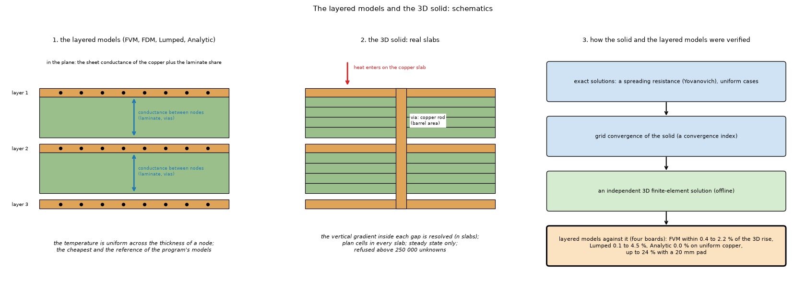
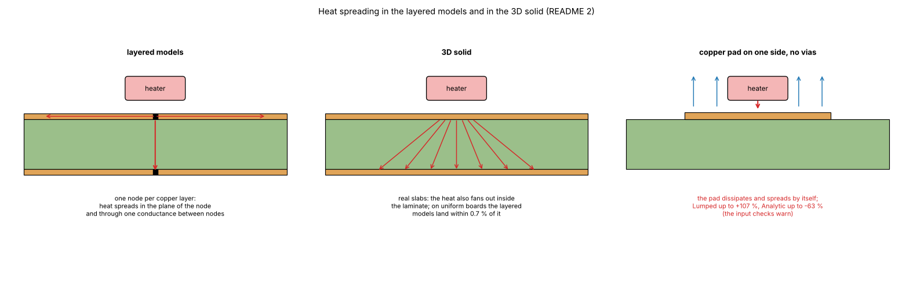
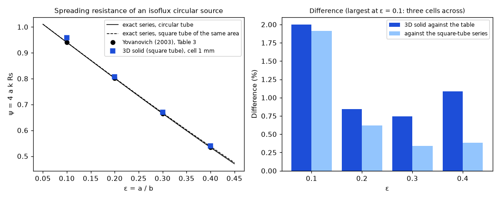
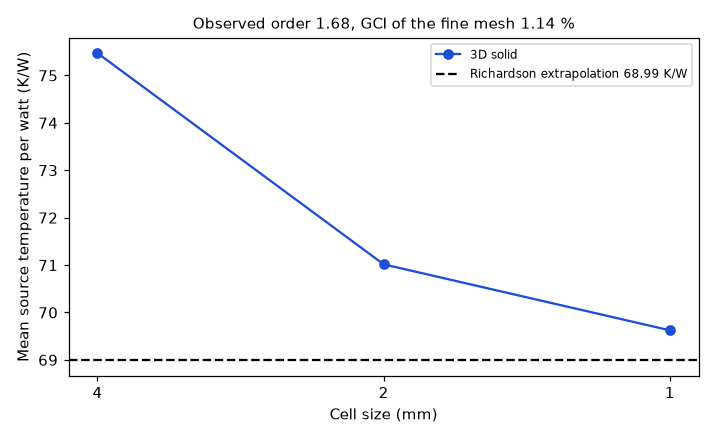
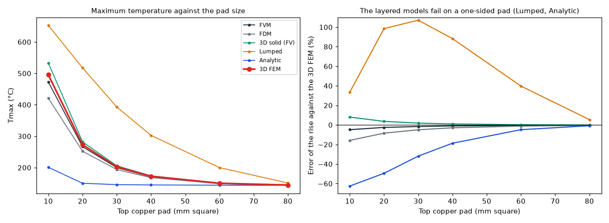

# The 3D solid and the layered models: verification against exact and independent references

Status: **implemented** in the program (see the program's `docs/versions.md` and `docs/validation.md`). Studies: `solid3d_verification.py`, `fem3d_validation.py`, `copper_dissipation.py`; figures: `make_figures.py`.

## 1. The questions

1. Does the program's own 3D solid (`pcbthermal/solid3d.py`) reproduce an exact solution and converge with the mesh?
2. How far are the layered models (FVM, FDM, Lumped, Analytic: one node per copper layer) from a real 3D solution, for uniform boards, small copper pads, vias, heatsinks and metal blocks?
3. Does the outer copper dissipate and spread heat like a heatsink, and where do the models fail?

### 1.1 Diagrams and illustrations



*Figure 4 (`figures/fig_04_layered_vs_3d_schematic.png`): The layered models against the 3D solid: 1, one node per copper layer with the sheet conductance in the plane and a conductance between nodes; 2, the 3D solid with real slabs, several laminate slabs per gap and a via as a copper rod; 3, the verification ladder from exact solutions to an independent finite-element solution.*



*Figure 5 (`figures/fig_05_heat_spreading_layered_and_3d.png`): heat spreading under a small heater: one node per copper layer in the layered models, a fan inside the laminate in the 3D solid, and a one-sided copper pad that dissipates by itself.*

## 2. Findings in short

* The 3D solid reproduces Yovanovich's (2003) spreading resistance of a circular isoflux source within 0.7 to 0.8 % (ε = 0.2, 0.3; 2 % at ε = 0.1, where the source has three cells) and converges at about second order (observed 1.68, GCI of the fine mesh 1.14 %).
* On a uniform board the four layered models land on the 3D answer within 0.7 %; with vias and a heatsink (the example board) within 1.5 %; the FVM follows an independent 3D finite-element solid within 2.2 % for any pad of 20 mm or more.
* The **Lumped and Analytic models are unreliable for a one-sided copper pad without vias** (Lumped up to +107 %, Analytic up to −63 %); the input checks warn.
* The outer copper dissipates and spreads by itself; a heatsink works through the copper under it.

## 3. Folder layout

| File | What it is |
| :-- | :-- |
| `scripts/solid3d_verification.py` | The analytical benchmark (Yovanovich) and the grid-convergence study of the 3D solid. |
| `scripts/fem3d_validation.py` | The independent 3D finite-element solid (scikit-fem, **not** in `requirements.txt`: `pip install scikit-fem`), also used by `models-comparison/validation_study.py --fem`. |
| `scripts/copper_dissipation.py` | The pad-size sweep and copper against heatsink, in every model and the FEM (`--fem`). |
| `scripts/make_figures.py` | Draws the three figures (needs scikit-fem for the third; about 90 seconds). |
| `scripts/make_diagrams.py` | Draws the schematic diagram and the illustration (figures 4 and 5; no data, no program; uses `research/diagram_kit.py`). |
| `figures/` | `fig_01` to `fig_05`; figures 4 and 5 are the diagram and the illustration (`make_diagrams.py`). |

## 4. How to run, and the results

```sh
.venv/bin/python research/solid3d-verification/scripts/solid3d_verification.py      # about 25 seconds
.venv/bin/python research/solid3d-verification/scripts/copper_dissipation.py --fem  # about 45 seconds, needs scikit-fem
.venv/bin/python research/solid3d-verification/scripts/make_figures.py              # about 90 seconds
```

### 4.1 Verification of the 3D solid: Yovanovich and grid convergence

`python research/solid3d-verification/scripts/solid3d_verification.py` (and `tests/test_solid3d_verification.py`). Two checks that do not use another solver of this project.

**Analytical benchmark.** The spreading resistance of an isoflux circular source of radius `a` on a long cylinder of radius `b` (insulated sides, cooled at the far end) is tabulated by Yovanovich (2003, Table 3) as `ψ = 4 a k Rs` against `ε = a/b` (the mean source temperature minus the one-dimensional resistances). The 3D solid solves a square block of the same area (`b = W/√π`, 50 mm, `k = 1` W/mK, thickness `1.5 b`, 40 slabs, cell 1 mm, 96-sided circle):

| ε = a/b | Table 3 (isoflux) | 3D solid | difference |
| --: | --: | --: | --: |
| 0.2 | 0.8009 | 0.8076 | +0.8 % |
| 0.3 | 0.6649 | 0.6698 | +0.7 % |

The square tube instead of the circle, the staircase representation of the circle and the one-dimensional resistances subtracted from a large total account for the 0.7 to 0.8 %. For `ε = 0.1` the source is 2.8 mm across (three cells) and the difference grows to 2 %.

**Grid convergence.** A square source aligned with every mesh (8 mm on a 48 mm block, 40 mm thick, 16 slabs) with the cell size halved twice (4, 2, 1 mm): the mean source temperature per watt is 75.47, 71.02 and 69.62 K/W; the convergence is monotone, the observed order is 1.68, the Richardson extrapolation is 68.99 K/W and the grid convergence index of the fine mesh (Roache, safety factor 1.25) is **1.14 %**. A circular source on the Cartesian grid does not converge monotonically (the staircase boundary changes with the mesh), which is why the aligned square is used for the GCI.

**What this does and does not show.** The conduction, the cell-cover treatment, the vertical resolution of the slabs and the boundary conditions of the 3D solid reproduce a published exact solution and converge at about second order. It does not test the vias (rods of copper area), the metal blocks and the fins, the outline cover, or the convection coefficients; those are tested against the layered models and the independent finite-element script (section 3). A method of manufactured solutions was considered and not done: the solid has no source terms to fix.



*Figure 1: `figures/fig_01_spreading_resistance_vs_yovanovich.png` (the program's 3D solid at ε = 0.1 to 0.4; the text above quotes 0.2 and 0.3).*



*Figure 2: `figures/fig_02_grid_convergence.png`.*

### 4.2 The layered models against an independent 3D finite-element solid, and copper against heatsink

`python research/models-comparison/scripts/validation_study.py --fem` (scikit-fem, offline, not in `requirements.txt`).

**The 3D model** (`research/solid3d-verification/scripts/fem3d_validation.py`): a tensor mesh of trilinear hexahedral elements; copper slabs with their true thickness (one element across), FR-4 gaps with four elements across,
copper where a zone exists and FR-4 where it does not; anisotropic FR-4 (0.3 through, 0.9 in plane); convection on the top, bottom and edge facets; the heater as a heat flux on its footprint on the top face;
a heatsink as an extra coefficient on the bottom facets inside its polygon; **a via as a copper rod with the copper area of the plated barrel** (0.147 mm square for a 0.3 mm via with a 25 µm wall, since the wall itself is far below
the mesh), through the whole thickness, with mesh lines refined around every rod. It does not use the "one node per copper layer" idea of the four models, so it measures the error of that idea. Element size 1 mm in the board plane
(halving it moved the 4-layer full-copper case by 0.06 °C; 2 elements instead of 4 across the gaps by 0.02 °C).

Maximum temperature of the top face [°C] and error of every model on the rise (FVM and FDM at 0.5 mm; Lumped and Analytic with their default settings):

| Board | 3D FEM [°C] | FVM | FDM | 3D solid (FV) | Lumped | Analytic |
| :-- | --: | --: | --: | --: | --: | --: |
| 4 layers, full copper | 90.6 | 90.3 (−0.4 %) | 90.3 (−0.5 %) | 90.5 (−0.1 %) | 91.1 (+0.7 %) | 90.6 (−0.0 %) |
| 2 layers, 40 mm top pad | 112.2 | 111.5 (−0.8 %) | 111.2 (−1.2 %) | 112.4 (+0.2 %) | 112.1 (−0.1 %) | 106.8 (−6.2 %) |
| 2 layers, 20 mm top pad | 136.2 | 133.7 (−2.2 %) | 131.7 (−4.0 %) | 138.0 (+1.6 %) | 131.1 (−4.5 %) | 109.6 (−23.9 %) |
| example board (partial copper, 9 vias, bottom heatsink) | 85.6 | 85.9 (+0.5 %) | 85.2 (−0.6 %) | 85.6 (−0.0 %) | 84.7 (−1.5 %) | 84.7 (−1.5 %) |

**Metal block** (a heatsink with a thickness; `research/solid3d-verification/scripts/fem3d_validation.py` models it as a gap-pad slab of conductivity 1 W/mK and thickness `R''` plus the block slab below the board, with its side faces losing heat too; 100 × 80 mm, 2 layers, 5 W, 30 × 30 mm copper pad on the bottom, block 60 × 60 mm unless stated; FVM and FDM at 1 mm; error on the rise):

| Case | 3D FEM [°C] | FVM | FDM |
| :-- | --: | --: | --: |
| no block (bottom pad only) | 134.2 | 133.2 (−0.9 %) | 132.6 (−1.5 %) |
| Al 3 mm, gap pad 5 K cm²/W | 115.5 | 115.0 (−0.5 %) | 114.9 (−0.6 %) |
| same, finned (extra h 60 W/m²K) | 99.7 | 99.0 (−1.0 %) | 99.0 (−1.0 %) |
| same, worse interface (20 K cm²/W) | 118.8 | 118.4 (−0.4 %) | 118.3 (−0.5 %) |
| Al 1 mm | 117.3 | 116.8 (−0.5 %) | 116.7 (−0.6 %) |
| Cu 3 mm | 115.3 | 114.8 (−0.5 %) | 114.8 (−0.6 %) |
| Al 3 mm 40 × 40 over a 50 × 50 mm pad | 120.4 | 119.4 (−1.0 %) | 119.0 (−1.4 %) |
| Al 3 mm 30 × 30 exactly over the pad | 129.3 | 128.1 (−1.1 %) | 127.4 (−1.8 %) |

The block is always within 1.8 % of the solid. (An earlier version of this script left unused nodes in the matrix of the solid and gave wrong numbers for blocks; fixed by pinning exactly the nodes that belong to no element.)

### 3.1 Does the outer copper dissipate and spread heat (against a heatsink)?

`python research/solid3d-verification/scripts/copper_dissipation.py [--fem]`. Board 100 × 80 mm, 2 layers, 5 W on a 10 × 10 mm heater on top, copper only on the top layer (a square pad centred on the heater), no vias, `h_top` 10 and `h_bottom` 15 W/m²K.
Maximum temperature [°C] against the 3D finite-element solid (error on the rise; the 3D FV column is the program's own `solid3d`):

| Top copper pad | 3D FEM | FVM | FDM | 3D solid (FV) | Lumped | Analytic |
| :-- | --: | --: | --: | --: | --: | --: |
| heater pad only (10 mm) | 495.3 | 472.4 (−4.9 %) | 420.9 (−15.8 %) | 533.1 (+8.0 %) | 652.7 (+33.5 %) | 201.1 (−62.6 %) |
| 20 mm square | 273.0 | 266.7 (−2.5 %) | 252.1 (−8.4 %) | 282.0 (+3.6 %) | 517.4 (+98.5 %) | 150.3 (−49.5 %) |
| 30 mm square | 202.6 | 199.7 (−1.6 %) | 193.8 (−5.0 %) | 205.9 (+1.9 %) | 392.9 (+107.2 %) | 145.9 (−31.9 %) |
| 40 mm square | 172.5 | 171.0 (−1.0 %) | 168.2 (−2.9 %) | 174.0 (+1.0 %) | 302.7 (+88.3 %) | 144.9 (−18.7 %) |
| 60 mm square | 150.3 | 149.6 (−0.6 %) | 148.8 (−1.2 %) | 150.6 (+0.2 %) | 200.1 (+39.7 %) | 144.2 (−4.9 %) |
| 80 mm square | 144.6 | 144.1 (−0.4 %) | 144.0 (−0.5 %) | 144.5 (−0.1 %) | 151.1 (+5.4 %) | 143.6 (−0.8 %) |

Copper against heatsink on the same board (40 mm area), FVM heat leaving the top face inside / outside the pad polygon:

| Case | 3D FEM | FVM | FDM | 3D solid (FV) | Heat over the area [W] | Elsewhere on the top face [W] |
| :-- | --: | --: | --: | --: | --: | --: |
| 40 mm copper pad | 172.5 | 171.0 (−1.0 %) | 168.2 (−2.9 %) | 174.0 (+1.0 %) | 1.30 | 0.78 |
| pad + heatsink, extra h 30 W/m²K | 131.5 | 130.9 (−0.6 %) | 130.1 (−1.3 %) | 131.8 (+0.3 %) | 2.99 | 0.40 |
| pad + heatsink, extra h 100 W/m²K | 100.7 | 100.4 (−0.4 %) | 100.3 (−0.5 %) | 100.6 (−0.1 %) | 4.10 | 0.16 |
| heater pad only + heatsink 30 W/m²K on bare laminate | 340.7 | 324.6 (−5.1 %) | 285.6 (−17.5 %) | 369.6 (+9.2 %) | 1.16 | 2.48 |

What it shows:
* **The outer copper dissipates and spreads by itself**: the temperature falls monotonically as the pad grows (495 → 145 °C) and saturates (80 mm gains 6 °C over 60 mm), and the whole top face loses heat, pad and bare laminate alike (the heat found outside the 40 mm pad, 0.78 W, is heat that the copper carried to the laminate).
  The FVM follows the 3D FEM within 1 to 2.5 % for pads of 20 mm and more; the 3D FV solid is within 2 % there, and both 3D models bracket the converged value on the heater-sized pad (section 3).
* **A heatsink works through the copper under it**: the same 30 W/m²K heatsink gives 131 °C on the pad and 325 °C on bare laminate, because on the laminate there is no sheet to spread the heat in. The heatsink adds convection area; the copper provides the path to it.
* **Where the models fail**: with a pad hardly larger than the heater (an edge of copper across the footprint) the FDM loses 8 to 16 % (the grid sees the pad as a few nodes), and the **Lumped and Analytic models are unreliable** for a one-sided pad without vias or bottom copper (Lumped up to +107 %, Analytic up to −63 %); they assume copper around the heater on both faces or a uniform sheet. The input checks already warn about a copper edge crossing a heater; use the FVM for such boards.

The 3D value of the example board is converged: 85.55 °C with 1 mm elements and 85.59 °C with 0.5 mm (2 elements across each gap).

The new **3D solid (FV)** column is the program's own 3D model (`solid3d.py`, section 2.7 of `models.md`; slabs of real thickness, 4 per gap, 1 mm cells here, 0.5 mm in the FEM script's column header): it lands within 0.2 % of the FEM on three boards and 1.6 % high on the 20 mm pad. Its numbers are also the closest to the FVM in section 2 (within 0.3 % on the ordinary scenarios, +4.5 % with a copper edge across the heater, +2.4 % with no copper under it).
**Convergence on a small pad**, where the two 3D models differ most (maximum temperature of the heater-sized copper pad, `copper_dissipation.py`; both rise or fall towards the same limit): 3D FV at 1 mm and 0.5 mm with 4 slabs per gap 533 and 523 °C, with 8 slabs 530 and 519 °C; FEM at 1 mm 495, at 0.5 mm 500 (4 elements per gap) and 502 (8): the limit is about 510 °C, so at 1 mm the FV is 4 % high and the FEM 3 % low on this extreme case (20 mm pad: FV 282, 280, 281, 279; FEM 273, 274, 275; limit about 277 °C).
Reading: on a uniform board the four layered models land on the 3D answer within 0.7 % (FVM, FDM and Analytic within 0.5 %). **With vias and a heatsink (the example board) all four are within 1.5 %**, and the FVM, with each via in one cell, is within 0.5 % of the 3D rods.
With a small copper pad the FVM follows the 3D solid within 2.2 %, the FDM and the Lumped within 4.5 %, and the Analytic loses accuracy exactly where its uniform-sheet assumption breaks (6 % with a 40 mm pad, 24 % with a 20 mm pad). The remaining 0.4 to 2 % of the FVM comes from
representing each copper layer by one node and the dielectric between two layers as a one-dimensional vertical resistance (no lateral spreading inside the gap).



*Figure 3: `figures/fig_03_copper_pad_models_vs_fem.png`.*

## 5. Limits of this study

* The 3D finite-element solid and the 3D finite-volume solid share a modelling choice for vias (a copper rod of the barrel's copper area) and the fin ratio, so they do not test the vias and fins independently.
* Not tested by the benchmark: vias, metal blocks and fins, the outline cover, the convection coefficients (those are tested against the layered models and the FEM script).
* A method of manufactured solutions was considered and not done: the solid has no source terms to fix.
* No measurement of a physical board: every model has only been compared with other models and exact solutions.

## 6. Sources

Yovanovich, J. Electronic Packaging 125 (2003) 169 to 177, Table 3 (as cited in the header of `solid3d_verification.py`; the title of the paper is not recorded here); Roache, grid convergence index, ASME V&V 20 (method; the standard was not read, the formula is the common three-grid GCI with safety factor 1.25). Own computation for the rest.

## What was read and what was not verified

* Read: Yovanovich's Table 3 values were taken from the published table as recorded in the script (the paper itself was not re-read). Not verified: no measurement of a physical board.
* Not implemented: a time simulation of the 3D solid (steady state only); the FEM solid inside the program (it stays an offline cross-check, scikit-fem is not a dependency).
