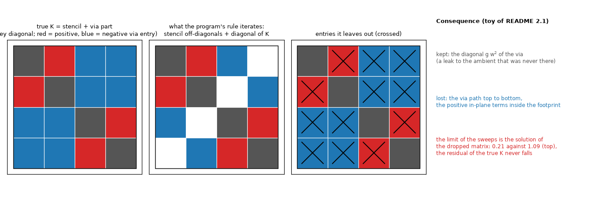
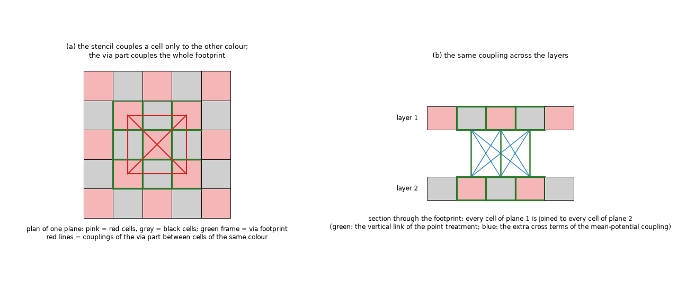
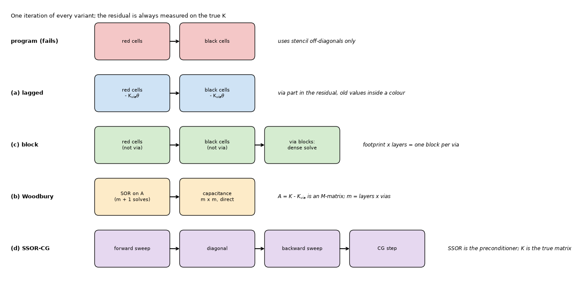
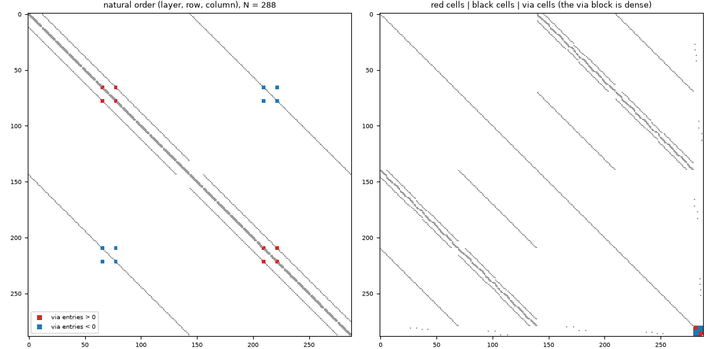
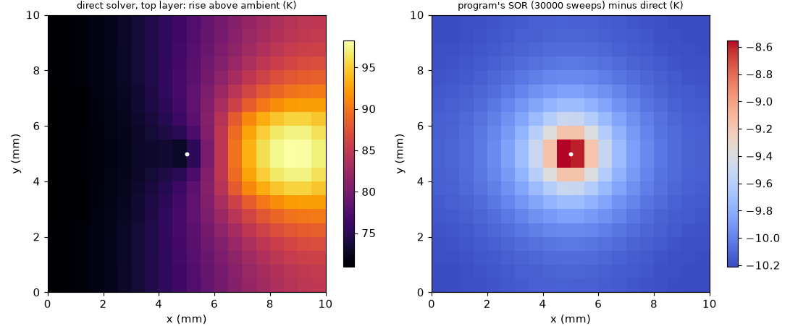
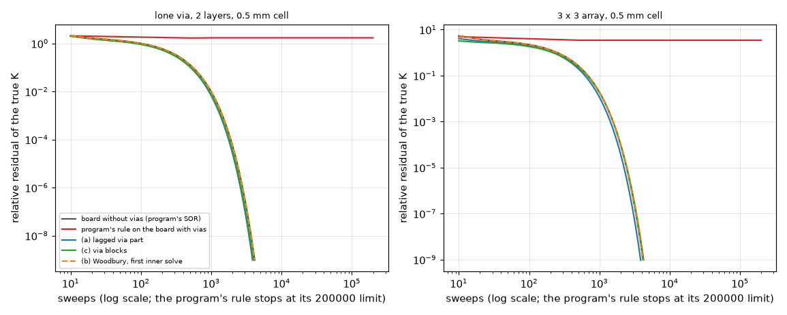
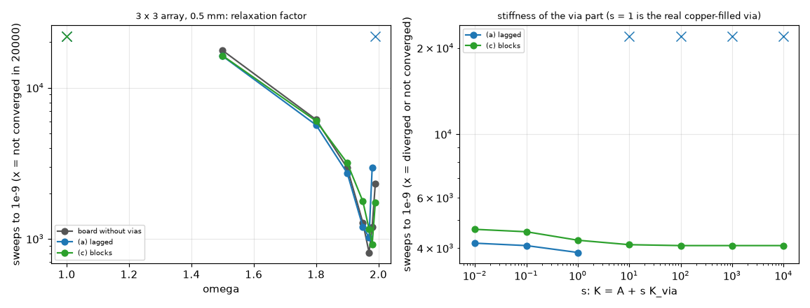

# SOR with the mean-potential via couplings

**Question** (maintainer): the red-black SOR of the FVM stops with "did not converge" 19.4 K (0.5 mm) and 21.9 K (0.25 mm) below the direct solver on the 3 x 3 array once the vias are treated by the mean-potential coupling of `research/point-via-convergence/` (the treatment `mw_disc@eta`), while CG matches the direct solver to 1e-11 K. Is there no way to run SOR with it, not even with an approximation of the vias?

**Answer in short.** There is, and it is cheap. The failure is not a property of SOR on this matrix; it is the way the program's `Network.solve_sor` is written: it rebuilds the off-diagonals from the six-neighbour stencil and takes only the diagonal from the assembled matrix, so it iterates a different matrix (the one without the via off-diagonals but with the via diagonal, a leak to the ambient that was never there). The true matrix is symmetric positive definite, so SOR does converge on it (Ostrowski-Reich); what the red-black ordering cannot do is update the cells of one via footprint independently. Treating the cells of every via (footprint cells of all layers) as one block, solved exactly after the red and black colours, gives an SOR that reaches the direct solution to 1e-8 K and is stable for every stiffness tried (up to 10^4 times the real via). *Review (section 8):* the block step must be relaxed by the same omega as the colours, with the blocks coloured so that no two coupled blocks move at once (variant c'); the unrelaxed step of the first version (c) needs the sweeps of the board without vias only while the via cells are few (1.02 to 1.06 times on the boards of this study) and up to 2.8 times as many on dense arrays, while (c') needs 0.79 to 1.00 times; its convergence for every 0 < omega < 2 is now proved (an energy argument, section 8), not only measured. Putting the via part into the residual (explicit, "lagged") also works for the vias of the 3 x 3 board but diverges for a stiffer via or a finer cell. The old point link as an approximation for SOR only gives a different answer from the direct solver (0.2 to 1.1 K here), which defeats the use of SOR as a check. Nothing of the program was edited.

All numbers below are printed by the scripts of this folder (run from the repository root with `.venv/bin/python research/sor-with-via-couplings/scripts/<script>.py`; the tests are in `tests/`). The maintainer's rule was followed: the simplest cases come first and each says which single effect it isolates.

## 1. The situation

### 1.1 Drawings

*Figure 01, `fig_01_what_the_program_iterates.png`: the 4 x 4 toy of 2.1 (two layers, two cells, one via over both cells). Left: the true matrix. Centre: what the program's `solve_sor` iterates (stencil off-diagonals, diagonal of K). Right: the entries it leaves out.*

*Figure 02, `fig_02_colouring_over_a_footprint.png`: red-black colouring of an illustrative 3 x 3 footprint (the real footprints of the studies are 1 to 4 cells at 0.25 mm, README 2.2). The stencil couples a cell only to the other colour; the via part couples all footprint cells to each other, including the same colour (red lines), and every cell of one plane to every cell of the next (section view).*

*Figure 03, `fig_03_sweeps_of_the_variants.png`: one iteration of the program's rule and of the variants (a), (c), (b), (d) of section 3.*

*Figure 04, `fig_04_the_matrix_with_via_couplings.png`: the real matrix of a 6 mm board with one copper-filled via (288 unknowns, two layers, 0.5 mm cells). Left: natural order; the via entries (red positive, blue negative) sit away from the stencil bands. Right: red cells, black cells, then the via cells: the stencil part is two decoupled halves, the via cells form a small dense block.*

### 1.2 What the matrix is

With the treatment `mw_disc@eta` the assembled matrix is `K = A + sum_v B_v^T G_v B_v`: `A` is the five-point and vertical stencil (an M-matrix), `B_v` takes the weighted mean of the footprint cells of each plane (weights `w`), and `G_v` is the Laplacian of the Kron-reduced barrel and wells (positive semi-definite). Written entrywise, `g u u^T` with `u = e_l (x) w - e_m (x) w` gives positive in-plane entries `+g w_a w_b` between footprint cells, and negative `-g w_a w_b` between footprint cells of different planes, including non-adjacent planes. `lib/sorvia.py` builds `B`, `G` and `K_via` and the tests check `K = A + K_via` and that `K_via` is positive semi-definite.

## 2. The failure, isolated on simple cases

### 2.1 A toy with a closed form (isolates: the via off-diagonals dropped, diagonal kept)

Two layers, two cells, one via over both cells with weights (1/2, 1/2), `gx = 2`, `gz = 3`, `g_v = 5`, `ga = 0.5` W/K, source 1 W as 1/2 W in each top cell (so the cells of a layer are at the same temperature and the 4 x 4 system collapses to 2 x 2). `study_failure.py` part A:

| | top | bottom | closed form |
| :-- | --: | --: | :-- |
| direct, true K | 1.090909 | 1.000000 | bottom `= (q/2)/ga`, top `= bottom + (q/2)/(gz + gv/2)` |
| limit of the program's rule | 0.212291 | 0.134078 | 2 x 2 solve of `(gz + gv/4) t - gz b = q/2`, `-gz t + (gz + ga + gv/4) b = 0` |

The iterated rule (3000 sweeps, omega 1.2) reaches 0.212291 on top, the closed form of the dropped matrix; the residual of the true K stays at 0.52. The via off-diagonals `-g_v/4` (path top to bottom) are lost and its diagonal `g_v/4` stays: each cell is connected to the ambient through the via by `g_v/4`, which cools the board.

### 2.2 Structure of the matrix (isolates: signs, dominance, definiteness)

Copper-filled 0.3 mm via, disc footprint at eta = exp(-1/4), `study_failure.py` part B (dense eigenvalues, N <= 800):

| board | cell (mm) | N | via entries (+/-) | max row sum / diag | lambda_min(K) | rho Jacobi stencil | rho Jacobi K | rho program sweep | rho lagged sweep |
| :-- | --: | --: | --: | --: | --: | --: | --: | --: | --: |
| unit cell, 2 layers | 0.25 | 392 | 24/32 | 1.0339 | 5.931e-06 | 0.99955 | 0.99988 | 0.99598 | 0.99895 |
| unit cell, 4 layers | 0.25 | 784 | 48/192 | 1.1320 | 2.937e-06 | 0.99898 | 0.99994 | 0.99076 | 0.99948 |
| lone via, 2 layers | 0.5 | 800 | 24/32 | 1.0273 | 2.225e-05 | 0.99946 | 0.99957 | 0.99310 | 0.99452 |

Findings: (1) `K` has positive off-diagonal entries (the in-plane ones inside the footprint): it is **not an M-matrix**; (2) rows are **not diagonally dominant** (row sum over diagonal 1.03 to 1.13 on the via rows), so the Jacobi and Gauss-Seidel theorems of dominance (Saad 2003, Theorem 4.9, p. 121) do not apply; (3) `K` is **symmetric positive definite** (lambda_min > 0), so point SOR converges for every 0 < omega < 2 (Saad, Theorem 4.10, p. 122); (4) the stencil alone is two-colourable (Property A, a consistently ordered matrix, Young's theory p. 126), the full `K` is not: its graph contains triangles (three footprint cells joined to each other), so no two-colouring exists, the footprint cells are joined to cells of their own colour, the red update is no longer a set of independent updates, and the consistent-ordering relation of Young is not available for it. The program's sweep has spectral radius below 1: it converges, to the wrong matrix (2.3).

### 2.3 The limit of the program's SOR is the dropped matrix (isolates: the cause)

Lone via board (10 mm, 0.5 mm cells), `study_failure.py` part C: the program's rule run to a residual of 1e-11 measured on `K_drop = diag(K) + stencil` stops after 3740 sweeps within 3.8e-10 K of the direct solution of `K_drop` (T_max 88.158 K) while the direct solution of the true `K` is 98.244 K. So the failure is fully explained by the dropped entries; the warning "SOR did not converge" is the residual of the true K, which the dropped iteration can never reduce.

*Figure 07, `fig_07_error_of_the_programs_sor.png`: lone via board, top layer. Left: direct solution. Right: the program's SOR after 30000 sweeps minus direct: the board is 8.6 to 10.2 K too cool everywhere, least cool at the via, as expected of a leak that the via diagonal adds at the footprint cells.*

### 2.4 The program's SOR on the boards (isolates: the effect of the number of vias and the cell)

`study_failure.py` part D (program's rule, residual stop, tol 1e-9, copper-filled vias; rise above ambient):

| board | cell (mm) | N | direct T_max (K) | SOR T_max - direct (K) | SOR sweeps | SOR residual | converged |
| :-- | --: | --: | --: | --: | --: | --: | :-- |
| unit cell, 2 layers (weak cooling) | 0.25 | 392 | 494.964 | -301.18 | 30000 | 1.7e+01 | False |
| lone via, 2 layers | 0.5 | 800 | 98.244 | -10.09 | 30000 | 1.7e+00 | False |
| row of 3 vias | 0.5 | 2048 | 23.183 | -2.43 | 30000 | 1.2e+00 | False |
| 3 x 3 array | 0.5 | 7056 | 36.035 | -19.42 | 200000 | 3.5e+00 | False |
| 3 x 3 array | 0.25 | 28224 | 35.991 | -21.87 | 200000 | 8.8e+00 | False |

The 3 x 3 rows reproduce the 19.4 K and 21.9 K of `point-via-convergence` (README 9). A single via is enough to fail, and a via with one footprint cell does not (the point treatment keeps the link in the stencil: tests `test_point_treatment_has_no_via_part`).

## 3. The variants (in memory, `lib/sorvia.py`)

Every variant measures its residual on the true `K`. The relaxation factor is the program's `2 / (1 + sin(pi / n_max))` unless stated. `study_variants.py`; "no-via sweeps" is the program's SOR on the same board with the vias removed: the reference for what the stencil alone costs.

### 3.1 Sweeps and accuracy (tol 1e-9; entry = sweeps or CG iterations; max |field - direct| in K)

| board | cell (mm) | N | no-via sweeps | program | lagged (a) | block (c) | Woodbury (b) | SSOR-CG natural (d) | SSOR-CG red-black (d) | CG Jacobi (program's) |
| :-- | --: | --: | --: | :-- | :-- | :-- | :-- | :-- | :-- | :-- |
| unit cell, 2 layers | 0.25 | 392 | 26350 | 200000 (no conv.); 3.7e+02 | 21000; 1.4e-07 | 21490; 1.4e-07 | 73830; 1.3e-07 | 42; 1.2e-09 | 52; 4.3e-10 | 49; 1.6e-10 |
| unit cell, 4 layers | 0.25 | 784 | 51270 | 200000 (no conv.); 4.4e+02 | 41600; 1.9e-07 | 42370; 2.0e-07 | 236330; 2.0e-07 | 59; 1.5e-09 | 72; 1.2e-09 | 81; 4.6e-10 |
| lone via, 2 layers | 0.5 | 800 | 4140 | 200000 (no conv.); 2.2e+01 | 3860; 4.6e-08 | 3940; 4.7e-08 | 11890; 4.5e-08 | 65; 2.2e-09 | 81; 3.2e-09 | 133; 1.0e-09 |
| lone via, 2 layers | 0.25 | 3200 | 8780 | 200000 (no conv.); 2.7e+01 | 8190; 2.3e-08 | 8290; 2.4e-08 | 24710; 2.4e-08 | 130; 1.2e-09 | 161; 1.8e-09 | 273; 1.1e-09 |
| row of 3 vias | 0.5 | 2048 | 2610 | 200000 (no conv.); 6.2e+00 | 2460; 9.3e-09 | 2580; 9.4e-09 | 17310; 9.5e-09 | 94; 2.0e-09 | 122; 1.1e-09 | 205; 8.6e-10 |
| 3 x 3 array | 0.5 | 7056 | 4170 | 200000 (no conv.); 2.5e+01 | 3860; 8.2e-09 | 4260; 9.6e-09 | 137640; 9.3e-09 | 101; 1.1e-09 | 128; 3.9e-09 | 199; 8.1e-10 |
| 3 x 3 array | 0.25 | 28224 | 8680 | 200000 (no conv.); 2.7e+01 | 8000; 4.3e-09 | 8440; 4.5e-09 | not run | 199; 7.4e-10 | 249; 1.7e-09 | 408; 5.7e-10 |

(The unit cell is the board with the weakest coupling to the ambient and so the slowest for every SOR variant; its 494 K is not a design, it isolates the stencil-limited convergence.)

*Figure 05, `fig_05_convergence_of_the_variants.png`: residual of the true K against sweeps (log scale). The board without vias, (a), (c) and the first inner solve of (b) fall together; the program's rule stays flat.*

Reading: (a) and (c) need the same sweeps as the board without vias (within 8 %, sometimes fewer) and end within 1e-7 K of the direct solution. (b) costs `m + 1` times as many sweeps (m = layers x vias footprint means: 36 for the 3 x 3 array), 3 to 36 times here, because every column of `A^-1 B^T` is a full SOR solve. (d) needs 42 to 249 iterations: about half of the Jacobi-preconditioned CG on the larger boards (199 against 408 at 28224 unknowns) and barely fewer on the unit cell (42 against 49).

### 3.2 Relaxation factor (3 x 3 array, 0.5 mm, sweeps to 1e-9; '-' = not converged in 20000)

| omega | no-via board | lagged (a) | block (c) |
| --: | --: | --: | --: |
| 1.0 | - | - | - |
| 1.5 | 17650 | 16200 | 16300 |
| 1.8 | 6150 | 5660 | 6020 |
| 1.9 | 2940 | 2720 | 3170 |
| 1.95 | 1280 | 1200 | 1770 |
| 1.97 | 810 | 1020 | 1160 |
| 1.98 | 1190 | 2960 | 920 |
| 1.99 | 2310 | - | 1730 |

The program's omega at this grid (42 cells, 2 / (1 + sin(pi / 42)) = 1.861) lies between the rows 1.8 and 1.9, and the best factor of all three variants is about 1.97, five times fewer sweeps (no-via 810, lagged 1020, block 1160 at 1.97; block 920 at 1.98). The lagged variant stops converging at omega 1.99 and degrades earlier. *Review (section 8):* for the board without vias the optimum is not only measured: the red-black stencil is consistently ordered, so Young's theory gives `omega_opt = 2 / (1 + sqrt(1 - rho_J^2))` (Saad, Theorem 4.16 and eq. 4.47), 1.9613 here (694 sweeps, 6.0 times fewer than the formula); the program's formula is the optimum of a square with fixed edge temperatures, not of a board that loses heat only through its faces. For the full matrix with vias no such theory applies; measured, (c') at 1.9613 needs 640 sweeps. A better omega is a separate gain that applies to the program's SOR with or without vias.

### 3.3 Stiffness of the via part (isolates: the one thing that distinguishes (a) from (c))

`K = A + s K_via` on the 3 x 3 array, 0.5 mm (`study_variants.py` part 3 and `study_stiffness.py`); s = 1 is the copper-filled via:

| s | lagged (a) sweeps | block (c) sweeps |
| --: | --: | --: |
| 0.01 | 4160 | 4650 |
| 1 | 3860 | 4260 |
| 10 | diverges | 4110 |
| 1000 | diverges | 4080 |
| 10000 | diverges | 4080 |

*Figure 06, `fig_06_omega_and_via_stiffness.png`: sweeps against omega (left) and against the stiffness factor s (right); crosses mark the runs that did not converge.*

Spectral radius of one sweep on the unit cell (dense, N = 392), `study_stiffness.py` part 3: lagged 0.99907 / 0.99895 / 0.99894 / **1.11548** / **4.539** for s = 0.1 / 1 / 3 / 10 / 100; block 0.99909 / 0.99898 / 0.99896 / 0.99895 / 0.99895: the block sweep is as fast as the board without vias for any s, the lagged sweep diverges. Reason: the lagged variant treats the same-colour via couplings Jacobi-fashion inside a colour, a Jacobi step on a cluster that is not diagonally dominant; the block step is a true block Gauss-Seidel step, and a block Gauss-Seidel/SOR on a symmetric positive definite matrix converges for 0 < omega < 2 (point version: Saad, Theorem 4.10; block version: Ostrowski's theorem with a block diagonal D, Varga Theorem 3.6, status S, and the energy argument of the review, section 8, which also covers the different omega of the colours and the blocks).

How close are real vias to the limit of (a)? Critical factor `s_c` (largest s that still converges, bisection on 4000 sweeps; `study_stiffness.py` part 1), program's omega / omega 1.5:

| board | cell (mm) | lagged s_c, program's omega | lagged s_c, omega 1.5 | block s_c |
| :-- | --: | --: | --: | --: |
| lone via, 2 layers | 0.5 | 8.97 | 13.25 | none up to 1e4 |
| lone via, 2 layers | 0.25 | 5.92 | 10.68 | none up to 1e4 |
| row of 3 vias | 0.5 | 7.17 | 12.11 | none up to 1e4 |
| 3 x 3 array | 0.5 | 2.91 | 6.68 | none up to 1e4 |
| 3 x 3 array | 0.25 | 1.44 | 3.58 | none up to 1e4 |

The margin of (a) shrinks with the number of vias and with the cell (1.44 at 0.25 mm): it would be gone at a finer cell. Real vias on the 3 x 3 board at 0.5 mm (part 2): a 0.3 mm open barrel converges (s_c 4.61), 0.3 mm copper-filled converges (2.91), 0.8 mm open (1.16) barely, **0.8 mm copper-filled does not converge**. The variant (c) on the same 0.8 mm filled board needs 4110 sweeps against 4170 for the board without vias, and rows of five vias 0.5 mm apart (blocks of 8 cells at 0.25 mm) or 0.4 mm apart (footprints overlapping at 0.5 mm: two merged blocks) need 5470 and 2560 sweeps against 5480 and 2610 (`study_stiffness.py` part 4).

### 3.4 Cost per sweep and total (3 x 3 array, 0.25 mm, 28224 unknowns; scripts' wall time on this machine, not a benchmark)

| method | iterations | seconds |
| :-- | --: | --: |
| program's rule (200000 sweeps, no convergence) | 200000 | 56.7 |
| lagged (a) | 8000 | 2.53 (0.32 ms per sweep) |
| block (c) | 8440 | 2.46 (0.29 ms per sweep) |
| CG Jacobi (program's `cg`) | 408 | 0.047 |
| SSOR-CG natural, scipy triangular solves | 199 | 0.58 |
| direct (program's, 7056 unknowns) | | 0.026 |

The via part adds about 15 to 35 % to the cost of a sweep (0.28 to 0.32 ms at 28224 unknowns, 0.09 to 0.12 ms at 7056). SOR is about 50 times slower than CG and slower still than the sparse direct solver in any variant: the maintainer's question is about keeping the comparison solver correct, not about speed.

## 4. The other options

### 4.1 (b) Woodbury (SOR on A plus a small direct solve)

`theta = y0 - Z (I + C G) ^-1 B y0`, `y0 = A^-1 Q`, `Z = A^-1 B^T G`, `C = B A^-1 B^T`: exact, the SOR only ever sees the M-matrix `A` (which is why every inner solve converges like the board without vias), the small solve is `m x m` with `m = layers x vias`. It needs `m + 1` SOR solves (37 for the 3 x 3 board, 4 layers x 9 vias) and the matrix and right-hand side change at every power-temperature or computed-h iteration of the program: 3 to 36 times the cost of (c) for the same answer (table 3.1). It matches the structure of the well treatment in reservoir simulators (the well equations are eliminated by a Schur complement, `(A - sum C D^-1 B) x_r = R_r - sum C D^-1 R_w`, [OPMFlow2019] equations 25-26, p. 12-13), but there the well block is eliminated once per Newton step, not solved by an inner iteration per right-hand side. Not worth the code.

### 4.2 (d) SSOR as a preconditioner of CG

`M = (D - wE) D^-1 (D - wF) / (w (2 - w))` ([Saad2003] section 10.2, p. 299), omega 1, true `K`. 42 to 199 iterations, accurate to 1e-9 K in the same table, half the iterations of the Jacobi-preconditioned CG, but the two triangular solves per iteration made it 12 times slower than CG at 28224 unknowns in this implementation (scipy `spsolve_triangular`; a vectorised red-black preconditioner would be cheaper per iteration, not measured). The program already has CG and a direct solver that agree to 1e-11 K: SSOR does not need to exist as a separate solver and is not an answer to "SOR with vias".

### 4.3 (e) The point link for SOR only

SOR on the program's own treatment (the point link, which lives in the stencil) converges to the direct solution of that treatment (differences of 1e-7 to 1e-9 K, `study_variants.py` part 4) but that is not the direct solution of the mean-potential treatment:

| board | cell (mm) | direct(point) - direct(mean potential) (K) | direct(mean) T_max (K) |
| :-- | --: | --: | --: |
| unit cell, 2 layers | 0.25 | +13.72 | 494.96 |
| unit cell, 4 layers | 0.25 | +12.91 | 491.59 |
| lone via, 2 layers | 0.5 | -0.23 | 98.24 |
| lone via, 2 layers | 0.25 | +1.00 | 98.24 |
| row of 3 vias | 0.5 | +0.22 | 23.18 |
| 3 x 3 array | 0.5 | +0.34 | 36.03 |
| 3 x 3 array | 0.25 | +1.08 | 35.99 |

With a warning it would run, but SOR and the direct solver would answer differently by the error of the old treatment, which grows with the refinement; `docs/validation.md` section 5 (direct, CG and SOR agree to 2e-8 K) could no longer be claimed. Rejected.

### 4.4 (f) Refuse SOR on boards with vias

Costs one `ValueError` like the metal block (`solve_sor` already refuses a block) and removes SOR from every board of the examples (they have vias). It is the fallback if the maintainer wants no code.

## 5. The program's example board (after the simple ones)

100 x 80 mm, four layers, nine 0.3 mm open vias under U1, partial copper, two heaters, heatsink (`study_real_board.py`; the program's rule is capped at 60000 sweeps at 1 mm and 20000 at 0.5 mm):

| cell (mm) | N | direct T_max (K above ambient) | variant | sweeps / iterations | converged | T_max - direct (K) | max field difference (K) | seconds |
| --: | --: | --: | :-- | --: | :-- | --: | --: | --: |
| 1.0 | 32000 | 60.225 | program | 60000 | False | -2.65e+01 | 3.7e+01 | 18.3 |
| 1.0 | 32000 | 60.225 | lagged | 2260 | True | -9.93e-09 | 1.0e-08 | 0.8 |
| 1.0 | 32000 | 60.225 | block | 2390 | True | -1.12e-08 | 1.1e-08 | 0.8 |
| 1.0 | 32000 | 60.225 | SSOR-CG natural | 189 | True | +1.80e-09 | 1.6e-08 | 0.6 |
| 0.5 | 128000 | 60.173 | program | 20000 | False | -2.00e+01 | 2.9e+01 | 24.1 |
| 0.5 | 128000 | 60.173 | lagged | 4600 | True | -5.17e-09 | 5.5e-09 | 6.2 |
| 0.5 | 128000 | 60.173 | block | 4810 | True | -5.56e-09 | 5.6e-09 | 5.9 |
| 0.5 | 128000 | 60.173 | SSOR-CG natural | 375 | True | +7.05e-10 | 1.1e-08 | 4.8 |

The conclusions of the simple boards hold: the program's rule is 20 to 27 K cool at the hottest point, (a) and (c) reach the direct solution to 1e-8 K.

## 6. Recommendation

1. **Variant (c'), block SOR with relaxed, coloured blocks, if SOR stays in the program** (*corrected by the review*: the first version recommended (c), whose block step is not relaxed). One new piece of state (the index list of every via's cells, which the treatment of `point-via-convergence/INTEGRATION.md` already has when it assembles the couplings) and about 45 lines in `fvm.Network.solve_sor` (`lib/sorvia.py`, `RB` with `block_omega=None, colour_blocks=True`: colours that skip the via cells, then, group by group, `theta[b] += omega Binv_b (Q_b - K[b, :] theta)`; the residual stop rule is unchanged because it already uses `K @ theta`). The sweeps of the board without vias or fewer (section 8), no restriction on stiffness or cell size, convergence proved for 0 < omega < 2, the answer equals the direct one to 1e-8 K.
2. **(a) lagged** is the shorter patch (the via part as `Kv @ theta` in the residual: 10 lines) but is not robust (diverges for a 0.8 mm copper-filled via at 0.5 mm and its margin falls with the cell): do not adopt.
3. **(b) Woodbury, (d) SSOR-CG, (e) the point link: not worth the code** (sections 4.1 to 4.3).
4. **(f) refuse** is the zero-effort alternative; it keeps the docs honest but removes SOR from the example boards. The choice between 1 and 4 is the maintainer's: SOR is documented as "for comparison" and is far slower than the other two solvers (about 50 times slower than CG here).

Whichever is chosen, the stop rule "did not converge" worked as designed: it was the only thing that revealed the problem (the step rule of the original program would have reported success on the wrong field; `docs/validation.md` 5). The design for entering the program is in `INTEGRATION.md`.

## 7. Limits and doubts

* The convergence results are for the treatment `mw_disc@eta` assembled by the copy of `research/point-via-convergence/lib/program_patch.py`; the variants read the via blocks it stores (`net._via_blocks`). The adopted implementation will have to store the same data.
* Via blocks are updated simultaneously (block Jacobi among blocks). Blocks that touch through the stencil without sharing a cell were tested only on the rows of 3.3 (they converged as fast as without vias); a pathological dense array with footprints in contact in two directions was not tried. Remedy if needed: merge blocks whose cells are stencil neighbours. *Review (section 8):* tried; (c) converges there (proved for a block step not over-relaxed) but slowly, over-relaxing it at once diverges, colouring the blocks (c') fixes both; merging is not needed.
* The stiffness limit of (a) was measured by bisection on 4000 sweeps with a falling-residual criterion, not from the spectral radius, except on the 392-unknown cell (3.3).
* The proof that block SOR converges for an SPD matrix is not read from a source (status M); the observation is numerical (s up to 1e4 on one board, all layouts of 3.3). *Review:* proved in section 8 (energy argument); the block statement of Ostrowski's theorem in Varga is known from a secondary source only (status S).
* The times are single runs on one machine; the direct and CG times are those of scipy at these sizes and are not claims about other sizes. SSOR-CG was implemented with scipy's triangular solves; its wall time is not a statement about a tuned implementation.
* The unit-cell board (494 K) is far outside any design; it is kept because it has the weakest cooling and shows the stencil-limited convergence. Its numbers are not used to say anything about temperature.
* FDM, the 3D solid and transient paths do not use `solve_sor` (only the FVM steady path does, `api.py` line 630): not checked here.

## 9. What was read and what was not verified

* **Read in full or in the sections used**: Saad, *Iterative Methods for Sparse Linear Systems*, 2nd ed. (open copy of the author): sections 3.3, 4.1 (SOR, SSOR, block relaxation, Algorithm 4.2), 4.2 (M-matrices, regular splittings, Theorems 4.9, 4.10, 4.16) and 10.2 (SSOR preconditioner), pages as in `research/theory/BIBLIOGRAPHY.md` section 16 ([Saad2003]); the sections on multicolouring of general graphs (3.3) were read but not needed after the block variant was chosen. Rasmussen and others, OPM Flow (arXiv:1910.06059), the well Schur complement, equations 25 and 26 and Figure 6 (status R for those pages only).
* **Seen as a search summary (S)**: the CPR preconditioner including wells (Nilsen and others, SPE 2023).
* **Not obtained (N)**: Young (1971), Varga (1962), Wallis (SPE 12265 and the 1985 paper), Zhou, Jiang and Tchelepi (2013), Golub and Van Loan (status M: the Woodbury identity in `lib/sorvia.py` is verified by the tests, not read from the book). The reservoir-simulation literature is therefore known only for the idea that wells are eliminated by Schur complements and used with CPR as a preconditioner, not for any convergence statement about SOR; the CPR idea (a coarse correction on the stiff variable) is the same shape as (b) but was not tried as a preconditioner here.
* **Reproduced**: the numbers 19.4 K and 21.9 K of `point-via-convergence` (section 2.4); the closed form of the toy; the fixed point of the program's rule as the solution of the dropped matrix.
* **Not verified**: any published SOR case with dense couplings (none found in the open sources read); the SOR/GS behaviour on a board with a computed heat transfer coefficient or a metal block (SOR refuses blocks); the effect of the variants on the transient networks (they do not use SOR).
* **Review**: section 8.
