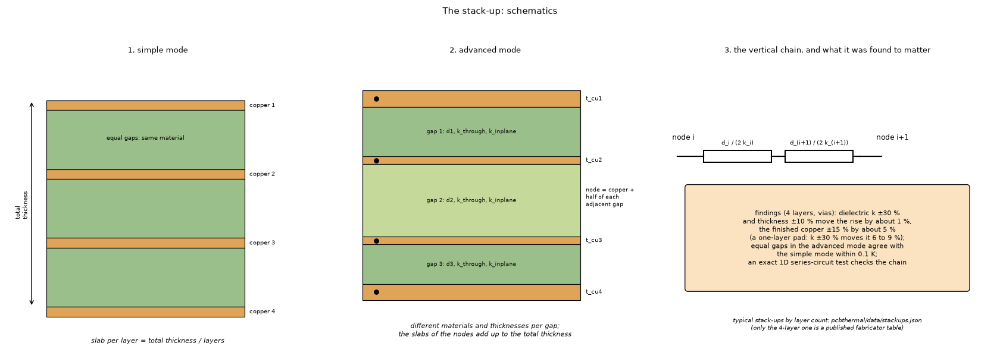
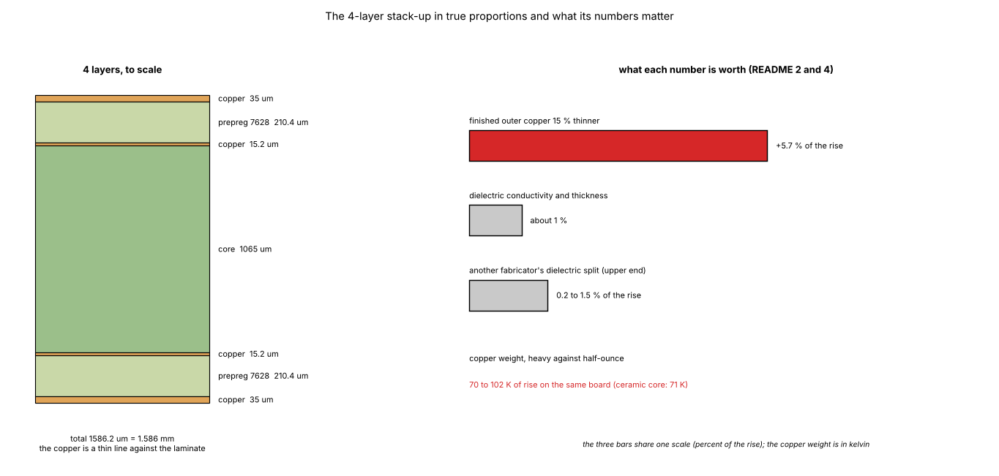
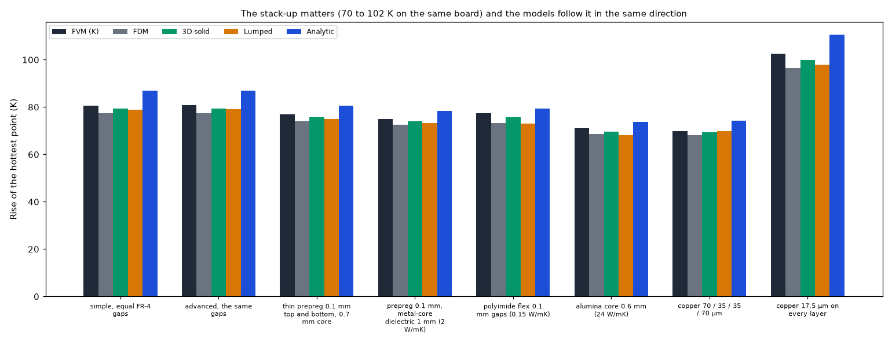
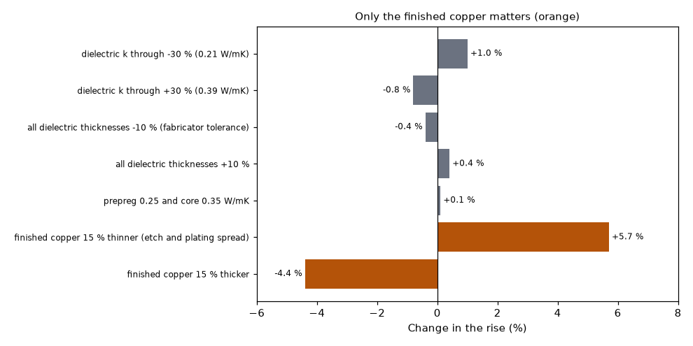
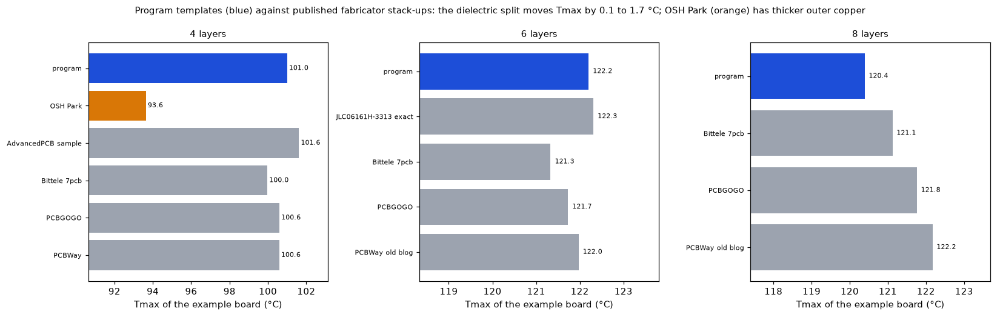
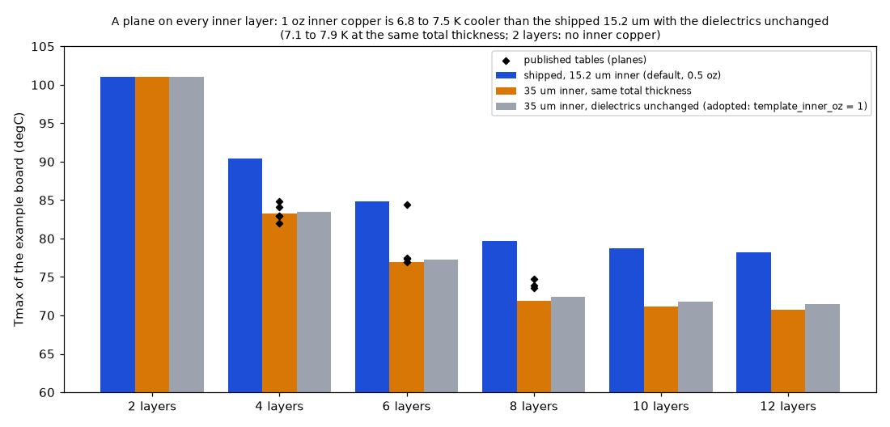
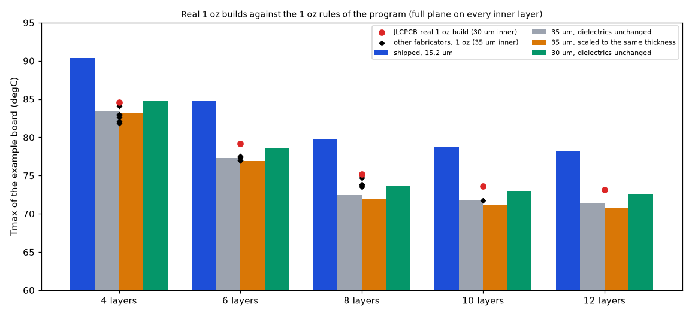

# The stack-up: advanced mode, typical templates and fabricators' tables

Status: **implemented** in the program (see the program's `docs/versions.md` and `docs/validation.md`). Studies: `stackup_outline_study.py` (sections 4.1 and 4.2), `stackup_vendor_check.py` (section 4.3) `study_dielectric_sensitivity.py` (section 4.4) and `study_inner_copper_1oz.py` (section 4.5); figures: `make_figures.py`. Reviewed on 2026-10-24 on the corrected program (section 7).

## 1. The questions

1. Does an advanced stack-up (copper per layer, material and thickness per gap) work in all five models, and does it add a model error?
2. How sensitive is the temperature to each stack-up number?
3. Are the program's typical stack-up templates (`pcbthermal/data/stackups.json`) close to what fabricators publish?

### 1.1 Diagrams and illustrations



*Figure 4 (`figures/fig_04_stackup_schematic.png`): The stack-up as schematics: 1, the simple mode (equal gaps, the thickness shared by the layers); 2, the advanced mode (copper per layer, material and thickness per gap; each node is the copper plus half of each adjacent gap); 3, the vertical chain as a series of half gaps and what it was found to matter.*



*Figure 5 (`figures/fig_05_stackup_to_scale.png`): the program's 4-layer stack-up in true proportions (35 / 15.2 / 15.2 / 35 um copper, 7628 prepreg 210.4 um, core 1065 um) and what each number is worth for the temperature.*

## 2. Findings in short

* The advanced stack-up with equal gaps reproduces the simple one (0.1 K apart), and an exact series circuit of layer nodes to 1e-6 K in the FVM and FDM.
* The stack-up matters (70 to 102 K of rise on the same board between heavy and half-ounce copper, 71 K with a ceramic core) and the models follow it in the same direction; the spread between models is the same as on a plain board.
* **On a board with copper on both faces, the parameter that matters is the finished copper**: a 15 % thinner finish raises the rise by 5.7 %; the dielectric conductivity (±30 %) and thickness (±10 %) move it by about 1 % with vias under the part and by 2 to 3 % without. **This does not hold for a one-layer board with a pad**: there the heat crosses the laminate and ±30 % of dielectric conductivity moves the rise by +8.7 / -6.1 % (section 4.4; the independent 3D solver agrees within 0.2 points on every case).
* The program's 4-layer template is JLC04161H-7628 as recorded from the JLCPCB pages in 2026-10-22 (only the core 1065 µm and the 15.2 µm inner copper were confirmed again in this review, section 7); the other fabricators' dielectric splits move the maximum temperature by 0.1 to 1.5 °C. With inner planes the 0.5 oz (15.2 µm) inner copper of the templates makes the board 5 to 8 K hotter than the 1 oz inner copper of most published tables.

## 3. Folder layout

| File | What it is |
| :-- | :-- |
| `scripts/stackup_outline_study.py` | Tables of the advanced stack-up in five models, the outline (see `../outline/`), the sensitivity to the stack-up numbers, the finned block. |
| `scripts/stackup_vendor_check.py` | The example board with the program's templates and with the published tables of seven fabricators entered layer by layer. |
| `scripts/study_dielectric_sensitivity.py` | The sensitivity of section 4.2 repeated on one-layer, two-layer and four-layer boards, against the independent 3D solver `../effective-conductivity/lib/layered3d.py`. |
| `scripts/study_inner_copper_1oz.py` | The templates with 15.2 µm and 35 µm inner copper (section 4.5). |
| `scripts/study_real_1oz_stackups.py` | The real 1 oz inner-copper stack-ups that could be read (JLCPCB, Bittele, PCBWay, PCBGOGO, AdvancedPCB) with their addresses, the pressed-prepreg rule check and the comparison with the program's 1 oz rules (section 4.6). |
| `scripts/make_figures.py` | Draws figures 1, 2, 3, 6 and 7 (runs the studies and reads the tables they print). |
| `scripts/make_diagrams.py` | Draws the schematic diagram and the illustration (figures 4 and 5; no data, no program; uses `research/diagram_kit.py`). |
| `figures/` | `fig_01` to `fig_07`; figures 4 and 5 are the diagram and the illustration (`make_diagrams.py`), figure 6 is section 4.5, figure 7 section 4.6. |

## 4. How to run, and the results

```sh
.venv/bin/python research/stackup/scripts/stackup_outline_study.py        # about 2 minutes
.venv/bin/python research/stackup/scripts/stackup_vendor_check.py         # about 15 seconds
.venv/bin/python research/stackup/scripts/study_dielectric_sensitivity.py  # about 2 minutes
.venv/bin/python research/stackup/scripts/study_inner_copper_1oz.py  # about 3 minutes (--no-3d: 1 minute)
.venv/bin/python research/stackup/scripts/study_real_1oz_stackups.py  # about 2 minutes
.venv/bin/python research/stackup/scripts/make_figures.py                  # about 4 minutes
.venv/bin/python research/stackup/scripts/make_diagrams.py
```

### 4.1 Exact checks and the advanced stack-up in five models

`python research/stackup/scripts/stackup_outline_study.py` prints the two tables; `tests/test_stackup.py`, `tests/test_outline.py`, `tests/test_inverse.py` and `tests/test_compute.py` hold the checks.
Board of the study: 60 × 40 mm, 4 layers with full copper, nine vias under a 6 × 6 mm heater of 3 W, typed 12 W/m²K on both faces, FVM at 1 mm.


**Exact checks.**
* A uniform board (heater and copper over the whole board, insulated edges) is one-dimensional: a chain of layer nodes joined by `k/d` of every gap. The FVM and the FDM reproduce the exact series circuit of a stack with three different gaps (0.12 mm at 0.4 W/mK, 0.9 mm at 2 W/mK, 0.25 mm at 0.3 W/mK) to 1e-6 K on every layer.
* The advanced stack-up with equal gaps against the simple one: 0.1 K apart (80.8 against 80.7 K rise); the small difference is how the laminate of the layer nodes is shared (copper plus half of each gap against thickness/N).
* An outline that is the whole rectangle gives the same result as no outline (1e-9 K), and an outline that cuts the board to a smaller rectangle gives the same result as the smaller board (0.05 K) in the FVM, the FDM and the 3D solid.
* The energy balance closes to 1e-9 on every outline in all three models, and a part drawn off the board still delivers its whole power.

**A. Advanced stack-up.** Rise of the hottest point in K (FVM) and the other models as a difference from it:

| Stack | FVM | FDM | 3D solid | Lumped | Analytic |
| :-- | --: | --: | --: | --: | --: |
| simple, equal FR-4 gaps | 80.7 | -4.1 % | -1.5 % | -3.2 % | +7.7 % |
| advanced, the same gaps | 80.8 | -4.1 % | -1.7 % | -3.3 % | +7.7 % |
| thin prepreg 0.1 mm top and bottom, 0.7 mm core | 76.9 | -3.6 % | -1.5 % | -3.5 % | +4.8 % |
| prepreg 0.1 mm, metal-core dielectric 1 mm (2 W/mK) | 75.1 | -3.4 % | -1.5 % | -3.6 % | +4.5 % |
| polyimide flex 0.1 mm gaps (0.15 W/mK) | 77.4 | -5.3 % | -2.1 % | -6.6 % | +2.5 % |
| alumina core 0.6 mm (24 W/mK) | 71.2 | -3.6 % | -2.1 % | -5.2 % | +3.6 % |
| copper 70 / 35 / 35 / 70 µm | 69.8 | -2.2 % | -0.6 % | -0.9 % | +6.4 % |
| copper 17.5 µm on every layer | 102.5 | -6.0 % | -2.6 % | -5.9 % | +7.8 % |

* The stack-up matters: the same board goes from 102.5 K (half-ounce copper) to 69.8 K (heavy outer copper) and from 80.7 to 71.2 K with a ceramic core; the models follow it in the same direction (every row of `test_stackup.py` checks the trend in all five models).
* The spread between models is the same as on the plain board (FDM about 4 % low because a via is sampled at the nearest node, the 3D solid within 2.6 %, the Lumped 0.9 to 6.6 % low, the Analytic 2.5 to 8 % high; the Lumped column was 1 point less low before the minimum ring width of the corrected program): the advanced stack-up does not add a model error.



*Figure 2: `figures/fig_02_stackups_in_five_models.png`.*

### 4.2 Sensitivity to the stack-up numbers

**C. Sensitivity to the stack-up numbers** (`python research/stackup/scripts/stackup_outline_study.py`; the typical 4-layer stack-up of `stackups.json`, base rise 84.5 K):

| Change | Rise [K] | Change in the rise |
| :-- | --: | --: |
| dielectric k through -30 % (0.21 W/mK) | 85.4 | +1.0 % |
| dielectric k through +30 % (0.39 W/mK) | 83.8 | -0.8 % |
| all dielectric thicknesses -10 % (fabricator tolerance) | 84.2 | -0.4 % |
| all dielectric thicknesses +10 % | 84.8 | +0.4 % |
| prepreg 0.25 and core 0.35 W/mK | 84.6 | +0.1 % |
| finished copper 15 % thinner (etch and plating spread) | 89.3 | +5.7 % |
| finished copper 15 % thicker | 80.8 | -4.4 % |

Without the vias under the part (base rise 93.4 K; printed by the same script since this review) the same ±30 % in the dielectric conductivity gives +3.3 / -2.3 %. On this board the prepreg and the core matter little; the copper and the vias matter more. Section 4.4 shows where that stops being true.



*Figure 3: `figures/fig_03_sensitivity_to_stackup_numbers.png`.*

### 4.3 The typical stack-ups against fabricators' tables

`python research/stackup/scripts/stackup_vendor_check.py` solves the example board (FVM, 2 mm) with the program's template of each layer count and with the published tables of seven fabricators entered layer by layer.

**What was found online.** Complete layer tables: JLCPCB (4 layers with 7628, 3313, 1080 and 2116 prepreg; 6 layers JLC06161H-3313), PCBWay (76 four-layer tables, 1 oz or 1.5 oz inner copper; an older blog table for 6 and 8 layers), OSH Park (4 layers, FR408HR), Bittele 7pcb (2 to 10 layers, 0.062 in, 1 oz), PCBGOGO (4, 6, 8 layers, 0.4 to 2.4 mm), AdvancedPCB (one 4-layer sample; the 6, 8 and 10-layer drawings are images). NextPCB gives only the prepreg thicknesses in text (2116 0.125 mm, 1080 0.077 mm, 7628 0.2 mm, central prepreg of the 6-layer 0.103 mm; the cores are in drawings). Eurocircuits does not publish tables as text: its builds are chosen in the configurator (about 940 predefined builds); the catalogue is cores of 100, 200, 360 and 710 µm with 12, 18, 35 or 70 µm foil and prepregs PR1080 70 µm, PR2116 120 µm, PR7628 180 µm; pooled boards are 1.55 mm (6 layers and more) and 1.00 mm (4 layers). Sierra Circuits (Proto Express) gives a nominal 1.57 mm, minimum core and dielectric 4 mil, and makes the final stack-up per order. For Eurocircuits, Sierra and NextPCB no complete layer table could be read, so they are checked only against the catalogue values (every prepreg and core of the templates is inside the catalogues: 76 to 210 µm prepreg, 330 to 1065 µm core).

The board is the example board reshaped to each layer count: its top copper on layer 1, its bottom plane on the last layer, its heaters, vias and bottom heatsink; the two inner planes of the example are dropped in the first column (so that only the dielectric split and the outer copper differ) and put on every inner layer in the second (so that the inner copper of each table counts).
Until this review the 6 and 8-layer boards had **no bottom copper** (the script kept only zones on layer indices 0 and n - 1, and the bottom plane of the example is index 3): their rows were about 21 K hotter (122.2 °C for the 6-layer template) and the comparison was of a different board. The 4-layer rows did not change.

| Stack-up | Total (mm) | Tmax, outer copper only (°C) | Tmax, a plane on every inner layer (°C) |
| :-- | --: | --: | --: |
| 4 layers, program template (= JLC04161H-7628: 35 / 15.2 / 15.2 / 35 µm, prepreg 210.4, core 1065) | 1.586 | 101.00 | 90.40 |
| 4 layers, AdvancedPCB sample (1 oz, 2 × 2116 per side, core 39 mil) | 1.613 | 101.62 | 84.12 |
| 4 layers, Bittele (1 oz, 2 × 2116 of 0.0091 in, core 0.037 in) | 1.544 | 99.97 | 82.98 |
| 4 layers, PCBGOGO (18 → 35 µm outer, prepreg 0.11, core 1.2) | 1.560 | 100.60 | 82.04 |
| 4 layers, PCBWay (1 oz inner, prepreg 190, core 1030) | 1.550 | 100.59 | 82.98 |
| 4 layers, OSH Park (43.2 µm outer, 17.5 µm inner, prepreg 199.9, core 990.6) | 1.512 | 93.64 | 84.83 |
| 6 layers, program template | 1.600 | 100.95 | 84.80 |
| 6 layers, JLC06161H-3313 as published (99.4 / 550 / 108.8 / 550 / 99.4 µm) | 1.538 | 100.66 | 84.43 |
| 6 layers, Bittele (0.0081 / 0.013 / 0.0091 / 0.013 / 0.0081 in) | 1.517 | 99.44 | 77.41 |
| 6 layers, PCBGOGO (prepreg 0.11, cores 0.6) | 1.740 | 101.12 | 77.52 |
| 6 layers, PCBWay blog table (110 / 530 / 110 / 530 / 110 µm) | 1.600 | 100.46 | 76.97 |
| 8 layers, program template | 1.600 | 99.24 | 79.72 |
| 8 layers, Bittele (1080 × 2, 0.009, 7628, 0.0051, 7628, 0.009, 1080 × 2) | 1.542 | 99.12 | 73.89 |
| 8 layers, PCBGOGO (prepreg 0.18, cores 0.2) | 1.600 | 100.03 | 74.70 |
| 8 layers, PCBWay blog table (175 / 130 alternating) | 1.370 | 98.82 | 73.55 |

* The 4-layer template is the JLCPCB table JLC04161H-7628 as it was read on 2026-10-22 (the addresses are in the program's `docs/validation.md`, section 14). In this review only part of it could be confirmed again: a search snippet of the JLCPCB help page gives the 1.065 mm core and 0.2 mm of 7628 prepreg with 0.0175 mm inner copper (an older version of the page, it seems), and an independent collection of JLCPCB's impedance templates (gsuberland/jlcpcb_autogenerated_stackups on GitHub, which disclaims any guarantee) gives 0.0152 mm for the inner copper of 4 to 8 layers; the 210.4 µm prepreg was not seen again. **Published versus constructed**: the 4-layer entry is the only one copied from a fabricator's table; the 2-layer entry (one 1.53 mm core) and the 6, 8, 10 and 12-layer entries are constructed so that the layers add up to the nominal thickness (the file `stackups.json` says so), and the 1-layer entry is the simple mode. Only the 4, 6 and 8-layer templates are compared with tables here.
* With the outer copper only, the other fabricators' dielectric splits (prepreg 190 to 250 µm, core 940 to 1200 µm; 6 layers cores 330 to 600 µm; 8 layers cores 130 to 229 µm) move the maximum temperature by 0.1 to 1.5 °C (0.2 to 2.0 % of the rise): a 4-layer board stays within 1.0 °C of the template, 6 layers within 1.5 °C, 8 layers within 0.8 °C. The exact prepreg and core split hardly matters on a board whose heat goes down the vias and spreads in the outer copper.
* **With inner planes the inner copper matters.** The templates use 0.5 oz (15.2 µm) inner copper, most tables 1 oz (34 to 36 µm): with a full plane on every inner layer the published boards are 6.3 to 8.4 °C cooler than the 4-layer template, 7.3 to 7.8 °C than the 6-layer and 5.0 to 6.2 °C than the 8-layer one, while the JLCPCB 6-layer table, which has the same 15.2 µm inner copper, is within 0.4 °C. The 0.5 oz inner copper is the conservative end; type the real value when it is known.
* **The finished outer copper matters too.** OSH Park's 1 oz outer copper is 43.2 µm (clad + plated), against the 35 µm of the templates: with its own dielectrics but 35 µm outer copper the board is at 100.55 °C, with 43.2 µm at 93.64 °C (−6.9 K, 9 % of the rise), and the JLCPCB dielectrics with 43.2 µm give 94.08 °C (both printed by the script since this review). A fabricator's "1 oz" finished outer copper is 35 to 43 µm (plating on 18 µm foil; PCBGOGO, PCBWay and JLCPCB quote 35 µm, OSH Park 43.2 µm), so the 35 µm default is the conservative end of the range.
* The old PCBWay blog table for 8 layers sums to 1.37 mm, not the 1.6 mm it is titled with, so it is not consistent (PCBWay calls it the old version); the PCBGOGO 6-layer table sums to 1.74 mm against its 1.6 mm title, probably because the cores listed include copper. Both are shown as published.
* The middle prepreg of the 6-layer template (200 µm) is thicker than the 109 to 110 µm of JLCPCB and PCBWay (the template keeps 1.6 mm by thickening it) and than the 231 µm of Bittele's two-sheet 2116; the whole JLCPCB 6-layer table, which has the same copper, is 0.3 to 0.4 °C cooler than the template (0.1 K before this review, on the board without bottom copper), so the templates were left unchanged.
* Not covered: constructions with blind or buried vias, sequential lamination, heavy copper, metal-core and ceramic boards (they are in the dielectric presets, with no fabricator table checked).



*Figure 1: `figures/fig_01_vendor_stackups.png`.*

### 4.4 Where the dielectric matters: other boards and an independent solver

`.venv/bin/python research/stackup/scripts/study_dielectric_sensitivity.py` repeats the changes of section 4.2 on boards where the heat has to cross the dielectric, with the FVM of the program and with the independent 3D finite-volume solver `../effective-conductivity/lib/layered3d.py` (real slabs, none of the program's code). The same physics on both sides: 60 × 40 mm, a 6 × 6 mm source of 3 W in the middle, 12 W/m²K on both faces (also under the source), insulated edges, FR-4 taken isotropic at 0.3 W/mK (the independent solver is isotropic per slab), 1 mm cells. Change in the rise, program / independent:

| Board | Base rise [K] | k -30 % | k +30 % | thickness -10 % | thickness +10 % | copper -15 % | copper +15 % |
| :-- | --: | --: | --: | --: | --: | --: | --: |
| 1 layer, full copper, 1.6 mm | 115.7 / 115.7 | +1.1 / +1.1 | -0.8 / -0.8 | -0.0 / -0.0 | +0.0 / +0.0 | +8.6 / +8.6 | -6.5 / -6.5 |
| 1 layer, 20 mm pad, 1.6 mm | 216.1 / 222.7 | +8.7 / +8.9 | -6.1 / -6.3 | +1.6 / +1.4 | -1.4 / -1.3 | +3.3 / +3.2 | -2.5 / -2.5 |
| 2 layers, full copper, no vias | 105.7 / 105.9 | +2.8 / +2.7 | -2.0 / -2.0 | -0.7 / -0.7 | +0.6 / +0.6 | +7.3 / +7.3 | -5.5 / -5.6 |
| 4 layers (template), full copper, no vias | 96.1 / 96.2 | +3.2 / +3.2 | -2.3 / -2.3 | -0.9 / -0.9 | +0.8 / +0.8 | +6.3 / +6.3 | -4.8 / -4.8 |
| 4 layers (template), full copper, 9 vias | 87.2 | +1.1 | -0.9 | -0.7 | +0.7 | +5.6 | -4.3 |

* The program and the independent solver agree on every sensitivity within 0.2 points, and on the base rise within 0.2 % except the one-layer pad (3.0 % low, the bare-pad error of the laminate nodes recorded in the program's `docs/theory.md`, section 1.4).
* "The dielectric conductivity and thickness move the temperature by about 1 %, the copper by 5 %" holds on the board it was measured on (4 layers, full copper, vias: +1.1 / -0.9 % and +5.6 / -4.3 % here, against +1.0 / -0.8 % and +5.7 / -4.4 % on the anisotropic board of section 4.2). Without vias the dielectric conductivity is worth 2 to 3 %; **on a one-layer board with a pad it is the first parameter** (+8.7 / -6.1 % for ±30 %), and the laminate thickness is worth 1.4 to 1.6 %. On a one-layer board with full copper the laminate barely matters (the copper spreads the heat over the whole board, which then loses it through the top film) but the copper is worth 6.5 to 8.6 %.
* The "copper weight" of the earlier statement is a ±15 % spread of the finished copper, not a change of weight: half-ounce against two-ounce outer copper moves the rise by 30 % (section 4.1).
* Limits: one source size, one coefficient (12 W/m²K), insulated edges, FR-4 isotropic in this table (the program's default is 0.9 W/mK in the plane); the board with vias has no independent value (the independent solver has no vias; the 3D solid column of section 4.1 is the check there).

### 4.5 Inner copper of the templates: 0.5 oz (15.2 µm) against 1 oz (35 µm)

`python research/stackup/scripts/study_inner_copper_1oz.py` (about 3 minutes; `--no-3d` skips the 3D solid) repeats the example board of section 4.3 (FVM, 2 mm, full plane on every inner layer, bottom plane on the last layer) with every template of the program and with the inner copper changed; the outer copper stays 35 µm. Variants: as shipped (15.2 µm); 35 µm with the dielectrics unchanged (the board gets thicker); 35 µm with the same total thickness (every dielectric of the template is scaled by one factor, the extra copper is taken out of the resin); 17.5 µm (a true 0.5 oz base foil), dielectrics unchanged. The difference is against the shipped template, in K and in % of its rise over the 25 °C ambient.

| Layers | Variant | Total (mm) | Tmax FVM (°C) | Difference (K) | Difference (% of the rise) | Tmax 3D solid (°C) |
| :-- | :-- | --: | --: | --: | --: | --: |
| 2 | shipped (no inner copper) | 1.600 | 100.99 | 0 | 0 | |
| 4 | shipped 15.2 µm | 1.586 | 90.40 | 0 | 0 | 90.46 |
| 4 | 35 µm, dielectrics unchanged | 1.626 | 83.46 | −6.94 | −10.6 | 83.51 |
| 4 | 35 µm, same thickness | 1.586 | 83.27 | −7.13 | −10.9 | 83.31 |
| 4 | 17.5 µm, dielectrics unchanged | 1.591 | 89.34 | −1.06 | −1.6 | 89.39 |
| 6 | shipped 15.2 µm | 1.600 | 84.80 | 0 | 0 | 84.83 |
| 6 | 35 µm, dielectrics unchanged | 1.679 | 77.30 | −7.50 | −12.5 | 77.33 |
| 6 | 35 µm, same thickness | 1.600 | 76.89 | −7.90 | −13.2 | 76.92 |
| 6 | 17.5 µm, dielectrics unchanged | 1.609 | 83.54 | −1.26 | −2.1 | 83.56 |
| 8 | shipped 15.2 µm | 1.600 | 79.72 | 0 | 0 | |
| 8 | 35 µm, dielectrics unchanged | 1.719 | 72.44 | −7.28 | −13.3 | |
| 8 | 35 µm, same thickness | 1.600 | 71.88 | −7.83 | −14.3 | |
| 8 | 17.5 µm, dielectrics unchanged | 1.614 | 78.43 | −1.28 | −2.3 | |
| 10 | shipped 15.2 µm | 2.000 | 78.76 | 0 | 0 | |
| 10 | 35 µm, dielectrics unchanged | 2.158 | 71.78 | −6.98 | −13.0 | |
| 10 | 35 µm, same thickness | 2.000 | 71.15 | −7.61 | −14.2 | |
| 10 | 17.5 µm, dielectrics unchanged | 2.018 | 77.51 | −1.25 | −2.3 | |
| 12 | shipped 15.2 µm | 2.400 | 78.22 | 0 | 0 | |
| 12 | 35 µm, dielectrics unchanged | 2.598 | 71.46 | −6.76 | −12.7 | |
| 12 | 35 µm, same thickness | 2.400 | 70.77 | −7.45 | −14.0 | |
| 12 | 17.5 µm, dielectrics unchanged | 2.423 | 77.00 | −1.22 | −2.3 | |

(The 3D solid was run for 4 and 6 layers only, for time; it agrees with the FVM within 0.06 K and gives the same differences to 0.01 K, so the effect is not an artefact of the FVM's layer model.)



*Figure 6: `figures/fig_06_inner_copper_1oz.png` (black diamonds: the published tables of section 4.3 with a plane on every inner layer).*

* **Size of the effect**: 1 oz (35 µm) inner copper cools the board by 6.8 to 7.5 K with the dielectrics unchanged and by 7.1 to 7.9 K at the same total thickness (11 to 14 % of the rise); the 4-layer template is the smallest (−10.6 / −10.9 %), the 8 to 12-layer ones the largest (−13 to −14 %). Thinning the dielectrics to keep the thickness adds only 0.2 to 0.7 K: the copper, not the thickness, is what matters. A true 0.5 oz base foil (17.5 µm) gives only −1.1 to −1.3 K. The 2-layer template has no inner copper and does not change.
* **Against the published tables (planes on every inner layer, section 4.3)**: the 4-layer template with 35 µm at the same thickness (83.27 °C) is within 0.3 K of PCBWay (82.98) and within 1.6 K of the AdvancedPCB (84.12) and OSH Park (84.83, 17.5 µm inner but 43.2 µm outer) tables; the shipped 15.2 µm template is 7.4 K above PCBWay. For 6 layers the 35 µm template (76.89) is within 0.1 to 0.6 K of the PCBWay blog (76.97) and PCBGOGO (77.52) tables, against 84.80 shipped. For 8 layers the 35 µm template (71.88) is 1.7 to 2.8 K below the three published tables (73.55 to 74.70), whose dielectrics are thinner at the cores, so the shipped 79.72 is 5.0 to 6.2 K above them and the 1 oz variant is 1.7 to 2.8 K below: the published tables fall between the two variants, nearer to 1 oz.
* **Which tables use which copper** (as recorded in this folder, section 4.3 and `stackups.json`): 0.5 oz (15.2 µm) inner copper is the JLCPCB specification for 4 to 8 layers (the source line of `stackups.json`; the JLC04161H-7628 and JLC06161H-3313 tables, and the independent collection of JLCPCB impedance templates, give 15.2 µm); 1 oz (about 35 µm) inner copper is quoted by PCBWay (four-layer tables and the older 6 and 8-layer blog table), PCBGOGO, Bittele 7pcb (1 oz, 35.6 µm) and AdvancedPCB (1 oz, 34.3 µm); OSH Park gives 17.5 µm inner (0.5 oz) with 43.2 µm outer. JLCPCB does sell a 1 oz inner option (30 um finished): section 4.6.
* **Which default is better**: the 0.5 oz template is the conservative one (hotter, by 7 to 8 K, 11 to 14 % of the rise, with planes) and is the real JLCPCB standard construction; the 1 oz one is the more common figure in other fabricators' tables and brings the 4 and 6-layer templates within 0.1 to 0.6 K of PCBWay/PCBGOGO (the 8-layer one stays 1.7 to 2.8 K cooler than the published tables). Without inner planes (zones only on the outer layers) the inner copper plays no part and the choice changes nothing. With the inner copper typed by the user, the template only matters until they edit it.
* **The decision (keep 0.5 oz or switch the inner copper to 35 µm, or ship both templates) is the maintainer's.** The proposed change to `stackups.json` is in `docs/for-the-project-documents.md`, section 7. Not covered: heavy inner copper (2 oz), partial planes (an inner layer is usually a signal layer with 30 to 70 % copper, so the true effect is between the two variants), other boards.

### 4.6 What fabricators really do with the dielectrics when the inner copper is 1 oz

Question (maintainer): the 1 oz variant of section 4.5 keeps the nominal board thickness by scaling every dielectric of the template by one factor (0.973 for 4 layers down to 0.909 for 12). Do fabricators thin the prepreg and the cores in proportion, thin only the prepreg (the resin fills the etched copper), or keep the dielectrics and let the board be thicker? `python research/stackup/scripts/study_real_1oz_stackups.py` (about 2 minutes) holds the stack-ups that could be read, with their addresses, and prints every table of this section. Every row has a full plane on every inner layer, as in sections 4.3 and 4.5; FVM, 2 mm.

**Sources and how they were read.** The status is what was done in this step. "WebFetch extraction" means the page was passed through the fetch tool, which returns a model's summary of the page, not the raw text, so those numbers are as extracted and were not checked against the page by eye; "read in full" for a PDF or a JSON file means the file itself was downloaded and its text parsed.

| Source | Address | Status |
| :-- | :-- | :-- |
| Source | URL | Status |
| :-- | :-- | :-- |
| JLCPCB (API template data) | https://github.com/gsuberland/jlcpcb_autogenerated_stackups | read in full |
| Bittele 7pcb 4L 0.062 in | https://www.7pcb.com/Upload_file/Multi-layer-stack-up.pdf | read in full (PDF text extracted) |
| Bittele 7pcb 6L | https://www.7pcb.com/Upload_file/Multi-layer-stack-up.pdf | read in full (PDF text extracted) |
| Bittele 7pcb 8L | https://www.7pcb.com/Upload_file/Multi-layer-stack-up.pdf | read in full (PDF text extracted) |
| Bittele 7pcb 10L | https://www.7pcb.com/Upload_file/Multi-layer-stack-up.pdf | read in full (PDF text extracted) |
| PCBWay 4L ID 1 (70 % residual) | https://www.pcbway.com/multi-layer-laminated-structure.html | WebFetch extraction (a model summary of the page, not the raw text), IDs 1-76 of 112 |
| PCBWay 4L ID 3 (30 % residual) | https://www.pcbway.com/multi-layer-laminated-structure.html | WebFetch extraction (a model summary of the page, not the raw text), IDs 1-76 of 112 |
| PCBWay old blog 6L 1.6 mm | https://www.pcbway.com/blog/Engineering_Technical/stackup___pcbway.html | WebFetch extraction (a model summary of the page, not the raw text); dielectrics only, no total given |
| PCBWay old blog 8L 1.6 mm | https://www.pcbway.com/blog/Engineering_Technical/stackup___pcbway.html | WebFetch extraction (a model summary of the page, not the raw text); dielectrics only, no total given |
| PCBGOGO 4L 1.6 mm (core as dielectric) | https://www.pcbgogo.com/pcbgogo-standard-stackup-for-multilayer-pcbs.pdf | read in full (PDF text extracted) |
| PCBGOGO 4L 1.6 mm (core includes the foils) | https://www.pcbgogo.com/pcbgogo-standard-stackup-for-multilayer-pcbs.pdf | read in full (PDF text extracted) |
| PCBGOGO 6L 1.6 mm (core as dielectric) | https://www.pcbgogo.com/pcbgogo-standard-stackup-for-multilayer-pcbs.pdf | read in full (PDF text extracted) |
| PCBGOGO 6L 1.6 mm (core includes the foils) | https://www.pcbgogo.com/pcbgogo-standard-stackup-for-multilayer-pcbs.pdf | read in full (PDF text extracted) |
| PCBGOGO 8L 1.6 mm (core as dielectric) | https://www.pcbgogo.com/pcbgogo-standard-stackup-for-multilayer-pcbs.pdf | read in full (PDF text extracted) |
| PCBGOGO 8L 1.6 mm (core includes the foils) | https://www.pcbgogo.com/pcbgogo-standard-stackup-for-multilayer-pcbs.pdf | read in full (PDF text extracted) |
| AdvancedPCB 4L 0.062 in sample | https://www.advancedpcb.com/en-us/resources/stackups/ | WebFetch extraction (a model summary of the page, not the raw text); the 6, 8 and 10-layer drawings are images |
| JLCPCB help, copper weight | https://jlcpcb.com/help/article/jlcpcb-copper-weight | WebFetch extraction (a model summary of the page, not the raw text): inner copper 0.5 oz (default), 1 oz and 2 oz for FR-4; availability depends on total layers and overall thickness; no stack-up |
| OSH Park | (address not recorded in section 4.3) | earlier read (section 4.3): inner copper is 17.5 um (0.5 oz): not a 1 oz build; read in the earlier step of section 4.3, not reopened here |
| Eurocircuits | https://www.eurocircuits.com/Standard-multilayer-builds | WebFetch extraction (a model summary of the page, not the raw text), no layer data: the builds are images and a configurator (over 940 predefined builds); the page has no numbers |
| Sierra Circuits (Proto Express) | https://www.protoexpress.com/tools/pcb-stackup-designer/ | snippet or summary only: an interactive designer; only search snippets |
| Wuerth Elektronik BASIC | https://we-online.com/en/products/printed-circuit-boards/basic/stackups-as-pdf | could not open or no layer data: page lists 4 and 6 layers, 1.55 mm nominal (1.63 mm finished), 35 um copper; layers are in PDFs that were not opened |
| Multi-CB | (no page found) | could not open or no layer data: search found nothing specific |
| NextPCB | https://www.nextpcb.com/blog/pcb-stackup-core-prepreg-copper-foil-guide | WebFetch extraction (a model summary of the page, not the raw text), no layer data: prepreg nominal thicknesses and cores with copper only, no multilayer table |
| Ventec / Isola laminate data | https://www.isola-group.com/wp-content/uploads/Prepreg-Selection-Individulal-Dielectric-Space.pdf | read in full (Isola); could not open or no layer data (Ventec): Isola application note (2013): the pressing rule used below, PDF text extracted and read in full; no Ventec data found; no IS410 table found |

JLCPCB does sell 1 oz inner copper: its help page lists 0.5 oz (default), 1 oz and 2 oz for FR-4 inner layers, "availability depends on total layers and overall thickness" (WebFetch extraction; another JLCPCB page quoted by a search snippet says 1 oz inner is for 4-layer boards only, so the order page decides). The JLCPCB layer data are 38 files of the open repository `gsuberland/jlcpcb_autogenerated_stackups` (`normalised_json/`: 4 to 12 layers, 1.0 to 2.5 mm, outer 1 oz, inner 0.5 oz and 1 oz, the "no requirement" build), generated from JLCPCB's impedance-template data; the repository says they were not checked by hand. Its 0.5 oz 4-layer 1.6 mm entry reproduces the program's template (210.4 / 1065 / 210.4 um), which is the check that these are the data the template came from. **JLCPCB's 1 oz inner copper is 30 um, not 35 um** (outer 35 um).

**What the pressed prepreg does (rule check).** Isola's application note (PDF, read in full) gives the rule: the copper-to-copper dielectric space is the overall thickness of the plies minus, for each adjacent layer, the etched fraction times the copper thickness (the resin that fills the etched area); the cores are bought thicknesses and do not change. Two fabricators' numbers follow it:

* PCBWay, 7628 prepreg of 196 um before pressing, 35 um inner copper: 185.5 um after pressing at 70 % residual copper and 171.5 um at 30 %; the rule gives 196 - (1 - 0.70) x 35 = 185.5 and 196 - (1 - 0.30) x 35 = 171.5 um (exact).
* AdvancedPCB's chart of the thickness per ply after processing, grouped by the weight of the adjacent inner copper and by coverage: 1 oz minus 0.5 oz at the same coverage, against (1 - coverage) x 0.7 mil from the rule (the chart is rounded to 0.1 mil = 2.5 um; the 7628 row at 70 % is 2.3 um off, one rounding step):

| Style | Coverage | Chart 0.5 oz | Chart 1 oz | Chart difference (um) | Rule difference (um) |
| :-- | --: | --: | --: | --: | --: |
| 106 | 30 % | 1.9 | 1.5 | -10.2 | -12.4 |
| 106 | 70 % | 2.2 | 2.0 | -5.1 | -5.3 |
| 1080 | 30 % | 2.6 | 2.1 | -12.7 | -12.4 |
| 1080 | 70 % | 2.8 | 2.6 | -5.1 | -5.3 |
| 2113 | 30 % | 3.5 | 3.0 | -12.7 | -12.4 |
| 2113 | 70 % | 3.7 | 3.5 | -5.1 | -5.3 |
| 2116 | 30 % | 4.7 | 4.2 | -12.7 | -12.4 |
| 2116 | 70 % | 4.9 | 4.7 | -5.1 | -5.3 |
| 7628 | 30 % | 6.5 | 6.0 | -12.7 | -12.4 |
| 7628 | 70 % | 6.8 | 6.5 | -7.6 | -5.3 |

So the pressed prepreg is thinner by the copper it buries, which is only the etched part: against a full plane (residual copper 100 %) there is nothing to fill and the prepreg keeps its thickness; at 30 to 70 % residual copper, 1 oz instead of 0.5 oz thins each prepreg by 5 to 13 um (about 3 to 6 % of a 200 um ply).

**JLCPCB, the same board with 0.5 oz and with 1 oz inner copper** (outer 35 um; same fabricator, same tool, same nominal thickness: this is what a fabricator changes). Cores and prepreg are sums of the thicknesses after pressing, in um; the "Difference" columns are the 1 oz build minus the 0.5 oz build.

| Layers | Thickness (mm) | Inner Cu (um) 0.5 / 1 oz | Cores (um) 0.5 / 1 oz | Prepreg (um) 0.5 / 1 oz | Dielectric total ratio 1/0.5 | Board total (mm) 0.5 / 1 oz | Tmax (degC) 0.5 / 1 oz | Difference (K) | Difference (% of the rise) |
| --: | --: | :-- | :-- | :-- | --: | :-- | :-- | --: | --: |
| 4 | 1 | 15.2 / 30 | 500 / 450 | 421 / 406 | 0.930 | 1.021 / 0.986 | 87.80 / 82.09 | -5.70 | -9.1 |
| 4 | 1.2 | 15.2 / 30 | 600 / 700 | 421 / 406 | 1.083 | 1.121 / 1.236 | 88.32 / 83.28 | -5.04 | -8.0 |
| 4 | 1.6 | 15.2 / 30 | 1065 / 1030 | 421 / 406 | 0.966 | 1.586 / 1.566 | 90.40 / 84.59 | -5.81 | -8.9 |
| 4 | 2 | 15.2 / 30 | 1465 / 1430 | 421 / 406 | 0.974 | 1.986 / 1.966 | 91.85 / 85.90 | -5.95 | -8.9 |
| 6 | 1 | 15.2 / 30 | 500 / 200 | 409 / 624 | 0.906 | 1.040 / 1.014 | 81.84 / 75.17 | -6.67 | -11.7 |
| 6 | 1.2 | 15.2 / 30 | 700 / 200 | 315 / 812 | 0.997 | 1.146 / 1.202 | 82.49 / 77.28 | -5.21 | -9.1 |
| 6 | 1.6 | 15.2 / 30 | 1100 / 500 | 315 / 919 | 1.003 | 1.546 / 1.609 | 84.46 / 79.16 | -5.30 | -8.9 |
| 6 | 2 | 15.2 / 30 | 1400 / 1400 | 409 / 402 | 0.996 | 1.940 / 1.992 | 86.06 / 79.58 | -6.48 | -10.6 |
| 8 | 1 | 15.2 / 30 | 390 / 225 | 432 / 574 | 0.972 | 0.983 / 1.049 | 77.95 / 71.37 | -6.58 | -12.4 |
| 8 | 1.2 | 15.2 / 30 | 600 / 300 | 432 / 620 | 0.892 | 1.193 / 1.170 | 79.19 / 72.49 | -6.70 | -12.4 |
| 8 | 1.6 | 15.2 / 30 | 900 / 750 | 538 / 654 | 0.976 | 1.600 / 1.654 | 81.37 / 75.18 | -6.19 | -11.0 |
| 8 | 2 | 15.2 / 30 | 1050 / 600 | 842 / 1218 | 0.961 | 2.053 / 2.068 | 84.02 / 77.73 | -6.29 | -10.7 |
| 10 | 1.2 | 15.2 / 30 | 400 / 300 | 582 / 568 | 0.884 | 1.174 / 1.178 | 76.67 / 69.90 | -6.77 | -13.1 |
| 10 | 1.6 | 15.2 / 30 | 800 / 600 | 597 / 712 | 0.939 | 1.589 / 1.622 | 78.88 / 72.41 | -6.46 | -12.0 |
| 10 | 2 | 15.2 / 30 | 1200 / 1000 | 597 / 676 | 0.933 | 1.989 / 1.986 | 80.64 / 73.62 | -7.02 | -12.6 |
| 12 | 1.2 | 15.2 / 30 | 375 / 375 | 578 / 450 | 0.865 | 1.175 / 1.195 | 74.52 / 68.82 | -5.69 | -11.5 |
| 12 | 1.6 | 15.2 / 30 | 750 / 500 | 670 / 710 | 0.852 | 1.642 / 1.580 | 76.91 / 70.16 | -6.74 | -13.0 |
| 12 | 2 | 15.2 / 30 | 1000 / 500 | 716 / 1120 | 0.944 | 1.938 / 1.990 | 78.51 / 72.41 | -6.10 | -11.4 |
| 12 | 2.5 | 15.2 / 30 | 1500 / 1000 | 716 / 1038 | 0.920 | 2.438 / 2.408 | 80.44 / 73.18 | -7.26 | -13.1 |

* **The fabricator does not scale anything**: for a nominal thickness it re-picks the build. The dielectric total of the 1 oz build is 0.85 to 1.08 of the 0.5 oz one (the scaled template assumes 0.91 to 0.97). At 1.6 mm the board total changes by -62 to +63 um (-4 % to +4 %; 4 layers 1.586 -> 1.566 mm, 6 layers 1.546 -> 1.609 mm), over all 19 pairs by -62 to +115 um (the 4-layer 1.2 mm board goes from 1.121 to 1.236 mm). The cores change by one catalogue step (4 layers 1.6 mm: 1065 -> 1030 um; 6 layers: two cores of 550 -> 250 um with the central gap 116 -> 513 um, which is two 7628 and one 3313 sheet) and the prepreg style and sheet count change too. Neither "scale everything" nor "thin only the prepreg" describes it; at the same nominal thickness the dielectric total can even go up (6 layers 1.6 mm: ratio 1.003; 4 layers 1.2 mm: 1.083).
* **Temperature**: 1 oz (30 um) instead of 0.5 oz lowers the maximum temperature by 5.0 to 7.3 K (8.0 to 13.1 % of the rise; 4 layers 5.0 to 6.0 K, 6 layers 5.2 to 6.7, 8 layers 6.2 to 6.7, 10 layers 6.5 to 7.0, 12 layers 5.7 to 7.3), whatever way the build was re-picked.

**The program's rules against the real builds.** Rows at the program's own thickness: 4, 6, 8 layers 1.6 mm; 10 layers 2.0 mm; the 12-layer template is 2.4 mm and JLCPCB offers 2.5 mm, shown instead. The "vs" columns are the row minus the variant named, in K. "35 um, prepreg thinned" applies the Isola rule at 50 % residual copper (each prepreg loses 0.5 x (35 - 15.2) um per adjacent inner layer, cores unchanged). The rows at 30 um are the copper of the JLCPCB 1 oz build with the template's dielectrics, so that the copper (30 against 35 um) and the dielectrics can be told apart.

| Layers | Row | Total (mm) | Dielectrics (um) | Tmax (degC) | vs scaled (K) | vs unscaled (K) | vs shipped (K) |
| --: | :-- | --: | --: | --: | --: | --: | --: |
| 4 | shipped template 15.2 um | 1.586 | 1486 | 90.40 | +7.13 | +6.94 | +0.00 |
| 4 | 35 um, dielectrics unchanged | 1.626 | 1486 | 83.46 | +0.19 | +0.00 | -6.94 |
| 4 | 35 um, scaled to the same thickness | 1.586 | 1446 | 83.27 | +0.00 | -0.19 | -7.13 |
| 4 | 35 um, prepreg thinned (Isola, 50 % residual) | 1.606 | 1466 | 83.29 | +0.02 | -0.17 | -7.11 |
| 4 | 30 um, dielectrics unchanged | 1.616 | 1486 | 84.83 | +1.57 | +1.37 | -5.56 |
| 4 | 30 um, scaled to the same thickness | 1.586 | 1456 | 84.69 | +1.42 | +1.23 | -5.71 |
| 4 | JLCPCB 1 oz 1.6 mm (inner 30 um) | 1.566 | 1436 | 84.59 | +1.32 | +1.13 | -5.81 |
| 6 | shipped template 15.2 um | 1.600 | 1469 | 84.80 | +7.90 | +7.50 | +0.00 |
| 6 | 35 um, dielectrics unchanged | 1.679 | 1469 | 77.30 | +0.40 | +0.00 | -7.50 |
| 6 | 35 um, scaled to the same thickness | 1.600 | 1390 | 76.89 | +0.00 | -0.40 | -7.90 |
| 6 | 35 um, prepreg thinned (Isola, 50 % residual) | 1.640 | 1430 | 77.01 | +0.11 | -0.29 | -7.79 |
| 6 | 30 um, dielectrics unchanged | 1.659 | 1469 | 78.66 | +1.76 | +1.36 | -6.14 |
| 6 | 30 um, scaled to the same thickness | 1.600 | 1410 | 78.36 | +1.46 | +1.06 | -6.44 |
| 6 | JLCPCB 1 oz 1.6 mm (inner 30 um) | 1.609 | 1419 | 79.16 | +2.26 | +1.86 | -5.64 |
| 8 | shipped template 15.2 um | 1.600 | 1439 | 79.72 | +7.83 | +7.28 | +0.00 |
| 8 | 35 um, dielectrics unchanged | 1.719 | 1439 | 72.44 | +0.55 | +0.00 | -7.28 |
| 8 | 35 um, scaled to the same thickness | 1.600 | 1320 | 71.88 | +0.00 | -0.55 | -7.83 |
| 8 | 35 um, prepreg thinned (Isola, 50 % residual) | 1.659 | 1379 | 72.07 | +0.19 | -0.37 | -7.65 |
| 8 | 30 um, dielectrics unchanged | 1.689 | 1439 | 73.70 | +1.82 | +1.26 | -6.01 |
| 8 | 30 um, scaled to the same thickness | 1.600 | 1350 | 73.29 | +1.40 | +0.85 | -6.43 |
| 8 | JLCPCB 1 oz 1.6 mm (inner 30 um) | 1.654 | 1404 | 75.18 | +3.30 | +2.74 | -4.53 |
| 10 | shipped template 15.2 um | 2.000 | 1808 | 78.76 | +7.61 | +6.98 | +0.00 |
| 10 | 35 um, dielectrics unchanged | 2.158 | 1808 | 71.78 | +0.63 | +0.00 | -6.98 |
| 10 | 35 um, scaled to the same thickness | 2.000 | 1650 | 71.15 | +0.00 | -0.63 | -7.61 |
| 10 | 35 um, prepreg thinned (Isola, 50 % residual) | 2.079 | 1729 | 71.38 | +0.23 | -0.40 | -7.38 |
| 10 | 30 um, dielectrics unchanged | 2.118 | 1808 | 72.98 | +1.83 | +1.20 | -5.79 |
| 10 | 30 um, scaled to the same thickness | 2.000 | 1690 | 72.50 | +1.35 | +0.72 | -6.26 |
| 10 | JLCPCB 1 oz 2.0 mm (inner 30 um) | 1.986 | 1676 | 73.62 | +2.47 | +1.84 | -5.15 |
| 12 | shipped template 15.2 um | 2.400 | 2178 | 78.22 | +7.45 | +6.76 | +0.00 |
| 12 | 35 um, dielectrics unchanged | 2.598 | 2178 | 71.46 | +0.68 | +0.00 | -6.76 |
| 12 | 35 um, scaled to the same thickness | 2.400 | 1980 | 70.77 | +0.00 | -0.68 | -7.45 |
| 12 | 35 um, prepreg thinned (Isola, 50 % residual) | 2.499 | 2079 | 71.03 | +0.26 | -0.42 | -7.19 |
| 12 | 30 um, dielectrics unchanged | 2.548 | 2178 | 72.61 | +1.84 | +1.15 | -5.61 |
| 12 | 30 um, scaled to the same thickness | 2.400 | 2030 | 72.09 | +1.32 | +0.63 | -6.13 |
| 12 | JLCPCB 1 oz 2.5 mm (inner 30 um) | 2.408 | 2038 | 73.18 | +2.41 | +1.73 | -5.04 |

**Other fabricators' 1 oz builds** (35 um inner copper; the PCBWay 4-layer rows use their pressed prepreg; for PCBGOGO "core 1.2 mm with 1/1 oz Cu" is run in both readings, as the dielectric itself and as including the two foils, because the PDF does not say and NextPCB and PCBWay name their cores with the copper included; the PCBWay old blog gives no total and its 8-layer dielectrics add to only 1.37 mm in total; Bittele boards are 0.062 in):

| Build | Total (mm) | Tmax (degC) | vs scaled (K) | vs unscaled (K) | vs shipped (K) | vs shipped (% of its rise) |
| :-- | --: | --: | --: | --: | --: | --: |
| Bittele 7pcb 4L 0.062 in | 1.544 | 82.98 | -0.29 | -0.48 | -7.42 | -11.3 |
| Bittele 7pcb 6L | 1.517 | 77.41 | +0.51 | +0.11 | -7.39 | -12.4 |
| Bittele 7pcb 8L | 1.542 | 73.89 | +2.01 | +1.45 | -5.82 | -10.6 |
| Bittele 7pcb 10L | 1.552 | 71.73 | +0.58 | -0.05 | -7.03 | -13.1 |
| PCBWay 4L ID 1 (70 % residual) | 1.541 | 82.90 | -0.36 | -0.55 | -7.49 | -11.5 |
| PCBWay 4L ID 3 (30 % residual) | 1.513 | 82.65 | -0.61 | -0.81 | -7.75 | -11.8 |
| PCBWay old blog 6L 1.6 mm | 1.600 | 76.97 | +0.07 | -0.33 | -7.83 | -13.1 |
| PCBWay old blog 8L 1.6 mm | 1.370 | 73.55 | +1.67 | +1.11 | -6.17 | -11.3 |
| PCBGOGO 4L 1.6 mm (core as dielectric) | 1.560 | 82.04 | -1.22 | -1.42 | -8.35 | -12.8 |
| PCBGOGO 4L 1.6 mm (core includes the foils) | 1.490 | 81.80 | -1.46 | -1.66 | -8.60 | -13.1 |
| PCBGOGO 6L 1.6 mm (core as dielectric) | 1.740 | 77.52 | +0.63 | +0.22 | -7.28 | -12.2 |
| PCBGOGO 6L 1.6 mm (core includes the foils) | 1.600 | 76.97 | +0.07 | -0.33 | -7.83 | -13.1 |
| PCBGOGO 8L 1.6 mm (core as dielectric) | 1.600 | 74.70 | +2.82 | +2.26 | -5.01 | -9.2 |
| PCBGOGO 8L 1.6 mm (core includes the foils) | 1.390 | 73.70 | +1.82 | +1.27 | -6.01 | -11.0 |
| AdvancedPCB 4L 0.062 in sample | 1.613 | 84.12 | +0.86 | +0.66 | -6.27 | -9.6 |

Over the 15 builds above, real minus program variant of the same layer count, and JLCPCB's 1 oz build against the 30 um variants, in K:

```
scaled         mean +0.47  mean absolute 1.00  min -1.46  max +2.82  (n = 15)
unscaled       mean +0.10  mean absolute 0.85  min -1.66  max +2.26  (n = 15)
Isola prepreg  mean +0.37  mean absolute 0.92  min -1.49  max +2.63  (n = 15)
JLCPCB 1 oz (30 um inner copper) minus the program variants at 30 um, in K
4 layers: real 84.59  vs 30 um unscaled -0.25  vs 30 um scaled -0.10
6 layers: real 79.16  vs 30 um unscaled +0.50  vs 30 um scaled +0.80
8 layers: real 75.18  vs 30 um unscaled +1.48  vs 30 um scaled +1.89
10 layers: real 73.62  vs 30 um unscaled +0.64  vs 30 um scaled +1.12
12 layers: real 73.18  vs 30 um unscaled +0.57  vs 30 um scaled +1.09
```



*Figure 7: `figures/fig_07_real_1oz_stackups.png` (red: JLCPCB 1 oz build with 30 um inner copper; black diamonds: the other fabricators, 35 um).*

* **Answer to the question**: real builds do not thin all dielectrics in proportion. The one physical thinning mechanism is the resin filling the etched copper, which affects only the prepreg, in proportion to the etched fraction, and is zero against a full plane. Otherwise fabricators re-pick cores and prepreg from their catalogue for the nominal thickness, so the dielectric total and the board thickness move by a few per cent in either direction (JLCPCB at 1.6 mm: -4 % to +4 %).
* **The three rules differ little**: at 35 um, scaled against unscaled differ by 0.2 to 0.7 K (0.3 to 1.3 % of the rise), and the Isola-thinned variant is 0.2 to 0.4 K below the unscaled one; at 30 um, scaled against unscaled differ by 0.1 to 0.6 K. The spread among real builds of the same layer count is larger (the 8-layer tables at 35 um span 73.55 to 74.70 degC, and JLCPCB's own 1 oz build is 2.7 K above the unscaled 35 um variant at 8 layers), and the copper thickness is a larger lever than the dielectric rule (30 instead of 35 um raises the temperature by 1.2 to 1.4 K).
* **Which is closer**: against the 15 builds with 35 um copper the unscaled variant has the smallest mean absolute deviation (0.85 K, against 1.00 K scaled and 0.92 K Isola-thinned); against JLCPCB's real 1 oz build at 30 um it is also closer (mean absolute 0.69 K against 1.00 K scaled). Real builds are on average slightly hotter than any variant (mean +0.1 K unscaled, +0.5 K scaled), because real builds keep or add dielectric where the scaled template removes it (8 layers: 1404 um of dielectric in the JLCPCB build against 1320 um scaled).
* **Recommendation (the decision is the maintainer's)**: for a 1 oz variant of the templates keep the template's dielectric thicknesses unchanged (no scaling factor) and change only the inner copper. Evidence: it is the closest to the real builds in the mean (0.85 and 0.69 K), it is the simplest, and the only physical thinning (resin fill) is zero under a plane and moves the maximum temperature by 0.2 to 0.4 K for a signal layer with half of its copper left. The cost is a board thicker than nominal by (35 - 15.2) um per inner layer (+0.04 mm for 4 layers up to +0.20 mm for 12 layers, 2.5 % to 8 %, inside the +-10 % tolerance fabricators quote) where real JLCPCB builds stay within -4 % to +4 % at 1.6 mm; the maximum temperature hardly depends on this (scaled against unscaled: 0.2 to 0.7 K). If the maintainer prefers boards at the nominal thickness, the scaled rule is acceptable and costs at most 0.7 K in the cool direction. If the 1 oz variant is meant to represent JLCPCB, the inner copper is 30 um (1.2 to 1.4 K hotter than 35 um).
* **Limits**: (a) one board and one heat-source layout, planes on every inner layer; a real inner layer is a signal layer with 30 to 70 % copper, so its result lies between the 0.5 oz and the 1 oz result of the tables, and its prepreg is thinner by the resin fill; (b) the JLCPCB data come from an open repository that says it was generated automatically and not checked by hand, not from the JLCPCB order page; (c) not usable: Eurocircuits (builds are images and a configurator), Sierra Circuits (interactive designer), Wuerth Elektronik BASIC (the layers are in PDFs that were not opened), Multi-CB (nothing found), AdvancedPCB 6 to 10 layers (images), Ventec and laminate datasheets with resin content per 1 oz (no data found), OSH Park (17.5 um inner, not 1 oz); (d) the PCBWay, AdvancedPCB and JLCPCB-help numbers come from WebFetch extractions, the Isola note, the Bittele and PCBGOGO PDFs from extracted text and the JLCPCB layers from the raw JSON; (e) PCBWay's 4-layer page was read for IDs 1 to 76 of 112, and its 6 and 8-layer builds only from the older blog table; (f) no measured board.

## 5. Limits of this study

* Sections 4.1 to 4.3 use one board each (the study board with 9 vias under a part, the example board reshaped), FVM at 1 to 2 mm; the temperatures are for those boards. Section 4.4 adds one-layer, two-layer and four-layer boards without vias, with one source size and one coefficient.
* The documents of the program describe the simple stack-up only: `docs/theory.md` section 1.2 gives `slab = t_pcb / L` and one gap `d`, not the advanced mode (copper plus half of each adjacent gap, `k/d` per gap, the thickness-weighted in-plane laminate of `Board.slab_thicknesses` and `Board.layer_laminate`); text for it is in `docs/for-the-project-documents.md`.
* The fabricator tables are as published on their pages (read from search snippets and pages, see the last section); two of them do not add up to their stated thickness and are shown as published.
* No blind or buried vias, sequential lamination, heavy copper or metal-core boards were checked against a fabricator table.
* No measurement of a physical board.

## 7. Review (2026-10-24, reviewer agent, program at `0ea5f07`)

Every study of the folder was re-run on the corrected program (`stackup_outline_study.py`, `stackup_vendor_check.py`, the new `study_dielectric_sensitivity.py`, `make_figures.py`, `make_diagrams.py`); `tests/test_stackup.py` and `tests/test_templates.py` pass (17 tests).

* **Defect in a study, fixed**: `stackup_vendor_check.py` dropped the bottom plane of every board with more than four layers (it kept zones on layer indices 0 and n - 1; the bottom plane of the example is index 3). The 6 and 8-layer rows of section 4.3 and of the program's `docs/validation.md` section 14 described boards with no bottom copper, about 21 K hotter than with it (6-layer template 122.20 -> 100.95 °C). The bottom plane now goes to the last layer; the 4-layer rows are unchanged. The ranges quoted from those rows changed (0.1 to 1.7 °C -> 0.1 to 1.5 °C; 0.2 to 1.5 % -> 0.2 to 2.0 % of the rise; 6 layers within 0.9 -> 1.5 °C; 8 layers within 1.4 -> 0.8 °C; the JLCPCB 6-layer table 0.1 K -> 0.3 K from the template). The old "8 layers within 1.4 °C" also left out the PCBWay row (1.78 °C away).
* **Stale numbers, fixed**: the Lumped column of table A (section 4.1) was from before the minimum ring width of the corrected program; it is 0.9 to 1.1 points lower on every row (for example -2.1 -> -3.2 % on the plain board). FVM, FDM, 3D solid and Analytic columns and tables B and C reproduce to the digit.
* **Numbers no script printed, now printed**: the board without vias of section 4.2 (93.4 K, +3.3 / -2.3 %: reproduced) and the three OSH Park variants of section 4.3 (100.55 and 94.08 reproduced; 93.65 is the 93.64 of the table).
* **Claim with a narrower scope than stated**: "the dielectric conductivity and thickness move the temperature by about 1 %, the copper weight by 5 %" is true on the 4-layer board with vias it was measured on, and checked against an independent solver here; it is 2 to 3 % without vias and 6 to 9 % on a one-layer board with a pad, and the "5 %" is a ±15 % spread of the finished copper, not a copper weight (section 4.4).
* **Template provenance**: only the 4-layer template comes from a fabricator's table; the others are constructed (as `stackups.json` says). The `sources` list of `stackups.json` says the published tables differ "by under 0.5 %"; the tables of section 4.3 give up to 2.0 % with outer copper only and up to 13 % with inner planes (8.4 K of a 65 K rise, the inner copper weight): the sentence belongs to the program and is left for the maintainer (`docs/for-the-project-documents.md`).
* **Checked and right**: the exact 1D series-circuit checks (in `tests/test_stackup.py`), the advanced-equals-simple check (0.1 K), the outline table B, the sensitivity table C; the advanced-mode code (`Board.slab_thicknesses`, `gap_properties`, `layer_laminate`) against its docstrings.
* **Stale run times, fixed**: the outline study takes about 2 minutes (not 10 seconds), the vendor check about 15 seconds.
* **Figures**: `fig_01` redrawn with the corrected rows (its title range 0.1 to 1.5 °C), `fig_02` with the new Lumped column; `fig_04` and `fig_05` texts corrected (the scope of the 1 % claim, 0.2 to 2.0 %).

## 6. Sources

Fabricator pages read: JLCPCB (4 and 6 layers), PCBWay (76 four-layer tables and an older blog table), OSH Park (FR408HR), Bittele 7pcb, PCBGOGO, AdvancedPCB (one 4-layer sample); NextPCB gives only prepreg thicknesses in text. The pages are named in `docs/validation.md` section 14; their addresses were not recorded in this repository, so this list is as read, not a citation list.

## What was read and what was not verified

* Section 4.6 (1 oz builds): the statuses are in its table; the JLCPCB layers (raw JSON), the Isola note, the Bittele and PCBGOGO PDFs were read as extracted text or parsed data; the PCBWay, AdvancedPCB, NextPCB, Eurocircuits and JLCPCB-help pages came through WebFetch extractions (a model's summary of the page); Sierra Circuits, Wuerth and Multi-CB gave nothing usable; no Ventec data.

* Read in full or from search snippets: the fabricator layer tables were taken from the pages found; two tables (PCBWay's old 8-layer blog table, PCBGOGO's 6-layer table) do not add up to their stated thickness and are shown as published. The addresses were not saved.
* Not verified: no measurement of a physical board.
* Not implemented: blind and buried vias, sequential lamination, heavy-copper and metal-core fabricator tables.
