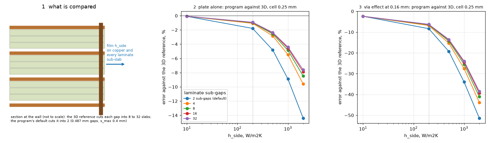
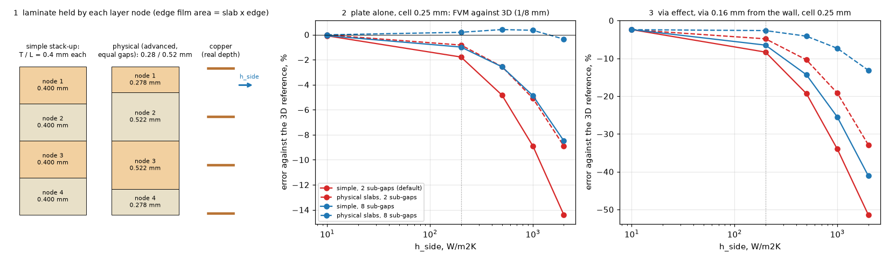

# Strong cooled edge: plate and via effect against an independent 3D solver

**Reviewed (section 8): the 'converged residual' of sections 4 to 6 was wrong.** It is the simple stack-up of the study board: every layer node stands for T / L = 0.4 mm, so the
outer copper nodes carry the edge film of 0.365 mm of laminate (physically 0.243 mm) at the copper temperature. With the physical slabs (the same board as an advanced stack-up of three
equal gaps, which is the board of the 3D reference) and eight sub-gaps the plate is +0.4 % at 1000 W/m2K and -0.4 % at 2000 (cell 0.25 mm) and the via effect is within 1 % at 0.5 to 3 mm
from the wall; what remains is the default's two sub-gaps and a via within one cell of the wall.

Question (Planned 2.6.1 item 21): at `h_side` 1000 W/m2K the whole board reads about 9 % cool and the effect of a via next to the edge reads 17 to 26 % low
against the 3D reference. Is it (a) the layered idealisation of the laminate at a strongly cooled edge, (b) a defect of the via model near such an edge, or
(c) a weakness of the 3D reference's own via? The program is not touched; everything is driven through its public API (`lib/prog.py`).

*Figure 1 (fig_01_strong_edge.png): left, the section at the wall with the film on every slab and the via 0.16 mm from it; middle, plate-alone error against the
edge coefficient; right, via-effect error, both at the 0.25 mm cell, for 2 (default), 4, 8, 16 and 32 laminate sub-gaps (simple stack-up, see section 8).*

## 1. Board, reference, how to run

Board: 10 x 10 mm, four full-copper layers of 35 um, 1.6 mm (gaps 0.487 mm), FR-4 0.3 W/mK both ways, h_top 10, h_bottom 200, 0.5 W source 3 x 2 mm at
(1..4, 4..6) mm on the top layer, one copper-filled via of 0.3 mm on y = 5 mm at a given distance from the right edge. Reference `lib/ref3d.py`
(imports nothing of the program): half domain by symmetry, copper planes one cell thick, FR-4 gaps in `n_sub` slabs, side film on every slab of the three
walls. Via representations: `cyl` (resolved copper cylinder, cell conductivity mixed by the area share of the drill disc, copper through the gap slabs),
`link` (the older one: copper-to-copper links per gap with the program's barrel conductance). Checks (`tests/test_strong_edge.py`): heat balance 1 to 1e-9 in
every run, disc area within 1 %, the two via forms agree within 25 % on a coarse mesh. The earlier values are reproduced: no-via rise 24.5377 K and
E (link) 0.6641 K at 1/16 mm, 8 slabs, h_side 1000.

Run: `scripts/run_ref.py`, `scripts/run_prog.py`, `scripts/analyze.py` (tables, from the caches in `out/`), `scripts/study_switches.py`, `scripts/make_figures.py`.
Memory: the 1/16 mm solves peak at 7.5 GB (too much for a routine run, so only the four headline rows use them; they were run one at a time); everything
else is at 1/8 mm (1.3 GB). The program runs are under 1 GB.

## 2. A labelling error in the earlier notes

On this board the shipped rule (`s_max` 0.4 mm) cuts the 0.487 mm gaps into **2** sub-gaps, not 4; the "16 sub-gaps" run of `laminate_s_max_mm` 0.1 gives
**5**. The numbers 23.48 / 0.553 K and 25.48 / 0.671 K at 1 mm are right; only the counts were wrong (`tests/test_strong_edge.py` holds it). True counts
below were set by overriding `laminate_params` of the options instance (program unchanged), which also allows more than the 10 sub-gaps that the public
range (`s_max` >= 0.05 mm) gives on this board.

## 3. The reference itself (cause c)

At `h_side` 1000, E = no-via minus via (K):

| plan cell | slabs | no-via rise | E cylinder | E links |
| :-- | :-- | :-- | :-- | :-- |
| 1/4 mm | 8 | 25.298 | 0.803 | |
| 1/8 mm | 2 / 4 / 8 / 16 / 32 | 25.289 / 24.870 / 24.734 / 24.696 / 24.686 | 0.786 / 0.752 / 0.742 / 0.739 / 0.738 | 0.653 (8) |
| 1/12 mm | 8 | 24.592 | 0.711 | |
| 1/16 mm | 4 / 8 | 24.705 / 24.538 | 0.717 / 0.706 | 0.664 (8) |

The reference converges: slabs beyond 8 move E by 0.5 %, the plan cell from 1/8 to 1/16 by 5 % (extrapolated about 0.70 K). The via representation moves E by
6 % (links 0.664 against the resolved cylinder 0.706). So the reference uncertainty on E is about 6 %; it cannot explain 17 to 31 %. The reference value used
below is the resolved cylinder (0.706 K at 1/16 mm; 0.742 K at 1/8 mm for the sweeps), and the percentages against the link reference (the older -17/-23/-26 %)
are 6 points smaller.

## 4. The plate alone (cause a)

Program FVM, rise without via against the 3D rise, % (default = 2 sub-gaps; 3D is 1/8 mm, 8 slabs, 0.8 % hot against 1/16 mm):

| h_side | 3D K | 1 mm: 2 / 4 / 8 / 16 | 0.5 mm: 2 / 4 / 8 / 16 | 0.25 mm: 2 / 4 / 8 / 16 / 32 |
| :-- | :-- | :-- | :-- | :-- |
| 10 | 51.69 | -0.2 all | -0.1 all | -0.1 all |
| 200 | 37.08 | -0.2 / +1.5 / +1.9 / +2.1 | -1.2 / -0.2 / 0.0 / +0.1 | -1.8 / -1.1 / -1.0 / -0.9 / -0.9 |
| 500 | 29.41 | -1.5 / +3.1 / +4.2 / +4.7 | -3.6 / -0.7 / -0.2 / +0.1 | -4.8 / -2.8 / -2.6 / -2.4 / -2.4 |
| 1000 | 24.73 | -5.1 / +2.3 / +4.1 / +5.1 | -7.4 / -2.6 / -1.4 / -0.9 | -8.9 / -5.5 / -4.9 / -4.6 / -4.4 |
| 2000 | 21.36 | -11.3 / -2.2 / +0.4 / +1.9 | -13.1 / -6.6 / -4.8 / -3.9 | -14.4 / -9.6 / -8.5 / -7.9 / -7.6 |

At 0.125 mm and 1000 W/m2K: default -9.4 %, 8 sub-gaps -6.3 %, 16 -6.1 %. Reading: (i) most of the "-8.7 %" is the **2 sub-gaps of the default**: with 8 the
plate is -1.4 % (0.5 mm) to -4.9 % (0.25 mm); (ii) [**wrong, see 8.2**: the residual is the equal slabs of the simple stack-up, not the idealisation] the error does **not** vanish with the cell and the slabs: compared with the 3D solve at the same plan cell the
program stays 6 to 7 % cool at 1000 and 8 to 10 % at 2000 (e.g. cell 0.25 mm, 16 sub-gaps: 23.61 K against 25.30 K at 1/4 mm; cell 0.125 mm: 23.21 against
24.73 K), a converged idealisation deficit; (iii) the +5 % at 1 mm with many sub-gaps is the half-cell film (a cell much wider than the gap), the 2.6.0 behaviour
described by `check_edge_laminate`, not a gain. (iv) Neither the band width (margin x3, x6: no change, 24.52 to 24.53 K at 0.5 mm) nor the film (without the
cut-cell edge film the plate is -10 to -11 %) is the missing piece (`study_switches.py`). With the copper held 0.5 mm inside the wall the plate is within -0.1 to
+0.2 % (0.5 mm, 8 to 16 sub-gaps) and -2.6 % (0.25 mm) at 1000, -1.5 % at 200: the deficit belongs to copper that reaches a strongly cooled wall.

## 5. The via effect (cause b)

E error against the resolved-cylinder reference (1/8 mm, 8 slabs), cell 0.25 mm unless stated:

| h_side | E 3D (K) | 1 mm: 2 / 8 / 16 | 0.5 mm: 2 / 8 / 16 | 0.25 mm: 2 / 4 / 8 / 16 / 32 |
| :-- | :-- | :-- | :-- | :-- |
| 10 | 3.034 | -1.4 | -2.1 | -2.4 all |
| 200 | 1.611 | -3.7 / +0.7 / +1.1 | -6.9 / -4.2 / -3.9 | -8.3 / -6.8 / -6.5 / -6.3 / -6.2 |
| 500 | 1.037 | -11.4 / +0.4 / +1.8 | -16.7 / -9.4 / -8.5 | -19.3 / -15.4 / -14.3 / -13.8 / -13.5 |
| 1000 | 0.742 | -25.4 / -6.6 / -4.0 | -31.0 / -18.9 / -17.2 | -34.0 / -27.5 / -25.5 / -24.5 / -24.0 |
| 2000 | 0.545 | -45.7 / -23.0 / -19.3 | -50.2 / -34.3 / -31.8 | -51.4 / -43.8 / -41.1 / -39.4 / -38.5 |

At 0.125 mm, 1000 W/m2K: default -34.5 %, 8 sub-gaps -27.6 %, 16 -26.9 % (against 0.706 K at 1/16 mm: -31 %, -24 %, -23 %). The 1 mm "agreement" with many
sub-gaps (-4 %) is the same cancellation as the plate's +5 %.

Distance from the wall at 1000 W/m2K (cell 0.5 / 0.25 mm, default / 8 / 16 sub-gaps, error %): via 0.16 mm: -31.0 -18.9 -17.2 / -34.0 -25.5 -24.5; 0.5 mm: -25.2 -12.3
-10.5 / -28.3 -19.3 -18.2; 1 mm: -24.3 -11.6 -9.9 / -27.4 -18.6 -17.5; 3 mm: -20.7 -9.9 -8.3 / -23.7 -16.0 -15.0. At 200 W/m2K the same rows are -3 to -7 % (default)
and -0.5 to -6 % (8 to 16). With the copper inset 0.5 mm and the via 1 mm from the wall: E error -11.4 / -4.5 / -3.6 % (0.5 mm; default / 8 / 16) and -14.5 / -9.8 /
-9.2 % (0.25 mm) at 1000, -5.3 / -2.0 / -1.6 % (0.5 mm) and -7.1 / -4.8 / -4.5 % (0.25 mm) at 200.

Reading: the via error is **not specific to the edge**: a via 3 mm from the wall (3 mm from the source's edge) already reads 15 % low at 1000 and 0.25 mm,
and a copper-inset board has the plate right and E -4 to -9 %. The via effect is the difference of two temperatures of a board that is itself 4 to 8 % cool, so
the plate deficit amplifies about 3 to 4 times in E. The part that grows when the via comes closer to the wall (3 mm to 0.16 mm: about 9 points at 0.25 mm, 16
sub-gaps) is of the size of the reference's own via uncertainty (6 %), so a via defect near the edge is not shown. At insulated-like edges (h 10) the via reads
-1.4 to -2.4 %, the baseline of the well.

## 6. Verdict

**Superseded by the review (section 8.3).** As first written:

* (a) **Yes, mainly.** The error is the layered idealisation at a strongly cooled wall whose copper reaches it: the program default of 2 sub-gaps explains about two
  thirds of the plate error (-8.9 % -> -4.9 % with 8 sub-gaps at 0.25 mm), and a converged residual of -4 to -6 % (1000 W/m2K) and -8 to -10 % (2000) remains at any cell
  and any sub-gap count. Band width and film are not the missing piece. The remaining cause was not isolated in the code.
* (b) A defect of the via model near the edge: **not shown**; the via reads -1.4 to -2.4 % where the edge does not matter, and a via far from the wall inherits the plate deficit.
* (c) The reference is sound for this question (E moves 6 % with the via form, 0.5 % with the slabs, about 5 % to 0.70 K with the cell), but its E is not exact to better than about 6 %.

## 7. What was read and what was not verified (study as first written; see 8.5 for the review)

Nothing from the literature was needed: the reference is a conduction solver checked by its own balance and by reproducing the earlier value to the digit; no published
case was reproduced here (the layered model was checked against published cases in `research/laminate-edge-band`). Not verified: a second, structurally independent 3D
solver (the reference shares the cell-centred scheme with the program); the cause of the converged -4 to -6 % (it persists with band, film and sub-gaps varied); the 1/16 mm
solves only at four rows (memory), the rest at 1/8 mm where E is 5 % high; one board (10 x 10 mm, 4 layers, 0.487 mm gaps) and one source; the cases above 500 W/m2K are
not air.

## 8. Review

Independent review of the closed study: every number re-run, the explanation tested directly, the cause of the residual isolated.

### 8.1 What was reproduced

* Sub-gap labels: `laminate.n_for_gap(0.487 mm)` is 2 with the defaults (`s_max` 0.4 mm, `n_max` 4) and 5 with `s_max` 0.1 mm, `n_max` 16 (section 2 holds).
* Section 3 (the reference): from `out/ref_cache.jsonl`, E at 1/16 mm, 8 slabs, h_side 1000: cylinder 24.538 - 23.832 = 0.706 K, links 0.664 K; at 1/8 mm 8 / 32 slabs 0.742 / 0.738 K (0.5 %);
  1/8 to 1/16 mm 0.742 to 0.706 K (4.8 %). The 1/16 mm solves were not re-run (7.5 GB); the 1/8 mm ones were taken from the cache, the program runs were all re-run.
* Sections 4 and 5 (program, simple stack-up): re-run by `scripts/study_review_slabs.py`; plate at 0.25 mm -1.8 / -4.8 / -8.9 / -14.4 % (default) and -1.0 / -2.6 / -4.9 / -8.5 % (8 sub-gaps) at
  200 / 500 / 1000 / 2000 W/m2K, via effect at 0.16 mm -8.3 / -19.3 / -34.0 / -51.4 % and -6.5 / -14.3 / -25.5 / -41.1 %, via 3 mm from the wall at 1000 -23.7 / -16.0 %, all to the digit;
  `study_switches.py` reproduced (band x3, x6: 23.61 to 23.62 K at 0.25 mm; film off -9.7 to -11.0 %); the research tests pass.

### 8.2 The cause of the residual: the equal slabs of the simple stack-up

`lib/prog.py` builds the board with `Problem.new(..., 1.6, ...)` and no dielectrics, the simple stack-up. There `Board.slab_thicknesses()` gives every layer node T / L = 0.400 mm, while the
vertical links use the real gaps of 0.487 mm. The physical slabs are copper plus half of each adjacent gap: 0.278 / 0.522 / 0.522 / 0.278 mm. The edge film of a node is h_side times its slab, so
the two outer nodes (the top one holds the source) carry the film of 0.365 mm of laminate at the copper temperature instead of 0.243 mm, and `laminate.build` keeps that excess on them
(its moves take only half a gap from a node). The 3D reference (`ref3d.py`) has the physical stack. Test: the same board with `board.dielectrics` = three equal gaps of 0.487 mm, FR-4 0.3 W/mK both
ways (exactly the board of the reference); everything else unchanged (`scripts/study_review_slabs.py`; error % against the 3D reference at 1/8 mm, 8 slabs; columns simple default / physical
default / simple 8 sub-gaps / physical 8 sub-gaps):

| h_side | cell 0.5 mm | cell 0.25 mm | cell 0.125 mm |
| :-- | :-- | :-- | :-- |
| 10 | -0.1 / -0.0 / -0.1 / -0.0 | -0.1 / -0.0 / -0.1 / -0.0 | -0.1 / -0.0 / -0.1 / -0.0 |
| 200 | -1.2 / -0.3 / -0.0 / +1.3 | -1.8 / -0.8 / -1.0 / +0.2 | -2.0 / -1.0 / -1.4 / -0.2 |
| 500 | -3.6 / -1.4 / -0.2 / +3.1 | -4.8 / -2.5 / -2.6 / +0.4 | -5.3 / -3.0 / -3.5 / -0.7 |
| 1000 | -7.4 / -3.6 / -1.4 / +4.4 | -8.9 / -5.1 / -4.9 / +0.4 | -9.4 / -5.7 / -6.3 / -1.3 |
| 2000 | -13.1 / -7.5 / -4.8 / +4.4 | -14.4 / -8.9 / -8.5 / -0.4 | -14.9 / -9.4 / -10.1 / -2.4 |

The reference at 1/8 mm is 0.8 % hot against 1/16 mm at 1000 W/m2K; against 1/16 mm the physical slabs with eight sub-gaps read +1.2 % (0.25 mm) and -0.5 % (0.125 mm). So the -4 to -6 % (1000) and
-8 to -10 % (2000) that 'remained at any cell and sub-gap count' were not a converged deficit of the layered idealisation: they go away with the right slabs. At 10 W/m2K the two stack-ups differ
by 0.1 %, so the in-plane laminate and the capacity that also follow the slab do not matter here; the difference is the edge film (inferred from that, not isolated by a switch in the code).
What is left is (i) the two sub-gaps of the default (-5.1 % at 1000, -8.9 % at 2000, 0.25 mm), and (ii) at 0.5 mm with many sub-gaps a hot error (+3 to +4 %): the half-cell film
of a cell wider than the gap, as documented by `checks.check_edge_laminate`.

Checks with other discretisations (h_side 1000, no via, against 1/16 mm, 24.538 K): the node-centred FDM moves from -9.6 to -5.9 % (default) and from -6.8 to -1.9 % (0.125 mm, 8 sub-gaps)
with the physical slabs; the program's 3D solid (real slabs whatever the stack-up mode, its own slab rule) reads +3.5 % at 0.25 mm and +1.4 % at 0.125 mm and is the same in both modes. Two
different discretisations agree with the reference once the board is the same, so the reference's own cell-centred scheme is not what decided the earlier result. A finite-element or
semi-analytic solver structurally unlike all of these was not written.

*Figure 2 (fig_02_review_slabs.png): left, the laminate each layer node holds in the simple stack-up (0.4 mm each) and with the physical slabs (0.28 / 0.52 mm), with the copper at its real
depth; middle, plate error against h_side at 0.25 mm; right, via-effect error for the via 0.16 mm from the wall at 0.25 mm; red the default two sub-gaps, blue eight, solid the simple stack-up,
dashed the physical slabs.*

### 8.3 The via effect, again (cause b)

Same columns, E against the resolved cylinder at 1/8 mm:

| h_side, via distance | cell 0.5 mm | cell 0.25 mm |
| :-- | :-- | :-- |
| 10, 0.16 mm | -2.1 / -2.1 / -2.1 / -2.1 | -2.4 / -2.4 / -2.4 / -2.4 |
| 200, 0.16 / 0.5 / 1 / 3 mm | -6.9 / -3.4 / -4.2 / -0.2; -3.8 / -0.3 / -1.1 / +3.0; -3.6 / -0.1 / -0.9 / +3.1; -3.2 / +0.2 / -0.7 / +3.1 | -8.3 / -4.8 / -6.5 / -2.7; -5.3 / -1.7 / -3.4 / +0.5; -5.1 / -1.6 / -3.2 / +0.6; -4.7 / -1.4 / -3.0 / +0.6 |
| 500, 0.16 mm | -16.7 / -7.6 / -9.4 / +1.7 | -19.3 / -10.4 / -14.3 / -4.1 |
| 1000, 0.16 / 0.5 / 1 / 3 mm | -31.0 / -15.8 / -18.9 / +1.5; -25.2 / -9.0 / -12.3 / +9.3; -24.3 / -8.6 / -11.6 / +9.3; -20.7 / -6.9 / -9.9 / +8.3 | -34.0 / -19.2 / -25.5 / -7.3; -28.3 / -12.7 / -19.3 / -0.2; -27.4 / -12.2 / -18.6 / +0.1; -23.7 / -10.3 / -16.0 / +0.2 |
| 2000, 0.16 mm | -50.2 / -29.6 / -34.3 / -2.2 | -51.4 / -32.9 / -41.1 / -13.1 |

With the physical slabs and eight sub-gaps at 0.25 mm the via 0.5 to 3 mm from the wall is within 0.6 % at 200 and 1000 W/m2K: the 15 to 16 % 'far from the wall' of section 5 was the slabs.
What grows near the wall is real but smaller: -7.3 % at 1000 and -13.1 % at 2000 for the via 0.16 mm from the wall (inside the first cell; E of the reference itself is 5 % high at 1/8 mm, so
about -2.5 % at 1000 against 1/16 mm). At 0.5 mm the via reads +8 to +9 % hot at 1000 W/m2K with eight sub-gaps (the half-cell film). With the default two sub-gaps the via effect stays
10 to 19 % low at 1000 W/m2K (0.25 mm) even with the physical slabs. A copper inset of 0.5 mm with the physical slabs: plate -2.6 / +0.3 % and E -6.2 / +0.5 % at 1000 (0.25 mm,
default / 8 sub-gaps).

### 8.4 Verdict of the review

* (a) Yes, but not as written: the error at a strongly cooled wall is the **under-resolved edge laminate (the default two sub-gaps on this board)** plus a **defect of the simple stack-up
  for three or more layers**: equal slabs T / L put too much edge film on the outer copper nodes. Of the -8.9 % at 1000 W/m2K (0.25 mm), about 4 points are the slabs (to -5.1 %) and the rest the
  sub-gaps; there is no converged residual of the idealisation on this board.
* (b) No via-model defect away from the wall (within 0.6 % at 0.5 to 3 mm with the physical slabs and eight sub-gaps); a via within one cell of a wall cooled at 1000 W/m2K or more reads
  7 to 13 % low at 0.25 mm (about 2.5 % at 1000 against the finer reference), the same order as the reference's own via uncertainty (6 %): not shown to be a defect.
* (c) The reference holds (balance 1 to 1e-9, slabs 0.5 %, cell 5 %, via form 6 %), and two other discretisations agree with it once the board is the same.
* A fix of the simple stack-up is a change of method (every simple board of three or more layers with an edge coefficient moves; the example board +0.089 K at 1 mm with h_side 10, FVM) and is
  left to the maintainer (`INTEGRATION.md` 1). The warning text is corrected on `fix/edge-laminate-warning-text` (`INTEGRATION.md` 2).

**Go** for closing the investigation with the corrections above: the question is answered, the earlier verdict (a converged residual of the idealisation) is withdrawn.

### 8.5 What was read and what was not verified (review)

Read in full: the study's scripts and libraries, `laminate.plan_gaps`, `n_for_gap`, `edge_band`, `build` (the moves of the edge film), `fvm.Network` (edge film, `_cut_edge_film`),
`Board.slab_thicknesses`. Re-run: every program number of sections 2, 4, 5 and 8 and `study_switches.py`. Not re-run: the 3D reference (cache used; 1/16 mm needs 7.5 GB). Not done: a
structurally different solver (finite elements); the impact of a fix of the simple slabs on the frozen numbers (only the example board was run); the via within one cell of the wall
against a finer reference; boards other than this one (one board, four layers, 0.487 mm gaps, one source). The effect on the edge film is inferred from the 0.1 % difference at 10 W/m2K,
not isolated by switching only the film. No literature was needed.
